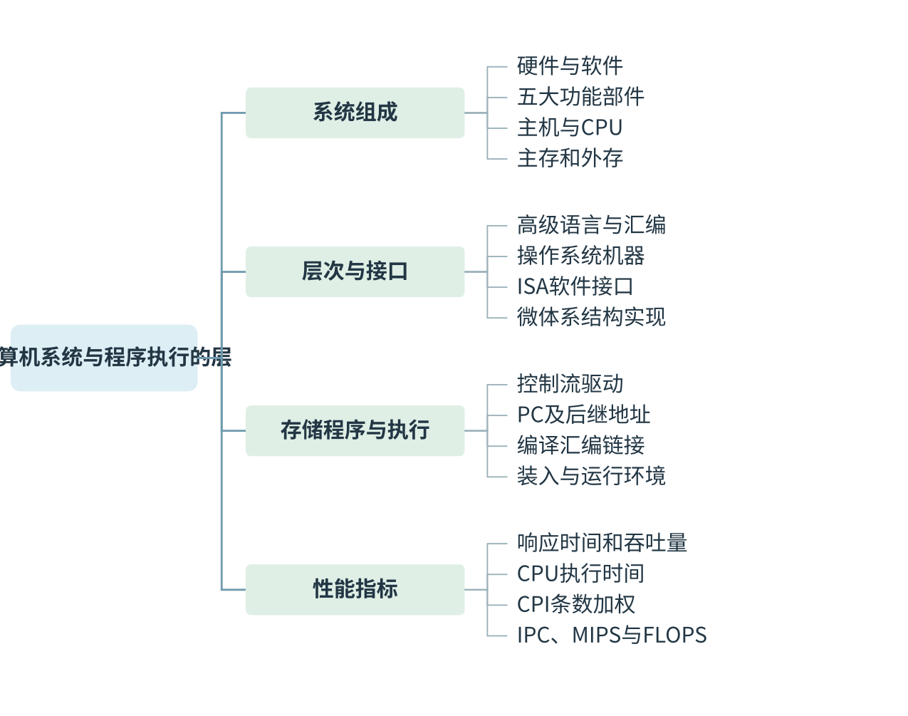
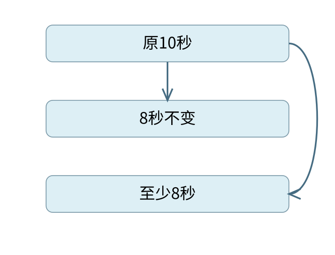

# 计算机系统与程序执行的层次 {#CO01}

[可编辑SVG](figures/map-01.svg)

[可编辑SVG](figures/map-02.svg)

本章围绕“系统组成 → 层次与接口 → 存储程序与执行 → 性能指标 → 优化与边界”展开。先判断对象与条件，再沿机制推导结果，最后用反例和数值检验结论。

## 从程序看计算机的功能部件 {#CO01-02}

> **课程连接 · 功能部件接到数据通路**
>
> 把 c=a+b 分成取a、取b、相加、存c后，第5章会逐步标出寄存器传送和控制信号。这里的功能划分仍成立；一块芯片可以同时实现多种功能，不能按芯片数倒推五部件。

::: {.definition title="概念与适用对象"}

计算机系统由硬件和软件共同构成。硬件提供保存信息、执行运算、控制步骤和输入输出的物理装置，软件用程序和数据规定装置怎样完成任务。仅凭处理器芯片无法判断一个应用能否运行；还要看指令集、操作系统、库及文件格式等条件。

:::

计算机的五个基本功能部件是运算器、控制器、存储器、输入设备和输出设备。这个分类按**功能**划分，不是按芯片这一物理实体划分。CPU 通常包含运算器、控制器和寄存器，还可能集成若干级 Cache；一个存储控制器也可能集成在处理器芯片内。

| 部件 | 在执行 `c=a+b` 时做什么 |
|---|---|
| 运算器 | 对取来的两个数进行加法，形成结果及有关标志 |
| 控制器 | 解释指令，在合适时刻发出选择、读写和运算等控制信号 |
| 存储器 | 保存指令、a、b、c 及执行所需的其他信息 |
| 输入、输出设备 | 将系统外部的信息送入系统，或把系统内的结果送出 |

中央处理器 CPU 的数据通路包括寄存器、运算部件及其连接，控制器决定数据在通路上何时、向哪里流动。第5章将把一次加法展开为寄存器传送；这里先把“处理数据”和“控制步骤”分清。

主存储器能由 CPU 直接按地址访问，程序执行时所需的指令和数据通常要进入主存。磁盘、SSD 等外存提供较大且非易失的存储空间；文件保存在磁盘，并不意味着 CPU 每执行一条指令都直接向磁盘取一次。

### ISA 规定什么，微体系结构决定什么 {#CO01-03}

> **最小反例 · 同ISA不保证文件通用**
>
> 最小反例：两系统使用同一指令集，但系统调用号、动态库和可执行文件格式不同。一份应用文件仍可能无法直接运行。ISA兼容解决指令语义，运行环境兼容还需操作系统与ABI条件。

指令集体系结构 ISA 是软件可见的机器接口，规定机器指令的功能和编码、软件可见的寄存器、数据类型、寻址方式以及相关的存储访问规则。微体系结构则指在该接口约束下怎样组织与实现机器，例如采用几级流水线、怎样转发数据、Cache 怎样实现、加法器采用何种进位结构。

同一个整数加法的机器指令，可以由不同硬件通路实现。只要软件可见的效果符合 ISA，程序不必知道内部用了串行进位还是先行进位。不过，机器码能否执行还取决于运行环境；“同一 ISA”不自动保证不同操作系统的可执行文件可直接互用。硬件与软件能实现相同逻辑功能，也不表示两者的时间、成本和可修改性相同。

## 存储程序怎样变成一次次指令执行 {#CO01-04}

> **不变量 · 地址单位必须统一**
>
> 顺序执行的后继地址应等于当前地址加指令占用的地址单位数。按字节编址且指令4B时加4；若题设每次只取1B，PC可逐次加1。先统一单位，才不会把局部取指步骤误作整条指令长度。

存储程序的基本思想是：执行前把程序指令和数据存入存储器，运行时自动取出指令、解释并执行。指令和数据都可以用二进制编码，机器根据当前操作和访问位置解释其含义。同一串位的“指令身份”或“数据身份”都离不开上下文。

冯·诺依曼型计算机按指令控制执行过程，常称控制流驱动。遇到转移、调用或异常中断时，下一步不再简单地取顺序地址上的指令，但仍由确定的控制机制改变执行位置。“存储程序”并不要求程序所在的存储内容在指令执行期间保持不变。

程序计数器 PC 保存指令执行所需的地址信息。最小的顺序执行过程可以写成：

1. 根据 PC 访问指令所在存储单元，取得指令。
2. 解释操作码和有关字段，取得操作数。
3. 执行运算、访存或控制转移，保存结果。
4. 按顺序地址或转移目标更新执行位置，继续取指。

这里的顺序地址增量取决于指令长度和地址单位。按字节编址、指令长4 B时，顺序地址通常增加4；不能把所有机器的 PC 更新都写成“加1”。流水线中取指、译码、执行还可能重叠，程序员看到的指令语义与内部时序应分开。

### 从 C 源文件到 CPU 能执行的内容 {#CO01-05}

> **错项排除 · 汇编符号不能直接执行**
>
> CPU读取的是按ISA编码的机器位串。汇编语言中的助记符还需编码，宏与伪指令可能展开为多条或零条机器指令。题目问“直接执行”时，应排除仅便于人阅读的符号表示。

在常见的静态编译流程中，预处理展开头文件和宏等指令；编译把高级语言转换为汇编形式；汇编把汇编指令编码成可重定位目标文件；链接合并目标文件与所需库，处理符号引用和重定位，形成可执行文件。装入程序再按可执行文件的组织方式建立进程的地址空间，准备执行入口。

汇编语句 `add` 是便于人阅读的符号，CPU 取到的是其机器编码。宏、伪指令还可能展开为零条、一条或多条机器指令。一条 C 语句也可能展开为多条指令；反过来，编译优化可能把多条 C 语句合并或删除。

### 例 1-1　硬件直接执行哪一种程序 {#CO01-06}

::: {.example title="配套例题"}

【配套例题】 计算机硬件能够直接执行的是（　）。

I. 机器语言程序　II. 汇编语言程序　III. 硬件描述语言程序

A. 仅 I　 B. 仅 I、II　 C. 仅 I、III　 D. I、II、III

:::

**解析。** 执行普通指令的硬件按 ISA 识别机器编码，因此 I 成立。汇编语言必须经过汇编，硬件描述语言用于描述和设计硬件，不能作为普通机器指令直接送入 CPU 执行。答案为 **A**。题目问的是执行接口，而不是哪种语言更接近硬件。

解释执行是另一种程序执行方式：解释器读取源程序或中间表示，并在运行时完成相应操作。实际解释器本身仍由机器指令运行。现代语言实现也可能结合解释、预编译和即时编译，不能用“高级语言都逐行解释”概括。

## 性能计算：先确定谁的时间在改变 {#CO01-07}

响应时间是从提出任务到得到结果经历的时间；吞吐量是单位时间内完成的任务量。增加处理器可以让多个独立任务同时进行，因而可能提高系统吞吐量；一个不能并行的单线程任务却不因此自动缩短执行时间。

程序的总运行时间还可能包含 I/O 等待、系统调度等。CPU 时间是 CPU 为该程序工作所花的时间。本节的基本性能式只计算指定口径的 CPU 时间：

\[
T_{\mathrm{CPU}}=\frac{N\times\overline{\mathrm{CPI}}}{f}
=N\times\overline{\mathrm{CPI}}\times T_{\mathrm{clk}}.
\]

$N$ 是实际执行的指令条数，不能用程序文件中的静态指令条数代替；$f$ 是主频，单位 Hz；$T_{\mathrm{clk}}=1/f$ 是时钟周期；平均 CPI 是每条指令平均占用的时钟周期数。若第 $i$ 类指令执行 $n_i$ 条、平均 CPI 为 $c_i$，则

\[
\overline{\mathrm{CPI}}=\frac{\sum_i n_i c_i}{\sum_i n_i}.
\]

不同类指令的 CPI 必须按条数加权平均。CPI 还受 Cache 缺失、流水线停顿等影响，并非仅由指令操作码决定。流水线稳态下 CPI 可以接近1；多发射处理器的平均 CPI 也可以小于1，这并不表示一条指令的全部处理延迟小于一个时钟周期。

### 例 1-2　主频相同，怎样由指令组成求时间 {#CO01-08}

::: {.example title="配套例题"}

【配套例题】 某计算机主频为1 GHz，程序 P 运行过程中共执行10000条指令，其中80%的指令执行平均需1个时钟周期，20%的指令执行平均需10个时钟周期。程序 P 的平均 CPI 和 CPU 执行时间分别是（　）。

A. 2.8，28 μs　 B. 28，28 μs　 C. 2.8，28 ms　 D. 28，28 ms

:::

**解析。** 条件给的是动态指令比例，先求加权平均：$0.8\times1+0.2\times10=2.8$。总周期数为 $10000\times2.8=28000$；1 GHz 对应每周期1 ns，因此 CPU 时间为28000 ns，即28 μs。答案为 **A**。百分比必须乘各类周期数，GHz 与 μs 的换算不能略去。

### 例 1-3　CPU 加快后，I/O 时间怎样处理 {#CO01-09}

> **最小反例 · 速度翻倍不等于总时减半**
>
> 最小反例：10秒任务中只有2秒可加速，即使这2秒缩短为0，总时间仍至少8秒。只有整个统计对象都按相同倍率加速，总历时才按该倍率缩短；先画出未改变的部分。
>
> 
>
> 可加速部分即使归零，总时间仍不小于8秒。

::: {.example title="配套例题"}

【配套例题】 假定基准程序 A 在某计算机上的运行时间为100 s，其中90 s为 CPU 时间，其余为 I/O 时间。若 CPU 速度提高50%，I/O 速度不变，则运行基准程序 A 所耗费的时间是（　）。

A. 55 s　 B. 60 s　 C. 65 s　 D. 70 s

:::

**解析。** “速度提高50%”是原速度的1.5倍，因此原来的90 s变为 $90/1.5=60$ s，而不是减为45 s。I/O 仍占10 s，总时间为70 s，选 **D**。

一般地，原运行时间中比例 $p$ 的部分加快为原速度的 $s$ 倍，其余不变，且两部分时间可以这样相加时，加速比为

\[
S=\frac{1}{(1-p)+p/s}.
\]

该式的上限是 $1/(1-p)$，但前提是加速部分划分和时间模型成立。若 I/O 与计算本来重叠，或并行化新增了通信与同步开销，应先画出实际时间关系，不能直接把各部分都相加。

### 比较性能时，为什么不能只看主频或 MIPS {#CO01-10}

> **课程连接 · Cache和操作系统怎样进入时间式**
>
> Cache缺失与流水线阻塞通常进入平均CPI；编译优化会改变动态指令数和组成；调度与I/O等待可能进入总历时。连接这些课程时先确认统计口径，避免把所有等待都塞入CPU执行时间。

两台机器的时间之比同时取决于指令条数、平均 CPI 和主频。相同源程序在不同 ISA、不同编译器下可能有不同的动态指令条数。即使平均 CPI 相等，也不能仅凭主频断言谁完成同一任务更快。

性能变化也应放在同一任务与同一统计口径下比较：编译优化可能同时减少动态指令条数、改变指令组成；改善 Cache 通常减少访存停顿，从而改变平均 CPI；提高主频改变每周期时间，但若伴随更多流水级或等待，CPI 也可能变化；增加核心则先要问任务能并行到什么程度。只有题干明确其他量不变时，才把时间比约成某一个因子的比例。

这些变化还对应不同系统层次。ISA 规定一条指令对软件可见的效果，编译器决定怎样用指令表达任务，微体系结构决定这些指令怎样在资源和时序上实现，操作系统决定进程可使用的运行环境与资源。问机器码能否执行，要查 ISA 和运行环境；问同一机器码为何快慢不同，要沿动态指令数、CPI、主频和等待时间寻找变化。用同一个“机器更先进”概括，无法支持具体推算。

MIPS 表示每秒执行多少百万条指令，$\mathrm{MIPS}=f/(\overline{\mathrm{CPI}}\times10^6)$；IPC 是每周期平均完成的指令数，在统计区间一致时与平均 CPI 互为倒数。MFLOPS 等指标统计浮点运算次数，与机器指令条数不是同一量。跨机器比较应优先比较同一任务的实际时间，再看指标如何解释差异。

机器字长主要反映 CPU 一次处理整数数据的基本位宽。它关系到整数表示范围和相关运算能力，但不能单独推出主存容量、总线宽度或某程序的速度。“64位机器”也不表示所有数据类型都占64位。

## 从层次图走到可核算的模型 {#CO01-model}

::: {.methodbox title="性能题四步"}

1. 写清任务和统计范围：CPU执行时间、总历时还是单位时间完成数。
2. 数动态指令，按条数加权求CPI；把GHz、ns、微秒统一。
3. 标出变化因子：指令数、CPI、主频或可并行比例；不变条件必须来自题设。
4. 用原方案回代，再检查加速后的总时间是否仍包含不可加速部分。

:::

### 为什么CPI按条数加权 {#CO01-proof}

> **不变量 · 平均值守住总量**
>
> 无论指令如何分类，平均CPI乘总动态指令数都应还原总周期数。若换一种分组后总周期发生变化，说明权重、分类或计数口径出了问题；这个回代比死记加权公式更容易排错。

::: {.proof title="从总周期数出发"}

第$i$类指令执行$n_i$条，每条占$c_i$周期，故该类总周期为$n_ic_i$；各类相加得到$C=\sum_i n_ic_i$。平均每条周期必为$C/(\sum_i n_i)$，因此权重是指令条数比例，而非各类指令所占时间比例。乘上共同的时钟周期，才得到CPU时间；若各阶段频率不同，应分阶段计算。

:::

层次结构图中的“机器”是一种抽象视角。高级语言机器依靠编译或解释实现，汇编语言机器依靠汇编工具，操作系统提供资源与服务接口，传统机器执行ISA指令，微程序机器描述某类控制器内部实现。并非所有CPU都采用微程序控制；不可把五层图误读成每个程序必经五种独立硬件。

### 从地址位数到容量 {#CO01-capacity}

> **最小反例 · 字长不能推出地址容量**
>
> 同样是32位整数处理器，可以配较小物理内存，也可以有更宽物理地址。最小反例已表明“字长32位所以最多4GiB”缺少地址位数前提。容量必须由地址数与每地址对应的单位共同确定。

若有$m$位完整地址、按字节编址且所有地址均可用，则最多可区分$2^m$个字节位置；若按$w$位字编址，容量应为$2^m\times w$位。MDR或数据总线宽度描述一次交换的数据位数，不能单独代替地址位数。以20位字节地址为例，可编址1MiB；若同为20位地址却每地址对应16位字，则可编址2MiB。

课程图中容量常按$2^{10}$递增，而频率、传输率通常按$10^3$递增。为避免含混，容量推导写成KiB/MiB或明确“本题K=$2^{10}$”；带宽则把每次字节数乘每秒次数，最后再按题设进制换单位。

### 发展历程的背景定位 {#CO01-history}

电子管、晶体管、中小规模集成电路、大规模与超大规模集成电路依次推动器件集成、可靠性和成本变化。它们帮助理解实现技术的演变；性能判断仍要回到具体任务的执行时间。教材与课件把部分发展史标为参考内容，本章保留这一背景，不以年代细节替代核心性能模型。

::: {.wideblock}

| 层次 | 向上说明什么 | 不能直接推出什么 |
|---|---|---|
| ISA | 软件可见指令与状态 | 具体流水段数、Cache组织 |
| 微体系结构 | 指令在部件和时序上的实现 | 应用跨操作系统直接兼容 |
| 操作系统 | 资源、进程与运行接口 | 所有应用可并行加速 |

:::

## 主动回忆自测 {#CO01-recall}

### 配套自测 {#CO01-11}

1. 【配套例题】程序 P 在机器 M 上的执行时间是20 s。编译优化后，P 执行的指令数减少到原来的70%，而 CPI 增加到原来的1.2倍，则 P 在 M 上的执行时间是（　）。A. 8.4 s　B. 11.7 s　C. 14 s　D. 16.8 s。
2. 原创补充：两个任务都由同一单核 CPU 各执行2 s。换成两核后，每个任务仍占用一个核执行2 s，且可同时开始。两个任务的总完成时间和单个任务的响应时间分别怎样变化？

**答案。** 1. D。主频不变，时间变为 $20\times0.7\times1.2=16.8$ s。2. 两个任务全部完成的时间从4 s降为2 s；无排队时单个任务本身的执行时间仍为2 s。该小例用于区分吞吐量改善与单任务加速。

### 遮住答案复述导图 {#CO01-recall-new}

::: {.recallcard title="主动回忆·自拟"}

1. 不看正文，画出五大功能部件，并圈出CPU与主机各自包含什么。
2. 同一ISA的两台机器为什么能执行同一类机器指令，却可能有不同CPI？
3. 一段程序CPU时间占80%，只把CPU部分加速为2倍，总加速比是多少？
4. 20位地址能否直接推出主存为1MiB？还缺哪个条件？
5. 用一句话分别说明响应时间、吞吐量、IPC和FLOPS的统计对象。

:::

### 参考答案 {#CO01-answers}

1. 五部件为输入、输出、存储、运算、控制；常见模型CPU含运算与控制及寄存器，主机还含主存。
2. ISA规定可见语义，流水线、Cache、功能部件与等待时序由具体微架构决定。
3. 原时间记1，变为$0.2+0.8/2=0.6$，加速比$5/3$。
4. 须说明按字节编址、完整20位地址均可用；已安装物理容量还可能更小。
5. 响应时间按单任务历时，吞吐按单位时间完成任务数，IPC按周期完成指令数，FLOPS按秒完成浮点运算数。
