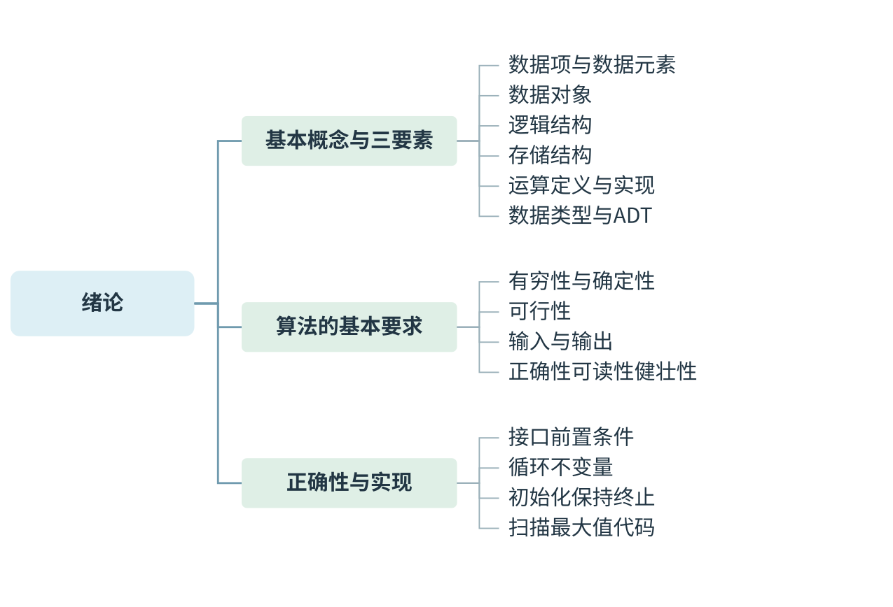
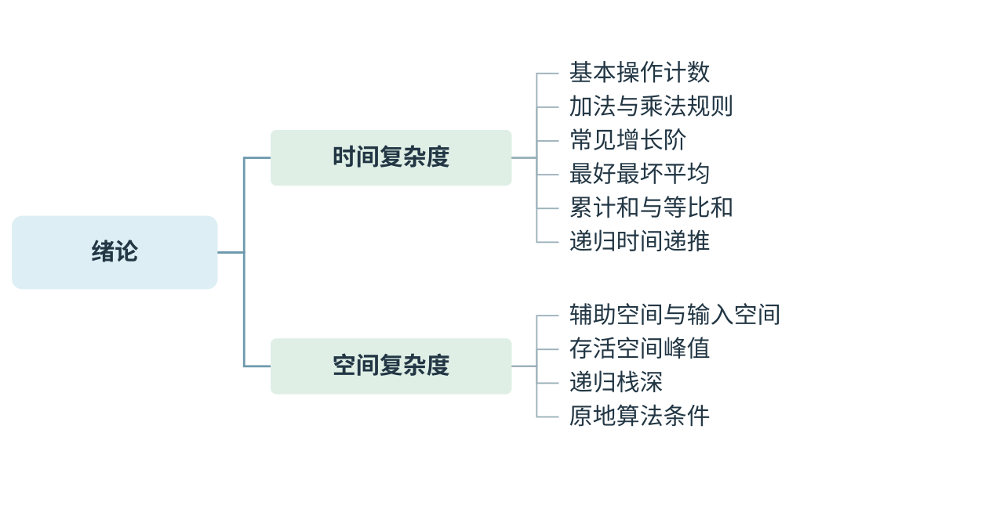
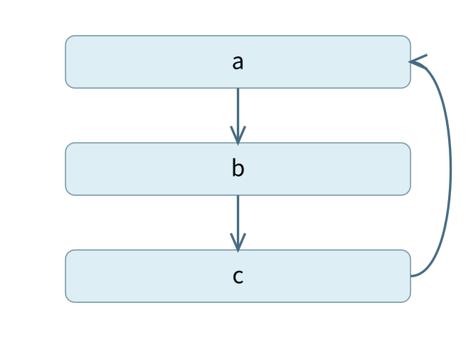

# 绪论：数据结构、算法与复杂度 {#DS01}



[可编辑SVG](figures/map-01.svg)



[可编辑SVG](figures/map-02.svg)

本书中，$n$ 表示输入规模。数组默认从 0 开始编号；线性表的“第 $i$ 个元素”默认采用从 1 开始的位序，二者同时出现时会写明对应关系。指针变量保存结点地址，`p->next` 是 `p` 所指结点的后继指针域；`p=NULL` 表示 `p` 当前不指向任何有效结点。伪代码中的赋值号 `=` 不表示数学等式，循环边界和执行顺序同样是算法的一部分。

## 逻辑关系怎样落实到存储 {#DS01-01}

**数据元素**是数据的基本单位，一个元素可由若干数据项组成。例如一条学生记录是一个元素，学号和姓名是它的数据项。**数据对象**是性质相同的数据元素的集合。讨论数据结构时，还必须说明元素之间的关系：是排成先后序列，形成父子层次，还是由任意边相连。

**逻辑结构**描述元素之间的逻辑关系，不涉及具体地址。集合结构没有规定元素间的先后关系；线性结构中，除首尾元素外，每个元素都有一个直接前驱和一个直接后继；树形结构表达层次；图结构表达更一般的关联。栈和队列都以线性关系为基础，但允许的操作位置不同，因此属于不同的抽象数据类型。

**存储结构**是逻辑结构在计算机中的表示。顺序存储用相邻位置体现关系，链式存储用指针联系结点，索引存储另建索引以定位元素，散列存储由关键字计算位置。四者都只是表示方法，不能把“线性结构”直接等同于“连续地址”。线性表既能顺序存储，也能链式存储。

### 例 1-1　值以外还要存什么 {#DS01-ex1}

::: {.example title="配套例题"}

〖1.1-005〗 在存储数据时，通常不仅要存储各数据元素的值，还要存储（　）。

A. 数据的操作方法　B. 数据元素的类型　C. 数据元素之间的关系　D. 数据的存取方法

:::

**解析。** 若只保存若干值，就无法区分这些值原本属于一个序列、一棵树还是一张图。存储结构必须表达元素间的关系，答案为 **C**。关系未必另占一个专门字段：数组的相邻位置已隐含先后，链表则用指针显式记录后继。

运算的定义与实现也要分开。线性表的“按位序取值”是一种抽象运算；在数组上用下标访问、在链表上顺指针查找，则是两种实现。选择存储结构时，要同时考虑需要保存的关系和需要执行的运算，不能只看对象包含多少个元素。

**抽象数据类型（ADT）**把数据对象、关系和允许的操作合在一起描述，而不限定具体的机器实现。例如，栈规定 `push`、`pop` 及后进先出语义；顺序栈和链栈都能实现这一约定。

## 算法怎样保证结束并得到正确结果 {#DS01-02}

> **错项排除 · 有穷不等于很快**
>
> 执行2的n次方步，只要对每个合法有限n都能结束，仍可满足有穷性。可行性也不是“考试规模下跑得快”；先判基本特性，再评价实际效率，不要混用两个层次。

算法是求解一类问题的有限操作序列，通常要求有穷性、确定性、可行性、输入和输出：对合法输入，执行有限步后结束；每一步含义明确，并能在有限时间内完成；可以有零个或多个输入，至少有一个输出。输出不限于屏幕打印，也可以是返回值或修改后的数据状态。

算法的有穷性针对**每一次合法输入**。运行时间很长，仍可能满足有穷性；没有终止条件的服务程序可以是有用的程序，却不属于这里所说的有限求解算法。可行性要求操作能够执行，并不要求它在现实规模下足够快。正确、可读、健壮以及时空效率是进一步评价设计的维度；“必须具备的特性”与“希望达到的设计质量”属于不同层面的问题。

证明循环正确性，可以找一个每轮前后都保持的关系，称为**循环不变式**。例如，依次扫描数组求最大值：处理前 $i$ 个元素后，`max` 等于这 $i$ 个元素的最大值。证明分三步：初始化时说明该关系为何成立；每轮用下一个元素更新后说明它仍成立；终止时 $i=n$，由不变式可知结果覆盖了全体元素。此外还要说明循环变量不断接近边界，以排除关系成立却永不终止的程序。

空表、单元素、重复元素和查找失败都不是额外装饰。若把初始化写成 `max=A[0]`，输入规模就必须满足 $n\ge1$；若允许空数组，应另行约定失败时的返回值，不能继续访问 `A[0]`。

## 怎样由执行次数得到时间复杂度 {#DS01-03}

> **错项排除 · 上界可以不紧**
>
> 线性时间当然满足O(n²)，但选择题通常要求紧数量级。若求和结果是1+2+4+⋯，用最大项乘项数会得到合法却不紧的上界；还要检查能否消去多余的对数因子。

实际运行时间受机器、编译器和输入分布影响。比较算法的增长规律时，先选择一种基本操作，统计它的执行次数 $T(n)$，再研究 $n$ 增大时的数量级。本书采用单位成本模型：定长整数的比较、赋值及一次数组访问都视为常数时间。若整数位数随输入增长，或者需要访问外存，这个假设就要重新检查。

$T(n)=O(f(n))$ 给出渐近上界；$T(n)=\Omega(f(n))$ 给出渐近下界；上下界同阶时记为 $\Theta(f(n))$。选择题通常用 $O$ 表示所要求的紧数量级。$3n^2+7n+9=\Theta(n^2)$：当规模足够大时，低次项和常数因子都不会改变增长阶。把 $O(n)$ 写成 $O(2n)$ 并没有更精确地给出渐近阶。

### 先看循环变量如何变化 {#DS01-detail1}

`i++` 经过 $n$ 次增长到 $n$；`i*=2` 则约经 $\log_2n$ 次到达循环边界。分析嵌套循环时，不能只数层数。若内层范围依赖外层变量，应先写出每轮次数再求和。例如：

```text
for i = 1 to n:
    for j = 1 to i:
        执行一次基本操作
```

总次数为 $1+2+\cdots+n=n(n+1)/2$，所以是 $\Theta(n^2)$。外层和内层各有一个变量，并不意味着次数总是 $n\times n$；本例只是恰好达到平方阶。

### 例 1-2　循环由累计和决定何时停止 {#DS01-ex2}

> **不变量 · 累计值与轮数不同**
>
> 第k轮结束时sum=k(k+1)/2，循环次数是满足停止不等式的最小k。sum约等于n不代表循环n次；每轮增量逐步变大，正是平方根阶出现的原因。

::: {.example title="配套例题"}

【2017】 下列函数的时间复杂度是（　）。

```c
int func(int n) {
    int i=0, sum=0;
    while (sum<n) sum += ++i;
    return i;
}
```

A. $O(\log n)$　B. $O(n^{1/2})$　C. $O(n)$　D. $O(n\log n)$

:::

**解析。** 条件检查的是 `sum`，应先把它写成循环次数的函数。执行 $k$ 轮后，`i=k`，$\mathrm{sum}=1+2+\cdots+k=k(k+1)/2$。终止时，$k$ 是满足 $k(k+1)/2\ge n$ 的最小非负整数，即

$$k=\left\lceil\frac{\sqrt{1+8n}-1}{2}\right\rceil.$$

每轮只做常数次操作，故 $k=\Theta(\sqrt n)$，答案为 **B**。`sum` 最终约为 $n$，不能据此推出执行了 $n$ 轮——每轮的增量本身也在增长。分析按题目给定的整数模型进行；实际实现还应防止固定字长溢出。

### 例 1-3　两层循环为什么仍是线性时间 {#DS01-ex3}

> **不变量 · 先列每轮工作量**
>
> 外层i取1、2、4等值，内层工作量恰与i相同。用等比和可知所有小轮之和仍受末轮的常数倍控制；“两层循环”没有提供平方阶的充分条件。

::: {.example title="配套例题"}

【2022】 下列程序段的时间复杂度是（　）。

```c
int sum=0;
for (int i=1; i<n; i*=2)
    for (int j=0; j<i; j++)
        sum++;
```

A. $O(\log n)$　B. $O(n)$　C. $O(n\log n)$　D. $O(n^2)$

:::

**解析。** 外层的取值为 $1,2,4,\ldots,2^k$，其中 $2^k<n\le2^{k+1}$。各轮内层次数正好为这些值，总计

$$1+2+4+\cdots+2^k=2^{k+1}-1.$$

该和小于 $2n$，而当 $n>1$ 时又不小于 $n$ 的某个常数倍，故为 $\Theta(n)$，答案为 **B**。若把每一轮都估成最后一轮的 $O(n)$，再乘以外层轮数，得到的只是不紧的 $O(n\log n)$ 上界，忽略了前几轮内层规模很小这一事实。

### 最好、最坏与平均情况在比较什么 {#DS01-detail2}

线性查找长度为 $n$ 的表：目标在首位时比较 1 次；在末位或不存在时，通常比较 $n$ 次。这是相同规模下不同输入造成的差异。**最坏时间**取规模为 $n$ 的合法输入中的最大执行次数；**最好时间**取最小；**平均时间**还须说明输入的概率分布。不能把“平均”直接理解为最好与最坏的算术平均。

若 $n$ 个元素被查找的概率相同，并且保证查找成功，则顺序查找的平均比较次数为 $(n+1)/2$。若还可能失败，就要把失败概率及其代价计入；第7章将按查找模型分别计算。

递归算法先写出递推关系。例如，若每次只递归求解规模为 $n-1$ 的一个子问题，并做常数工作，则 $T(n)=T(n-1)+\Theta(1)=\Theta(n)$。若产生两个规模为 $n/2$ 的子问题，并在本层做线性合并，则 $T(n)=2T(n/2)+\Theta(n)$：每层总工作为 $\Theta(n)$，约有 $\log_2n$ 层，总时间为 $\Theta(n\log n)$。不能只看到规模减半就写成对数时间；每层有多少个子问题同样决定总量。

## 辅助空间中为何要计入递归栈 {#DS01-04}

**辅助空间复杂度**衡量算法运行时所需的额外空间随输入规模增长的情况，一般不计输入本身占用的空间；题目对输出区是否计入另有约定时，按题意处理。本书比较排序时把归并辅助数组计入额外空间，不重复计算原数组。

几个循环变量只占 $\Theta(1)$ 空间，循环执行一万次也不需要同时保存一万个变量。相反，递归调用尚未返回时，调用记录必须同时保留参数、返回位置和局部状态。递归求和每层只用常数空间，但同一时刻最多存在 $n$ 层调用，因此辅助空间为 $\Theta(n)$；时间与空间同阶只是这个例子的特点，并非所有递归都如此。

若一次调用先处理左半、返回后再处理右半，左右子树的递归调用就不会全程同时展开。二叉树遍历的调用总数为 $\Theta(n)$，最大栈深为树高 $h$，故递归辅助空间是 $O(h)$。完全二叉树中 $h=\Theta(\log n)$；单支链中 $h=\Theta(n)$。这里不能用“访问了 $n$ 个结点”代替“同时保留了多少层状态”。

**原地算法**通常允许常数个辅助单元。只数递归代码中有几个显式变量而忽略调用栈，就可能误判为原地算法。快速排序即使在原数组上划分，递归栈仍要计入：普通实现平均 $O(\log n)$，最坏 $O(n)$；第8章会解释两者分别对应怎样的划分。

## 由导图辨清对象、结构、类型与运算 {#DS01-map}

> **课程连接 · 同一关系，多种表示**
>
> 操作系统的空闲块可用位图或链表记录，表达的都是“哪些块可用”。更换表示会改变定位和更新代价。复习时把逻辑关系与地址表示分开，才能解释同一功能为何有不同算法。

> **最小反例 · 链式不等于树**
>
> 三个结点a→b→c→a可以构成循环单链表的物理链接，链接图含环，不能据此认定为树。采用指针联系只是存储表示；逻辑对象究竟是线性表、树还是图，还需查看关系与操作约定。
>
> 
>
> 循环链接含环，链式存储不能确定树关系

::: {.definition title="数据结构的三要素"}

一个数据结构要同时回答：对象中有哪些元素，元素之间是什么逻辑关系，需要提供哪些运算。存储结构负责把这些关系及操作落实为计算机中的表示与实现。数据项是构成元素的不可分割单位；记录由多个数据项构成，却仍可作为一个元素整体处理。

:::

数据类型由一个值的集合及定义在该集合上的操作组成。原子类型的值不再分解，结构类型的值可分解为成分；抽象数据类型进一步强调对使用者可见的对象、关系和操作语义，将实现细节藏在接口之后。逻辑结构与存储结构不是一一对应：同一逻辑结构可以有多种表示，同一种链式表示也能用于线性表、树、图。

::: {.wideblock}

| 判断维度 | 需要说明什么 | 例子 | 不能直接推出什么 |
| --- | --- | --- | --- |
| 逻辑结构 | 元素间关系 | 序列、层次、任意关联 | 是否使用连续地址 |
| 存储结构 | 地址与链接的表示 | 顺序、链式、索引、散列 | ADT允许的操作一定相同 |
| 运算定义 | 输入、输出与前后条件 | 取第i个元素、插入 | 具体执行多少次访问 |
| 运算实现 | 在已定表示上怎样执行 | 数组寻址、逐结点扫描 | 另一种表示下代价也相同 |

:::

## 用一个完整算法连接特性、正确性与代价 {#DS01-code}

> **不变量 · 已处理区的最大值**
>
> 进入第i轮前，best只承诺等于前i个元素的最大值，并没有承诺覆盖未扫描区。证明每轮将承诺扩展一个元素，比直接说“循环完一定正确”多出了保持关系这一关键环节。

> **最小反例 · 零不能当通用初值**
>
> 数组只有一个元素−3时，若best初始化为0并只在出现更大元素时修改，最后返回0就出错。非空数组应从真实元素初始化；空数组另行定义失败结果。

::: {.methodbox title="先写接口契约，再写循环"}

以求数组最大值为例：合法输入为长度$n\ge1$的有效数组；返回值应等于数组中某个元素，且不小于任意元素。允许空输入时，必须把失败作为接口的一部分；不能凭空取一个数充当所有整数数组的最大值。

:::

```cpp
#include <cstddef>
bool maximum(const int* a, std::size_t n, int& answer) {
    if (n == 0 || a == nullptr) return false;
    int best = a[0];
    for (std::size_t i = 1; i < n; ++i)
        if (a[i] > best) best = a[i];
    answer = best;
    return true;
}
```

上面的C++17接口以布尔返回值区分“空数组没有最大值”和“最大值恰为0”，失败时不修改answer。若a非空，还要求它实际指向至少n个有效元素；仅检查指针非空并不能检验其可访问长度。后续指针操作同样必须满足有效结点前提。

::: {.proof title="扫描最大值的循环证明"}

进入第$i$轮前，不变量为`best=max(a[0..i-1])`。初始化$i=1$时，唯一已处理元素为$a[0]$；比较$a[i]$后取较大者，不变量扩展到前$i+1$个元素。$i$严格递增且上界为$n$，故循环终止；终止时处理全部元素，返回正确最大值。非空输入恰有$n-1$次元素大小比较，所以时间为$\Theta(n)$，额外存储为$\Theta(1)$。

:::

## 渐近分析的运算规则及适用条件 {#DS01-rules}

::: {.theorem title="加法取主阶，嵌套先计实际次数"}

若两段代码依次执行，时间为$T_1(n)+T_2(n)$，可按最大数量级归并；若一段工作被重复$k(n)$次且每次代价有统一紧界，才可直接相乘。内层范围随外层变化时，先写求和。常数底的对数只相差常数因子。

:::

常见增长次序（$c>1$为固定常数）为

$$1\prec\log n\prec n\prec n\log n\prec n^2\prec n^3\prec c^n\prec n!.$$

$O$上界并不唯一：线性算法当然也属于$O(n^2)$，但题目通常要求最紧的常见阶。最好/最坏描述同规模输入的选择，$O/\Omega/\Theta$描述函数之间的界，不能将两组概念机械配对为“O只表示最坏”。

空间必须数**同一时刻仍存活的状态**。两段代码顺序使用并释放临时数组时，峰值可取各段最大值；两个数组同时保留时才相加。循环内每轮复用一个长度$n$的临时数组，即使循环$n$轮，峰值仍为$\Theta(n)$而非$\Theta(n^2)$。递归每层若分配不同规模的数组，必须沿一条同时活跃的调用链求和，而非只用层数乘最外层空间。

## 历史错题指向的辨析 {#DS01-errors}

> **错项排除 · 效率不是唯一质量**
>
> 一个输出错误的程序即使时间和空间都很少，也没有解决目标问题。遇到用效率“全面衡量优劣”的说法，应先检查正确性等前提；正确性、可读性、健壮性不能被遗漏。

算法必须具备五项基本特性；正确性、可读性、健壮性以及时空效率则是进一步评价设计的维度。CPU实际耗时受机器与实现影响，并非只由抽象算法决定；也允许以更多空间换取更少时间。配套单选对“衡量优劣”的概括存在措辞歧义，复习时应掌握这几个层次的区别，不把时空效率当作全部质量条件。做复杂度题则先找真正的停止量，列累计和或等比和，避免将变量最终值直接当作循环次数。

## 主动回忆自测 {#DS01-check}

第1题为配套题，其余为自拟补充。先遮住答案，说明停止条件、存活空间与表示关系。

::: {.recallcard title="合上正文，沿导图复述"}

1. 【2019】设n是描述问题规模的非负整数，程序段 `x=0; while(n>=(x+1)*(x+1)) x=x+1;` 的时间复杂度是（　）。A. $O(\log n)$　B. $O(n^{1/2})$　C. $O(n)$　D. $O(n^2)$
2. 一段算法循环调用一个无递归函数 $n$ 次，每次函数使用 10 个整数局部变量。仅考虑这些局部变量，辅助空间是 $O(n)$ 还是 $O(1)$？
3. 一个对象采用链式存储，能否据此断定它的逻辑结构是一棵树？
4. 数据项、数据元素、数据对象之间是什么关系？ADT是否规定必须用数组实现？
5. 算法的五项特性与正确性、健壮性有什么区别？“输入”必须从键盘读入吗？
6. 单个循环变量连续翻倍，和外层翻倍但内层执行i次，两者为什么不是同一个阶？
7. 顺序执行两段各需n个临时单元的代码，峰值空间一定是2n吗？
8. 递归每次将规模减半、每层只用常数空间，时间是否一定是对数阶？还缺什么信息？

:::

### 核对答案 {#DS01-recall-extra}

::: {.recallcard .keep title="先核条件，再核结论"}

1. **B**。次数恰为 $\lfloor\sqrt n\rfloor$：终止时 $x^2\le n<(x+1)^2$，仍为平方根数量级，但停止方程与例 1-2的累计和不同。2. $O(1)$：前一次调用返回后，局部空间可以复用。3. 不能。链式存储只是一种表示方法，线性表、树和图都可以采用。

4. 元素是处理的基本单位，由数据项组成；对象是同性质元素的集合。ADT规定抽象语义而不限定表示。
5. 五项特性描述作为有限求解算法的要求；正确性等描述设计质量。输入可由参数、已存数据等提供，并不限定交互方式。
6. 前者轮数为对数；后者基本操作数为1+2+4+⋯，是线性量级。
7. 不一定。若前段的临时空间结束后可复用，峰值只需n个量级；若两段结果必须同时保留才相加。两者渐近阶均为Θ(n)，但实际峰值不同。
8. 还要知道每层产生几个子问题、每个调用做多少非递归工作。两个半规模递归和一个半规模递归具有不同调用总量。

:::
