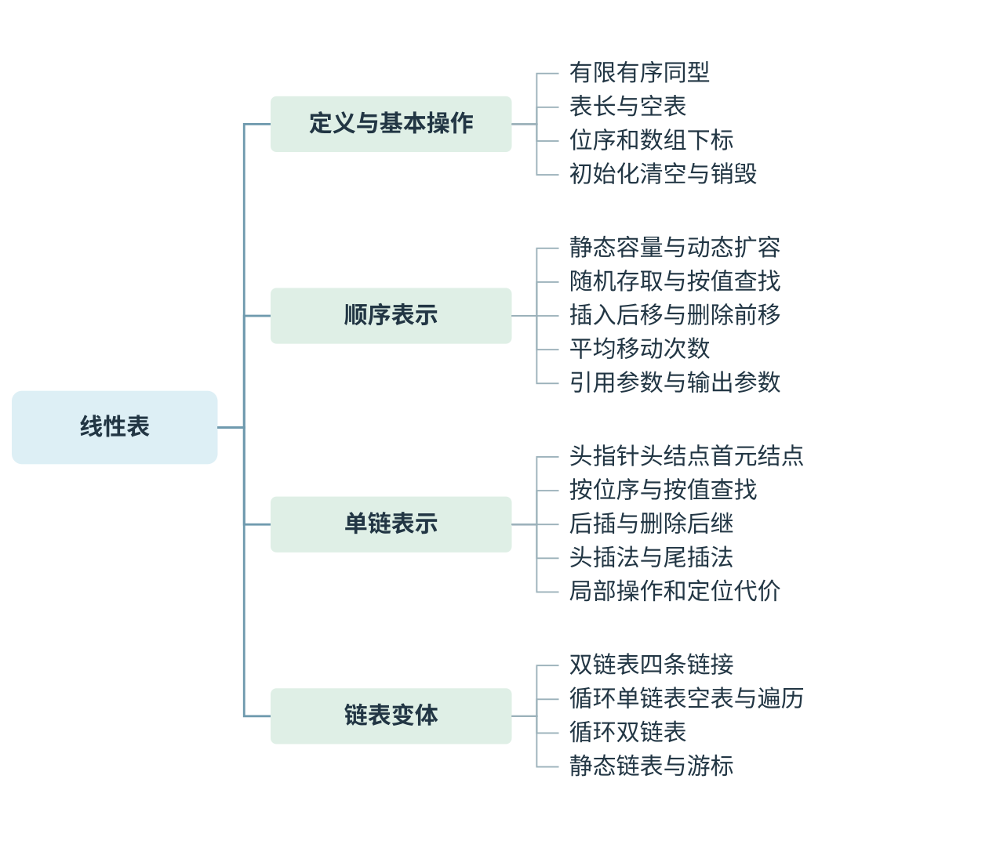
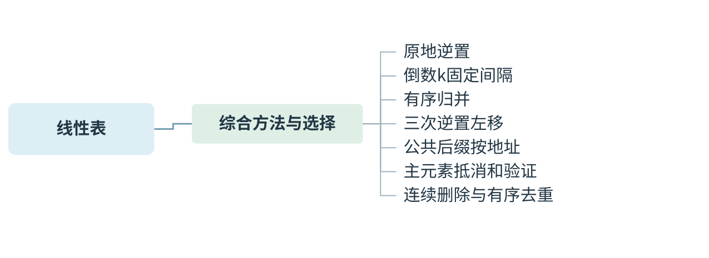
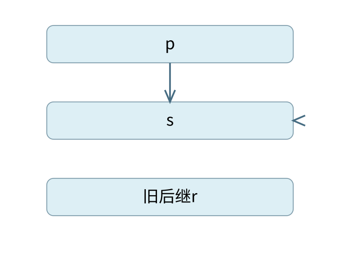
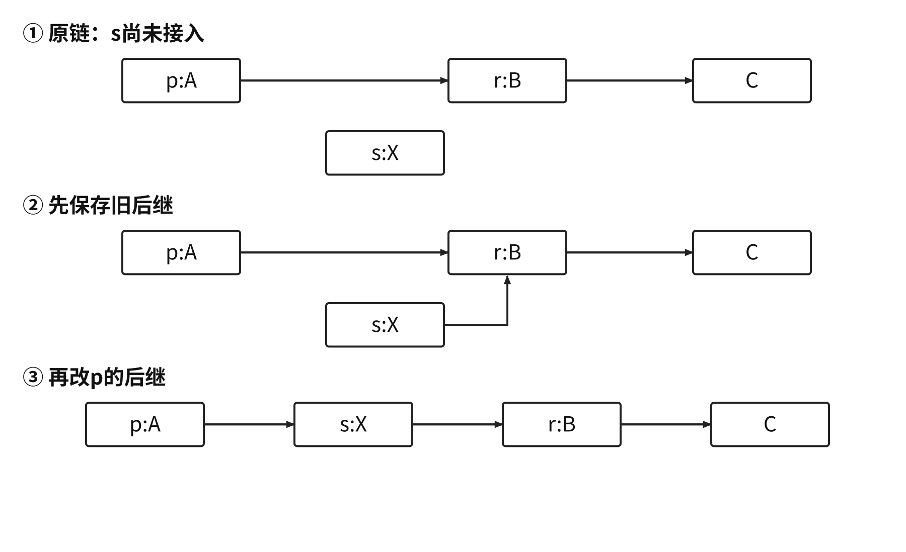
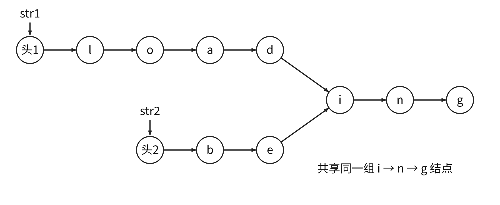

# 线性表：顺序表示、链式表示与算法 {#DS02}



[可编辑SVG](figures/map-01.svg)



[可编辑SVG](figures/map-02.svg)

同一个线性表可以放在连续数组中，也可以由分散的结点连接起来。前者依靠数组下标定位，插入和删除常要搬移元素；后者把先后关系放在链接中，定位常要逐结点进行。分析操作复杂度时，必须把“找到位置”和“修改结构”分别计算。

## 位序、下标和基本操作 {#DS02-01}

> **最小反例 · 容量不等于表长**
>
> 容量为100的数组可以表示空表，此时length=0；也可只保存一个元素。仅给数组上界不能推断有效元素数。插入判断必须同时检查位序是否合法与是否尚有空位。

线性表是具有相同数据类型的 $n$ 个元素的有限序列。$n=0$ 时为空表。非空表的第一个元素没有直接前驱，最后一个没有直接后继，其余元素各有一个直接前驱和一个直接后继。这里的“相同类型”不要求元素的值互不相同。

长度为 $n$ 的表，已有元素的位序是 $1\sim n$；在第 $i$ 个位置插入新元素，合法范围是 $1\le i\le n+1$。最后一个位置表示追加。若用 `A[0..n-1]` 保存，位序 $i$ 对应下标 $i-1$。查找失败的信号不能与下标 0 混淆，例如按位序返回 0 表示失败，或按下标返回 −1 表示失败。

本章约定单链表有头结点 `L`，首元结点为 `L->next`。头结点用于统一第一个位置的插入与删除，不保存有效表元素；**头指针**是指向它的指针变量，二者不是同一对象。无头结点的版本也可以实现相同运算，但修改第一个结点时必须能够修改头指针。

## 顺序表的寻址、插入和删除 {#DS02-02}

> **错项排除 · 随机存取不等于随机查值**
>
> 顺序表给定位序后可用地址公式直接访问；只给目标值时，尚不知道它在哪个位置。无序表按值查找仍需逐个比较，不能把随机访问的O(1)套到所有查找上。

若每个元素占 $w$ 个地址单位，首元素地址为 $b$，则第 $i$ 个元素地址为 $b+(i-1)w$。计算地址只需常数次算术运算，故可随机存取。“随机”指任意位置可以直接定位，与随机数无关。按值查找仍要比较元素，未排序时通常需要 $O(n)$ 时间。

在下标 $k$ 处插入，要把 `A[k..n-1]` 各后移一位；必须**从后向前**移动，否则后一个元素可能已被前一个覆盖。删除下标 $k$ 的元素，则把 `A[k+1..n-1]` 各前移一位，按从前向后的顺序执行。

```text
insert(A, n, capacity, k, x):
    if k<0 or k>n or n==capacity: return false
    for j=n down to k+1: A[j]=A[j-1]
    A[k]=x
    n=n+1
    return true
```

插入移动 $n-k$ 个元素，追加时为 0；删除移动 $n-k-1$ 个元素，删除末元素时为 0。等概率在 $n+1$ 个插入位置选择时，平均移动 $n/2$ 个；等概率删除 $n$ 个已有元素时，平均移动 $(n-1)/2$ 个。平均数的分母不同，来自合法位置数不同。

### 例 2-1　没有给存储方式时能否确定移动数 {#DS02-ex1}

> **错项排除 · 不搬移不等于常数时间**
>
> 链表删除可只改链接，不需要移动其他元素的数据；但若还要从头定位前驱，操作总时间依然可能为线性。做题先拆分定位成本和局部结构修改成本。

::: {.example title="配套例题"}

〖2.3-012〗 在线性表 $a_0,a_1,\ldots,a_{100}$ 中，删除元素 $a_{50}$ 需要移动（　）个元素。

A. 0　B. 50　C. 51　D. 0 或 50

:::

**解析。** 题目没有限定存储方式。顺序表中，后面的 $a_{51}\sim a_{100}$ 共 50 个元素前移；链表中改变链接即可，无需搬移其他结点的数据，故答案为 **D**。删除前若还要从头寻找该结点，链表访问时间仍可能是 $O(n)$；“不移动数据”不等于“全过程常数时间”。

静态数组的容量固定，不意味着表长固定。动态数组可以在空间不足时申请更大的连续区并搬移旧元素，但单次扩容可能需要 $O(n)$ 时间；分析某一次插入时不能忽略这次复制。

## 顺序表的完整状态与核心实现 {#DS02-code-seq}

> **不变量 · 搬移保护未读区**
>
> 插入向后搬移时，从后往前处理能确保源元素尚未被覆盖；删除向前搬移则从前往后读。记住需要保护的未读区，就能由目标下标推回正确循环方向。

::: {.definition title="表长、容量和初始化"}

顺序表的状态不只是数组，还包括当前有效长度。容量是最多容纳的元素数，表长是已经存放的元素数，满足$0\le length\le capacity$。初始化令表长为0；清空只撤销有效元素，销毁还要按存储方式释放资源。静态数组离开作用域由语言回收，动态申请区则按分配方式释放。

:::

下例统一使用C++17、位序从1开始，内部数组从0开始。`L`以引用传入，是为了修改调用者的表长和元素；删除的输出参数仅在成功时被赋值。

```cpp
constexpr int CAP = 100;
struct SeqList { int data[CAP]; int length = 0; };
bool insertAt(SeqList& L, int pos, int x) {
    if (pos < 1 || pos > L.length + 1 || L.length == CAP)
        return false;
    const int k = pos - 1;
    for (int j = L.length; j > k; --j)
        L.data[j] = L.data[j - 1];
    L.data[k] = x;
    ++L.length;
    return true;
}
```

```cpp
bool eraseAt(SeqList& L, int pos, int& removed) {
    if (pos < 1 || pos > L.length) return false;
    const int k = pos - 1;
    removed = L.data[k];
    for (int j = k; j + 1 < L.length; ++j)
        L.data[j] = L.data[j + 1];
    --L.length;
    return true;
}
```

::: {.proof title="为什么移动方向不能互换"}

插入时，待保留的旧元素位于$A[k..n-1]$。从后向前移，在写入$A[j]$时，旧$A[j]$已经被保存到更后的位置；因此不会丢失仍需搬移的元素。若从前向后做$A[j+1]=A[j]$，旧$A[j+1]$会在下一轮读取之前被覆盖。删除正好相反，目标地址比源地址小，故从前向后移动能保护未读的旧后缀。

:::


## 单链表：先保留哪条链接 {#DS02-03}

> **最小反例 · 两句交换会丢链**
>
> p原后继为r。若先写p->next=s，再写s->next=p->next，第二句读到的是s，形成自环，r不再可从p到达。先暂存旧链接，是所有原地指针改写的基本纪律。
>
> 
>
> 错误顺序使s自环，旧后继r不可达

结点由数据域与后继指针域构成。不同结点不要求物理相邻；同一个结构体结点所含的各域作为一个整体分配，因此不能把“结点之间地址分散”误说成“一个结点内部各域随意分散”。为了读取第 $i$ 个元素，须从链头沿 `next` 走 $i-1$ 步，所以链表不支持按位序的常数时间随机访问。

已知有效结点 `p`，在其后插入新结点 `s`：先令 `s->next=p->next` 保存旧后继，再令 `p->next=s`。若先把 `p->next` 改成 `s`，随后从 `p->next` 取得的已不是旧后继，可能产生自环并丢失后半链。

{#ds-fig-list-insert width=94%}

删除 `p` 的后继时，先检查 `p->next!=NULL`，再用 `q=p->next` 暂存待删结点，执行 `p->next=q->next`，最后释放 `q`。释放后不能继续读取 `q->next`。若只给待删结点的指针而不给其前驱，通常还要从头寻找前驱；用“复制后继数据再删后继”的办法不适用于尾结点，还可能改变题目要求保留的结点身份。

头插法不断把新结点接到头结点之后，输入次序会逆转；尾插法保存尾指针，每次接到尾部，能保留输入次序。两者若都维护所需指针，建立 $n$ 个结点的链表均为 $O(n)$；若每插入一个元素都重新从头找尾部，才会累积到 $O(n^2)$。

### 原地逆置：未处理部分不能丢 {#DS02-detail1}

维护 `prev` 为已逆置部分的新首结点，`cur` 为未处理部分的首结点。每次先暂存 `nxt=cur->next`，再把 `cur->next` 指向 `prev`，随后推进两个工作指针。

```c
void reverseList(Node *L) {       // 带头结点
    Node *prev=NULL, *cur=L->next;
    while (cur!=NULL) {
        Node *nxt=cur->next;
        cur->next=prev;
        prev=cur;
        cur=nxt;
    }
    L->next=prev;
}
```

每轮只移动一个结点到逆置区。空表时循环不执行，头结点仍指向空；单结点时其 `next` 仍为空。时间 $\Theta(n)$，辅助空间 $\Theta(1)$。递归逆置虽然也能线性运行，却要保留递归栈，不能与迭代实现的空间混算。

### 例 2-2　如何一次扫描找到倒数第 $k$ 个结点 {#DS02-ex2}

> **不变量 · 固定间隔保持到尾**
>
> fast先走k步后，两指针始终相隔k条后继步。当fast到空位置时，slow距空位置也恰为k步，故指向倒数第k个结点。先走阶段遇空可直接识别k超过表长。

::: {.example title="配套例题"}

配套例题：已知一个带有表头结点的单链表，结点结构为 `data | next`，只给出了头指针 `list`。在不改变链表的前提下，设计尽可能高效的算法，查找倒数第 $k$ 个位置上的结点（$k$ 为正整数）。若成功，输出该结点的 `data` 值并返回 1；否则只返回 0。要求说明设计思想、实现步骤，并用 C、C++ 或 Java 描述算法，在关键处加注释。

:::

**解析。** 倒数位置由尾部决定，但链表不能直接向前访问。让两个指针保持固定间隔：`fast` 先从首元结点前进 $k$ 步，再让 `fast` 与 `slow` 同步前进。若表长为 $n$，`fast` 到达空位置时共走了 $n$ 步，`slow` 只走了 $n-k$ 步，正好指向第 $n-k+1$ 个结点。

```c
int searchK(Node *list, int k) {
    if (k<=0) return 0;
    Node *fast=list->next, *slow=list->next;
    for (int j=0; j<k; ++j) {
        if (fast==NULL) return 0;   // 表长不足 k
        fast=fast->next;
    }
    while (fast!=NULL) {
        fast=fast->next;
        slow=slow->next;
    }
    printf("%d", slow->data);
    return 1;
}
```

以长度 5、$k=2$ 为例，先让 `fast` 指向第3个结点，`slow` 留在第1个；同步经过“4与2—5与3—空与4”，第4个即倒数第2个。$k=n$ 时第一阶段恰好走到空位置，第二阶段不执行，返回首元结点；$k>n$ 时在第一阶段报失败。两个指针合计走 $O(n)$ 步，辅助空间 $O(1)$，没有修改任何链接。

## 双链表、循环链表与静态链表 {#DS02-04}

双链表为每个结点增加 `prior`，以便从当前结点访问直接前驱。已知 `p` 后，删除 `p` 可在 $O(1)$ 时间内同时接好两侧；但这不消除按位序寻找 `p` 的成本。

### 例 2-3　把结点插到双链表结点之前 {#DS02-ex3}

> **最小反例 · 旧前驱必须还能取得**
>
> 只有r、p两个相邻结点时，在p前插q的最终关系是r↔q↔p。若第一句覆盖p->prior，之后再从它读取就失去r；四条目标链接全部成立才算插入完成。

::: {.example title="配套例题"}

〖2.3-015〗 在双链表中向 `p` 所指的结点之前插入结点 `q`，正确操作是（　）。

```text
A. p->prior=q; q->next=p;
   p->prior->next=q; q->prior=p->prior;
B. q->prior=p->prior; p->prior->next=q;
   q->next=p; p->prior=q->next;
C. q->next=p; p->next=q;
   q->prior->next=q; q->next=p;
D. p->prior->next=q; q->next=p;
   q->prior=p->prior; p->prior=q;
```

:::

**解析。** 假设 `p` 有有效前驱（可以是头结点）。记旧前驱为 `r`，结果必须同时满足 `r->next=q`、`q->prior=r`、`q->next=p`、`p->prior=q`。D 在最后才修改 `p->prior`，因此前三句还可以取得旧前驱，答案为 **D**。A 的第一句过早覆盖旧前驱；B 最后把 `p->prior` 设成了 `p` 自身；C 既改错方向，又使用尚未设置的 `q->prior`。

写程序时也可先 `q->prior=p->prior; q->next=p;`，再改两侧结点的链接。若 `p` 是不带头结点链表的首元结点，前驱为空，须单独更新头指针，不能直接解引用这个空前驱。

**循环单链表**把尾结点的 `next` 指回链头。带头结点时，空表满足 `L->next==L`；`L==NULL` 只说明没有有效头结点，并非这个模型的空表条件。遍历应在重新遇到头结点时结束，而不是等待 `NULL`。

只给尾指针 `rear` 的无头循环单链表，可以用 `rear->next` 取得首元结点；两个非空循环单链表头尾相接时，交换各尾部的后继链接即可完成 $O(1)$ 拼接。若只给头指针且没有尾链接，要先找到尾部，通常需要线性时间。若存在头结点，拼接时须处理多余头结点，不能把它当作数据留在两表之间。

循环双链表的头结点同时连接首尾，空表时 `next` 与 `prior` 都指回头结点。**静态链表**用数组保存结点，用整数下标代替机器指针；逻辑后继由游标决定，不要求结点下标相邻。还须维护空闲结点链或其他管理空闲位置的结构，数组开得大不等于每个位置都是有效数据。

## 双指针、归并与原地处理 {#DS02-05}

这些方法把题目的约束变成指针之间的不变关系。使用前先确认能否修改原数据、是否有序、是否共享结点，以及是否需要保留重复元素。

### 例 2-4　数组循环左移怎样避免反复搬移 {#DS02-ex4}

::: {.example title="配套例题"}

配套例题：将 $n\ (n>1)$ 个整数存放在一维数组 $R$ 中。设计一个时间、空间都尽可能高效的算法，将序列循环左移 $p\ (0<p<n)$ 个位置，即把 $(X_0,\ldots,X_{n-1})$ 变为 $(X_p,\ldots,X_{n-1},X_0,\ldots,X_{p-1})$。给出思想、C/C++ 或 Java 实现，并说明时间与空间复杂度。

:::

**解析。** 题目要求两个连续区段交换位置，同时保持各段内部次序。设前 $p$ 个元素为 $A$，其余为 $B$。分别逆置得 $A^RB^R$，再整体逆置，即得 $BA$。两个区段各被逆置两次，内部方向恢复，而相对位置交换。

```c
void reverse(int R[], int l, int r) {
    while (l<r) {
        int t=R[l]; R[l]=R[r]; R[r]=t;
        ++l; --r;
    }
}
void rotateLeft(int R[], int n, int p) {
    reverse(R,0,p-1);
    reverse(R,p,n-1);
    reverse(R,0,n-1);
}
```

例如 `abcdefgh` 左移3位，依次得到 `cbadefgh`、`cbahgfed`、`defghabc`。总交换次数不超过 $n$，时间 $O(n)$；只用常数临时变量，空间 $O(1)$。若将首元素移到末尾重复 $p$ 次，时间为 $O(np)$，当 $p$ 与 $n$ 同阶时会退化。三次逆置可处理 $p=1$ 和 $p=n-1$，无需另写搬移循环。

### 有序归并为什么可以一次扫描 {#DS02-detail2}

两个递增表的当前首元素中，较小者一定是剩余全部元素中最小的。输出它并推进对应指针，重复直到某表为空，再接上另一个表的剩余部分。合并长度为 $m,n$ 的两个表需要 $O(m+n)$ 时间；数组版本通常另开输出区，链表版本在允许破坏原表时可直接重接结点。

比较相等元素时，若希望保持原相对次序，先取左表元素。若题目要求集合并集而不是多重集合合并，则相等时只输出一次并推进两个指针；这项条件会改变算法，不能只改题目的答案。

### 例 2-5　相同后缀是相同字符还是相同结点 {#DS02-ex5}

> **错项排除 · 字符相同不等于共享**
>
> 两个结点都存字符i，也可能位于不同地址。公共后缀要求从某处起共享同一串结点，应比较指针而不是data；共享链不能再按两条独占链分别释放。

::: {.example title="配套例题"}

配套例题：采用带头结点的单链表保存单词，两个单词可共享相同后缀的存储空间。例如 `loading` 与 `being` 共享从字符 `i` 开始的结点。`str1`、`str2` 指向两个头结点，结点为 `data | next`。设计时间上尽可能高效的算法，找到共同后缀的起始结点，给出思想、程序及时间复杂度。

{#ds-fig-shared-suffix width=94%}

:::

**解析。** 共享指的是地址相同，不能以 `p->data==q->data` 判断。单链表一旦在某结点汇合，其后继也相同，所以两表从公共起点到末尾的长度相等。先各扫描一次求长 $m,n$，让较长表先走 $|m-n|$ 步，两指针便处于距表尾相同的位置；此后同步前进，第一次地址相等的位置就是答案。

```c
Node *commonSuffix(Node *str1, Node *str2) {
    int m=0,n=0;
    for (Node *p=str1->next; p; p=p->next) ++m;
    for (Node *q=str2->next; q; q=q->next) ++n;
    Node *p=str1->next, *q=str2->next;
    while (m>n) { p=p->next; --m; }
    while (n>m) { q=q->next; --n; }
    while (p!=q) { p=p->next; q=q->next; }
    return p;                   // 无公共结点时二者同时为 NULL
}
```

图中两表长度分别为7和5，先让长表跨过 `l,o`，再比较 `a` 与 `b`、`d` 与 `e`，最后到达同一个 `i`。若两表内容相同却各自分配结点，则直到空位置才相等，返回空。总时间 $O(m+n)$，辅助空间 $O(1)$，适用于有限、无环单链表。

### 例 2-6　主元素为什么还要再计数 {#DS02-ex6}

> **最小反例 · 剩下候选仍需复核**
>
> 序列1、2、3经抵消可留下3，但3只出现一次，未超过一半。抵消给出的是存在多数时的必要候选，并不证明多数存在；第二次计数补上充分性检验。

::: {.example title="配套例题"}

配套例题：整数序列 $A=(a_0,\ldots,a_{n-1})$ 满足 $0\le a_i<n$。某值出现次数超过 $n/2$ 时，称它为主元素。例如 $(0,5,5,3,5,7,5,5)$ 的主元素为5，而 $(0,5,5,3,5,1,5,7)$ 没有主元素。设计尽可能高效的算法，存在主元素时输出该值，否则输出 −1；给出思想、程序及时间、空间复杂度。

:::

**解析。** 每次删除两个值不同的元素，不会消灭一个原本占严格多数的值：若删去一个多数元素和一个其他元素，多数仍超过剩余的一半；若删去两个其他元素，多数优势更大。用一个候选值和计数模拟这种抵消。计数为0时选新候选；相同则加1，不同则减1。

```c
int majority(int A[], int n) {
    int candidate=0, count=0;
    for (int i=0; i<n; ++i) {
        if (count==0) { candidate=A[i]; count=1; }
        else if (A[i]==candidate) ++count;
        else --count;
    }
    int actual=0;
    for (int i=0; i<n; ++i)
        if (A[i]==candidate) ++actual;
    return actual>n/2 ? candidate : -1;
}
```

抵消只保证“若有主元素，最后候选一定是它”，没有保证主元素存在。例如 `1,2,3` 最后仍可能留下候选3，它只出现一次，所以必须第二次扫描核实。两个线性扫描合计 $O(n)$ 时间，额外空间 $O(1)$。题目给出的值域也允许用计数数组，但需 $O(n)$ 辅助空间；此处没有必要为省下一次扫描而付出这部分空间。

## 单链表的接口契约与基本操作 {#DS02-code-link}

> **不变量 · 头结点不随表空而消失**
>
> 有效头结点始终存在，数据结点从L->next开始。空表并不意味着L为空；统一前驱定位时pos=0对应头结点，才能让第一个位置的插入与其他位置共用同样两步链接。

::: {.methodbox title="先定位前驱，再改链接"}

把按位序插入/删除拆成两步：先从有效头结点开始走到第$pos-1$个结点，再执行局部接入或摘除。前驱定位可能是线性时间；局部链接改写是常数时间。以下代码要求链表有限、无环、结点独占所有权，头结点始终有效；共享后缀仅做只读查找，不能分别销毁两条共享链。

:::

```cpp
struct Node { int data; Node* next; };
// 返回第pos个结点；pos=0返回有效头结点。
Node* nodeAt(Node* L, int pos) {
    if (pos < 0) return nullptr;
    Node* p = L;
    while (p != nullptr && pos > 0) {
        p = p->next;
        --pos;
    }
    return p;
}
```

```cpp
bool insertNode(Node* L, int pos, int x) {
    if (pos < 1) return false;
    Node* p = nodeAt(L, pos - 1);
    if (p == nullptr) return false;
    Node* s = new Node{x, p->next};
    p->next = s;
    return true;
}
bool eraseNode(Node* L, int pos, int& removed) {
    if (pos < 1) return false;
    Node* p = nodeAt(L, pos - 1);
    if (p == nullptr || p->next == nullptr) return false;
    Node* q = p->next;
    removed = q->data;
    p->next = q->next;
    delete q;
    return true;
}
```

`new`申请失败时，标准C++抛出异常；此时接入语句尚未执行，旧链不变。上面的布尔失败只表示非法位序等接口条件失败，并没有把内存分配异常改成false。销毁独占链时逐个保存后继再`delete`，最后才释放头结点；不能混用`malloc/free`与`new/delete`。

初始化可用`Node* L = new Node{0, nullptr};`，其中头结点的data不计入表。按值查找从`L->next`开始，比较值并沿next前进；查找不存在时返回nullptr。求表长必须实际数数据结点，而不是将头结点计入。

## 结构选择与操作代价对照 {#DS02-compare}

> **课程连接 · 表示影响访问局部性**
>
> 连续数组通常能利用缓存中的相邻数据，分散结点可能增加缓存未命中。渐近复杂度相同也不保证实际用时相同；比较表示时同时检查数据规模、访问方式和存储开销。

::: {.wideblock}

| 操作条件 | 顺序表 | 单链表（有效头结点） | 选择时还需检查 |
| --- | --- | --- | --- |
| 按位序取值 | $O(1)$ | $O(n)$ | 是否要求随机访问 |
| 无序按值查找 | $O(n)$ | $O(n)$ | 值是否有序、是否另有索引 |
| 按位序插入/删除 | 最坏$O(n)$ | 定位最坏$O(n)$ | 是否已给有效前驱 |
| 已知前驱后的局部修改 | 仍可能搬移后缀 | $O(1)$ | 申请/释放与结点身份 |
| 存储开销 | 连续容量可能有空闲 | 每结点含链接域 | 局部性、碎片和最大规模 |

:::

顺序表逻辑相邻通常也物理相邻，有利于连续访问；链表用额外链接换取接入灵活性，不能由此得出“链表一定更省空间”。静态链表虽然使用数组分配结点，逻辑后继仍由游标指定，所以不具备按逻辑位序直接寻址的能力。

## 连续删除与有序去重的线性写法 {#DS02-filter}

> **不变量 · 删后检查新后继**
>
> 若当前前驱后连续两个结点都等于x，删掉第一个后马上前进，就可能跳过第二个。前驱只在保留结点时前进，才能让每个新后继都得到检查。

::: {.methodbox title="删除后留在前驱，保留后才前进"}

删除单链表所有值为x的结点时，用p指向已处理部分的最后一个保留结点。若p后继应删除，就摘除后继续检查p的新后继；否则p向前走。相邻多个x正是不能在每次删除后都移动p的原因。

:::

```cpp
void eraseAll(Node* L, int x) {
    Node* p = L;
    while (p->next != nullptr) {
        if (p->next->data == x) {
            Node* q = p->next;
            p->next = q->next;
            delete q;
        } else {
            p = p->next;
        }
    }
}
```

顺序表有序去重可让读指针从左到右扫描，写指针只扩展“已保留的互异前缀”。若当前值不同于最后一个保留值才写入；每个元素只处理常数次，总时间$O(n)$，额外空间$O(1)$。未排序数组中，相邻不重复不能保证全局不重复，不能悄悄去掉有序条件。

## 主动回忆自测 {#DS02-check}

以下为原创补充，检查边界和不变式。

1. 允许修改单链表，要求删除所有值为 $x$ 的结点。删除一个结点后，指向前驱的指针是否应立即后移？
2. 两个无环单链表长度相同，尾结点地址相同，能否断定它们一定有公共后缀？
3. 顺序表去除相邻重复元素时，为什么可用“已保留长度”作为写指针，而不必每删一个元素都搬移后半表？

**答案。** 1. 不应立即后移；新的后继还可能等于 $x$，应继续检查当前前驱的后继。只有保留一个结点时前驱才推进。2. 能；至少尾结点本身就是公共后缀，公共起点还可能更早。3. 扫描指针只读未处理区，写指针只向前形成已保留区；每个元素最多被检查和写入常数次，总时间 $O(n)$。若原表无序，这只能消除相邻重复，不能保证全表唯一。


### 补充自拟回忆题 {#DS02-recall-extra}

::: {.recallcard title="从边界恢复算法"}

4. 长度n的顺序表允许在哪些位序插入，在哪些位序删除？各自等概率模型的分母是什么？
5. 有效头结点、头指针、首元结点如何区分？带头结点空表中哪一个为空？
6. 只给单链表尾结点指针，能否总在O(1)时间内删除该结点并保留其他结点身份？
7. 主元素候选的计数归零意味着此前完全没有主元素吗？为什么最后还要核计数？
8. 两个内容相同却分别分配的单链表，公共后缀算法返回什么？适用前提是什么？

:::

::: {.solution title="补充题核对答案"}

4. 插入位序1到n+1，删除1到n；平均插入移动数除以n+1，平均删除移动数除以n。
5. 头指针是地址变量，头结点是哨兵对象，首元结点是第一个有效元素。有效头结点存在时，空表是L->next为空。
6. 不能。单链表尾结点无后继可复制，且没有直接前驱链接，通常要从头找前驱。
7. 不意味着不存在严格多数；抵消保证“若存在，最后候选是它”，不能反推候选一定占多数，必须再次扫描。
8. 返回nullptr。地址相等才表示共享，前提是有限无环单链表且头结点和链接有效。

:::
