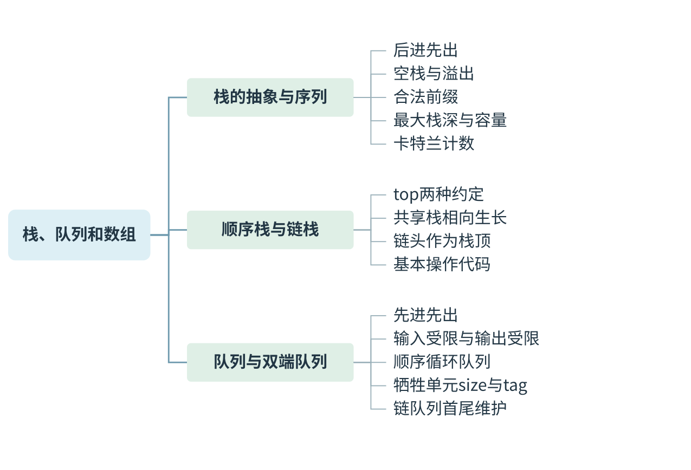
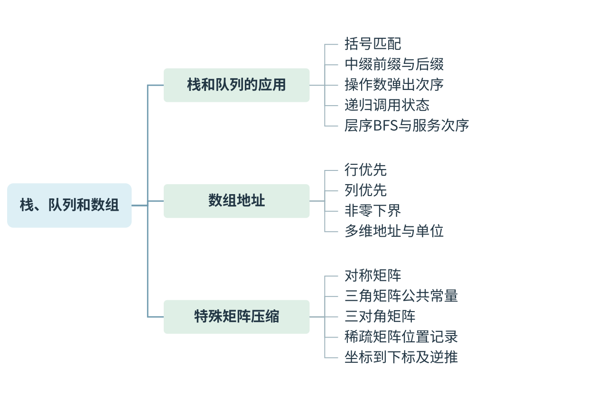
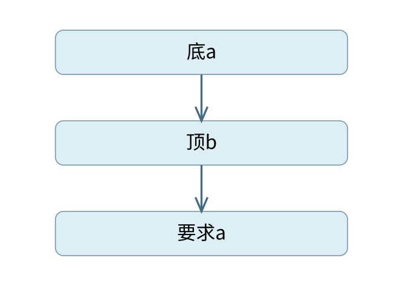
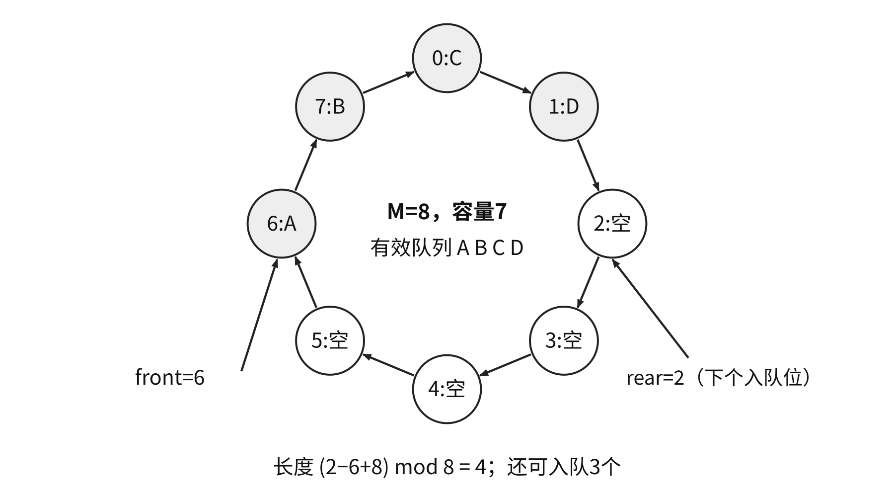

# 栈、队列和数组：状态约束与压缩存储 {#DS03}



[可编辑SVG](figures/map-01.svg)



[可编辑SVG](figures/map-02.svg)

栈与队列都保存线性序列，差别在于允许从哪一端加入和取出。判断一个操作序列是否合法，必须保留操作过程中的状态；只检查输入、输出是否含有相同元素，不能排除违反栈顶或队头约束的情况。

## 栈的后进先出与合法序列 {#DS03-01}

> **最小反例 · 数量相同仍不合法**
>
> 顺序输入a、b、c，要先输出c就必须把三者全部入栈；弹出c后栈顶为b，接着要求a便失败。输出c、a、b与输入含相同元素，却违反栈顶约束。
>
> 
>
> c已弹出，b挡在a上方

**栈**只允许在同一端插入和删除，这一端称为栈顶，另一端称为栈底。入栈称 `push`，出栈称 `pop`。栈为空时不能出栈；固定容量栈满时不能继续入栈。若中途不出栈，一批元素的出栈次序是入栈次序的逆序；若允许交替入栈和出栈，输出就可能有多种。

检验给定输出的方法是按目标逐个模拟：若当前栈顶不是所需元素，继续把尚未入栈的元素依次压入；一旦所需元素到顶，就弹出。若输入已用尽而栈顶仍不符，输出不合法。这个过程也给出实现该输出所需的最小容量，即模拟中出现的最大栈深。

### 例 3-1　队列不会改变栈的输出次序 {#DS03-ex1}

::: {.example title="配套例题"}

配套例题：栈 $S$ 和队列 $Q$ 初始均为空，元素 `a,b,c,d,e,f,g` 依次入栈 $S$。每个元素出栈后立即进入队列 $Q$，7个元素出队顺序为 `b,d,c,f,e,a,g`，则栈容量至少是（　）。

A. 1　B. 2　C. 3　D. 4

:::

**解析。** 队列保持进入它的先后次序，因此它的输出就是栈的输出。按目标模拟，栈内状态按栈底到栈顶写：

| 需要输出 | 必须先执行的入栈 | 弹出后栈内剩余 |
| --- | --- | --- |
| b | a、b | a |
| d | c、d | a、c |
| c | 无 | a |
| f | e、f | a、e |
| e | 无 | a |
| a | 无 | 空 |
| g | g | 空 |

压入 d 或 f 后，栈深达到3；表中过程也说明3个单元足够，答案为 **C**。不能把队列当作另一处可以随意调整次序的缓冲区。

若只用入栈 `I`、出栈 `O` 表示操作，一段从空栈出发并回到空栈的合法序列须满足：两类操作的总数相等，且每个前缀中 `O` 的个数不超过 `I`。对 $n$ 个不同元素，合法出栈序列数为卡特兰数 $C_n=\frac1{n+1}\binom{2n}{n}$；这一公式用于计数，不代替具体容量与给定序列的模拟。

输入为 `a,b,c,d` 时，若输出以 `c,d` 开头，弹出 c 后栈中为 a、b，随后必须压入并弹出 d，剩余只能 b、a，因此仅有 `c,d,b,a` 一种。若题目指定的是栈的输出而让输入未知，也要反推中间栈顶。例如第3个输入是1，输出从1递增，1弹出时第2个输入压在第1个输入上方；若第1个是2，就要先弹出上面的另一个值才能到2，与“接下来输出2”矛盾，所以第1个不可能是2。

## 队列与双端队列 {#DS03-02}

> **错项排除 · 双端队列要看受限端**
>
> 输入受限和输出受限双端队列是两种不同约束。普通栈的合法输出在一般双端队列中能实现，但不能倒推出任意指定输出都能实现；仍要跟踪两端状态。

**队列**只在队尾加入、在队头删除，遵循先进先出。它适合保存等待依次处理的对象，如按发现顺序等待扩展的图顶点。队头与队尾是逻辑角色，不能凭数组下标的大小判断先后：循环队列绕回后，队尾下标可以小于队头下标。

**双端队列**允许在两端插入和删除。输入受限双端队列只允许一端输入，两端均可输出；输出受限双端队列允许两端输入，只允许一端输出。判断输出时应明确属于哪一种，不能直接套普通队列或普通栈的限制。双端队列能够模拟栈与队列，但这不表示它能按任意次序输出一组顺序输入的元素。

## 顺序栈、共享栈与循环队列 {#DS03-03}

> **错项排除 · 共享栈只在相邻时满**
>
> 两栈从数组两端向中间增长，未用单元恰位于两栈顶之间。两栈顶相邻已经没有空位；等到相等才判满，就已让两个栈占用同一个位置。

顺序栈存于 `A[0..M-1]`。本书令 `top` 指向当前栈顶，初值 −1：空条件 `top==-1`，满条件 `top==M-1`；入栈为 `A[++top]=x`，出栈为 `x=A[top--]`。若题目改用“`top` 指向下一个空位”，空条件就为0，入栈与出栈的增减位置也随之改变。先画一个元素的状态，再写公式，通常比背四个表达式可靠。

两个栈共享一个数组时，可让一端从左向右长、另一端从右向左长。初值 `top1=-1, top2=M`，栈满当且仅当 `top2-top1==1`。未用空间是两栈顶之间的单元，某个栈已用多少并不单独决定全局是否栈满。入栈前必须先检查两栈顶是否相邻，不能等两个栈顶已经重合才报告满。

### 循环队列先立约定再计算 {#DS03-detail1}

采用长度为 $M$ 的数组，令 `front` 指向队头元素，`rear` 指向下一次入队位置。出队后 `front=(front+1)%M`，入队后 `rear=(rear+1)%M`。若只有这两个下标，空与完全占满都会出现 `front==rear`，无法区分。

**牺牲一个单元**时，约定空条件为 `front==rear`，满条件为 `(rear+1)%M==front`，可保存的最大元素数是 $M-1$。当前长度为

$$\mathrm{len}=(rear-front+M)\bmod M.$$

{#ds-fig-circular width=80%}

若要求 $M$ 个单元全部可用，可以增加 `size` 计数，或增加标志，区分最近一次使二者相等的是入队还是出队。此时“空”和“满”的判断依赖新增成员，不能仍照搬牺牲单元的满条件。

### 例 3-2　换了 front 含义，长度公式是否改变 {#DS03-ex2}

::: {.example title="配套例题"}

〖3.2-006〗 循环队列存于数组 `A[21]`，`front` 指向队首元素的前一个位置，`rear` 指向队尾元素。当前 `front=8, rear=3`，队列长度为（　）。

A. 5　B. 6　C. 16　D. 17

:::

**解析。** 有效元素从下标9开始，经过9至20，再经过0至3，共 $12+4=16$ 个，答案为 **C**。公式仍可写成 $(3-8+21)\bmod21=16$，是因为与前一约定相比，两个指针的含义都错开了一个位置。若只改变一个指针的含义，公式就未必不变。数组是 `A[0..n]` 时实际有 $n+1$ 个单元，取模也必须使用 $n+1$。

## 链栈与链队列 {#DS03-04}

> **不变量 · 尾指针不能悬空**
>
> 带头结点链队列始终让rear指向最后一个数据结点，空时指向头结点。删去唯一数据结点后，rear必须回到front；否则下次入队会经已释放地址写内存。

链栈通常把链头作为栈顶，头插与头删都是 $O(1)$。动态分配可随数据量申请结点，因而通常不受预先给定的小容量数组限制；但入栈仍可能因可用内存不足而失败，出栈时也仍可能遇到空栈。

单链队列把链头作为队头，链尾作为队尾，并保存两个指针。若反过来从单链表尾部删除，必须找到尾结点的前驱，出队会变为 $O(n)$。带头结点的链队列空时 `front==rear`，二者都指向头结点。入队时接到 `rear->next` 并更新 `rear`；出队时删除 `front->next`。

```text
dequeue(Q):
    if Q.front==Q.rear: return 失败
    p=Q.front->next
    x=p->data
    Q.front->next=p->next
    if Q.rear==p: Q.rear=Q.front
    释放 p
    return x
```

最后一个数据结点出队时，必须让尾指针退回头结点；否则它指向已释放的空间。非空且不止一个元素时，无需改变尾指针，所以对“删除是否修改头尾指针”这类问题，答案取决于被删除的是否为最后一个元素。

只带队首指针的非循环双链表，要在另一端入队仍需找尾部；循环双链表则可通过 `front->prior` 直接取得尾部。比较结构时，应检查有没有可到达另一端的短链接，而不是看到“双链”就认定所有操作都为常数时间。

## 多维数组的地址怎样计算 {#DS03-05}

> **课程连接 · 偏移先统一地址单位**
>
> 数组公式先数元素，再乘每元素宽度。计组中的字节编址与按字编址会改变地址单位；同样的元素偏移，在两种编址方式下不能直接共用一个数值。

数组同一维度的下标取值范围固定，每个元素大小相同。设二维数组的行下标为 $l_1\sim u_1$，列下标为 $l_2\sim u_2$，列数 $c=u_2-l_2+1$，行数 $r=u_1-l_1+1$，每元素占 $w$ 字节，首元素地址为 $b$。

按行优先时，在 $(i,j)$ 前有 $i-l_1$ 个完整行及本行的 $j-l_2$ 个元素，故

$$\operatorname{Addr}(A[i,j])=b+[(i-l_1)c+(j-l_2)]w.$$

按列优先时，先数完整列：

$$\operatorname{Addr}(A[i,j])=b+[(j-l_2)r+(i-l_1)]w.$$

例如 `A[2..4][−1..2]` 按行优先存放，每元素4字节，`A[2][−1]` 的地址为1000。`A[4][1]` 前有 $2\times4+2=10$ 个元素，字节地址为1040。下标差先得到“元素数”，最后乘元素宽度才得到字节偏移；按字编址的题则要统一成字地址再计算。

三维数组按行优先时，最右下标变化最快：`A[i][j][k]` 的相对元素位置为 $((i-l_1)n_2+(j-l_2))n_3+(k-l_3)$。可以逐维理解，不必另背一个没有下标原点的公式。

## 对称、三角、三对角与稀疏矩阵 {#DS03-06}

压缩存储利用元素间的确定关系，避免重复保存。**对称矩阵**满足 $a_{ij}=a_{ji}$，保存一侧三角即可；访问另一侧时交换 $i,j$。**三角矩阵**的三角区之外，元素全部相同，通常还要额外保存这个公共常量，它未必为0。**三对角矩阵**只在主对角线及相邻两条对角线上可能非零，共有 $3n-2$ 个需要保存的位置。

下三角按行保存、原矩阵与数组下标均从0开始时，位置 $(i,j)$（$i\ge j$）之前有 $1+2+\cdots+i=i(i+1)/2$ 个元素，故数组下标为 $i(i+1)/2+j$。若原矩阵从1开始而数组从0开始，公式相应变成 $i(i-1)/2+j-1$。推导的顺序始终是“前面完整行或列数＋本行或列内偏移”。

### 例 3-3　三对角矩阵的起止行不能一律算3个 {#DS03-ex3}

> **错项排除 · 三对角首尾行少一个**
>
> n至少为2时，首行和末行各只保存2个位置，中间行才各3个。若把第i行之前全部按3个计，会从第一行就多算；先列2+3(i−2)再加本行偏移。

::: {.example title="配套例题"}

配套例题：100阶三对角矩阵 $M$ 的元素 $m_{i,j}\ (1\le i,j\le100)$ 按行优先依次压缩存入下标从0开始的一维数组 $N$。$m_{30,30}$ 在 $N$ 中的下标为（　）。

A. 86　B. 87　C. 88　D. 89

:::

**解析。** 第一行有2个元素，第2至29行各有3个，共 $2+28\times3=86$ 个在第30行之前。第30行依次保存 $m_{30,29},m_{30,30},m_{30,31}$，目标是本行第2个，因此下标为 $86+1=87$，答案为 **B**。这里87是从0开始的下标，目标是第88个被保存的元素。

### 例 3-4　先用对称性换到实际保存的半边 {#DS03-ex4}

::: {.example title="配套例题"}

配套例题：10×10对称矩阵 $M$ 的上三角元素 $m_{i,j}\ (1\le i\le j\le10)$ 按列优先存入 C 语言一维数组 $N$。$m_{7,2}$ 在 $N$ 中的下标为（　）。

A. 15　B. 16　C. 22　D. 23

:::

**解析。** $m_{7,2}=m_{2,7}$，实际寻找第7列第2行。前6列各存 $1,2,\ldots,6$ 个，共21个；本列目标前还有第1行1个元素，所以从0开始的下标为 $21+1=22$，答案为 **C**。不能先把下三角坐标直接代入上三角公式，再试图以加减1修正。

上三角若改为按行优先，各行长度为 $n,n-1,\ldots,1$；第 $i$ 行之前有 $(i-1)(2n-i+2)/2$ 个保存位置。下三角若按列优先，各列长度同样递减，但列内偏移为 $i-j$。公式外形相近，决定它的是保存方向与下标原点。

**稀疏矩阵**的非零位置没有固定三角规律，需要连同位置一起保存。三元组顺序表记录 `(行,列,值)`，还须保存矩阵行列数与非零元数；十字链表为同一个非零元同时设置行链接和列链接。压缩后不能再按普通二维数组地址公式随机访问任意元素，查找与修改成本随表示方法而变。

## 表达式、递归与层次处理 {#DS03-07}

> **最小反例 · 括号计数看不到嵌套**
>
> ([)]中每一类左右括号数都相等，但第三个字符要求圆括号配对，栈顶却是方括号。配对必须遵守最近未完成对象先结束，不能在扫描后任意重排。

### 括号与表达式中的“最近一个尚未完成对象” {#DS03-detail2}

左括号入栈；遇右括号时，栈顶必须是对应种类的左括号，匹配后弹出；扫描完后栈必须为空。`([)]` 中括号数量相等，但遇到第一个右圆括号时栈顶为左方括号，已经失败。这个过程正好需要最后遇到且尚未配对的对象，所以选择栈。

后缀表达式中，操作数先入栈，遇二元运算符时先弹出的数是**右操作数**，后弹出的是左操作数，计算后将结果入栈。减法、除法不能颠倒。合法的二元后缀表达式在遇到每个运算符时，栈中至少有两个可用值，最终恰好留下一个结果。

### 例 3-5　弹出次序怎样影响减法 {#DS03-ex5}

::: {.example title="配套例题"}

配套例题：栈 $S_1$ 保存整数，$S_2$ 保存运算符。函数 F() 依次：（1）从 $S_1$ 弹出操作数 a、b；（2）从 $S_2$ 弹出运算符 op；（3）执行 b op a；（4）把结果压入 $S_1$。初始 $S_1$ 自底向顶为5、8、3、2，$S_2$ 自底向顶为 `*`、`−`、`+`。调用3次 F() 后，$S_1$ 栈顶值是（　）。

A. −15　B. 15　C. −20　D. 20

:::

**解析。** 第一次弹出2、3，用加法得到 $3+2=5$，整数栈变为5、8、5。第二次弹出5、8，用减法得到 $8-5=3$，栈变为5、3。第三次得到 $5\times3=15$，答案为 **B**。若第二次按弹出先后计算 $5-8$，就会得到错误的负数。

中缀转后缀可用运算符栈：操作数直接输出；左括号入栈；右括号触发输出直到匹配左括号；遇运算符时，先输出栈顶中优先级更高的运算符。对通常左结合的 `+、−、*、/`，同级也先弹出；若加入右结合运算符，同优先级的处理规则需要调整。

例如 $x+y(z-u)/v$（其中相邻表示乘法）先把括号内写成 `zu−`，乘除按左结合形成 `yzu−*v/`，最后与 x 相加，得 `xyzu−*v/+`。这里的输出顺序表达运算依赖，而不是把原式的符号按种类重新排列。

### 递归返回前保存了什么 {#DS03-detail3}

递归调用栈保存尚未完成的调用。调用树的一个结点表示一次调用，不能把函数返回值当作调用次数。对于

```c
int F(int n) {
    if (n<=3) return 1;
    return F(n-2)+F(n-4)+1;
}
```

令 $C(n)$ 表示含当前调用在内的调用次数，则 $n\le3$ 时 $C(n)=1$，否则 $C(n)=1+C(n-2)+C(n-4)$。因此 $C(4)=C(2)+C(0)+1=3$，$C(6)=1+3+1=5$，$C(8)=1+5+3=9$。式中返回值的“＋1”不是另一次函数调用；次数递推中的“＋1”是当前调用本身。此过程对应〖3.3-006〗的递归调用模型。

C/C++ 对加号两侧函数调用的求值先后并不一概保证从左到右。若题目问“第几个被调用”，应检查答案是否依赖这个先后，不能把一种习惯顺序当作语言保证。调用总数与最终结果在本例不受这个先后影响。另如〖3.3-007〗把递归式改为 `func(x-2)+func(x-4)`、基例返回2，并计算 `func(func(5))`：必须先完成内层func(5)，它和func(3)、func(1)共3次调用，结果为4，所以第4次是外层func(4)；内层两个基例谁先执行不影响这个结论。

层次处理需要先进先出的队列：先发现的一层结点必须先扩展，后发现的下一层排在后面。第5章层序遍历与第6章 BFS 都用这条约束，但图还需 `visited` 防止同一顶点反复入队。

## 从导图恢复栈与队列的核心接口 {#DS03-code}

> **不变量 · top含义决定增减位置**
>
> top指栈顶时，空状态为−1，入栈先加再写；top指下一空位时，空状态为0，入栈先写再加。用空栈和单元素两幅状态检查，比只背push语句更能应对改约定题。

> **最小反例 · 同一对下标可能空也可能满**
>
> 数组长度2、front=rear=0可表示刚初始化的空队列，也可在允许全用两个单元时表示已入队2个元素。只有两个模下标丢失了一圈的信息，必须牺牲单元或增加状态。

::: {.definition title="先约定指针指向什么，再写边界"}

顺序栈中的top可以指栈顶元素，也可以指下一空位；循环队列中的front/rear也有不同语义。表示约定决定空满条件、增减时机和长度公式。同一个变量名并不保证同一种表示，改题时先画空状态和单元素状态。

:::

以下栈使用“top指当前栈顶”的约定；下标从0开始，空栈top为−1。

```cpp
constexpr int SMAX = 100;
struct Stack { int data[SMAX]; int top = -1; };
bool push(Stack& s, int x) {
    if (s.top == SMAX - 1) return false;
    s.data[++s.top] = x;
    return true;
}
bool pop(Stack& s, int& x) {
    if (s.top == -1) return false;
    x = s.data[s.top--];
    return true;
}
```

循环队列使用“front指队头元素，rear指下一入队位”的约定，牺牲一个单元；数组长度固定为8，最大有效长度为7。

```cpp
constexpr int QMAX = 8;
struct RingQueue { int data[QMAX]; int front = 0, rear = 0; };
bool enqueue(RingQueue& q, int x) {
    if ((q.rear + 1) % QMAX == q.front) return false;
    q.data[q.rear] = x;
    q.rear = (q.rear + 1) % QMAX;
    return true;
}
bool dequeue(RingQueue& q, int& x) {
    if (q.front == q.rear) return false;
    x = q.data[q.front];
    q.front = (q.front + 1) % QMAX;
    return true;
}
```

::: {.proof title="环形长度公式来自有向距离"}

从front沿数组下标递增方向走到rear，步数就是有效元素数。未绕回时为rear−front，绕回时为M−front+rear，合并为$(rear-front+M)\bmod M$。牺牲一个单元将步数限制在0至M−1，从而只让0表示空；若允许M个元素，模运算会把长度M也变成0，必须增加size或标志保存这一个区别。

:::

::: {.wideblock}

| 环形队列策略 | 空条件 | 满条件 | 可用容量 |
| --- | --- | --- | --- |
| 牺牲一个单元 | front=rear | (rear+1) mod M=front | M−1 |
| 增加size计数 | size=0 | size=M | M |
| 增加最近操作tag | front=rear且tag为出队 | front=rear且tag为入队 | M |

:::

tag方案初始设为“出队”态，初始化即表示空；成功入队/出队后更新tag。计数方案每次成功修改长度，失败操作不能改size。链队列没有预设数组容量，但申请新结点仍可能失败，不能将“不判数组满”理解为内存无限。

## 矩阵压缩：由坐标到下标，再从下标恢复坐标 {#DS03-matrix-method}

> **不变量 · 先换到已保存半边**
>
> 对称矩阵访问未存的半边时，先交换i、j，再按保存方向计数。坐标转换解决的是表示对应；数组从0还是1起始解决的是编号，两步不能互相替代。

::: {.methodbox title="完整行数加行内偏移"}

每次先写清：矩阵坐标从0还是1开始、压缩数组从0还是1开始、上/下三角、行/列优先。若是对称矩阵，先把目标换到实际保存的半边。最后数前面完整行或列，再加本行/列内偏移；不要用最后加减1修补错误的保存方向。

:::

对于坐标从0开始、按行保存下三角的矩阵，令$T_i=i(i+1)/2$，则$k=T_i+j$。反向给定有效数组下标k时，先找到唯一满足$T_i\le k<T_{i+1}$的i，再令$j=k-T_i$。数学上

$$i=\left\lfloor\frac{\sqrt{8k+1}-1}{2}\right\rfloor,\qquad j=k-\frac{i(i+1)}2.$$

例如k=8，因$T_3=6\le8<T_4=10$，得$i=3,j=2$。实现时若用浮点平方根，应以整数三角数边界复核，防止舍入把边界分到相邻行。

坐标从1开始、压缩数组从0开始时，上三角行优先下标为

$$k=\frac{(i-1)(2n-i+2)}2+(j-i),\quad1\le i\le j\le n.$$

下三角列优先则为

$$k=\frac{(j-1)(2n-j+2)}2+(i-j),\quad1\le j\le i\le n.$$

三角矩阵的公共常量区可另存一个值，所需空间为$n(n+1)/2+1$；对称矩阵只保存一侧即可，不需要这个公共常量单元。三对角矩阵$n\ge2$时按行存3n−2个有效位置，坐标从1、数组从0的统一公式为$k=2i+j-3$，前提是$|i-j|\le1$且坐标不越界。n=1时只有一个元素，应按单元素矩阵处理，不再套首尾行各2个的解释。

稀疏矩阵中零元位置不具有固定三角规律。三元组的“下标”表示第几个非零记录，不能直接由坐标用普通二维地址公式得到；修改原来的零元为非零元时，可能需要插入记录并调整次序或链接。

## 典型应用的失败条件 {#DS03-app-method}

> **错项排除 · FIFO只是具体策略**
>
> 队列ADT规定先进先出，操作系统的“就绪队列”名称却不保证所有调度算法都按FIFO选择。先来先服务可借FIFO说明，优先级等策略需要额外排序或选择规则。

中缀表达式将运算符写在左右操作数之间；前缀写在两者之前，后缀写在两者之后。前缀求值从右向左扫描，遇运算符先弹出的值是左操作数、后弹出的值是右操作数；后缀从左向右扫描则先弹出右操作数。方向与角色要一起记。

例如$x+y(z-u)/v$按通常左结合规则，前缀为`+ x / * y - z u v`，后缀为`x y z u - * v / +`。两种形式都用位置表达运算依赖而省去括号；不是简单地把所有运算符搬到字符串开头或末尾。

::: {.methodbox title="按尚未完成对象的次序选结构"}

最近进入且尚未结束的对象要先处理，用栈：括号配对、函数调用、表达式中等待右操作数的运算。最早进入且尚未服务的对象先处理，用队列：层序遍历、BFS、先来先服务。操作系统的就绪队列只是管理等待对象，实际调度策略未必总是FIFO。

:::

后缀表达式求值必须同时检查：遇二元运算符时至少有两个操作数、除数合法、扫描末尾恰好留下一个结果。仅仅“最终留下一个数”不足以排除中途栈下溢。例如`1 + 2`按后缀语法扫描，在加号处就没有两个数；`1 2 3 +`则扫描后还剩两个值。

::: {.example title="自拟：括号数量正确仍可失败"}

输入`([)]`中左右圆括号和左右方括号数量分别相等。用栈检查时，在哪一个字符首次失败？

:::

前两个字符依次入栈，栈顶为`[`；读到第三个字符`)`时，它要求栈顶为`(`，因此立即失败。只统计每类括号数量看不到嵌套关系，错误发生在第三个字符，不能等扫描完再随意重新配对。

## 主动回忆自测 {#DS03-check}

第2题引自王道书，其余为原创补充，检查表示约定。

1. 数组有8个单元、牺牲一个单元的循环队列，`front=6,rear=2`，长度是多少？还能再入队几个元素？
2. 〖3.1-025〗顺序共享栈 `Share[0..n−1]`，第一个栈顶top1初值−1，第二个栈顶top2初值n，栈满条件是（　）。A. `top2−top1==1`　B. `top1−top2==1`　C. `top1==top2`　D. 都不对
3. 下标从1开始的三对角矩阵，若压缩数组也从1开始，非边界行元素 $a_{i,j}$ 的位置如何计算？

**答案。** 1. 长度 $(2-6+8)\bmod8=4$，最大容量7，还能入队3个。2. **A**，两栈顶相邻时已无可用单元，不能等栈顶重合才判满。3. 前面有 $2+3(i-2)=3i-4$ 个元素，本行从 $j=i-1$ 开始，故从1开始的位置为 $3i-4+[j-(i-1)]+1=2i+j-2$；前提为 $2\le i\le n-1$ 且 $|i-j|\le1$，首尾行须按实际保存位置解释。


### 补充自拟回忆题 {#DS03-recall-extra}

::: {.recallcard title="先画状态，再作判断"}

4. 入栈顺序为a、b、c，输出c、a、b是否合法？第一次失败时栈顶是谁？
5. 带头结点链队列删除最后一个数据结点时，front和rear应指向哪里？
6. 同一个n阶对称矩阵，为什么下三角行优先和上三角列优先有相同的三角数结构？坐标如何转换？
7. 后缀表达式`8 3 - 2 /`的值是多少？若按整数除法计算，先弹出的数是什么角色？
8. 递归访问n个结点，最大同时活跃调用数一定为n吗？应由哪个结构参数决定？

:::

::: {.solution title="补充题核对答案"}

4. 不合法。弹出c后栈中为a、b，想输出a时栈顶是b，而输入已用尽。
5. front仍指有效头结点，rear必须退回front；头结点的next为空。rear不能留在已释放的数据结点上。
6. 一边各行保存1、2、⋯个元素，另一边各列也保存1、2、⋯个。先用aij=aji交换坐标，再按对应行或列求偏移。
7. 先计算8−3=5，再作5/2，整数结果为2；每次先弹出右操作数，除法的除数是先弹出的2。
8. 不一定。由最长未返回调用链决定；树遍历通常取树高h，最坏链形树才可达到n。

:::
