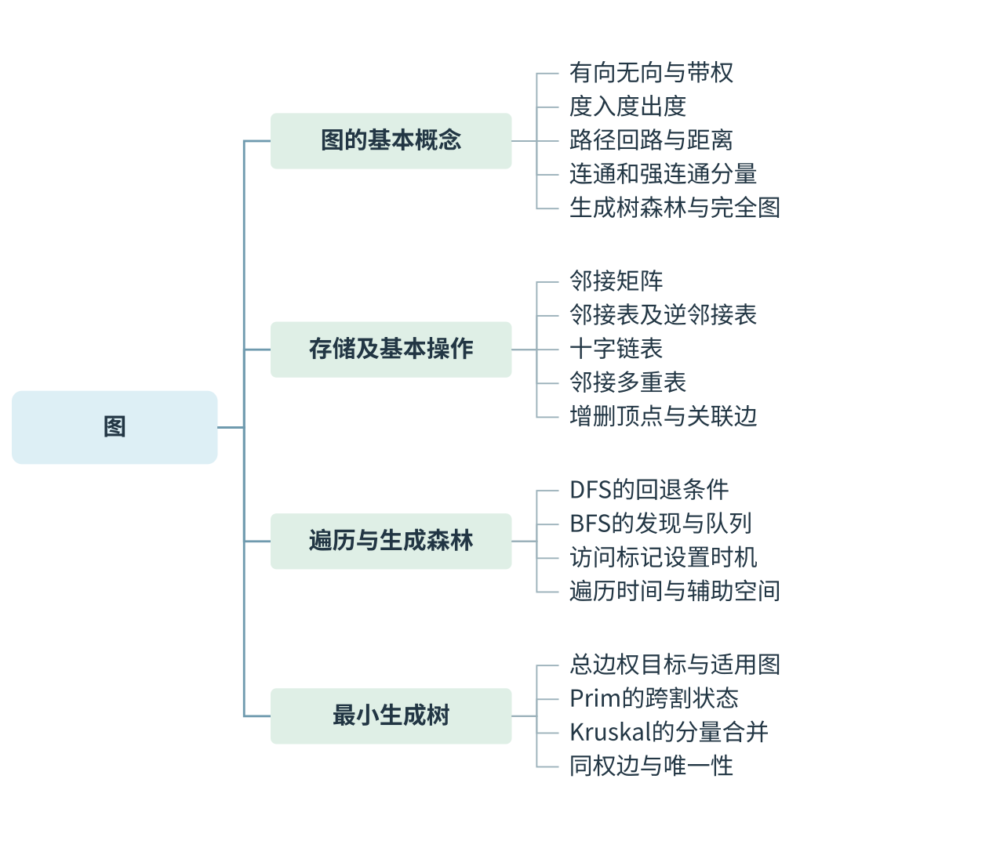
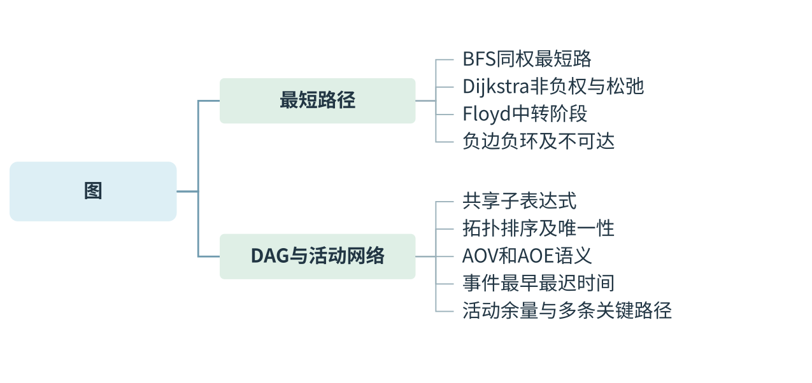
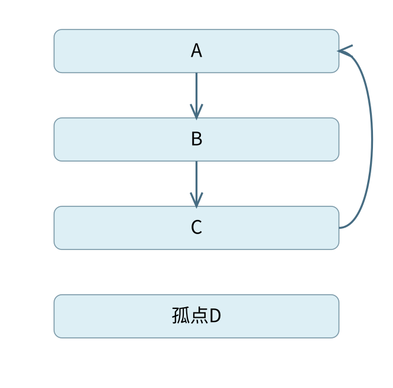
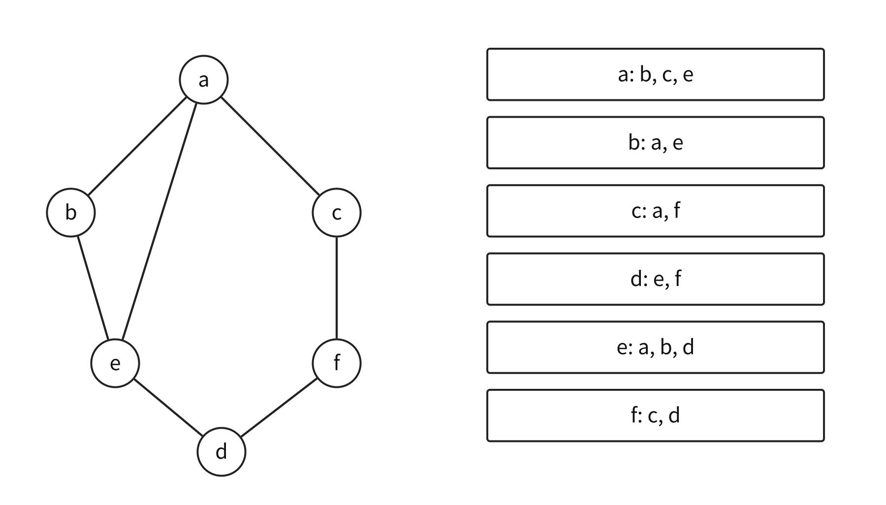
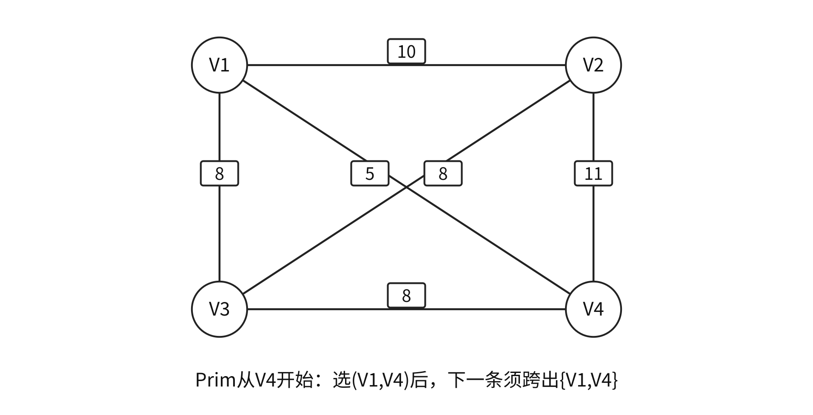
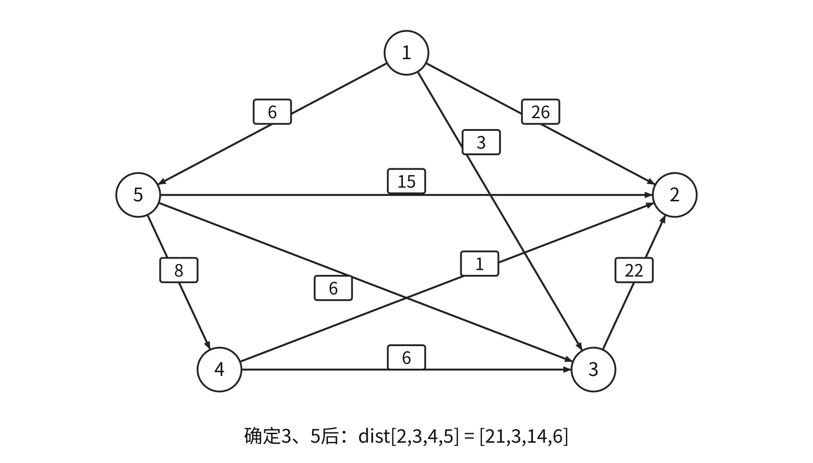
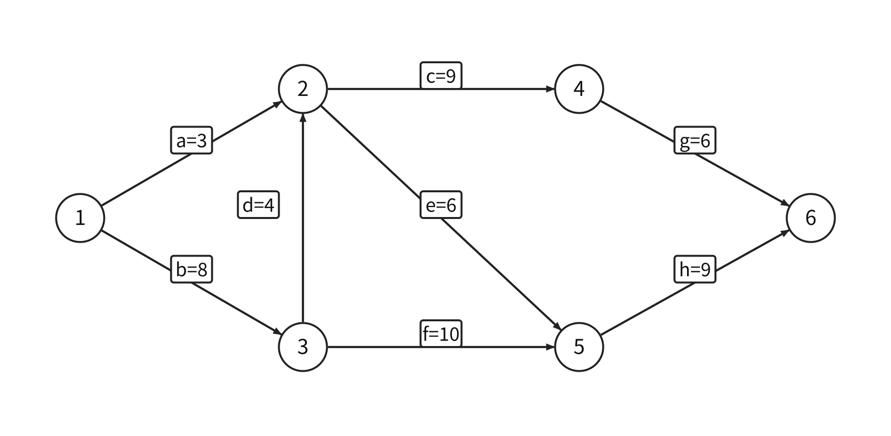

# 图 {#DS06}



[可编辑SVG](figures/map-01.svg)



[可编辑SVG](figures/map-02.svg)

图的题目先辨认边的含义：一条边可以表示可通行的道路、需要铺设的线路，也可以表示任务之间的先后约束。最短路径、最小生成树、拓扑排序和关键路径分别优化或检查不同对象；选择算法前先把题目要求写成图上的条件。

## 导图主干与阅读路径 {#DS06-map}

- **图的基本概念**：有向无向与带权；度入度出度；路径回路与距离；连通和强连通分量；生成树森林与完全图。
- **存储及基本操作**：邻接矩阵；邻接表及逆邻接表；十字链表；邻接多重表；增删顶点与关联边。
- **遍历与生成森林**：DFS的回退条件；BFS的发现与队列；访问标记设置时机；遍历时间与辅助空间。
- **最小生成树**：总边权目标与适用图；Prim的跨割状态；Kruskal的分量合并；同权边与唯一性。
- **最短路径**：BFS同权最短路；Dijkstra非负权与松弛；Floyd中转阶段；负边负环及不可达。
- **DAG与活动网络**：共享子表达式；拓扑排序及唯一性；AOV和AOE语义；事件最早最迟时间；活动余量与多条关键路径。

先按导图说清对象与条件，再沿相应正文执行算法或推导。章末先遮住答案回忆各主枝；不能只凭图中文字是否熟悉判断掌握。

## 顶点、边、连通性与路径 {#DS06-01}

> **课程连接 · 网络拓扑只是图的一种模型**
>
> 计算机网络可把路由器视为顶点、链路视为边，但边权可能表示时延、费用或带宽的变换。先明确权的含义再选择算法；同一个物理网络可以对应不同优化问题。

> **最小反例 · n减1条边不够判树**
>
> 三点成环再加一个孤立点，共4顶点3边，恰有$n-1$条边却不连通且有环。判树还要加连通或无环条件，不能只由数量推出结构。
>
> 
>
> 4顶点3边：三角形加孤点，满足m=n−1却不是树。

::: {.definition title="图与本章模型"}

图记为 $G=(V,E)$，$V$ 为顶点集合，$E$ 为边集合。无向边用无序顶点对表示，有向边（弧）用有序对表示。除另行说明，本章讨论无自环、无平行边的简单图，顶点数 $n=|V|>0$。无向简单图最多有 $n(n-1)/2$ 条边；有向简单图最多有 $n(n-1)$ 条弧。带权图的边还关联权值，权可以表示距离、费用或时间。

:::

无向图顶点的度为关联边数，所有顶点度数和为 $2|E|$；有向图分别计入度、出度，各自总和都为 $|E|$。无向图度数为奇数的顶点个数必为偶数。路径长度若未加权，通常计边条数；带权长度计沿途权值和。简单路径不重复顶点，简单回路除首尾相同外不重复其他顶点。

无向图任意两顶点都有路径时称为连通图，其极大连通子图为连通分量；有向图中每对顶点相互可达时为强连通，极大强连通子图为强连通分量。单向可达不等于强连通。“极大”指不能再加入原图其他顶点而保持相应性质，不是要求分量含全图最多的顶点。

连通无向图的**生成树**含全部顶点，连通且无环，因此有 $n-1$ 条边。它是极小连通子图：再删一边即不连通。生成树一般不是原图的连通分量，因为连通分量要保留该连通块原有的全部边，不能删到只剩一棵树。非连通图的每个分量各取一棵生成树，得到生成森林。

### 例 6-1　“有可能连通”与“保证连通”不同 {#DS06-ex1}

::: {.example title="配套案例"}

【配套例题】 无向图有7个顶点，要保证图在任何情况下都连通，需要的边数最少是（　）。

A. 6　B. 15　C. 16　D. 21

:::

**解析。** 6条边可以组成一棵生成树，但也可以都集中在部分顶点上，不能保证连通。若图不连通，边数最多的分法是6个顶点组成完全图，剩1个孤立顶点，共 $\binom62=15$ 条边。超过15条就不可能仍不连通，故最少16条，答案为 **C**。

一般的 $n$ 顶点简单无向图，边数大于 $(n-1)(n-2)/2$ 可保证连通；边数至少 $n-1$ 只是连通的必要条件。若图有 $c$ 个连通分量，则每个分量至少要“顶点数减1”条边，所以 $|E|\ge n-c$。若 $|E|<n-1$，必不连通；若 $|E|=n-1$，还需检查是否无环或连通，才能认定为树。

一张 $n$ 顶点、$n$ 条边的无向图必有环，因为无环森林最多有 $n-1$ 条边。但图有环并不保证连通，也不保证只有一个环。求给定边数下最多的连通分量数时，应让边尽量集中：例如51个顶点、21条边，可在7个顶点上组成完全图，其余44个孤立，共45个分量；少于7个顶点最多15条边，无法容纳21条。

“完全图”是边达到上限的图；“连通”只要求路径存在。稠密与稀疏描述边数相对规模，具体选结构还要结合访问方式。对于$n>1$的强连通有向图，每个顶点入度、出度至少1，所以至少$n$条弧，有向环可达到下界；$n=1$时零弧图也可按零长度路径视为强连通，不能忽略这个边界。

**有向树**常指恰有一个入度为0的根、其余顶点入度为1、根沿弧可达全部顶点的有向无环图。仅仅有$n-1$条弧还不够。图中两点的距离是最短路径长；不可达时记为无穷，不把“没有路径”误记为距离0。

## 邻接矩阵、邻接表与基本操作 {#DS06-02}

> **错项排除 · 零权边不是没有边**
>
> 带权邻接矩阵用无穷表示无边时，零是合法边权。若仍以if(A[u][v])判断有边，就会漏掉零权边；AOV的0/1邻接矩阵与这种表示的语义不同。

邻接矩阵 `A[u][v]` 表示是否存在 $u\to v$；带权时元素存放权值，用 $+\infty$ 表示不存在，不能把0既用作“无边”的标记，又用作零权边的权值。无向图矩阵对称，有向图不必。矩阵占 $\Theta(n^2)$ 空间，检查一条给定边为 $O(1)$，枚举某顶点邻边通常要扫整行 $O(n)$。

邻接表为每个顶点保存其邻接点链。无向图每条边通常出现两个表结点，有向图每条弧在出边表出现一次，空间均为 $\Theta(n+|E|)$。枚举邻边只访问实际表项，判断一条边是否存在则可能扫描相应链。逆邻接表以终点组织入边，方向与普通出边表相反。

下图同时用于说明存储表示与遍历。无向边为 `ab、ac、ae、be、cf、df、de`，各邻接表按字母升序排列。

{#ds-fig-graph width=96%}

对该图，a 行有b、c、e三个非零项，b 行有a、e两个。无向图中，顶点的度等于该行非零项的个数；有向图中，行的非零项数给出出度，列的非零项数给出入度。求有向图所有顶点的入度时，矩阵要扫描 $n^2$ 个位置，邻接表只需扫描所有表项，成本不同。

删除顶点会同时删除其所有关联边。无向邻接表不能只删除该顶点自己的链，还要清除其他顶点中指向它的表项；有向图则须同时考虑入边和出边。题目若给出“只按出度计删除成本”的实现，应检查它是否另有入边索引。

## 十字链表与邻接多重表 {#DS06-03}

> **不变量 · 一条边结点参与两条链**
>
> 邻接多重表让同一个无向边结点同时属于两个端点链。沿当前端点前进时选择其对应链接；这解释了为何可统一标记边，也解释了不能始终沿ilink。

**十字链表**面向有向图，每条弧只建立一个弧结点，记录弧尾、弧头以及两个链接：一个沿相同弧尾串联出弧，一个沿相同弧头串联入弧。每个顶点分别保存第一条出弧、第一条入弧。这样同一条弧可从源顶点的出边链或终点的入边链到达，无需存两份弧数据。

**邻接多重表**面向无向图，每条边只建一个边结点，记录两个端点 `ivex,jvex`，并有 `ilink,jlink`，分别串入两个端点的关联边链。沿顶点 u 的链前进时，须先判断 u 是这条边的哪个端点，再选择对应链接；不能始终只走 `ilink`。这种表示便于给一条边设置统一访问标记、执行删除等边操作。

普通邻接表为每条无向边保存两个表项；邻接多重表中的一个边结点同时挂在两条链上。数边时若直接数链表项，两种结构得到的数目会相差常数倍。稀疏矩阵的十字链表也使用“两种方向共享一个数据结点”的思想，但它的两维是行与列，不是有向图的弧尾与弧头。

## 深度优先搜索与搜索森林 {#DS06-04}

> **不变量 · DFS何时才允许回退**
>
> 当前顶点仍有未访问邻点时必须深入，全部处理完才回退。输出相邻两点可以不直接相连，因为中间隐含了回退；仅检查输出相邻性会误排除合法DFS。

DFS 从一个顶点开始，标记并访问，再递归访问尚未访问的邻接点；当前顶点已没有未访问邻点时才回退。标记用于防止沿环重复访问。遍历整张图时，还须依次检查所有顶点，对仍未访问的顶点重新启动搜索；一趟 DFS 未必到达全图。

```text
DFS(u):
    visited[u]=true
    visit(u)
    for v in u 的邻接点:
        if not visited[v]: DFS(v)

traverse(G):
    全部 visited 初始化为 false
    for u in 全体顶点:
        if not visited[u]: DFS(u)
```

上图按字母顺序枚举邻点，从 a 开始，得到 `a,b,e,d,f,c`。首次到达新顶点的边形成 DFS 生成树；无向图的搜索树棵数等于连通分量数，有向图不能用树棵数直接认定强连通分量数。

### 例 6-2　什么时候允许回退去另一个分支 {#DS06-ex2}

::: {.example title="配套案例"}

〖6.3-011〗 无向图顶点为 `{a,b,c,d,e,f}`，边为 `{ab,ae,ac,be,cf,fd,ed}`。进行深度优先遍历，不能得到的序列为（　）。

A. acfdeb　B. aebdfc　C. aedfcb　D. abecdf

:::

**解析。** D 访问到 `a,b,e` 时，e 的邻点d尚未访问，必须深入d，不能先回退到a转去c，因此 D 不可能。A可沿a→c→f→d→e→b；B可先走a→e→b，b无未访问邻点后回到e，再走d→f→c；C可先走a→e→d→f→c，回退后再处理b。答案为 **D**。输出序列中相邻的两个顶点不一定直接相连，因为中间可能发生回退；判断时真正要看的是，回退发生时当前顶点是否还有未探索的邻点。

采用邻接表时，每个顶点和表项只处理常数次，时间 $O(n+|E|)$；矩阵要对每个访问顶点扫一整行，时间 $O(n^2)$。递归栈最坏 $O(n)$，另有访问标志数组 $O(n)$。如果改为在递归返回前才输出顶点，得到的是完成次序；对 DAG，该完成次序的逆序就是拓扑序列，第8节会说明原因。

## BFS 为什么得到无权最短路 {#DS06-05}

> **最小反例 · 边最少而权更大**
>
> 三点A、B、C，AB与BC权1，AC权3。BFS从A一跳发现C，少一条边却总权3；经B两跳总权2。因此BFS的分层证明不能覆盖不等权路径目标。

BFS 用队列保存已发现、尚未扩展的顶点。起点先标记并入队；每次取出队头，将其尚未发现的邻点标记、记录距离并入队。标记应在**入队时**设置，若等到出队才标记，同一顶点可能被不同前驱重复入队。

```text
BFS(s):
    dist[s]=0; visited[s]=true; enqueue(s)
    while 队列非空:
        u=dequeue()
        for v in u 的邻接点:
            if not visited[v]:
                visited[v]=true
                dist[v]=dist[u]+1; parent[v]=u
                enqueue(v)
```

::: {.proof title="BFS首次发现即最短"}

队列保证按距离分层出队：距离0的顶点先于距离1的，距离1的又先于距离2的。首次发现 v 时，若还存在更短的路径，这条路径上 v 的前驱应位于更早的一层，早已被扩展，v 也就应更早被发现，矛盾。因此 `dist` 记录的是最少边数。

:::

上图从a出发、邻点按字母枚举，出队访问序列为 `a,b,c,e,f,d`；b、c、e距离1，f、d距离2。该序列与DFS顺序不同，但也不唯一：同层邻接次序可改变，最少边数不变。带权不等长边时，少经过一条边未必总权更小，不能把这条证明直接推广为带权最短路。

邻接表与矩阵的时间同DFS，队列和标记等辅助空间为 $O(n)$。有向图中，BFS只沿弧的方向扩展；“无权最短路”并不要求图无向，但要求每条边的代价相同，只按边数计。

::: {.methodbox title="把题意翻译成图算法的目标"}

先确定有向还是无向、边权是否同一常数，再问目标是“全部顶点以最低总价接通”“某个起点到各点最短”“先后约束合法”还是“工程完成时间”。BFS只保证同权边最短，MST只控制整棵树总权；它们不能互相替代。

:::

## Prim 与 Kruskal 在挑什么边 {#DS06-06}

> **错项排除 · 同权不等于MST必不唯一**
>
> 若所有边权互异，MST一定唯一；逆命题不成立。一个本来就是树的连通图，即使边权相同，其生成树仍只有它本身，不能根据同权直接判不唯一。

最小生成树（MST）要求连通全部顶点、无环，并使所选 $n-1$ 条边权和最小。它不要求从某个起点到每个顶点的路径最短。若图不连通，只能得到每个分量的最小生成森林。

Prim 维护一个已连接顶点集合 U，每次从“一端在U、一端在外”的边中选最小边，加入新顶点。Kruskal 则把全部边按权非降序考虑，端点在不同当前分量时选入并合并，同一分量则跳过以避免成环。二者都利用割上的轻边性质，但状态不同：Prim始终扩展一棵树，Kruskal可能同时有多棵。

### 例 6-3　同权边怎样影响第二次选边 {#DS06-ex3}

::: {.example title="配套案例"}

【配套例题】 求下图最小生成树，可能为 Kruskal 第2次选中、但不可能为从 $V_4$ 开始的 Prim 第2次选中的边是（　）。

{#ds-fig-mst width=78%}

A. $(V_1,V_3)$　B. $(V_1,V_4)$　C. $(V_2,V_3)$　D. $(V_3,V_4)$

:::

**解析。** 两个算法首先都选权5的 $(V_1,V_4)$。Kruskal 此后可选任意一条不成环的权8边，包括 $(V_2,V_3)$。Prim 此时 U 为 $\{V_1,V_4\}$，第2条边必须跨越这个集合的边界，只能在 $(V_1,V_3)$ 与 $(V_4,V_3)$ 中选权8的边；$(V_2,V_3)$ 两端都在集合外，不能选。答案为 **C**。

继续执行时，Kruskal若选 $(V_2,V_3)$，最后还要用一条权8边把两个分量连接，总权21；Prim选入V3后，再用 $(V_3,V_2)$ 权8连V2，也是21。同权边可能导致不同的MST；全部边权互异足以保证MST唯一，但存在同权边时MST仍可能唯一。

朴素Prim配矩阵为 $O(n^2)$；邻接表配优先队列可降低稀疏图中选最小边的代价。Kruskal主要花在边排序，常写 $O(|E|\log|E|)$，加并查集维护分量。具体选哪一个，还要看图的表示与选边的实现，不能只比较算法名字。

### 最小生成树的核心伪码 {#DS06-mst-code}

> **不变量 · Prim的key不是距离**
>
> Prim只问一条跨割边接新点的代价，key更新取边权；Dijkstra问源点到新点的完整路径，需加已确定前缀。把两者公式混写可能算出另一种对象。

```text
Prim(s):
    U={s}; key[v]=w(s,v)，无边记无穷
    重复直到选入全部顶点:
        u=U外key最小者
        若key[u]=无穷: 原图不连通，停止
        选入parent[u]到u的边；U加入u
        对每个U外邻点v:
            若w(u,v)<key[v]: 更新key[v]及parent[v]
```

这里`key[v]`始终是U到v的最轻跨割边，**不是**从s到v的路径长度，所以更新式没有`key[u]+w(u,v)`。

```text
Kruskal(G):
    将边按权非降排序；每个顶点初始化为单独集合
    对每条边(u,v,w):
        若find(u)!=find(v):
            选入此边；unite(u,v)
    若选入边数<n-1: 得到最小生成森林而非生成树
```

::: {.proof title="为何跨割最轻边可以安全加入"}

设已有选择能扩展到某棵MST，考虑与现有分量相容的割及其一条轻边$e$。若某MST不含$e$，加入$e$形成环，环上必有另一条跨该割的边$f$，且$w(e)\le w(f)$。删$f$保连通且不增权，得到含$e$的MST；这说明选择可扩展，不表示所有MST都必须含$e$。

:::

## Dijkstra 与 Floyd 的条件和中间状态 {#DS06-07}

> **错项排除 · 有负边与一定算错不同**
>
> 负边意味着标准Dijkstra失去通用正确性保证，不代表每个含负边实例都会得错值。选项若用“只要有一条负边就必算错”的绝对语气，可用简单单路径反驳。

Dijkstra 求单源最短路径。维护已确定集合 S 与暂定距离 `dist[v]`；每次选择 S 外距离最小的顶点 u，确定它的最短距离，再用 `dist[u]+w(u,v)` 松弛其邻点。尚未确定的 `dist` 是已知可达路径的最好上界，不一定已是真正最短距离。

通用正确性要求边权非负：若能先经过一个当前距离更远的顶点、再经负边绕回u，u的真实距离就可能小于已确定的值，于是u被过早确定。出现负边不表示每个实例都必然算错，但标准算法不能保证正确。不可达顶点的距离保持无穷，所有剩余距离都为无穷时可停止，不能再把无穷当作普通数参与加法。

### 例 6-4　求出第二条最短路径后哪些值还可变 {#DS06-ex4}

::: {.example title="配套案例"}

【配套例题】 使用 Dijkstra 求下图从顶点1到其余顶点的最短路径，`dist` 依次保存到2、3、4、5的距离。求出第二条最短路径后，`dist` 内容为（　）。

{#ds-fig-dijkstra width=88%}

A. 26、3、14、6　B. 25、3、14、6　C. 21、3、14、6　D. 15、3、14、6

:::

**解析。** 先把起点1确定，初始 `dist=(26,3,∞,6)`。第1条到其他顶点的确定路径是1→3，长3；用3→2的22更新到2距离为25。随后选顶点5，距离6，第2条路径确定；由5→2的15把到2更新为21，由5→4的8把到4更新为14，得到 **(21,3,14,6)，答案 C**。

::: {.wideblock}

| 已确定的新顶点 | 暂定距离向量(dist[2],dist[3],dist[4],dist[5]) |
| --- | --- |
| 1（初始化） | (26,3,∞,6) |
| 3 | (25,3,∞,6) |
| 5 | (21,3,14,6) |
| 4 | (15,3,14,6) |
| 2 | (15,3,14,6) |

:::

答案要求的是第2条路径确定后，不是算法最终结果。顶点4随后才用其到2的权1把21改为15，不能把这个将来更新提前放进答案。

Floyd 求任意顶点对之间的最短路。令 $D^{(k)}[i,j]$ 表示只允许编号不超过k的顶点作为内部中转时的最短距离，则

$$D^{(k)}[i,j]=\min\{D^{(k-1)}[i,j],D^{(k-1)}[i,k]+D^{(k-1)}[k,j]\}.$$

两种候选分别是不经过k，或在k处分成两段。实现时中转顶点k必须放在最外层循环，才能对应这个阶段的含义。时间 $O(n^3)$，距离矩阵 $O(n^2)$；允许负边，但要求不存在影响所求路径的负权回路，否则不存在有限最短值。无向图中一条负权边就能往返构成负权闭合游走，不能直接套用通常的有限最短路模型。

矩阵版 Dijkstra 单源时间 $O(n^2)$；对每个源点重跑得到全源需 $O(n^3)$，不能仍写成 $O(n^2)$。BFS求的是同权边下的最少边数，MST最小化整棵树的边权总和，Floyd/Dijkstra最小化指定端点之间的路径权和；三个目标要分别辨认。

### 最短路径的阶段循环 {#DS06-shortest-code}

> **不变量 · 已确定与暂定要分开**
>
> Dijkstra中暂定dist只是一条已知路径的最好上界。选出最小暂定点后才永久确定；过程题若提前使用未来松弛的值，就把最终答案错误放入了中间状态。

```text
Dijkstra(s):
    dist[s]=0；其余为无穷；S为空
    重复选择S外dist最小的u:
        若dist[u]=无穷: 停止
        S加入u
        对每条u到v，若v未确定且dist[u]+w(u,v)<dist[v]:
            更新dist[v]；parent[v]=u
```

最外层每次永久确定一个顶点，这是非负权前提的用处；已经确定的点不能靠未来负边回头改写。实现中先检查`dist[u]`有限，避免无穷哨兵加权溢出。

```text
Floyd(D):
    D[i][i]=0；其他位置按直接边初始化
    for k=0..n-1:
        for i=0..n-1:
            for j=0..n-1:
                若D[i][k]与D[k][j]均有限:
                    D[i][j]=min(D[i][j],D[i][k]+D[k][j])
```

`k`在外层时，“已允许的中间顶点集合”才依次扩大。若结束后某`D[v][v]<0`，说明存在负环；受该负环影响的点对没有有限最短距离，不能继续解释该数值为答案。

## 拓扑排序：由入度判断哪些任务可以先做 {#DS06-08}

有向无环图（DAG）可以用顶点表示活动、弧表示先后约束，称为 AOV 网。拓扑序列要求对每条弧 $u\to v$，u都排在v之前。算法先把所有入度为0的顶点作为候选，每次删除一个候选及其出弧，更新后继入度；若处理完的顶点数不足n，则存在有向环。

有多个候选时可以选择不同的顺序，因此拓扑序列一般不唯一。对DAG做DFS并在退出时输出，每条弧的终点必先完成，得到的是逆拓扑序列；把该完成序列反向才是拓扑序列。若存在有向环，仅取得一个DFS完成次序并不能证明拓扑合法。

### 例 6-5　怎样判定唯一拓扑序列 {#DS06-ex5}

::: {.example title="配套案例"}

【配套例题】 载人航天工程包含众多子工程，为保证有序开展，需要明确前导子工程。这可抽象为有向图的拓扑序列问题。已知图G采用邻接矩阵存储：

```c
typedef struct {
    int numVertices,numEdges;
    char VerticesList[MAXV];
    int Edge[MAXV][MAXV];
} MGraph;
```

设计 `int uniquely(MGraph G)` 判定G是否存在唯一拓扑序列，是则返回1，否则返回0。给出设计思想及带关键注释的C或C++实现。

:::

**解析。** 每一轮的候选零入度顶点必须恰有一个。若图无环且某轮至少有两个，二者都可作为下一项，交换其先后可产生至少两个拓扑序列；若某轮没有候选而尚未处理完，则余图有环，无法完成。这两种情况都不满足唯一，均可返回0。只有始终唯一且处理完全体顶点，才能返回1。

```c
int uniquely(MGraph G) {
    int n=G.numVertices, indeg[MAXV]={0};
    bool used[MAXV]={false};
    for (int u=0; u<n; ++u)
        for (int v=0; v<n; ++v)
            if (G.Edge[u][v]) ++indeg[v];
    for (int step=0; step<n; ++step) {
        int pick=-1;
        for (int v=0; v<n; ++v)
            if (!used[v] && indeg[v]==0) {
                if (pick!=-1) return 0; // 至少两个候选
                pick=v;
            }
        if (pick==-1) return 0;         // 剩余部分有环
        used[pick]=true;
        for (int v=0; v<n; ++v)
            if (G.Edge[pick][v]) --indeg[v];
    }
    return 1;
}
```

这里AOV邻接矩阵用0/1分别表示无边与有弧，不能直接把带权矩阵的“无边为无穷”搬进这个判断。总时间 $O(n^2)$，工作数组额外占 $O(n)$；题给的按值传参若实际复制整个矩阵，形参副本还占 $O(n^2)$，可按接口许可改为只读引用。若使用邻接表并维护零入度候选数，处理时间可为 $O(n+|E|)$。顶点已经按某个拓扑次序编号时，所有弧才保证由小编号指向大编号，邻接矩阵才呈严格上三角；任意编号的DAG不必原样为三角矩阵。

DAG还可表达共享子表达式：相同子式只存一份，不同上层结点可指向同一子式。它表达计算依赖而非普通树的唯一双亲关系；不能再套用“除根外每结点恰有一个双亲”。

### 一般拓扑排序的队列实现 {#DS06-topo-code}

> **课程连接 · 同步前驱约束就是偏序**
>
> 操作系统中多个事件的前驱关系可用DAG表示，零入度事件代表当前所有前驱已完成。拓扑排序只给合法先后，不计算耗时；带持续时间的工期还需AOE时间传播。

```text
topological(G):
    统计所有顶点的入度；把入度0者入队Q
    count=0
    while Q非空:
        u=出队；输出u；count++
        对每条u到v: indeg[v]--
            若indeg[v]==0: v入队
    返回count==n
```

入度表示余图中尚未删除的前驱数，只有从1降到0时加入候选。若只关心任意拓扑序列，可以任选候选；要判断唯一，则每一步候选数都必须恰为1，原例的代码正是在增加这个约束。

## 关键路径：事件与活动的时间不同 {#DS06-09}

AOE 网用顶点表示事件、带权有向边表示活动，边权为持续时间。某事件要等全部进入活动都完成才能发生；它发生之后，其出边活动才能开始。以下假设该网无环、持续时间非负，且有统一的源点和汇点；若源点或汇点不止一个，可添加零时长的虚边统一。

事件最早发生时间 `ve[v]` 按拓扑序计算：从所有前驱中取 `ve[u]+w(u,v)` 的**最大值**，因为全部前导活动都得完成。令汇点的最迟发生时间等于总工期，事件的最迟发生时间 `vl[u]` 则按逆拓扑序计算，取所有后继的 `vl[v]-w(u,v)` 的**最小值**，以保证每条后续活动仍赶得上。

活动 $u\to v$ 的最早开始时间为 $e=ve[u]$，最迟开始时间为 $l=vl[v]-w(u,v)$。$l-e$ 是该活动的时间余量；余量0的活动为关键活动。关键路径是源到汇的一条最长带权路径，决定最短可完成工期；它不是边最多的路径。

### 例 6-6　多条关键路径时怎样缩短工期 {#DS06-ex6}

::: {.example title="配套案例"}

【配套例题】 下图AOE网包含8个活动。通过同时加快若干活动，可缩短整个工程工期。下列选项中，加快所列活动进度就可缩短工期的是（　）。

{#ds-fig-aoe width=92%}

A. c和e　B. d和c　C. f和d　D. f和h

:::

**解析。** 先按拓扑次序1、3、2、4、5、6算事件时间。

::: {.wideblock}

| 事件 | ve | vl |
| --- | --- | --- |
| 1 | 0 | 0 |
| 2 | 12 | 12 |
| 3 | 8 | 8 |
| 4 | 21 | 21 |
| 5 | 18 | 18 |
| 6 | 27 | 27 |

:::

例如 `ve[2]=max(0+3,8+4)=12`，不能仅沿1→2算成3；`ve[5]=max(12+6,8+10)=18`。从汇点反推，`vl[2]=min(21−9,18−6)=12`，同时约束它通往4和5的两条后续活动。

活动a余量为9，其余b、c、d、e、f、g、h均为关键活动。关键路径有三条：`b-d-c-g`、`b-d-e-h`、`b-f-h`，长度均27。若只缩短其中一条路径上的活动，其他路径仍可能保持27。f与d合起来覆盖三条关键路径：d影响前两条，f影响第三条；两者同时适当缩短，所有原关键路径都会变短。答案为 **C**。A、B遗漏路径b-f-h，D遗漏路径b-d-c-g。

增加关键活动时长会使包含它的路径变长，进而延长工期；缩短某一关键活动却未必缩短工期，因为还可能有不包含它的其他关键路径。持续缩短还可能使原非关键路径成为新的关键路径，必须重新计算，不能无限按原余量推断。

### 关键路径的计算表怎样落到程序 {#DS06-aoe-code}

> **错项排除 · 缩短一条关键活动未必够**
>
> 存在两条等长关键路径时，只缩短其中一条独有活动，另一条仍保持原工期。要检查所有当前关键路径是否都被影响，并在缩短后重新计算新关键路径。

```text
criticalPath(G):
    取得拓扑序T；若不存在则模型非法
    ve[*]=0
    按T正序，对每条u到v: ve[v]=max(ve[v],ve[u]+w(u,v))
    D=ve[统一汇点]；vl[*]=D
    按T逆序，对每条u到v: vl[u]=min(vl[u],vl[v]-w(u,v))
    对每条活动u到v:
        e=ve[u]；l=vl[v]-w(u,v)
        若e==l: 该边为关键活动
```

按“全部前驱都完成”取最大最早时间，按“不拖延任何后继”取最小最迟时间，方向不能交换。不能将`ve[v]`直接当作边$u\to v$的活动最早开始时间，活动开始由弧尾事件$u$决定。

::: {.wideblock}

::: {.wideblock}

| 任务 | 前提与优化对象 | 核心状态 | 典型边界 |
| --- | --- | --- | --- |
| BFS最短路 | 同权边；最少边数 | 分层队列和距离 | 非等权不能直接用 |
| MST | 带权无向图；总树权最小 | Prim跨割值或Kruskal分量 | 不保证源点路径最短 |
| Dijkstra | 非负权；单源路径和最小 | 已确定集合与暂定上界 | 负边破坏通用保证 |
| Floyd | 无相关负环；点对最短 | 允许的中转点集合 | 中转点循环在最外层 |
| 拓扑 | DAG；满足先后约束 | 余图入度 | 无候选而未结束表示有环 |
| 关键路径 | AOE DAG；总工期 | 事件ve/vl及活动e/l | 多条关键路径需同时考虑 |

:::

:::

## 主动回忆自测 {#DS06-check}

以下为自拟补充，检查算法选择的边界。

1. 图有8个顶点、7条边，能否直接认定为树？若再给“连通”呢？
2. 有向图A→B、A→C、B→D、C→D有几个拓扑序列？若添加B→C，怎样变化？
3. 一条边权变大，MST总权与某一对顶点最短距离是否一定同时改变？
4. 一条关键活动缩短1，工期是否必缩短1？

5. 无向图三点A、B、C，边AB=1、AC=3、BC=1。从A作BFS得到的到C路径是否必为最短权路径？
6. Prim的`key[v]`与Dijkstra的`dist[v]`分别保存什么？为什么松弛公式不同？
7. Floyd把`k`放内层，仅执行一次三重循环还能直接沿用原证明吗？
8. DAG中某轮有两个零入度顶点，能否仍有唯一拓扑序列？

**答案。** 1. 不能；若无向且连通，7条边恰够生成树，不可能再有环，故为树。2. 原有A-B-C-D与A-C-B-D两个；添加后仅A-B-C-D。3. 不一定；该边可能不在任何当前采用的最优解中，两种优化目标也不同。4. 不一定；有另一条不含该活动的同长关键路径时工期不变。

5. 不能；BFS可一条边直接到C，权为3，实际A-B-C权为2。它最少的是边数，不是总权。
6. 前者是连接现有树集合到v的最轻边；后者是从固定源点到v的已知路径最小上界，后者需累加已确定前缀距离。
7. 不能，阶段已不再对应统一的中转集合；必须重新证明算法，而非只因循环次数相同就认定等价。
8. 不能；在无环余图中这两个候选可分别作为下一项，并可扩展为合法序列，至少产生两种拓扑序。
