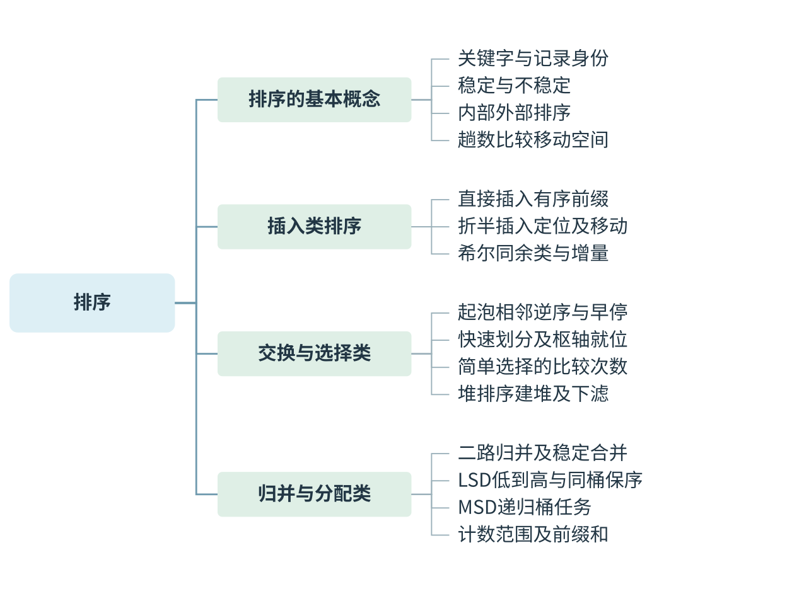
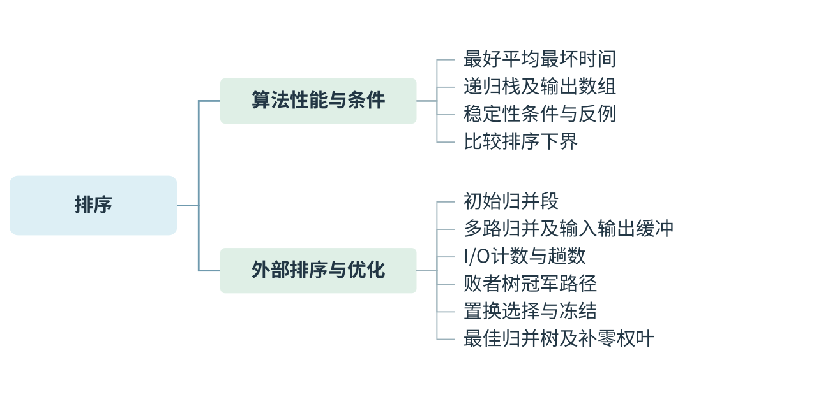
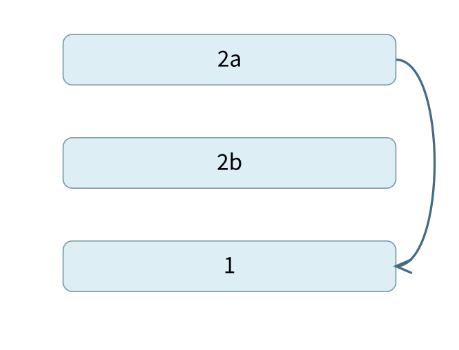
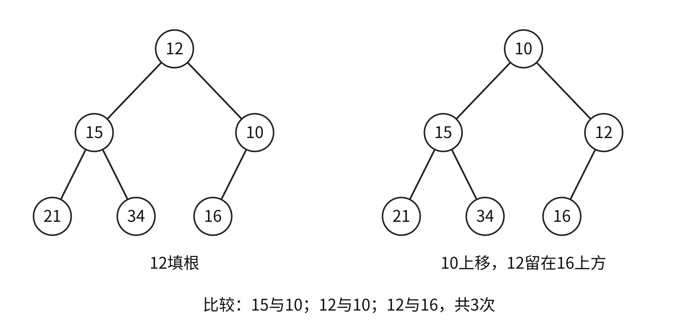
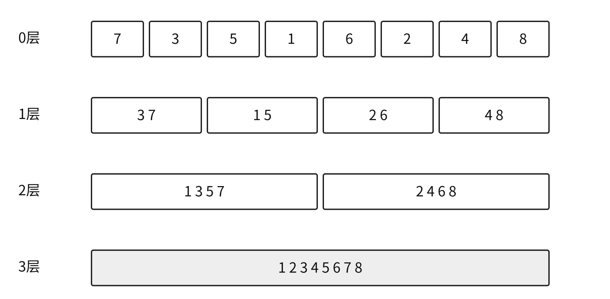
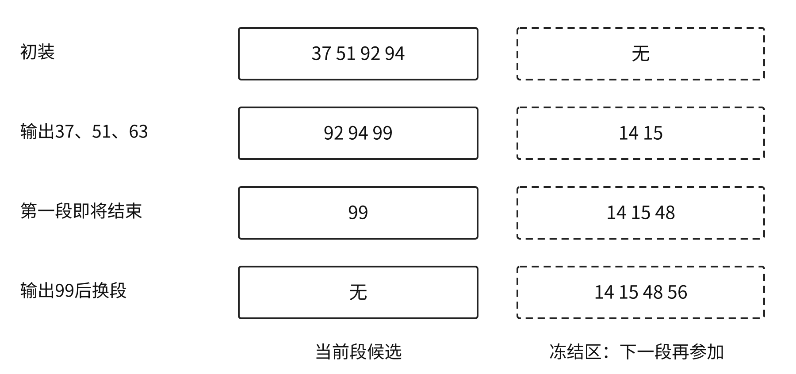
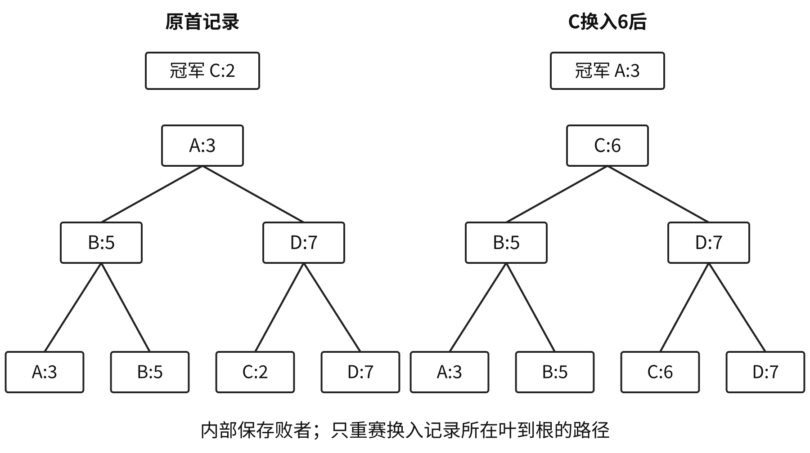

# 排序 {#DS08}



[可编辑SVG](figures/map-01.svg)



[可编辑SVG](figures/map-02.svg)

排序把记录按关键字排列，同时可能改变相等关键字记录原有的相对次序。做过程题时，先确定这一趟处理的是一个元素、一个增量分组，还是所有当前子区间；做选择算法的题时，再比较规模、初始状态、稳定性、空间和外存访问。算法名字相同、划分约定不同，产生的中间序列也可能不同。

## 导图主干与阅读路径 {#DS08-map}

- **排序的基本概念**：关键字与记录身份；稳定与不稳定；内部外部排序；趟数比较移动空间。
- **插入类排序**：直接插入有序前缀；折半插入定位及移动；希尔同余类与增量。
- **交换与选择类**：起泡相邻逆序与早停；快速划分及枢轴就位；简单选择的比较次数；堆排序建堆及下滤。
- **归并与分配类**：二路归并及稳定合并；LSD低到高与同桶保序；MSD递归桶任务；计数范围及前缀和。
- **算法性能与条件**：最好平均最坏时间；递归栈及输出数组；稳定性条件与反例；比较排序下界。
- **外部排序与优化**：初始归并段；多路归并及输入输出缓冲；I/O计数与趟数；败者树冠军路径；置换选择与冻结；最佳归并树及补零权叶。

先按导图说清对象与条件，再沿相应正文执行算法或推导。章末先遮住答案回忆各主枝；不能只凭图中文字是否熟悉判断掌握。

## 稳定性、内外排序与比较口径 {#DS08-01}

> **最小反例 · 相同数字隐藏记录身份**
>
> 最小反例给相等关键字附身份：$2_a,2_b,1$经简单选择首趟成为$1,2_b,2_a$。只写数字2、2会看不出顺序改变；稳定性讨论的是整条记录的身份。
>
> 
>
> 交换首项与1跨过2b，结果为1、2b、2a。

::: {.definition title="排序稳定性"}

若两条记录关键字相等，排序后它们的相对次序与原来一致，称该排序算法**稳定**。给记录加身份下标，如 $2_a,2_b$，就能检验相等值是否被交换；只看两个相同数字无法观察稳定性。稳定性是算法对所有合法输入的保证，某个不稳定算法在一份特定数据上也可能恰好没有打乱相等记录。

:::

内部排序指排序时待处理记录能全部放入内存；外部排序需要在内外存间分批交换。二者的区别在于处理期间是否需要外存参与，不能只按一个固定的数据量阈值划分。外部排序通常优先减少块I/O，内部排序则常比较关键字比较次数、移动次数和辅助空间。

“一趟”指什么，须按具体算法的说明确定。直接插入一趟放好一个新记录；归并一趟合并所有相邻段；本章快速排序的过程题，把同一深度上尚未确定最终位置的所有子区间各划分一次，算作一趟。若程序逐子区间调用一次划分就计一趟，应按那份程序重新解释。

## 直接插入与折半插入 {#DS08-02}

直接插入维护左侧已排好序的前缀。取下一个记录x，从前缀末尾向左比较，把大于x的记录右移，直到找到插入位置。每次循环结束，前缀扩大1且仍有序。

```c
void insertionSort(int A[], int n) {
    for (int i=1; i<n; ++i) {
        int x=A[i], j=i-1;
        while (j>=0 && A[j]>x) {
            A[j+1]=A[j]; --j;
        }
        A[j+1]=x;
    }
}
```

相等时不再左移，把新记录放在已有相等记录后面，因此稳定。若条件改为 `A[j]>=x`，会把新记录放到旧相等记录之前，稳定性随之改变。初始有序时每趟只比较一次就停止，时间 $\Theta(n)$；逆序时要移动 $1+2+\cdots+(n-1)$ 个记录，最坏 $\Theta(n^2)$；仅用一个暂存记录和几个下标，空间 $O(1)$。

折半插入在有序前缀中用折半查找决定插入点，减少了关键字比较；但数组中腾出位置仍要移动元素，平均和最坏移动量仍为 $\Theta(n^2)$，因此平均和最坏总时间也为 $\Theta(n^2)$。要保持稳定，应寻找“第一个大于x”的位置，把x插到所有旧相等项之后。

本章比较表采用**每趟都完整执行折半定位**的实现，不先用前缀末项判断是否已经就位。因此即使初始有序，比较总量仍为 $\Theta(\sum_{i=1}^{n-1}\log(i+1))=\Theta(n\log n)$，最好总时间也是 $\Theta(n\log n)$；最好时只是移动少，比较代价并不随之减少。若另加“已不小于前缀末项则直接跳过折半”的判断，有序输入可变成线性时间，那是增加了提前判断的实现。

### 折半定位怎样保持稳定 {#DS08-bin-insert}

> **不变量 · 相等时继续向右定位**
>
> 折半插入寻找首个大于x的位置，旧相等项都留在左边。定位快只减少比较，数组腾位置仍要移动；看到折半二字就写整体对数时间，漏掉了主要移动量。

```text
binaryInsertion(A,n):
    for i=1..n-1:
        x=A[i]；low=0；high=i-1
        while low<=high:
            mid=low+(high-low)//2
            若A[mid]<=x: low=mid+1
            否则high=mid-1
        将A[low..i-1]向右移动1位
        A[low]=x
```

相等时向右找，最终`low`指向有序前缀中第一个大于x的位置。寻找位置的比较减少，腾出位置的移动仍可能为二次；“折半”描述定位方式，不是整体复杂度结论。

## 起泡：一次相邻交换消除一个逆序 {#DS08-03}

从左向右比较相邻元素，前者大于后者就交换，一趟后最大记录到达最右端；下趟只处理未确定的左侧范围。若某一趟没有发生交换，整段已无相邻逆序，可提前结束。没有这项标志的实现即使输入有序，也仍会执行全部固定比较。

例如 `4,2,3,1` 第一趟依次变为 `2,4,3,1→2,3,4,1→2,3,1,4`，只保证末尾4就位，不保证其余已序。每次交换仅在严格大于时进行，不会跨过相等记录，故稳定。带提前终止时最好 $\Theta(n)$，平均、最坏 $\Theta(n^2)$，空间 $O(1)$。

### 带提前停止的起泡代码 {#DS08-bubble-code}

> **错项排除 · 最好线性依赖早停标志**
>
> 起泡有序输入一趟无交换即可停，所以线性；若程序固定执行全部趟数，即使每次都不交换，比较仍是二次。复杂度表需要与实际程序条件配套。

```c
void bubbleSort(int A[], int n) {
    for (int end=n-1; end>0; --end) {
        bool changed=false;
        for (int j=0; j<end; ++j)
            if (A[j]>A[j+1]) {
                int x=A[j]; A[j]=A[j+1]; A[j+1]=x;
                changed=true;
            }
        if (!changed) break;
    }
}
```

此段使用C++的`bool`；改用C时应包含`stdbool.h`或使用整型标志。每趟后尾部已确定的记录不再参与下一趟，未交换则剩余前缀也已序。

## 简单选择：比较与移动的代价不同 {#DS08-04}

简单选择每趟从未排序区找到最小记录，与该区首记录交换，使前部有序区扩大。无论初始是否有序，找最小值都要扫描当前未排序区，关键字比较总数固定为 $(n-1)+(n-2)+\cdots+1=n(n-1)/2$。至多交换n−1次，比较次数却始终为 $\Theta(n^2)$。

它通常不稳定。例如 $2_a,2_b,1$，第一趟把1与 $2_a$ 交换，得到 $1,2_b,2_a$，相等关键字次序逆转。这不是比较时相等就交换造成的，而是与远处最小记录交换时跨越了 $2_b$；仅把找最小值的条件改成严格小于，不能保证稳定。

```text
selectionSort(A,n):
    for i=0..n-2:
        pick=i
        for j=i+1..n-1:
            若A[j]<A[pick]: pick=j
        若pick!=i: swap(A[i],A[pick])
```

省掉`pick==i`时的自交换可以减少移动，却不减少寻找最小值的比较。这说明“比较固定”不等于“每份输入交换数也固定”。

## 希尔：一趟只保证各增量子序列有序 {#DS08-05}

希尔排序选择递减增量d，对下标同余的记录分别作直接插入排序，称为d间隔有序。较大增量使远处记录较快移动，最后必须有d=1这一趟，才能保证整体有序。某个d间隔有序，不代表相邻记录有序；改用更小的增量后，也仍需再排。

### 例 8-1　两趟希尔排序怎样按下标分组 {#DS08-ex1}

::: {.example title="配套案例"}

〖8.2-012〗 输入序列为 `13,24,7,1,8,9,11,56,34,51,2,77,5`，增量依次为5、3、1。两趟排序后为（　）。

A. 1,7,8,9,13,24,11,34,51,2,5,56,77

B. 1,7,5,2,8,9,24,11,34,51,13,77,56

C. 2,11,5,1,8,9,24,7,34,51,13,77,56

D. 2,5,11,1,8,9,7,24,34,13,51,77,56

:::

**解析。** d=5按下标余数分组，例如下标0、5、10的 `13,9,2` 排为 `2,9,13`；下标2、7、12的 `7,56,5` 排为 `5,7,56`。第一趟整体为

`2,11,5,1,8,9,24,7,34,51,13,77,56`。

d=3重新分组：下标0、3、6、9、12的 `2,1,24,51,56` 排为 `1,2,24,51,56`；下标1、4、7、10的 `11,8,7,13` 排为 `7,8,11,13`；下标2、5、8、11的 `5,9,34,77` 已有序。填回原下标得

`1,7,5,2,8,9,24,11,34,51,13,77,56`，答案为 **B**。

“一趟”包含全部余数分组，不是只排第一组。最后d=1这一趟才对全序列作插入排序。希尔排序不稳定，复杂度与增量序列有关：不附增量条件，便给不出通用的精确平均阶；空间通常为 $O(1)$。

### 希尔排序的同余类循环 {#DS08-shell-code}

> **不变量 · d间隔有序不是相邻有序**
>
> 一趟希尔处理全部同余类，得到每个间隔d子序列有序。不同余数类之间仍未比较；只有最后d=1，才把全数组约束为同一有序序列。

```text
shellSort(A,n,gaps):
    对每个递减正增量d（最后必须为1）:
        for i=d..n-1:
            x=A[i]；j=i-d
            while j>=0且A[j]>x:
                A[j+d]=A[j]；j-=d
            A[j+d]=x
```

内层以d为步长在同一同余类中移动，因此一次i循环只处理一个新记录；完整一趟要遍历全部i。所有增量必须为正，否则无法保证进展；末增量1将各分组约束最终汇成整体有序。

## 快速排序：先划分，再递归 {#DS08-06}

> **错项排除 · 首枢轴遇到已有序可能最坏**
>
> 首记录作枢轴时，升序输入每次都产生0与n−1的分割，时间二次、栈线性。插入排序有序最快的经验不能迁移到这份快排；随机枢轴需另用期望模型分析。

一趟划分选择枢轴，使左区记录不大于枢轴、右区记录不小于枢轴，并确定一个枢轴的最终位置；两侧内部仍可能无序。以下采用首记录作枢轴、双向扫描的“挖坑”方式，便于明确指针停留与填回位置。

```c
int partition(int A[], int low, int high) {
    int pivot=A[low];
    while (low<high) {
        while (low<high && A[high]>=pivot) --high;
        A[low]=A[high];
        while (low<high && A[low]<=pivot) ++low;
        A[high]=A[low];
    }
    A[low]=pivot;
    return low;
}
```

```text
quickSort(A,l,r):
    if l>=r: return
    p=partition(A,l,r)
    quickSort(A,l,p-1)
    quickSort(A,p+1,r)
```

每次划分扫过当前区间，代价与区间长度同阶。两侧规模较均衡时，每层合计 $O(n)$、约 $\log n$ 层，时间 $O(n\log n)$；若首枢轴总是最小或最大，规模为n−1与0，累积为 $\Theta(n^2)$。原序列已经有序时，这个首枢轴实现反而落到最坏情况，不能把插入排序“有序输入最快”的结论照搬过来。

递归栈平均 $O(\log n)$、最坏 $O(n)$；数组内划分的常数临时变量不能抵消调用栈。远距离移动会改变相等记录顺序，通常不稳定。等值很多时，具体左右扫描规则会影响划分平衡；三路划分是另一种处理方式，不能把它的状态与上述程序的状态混写。

### 例 8-2　第二趟结束后应有几个枢轴就位 {#DS08-ex2}

::: {.example title="配套案例"}

【配套例题】 对尚未确定最终位置的所有元素进行一遍处理称为一趟。下列序列中，不可能是快速排序第二趟结果的是（　）。

A. 5,2,16,12,28,60,32,72

B. 2,16,5,28,12,60,32,72

C. 2,12,16,5,28,32,72,60

D. 5,2,12,28,16,32,72,60

:::

**解析。** 先确定完全有序结果为 `2,5,12,16,28,32,60,72`。一个就位枢轴还必须满足左边全不大于它、右边全不小于它。若第一枢轴在端点，第二趟只划分一个非空子区间，可能只有两个枢轴就位；若第一枢轴不在端点，两侧均非空，第二趟后至少有三个就位位置（单元素区间自身已就位）。

选项 D 中只有12与32这两个位置满足分隔关系，而且两者都不是端点。无论谁作为第一枢轴，第二趟都应在它左右再各形成一个就位位置，这与只有两个就位位置相矛盾，所以答案为 **D**。

选项 A 可先把最大值72定在末尾，再在左区把28就位；选项 B 可先把最小值2定在首位，再把72就位；选项 C 可先把28就位，再让左区的2、右区的32就位。判断依据不是“看起来有几个数字已按升序排好”，而是每个枢轴对整个区间的分隔作用。

## 堆排序：堆范围与有序区分开 {#DS08-07}

> **不变量 · 尾部已序，前部只是堆**
>
> 升序堆排序每轮把当前最大值固定到尾部，下一轮只调整缩小后的前部堆。前部兄弟不保证有序，不能把一次建堆的数组误判为一趟完整升序输出。

升序堆排序先建大根堆，根即未排序区的最大值；把根与当前末元素交换，这个最大值就留在末尾，堆范围减1，再对新根下滤。重复到堆范围只剩一个元素。此时数组尾部有序，前部只是一个堆，整体并未递增。

建堆 $O(n)$，每次删除最大值并调整至多 $O(\log n)$，完整排序有 $O(n\log n)$ 时间上界；常规迭代下滤空间 $O(1)$。教材常按关键字互异的模型，把各种情况都列为对数线性阶，但不能据此断言任意重复输入都要做同样多的比较：若关键字全相等且下滤在相等时立即停止，具体实现可以只做线性数量次比较。末尾与根的远距离交换使堆排序通常不稳定。小根堆反复交换到末尾得到的是降序数组，不能只看“每次取最小”就认定数组最后为升序。

### 例 8-3　删除堆顶时怎样数关键字比较 {#DS08-ex3}

::: {.example title="配套案例"}

【配套例题】 小根堆为 `8,15,10,21,34,16,12`，删除关键字8之后重建堆，此过程中关键字之间的比较次数是（　）。

A. 1　B. 2　C. 3　D. 4

:::

**解析。** 用最后的12填根，堆范围由7缩为6。先比较两个孩子15与10，选10（第1次）；再比较候选12与10（第2次），10上移、12下到原10位置。该位置只有一个孩子16，比较12与16（第3次）后停止。结果为 `10,15,12,21,34,16`，答案为 **C**，过程如下图所示。

{#DS08-heap-delete width=96%}

无需再把16与不存在的右孩子比较，循环边界检查也不是关键字比较。若题目给了另一个下滤程序，例如始终下沉至叶再回升，应按那个程序计数，不能把本过程的3次当作所有实现的共同常数。

### 完整堆排序的两段工作 {#DS08-heap-code}

> **课程连接 · 优先队列与选择小部分记录**
>
> 只找最小10项时可维护10项大根堆，把更小新值替换堆顶；不必完整排序。流式读入适合这种状态维护，若可原地随机访问，还可比较选择算法的期望线性方案。

```text
heapSort(A,n):
    for i=n//2 downto 1: siftDown(A,i,n)
    for end=n downto 2:
        swap(A[1],A[end])
        siftDown(A,1,end-1)
```

此处用1起始数组及大根堆，`siftDown`每轮先选较大孩子，再判断暂存根值能否停止；其核心代码见第5章，也可按下面的短伪码独立实现。

```text
siftDown(A,r,end):
    x=A[r]
    while 2*r<=end:
        c=2*r；若c<end且A[c]<A[c+1]: c++
        若x>=A[c]: break
        A[r]=A[c]；r=c
    A[r]=x
```

第一段自底向上建堆，第二段才把最大值逐个固定到末尾。不能把建堆$O(n)$当成完整堆排序的最坏时间。

## 二路归并：有序子段怎样变成长有序段 {#DS08-08}

归并两个有序段时，只需比较当前未输出首记录，较小者先输出；一段耗尽后，另一段直接复制。相等时先取左段能保持稳定。归并长度分别为a、b的段，最坏作a+b−1次关键字比较：到只剩最后一个记录时，它属于哪个段已经确定，直接复制，不再作跨段比较。

自底向上先把每个记录视为长度1的段，一趟两两合并，段长最长变为2，再到4、8……；自顶向下先递归处理两半，再归并。每层总处理 $O(n)$ 个记录，层数 $O(\log n)$，故普通二路归并时间为 $O(n\log n)$，不因原序列已序就自动跳过整套过程。数组实现的归并辅助区通常为 $O(n)$，递归栈的 $O(\log n)$ 不改变总空间阶。

{#ds-fig-merge width=96%}

### 例 8-4　比较次数不等于移动次数 {#DS08-ex4}

::: {.example title="配套案例"}

【配套例题】 三个有序序列 `(3,5)`、`(7,9)`、`(6)`，按从左到右次序选择序列进行二路归并，关键字总比较次数为（　）。

A. 3　B. 4　C. 5　D. 6

:::

**解析。** 先归并前两段，比较3与7、5与7，两次后左段耗尽，直接接7、9，得到 `3,5,7,9`。再与单元素6归并，比较3与6、5与6、7与6，共3次，之后接7、9。总数 $2+3=5$，答案为 **C**。最坏上界a+b−1只有在具体过程能一直交错到仅剩一个元素时才取到，本题第一次只比较2次，不能机械按4−1计3次。

### 两段归并的稳定合并核心 {#DS08-merge-code}

> **错项排除 · 比较上界不等于具体次数**
>
> 归并a、b项最坏比较a+b−1次，但一段提前耗尽就直接复制另一段。计算给定值的过程题应逐次比较段首，不能每次都机械代入最坏上界。

```text
merge(A,l,mid,r,B):
    i=l；j=mid+1；k=l
    while i<=mid且j<=r:
        若A[i]<=A[j]: B[k++]=A[i++]
        否则: B[k++]=A[j++]
    复制左段剩余项至B
    复制右段剩余项至B
    将B[l..r]写回A[l..r]
```

::: {.proof title="相等时先取左段为何保序"}

假设两个输入子段内部已经稳定有序。来自同一段的记录依次输出，相对次序不变；来自不同段的相等记录，左段原本在前，比较相等时仍先输出左段。因此合并保留所有相等记录的原相对次序，递归或分层重复后全序列仍稳定。

:::

## 基数排序：低位排好后怎样保留次序 {#DS08-09}

基数排序按关键字的组成部分分配、收集。LSD从最低有效位开始，逐位稳定排序；每轮收集必须保持同一桶内原顺序，才能保留先前已经排好的低位关系。处理更高位后，低位只在高位相同时才决定顺序，这也正是从低到高稳定处理的依据。

### 例 8-5　第一趟后为什么尚未整体递增 {#DS08-ex5}

::: {.example title="配套案例"}

〖8.5-012〗 对 `05,46,13,55,94,17,42` 进行基数排序，一趟后的结果为（　）。

A. 05,46,13,55,94,17,42

B. 05,13,17,42,46,55,94

C. 42,13,94,05,55,46,17

D. 05,13,46,55,17,42,94

:::

**解析。** 本题采用通常的十进制LSD，第一趟按个位分配：桶2放42，桶3放13，桶4放94，桶5依次放05、55，桶6放46，桶7放17。按桶号收集得 `42,13,94,05,55,46,17`，答案为 **C**。桶5不能把55放到05之前。第二趟按十位稳定处理，才得到 `05,13,17,42,46,55,94`。

若共d位、基数r，每轮分配n项并收集r个桶，时间为 $O(d(n+r))$。空间要按实现：已有链式记录、链接域计入原记录时，额外的桶头、桶尾指针为 $O(r)$；数组分桶另开输出数组时为 $O(n+r)$。固定十进制位数与r时可近似线性，但不能把位数随规模增长的情形也无条件写为 $O(n)$。

MSD从最高位开始，把记录分成桶后递归处理各桶；它的任务分解与LSD不同。负整数、可变长字符串、空缺位的次序都需要事先定义，不能把非负定长十进制示例原样用于所有关键字。

### 按取值计数：空间与稳定实现的条件

计数排序把关键字的值映射为计数数组的下标。若整数取值从min到max，令 $k=\mathrm{max}-\mathrm{min}+1$，以 `key-min` 为下标：先统计频次，再求前缀和，得到每个值应占据的输出位置范围。例如序列 $2_a,4,3_a,0,2_b,3_b$ 的频次数组为 `[1,0,2,2,1]`，前缀和为 `[1,1,3,5,6]`。从后向前扫描原序列，每次把记录放到该值当前最后一个输出位置，再将位置减1，得到 $0,2_a,2_b,3_a,3_b,4$，相等记录仍保序。

按这一稳定实现，时间为 $\Theta(n+k)$，输出数组与计数数组合计辅助空间 $\Theta(n+k)$。它适合整数取值范围较小的情形；k很大时，清零和累计计数本身就可能不合算。若只按次数把数值重新覆写回数组，没有保存相等记录的身份及附加数据，不能据此宣称对记录作了稳定排序。计数、基数利用关键字结构，不属于仅靠关键字两两比较来确定次序的模型，因而不直接受比较排序的 $\Omega(n\log n)$ 最坏下界约束。

### LSD和稳定计数的核心次序 {#DS08-distribute-code}

> **不变量 · LSD依赖每轮的稳定性**
>
> 更高位相同的记录仍要靠已经排好的低位决定先后，故同桶必须保留上轮次序。改成插桶头或逆序收集可能破坏这个不变式，即使每轮单独看都按本位有序。

```text
LSD(records,d,r):
    从最低位到最高位执行d轮:
        清空r个桶
        按当前序列从前向后，把记录追加到对应桶尾
        按桶号递增、桶内先入先出收集
```

```text
stableCounting(records,min,max):
    k=max-min+1；count[0..k-1]=0
    扫描记录并按key-min累计count
    对count求前缀和
    从后向前扫描原记录x:
        count[x.key-min]--
        B[count[x.key-min]]=x
    返回B
```

计数输出位置以0开始。输出的是整条记录而非只覆写关键字，才有条件讨论相等记录身份的稳定性；若取值范围很大，必须先衡量$k$所需空间与清零代价。

## 外部排序：归并段、缓冲与I/O {#DS08-10}

> **课程连接 · 外排瓶颈联系操作系统I/O**
>
> 外排优先按块读写，输出缓冲攒满再写可减少细粒度I/O。多路需要更多输入缓冲，路数受实际内存约束；双缓冲与异步I/O还会改变可用块数和耗时模型。

外部归并先把可装入内存的一批记录排成有序初始归并段，再多路归并。内存可同时放B个块、每路至少1个输入缓冲块且留1个输出缓冲块时，最多支持B−1路简单归并；双缓冲或额外选择结构还可能占更多空间。提高路数可以减少趟数，但不能忽略缓冲的实际容量。

若有r个初始段，固定k路平衡归并需要 $\lceil\log_k r\rceil$ 趟，最后一组可不足k路。每一趟把全部N个数据块读入并写出，通常为2N次块传输；生成初始段也读写全文件，若计入该阶段，总量为 $2N[1+\lceil\log_k r\rceil]$，这里不计寻道、缓存命中或最后输出直送等特殊节省。

例如4500条记录，每块75条，内存能容450条，则文件60块、内存6块。直接分批内排序可得到10个初始段，每段450条、6块；若用5路归并，10→2→1，需要2趟归并。计初始段生成，总块传输 $2\times60\times3=360$ 次。记录数、块数、段数各起不同作用，不能把4500直接当作I/O次数。

### 置换—选择为什么能产生长于内存的段

工作区保存当前仍可进入本段的记录。每次输出其中最小值x，再读一个新记录y：若 $y\ge x$，它仍可参加当前段；若 $y<x$，就把它冻结，留给下一段。可用记录耗尽时结束本段，把全部冻结记录解冻，重新开始。这里工作区只保持m条候选，输出段却可以随着不断换入而增长。

### 例 8-6　冻结记录在什么时候重新参加 {#DS08-ex6}

::: {.example title="配套案例"}

【配套例题】 对含 $n>0$ 个记录的文件外部排序，以置换—选择生成初始归并段，工作区能保存m个记录。

（1）文件19个关键字依次为 `51,94,37,92,14,63,15,99,48,56,23,60,31,17,43,8,90,166,100`，m=4时生成几个初始段？各是什么？

（2）对任意m（$n\gg m>0$），第一个初始段长度最大、最小值分别是多少？

:::

**解析。** 先装入51、94、37、92，输出37后读入14，因为14<37而冻结；输出51后读入63，63仍可参加本段。前6次输出和换入如下：

::: {.wideblock}

| 输出 | 新读入 | 新记录归属 |
| --- | --- | --- |
| 37 | 14 | 冻结 |
| 51 | 63 | 当前段 |
| 63 | 15 | 冻结 |
| 92 | 99 | 当前段 |
| 94 | 48 | 冻结 |
| 99 | 56 | 冻结 |

:::

此时工作区14、15、48、56全被冻结，第一段结束。解冻后继续，同样逐次选最小；读入17、43、8和100时，它们分别小于当时最后输出的31、48、56和166，留给下一段。最终得到3段：

1. `37,51,63,92,94,99`；
2. `14,15,23,31,48,56,60,90,166`；
3. `8,17,43,100`。

每个原记录恰好输出一次，三段长度 $6+9+4=19$，段内均递增。第一个初始段最多可含全部n项，输入已经非降时即如此；最少为m项，例如输入严格递减，每个新读入都冻结，但最初m个仍要全部输出才能结束。答案是**最大n、最小m**，不是每段都恰好m或2m。

{#ds-fig-replacement width=96%}

### 败者树怎样减少每次输出后的比较

k路归并每次都要找各段当前首记录中的最小者。败者树把各路作为叶，内部结点记录一次比赛的败者，并额外保存总冠军的路号。冠军输出后，仅该路换入新首记录，它沿原比赛路径与保存的败者重新比较；每层只需一次关键字比较，更新约 $O(\log k)$。

例如4路首记录为A:3、B:5、C:2、D:7，冠军是C的2，内部保存5、7及最终败者3。C换入6后，先与7比较，再与3比较，冠军变为A的3。这次更新不必重新比较未变化的3与5。堆的下滤一般先比较两个孩子再与候选比较，败者树每层沿既定对手路径比较，过程不同；堆可以在中途已满足堆序时停止，败者树更新冠军路径则要传到总冠军位置。

{#ds-fig-loser width=96%}

### 例 8-7　不等长有序表怎样安排合并 {#DS08-ex7}

::: {.example title="配套案例"}

【配套例题】 6个升序表A、B、C、D、E、F，分别含10、35、40、50、60、200个元素。通过5次两两合并成为一个升序表，要求最坏情况下比较总次数最小。

（1）给出完整合并过程及最坏比较总次数。（2）描述N个不等长升序表的合并策略并说明理由。

:::

**解析。** 一张表每参加一次合并，它的全部元素就再次参与一层归并工作。让长表尽量晚参加、短表尽早参加，等价于最小化以表长为叶权的二叉归并树WPL，即采用哈夫曼合并策略：

::: {.wideblock}

| 合并段长 | 新段长 | 本次最坏比较 |
| --- | --- | --- |
| 10与35 | 45 | 44 |
| 40与45 | 85 | 84 |
| 50与60 | 110 | 109 |
| 85与110 | 195 | 194 |
| 195与200 | 395 | 394 |

:::

最坏比较总数 $44+84+109+194+394=825$。合并长度之和即WPL，为830；每次归并比较至多“合并长度−1”，共有5次，所以也可得830−5=825。推广到N段，就是反复选当前两个最短段合并后放回候选集合，直到只剩一段，理由与哈夫曼最优树相同。

### 例 8-8　四路最佳归并为什么补零权段 {#DS08-ex8}

::: {.example title="配套案例"}

〖8.7-004〗 12个初始段长分别为30、44、8、6、3、20、60、18、9、62、68、85。进行4路外部归并，画出最佳归并树并计算WPL。

:::

**解析。** 满4叉归并树的叶数应满足 $(r-1)\bmod3=0$。12不满足，补1个零权虚段得到13个叶。每次取4个最小权值：

`0+3+6+8=17`，`9+17+18+20=64`，`30+44+60+62=196`，最后 `64+68+85+196=413`。

所以WPL为 $17+64+196+413=690$。虚段不含真实记录，补它是为了让第一次归并允许不足4个真实输入，不会平白增加文件数据量。若每次合并段都完整读写，且段长按块计，归并阶段总块I/O为 $2\times690=1380$；这是按该模型计数，不包含此前生成初始段的读写。

### 外部归并和置换—选择的状态 {#DS08-external-code}

> **最小反例 · 输出段可以比内存更长**
>
> 最小直观情形：工作区1条，输入1、2、3。每输出一条再换入更大者，三条属于同一段，内存始终只存1条。不能把段长固定等同工作区容量。

```text
mergeKRuns(runs):
    每路读入首缓冲块，另留输出块
    重复选择各非空路当前最小首记录，写入输出缓冲
    选中路的块用尽时读它的下一块
    输出块满时写外存；最后写出不足一块的剩余输出
```

```text
replacementSelection(input,m):
    工作区读入至多m条，标记为当前段可用
    while 工作区非空:
        若无可用记录: 结束当前段，全部冻结项解冻
        输出可用记录中最小的x
        若还有输入，读入y占用x释放的位置:
            若y<x则冻结，留下一段；否则本段可用
        否则删除该工作区位置
```

每个输入记录恰好换入并输出一次；冻结表示属于下一段，不能在当前段末尾直接按数值插回。工作区大小固定，输出段长度却可以继续增长，二者不是同一个量。

::: {.methodbox title="外部排序先统一单位再计I/O"}

依次写记录数、每块记录数、内存块数、初始段数、路数与趟数。若题目包含初始段生成，另计一次全文件读写；若按归并树WPL计不等长段合并，则逐内部结点累计读写，不能再乘一个全文件的统一趟数。

:::

## 怎样比较和选择排序算法 {#DS08-11}

> **错项排除 · 下界没有否定计数排序**
>
> 比较排序下界假设只凭两两比较区分互异关键字排列；计数索引利用整数取值范围，成本还含k。若k很大，线性于n的口号忽略了计数数组和前缀和代价。

下表比较的是**完整排序的总时间**，同时计入比较、移动和循环工作，不把一次划分、一次下滤或只建堆当作完整排序。辅助空间不计输入记录本身，但计入递归栈和另开输出数组；$\Theta$ 表示同阶，$O$ 只给上界。$r$ 为基数，d为固定执行的位数，k为计数排序的取值范围大小。比较排序的平均列按互异关键字的等概率随机排列分析；随机枢轴快排也可对其随机选择取期望，这些都不等于每份输入的保证。

::: {.wideblock}

| 算法 | 最好时间 | 平均时间 | 最坏时间 |
| --- | --- | --- | --- |
| 直接插入 | $\Theta(n)$ | $\Theta(n^2)$ | $\Theta(n^2)$ |
| 折半插入 | $\Theta(n\log n)$ | $\Theta(n^2)$ | $\Theta(n^2)$ |
| 起泡 | $\Theta(n)$ | $\Theta(n^2)$ | $\Theta(n^2)$ |
| 简单选择 | $\Theta(n^2)$ | $\Theta(n^2)$ | $\Theta(n^2)$ |
| 希尔 | 依增量序列 | 依增量序列 | 依增量序列 |
| 快速 | $\Theta(n\log n)$ | $\Theta(n\log n)$ | $\Theta(n^2)$ |
| 堆 | $O(n\log n)$，见下文 | $\Theta(n\log n)$ | $\Theta(n\log n)$ |
| 二路归并 | $\Theta(n\log n)$ | $\Theta(n\log n)$ | $\Theta(n\log n)$ |
| LSD基数 | $\Theta(d(n+r))$ | $\Theta(d(n+r))$ | $\Theta(d(n+r))$ |
| 计数 | $\Theta(n+k)$ | $\Theta(n+k)$ | $\Theta(n+k)$ |

:::

::: {.wideblock}

| 算法 | 辅助空间与稳定性 | 重要实现条件 |
| --- | --- | --- |
| 直接插入 | $O(1)$；稳定 | 只移动严格大于新项的记录 |
| 折半插入 | $O(1)$；稳定 | 每趟都折半定位；插在旧相等项之后 |
| 起泡 | $O(1)$；稳定 | 有无交换标志可提前停；仅逆序相邻项交换 |
| 简单选择 | $O(1)$；不稳定 | 每趟选最小后与首位交换；比较固定 |
| 希尔 | $O(1)$；不稳定 | 逐组插入，末增量为1；未给增量不填统一时间阶 |
| 快速 | 栈平均 $O(\log n)$，最坏 $O(n)$；不稳定 | 本章单枢轴划分与双支递归；平均需随机模型 |
| 堆 | $O(1)$；不稳定 | 自底向上建堆、迭代下滤；最好紧界有条件 |
| 二路归并 | $\Theta(n)$；稳定 | 数组常规归并，不跳过已有序段；相等先取左段 |
| LSD基数 | 链式额外 $O(r)$；数组 $O(n+r)$；稳定 | 固定执行d轮；同桶保序；链式原记录已有链接域 |
| 计数 | $\Theta(n+k)$；稳定 | 计数、前缀和、逆向放入输出数组的记录实现 |

:::

堆排序的教材汇总表在关键字互异的常规模型下，把最好、平均、最坏都列为对数线性阶；本表最好一栏保留总时间上界，并提醒具体停机条件：若允许所有关键字相等，下滤比较到相等即停止，建堆和全部输出可只做 $\Theta(n)$ 工作。不能把教材汇总表的最好紧界无条件套到这类重复输入上，也不能因这一特例删去堆排序的 $\Theta(n\log n)$ 最坏时间。起泡若无提前停止标志，则有序输入仍执行固定二次比较；归并若另加跳过有序段的优化，最好情况也应随实现重算。

规模小、接近有序时，直接插入移动少、控制简单；需要可靠的最坏对数线性时间且额外空间有限时，可考虑堆；要求稳定而可用线性辅助区时，可用归并；关键字可分成少量固定位，或整数取值范围较小时，可分别比较基数排序、计数排序的代价。外存排序则优先设计初始段和多路归并，不能只把内部快排换到磁盘上逐元素访问。

移动、比较和趟数不能互相替代。简单选择比较量不受初始次序影响，交换次数却依实现而定，某次交换可以在代码中省去；折半插入比较量变化小，移动量仍依赖初始排列；LSD按固定d位执行时，分配收集的轮数固定；快速排序的划分深度取决于划分结果。并行能力也依实现：快排两子区间可独立，归并同层不同段可独立；LSD的下一位依赖本位稳定结果，但每一位内部仍可设计并行分配。不能把某个串行教材步骤的依赖，扩大成算法在任何实现下“绝不可能并行”。

::: {.theorem title="比较排序下界的适用模型"}

仅通过两两关键字比较区分$n$个互异关键字的全部排列时，最坏比较次数为$\Omega(n\log n)$。

:::

::: {.proof title="决策树至少要容纳全部排列"}

互异关键字有$n!$种相对次序，一棵二分比较决策树至少需要$n!$个叶。高度为$h$的二叉树至多$2^h$个叶，所以$h\ge\lceil\log_2(n!)\rceil=\Omega(n\log n)$。计数与基数利用取值或数位结构，操作不只在这棵两两比较树中分支，故不与其线性特殊模型矛盾。

:::

## 主动回忆自测 {#DS08-check}

第2题为配套例题，其余为自拟补充，检查模型变化。

1. 直接插入把大于条件改为大于等于，时间阶没变，哪项性质可能改变？
2. 【配套例题】n（n>100000）个数保存在一维数组M中，需要查找最小的10个数。（1）设计算法，要求平均情况下比较次数尽可能少，简述思想，不需要程序实现。（2）说明平均时间复杂度和空间复杂度。
3. 100个初始段，最多4路归并，需要几趟？若每趟完整读写500块，归并阶段多少块传输？
4. 一个不稳定排序在没有相等关键字的输入上，能否观察到稳定性差异？

5. 直接选择用严格小于找最小值，为什么仍可能不稳定？给最小三记录反例。
6. 折半插入将相等时的分支改为向左找，会影响比较次数的阶还是稳定性？
7. 两个长度分别为2、3的有序段，归并一定需要4次关键字比较吗？
8. 置换—选择工作区4条，输入已递增的100条记录，第一段最多多长？内存是否因此装入100条？

**答案。** 1. 可能破坏稳定性，新相等记录移到旧记录前。2. 用随机枢轴划分，把第10小作为选择目标，只继续处理包含这一秩的子区间；其余一侧无需继续排序。确定分界后，左侧保留10个最小数，边界有相等值时按还需个数选取。平均时间 $O(n)$，在原数组上迭代选择可用 $O(1)$ 辅助空间；题目不要求这10个数内部有序。也可维护大小10的大根堆：只用小于堆顶的数替换并下滤，适合流式读入，代价为 $O(n\log10)$、辅助 $O(10)$，不能把它误写成必须完整排序。3. $\lceil\log_4100\rceil=4$ 趟，传输 $4\times2\times500=4000$ 块；若包含初始段生成，再加1000块。4. 不能。输入中不存在相等记录，但算法的稳定性定义仍按所有合法输入判断。

5. $2_a,2_b,1$第一趟把1与$2_a$远距离交换，得到$1,2_b,2_a$，破坏稳定性；找最小值时没有因相等更新pick也无法避免。
6. 比较阶通常不变，但把新相等记录插到旧相等记录之前，稳定性可能破坏。
7. 不一定，4只是最坏上界；若较短段的所有值都小于另一段，只比较2次就直接复制余段。
8. 可长100条；输出一条就换入一条，工作区始终最多4条，段长不等于同时驻留的记录数。
