# 操作系统完整笔记


<a id="OS01"></a>
# 计算机系统概述

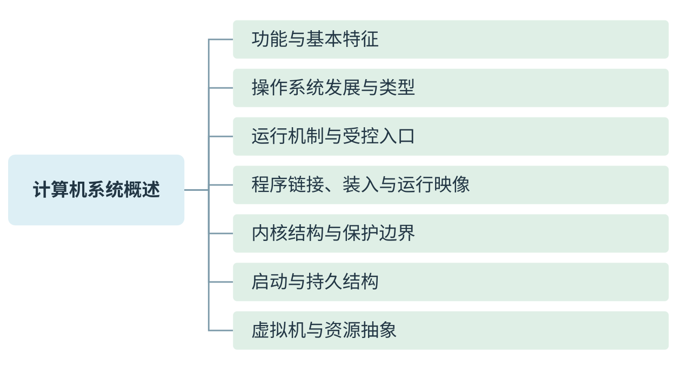

[可编辑SVG](../chapters/OS01/figures/overview.svg) · [完整知识导图](../chapters/OS01/chapter-map.pdf)

<a id="OS01-guide"></a>
## 资源、权限与控制流

> **课程连接 · 运行环境**
>
> 硬件资源由内核管理；用户程序通过受控入口申请服务，权限级与地址空间提供不同保护。

**方法 · 概念辨析的四步路径**
1. 先确定对象：是硬件资源、内核结构、用户程序，还是磁盘上的持久数据？
2. 再确定权限：操作能否影响其他进程或全局保护状态，是否需要受控入口？
3. 沿一次执行追踪：普通调用、陷入、异常响应、软件处理、返回，各由谁完成？
4. 最后检查条件：并发不自动推出并行，模式切换不自动推出进程切换，结构收益也要说明代价。

**定义 · 用资源与接口理解操作系统**
操作系统对处理器、内存、文件和设备实行受保护的管理，并向应用提供服务。学习时同时标出“管理对象”“允许谁操作”“通过哪个入口请求”；基本特征和内核结构都围绕这三件事展开。

<a id="OS01-entry-proof"></a>
### 受控入口为何不能由用户代码自行授予权限

**推导 · 从保护目标推出入口约束**
假设用户程序能先用普通赋值把模式位改为内核态，再调用服务，那么它也能跳过服务的参数检查，直接关闭时钟中断或改写别的进程映射，资源隔离立即失效。因此权限变化必须由硬件按预定事件与入口规则执行；内核取得控制权以后再检查请求。用户可以发起请求，并不等于用户能决定入口与授权结果。

程序执行一条普通加法指令时，通常直接使用处理器；读取文件时，却不能自己任意驱动磁盘。两种操作的差别来自资源保护：处理器、内存和设备由多个程序共享，操作系统必须管理它们，并给应用提供受控的使用接口。本章沿着一个程序的运行过程，梳理用户态、内核态、异常、系统调用和地址空间之间的关系。

<a id="OS01-1-1"></a>
## 操作系统管理什么，向程序提供什么

> **最小反例 · 单核也有并发**
>
> 一个CPU先运行A十毫秒，再运行B十毫秒，二者在同一时间段交替推进，已满足并发，却没有在同一时刻执行两条用户指令。把“系统有多个任务”直接推出“任务必并行”，就混淆了时间区间与时间点。
>
> 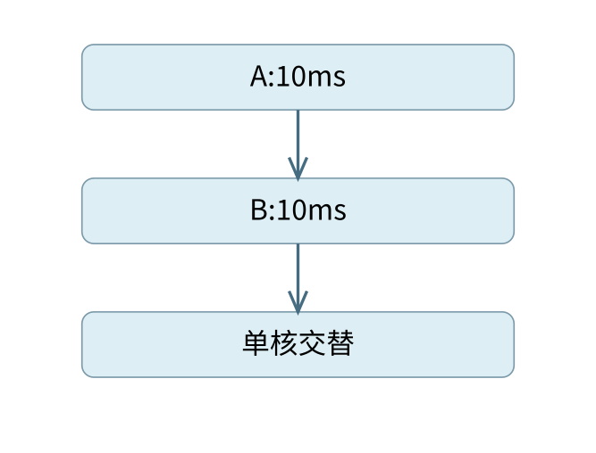
>
> 同一时间段交替推进是并发，不推出同一时刻指令并行。

**操作系统**是控制和管理计算机硬件、软件资源，组织程序运行，并向用户和应用程序提供接口的系统软件。这里的“管理”要落到具体对象上：处理机管理决定谁运行；内存管理分配空间并隔离访问；文件管理组织持久数据；设备管理协调输入输出，屏蔽设备差异。

面向用户的命令行、图形界面便于发起操作；面向应用程序的系统调用接口允许程序请求内核服务。图形界面不是所有操作系统都必须具有的组成部分。编译器虽然也是系统软件，但把高级语言翻译成目标程序并不是操作系统的基本职责。

〖1.1-003〗 下列哪项不是操作系统关心的基本问题：管理裸机、提供用户程序与硬件的接口、管理系统资源、提供高级语言编译器？答案是最后一项。判断依据是该功能是否承担资源管理与运行控制，不能只看它是否属于“系统软件”。

<a id="OS01-interfaces"></a>
### 用户接口：联机命令、脱机命令与程序接口

> **概念辨析 · 脱机并不等于离线网络**
>
> 联机与脱机命令接口按交互提交方式区分。批处理命令文件可以由联网计算机执行，分类依据仍是预先组织命令后批量运行。

操作系统向上提供的接口要区分使用者和使用方式。**联机命令接口**又称交互式命令接口，用户输入一条命令，系统解释并执行，再接收下一条；**脱机命令接口**又称批处理命令接口，用户预先组织一组作业控制命令，系统按约定顺序处理，执行期间通常不需要用户逐条干预。两者的“联机／脱机”描述的是命令提交与交互方式，不直接等同于有没有网络连接。

**程序接口**由一组系统调用构成，供程序请求服务。用户在文件管理器中点击“删除”属于使用图形用户界面，应用程序随后可能通过系统调用完成文件操作。图形界面、命令解释器、库函数和系统调用分别处在不同层次；把图形界面的一次点击直接视为CPU执行一条机器指令，会漏掉应用处理、库封装和内核服务。

<a id="os-fig-interfaces"></a>
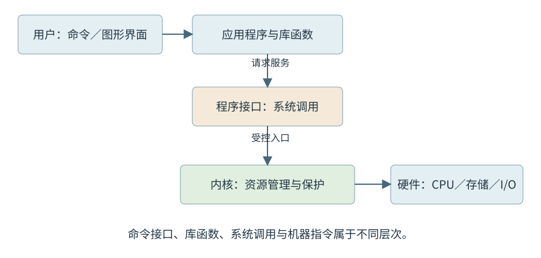

操作系统对硬件进行组织与抽象，把原本不便直接使用的裸机扩充为便于使用的机器。因此“扩充机器”强调增加服务与抽象，并不表示凭空增加CPU、内存或磁盘的物理容量。硬件资源仍有限，资源管理目标还包括安全、有效和公平地组织使用。

例如应用中的`printf`先进行格式转换，输出路径可能再调用系统服务；计算绝对值的库函数可以只执行用户态指令。判断接口类型时，应沿实际执行路径辨认，而不是依据函数名长短或是否属于标准库。

<a id="OS01-auto-1"></a>
### 并发、共享、虚拟与异步怎样联系

**并发**指多个活动在同一时间间隔内推进；**并行**指多个活动在同一时刻执行。一个 CPU 交替执行两个进程，已有并发；多个核上分别执行，才有处理器层面的并行。单 CPU 的计算与设备的数据传输仍可能并行。

**共享**指资源供多个并发活动共同使用。打印机一类资源通常需要互斥使用；磁盘文件或内存中只读代码可按规定共享。所谓“同时共享”不等于所有硬件操作都在同一瞬间发生，而是允许多个活动在同一时期使用同一资源。

**虚拟**把有限的物理资源抽象为若干逻辑资源。例如时间片让每个用户似乎独占一个处理器，虚拟内存让进程使用独立的地址空间。**异步**指进程因竞争处理器、等待 I/O 等原因，以不可预先确定的速度向前推进。它不表示进程内部可以违背程序依赖，也不等同于接口中的“异步 I/O”。

并发活动会竞争资源，因而共享必须伴随保护；虚拟化为并发活动提供合适的使用视图；资源等待又造成执行速度的不确定。后续同步与调度问题都以这些关系为前提。

<a id="OS01-ex1-1"></a>
### 例 1-1　进程越多，处理器利用率一定越高吗

**例题 · 配套例题**

【配套例题】 下列关于多道程序系统的叙述中，不正确的是（　）。

A. 支持进程的并发执行　　B. 不必支持虚拟存储管理

C. 需要实现对共享资源的管理　　D. 进程数越多 CPU 利用率越高


**解析。** 多道程序设计的直接收益是：一个进程等待 I/O 时，CPU 可以运行其他就绪进程。但这一收益有前提：可运行进程过多会增加调度开销和内存压力，严重时频繁换页，CPU 反而难以有效执行用户计算。因此 D 把条件性收益写成了单调关系，答案为 **D**。多道程序可以使用不带请求分页的内存方案，B 正确；“多道”不等于“必须有虚拟内存”。

<a id="OS01-1-2"></a>
## 批处理、分时与实时解决不同的问题

> **错项排除 · 实时性的判据是期限**
>
> 控制任务必须在五毫秒内响应，即使某机器多数时候只用一毫秒，偶尔延迟十毫秒也可能违反硬实时要求。排除“实时系统就是运行速度最快的系统”时，应指出缺少最坏响应与截止期限这一保证。

早期人工装入程序时，CPU 常等待操作者准备下一项作业。单道批处理把多个作业预先排好，自动逐个执行，减少人工干预；但一个作业等待 I/O 时，处理器仍可能空闲。多道批处理允许多项作业同时在内存中，利用 CPU 与 I/O 的重叠提高吞吐量。中断使设备完成时能够通知 CPU，存储保护、调度和资源管理使多道运行可控。

**分时系统**把处理器时间分成时间片，轮流服务交互用户，主要关注响应时间和交互性。一个时间片并不等于某个程序的全部运行时间；未运行完的程序会在以后继续执行。**实时系统**关注任务能否在规定期限内得到响应或完成。硬实时任务错过截止时间便不能满足系统要求；软实时允许一定程度的超期，但质量会下降。实时性不能只解释成“运行得快”：提前 1 秒完成与晚于期限 1 毫秒完成，两者的结果差异可能与绝对执行速度无关。


| 类型 | 主要组织方式 | 评估时首先关心什么 |
| --- | --- | --- |
| 多道批处理 | 作业成批提交，运行中较少交互 | 吞吐量、周转时间、资源利用率 |
| 分时 | 多用户交互，时间片轮转 | 响应时间、使用公平性 |
| 实时 | 按期限和任务紧迫性组织执行 | 截止时间、响应的可预测性 |


网络操作系统支持联网计算机上的资源与通信服务；分布式系统进一步组织多台计算机协作，可能提供统一资源视图。单用户、多用户、单任务、多任务则是另外的分类维度，不能把“单用户”自动理解为“单任务”。

<a id="OS01-batch-evolution"></a>
### 从人工操作到多道程序：CPU为什么会空闲

人工操作阶段，装入纸带、检查结果和准备下一作业需要人参与，CPU常等待外部准备。脱机输入／输出把部分慢速操作交给外围设备预先处理，减少主机等待人工操作的时间；单道批处理进一步由监督程序自动安排作业，但内存中仍只有一道作业可运行，该作业等待I/O时，CPU缺少其他可切换的工作。

多道程序设计把多道作业同时放在内存中：某道作业等待设备时，另一道就绪作业可以使用CPU。这里有两种不同的重叠：CPU与I/O设备可以物理并行；同一CPU上的多道程序交替执行形成并发。收益来自填补空闲时间，而系统同时承担处理机分配、存储保护、设备协调等额外管理工作。

若只有进程A，A依次计算2 ms、输入4 ms、计算2 ms，忽略系统开销，则完成时间8 ms，CPU有效计算4 ms，利用率为50%。若在A等待输入时运行另一个就绪进程B的4 ms计算段，时间线可成为A计算0～2、A输入与B计算2～6、A计算6～8；总历时仍为8 ms，却完成8 ms计算，CPU利用率达到100%。这是根据上述机制构造的示例，成立前提是设备与CPU可并行、B始终就绪且忽略切换开销。

批处理主要追求吞吐量与周转；分时进一步强调交互、独立使用感和及时响应。实时系统还必须依据任务期限安排执行，硬实时与软实时在能否容忍超期方面不同。几类系统可在现代实现中兼具若干特征，分类是在比较主要设计目标。

<a id="OS01-1-3"></a>
## 用户态、内核态与特权指令

> **最小反例 · 内核也要做普通加法**
>
> 内核计算页框号或更新计数器时，会执行普通算术指令。它们在用户态通常也合法，所以“内核态执行的都是特权指令”不成立。限制方向是特权操作要求高权限，不能把这个蕴含关系反过来。

处理器的**工作模式**规定当前代码能够执行哪些受保护操作。用二态模型表示时，用户态权限较低，内核态权限较高。模式位保存在程序状态信息中，由硬件按规则改变；普通用户程序不能靠一条赋值指令就把自己切换成内核态。

**特权指令**只能在规定的高权限模式执行，例如修改关键内存映射、设置中断屏蔽状态、直接控制受保护 I/O。若允许任意用户程序关闭时钟中断，它就可能长期占用 CPU，使调度失去控制。普通算术、逻辑和多数寄存器操作没有这种系统级影响，可以在用户态执行，也可以在内核态执行。

由此要区分两件事：特权指令必须在内核态运行，但内核态运行的并不都是特权指令。前者约束的是特权指令；若把内核态理解成只能执行特权指令，内核中的普通计算就无从进行。陷入指令是用户程序主动进入受控入口的指令；它允许在用户态执行，执行后由硬件转入规定的内核入口，不能据“会进入内核”反推它是用户态禁止执行的特权指令。

<a id="OS01-1-4"></a>
## 中断和异常怎样把控制权交给内核

**外部中断**由正在执行的指令以外的事件引起，如时钟到期、设备完成。**异常**由当前指令执行过程中的事件引起，如除数为零、缺页、执行非法指令；主动执行陷入指令也通过受控异常入口请求服务。不同教材可能把“中断”作为包括内外事件的总称，本书需要区分时使用“外部中断”和“异常”。

一次典型控制转移包括以下连续过程：硬件检测事件，保存继续执行所需的断点和程序状态，按事件号找到处理入口并切换到所需模式。入口代码再保存会被处理程序改写的通用寄存器，然后执行处理；退出时恢复相应现场，使用专门返回指令恢复程序状态和继续位置。具体保存位置以及硬件、软件的分工取决于体系结构，不能把所有现场的保存都归给同一方。

<a id="os-fig-control"></a>
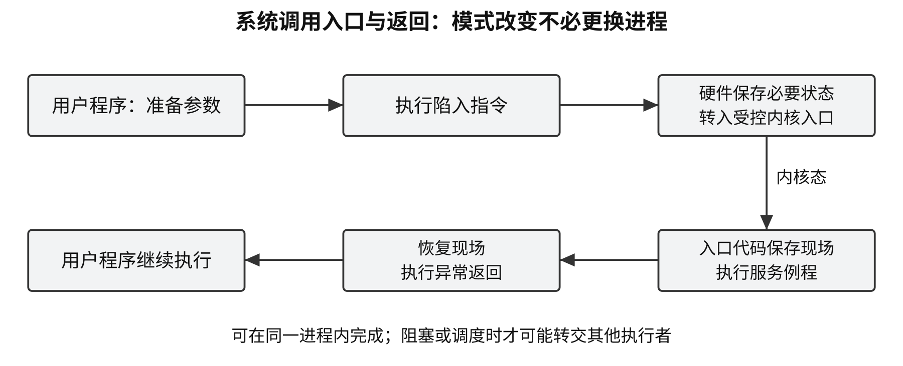

外部中断通常在指令边界被响应；异常通常在指令执行期间被发现。可恢复故障处理完后，可能重新执行产生异常的指令，例如缺页后重试访存；陷入返回通常从陷入指令的后继指令继续执行；不可恢复错误可能终止进程。题目给出具体指令集时，以其断点与返回规则为准。

<a id="OS01-exception-types"></a>
### 陷阱、故障与终止：异常返回地址为何不同

异常可按触发与恢复方式区分。**陷阱（trap）**通常是程序有意发起的受控事件，常用于请求内核服务，处理完后继续执行后继指令。**故障（fault）**表示当前指令执行条件暂不满足；若处理能够修复条件，如为合法虚拟页调入内容，返回后可重新执行引起故障的指令。**终止（abort）**表示难以恢复的严重事件，通常无法正常继续原来的指令序列。

| 类别 | 事件与当前指令的关系 | 常见后续行为 |
| --- | --- | --- |
| 外部中断 | 来自设备、时钟等外部事件 | 处理后恢复被打断程序，或依据调度决定切换 |
| 陷阱 | 程序有意执行陷入指令 | 从规定的后继位置继续 |
| 故障 | 当前指令执行发现可处理问题 | 修复条件后重试原指令 |
| 终止 | 发生难以恢复的严重错误 | 结束相关执行或进入故障处理 |

分类用来说明机制，不宜只凭“除零”等事件名称断言所有体系结构的处理和返回方式完全相同。具体题目给出指令集、异常模型或操作系统行为时，应以题设为准。

**中断向量**提供中断处理入口等信息；**中断向量表**按事件编号组织这些入口信息。响应机制定位入口后，才进入相应的软件处理程序。中断响应、保存现场、执行处理、恢复现场和返回是连续环节，硬件与软件的职责应分别核对。

<a id="OS01-ex1-2"></a>
### 例 1-2　执行系统调用时，哪些操作属于软件

**例题 · 配套例题**

【配套例题】 执行系统调用的过程涉及下列操作，其中由操作系统完成的是（　）。

Ⅰ. 保存断点和程序状态字　　Ⅱ. 保存通用寄存器的内容

Ⅲ. 执行系统调用服务例程　　Ⅳ. 将 CPU 模式改为内核态

A. 仅Ⅰ、Ⅲ　　B. 仅Ⅱ、Ⅲ  
C. 仅Ⅱ、Ⅳ　　D. 仅Ⅱ、Ⅲ、Ⅳ


**解析。** 按题目采用的常规异常入口模型，Ⅰ、Ⅳ由响应机制中的硬件完成；Ⅱ由内核入口代码完成，Ⅲ本来就是内核软件执行的服务。因此答案为 **B**。将模式切换留给不受保护的用户代码会破坏入口的受控性；内核不能等到自己已经进入服务代码，才由普通指令任意决定是否取得权限。

中断处理不必导致进程切换。例如时钟中断只更新计数后返回原进程，模式虽然来回切换，但运行的仍是原进程。这个区别在第2章用于分析上下文切换。

<a id="OS01-1-5"></a>
## 系统调用与库函数：调用一段代码，还是请求内核服务

> **错项排除 · 系统调用不保证阻塞**
>
> 读取的数据若已经在内核缓存且可立即返回，系统调用仍跨越了保护边界，却可能始终由原进程完成。判断阻塞要看所需事件是否尚未满足，判断进入内核要看是否通过受控入口，两项不能互相替代。

**系统调用**是应用通过规定接口请求内核服务的过程。程序准备调用号和参数，执行陷入指令；内核检查参数、权限及资源状态，分派到相应服务；服务完成时，或进程阻塞后又被唤醒继续时，内核把结果返回用户程序。检查参数不能省略，例如用户提供的缓冲区地址必须落在允许访问的范围内。

**库函数**是程序可以调用的已有函数。纯字符串长度计算可以完全在用户态完成；文件读写库函数可能整理格式、维护用户缓冲区，再调用 `read`、`write` 等系统调用。因而“调用库函数”既不必然发生模式切换，也不排斥发生系统调用。反过来，系统调用也不是普通函数调用：它跨越保护边界，并通过内核规定的入口执行。

读取磁盘文件时，`read(fd, buf, n)` 中的 `fd` 标识已经打开的文件，`buf` 是接收数据的用户缓冲区，`n` 是请求字节数。若数据已在内核缓存，内核可能复制后直接返回；若必须等待设备，当前进程可能先阻塞，CPU 转去运行其他进程。不要把“系统调用进入内核”与“系统调用必阻塞”合为一条结论。

〖1.1-010〗 库函数不直接处理所有受保护硬件请求。判断一个具体函数是否引起陷入，要看它在本次路径上是否请求内核服务，不能只凭“库函数”这个名称。

<a id="OS01-1-6"></a>
## 从源程序到可运行映像：链接、装入与地址绑定

> **不变量 · 先判范围，再求和**
>
> 界限寄存器按长度定义时，合法逻辑地址始终满足$0\le a<L$。即使$B+a$仍落在已安装的物理内存内，也不能放行$a=L$。这个不变量保护的是当前进程的合法区间，与整台机器是否还有空间无关。

编译把源程序翻译为目标模块，目标模块可能仍含未确定的外部符号。**链接**把多个目标模块和所需库连接起来，解析符号并处理地址引用，形成可装入文件。静态链接在运行前完成所需模块的合并；装入时动态链接在装入时连接；运行时动态链接在首次调用等运行时机连接所需模块。

**装入**把可执行文件需要的内容映射或读入进程地址空间，并建立运行条件。地址绑定可能发生在不同阶段。


| 方式 | 地址何时确定 | 移动到另一个物理位置会怎样 |
| --- | --- | --- |
| 绝对装入 | 编译或汇编时已给定绝对地址 | 通常须重新生成或修补地址 |
| 可重定位装入 | 装入时按实际起点修改相关地址 | 装入后不能仅换一个基址就随意搬移 |
| 动态运行时装入/重定位 | 执行访存时由地址变换机构转换 | 更新映射后可改变物理位置，需相应硬件支持 |


最小的动态重定位模型使用基址寄存器 $B$ 和界限 $L$。程序产生逻辑地址 $a$，先检查 $0\le a<L$，合法时物理地址为 $B+a$。例如 $B=12000,L=2000$，逻辑地址 1500 转为 13500；逻辑地址 2000 已越界，不能因为“两数相加仍在主存范围内”就判为合法。界限表示长度时，上界通常不包含；若题目把寄存器定义成最大合法地址，则应按其定义调整比较。

动态重定位在执行阶段进行，依赖重定位信息与硬件地址变换机构，不需要每次访存都调用装入程序。操作系统负责设置和维护映射，硬件完成运行中的快速转换。分页的非连续映射在第3章展开。

<a id="OS01-1-7"></a>
## 进程地址空间中，代码、数据、堆和栈各放什么

> **课程连接 · 指针自身与所指对象分开**
>
> 数据结构中的链表头指针可能是函数局部变量，所指结点却由动态分配得到；函数退出与结点释放属于不同生存期问题。分析内存图时为“指针变量”和“动态对象”分别画位置，能避免把整个链表误判为栈对象。

**地址空间**是一组可由地址标识的位置。进程的虚拟地址空间提供其运行时看到的地址视图，不要求这些地址对应的内容全部同时存在物理内存。可执行文件的磁盘布局、进程的虚拟布局、物理页框布局是三个不同对象。

典型用户空间包含代码区、静态数据区、堆、栈和映射区。代码区存放机器指令，通常只读且可共享；已初始化的全局变量、静态变量通常在初始化数据区，未显式初始化或零初始化的数据可用零填充区表示。堆用于动态申请的对象，栈保存函数活动记录中的参数、返回信息与未被优化掉的自动局部变量。共享库和映射文件可位于映射区。具体地址增长方向和排列由平台决定，示意图不能代替题设。

考虑以下代码，假定采用常规 C 运行时布局且忽略编译优化：

```c
#include <stdlib.h>

int g = 3;
static int z;
int main(void) {
    int n = 16;
    char *p = malloc(n);
    /* 使用 p 指向的空间 */
    free(p);
}
```

`g` 是初始化静态存储期数据，`z` 是零初始化静态存储期数据；`n` 和指针变量 `p` 自身属于 `main` 的局部活动记录；`p` 指向的动态对象属于堆。指针存在哪里与它指向的对象存在哪里必须分别回答。“写在函数外”并不等于“属于代码段”；局部变量也未必都放在栈上，优化可能把它们放进寄存器或直接消除。

进程控制块 PCB 保存调度与管理信息，是内核数据结构，不是应用能够随意修改的用户栈对象。同一程序的两个运行实例可以共享只读代码，但具有不同的进程身份、逻辑状态和数据视图。

<a id="OS01-1-8"></a>
## 内核结构：把哪些功能放进同一保护域

**分层结构**按依赖关系划分功能，上层使用规定的下层服务，便于逐层验证；代价是层次难划分、调用路径可能增长。**模块化结构**把功能组织为接口清楚的模块，允许在约定接口下替换实现。模块划分不自动规定严格的层次调用关系，模块也不等于独立的保护域。模块设计追求模块内部功能紧密相关（高内聚），模块之间通过尽量少的依赖协作（低耦合）。接口需要在开发前充分设计；若需求尚不明确，预先规定所有接口较困难，跨模块协调也可能增加设计和维护成本。

**宏内核**把较多的管理功能放在内核地址空间中，功能间可以直接调用，通信开销较小；一个内核模块的错误也可能影响整个系统。**微内核**把最基本的调度、低级地址空间管理、进程间通信等保留在内核，把较多服务移到用户态服务器。隔离与替换更容易，但一次服务可能增加消息传递和保护域切换，不能无条件断言性能更好。

**外核**进一步把资源保护和复用机制与高层资源抽象分开，让应用或库操作系统按需要实现抽象。它并非“没有内核”或“不保护资源”；恰恰相反，保留必要的保护职责正是外核的基础。

比较宏内核与微内核时，先看服务放在哪个保护域，再分析通信和故障如何跨越这个边界。下表比较典型结构；实际系统可以混合采用这些设计。


| 共同维度 | 宏内核 | 微内核 |
| --- | --- | --- |
| 服务的位置 | 文件系统、设备管理等较多服务在内核态 | 只保留基本机制，较多服务由用户态服务器实现 |
| 服务间通信 | 同一内核地址空间内可直接调用 | 常经进程间通信、消息传递和保护域切换 |
| 故障影响 | 内核模块错误可能破坏其他内核功能 | 用户态服务器的故障较易隔离，但仍需设计恢复机制 |
| 扩展和移植 | 模块接口有助维护，修改仍须考虑内核内部依赖 | 可分别调整服务器；小内核较便于验证、移植 |
| 性能代价 | 调用路径较短；功能多不等于任意实现都快 | 跨域通信可能增加开销；隔离收益不能直接推出性能更高 |


<a id="OS01-ex1-3"></a>
### 例 1-3　微内核的收益与代价

**例题 · 配套例题**

【配套例题】 与宏内核操作系统相比，下列特征中，微内核操作系统具有的是（　）。

Ⅰ. 较好的性能　Ⅱ. 较高的可靠性　Ⅲ. 较高的安全性　Ⅳ. 较强的可扩展性

A. 仅Ⅱ、Ⅳ　　B. 仅Ⅰ、Ⅱ、Ⅲ  
C. 仅Ⅰ、Ⅲ、Ⅳ　　D. 仅Ⅱ、Ⅲ、Ⅳ


**解析。** 服务间保护边界有利于限制故障影响，减少高权限代码有利于安全，服务模块也更容易扩充；但跨域通信会增加开销，不能把Ⅰ列为一般优势。答案为 **D**。这些是结构层面的比较，不是对任意两个具体系统的性能或安全性作无条件排名。

<a id="OS01-kernel-primitives"></a>
### 原语、时钟与内核的基本机制

> **适用边界 · 关中断的作用范围**
>
> 当前CPU暂不响应可屏蔽中断，不会自动阻止另一CPU访问共享结构。多处理机原子性还依赖锁、原子指令等机制。

内核的底层机制通常包括时钟管理、中断处理和原语。时钟中断既可支持计时，也为时间片到期、定时等待等管理提供事件来源。原语负责完成需要保持一致性的关键操作，例如保存现场、改变进程状态和移动PCB队列。

原语的**原子性**要求其他执行者不能观察到破坏约定的中间状态。单处理器模型常用短暂关闭可屏蔽中断的方法保护关键操作；它的作用范围是当前处理器，且不能屏蔽所有可能的异常。多处理器上，别的处理器仍可能访问共享数据，因此还需要锁或原子指令等同步机制。不能把“本CPU不响应某类中断”当作“整台机器没有并发访问”。

分层结构、模块化、宏内核和微内核比较的是功能组织和保护边界。模块之间接口清楚不意味着每个模块都必须独立运行在用户态；微内核将服务移出高权限域，也仍需通过内核机制保护通信和共享资源。

<a id="OS01-1-9"></a>
## 开机以后，内核怎样获得控制权

> **课程连接 · 开机结构与磁盘格式不同**
>
> 中断入口、页表和调度队列属于本次运行所需结构；分区表、根目录和磁盘索引节点通常是持久存储的一部分。把题中对象按“随运行建立”与“跨重启保留”定位，才能判断初始化是否需要重新创建。

典型引导链为：处理器复位后执行固件中的启动代码，固件初始化必要硬件并选择启动设备；引导程序定位并装入内核；内核建立中断入口、内存管理和设备管理等基本环境，创建初始进程，最后进入正常调度与用户服务。引导程序可以分阶段，早期阶段只装入后续阶段，不能把所有启动代码都理解成同一段磁盘程序。

传统 BIOS/MBR 模型中，磁盘主引导记录可含引导代码和分区表；现代 UEFI/GPT 的组织不同。回答“引导程序在哪里”必须先确定所指的是固件初始代码、主引导代码，还是文件系统中的后续装载器。引导不等于格式化：已经安装的文件系统和分区信息可以跨多次开机保留，而内核运行所需的内存管理结构需要本次启动建立。

<a id="os-fig-boot-chain"></a>
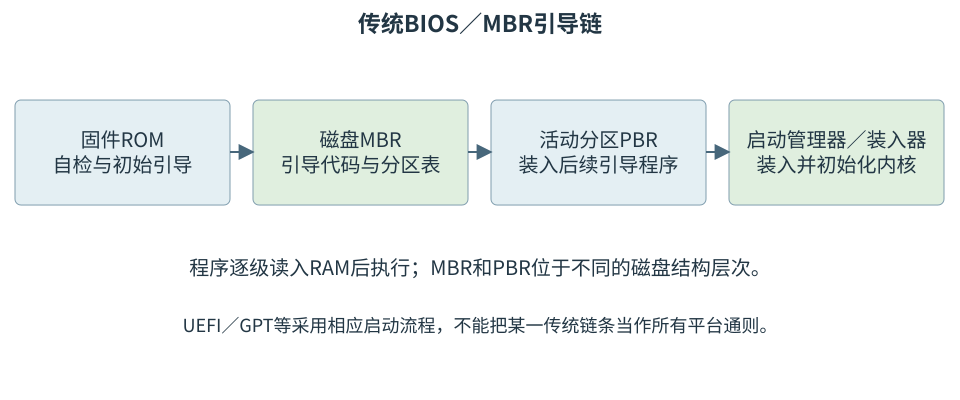

<a id="OS01-ex1-4"></a>
### 例 1-4　每次开机需要重新建立什么

**例题 · 配套例题**

【配套例题】 下列选项中，需要在操作系统进行初始化过程中创建的是（　）。

A. 中断向量表　　B. 文件系统的根目录

C. 硬盘分区表　　D. 文件系统的索引节点表


**解析。** 中断向量表是本次内核运行所需的控制转移结构，需要在初始化中建立，答案为 **A**。其余为磁盘格式与文件系统的持久结构，通常在分区或创建文件系统时形成，不应每次开机重建。

<a id="OS01-1-10"></a>
## 虚拟机：客户操作系统也可以成为被管理者

**虚拟机管理程序 VMM**向客户操作系统提供虚拟处理器、内存和设备，安排多个虚拟机使用物理资源，并隔离其影响。客户操作系统中的“内核态”只是客户的权限视图，并不意味着客户操作系统可以越过 VMM 任意修改主机资源。敏感操作由硬件虚拟化支持、陷入模拟或其他受控机制处理，具体路径随实现变化。

第一类 VMM 直接运行在硬件上；第二类 VMM 依托宿主操作系统运行。二者都可能采用硬件加速，因此不能把它们简单等同于“硬件实现”和“软件实现”。多台虚拟机可以在单核上交替运行，也可以在多核上并行运行，所以“同时存在多台虚拟机”不能推出它们在每一时刻都真正并行。

进程虚拟地址空间隔离的是进程访存；系统虚拟机为客户操作系统提供完整机器抽象。容器通常共享宿主内核，通过名称空间、资源控制等隔离进程环境，但这不等同于每个容器都带一个独立客户内核。这里借容器辨析抽象层次，不要求记忆其实现细节。

<a id="OS01-vmm-models"></a>
### 虚拟机的两种组织方式

> **抽象层次 · 客户与宿主分开判断**
>
> 客户进程阻塞是客户操作系统内部事件；虚拟机暂停是整个客户机器失去物理运行机会。二者的管理者和影响范围不同。

| 维度 | 第一类VMM | 第二类VMM |
| --- | --- | --- |
| 直接依托的层次 | 直接运行在物理硬件上 | 作为宿主操作系统上的程序运行 |
| 设备服务路径 | 由VMM及其设备服务组件组织 | 还利用宿主系统的设备驱动与服务 |
| 客户系统看到的对象 | 虚拟CPU、虚拟内存、虚拟设备 | 同样是完整的虚拟机器抽象 |
| 存储资源分配 | 由VMM管理物理存储并分配客户空间 | 虚拟磁盘常表现为宿主文件系统中的文件 |
| 性能与可支持数量 | 少一层宿主转接，通常具有较小的额外开销 | 还需宿主资源；数量与性能受具体负载和实现影响 |
| 虚拟机迁移 | 依赖管理程序的镜像、设备和迁移机制 | 虚拟磁盘文件便于复制；仍须匹配虚拟硬件与平台 |
| 运行权限 | VMM管理物理资源，特权机制由平台提供 | 可由用户态组件与宿主内核组件协同完成 |

客户内核使用虚拟CPU的高权限操作时，实际保护层仍须确认其影响只落在分配给该虚拟机的资源上。虚拟机暂停与客户进程阻塞不是同一个层次的状态：前者可使整个客户系统暂时没有物理CPU运行机会，后者是客户系统内部某个执行者在等待事件。

<a id="os-fig-vmm-layers"></a>
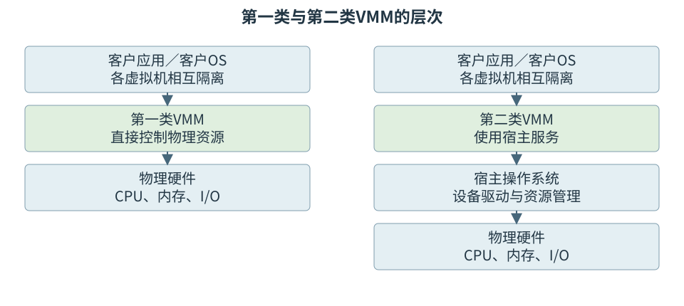

第一类VMM直接管理物理资源，可把物理存储空间等划分给客户系统；第二类VMM借助宿主文件、内存和设备服务，客户虚拟磁盘可以表现为宿主文件中的数据。通常第一类少一层宿主转接、资源控制更直接；第二类依赖宿主的资源与驱动，作为普通宿主文件保存的虚拟机器也较便于复制迁移。实际性能、客户种类和迁移能力还取决于硬件虚拟化支持及产品实现。

虚拟化还必须控制客户内核的特权操作：客户看到的高权限不等于可以越过VMM访问别的客户资源。支持虚拟化的CPU提供相应的执行与陷入机制；传统Ring 0～3权限示意中的Ring 0与用户Ring 3，说明的是受控权限等级，不能据此断定客户内核直接取得整台物理机的最高控制权。

<a id="OS01-1-review"></a>
## 分支回顾与自测

> **课程连接 · 回忆顺序**
>
> 先区分用户态与内核态，再分别说明异常入口、内核操作和返回的位置。

以下为原创回顾设问，用于检查本章机制与边界。

1. 普通函数调用、系统调用、设备中断是否都必然更换当前进程？
2. 用户程序执行陷入指令后进入内核，是否说明陷入指令应禁止在用户态执行？
3. 基址为 4096、界限为 1024，逻辑地址 1023 与 1024 分别怎样处理？
4. 指针变量在栈上，是否说明它指向的对象也在栈上？
5. 单核运行四台虚拟机，是否要求四台同时执行机器指令？

<a id="OS01-auto-2"></a>
### 自测答案

1. 都不必然。函数调用通常不跨保护域；系统调用和设备中断可能只切换模式后返回原进程。只有实际选中另一个进程时，才发生调度切换。
2. 否。陷入是用户可执行的受控入口；目标入口和权限变化受硬件及内核规则约束。
3. 1023 合法，物理地址为 5119；1024 等于长度上界，越界。
4. 否。须分别判断指针自身与所指对象的生存期和分配方式。
5. 不要求。它们可以分时复用一个处理器，并发而非同一时刻并行。

<a id="OS01-recall"></a>
## 主动回忆自测

> **课程连接 · 自主检验**
>
> 遇到调用流程题，依次写出发起者、特权转换、内核处理和返回条件。

以下均为自拟题，先盖住答案，按“对象—权限—执行路径—条件”口述理由。

**主动回忆 · 功能、权限与结构的综合辨析**
1. 单CPU交替运行两个程序，哪些特征成立？能否据此断言两程序指令并行？
2. 为什么增加进程数不一定持续提高CPU利用率？
3. 陷入指令为何能在用户态执行，而修改中断屏蔽状态通常不能？
4. 一次设备中断后仍返回原进程，发生了什么切换，又没有发生什么切换？
5. 基址12000、界限2000，逻辑地址1999与2000怎样处理？
6. 函数局部指针指向malloc得到的空间，两个对象各属于哪种存储？
7. 微内核减少高权限代码，为什么仍不能直接断言性能更高？
8. 第一类、第二类VMM的区别是什么？单核运行多台虚拟机是否矛盾？

<a id="OS01-recall-answers"></a>
### 核对答案与关键理由

1. 同一时间段交替推进是并发；单核同一时刻通常只执行一条用户指令，不能据此判用户指令并行。
2. 可隐藏部分I/O等待，但过多进程会增加调度、同步和内存压力，严重时抖动，收益有条件。
3. 陷入只进入预定的受控入口；任意用户修改全局屏蔽状态会破坏调度与保护，因而受权限约束。
4. 中断可导致用户态与内核态之间的模式变化；实际运行身份仍是原进程时，没有切换到另一个进程。
5. 1999满足$0\le a<2000$，物理地址13999；2000等于长度上界，越界，不能先相加再放行。
6. 指针变量本身通常位于函数活动记录中，动态对象在堆；优化可能改变局部变量的实际存放，题设优先。
7. 服务移出内核改善隔离，却可能增加IPC、消息复制和保护域切换；不同实现的总性能须实际比较。
8. 第一类直接运行于硬件，第二类依托宿主系统；二者都可用硬件加速。多虚拟机可分时复用单核，无矛盾。


<a id="OS02"></a>
# 进程与线程

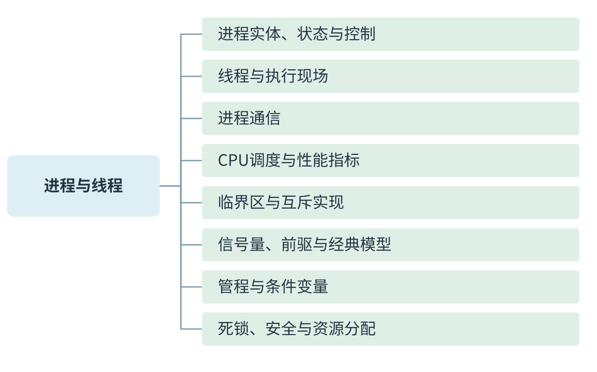

[可编辑SVG](../chapters/OS02/figures/overview.svg) · [完整知识导图](../chapters/OS02/chapter-map.pdf)

<a id="OS02-guide"></a>
## 进程执行、调度、同步与资源分配

> **课程连接 · 四条主线**
>
> 进程与线程描述执行实体；调度分配处理器；同步规定先后；死锁涉及多资源等待。

进程把程序的一次执行和资源环境联系起来，线程进一步划分执行流。一个执行者能否继续前进，既取决于是否分到CPU，也取决于所需数据、同步事件与资源是否到位。下面先建立状态与调度模型，再用互斥、信号量和死锁分析描述执行者之间的关系。

<a id="OS02-module-02"></a>
## 进程、线程、调度与上下文切换

程序是指令和数据的静态描述，进程是程序的一次执行过程及其资源环境。同一可执行文件运行两次，可以产生两个进程；同一进程又可以包含多个执行线程。判断状态变化时，要分别问：资源属于谁，当前谁在执行，谁还在等一个事件，谁只是等待处理器。

<a id="OS02-2-1"></a>
### 进程与线程：资源单位和执行单位

**进程**是系统进行资源分配和管理的基本单位，具有独立的运行状态和地址空间视图。进程实体通常由程序段、相关数据和进程控制块 PCB 等构成。PCB 记录标识、状态、调度信息、资源使用信息及保存的处理器现场，内核据此管理进程；“一个进程没有正在占用 CPU”不等于它不存在。

**线程**是进程内部的一条执行流。在引入线程的系统中，处理器调度通常落实到可调度线程，而地址空间、打开文件等资源主要归所属进程。每条线程需要自己的程序计数器、寄存器现场、栈和线程控制信息，否则无法分别记住执行位置和函数调用链。

同一进程的线程可以访问共同的代码、静态数据、堆及进程资源，但拥有独立的执行现场。“线程有自己的栈”指的是各线程的函数调用状态分别管理，但这不意味着同进程的其他线程在地址上无法访问该栈。只要得到有效地址并具备权限，线程仍可能错误地访问另一线程的对象；私有用途与硬件隔离不同。

进程通常具有动态性、并发性、独立性、异步性和结构性。动态性体现进程随执行而创建、变化和结束，是进程的最基本特征；结构性指进程实体由程序段、数据段和PCB组成。独立性指其运行和管理环境，不表示不能通信或共享；异步性也不意味着可以违反自身指令的必要依赖。线程有利于把服务器中等待网络、处理请求等活动组织成多个执行流，但线程数增加同样会带来同步、栈空间和切换开销。


| 比较维度 | 不同进程之间 | 同一进程的不同线程之间 |
| --- | --- | --- |
| 资源与地址空间 | 各有地址空间和进程资源；共享须按机制建立 | 共享代码、数据、堆和打开文件等所属进程资源 |
| 执行现场 | 由各自的控制信息保存 PC、寄存器、栈等 | 每条线程仍有独立 PC、寄存器、栈和线程控制信息 |
| 切换要改变什么 | 还需切换相应地址空间环境 | 通常无需更换所属进程的地址空间，仍须换执行现场 |
| 数据交换 | 通过共享内存、消息、管道等机制 | 可直接访问共同对象，仍须处理同步与互斥 |
| 隔离边界 | 默认地址隔离有助限制误写的影响 | 一个线程可破坏共同空间；线程栈并非在地址上对其他线程不可访问 |


这里比较的是资源归属；能否由内核分别调度、阻塞是否牵连其他线程，还要看下一节的线程实现与映射模型。

<a id="OS02-2-2"></a>
### 就绪、运行和阻塞：先判断缺少什么

> **错项排除 · 唤醒与分派是两步**
>
> I/O完成把阻塞者所缺的事件补齐，通常只使其进入就绪队列。处理器仍可由原进程或另一个高优先级者使用，因此“设备一完成，该进程立即运行”遗漏了调度决定。画状态图时应保留阻塞到就绪、就绪到运行两条边。

**就绪态**表示除处理器外，执行所需条件已满足；**运行态**表示正在处理器上执行；**阻塞态**表示等待 I/O、资源、同步事件等条件，暂不能因获得 CPU 就继续。单处理器同一时刻至多一个相应执行实体在运行，就绪与阻塞却都可以有多个。

<a id="os-fig-states"></a>
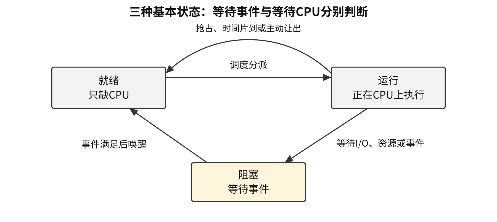

运行者用完时间片或被更高优先级者抢占，通常转为就绪；执行阻塞式 I/O 而数据未就绪，转为阻塞；等待事件发生后，由内核唤醒为就绪。阻塞者一般不能直接跳到运行，因为事件满足与分配处理器是两个决定。就绪者没有在执行，也不能主动发起一项新的阻塞操作。

创建态用于建立运行环境，终止态用于退出和清理；若进程被换出内存，还可引入挂起就绪、挂起阻塞等状态。挂起描述的是进程是否驻留内存，阻塞描述的是缺少事件，二者不是同义词。等待事件已满足的挂起阻塞进程，可以先成为挂起就绪，仍须调入并获得 CPU 才能运行。

<a id="OS02-course-seven-states"></a>
#### 挂起与激活：七状态模型

> **辨析 · 挂起与阻塞**
>
> 阻塞表示事件未满足；挂起表示映像暂时不驻留。事件发生后，阻塞挂起转为就绪挂起，调回后才进入就绪队列。

课件在五状态模型上增加**就绪挂起**与**阻塞挂起**：前者执行条件已具备，但进程映像暂不在内存；后者既在等待事件，又处于挂起状态。在此经典模型中，挂起指暂时调出进程映像，普通阻塞态仍驻留内存；进程控制块仍须保留以便系统管理。不同实际系统可采用更细的驻留和换出策略。


<a id="os02-seven-states-diagram"></a>
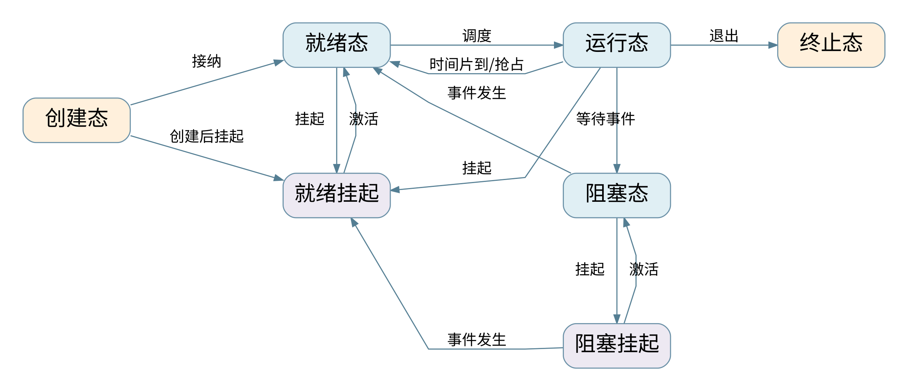


事件在阻塞挂起时发生，进程转入就绪挂起，而不是立即取得处理器。激活把就绪挂起者转为就绪、把仍在等待的阻塞挂起者转为阻塞；运行者也可能被挂起。创建后的进程可按系统策略进入就绪或就绪挂起。挂起队列可按就绪与阻塞区分，阻塞挂起者还可按等待事件进一步分类。


<a id="OS02-ex2-1"></a>
#### 例 2A-1　主动让出处理器后去哪里

**例题 · 配套例题**

【配套例题】 下列由当前线程引起的事件或执行的操作中，可能导致该线程由执行态变为就绪态的是（　）。

A. 键盘输入　　B. 缺页异常　　C. 主动出让 CPU　　D. 执行信号量的 wait() 操作


**解析。** 主动出让处理器时，线程可能仍具备执行条件，只是把本次运行机会交出去，因而变为就绪，答案为 **C**。缺页且需等待调页、等待未到来的输入，通常使线程阻塞。信号量 wait 若能取得许可，可继续运行；若取不到，则阻塞，而不是仅因调用了 wait 就进入就绪。

键盘输入或另一进程退出临界区，可能满足某个阻塞者等待的条件，使它被唤醒；当前进程的时间片用完则主要改变当前运行者的状态。判断“可能唤醒”时要指明被满足的是哪个等待条件，不能把所有调度事件都当作唤醒。

<a id="OS02-2-3"></a>
### 用户级、内核级线程与映射模型

> **课程连接 · 模型决定多核并行度**
>
> 多个用户线程若全部复用一个内核执行实体，内核无法同时把它们安排到两个CPU上。若映射到多个内核线程，才可能获得多核并行。判断时把用户线程数、承载实体数、物理核数分开，不能仅凭线程名字推结论。

**用户级线程**由用户空间线程库建立和管理，内核可能只看见承载它们的进程或少量内核调度实体。纯用户级线程切换可以只修改用户现场，开销较小；但在多对一模型中，一个承载实体因阻塞式系统调用被阻塞，其他用户线程也失去在该实体上执行的机会；内核也无法把这些用户线程分派到多个核真正并行。

**内核级线程**由内核识别、管理和调度。某线程阻塞时，同进程的其他内核线程仍可运行；多个线程也可分派到不同核。代价是创建、管理和切换通常需要内核参与；因此“切换开销小”是用户级线程的长处，不能反过来算作内核级线程的优势。


| 共同维度 | 用户级线程 ULT | 内核级线程 KLT |
| --- | --- | --- |
| 谁维护线程控制信息 | 用户空间的线程库 | 操作系统内核 |
| 谁选择这一级的运行者 | 线程库选择某个承载实体内的用户线程 | 内核调度器选择可运行的内核线程 |
| 切换怎样发生 | 纯用户级切换可只保存、恢复用户现场，不必进入内核 | 由内核保存、恢复相应执行现场并分派 |
| 内核能区分到哪一级 | 不能分别调度其不可见的用户线程，只能调度承载实体 | 可分别阻塞、唤醒和分派各内核线程 |


是否牵连其他线程、能否多核并行，还要看这些管理对象在下表中如何映射，不能仅凭“用户级”三个字判断所有实现。


| 映射 | 内核看到什么 | 阻塞和并行的结果 |
| --- | --- | --- |
| 多对一 | 多个用户线程对应一个内核执行实体 | 一个阻塞可能挡住全部；不能在多核上同时执行这些用户线程 |
| 一对一 | 每个用户线程对应一个内核线程 | 阻塞影响可局部化，可多核并行；内核管理成本较大 |
| 多对多 | 多个用户线程复用若干内核线程 | 线程库与内核分层调度，并行度受可用内核线程和核数约束 |


<a id="os02-fig-course-thread-one"></a>
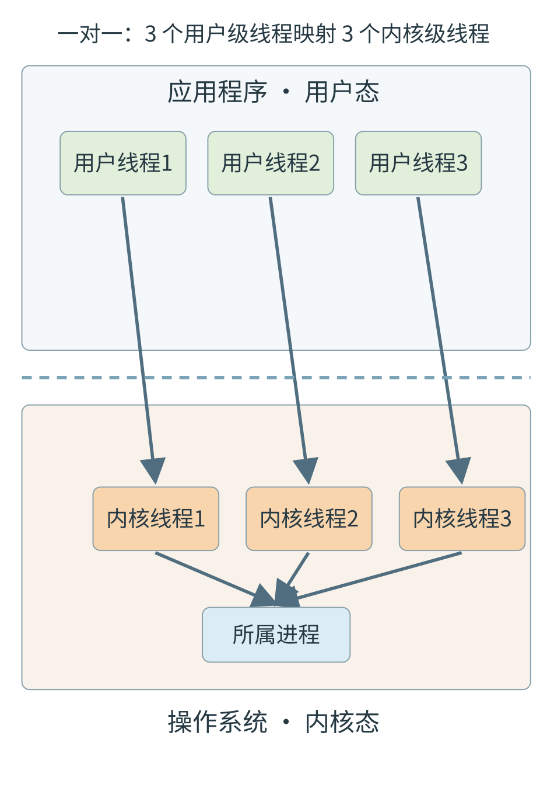

<a id="os02-fig-course-thread-many-one"></a>
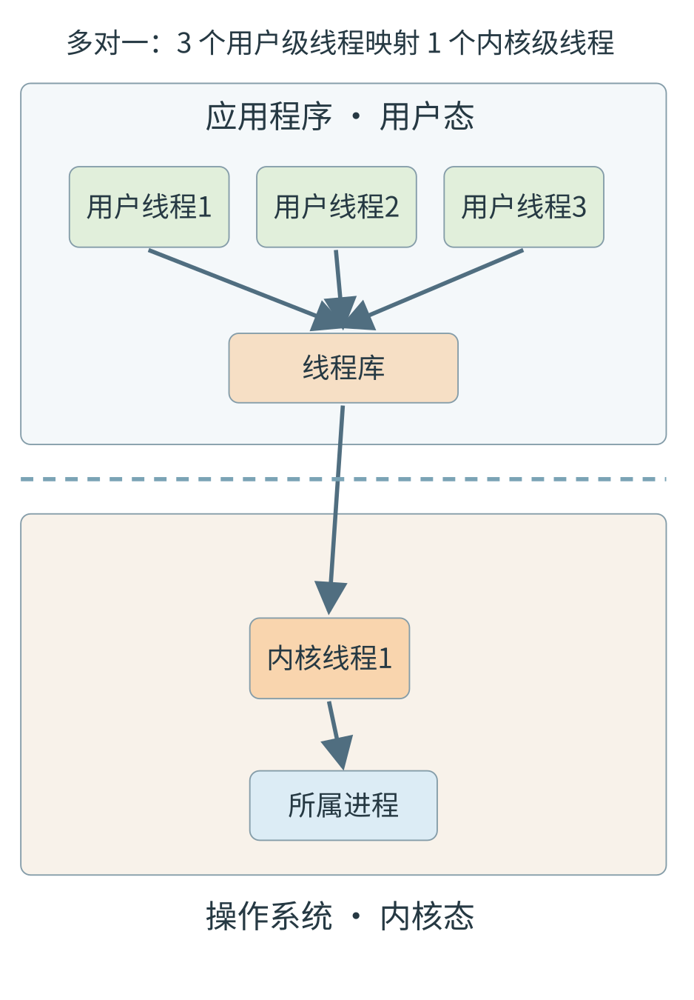

<a id="os02-fig-course-thread-many-many"></a>
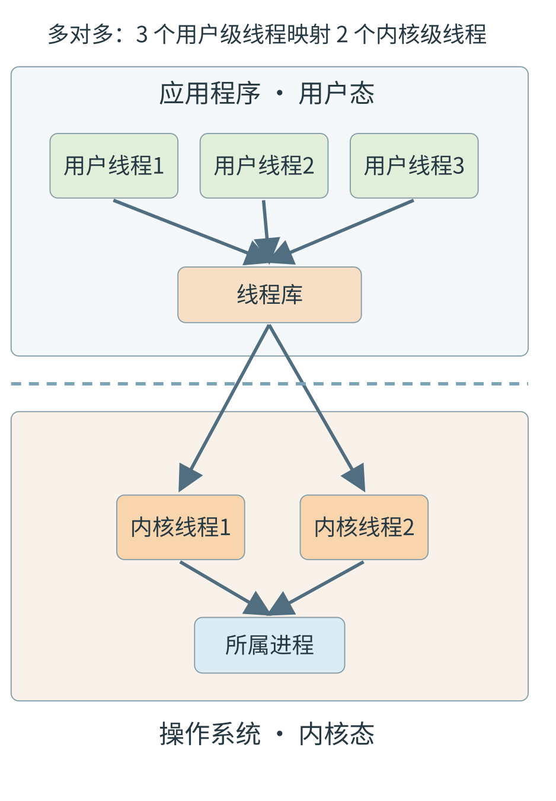

图中分别展示三个用户线程对应三个、一个和两个内核线程的例子。多对多的“多”不是要求两侧线程数量相同；用户线程库负责用户线程的管理，而内核调度其可见的内核线程。线程阻塞是否影响其他线程，还要看具体映射及阻塞发生的位置。

“内核级”描述管理方式，不能理解成该线程的应用代码始终在内核态执行。用户线程进入系统调用时也可能执行内核代码。线程类型、CPU 当前模式、进程所属地址空间是三个不同判断维度。

<a id="OS02-2-4"></a>
### 创建、撤销与组织：PCB 为什么是管理入口

> **课程连接 · PCB的作用**
>
> PCB记录身份、状态、现场与资源信息；进程存在期间，系统需维护其对应管理信息。

创建进程一般需要分配标识和 PCB、建立地址空间和初始数据、关联资源、初始化执行现场，再加入适当的调度队列。用户登录、启动程序或系统创建服务进程可能触发创建；给已有进程分配设备只是改变其资源状态，不必产生新进程。

终止进程时，内核停止其执行，处理相关等待与通知，回收资源并释放管理结构。子进程是否随父进程终止，取决于系统的父子关系政策；不能把级联终止当成所有系统的通则。某些系统会保留最少退出信息，供父进程取得状态后再完全释放。

PCB 可以用链表、队列或索引表组织。就绪队列按调度规则组织可运行者，事件等待队列组织等待同类条件者；状态转换时要同步维护状态字段和所在队列。不能只改一个“状态字”，却把进程留在错误的队列中。

线程的创建同样要建立 TCB、栈和初始执行现场，但可以复用所属进程的地址空间等资源。在常规父子进程模型中，父子是两个独立进程，可并发执行、有不同 PCB；即使最初采用写时复制暂时共享物理页，也不是共用一个无区分的虚拟地址空间。真正共享的部分须由共享映射等机制建立。

线程控制块 **TCB** 保存线程的管理信息。课件所列字段包括线程标识符 TID、程序计数器 PC、其他寄存器内容、栈指针、运行状态和优先级；线程表汇集相应线程的控制信息，供线程管理和调度使用。保存和恢复这些现场，才能让线程从原来的执行位置继续。用户级线程的信息由用户空间线程库管理；内核级线程的控制信息由内核维护，具体表结构随实现而异。

<a id="OS02-2-5"></a>
### 共享内存、消息、管道和信号

> **错项排除 · 共享内存只提供共同位置**
>
> 两个进程映射同一物理页后，写入可被对方访问，但这并未规定谁先写、何时读，也未把读改写自动变成原子操作。通信方式解决数据放在哪里，同步机制解决操作怎样协调，二者承担的任务不同。

**共享内存**让多个进程把某些虚拟地址映射到共同的物理存储区。建立映射后，数据交换可以通过普通访存完成，减少反复拷贝；但谁先写、读者何时可读、多个修改者是否冲突，仍需要同步机制。共享内存本身并不保证不发生竞争。

课件将共享内存分为两种组织方式。**基于数据结构的共享**对共享区中的数据形式作约束，例如规定只能放固定长度的数组；**基于存储区的共享**由操作系统提供共享区，通信进程自行约定数据布局和访问方式。课件把前者称为低级、后者称为高级通信；这里的区别是接口约束和进程控制范围，具体速度受实现、同步与访问模式影响，不能把“高级”直接当作固定倍数的性能结论。

**消息传递**把数据交给消息接口，由发送、接收及相关队列组织通信。直接通信指定对方进程，间接通信通过信箱或端口；同步发送、异步发送等语义由接口规定。一次接收若没有消息，可能阻塞，也可能立即报告暂不可用，不能只凭“消息传递”决定状态。

<a id="os02-fig-course-ipc"></a>
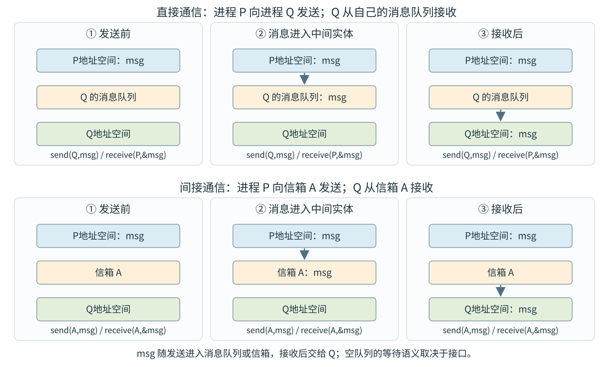

**管道**提供有次序的数据流通道。经典无名管道常用于有亲缘关系的进程，通常按半双工模型理解；双向通信可用两个管道。命名管道允许按名称建立联系。管道容量有限，空管道上的阻塞读、满管道上的阻塞写都会等待；写入数据后，不代表读取者会立即得到 CPU。

**信号**是向进程通知某类事件的机制，如终止请求、定时事件等。信号与信号量不同：前者通知事件，后者通过许可计数和等待队列协调资源与次序。普通信号并不携带任意大量的数据，也不等同于可靠的消息队列；是否排队等细节须看具体信号类型与接口。

例如父进程经管道把一批数交给子进程：父进程先写数据，子进程读到数据后计算。管道本身组织数据和读写等待；若两者还要更新另一个共享统计量，就仍需为该统计量建立同步保护。不要把“已经用了一种通信方法”推成“所有共享状态都已受保护”。

<a id="OS02-control-primitives"></a>
### 进程控制原语：状态、队列与现场一起更新

> **课程连接 · 状态转换**
>
> 状态转换通常还伴随队列迁移与现场处理；原语的整体操作不可被中断地执行。

进程控制不仅改一个状态字段，还要使PCB、队列与资源归属一致。以下步骤是逻辑职责，具体实现可以按内核设计合并或调整。

| 原语 | 主要工作 | 对应状态变化 |
| --- | --- | --- |
| 创建 | 申请空白PCB，分配必要资源，初始化标识、现场及管理信息，插入就绪队列 | 创建完成后进入就绪 |
| 撤销 | 确定被终止者，必要时停止其运行，回收资源，移出相关队列并回收PCB | 从原状态进入退出清理 |
| 阻塞 | 保存现场，修改状态，将当前执行者移入相应事件等待队列，重新调度 | 运行→阻塞 |
| 唤醒 | 因相应事件满足而移出等待队列，修改状态，插入就绪队列 | 阻塞→就绪 |
| 切换 | 保存旧执行者现场，更新队列与状态，恢复新执行者现场 | 运行者与就绪者更替 |

若只把`state`从阻塞改成就绪，却尚未把PCB从等待队列移走，另一管理操作便可能同时把它当作两种状态处理。因此相关更新要形成受保护的原子操作。原语保护的是关键更新步骤，进程已经阻塞后的整个等待过程可以持续很久，CPU仍应运行别的就绪者。

**PCB组织方式**可以用状态队列，也可以用索引表。队列中的链接字段把同类状态的PCB连起来；索引方式在表中保存相应PCB地址或索引。系统还可按等待原因分设多个阻塞队列，以便发生事件时定位应唤醒的执行者。

<a id="OS02-course-pcb-organization"></a>
### PCB 的链式和索引组织

单处理器的一个状态快照中，执行指针指向 PCB2；就绪队列为 PCB5→PCB1→PCB4，阻塞队列为 PCB3→PCB7→PCB6。链式组织把同一队列的 PCB 通过链接字段串接；由于等待事件不同，也可为各事件分别建立阻塞队列。下图的多核运行队列只是另一种状态快照，不能与单核瞬间的运行指针混为同一个系统时刻。


<a id="os02-pcb-chain"></a>
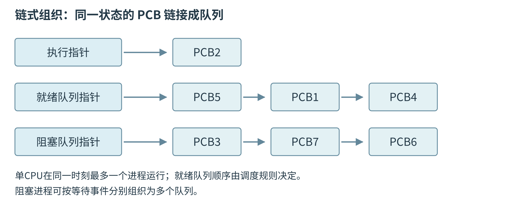


<a id="os02-pcb-events"></a>
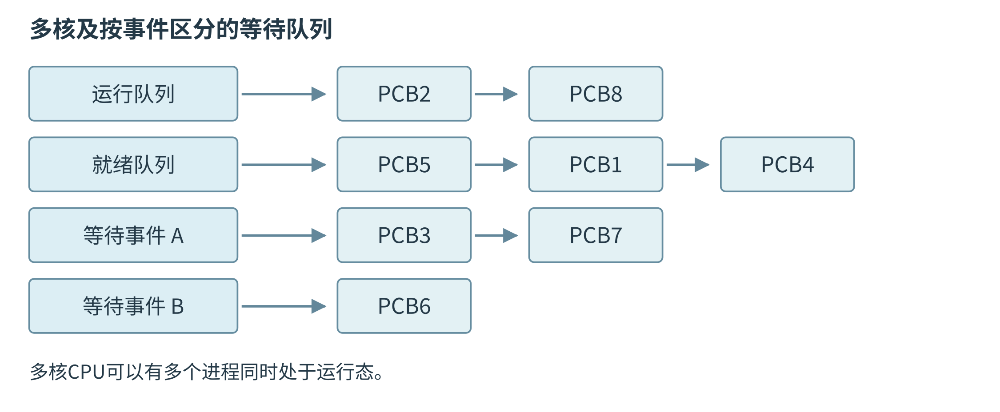


索引组织将各状态对应的 PCB 定位信息放入索引表。另一个示例的就绪索引依次指向 PCB5、PCB1、PCB4，阻塞索引依次指向 PCB6、PCB7、PCB3；两个示意图是各自的快照，其阻塞顺序不必相同。


<a id="os02-pcb-index"></a>
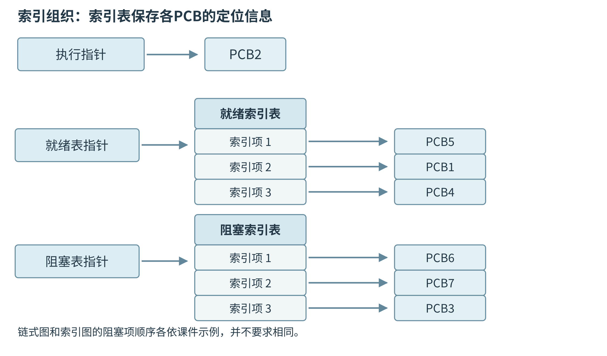


<a id="OS02-signals"></a>
### 信号：pending、blocked与用户处理程序

> **辨析 · 屏蔽信号不是阻塞进程**
>
> blocked位图控制递送，pending保存待处理事件。暂缓某个信号时进程仍可能执行；进程阻塞态是等待I/O或同步条件的另一类状态。

信号用于通知进程某类事件已经发生。发送者可以是获授权的其他进程，也可以是内核。课件以普通信号位向量模型说明：`pending`记录待处理信号，`blocked`记录暂时屏蔽的类型；当前可递送集合为

$$D=\mathrm{pending}\;\&\;\sim\mathrm{blocked}.$$

这里的“阻塞一个信号”表示暂缓递送该类型，并不等于使整个进程进入阻塞态。信号到达后先保存在待处理状态，适当时机（例如从内核态返回用户态的路径）检查递送。可执行默认动作，也可在允许时执行进程设置的用户处理程序。处理程序一般运行在用户态；内核负责组织递送并保存、恢复相关执行环境。

<a id="os-fig-signal-masks"></a>
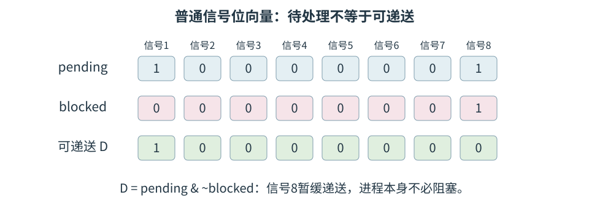

例如按信号编号1至8排列，待处理位为`1 0 0 0 0 0 0 1`，屏蔽位为`0 0 0 0 0 0 1 1`，可递送位为`1 0 0 0 0 0 0 0`。处理信号1后清除其待处理记录；信号8仍应保持待处理，直到解除屏蔽且满足递送条件。普通信号只用一个位表示同类事件时，多次到达可能合并，因此不能据此精确统计事件次数；具有排队语义的信号机制需另按接口说明。

用户处理程序可以改变异常后的处理策略，但并非所有信号都允许捕获、忽略或屏蔽。异常由处理器检测与内核处理；信号是操作系统向进程通知事件的机制。一次缺页可以由内核修复而不向应用递送信号；一次异常也可能使内核进一步向进程发送信号，二者应分层判断。

<a id="OS02-pipe-details"></a>
### 管道的数据与等待条件

管道是容量有限的内核缓冲数据流。读出通常消耗已有数据，区别于读者—写者模型中“读后仍保留文件内容”的共享读。管道已有数据时，读者不必等待写满整个缓冲区；管道尚有可用容量时，写者也不必等待全部读空。空、满条件决定能否推进，具体一次读写能传多少数据及是否原子，要依据接口和请求长度。

经典半双工模型可用两个管道构成双向同时通信。允许多个读写者的具体系统仍需约定读取分配、消息边界及原子写长度；普通字节流管道不能天然保留应用自定的记录边界。 课件为避免多个读者竞争造成应用层数据分配混乱，列出“多个写进程、一个读进程”的组织方案，以及允许多个读者共同读取的方案：后者中一段已读取的数据会从管道中消耗，不会自动复制给每个读者；应用应明确任务分配与记录边界。具体系统的多个读者按内核及调度行为取得数据，不能据此假定严格轮询、公平或广播给所有读者。

<a id="OS02-2-6"></a>
### 调度层次与评价指标

> **不变量 · 等待时间要扣对部分**
>
> 无I/O的单CPU段模型满足周转＝就绪等待＋服务；若还有阻塞，必须再加阻塞时间。始终把一个进程的整个生存区间按状态分段相加，再套公式，能避免把等待设备的时间全部算进就绪队列等待。

**高级调度**从后备作业中选作业进入内存并取得参与运行的资格；**中级调度**通过换出、换入调节内存中的进程数量；**低级调度**从就绪实体中选择处理器使用者。并非所有现代系统都以经典批处理作业队列组织这三级调度，但三者处理的对象和时间尺度应区分。

设作业或进程 $i$ 的到达时刻为 $A_i$，首次运行时刻为 $S_i$，完成时刻为 $C_i$，实际服务时间为 $B_i$。在只含一个 CPU 段、无 I/O、忽略切换开销的题目中：

$$
T_i=C_i-A_i,\qquad W_i=T_i-B_i,\qquad R_i=S_i-A_i,\qquad T_i^{\mathrm{w}}=\frac{T_i}{B_i}.
$$

$T_i$ 为周转时间，$W_i$ 为就绪等待时间，$R_i$ 为响应时间，$T_i^{\mathrm{w}}$ 为带权周转时间。平均值是逐个算完再取算术平均；平均带权周转时间一般不等于平均周转时间除以平均运行时间。

若进程有 I/O 等待，周转时间还包含阻塞时间，此时不能只用 $T_i-B_i$ 当作就绪等待；应再扣除相应阻塞时间。吞吐量是单位时间完成的任务数，CPU 利用率是观察区间内 CPU 忙时长占比。题目是否把切换时间计为“忙”，以及忙于内核开销是否算有效服务，需要按口径说明。

**课件例：利用率和吞吐量。** 单道程序依次使用 CPU 5 秒、打印机 5 秒，再使用 CPU 5 秒后结束；观察区间共 15 秒，其中 CPU 工作 10 秒，打印机工作 5 秒。因此 CPU 利用率为 $10/15\approx66.67\%$，打印机利用率为 $5/15\approx33.33\%$。若另一观察区间内完成 10 道作业，共用 100 秒，则系统吞吐量为 $10/100=0.1$ 道／秒。多道程序执行时应先画出各设备忙闲时间，再按同一观察区间计算。

<a id="OS02-2-7"></a>
### 什么时刻可以调度，抢占改变了哪一步

> **课程连接 · 调度时机**
>
> 进程阻塞、终止或被抢占可能触发调度；内核临界区等场合需结合系统规则判断能否切换。

当前进程结束、主动阻塞或让出处理器，必须考虑选择其他可运行者；新进程到达、I/O 完成使更合适者就绪、时间片到期，也可能触发重新选择。**非抢占方式**允许当前运行者继续，直到结束或主动放弃；**抢占方式**允许在满足规则的事件点中断当前运行者，把它放回就绪队列。

调度器负责选择，分派器负责把处理器实际交给所选者，包括必要的现场恢复与切换。发生一次中断不必更换运行者，检查一次调度条件也不等于一定发生进程切换。题目询问“调度次数”时，应核清是否计首次分派、是否计选择原进程、是否计最后转入空闲；不能把事件点数和切换次数混算。

内核维护调度结构时，短小临界区等处不允许任意抢占，否则可能读到队列的半更新状态；处理中断的阶段也有相应约束。所谓内核可抢占，并非每条内核指令都可以无条件中断并调度。

普通临界区访问的是需互斥的普通资源，例如打印机；进程持有相应互斥权期间，仍可能被调度切换，其他进程不能因此使用该资源。课件所说的内核程序临界区用于访问内核管理数据结构，例如就绪队列，执行有关原子操作时不能调度。判断能否切换应结合临界区和系统的具体约束，不能仅凭“处于临界区”作一概判断。

<a id="OS02-idle"></a>
### 调度器与闲逛进程

> **课程连接 · 闲逛进程**
>
> 就绪队列没有普通可运行进程时，闲逛进程让处理器处于可管理的等待状态。

调度器在允许调度的事件点检查就绪集合并选择执行者。一次检查可能继续选中当前进程；只有实际改变执行者时才进行相应上下文切换。非抢占策略下，新进程到达或I/O完成可使其就绪，但通常不能仅因其更优就夺走当前执行者的CPU；抢占策略则可在规定的时钟、唤醒等事件点重新比较。

没有普通就绪进程时，系统运行**闲逛进程（idle）**或相应空闲线程。它的优先级最低，通常执行低功耗等待等操作，仍需允许中断使系统重新处理事件。空闲线程处于运行状态不意味着CPU正在进行有效用户计算；计算利用率时，须依据题目是否把空闲、内核管理和切换分别计入。

<a id="OS02-2-8"></a>
### 沿时间线执行调度算法

> **最小反例 · 不能挑未来的短任务**
>
> 在时刻2选择作业，时刻3才到达的短作业即使只需1毫秒也不在候选集合。算法先受“已到达且就绪”的约束，随后才比较运行长度或响应比；跳过集合筛选，会把最短优先错误变成预知未来的调度。

处理调度题时，先明确到达时间、服务时间、抢占规则、同刻事件次序及开销。每到一个可能改变选择的事件点，只在**已经到达且就绪**的进程中选择，记录剩余 CPU 时间。最后用完成时刻计算指标，并检查 CPU 总服务量是否与题表一致。

<a id="OS02-auto-1"></a>
#### FCFS、SJF、SRTF 与高响应比

**先来先服务 FCFS**按就绪到达次序选择，通常不抢占。长 CPU 段在前时，后面的短进程和 I/O 型进程可能等很久，产生护航效应。**短作业/短进程优先 SJF**在选择时挑预计运行时间最短者，通常指非抢占版本；它需要预测运行时间，持续到来的短任务可能使长任务饥饿。

**最短剩余时间优先 SRTF**是抢占版本，新进程到达时比较的是“新进程的服务时间”与“当前进程剩余时间”，不能拿当前进程最初总时间比较。**高响应比优先 HRRN**通常非抢占，选择时计算

$$\text{响应比}=\frac{\text{等待时间}+\text{预计服务时间}}{\text{预计服务时间}}=1+\frac{W}{B}.$$

等待越久，响应比越大，有助于缓解长任务长期等候。这个“响应比”是调度优先量，与前节的“响应时间”不是同一个指标。

<a id="OS02-ex2-2"></a>
#### 例 2A-2　先排除尚未到达者，再比较

**例题 · 配套例题**

【配套例题】 4 个作业到达系统的时刻和运行时间如下表所示。


| 作业 | 到达时刻 | 运行时间 |
| --- | --- | --- |
| J1 | 0 | 3 |
| J2 | 1 | 3 |
| J3 | 1 | 2 |
| J4 | 3 | 1 |


系统在 $t=2$ 时开始作业调度。若分别采用先来先服务和短作业优先调度算法，则选中的作业分别是（　）。

A. J2、J3　　B. J1、J4　　C. J2、J4　　D. J1、J3


**解析。** 此时只有 J1、J2、J3 到达。FCFS 选择最早到达的 J1；SJF 比较三者运行时间 3、3、2，选择 J3。答案为 **D**。J4 尚未到达，即使其时间最短也不能提前选择。

**原创变式。** 沿用本题数据，仅把算法改为 HRRN，检查它与 SJF 是否等同。$t=2$ 时，J1、J2、J3 的响应比分别为 $1+2/3$、$1+1/3$、$1+1/2$，应选 J1。改变的是优先量，因此不能仍然只比较运行时长。

<a id="OS02-lecture-scheduling"></a>
#### 课件算例：同一组进程比较FCFS、SJF、SRTF和HRRN

四进程的到达时刻为$(0,2,4,5)$，CPU服务时间为$(7,4,1,4)$，依次对应$P_1$至$P_4$。均只有一个计算段，忽略切换开销；同优先量按先到达者选择。

| 算法 | 按时间先后的运行片段 | 完成时刻$(C_1,C_2,C_3,C_4)$ |
| --- | --- | --- |
| FCFS | $P_1:0\!\sim\!7$，$P_2:7\!\sim\!11$，$P_3:11\!\sim\!12$，$P_4:12\!\sim\!16$ | $(7,11,12,16)$ |
| 非抢占SJF | $P_1:0\!\sim\!7$，$P_3:7\!\sim\!8$，$P_2:8\!\sim\!12$，$P_4:12\!\sim\!16$ | $(7,12,8,16)$ |
| SRTF | $P_1:0\!\sim\!2$，$P_2:2\!\sim\!4$，$P_3:4\!\sim\!5$，$P_2:5\!\sim\!7$，$P_4:7\!\sim\!11$，$P_1:11\!\sim\!16$ | $(16,7,5,11)$ |
| HRRN | 本例与非抢占SJF相同 | $(7,12,8,16)$ |

FCFS的周转时间为$(7,9,8,11)$，等待时间为$(0,5,7,7)$，带权周转为$(1,9/4,8,11/4)$；平均值分别为$8.75$、$4.75$、$3.5$。

非抢占SJF的周转时间为$(7,10,4,11)$，平均周转为8，平均等待为4，平均带权周转为$41/16=2.5625$。SRTF的周转时间为$(16,5,1,6)$，平均周转为7，平均等待为3，平均带权周转为$169/112\approx1.5089$。计算时保留分数到最后，避免把$16/7$先截成2.28影响平均值。

HRRN在时刻7比较：$P_2$的响应比为$9/4$，$P_3$为4，$P_4$为$6/4$，故选$P_3$；时刻8再比较$P_2$的$10/4$与$P_4$的$7/4$，选$P_2$。本例顺序相同只是数据造成，不能把HRRN当成SJF的同义词。

“平均等待时间最少”等最优性结论必须附模型条件，例如所有作业同时可运行、已知运行时间、忽略切换成本等。最少平均周转也不自动等价于最少平均带权周转。

<a id="OS02-auto-2"></a>
#### 优先级：先看数值方向，再看是否抢占

优先级可以由任务性质静态规定，也可以随等待、CPU 使用等动态调整。数值大代表高还是低，必须按题目读；同为“优先级调度”不保证使用同一方向。提高长等候者优先级称为老化，有助于避免低优先级进程饥饿；实时任务则常需要按紧迫性或期限组织优先次序。

<a id="OS02-course-priority"></a>
#### 同组进程的抢占与非抢占优先级

四个进程的到达时间为 $(0,2,4,5)$，运行时间为 $(7,4,1,4)$，优先数分别为 $(1,2,3,2)$；数值越大优先级越高，同优先级按进入就绪队列的先后选择，忽略切换开销。

| 模式 | 执行区间 |
| --- | --- |
| 非抢占 | P1[0,7) → P3[7,8) → P2[8,12) → P4[12,16) |
| 抢占 | P1[0,2) → P2[2,4) → P3[4,5) → P2[5,7) → P4[7,11) → P1[11,16) |

非抢占时P1在7时完成，此时已到达的P3优先级最高；8时P2与P4同级，P2先入队。抢占时P2在2时到达并抢占P1，P3在4时到达并抢占P2；5时P3结束且P4到达，P2已经在队列中，故先运行P2。其轨迹与这一组数据下的SJF/SRTF轨迹碰巧相同，但选择依据分别是优先级与服务时间。

<a id="OS02-ex2-3"></a>
#### 例 2A-3　被抢占者的剩余时间必须保留

**例题 · 配套例题**

【配套例题】 进程进入就绪队列的时刻、优先级（值越大优先权越高）及 CPU 执行时间如下表所示。


| 进程 | 到达 | 优先级 | CPU 时间 |
| --- | --- | --- | --- |
| P1 | 0 ms | 1 | 60 ms |
| P2 | 20 ms | 10 | 42 ms |
| P3 | 30 ms | 100 | 13 ms |


采用基于优先权的抢占式 CPU 调度算法，从 0 ms 开始调度，三个进程的平均周转时间为（　）。

A. 60 ms　　B. 61 ms　　C. 70 ms　　D. 71 ms

<a id="os-fig-priority"></a>
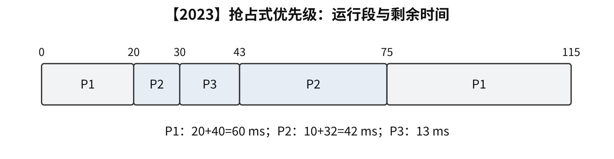


**解析。** 0—20 ms 只有 P1，执行 20 ms 后还余 40 ms。P2 到达并抢占，执行至 30 ms，还余 32 ms。P3 优先级最高，30—43 ms 执行完毕；随后 P2 执行 32 ms，于 75 ms 完成；最后 P1 执行 40 ms，于 115 ms 完成。

三者周转时间依次为 $115-0=115$ ms、$75-20=55$ ms、$43-30=13$ ms，平均为 $(115+55+13)/3=61$ ms，答案为 **B**。完成时刻之和不是周转时间之和；每项都要减各自到达时刻。

<a id="OS02-ex2-4"></a>
#### 例 2A-4　一次到达不必增加一次进程调度

**例题 · 配套例题**

【配套例题】 P0、P1、P2、P3 的到达、优先级（值越小优先权越高）和执行时间如下表所示。采用基于优先权的抢占式进程调度，从 0 ms 开始，到四个进程都运行结束为止，发生进程调度的总次数为（　）。


| 进程 | 到达 | 优先级 | CPU 时间 |
| --- | --- | --- | --- |
| P0 | 0 ms | 15 | 100 ms |
| P1 | 10 ms | 20 | 60 ms |
| P2 | 10 ms | 10 | 20 ms |
| P3 | 15 ms | 6 | 10 ms |


A. 4　　B. 5　　C. 6　　D. 7


**解析。** 实际运行段依次为 P0[0,10)、P2[10,15)、P3[15,25)、P2[25,40)、P0[40,130)、P1[130,190)。P1 在 10 ms 到达，但优先级低于当时可选者，不单独取得一个运行段。按题目计首次分派且不计最后转入空闲，六次分派，答案为 **C**。若只数相邻两个实际运行进程的更换，则是五次；两种口径不可混用。

<a id="OS02-auto-3"></a>
#### 时间片轮转与多级反馈队列

**时间片轮转 RR**按就绪队列的先后，让每个进程取得至多一个时间片。进程在时间片内结束或阻塞，就提前让出；用完时间片仍未结束者回到队尾。时间片过长会接近 FCFS，过短会增加切换开销。若每次有效执行 $q$、切换耗时 $s$，持续满负荷时有效服务占比可近似写为 $q/(q+s)$，但最后一个短段等边界应逐段算。

同刻有新进程到达又有时间片到期时，谁先入队可能改变结果，应按题设；题设没有规定且确实影响答案时，必须声明采用的次序。不能把刚被抢占的进程总放在队首，新到者也不能越过当前时间片先运行。

**王道课件：用同一组进程比较时间片。** 四个进程P1、P2、P3、P4分别在0、2、4、5到达，服务时间分别为5、4、1、6；忽略切换开销。同一时刻有新进程到达和时间片到期时，先将新到进程入队，再将未完成的当前进程放队尾。

| 时间片 | 执行顺序 | 依次结束时刻 |
| --- | --- | --- |
| 2 | P1、P2、P1、P3、P2、P4、P1、P4、P4 | 2、4、6、7、9、11、12、14、16 |
| 5 | P1、P2、P3、P4、P4 | 5、9、10、15、16 |

例如时间片为2时，时刻2的P2先入队，随后未完成的P1回到队尾，因此下一段执行P2；时刻4的新到P3也先于P2回队，但P1已经在队首，故4～6运行P1。时间片为5时，P1、P2、P3各可在一个时间片内结束，P4仍需两个时间片；连续两片均为P4，并非它的服务时间只有5。若同刻入队规则或切换开销改变，队列轨迹和计时应重新计算。


**多级队列**把不同类型进程固定放在不同队列；**多级反馈队列**允许进程在队列间移动，常用较高队列的短时间片及时响应交互，CPU 使用时间较长者逐级下移。队列间是否抢占、各级规则和提升规则必须逐项读取，不能靠固定模板代替题设。

<a id="OS02-course-multilevel"></a>
#### 固定多级队列的队内、队间规则

将系统进程、交互进程和批处理进程分别放在三个队列。例中队内分别采用优先级、RR和FCFS；队列之间可以采用固定优先级，也可以按50%、40%、10%的比例分配处理器时间。这是两种不同的队间规则：采用固定优先级时，较高优先级队列为空，较低优先级队列才能被选中；采用比例分配时按所给份额安排。


<a id="os02-multilevel-course"></a>
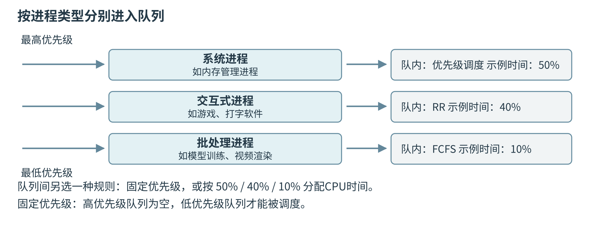


<a id="OS02-ex2-5"></a>
#### 例 2A-5　二级反馈中，第二级按剩余量选择

**例题 · 配套例题**

【配套例题】 系统采用二级反馈队列调度。Q1 采用时间片轮转，时间片为 10 ms；Q2 采用短进程优先。系统优先调度 Q1，Q1 为空才调度 Q2；新创建进程先进入 Q1，在 Q1 执行一个时间片后仍未结束则转入 Q2。当前两队列为空，系统依次创建 P1、P2 后开始调度，两者需要的 CPU 时间分别为 30 ms、20 ms。平均等待时间为（　）。

A. 25 ms　　B. 20 ms　　C. 15 ms　　D. 10 ms


**解析。** P1 在 Q1 执行 0—10 ms，余 20；P2 执行 10—20 ms，余 10。此时 Q1 为空，Q2 中 P2 剩余较短，先执行 20—30 ms 完成，再运行 P1 至 50 ms。两者初始时均已创建，等待分别为 $50-30=20$ ms、$30-20=10$ ms，平均 15 ms，答案为 **C**。转入 Q2 以后，已经执行的时间不能重复计算。

<a id="OS02-ex2-6"></a>
#### 例 2A-6　同一组到达事件，SRTF 与 RR 如何分别推进

**例题 · 配套例题**

〖2.2-006〗 系统有 4 个进程，预计运行时间和到达就绪队列的时刻如下，单位均为时间配额。分别采用可抢占式短进程优先和时间片轮转调度（时间片为 2），求各进程的调度次序与平均周转时间。


| 进程 | 到达时刻 | 预计运行时间 |
| --- | --- | --- |
| P1 | 0 | 8 |
| P2 | 1 | 4 |
| P3 | 2 | 9 |
| P4 | 3 | 5 |


**解析。** SRTF 在 0 时先选 P1；到 1 时 P1 余 7，而 P2 只需 4，故抢占。到 2 时 P2 余 3，小于新来的 P3 的 9；到 3 时 P2 余 2，小于 P4 的 5，均不抢占。P2 在 5 完成后，等待者的剩余量依次为 P1 的 7、P3 的 9、P4 的 5，因此先 P4，再 P1，最后 P3。


| 进程 | SRTF 实际运行区间 | 周转时间 |
| --- | --- | --- |
| P1 | [0,1)、[10,17) | 17 |
| P2 | [1,5) | 4 |
| P3 | [17,26) | 24 |
| P4 | [5,10) | 7 |


平均周转为 $(17+4+24+7)/4=13$。P3、P4 到达都使调度器重新比较，但比较后可以继续当前 P2，不能把每次到达都强制切换。

RR 按本题参考解采用“同刻新到者先入队，再把时间片到期者放队尾”的约定。P1 在 [0,2) 后回队尾，此时队列为 P2、P3、P1；P4 在 3 到达，排在当时的等待队尾。以后按同样规则，每次只扣实际使用的一个时间片；剩余不足 2 者提前结束。


| 进程 | RR 实际运行区间 | 周转时间 |
| --- | --- | --- |
| P1 | [0,2)、[6,8)、[14,16)、[20,22) | 22 |
| P2 | [2,4)、[10,12) | 11 |
| P3 | [4,6)、[12,14)、[18,20)、[23,25)、[25,26) | 24 |
| P4 | [8,10)、[16,18)、[22,23) | 20 |


平均周转为 $(22+11+24+20)/4=19.25$。最后只有 P3，它在 25 用完一个片后仍可再次获选，不能因为“轮转”而强行等待一个不存在的其他进程。若同刻入队约定改变，2 时的队列及以后轨迹也要随之重算。

<a id="OS02-auto-4"></a>
#### 调度算法的选择依据与抢占条件

下表比较的是前述 CPU 调度规则。“需要时长”指选择时需要已知或估计的 CPU 服务量，不是说运行时间必须由用户准确预报。各种算法都只在已到达、已就绪的实体中选择。


| 算法 | 下一个运行者怎样选 | 是否抢占 | 是否需要预计 CPU 时长 |
| --- | --- | --- | --- |
| FCFS | 按进入就绪队列的先后 | 通常不抢占 | 不需要 |
| SJF | 预计服务时间最短者 | 本章指非抢占版 | 需要预计服务时间 |
| SRTF | 预计剩余时间最短者 | 可以抢占 | 需要预计剩余时间 |
| HRRN | 选择 $1+W/B$ 最大者 | 通常不抢占 | 需要预计服务时间 $B$ |
| 优先级 | 按题设优先级高低 | 两种版本都有 | 通常不以时长为必需输入 |
| RR | 队首运行至片满、结束或阻塞 | 片满时抢占 | 不需要 |
| 多级反馈队列 | 先选队列，再执行该队列规则 | 常见模型允许高队列抢占 | 不需事先估计总服务时间 |


| 算法 | 等待方面的主要边界 |
| --- | --- |
| FCFS | 正常推进时不因后到者插队而饥饿；短任务可能被长任务拖住 |
| SJF | 持续到来的短任务可能使长任务饥饿 |
| SRTF | 比较剩余量；持续短任务同样可能阻挡长任务 |
| HRRN | 等待使响应比增加，兼顾长短任务；不等于固定等待上界 |
| 优先级 | 固定低优先级者可能饥饿；老化可逐步提高其优先级 |
| RR | 同队列轮流获得机会；片过小会增加切换开销 |
| 多级反馈队列 | 若高队列始终有任务，低队列可能长期无机会；是否定期提升须看规则 |


“短任务优先”不自动包含抢占；“按优先级”也不自动包含时间片。题干同时给出多个规则时，先判断哪个规则决定候选队列，再判断队内顺序，最后处理到达、片满和阻塞等事件。

<a id="OS02-ex2-7"></a>
#### 例 2A-7　把“等待越久越优先”写成动态优先数

**例题 · 配套例题**

【配套例题】 某进程调度程序采用基于优先数（priority）的调度策略，即选择优先数最小的进程运行。进程创建时由用户指定一个 nice 作为静态优先数。为了动态调整优先数，引入运行时间 cpuTime 和等待时间 waitTime，初值均为 0。进程处于执行态时，cpuTime 定时加 1，且 waitTime 置 0；进程处于就绪态时，cpuTime 置 0，waitTime 定时加 1。请回答下列问题。

（1）若调度程序只将 nice 的值作为进程的优先数，即 priority=nice，则可能会出现饥饿现象，为什么？

（2）使用 nice、cpuTime 和 waitTime 设计一种动态优先数计算方法，以避免产生饥饿现象，并说明 waitTime 的作用。


**解析。** （1）数值小才优先。若就绪队列中一直有 nice 较小的进程，nice 较大的进程便可能一直落选。系统仍有其他进程在运行，因此这是饥饿，不能解释成全部进程互等的死锁。

（2）一种方法是

$$priority=nice+k_1\,cpuTime-k_2\,waitTime,\qquad k_1>0,\ k_2>0.$$

运行时间增长使优先数增大，降低持续占用 CPU 者的优先级；就绪等待增长使优先数减小，提高长期等待者的优先级。两个符号都由“数值越小越优先”决定，不能沿用数值越大越优先的公式。

例如仅为检验公式方向，取 $k_1=k_2=1$：nice=10 的等待者在等待 11 个计时单位后，优先数成为 −1，比 nice=0 的刚就绪进程更小，因而先被选中。这是**原创代入检查**，不是原题新增数据。等待者一旦运行，waitTime 按题设清零；再次就绪时 cpuTime 清零，不能把这两个量误当成从创建起永久累计的总量。

waitTime 提供的是老化机制。但若把它用作无饥饿的保证，还需满足一些前提：采用通常的有限进程或有界 nice 模型，持续计时和重算，适当抢占或有限运行段，以及同优先数下不无限越过等待者。不能把一个公式解释成对任意到达流和任意调度实现都存在固定等待上界。

<a id="OS02-multiqueue"></a>
#### 多级队列与多级反馈：是否允许改变所属队列

**多级队列调度**按任务类型分设队列，进程通常固定归属某类队列。队列之间可用固定优先级，也可按时间比例分配CPU；各队列内部可分别使用优先级、RR或FCFS等策略。固定优先级下，高级队列持续非空可能使低级队列饥饿。

**多级反馈队列**还允许根据实际运行行为在队列间移动。新进程先进入较高队列，时间片逐级增大，用满时间片且未完成者下降；较高队列出现就绪者可抢占较低队列。是否保留剩余时间片、被抢占者回到队首还是队尾、I/O返回后进入哪一级，都必须采用题目给定规则。

课件例子使用三级时间片1、2、4，$P_1(到达0,运行8)$、$P_2(1,4)$、$P_3(5,1)$。按课件被抢占者回原队列尾、再次轮到时分配该级时间片的规则，CPU片段为：

$$P_1(1)\to P_2(1)\to P_1(2)\to P_2(1)\to P_3(1)\to P_2(2)\to P_1(4)\to P_1(1).$$

括号为此次实际运行时长，时间端点依次为$0,1,2,4,5,6,8,12,13$。时刻5的抢占没有把$P_2$原总服务时间重新计入，只改变其尚未完成部分的后续安排。

<a id="OS02-2-9"></a>
### 多处理机调度：负载与缓存都有代价

> **课程连接 · 迁移与Cache局部性相互影响**
>
> 把线程移到空闲核可减少排队，却可能丢掉此前核的Cache与TLB热状态。组成原理的命中率和操作系统的负载均衡在这里共同影响总时间；每核任务数量相等也不保证剩余工作量相等。

多个处理器可以使用公共就绪队列，也可以各自维护队列。公共队列便于共享负载，但并发访问需同步；每核队列降低争用，却可能出现一核排队、一核空闲，需要负载均衡。课件中的**推迁移**由专门的系统程序周期性检查各处理器的负载，将任务从繁忙处理器迁往较空闲的处理器；**拉迁移**由空闲处理器的调度程序主动从繁忙处理器取得任务。不同系统可采用其他负载监测与迁移实现，因此应按题目描述识别触发者。

**处理器亲和性**倾向让线程继续在此前运行的处理器上执行，利用缓存和地址转换缓存中的内容。软亲和性是调度倾向，硬亲和性是允许处理器集合的明确限制。负载均衡可能要求迁移，缓存局部性可能要求保留，二者需要权衡；不能把“每核进程数相同”当作负载完全相同，因为各任务剩余计算量可能不同。

同时多线程 SMT 让一个物理核维护多个硬件线程现场，共享某些执行资源；它不等于每条逻辑处理器都具有独立完整的执行单元。调度题未给多处理机规则时，不要自行把一个进程拆到多个核同时加速。

<a id="OS02-course-context-example"></a>
### 中断执行后，PCB怎样保存运算中间状态

考虑 `int x=1; x++;` 的一个教学指令序列：指令1把1写入内存变量x；指令2把x读入通用寄存器；指令3使寄存器加1；指令4将寄存器结果写回x。执行完指令3而尚未执行指令4时，内存中的x仍为1，通用寄存器为2，PC指向指令4。

如果此刻切换到另一个进程，内核须先将前一进程的PC、程序状态字PSW和必要寄存器值保存到其PCB。后一个进程可把自己的通用寄存器改为250；该值属于它自己的执行现场。再切回前一进程时，从其PCB恢复PC与寄存器值2，接着执行指令4，内存中的x才变为2。保存寄存器现场并非把其他进程运行时的250当作前一进程结果；不恢复正确现场就可能把错误值写回。


<a id="os02-context-switch-course"></a>
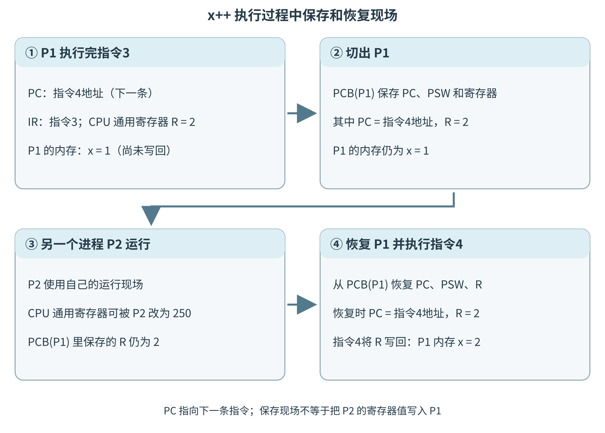


<a id="OS02-course-multiprocessor-queues"></a>
### 多处理器就绪队列与负载迁移

公共就绪队列供多个CPU选择任务，访问共享队列要互斥；它便于分配负载，但线程迁往其他处理器时可能损失原有缓存亲和性。软亲和性是调度器尽量让线程留在原处理器，硬亲和性由进程或系统明确限定允许执行的CPU集合。


<a id="os02-common-queue"></a>
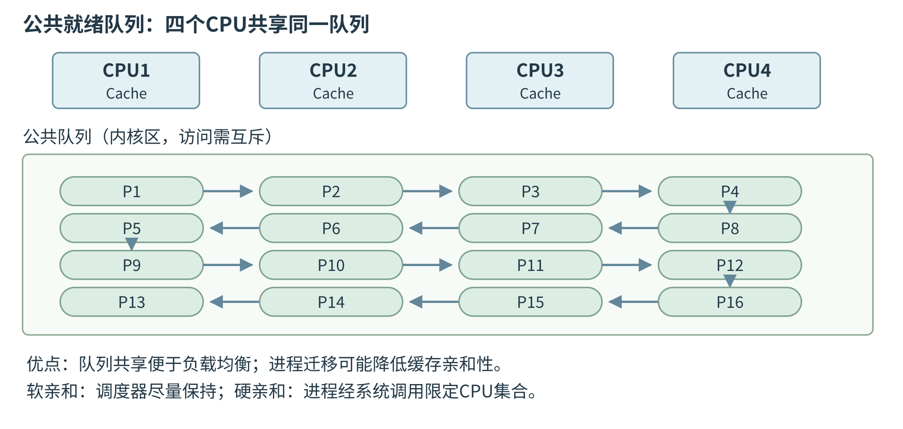


使用私有队列时，假设四个CPU的负载依次为50%、80%、80%、95%。将P16从CPU4队列迁至CPU1后，示例负载变为75%、80%、80%、70%。Push由专门系统程序定期检查负载并推动迁移；Pull由空闲或负载低的处理器的调度程序从忙处理器拉取任务。数值只是该示例的一次状态变化，不能推断每次迁移都改变相同百分比。


<a id="os02-private-queues"></a>
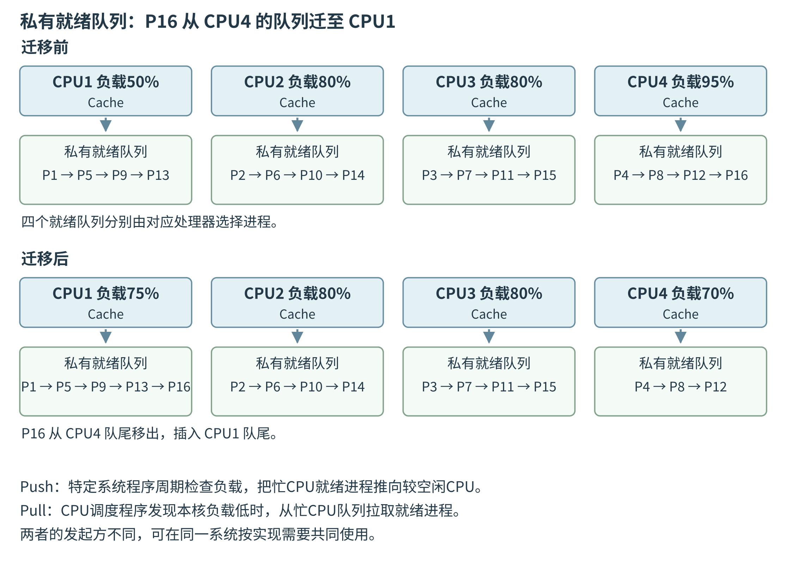


<a id="OS02-2-10"></a>
### 上下文切换与模式切换

> **课程连接 · 两种切换**
>
> 用户态进入内核态不必更换当前进程；发生上下文切换则需要保存和恢复执行现场。

**上下文**是恢复执行所需的状态，包括程序计数器、寄存器、栈等；进程切换还可能更换地址空间相关状态。**模式切换**只是当前执行权限模式改变，例如同一进程进入系统调用再返回；它不必改变执行身份。**上下文切换**则把 CPU 从一个执行实体交给另一个。

同进程的线程切换通常要换 PC、寄存器和栈，而不必更换进程页表基址和共同的文件资源。跨进程切换还要建立新地址空间环境；TLB 是否必须全部清空，取决于是否支持地址空间标识等硬件条件。不能把“跨进程切换一定清空全部 Cache”列作一般步骤。

〖2.2-009〗 同一进程中 T1 切到 T2，需要更新各自执行位置和栈环境；进程页表和进程打开文件资源并不因同进程线程切换而自然改变。判断题列出的每项寄存器，要先说明它保存线程状态还是进程共享状态。

【配套例题】 “执行系统调用”完成并返回调用者时，可以使 CPU 从内核态回到用户态；阻塞、唤醒和执行 CPU 调度本身属于内核管理路径，不能认为这些操作完成时都必然返回用户态。具体返回到哪个线程，由当时调度与返回路径决定。

<a id="OS02-2-review"></a>
### 分支自测：用相同时间线检查不同问题

以下为原创回顾设问。

1. 已等到 I/O 数据的进程是否立即运行？线程发出 I/O 请求是否必然阻塞？
2. 在例 2A-3中，P2 的响应时间、等待时间、周转时间分别是多少？
3. 同一进程的两个内核线程切换，是否必须改页表基址？
4. 预计服务时间相同的两个作业，HRRN 如何反映等待差别？
5. 多核上迁移线程，一定能提高性能吗？

<a id="OS02-auto-5"></a>
#### 自测答案

1. 数据到达使相应等待条件满足，通常先就绪，再等调度。若请求非阻塞或数据已可用，I/O 接口可不使线程阻塞。
2. P2 在到达 20 ms 时立即开始，响应时间 0；周转时间 55 ms，服务 42 ms，所以等待 13 ms。
3. 通常不必，二者使用同一进程地址空间，但 PC、寄存器和线程栈等要切换。
4. $B$ 相同则 $1+W/B$ 随 $W$ 增大，等待较久者响应比更高。
5. 不一定。迁移可能缓解排队，也可能丢失缓存局部性、产生同步和迁移成本。

<a id="OS02-module-03"></a>
## 同步、互斥与信号量

> **课程连接 · 同步与互斥**
>
> 同步约束事件先后，互斥限制临界资源同时访问；同一场景常同时需要二者。

进程合作时，需要回答两个不同的问题：一项操作必须等哪项操作完成，几个进程能否同时操作同一份共享数据。前者决定先后次序，后者决定互斥范围。信号量可以表达这两种约束，但其含义、初值和放置位置都要从题目条件推出。

本章代码是描述并发关系的伪代码。`P(S)` 与 `wait(S)` 同义，`V(S)` 与 `signal(S)` 同义；条件变量的 `wait`、`signal` 会另行定义。进程编号与数组下标从 0 开始。除特别说明外，信号量采用本章的记录型语义，不假定等待队列按先进先出调度。

<a id="OS02-concepts"></a>
### 临界区约束什么，为什么还需要同步

> **课程连接 · 临界区**
>
> 同一临界资源应由有效的互斥协议保护；剩余区无需因此全部串行。

<a id="OS02-auto-6"></a>
#### 从一次丢失的更新看原子操作

两个进程共享整数 `x`，初值为 0，各执行一次 `x=x+1`。一条高级语言语句未必对应一条不可分割的机器操作。若每次更新分为“读入本地寄存器—加 1—写回”，就可能出现下图的交错：两个进程都读到 0，最后都写入 1，结果只有 1。

<a id="fig-lost"></a>
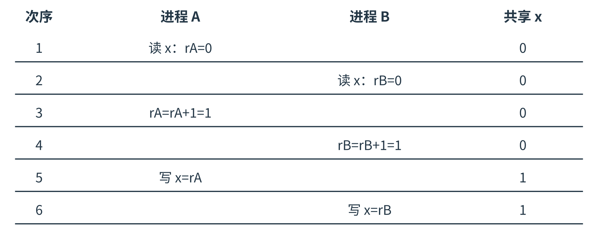

即使只有一个 CPU，进程也可能在读与写之间被切换出去，所以单处理机上同样存在竞争。多处理机上还可能真正同时执行。这里把某段操作视为**原子操作**，是说其他并发操作无法插入其内部，也无法观察到破坏该操作语义的中间状态；不能仅凭“这是一行代码”认定原子性。

进程在运行态时占用处理机；在就绪态时具备运行条件，等待调度；在阻塞态时等待事件，暂时不能被调度执行。因资源不足而主动阻塞，与反复执行检查指令的忙等待不同。唤醒把阻塞进程变为就绪进程，不保证它立即运行。

<a id="OS02-auto-7"></a>
#### 资源、代码与先后关系

**临界资源**是在同一时段只允许一个进程使用的共享资源。**临界区**是进程中访问相应临界资源的代码段。进入区负责申请进入，退出区负责释放；二者不属于被保护的临界区本身。资源是一份共享对象，相关临界区可以有多段，分布在不同进程中。

〖2.3-027〗 5 个并发进程各有一段访问同一变量 A 的代码，对应 5 个相关临界区。临界区要按代码段计数，不能按共享变量的份数计数。一般程序若在多处访问共享数据，也不能仅凭进程数推出代码段总数。

**互斥**限制重叠：某进程正在访问临界资源时，其他需要访问它的进程须等待。**同步**规定合作中的先后关系：后续操作需要某项结果，就必须等产生该结果的操作完成。同一对进程可能同时受这两种约束。

<a id="OS02-ex-err11"></a>
#### 例 2B-1　共享缓冲区中的两种约束

**例题 · 配套例题**

〖2.3-011〗 进程 A 和进程 B 通过共享缓冲区协作完成数据处理，进程 A 负责产生数据并放入缓冲区，进程 B 从缓冲区读数据并输出。进程 A 和进程 B 之间的制约关系是（　）。

A. 互斥关系　　B. 同步关系　　C. 互斥和同步关系　　D. 无制约关系


**解析。** 进程 B 必须在进程 A 放入数据后读取，这是同步；对共享缓冲区的访问还须协调，避免操作冲突，这是互斥。答案为 **C**。选项 B 只概括了先后关系，没有涵盖互斥。

本题指出两类约束，并不意味着任何实现都必须恰好使用“一个同步量加一个互斥量”。操作是否反复执行、容量是否为 1，以及同步本身是否已排除重叠，都会影响实现；[例 2B-4](#OS02-ex-2024)会分别处理。

<a id="OS02-auto-8"></a>
#### 怎样判断互斥方案是否合格

检查一种方案时，先找违反条件的具体交错，不要只看顺序执行的结果。


| 检查项 | 要问的问题 |
| --- | --- |
| 空闲让进 | 临界区无人使用，是否仍被一个不参与竞争的进程挡住？ |
| 忙则等待 | 一个进程尚未退出，另一个能否进入同一临界区？ |
| 有限等待 | 请求提出后，其他进程获准进入的次数是否存在有限上界？还须满足进程持续获得执行机会、临界区操作有限等前提。 |
| 让权等待 | 不能进入时，是阻塞并让出处理机，还是继续占用 CPU 检查？ |


前三项分别检查进入机会、互斥安全和等待上界；让权等待检查等待方式。一个自旋方案可能保证互斥，却不满足让权等待。**无死锁不等于无饥饿**：系统整体仍在前进，但某个进程可能反复被越过。

<a id="OS02-locks"></a>
### 软件互斥与锁：检查和占用必须连起来

> **错项排除 · 原子锁不自动保证公平**
>
> TestAndSet保证检查旧值和置位不可被插入，因而可以建立互斥；它没有规定等待者先后次序。某进程持续抢不到锁仍可能饥饿，所以“硬件原子指令保证有限等待”缺少排队、公平和持续运行等条件。

<a id="OS02-auto-9"></a>
#### 三种失败方案留下了什么问题

以下双进程模型假定单次共享变量读写原子、内存顺序与伪代码一致。`flag[i]` 表示进程 $P_i$ 想进入。现代机器上的编译器重排与存储重排不在这些伪代码的默认模型内，实际程序还需相应原子变量与内存序保证。


| 方案 | 进入区的核心操作 | 一条足以否定它的执行情况 |
| --- | --- | --- |
| 单标志法 | 等待 `turn==i`，退出时将机会交给对方 | `turn=0`，但 $P_0$ 一直在剩余区工作（不访问该临界资源的其他代码）；$P_1$ 不能进入空闲临界区。 |
| 双标志先检查 | 先等对方 `flag` 为假，再置自己为真 | 双方都在对方置真前完成检查，随后同时进入，不能保证互斥。 |
| 双标志后检查 | 先置自己为真，再等对方为假 | 双方先置真，都等待对方退出；此时没有任何一方进入，无法执行清标志。 |


这些模型与反例见王道书 §2.3。先检查法的问题是“检查与声明占用分离”；简单调换两句又可能造成双方互等。

<a id="OS02-auto-10"></a>
#### Peterson 算法怎样处理双方同时申请

Peterson 算法用 `flag` 表达意愿，用 `turn` 在双方都想进入时决定谁先进入。两个 `flag` 初值均为 `false`；对 $i\in\{0,1\}$，令 $j=1-i$：

```text
flag[i] = true;
turn = j;
while (flag[j] && turn == j) { }  // 忙等待
访问临界资源;
flag[i] = false;
```

若只有自己请求，对方的 `flag` 为假，可直接进入。若双方都请求，两次对 `turn` 的写入总有先后：后写的一方把进入机会让给对方，自己等待。退出时清除自己的意愿，等待者随后通过检查。

还须排除“一个已进入，另一个又进来”的情况。假设 $P_i$ 在临界区，此时 `flag[i]` 为真；后来的 $P_j$ 声明意愿并将 `turn` 置为 `i`，就必须等待。如果双方已在进入区竞争，后一次 `turn` 写入同样使其中一方等候。由此排除同时进入。在上述内存模型、进程继续执行且临界区有限等前提下，它也能保证有限等待；它仍在循环检查，不能让权等待。

<a id="OS02-auto-11"></a>
#### TestAndSet 为什么能够上锁

硬件提供的 TestAndSet（TS，也称 TSL）以一次原子操作返回 `lock` 的旧值，并把 `lock` 置为真。以下只是该指令的逻辑含义，不能把普通语言实现的三句代码直接当作原子指令：

```text
TestAndSet(lock):
    old = lock
    lock = true
    return old

// lock 初值 false
while (TestAndSet(lock)) { }
访问临界资源;
lock = false;
```

第一个读到假值的调用者同时把锁置真；后续调用者得到真值，继续等待。关键在于“取旧值并置真”不能被其他竞争者插入，而不在于 `while` 语句本身有什么特殊之处。Swap/XCHG 则原子交换共享的 `lock` 与进程私有的 `key`。共享 `lock` 初值为假，每次申请先令本进程的 `key=true`，再反复原子交换二者，直到 `key=false`，表示取得了交换前的空闲锁；退出时令 `lock=false`。

这类锁若一直循环，就是**自旋锁**。它避免睡眠和唤醒的切换开销，适用于持锁时间很短、持锁者能够继续运行的情形。它不保证公平；有限等待也不能只从指令的原子性推出。阻塞锁在不可用时使线程睡眠，更适合可能较长的等待；不能把“互斥锁”这个名称一概等同于自旋实现。

单处理机上，自旋者正在运行时，持锁者不能同时运行；若调度还能让持锁者重新运行，锁仍可能被释放。若相关内核区又禁止了能让持锁者运行的切换，便不能指望忙等自行结束。多处理机上，其他核可继续执行持锁者。

屏蔽本 CPU 的可屏蔽中断，只能在单处理机、相关执行路径不会主动阻塞等限定下保护短小的内核临界操作；它无法阻止另一 CPU 访问共享数据，因此不适用于一般多处理机互斥。开关中断是特权操作，普通用户程序无权执行。分析原语的原子性时，应说明保护范围，不能笼统写“所有原语都靠关中断”。

<a id="OS02-software-code"></a>
#### 四种软件互斥写法的进入区

以下双进程伪代码中$i\in\{0,1\}$、$j=1-i$，单次共享变量读写原子且按程序次序可见。它们的适用边界与前述反例共同构成分析依据。

```text
// 单标志：turn初值0
while (turn != i) { }
临界区;
turn = j;

// 双标志先检查：flag[0]=flag[1]=false
while (flag[j]) { }
flag[i] = true;
临界区;
flag[i] = false;

// 双标志后检查：flag[0]=flag[1]=false
flag[i] = true;
while (flag[j]) { }
临界区;
flag[i] = false;
```

三段分别暴露严格交替、检查与占用分离、双方先声明后互等的问题。Peterson算法在声明后再用`turn`解决双方同时竞争，不能只删掉其中任一变量。

Swap原子交换可写为：

```text
// lock共享且初值false；key为本进程私有变量
key = true;
while (key) Swap(lock, key);
临界区;
lock = false;
```

原子交换一次完成两变量值的互换，`key`取得交换前的旧锁值。把Swap展开成三条普通赋值后，仍必须有额外机制保证三条作为整体原子执行，才能保留上述结论。

<a id="OS02-integer-semaphore"></a>
#### 整型信号量与记录型信号量的分界

整型信号量的典型定义是：`wait(S)`先在`S<=0`时循环，发现`S>0`后减1；`signal(S)`加1。检查与递减仍需原子化。等待者占CPU忙等，不能让权等待，计数也不利用负数记录队列长度。

记录型信号量把“资源不足”转为进入等待队列并阻塞。比较题中，先确认采用哪套定义，再解释0、负值和等待人数；不能把整型的`S<=0`忙等条件直接套到记录型P操作减1后的判断。

<a id="OS02-semaphore"></a>
### 信号量：先说明它代表什么，再计算初值

> **不变量 · 记录型计数的符号含义**
>
> 采用本节记录型定义时，正数表示未分配许可，负值绝对值表示等待者数量。P先减再判断，结果等于0仍已拿到最后许可；V先加再判断，结果等于0仍需唤醒。不能把整型忙等信号量的非负规则混进来。

<a id="OS02-auto-12"></a>
#### 记录型 P、V 的完整语义

记录型信号量 $S$ 包含整数 `value` 与等待队列。初始化只做一次；以后通过 P、V 改变状态。以下“修改计数—判断—入队或唤醒”须由系统实现为一个原子操作；但进程阻塞之后，整个等待期间并不因此变成不可调度的原子区。

```text
P(S):
    S.value = S.value - 1
    if S.value < 0:
        将当前进程加入 S 的等待队列并阻塞
        // 被唤醒后，本次 P 返回；不再次减 1

V(S):
    S.value = S.value + 1
    if S.value <= 0:
        从 S 的等待队列移出一个进程，将其置为就绪
```

P 表示申请一个许可。减 1 后为 0，说明最后一个可用许可刚被取得，**此时不阻塞**；减 1 后小于 0，才说明本次申请需要等待。V 增加一个许可；加 1 后仍小于或等于 0，说明原先有人等待，需要把这个机会交给一个等待者。V 本身不会因资源不足而阻塞。

`value>0` 表示尚未分配的许可数；`value=0` 表示没有未分配许可，也没有在该量上等待的进程；`value<0` 时，$-\mathrm{value}$ 是等待队列长度。这些解释采用上述记录型定义。整型信号量的另一种实现是在 `S<=0` 时循环检查，再取得许可；其计数通常不为负，且可能忙等，不能混用两套数值规则。

设两台同类打印机对应初值 2，A、B、C、D 先后申请，再由 A、B 归还；下图为便于追踪，假定按入队顺序唤醒。

<a id="fig-signed"></a>
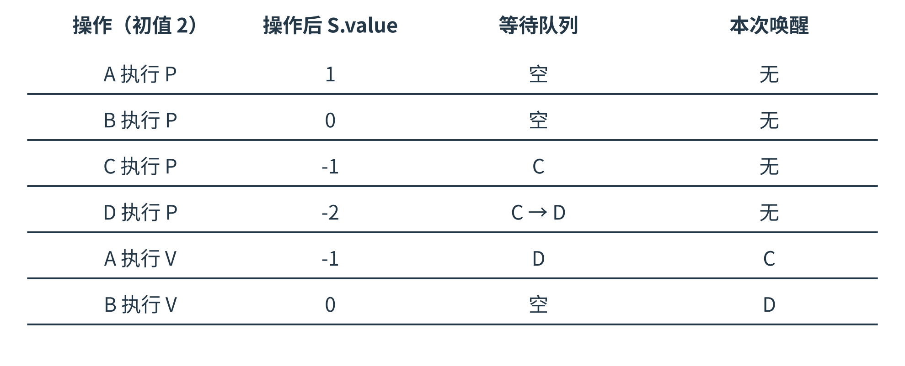

A 归还后值为 −1，C 已得到可继续执行本次 P 的机会，D 仍等待。此时值仍为负数，但 C 不必再做一次 P。唤醒 C 也不意味着 C 立即运行：取得许可与分到 CPU 是两件事。

<a id="OS02-auto-13"></a>
#### 初值来自初态，不来自“同步量”这个名称

互斥量 `mutex=1` 表示只有一个进入许可。若某项一次性工作尚未完成，完成通知 `done=0`，后续进程先等通知。若缓冲区已有 $k$ 个可消费的产品，产品许可应从 $k$ 开始；容量为 $n$、已有 $k$ 件时，空位许可应为 $n-k$。

<a id="OS02-ex-err18"></a>
#### 例 2B-2　同步信号量一定从 0 开始吗

**例题 · 配套例题**

〖2.3-018〗 用 P、V 操作实现进程同步，信号量的初值为（　）。

A. −1　　B. 0　　C. 1　　D. 由用户确定


答案为 **D**。这里的“由用户确定”指根据资源或事件的初始状态确定，不能任意设数。B 适用于尚未发生、尚无可用结果的一次通知，不能覆盖所有同步情形。判断初值时，应检查题目有没有给出“尚未发生”这个限定。

<a id="OS02-auto-14"></a>
#### 将完成条件放在正确位置

若操作 B 必须在 A 完成后开始，设置 `done=0`：

```text
前进程：A; V(done);
后进程：P(done); B;
```

若后进程先到，P 使它等待；若前进程先到，V 留下一个许可，后进程后来做 P 时也能通过。通知必须放在 A **完成之后**，不能在 A 开始前发布。互斥则是各参与者在受保护代码前 P、后 V；同步的一次 P 与产生它的一次 V 通常分布在不同进程中。因此，“P、V 要配合”不等于“必须在同一进程紧挨着出现”。

信号量通常没有互斥锁的持有者限制：一个进程可 P，另一个可 V。这允许它表达合作事件，也意味着不能把信号量与具有所有权要求的 mutex API 完全混同。

<a id="OS02-precedence"></a>
### 从前驱图到线程代码

> **错项排除 · 满足次序还要保留并发**
>
> 若要求C完成后E可开始，却在D完成后才通知E，虽然没有违反C先于E，却额外加上D先于E。前驱题需同时检查“不提前”和“不增加无关等待”，通知应紧随真正的前驱条件成立时发出。

前驱图的边 $A\to B$ 表示 B 不能在 A 完成前开始。先标出哪些顺序已由同一线程的程序顺序保证，再为剩下的跨线程依赖传递完成通知。给每条边各设一个初值 0 的信号量是常见的直接构造，但已有顺序可能使部分量不再需要；反过来，两个操作都等 C，也推不出它们之间要互相等待。

<a id="OS02-course-precedence"></a>
#### 课件例：六个操作的三路汇合

进程 $P_i$ 执行操作 $S_i$。课件前驱关系为 $S_1\to S_2,S_3$，$S_2\to S_4,S_5$，以及 $S_3,S_4,S_5\to S_6$。每条边各用一个初值为0的信号量：$a,b,c,d,e,f,g$ 分别对应图中的七条边。前一操作完成后发出许可，后一操作开始前取得许可。

<a id="os02-fig-course-precedence"></a>
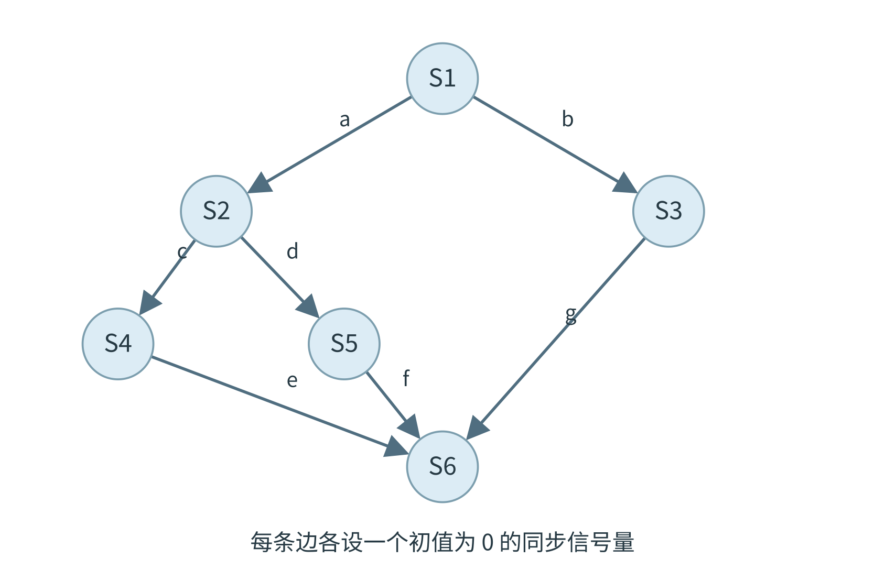

```text
P1: S1; V(a); V(b);
P2: P(a); S2; V(c); V(d);
P3: P(b); S3; V(g);
P4: P(c); S4; V(e);
P5: P(d); S5; V(f);
P6: P(e); P(f); P(g); S6;
```

例如，$S_4$ 的许可来自 $S_2$ 完成后的 `V(c)`；$S_6$ 必须先依次取得三路许可，才可执行。三个 P 的顺序可以调整，但不能省去任意一路，也不能将 `V(e)` 放到 $S_4$ 之前。该例每个信号量只有一个发送者与一个接收者，均用于一次同步，不是互斥锁。

<a id="OS02-ex-2022"></a>
#### 例 2B-3　哪些边需要跨线程通知

**例题 · 配套例题**

【配套例题】 某进程的两个线程 T1 和 T2 并发执行 A、B、C、D、E 和 F 共 6 个操作，其中 T1 执行 A、E 和 F，T2 执行 B、C 和 D。题46图表示上述 6 个操作的执行顺序所必须满足的约束：C 在 A 和 B 完成后执行，D 和 E 在 C 完成后执行，F 在 E 完成后执行。请使用信号量的 wait()、signal() 操作描述 T1 和 T2 之间的同步关系，并说明所用信号量的作用及其初值。

<a id="fig-precedence"></a>
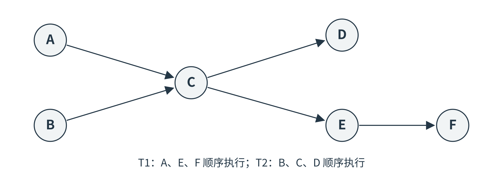


**解析。** 在所写程序中，让 T1 按 A、E、F，T2 按 B、C、D 顺序执行，B→C、C→D、E→F 就已满足。跨线程仍需保证 A→C 和 C→E，分别设 `S_AC=0`、`S_CE=0`。

```text
semaphore S_AC = 0, S_CE = 0;

T1() {                 T2() {
    A;                     B;
    signal(S_AC);          wait(S_AC);
    wait(S_CE);            C;
    E;                     signal(S_CE);
    F;                     D;
}                      }
```

T2 到达 C 前已完成本线程的 B，又收到了 A 完成的通知，因此 C 的两个前提齐备。C 完成后先发布 `S_CE`，T1 才能开始 E，随后执行 F；T2 自行继续 D。

例如，A、B、C、E、F、D 是允许的完成次序，A、B、C、D、E、F 也允许。D 与 E、F 没有额外次序要求。若把通知放到 D 后，虽然仍不违反图中的先后约束，却会强加 E 等待 D 的限制，减少题目允许的并发。结果安全不等于完整保留了题目允许的并发。


<a id="OS02-buffer"></a>
### 缓冲区：容量许可与互斥范围分别建立

> **最小反例 · 锁住改变条件的人**
>
> 初始空缓冲区中，消费者若先P(mutex)再P(full)，就会持锁等产品；生产者随后等同一把锁，无法放入产品。两方等待的事件互相依赖。修正时应让消费者先取得产品许可，再申请只保护单次取出的缓冲锁。
>
> 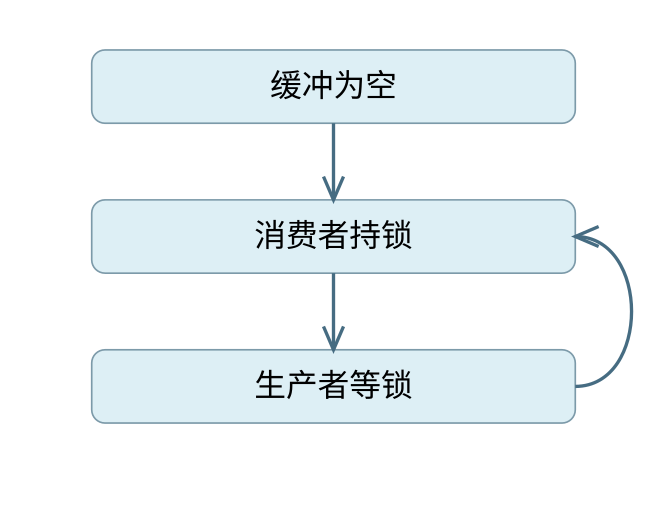
>
> 消费者持mutex等待full，生产者也需要mutex，二者无法推进。

> **不变量 · 许可与物理槽位有中间态**
>
> 容量2且初始为空，生产者刚做P(empty)尚未放入时，empty＝1、full＝0，物理空槽却仍为2。许可已预留而物理状态未改变，因此不能把empty＋full＝容量写成每条指令后都成立的不变量。

<a id="OS02-ex-2024"></a>
#### 例 2B-4　同一个缓冲区为什么有不同的信号量方案

**例题 · 配套例题**

【配套例题】 计算机系统中的进程之间往往需要相互协作以完成一个任务。在某网络系统中，缓冲区 B 用于存放一个数据分组，对 B 的操作有 C1、C2 和 C3。C1 将一个数据分组写入 B 中，C2 从 B 中读出一个数据分组，C3 对 B 中的数据分组进行修改。要求 B 为空时才能执行 C1，B 非空时才能执行 C2 和 C3。

（1）假设进程 P1 和 P2 均需要执行 C1，实现 C1 的代码是否为临界区？为什么？（2分）

（2）假设 B 初始为空，进程 P1 执行 C1 一次，进程 P2 执行 C2 一次。请定义尽可能少的信号量，并用 wait()、signal() 操作描述进程 P1 和 P2 之间的同步或互斥关系，说明所用信号量的作用及其初值。（3分）

（3）假设 B 初始不为空，进程 P1 和 P2 各执行 C3 一次。请定义尽可能少的信号量，并用 wait()、signal() 操作描述进程 P1 和 P2 之间的同步或互斥关系，说明所用信号量的作用及其初值。（3分）


**解析。** （1）是。两个 C1 都操作同一缓冲区，若同时发现 B 为空后分别写入，可能覆盖数据；检查并改变缓冲状态的代码需要保护。

（2）先把“初始为空、各一次”转成 C1 完成→C2 开始。设置 `done=0`，表示唯一一次写入完成的通知：

```text
semaphore done = 0;
P1() { C1; signal(done); }
P2() { wait(done); C2; }
```

不设同步量，P2 就可能先读；设一个同步量就足以使 C2 必在 C1 之后，两次操作不会重叠，故无需再加互斥量。这里同步关系已经保证了本情境下的互斥，不能据[例 2B-1](#OS02-ex-err11)的分类机械增加变量。

（3）B 已非空，且这里只有两个 C3，修改不会将 B 清空。无需等待新的产品，只须保证两次修改不重叠：

```text
semaphore mutex = 1;
P1() { wait(mutex); C3; signal(mutex); }
P2() { wait(mutex); C3; signal(mutex); }
```

三问的共享对象相同，操作类型与执行次数却不同。“容量为 1”不能单独决定信号量个数；必须结合参与者、初态和活动范围一起判断。

<a id="OS02-auto-15"></a>
#### 有限缓冲区为什么通常需要 empty、full 和 mutex

经典生产者—消费者模型中，一组生产者反复放入，一组消费者反复取走，共享容量为 $n>0$、初始为空的缓冲区。每次放入或取出一件，对缓冲区及相关指针的操作都须互斥。基本模型见王道书 §2.3。

三项条件分别决定三种许可：`empty=n` 表示尚未被申请的空槽，`full=0` 表示尚未被申请的产品，`mutex=1` 保护单次缓冲操作。生产者在本地生产、消费者在本地使用产品，这些操作都不占用缓冲区锁。

<a id="fig-buffer"></a>
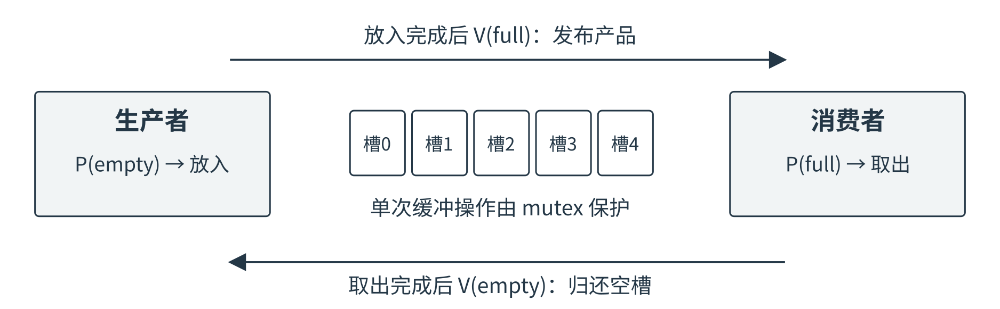

```text
semaphore empty = n, full = 0, mutex = 1;

producer() {
    while (true) {
        x = produce();
        P(empty);          // 先取得一个空槽许可
        P(mutex);
        put(x);
        V(mutex);
        V(full);           // 放入完成，才能发布产品
    }
}
```

```text
consumer() {
    while (true) {
        P(full);           // 先取得一个产品许可
        P(mutex);
        x = get();
        V(mutex);
        V(empty);
        consume(x);
    }
}
```

“尚未被申请”这一限定不能省略。容量为 2、初始为空时，一个生产者刚执行 P(empty) 而尚未放入，`empty=1, full=0`，物理空槽却仍有 2 个。空槽已预留，信号量先减少，实际空位数还没变；消费者取得 `full` 后、实际取出前也类似。因此，执行中每一步的 `empty+full` 都未必等于 $n$，`full` 也未必等于实存产品数。只有两个计数均非负，且既无已取得但尚未使用的许可、也无操作完成却尚未发布的许可时，才能把它们分别与物理空槽数、产品数对照。计数为负时，其绝对值表示相应等待者数。

<a id="OS02-auto-16"></a>
#### 为什么不能持有缓冲区锁等待产品

若消费者先 `P(mutex)` 再 `P(full)`，初始为空时，它会持锁阻塞。生产者随后申请 `mutex` 也阻塞；消费者等生产者放入，生产者等消费者解锁，形成等待环。

<a id="fig-deadlock"></a>


所以在这个算法中，容量或产品的 P 在外，缓冲区锁的 P 在内。判断别的算法时仍要追问：当前持有什么，等待什么，谁能使条件成立，对方是否也要用所持资源。不能把“同步 P 总在所有互斥 P 前”当成普遍定理；[整批取数](#OS02-ex-2014)和[读者组](#OS02-readers)会给出更具体的锁范围。

放入之后，本算法的 `V(mutex)` 与 `V(full)` 可交换：消费者即使先收到产品许可，仍须取得 `mutex` 才能取出。原顺序可避免提前唤醒后再等锁。这个判断依赖放入已经完成、且后续访问也持锁；不是所有 V 都能任意挪动。

〖2.3-039〗 生产者—消费者模型处理的是进程之间的同步与互斥。它本身不保证公平；错误的 P 顺序还可能制造死锁。避免这一错误顺序只是正确实现的必要条件，不能据此声称该模型能解决任意死锁。

<a id="OS02-ex-2009"></a>
#### 例 2B-5　消费者只能取特定类别时怎样计数

**例题 · 配套例题**

【配套例题】 三个进程 P1、P2、P3 互斥使用一个包含 N（N>0）个单元的缓冲区。P1 每次用 produce() 生成一个正整数并用 put() 送入缓冲区某一空单元中；P2 每次用 getodd() 从该缓冲区中取出一个奇数并用 countodd() 统计奇数个数；P3 每次用 geteven() 从该缓冲区中取出一个偶数并用 counteven() 统计偶数个数。请用信号量机制实现这三个进程的同步与互斥活动，并说明所定义信号量的含义（要求用伪代码描述）。


**解析。** “缓冲区非空”不足以允许 P2 取数：其中可能只有偶数。保留共同的空位许可，把产品许可按可取条件拆为 `odd` 与 `even`；三种缓冲操作共用 `mutex`。

原题未明说缓冲区初态。以下按参考答案采用**初始为空**：`empty=N, odd=even=0, mutex=1`。令 `x` 是 P1 本次生成的本地整数，`put()` 放入它；保留题设函数名。

```text
semaphore empty = N, odd = 0, even = 0, mutex = 1;

P1() {
    while (true) {
        x = produce();
        P(empty);
        P(mutex);
        put();
        V(mutex);
        if (x % 2 != 0) V(odd); else V(even);
    }
}
```

```text
P2() {
    while (true) {
        P(odd);
        P(mutex);
        getodd();
        V(mutex);
        V(empty);
        countodd();
    }
}
```

```text
P3() {
    while (true) {
        P(even);
        P(mutex);
        geteven();
        V(mutex);
        V(empty);
        counteven();
    }
}
```

每次 put 只发布所放入的产品所属类别的一份许可，消费者不能拿另一类别的许可代用。getodd/geteven 完成后，空位可立刻交还；各自的统计不访问共享缓冲区，留在锁外。

若初始已有 $a$ 个奇数、$b$ 个偶数，则应改为 `odd=a, even=b, empty=N-a-b`，其中 $a,b\ge0$ 且 $a+b\le N$。若长期没有某类别的产品产出，该类别的消费者就可能持续等待，直到该类产品出现；只要生产者和另一消费者仍前进，就不能仅凭这一等待认定系统死锁。题目没有保证所有类别都会出现。

<a id="OS02-ex-2014"></a>
#### 例 2B-6　连续取 10 件改变的是哪一层互斥

**例题 · 配套例题**

【配套例题】 系统中有多个生产者进程和多个消费者进程，共享一个能存放 1000 件产品的环形缓冲区（初始为空）。当缓冲区未满时，生产者进程可以放入其生产的一件产品，否则等待；当缓冲区未空时，消费者进程可以从缓冲区取走一件产品，否则等待。要求一个消费者进程从缓冲区连续取出 10 件产品后，其他消费者进程才可以取产品。请使用信号量 P、V（或 wait()、signal()）操作实现进程间的互斥与同步，要求写出完整的过程，并说明所用信号量的含义和初值。


**解析。** “连续”限制其他消费者插入取数，不禁止生产者在这期间补货。由此需要两个范围：`mutex=1` 保护一次缓冲操作，`batch=1` 由一个消费者持有直到它取满 10 件。生产者不申请 `batch`。

```text
semaphore empty = 1000, full = 0, mutex = 1, batch = 1;
item buf[1000];
int in = 0, out = 0;

producer() {
    while (true) {
        x = produce();
        P(empty);
        P(mutex);
        buf[in] = x;
        in = (in + 1) % 1000;
        V(mutex);
        V(full);
    }
}
```

```text
consumer() {
    while (true) {
        P(batch);
        for (int k = 0; k < 10; ++k) {
            P(full);
            P(mutex);
            local[k] = buf[out];
            out = (out + 1) % 1000;
            V(mutex);
            V(empty);
        }
        V(batch);
        consume(local);
    }
}
```

`empty`、`full` 的含义与初值来自容量和初态。`in/out` 分别指向下一次放入、取出的位置；`local[0..9]` 是消费者私有的十件产品存储。每次取走一件就归还一个空槽，不必等整批结束。

假设消费者已取出 3 件，缓冲区暂时为空。它持有 `batch`，等 `full`；但它没有持有 `mutex`，生产者能继续放入并 V(full)，因此可接着取第 4 件。其他消费者不能插入，所要求的连续性得到保持。若把 `mutex` 从整批开头一直持有到末尾，消费者会在缺货时挡住补货者，形成死锁。

本解不要求开始时凑齐 10 件。不要让多个消费者在批锁之外各申请若干产品许可，再等凑够十个；这会把产品预留给多个消费者，破坏整批协调。`batch` 在前并非违反上一节的锁顺序：真正要检查的是生产者是否也依赖它，以及消费者等待产品时是否仍给生产者留下执行通路。

<a id="OS02-fruit"></a>
### 课件模型：一只盘子与两类水果

> **辨析 · 容量1是互斥结论的前提**
>
> 一只盘子通过空盘与特定水果许可交接访问权。容量大于1后，生产者可并发操作共享容器，通常还要独立mutex保护结构。

一只盘子一次只能放一个水果；父亲放苹果，母亲放橘子，女儿取苹果，儿子取橘子。盘子初始为空。需要区分“空盘”“有苹果”“有橘子”三个条件，设`plate=1, apple=0, orange=0`。

```text
father:                       mother:
while (true) {                while (true) {
    准备苹果;                     准备橘子;
    P(plate);                    P(plate);
    放入苹果;                     放入橘子;
    V(apple);                    V(orange);
}                             }

daughter:                     son:
while (true) {                while (true) {
    P(apple);                    P(orange);
    取出苹果;                     取出橘子;
    V(plate);                    V(plate);
    吃苹果;                       吃橘子;
}                             }
```

<a id="os-fig-fruit"></a>
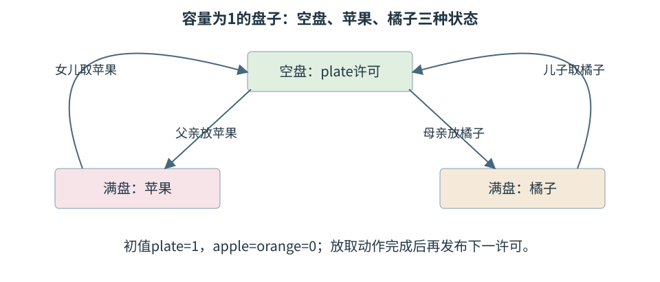

盘子容量为1且每次按上述顺序完整交接，访问权在空盘许可、某生产者、某类水果许可、对应消费者之间转移，不能同时有两个进程访问盘子；因此这份特定模型可由同步关系兼顾互斥。记录型信号量的数值可能为负，解释访问权时应跟踪已取得但尚未归还的许可，不能简单把三个原始计数相加。

若容量变为2，父母可以分别取得一个空位并发修改共享存放结构，单靠容量计数已不足以保证互斥。此时增加`mutex=1`，在生产者`P(plate)`后、消费者`P(apple)`或`P(orange)`后取得互斥量，只保护实际放取动作，再释放互斥量及发布相应条件。等待资源前不持有盘子锁，才能让能够改变条件的其他进程继续工作。

<a id="OS02-readers"></a>
### 多个读者怎样作为一组申请资源

> **不变量 · 登记与首末判断一起保护**
>
> 第一个读者申请文件权，最后一个读者释放。若只保护计数加减而不保护是否为首末读者的判断，新读者可能在旧末读者释放后直接进入，与写者重叠。保护对象是整个判定与登记过程，不能只盯住一条加法。

读者—写者模型允许多个读者同时读共享文件；写者之间互斥，写者与任何读者互斥。读者读完不清空文件，因此“已有数据”不应被当作一个被读走就消耗的产品许可。以下采用王道书 §2.3 的经典模型；每次读或写的时间有限，所有访问者遵守同一协议。

<a id="OS02-auto-17"></a>
#### 首读者申请，末读者释放

令 `rw=1` 表示文件访问权：一个写者独占，或者一组读者共同持有。共享计数 `readCount=0` 记录已登记但尚未退出的读者数，`countMutex=1` 保护该计数和首末读者判断。

```text
semaphore rw = 1, countMutex = 1;
int readCount = 0;

reader() {
    P(countMutex);
    if (readCount == 0) P(rw);
    readCount++;
    V(countMutex);

    读文件;

    P(countMutex);
    readCount--;
    if (readCount == 0) V(rw);
    V(countMutex);
}
```

```text
writer() {
    P(rw);
    写文件;
    V(rw);
}
```

第一个读者为整组取得 `rw`，后续读者只登记，不重复申请 `rw`；最后一个读者离开才归还。若每个读者都在读文件前 P(rw)、读后 V(rw)，读者也被串行化，题目允许的并发便丢失了。

<a id="fig-readers"></a>
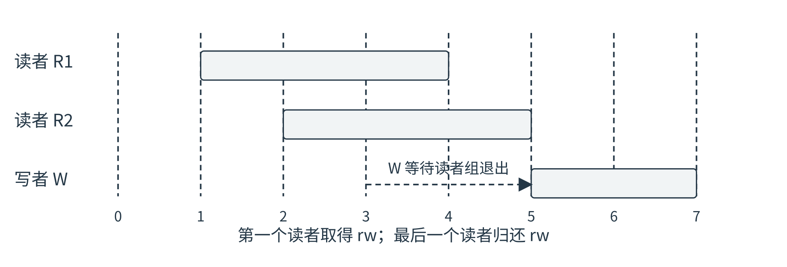

计数的检查和修改须在同一个受保护范围。假设只保护加减、不保护前面的判断：`readCount=1` 时，新读者检查到非零，准备跳过 P(rw)，此时暂停；原有的最后一个读者退出，把计数减到 0 并释放 rw；写者取得 rw 后，新读者才恢复，将计数加 1 并开始读。新读者没有申请 rw，却与写者同时访问。把判断和登记一起保护，才能排除这条交错。

首读者可能持有 `countMutex` 等待 `rw`，此处为何不必然死锁？它等待时 `readCount=0`，所以没有已登记的读者需要取得 `countMutex` 来做末读者退出；正在写的进程归还 `rw` 也不需要 `countMutex`。

<a id="OS02-auto-18"></a>
#### 读者优先与公平需要分别说明

上述算法中，只要仍有读者在读，新来的读者就能加入同一组，即使已有写者等 `rw`。不断到来的读者可能使 `readCount` 始终不归零，写者因而饥饿。

一种改法是加入口信号量 `gate=1`。每个读者在登记前 P(gate)，登记后 V(gate)；写者则 P(gate)、P(rw)，写完后依次 V(rw)、V(gate)。其余读者退出代码不变：

```text
// 读者的入口，替换上一算法的入口部分
P(gate);
P(countMutex);
if (readCount == 0) P(rw);
readCount++;
V(countMutex);
V(gate);

// 写者完整过程
P(gate);
P(rw);
写文件;
V(rw);
V(gate);
```

一旦写者取得 `gate`，新读者不能再登记；原有读者仍能按原退出代码离开，最后一个释放 `rw`，写者便可进入。若 `gate` 队列按先进先出服务，且进程持续获得执行机会、每次读写有限，可进一步说明等待者不会被后来者无限越过。**仅有信号量而没有公平排队约定，不能无条件宣称“不会饥饿”或“严格先来先服务”。** 它也不是绝对的写优先策略：写者并不在任何到达次序下都先于读者进入。

<a id="OS02-philosophers"></a>
### 哲学家进餐：申请多个资源时怎样断开等待环

> **错项排除 · 四人申请不等于四人吃饭**
>
> 五根筷子下，每个吃饭者要占两根，最多只能有两人同时吃。room＝4限制的是开始申请到全部归还这一段内的人数，用来避免五人各拿一根；它既不是同时吃饭人数，也不直接保证所有等待者公平。

五个哲学家 $P_0$ 至 $P_4$ 围桌而坐，每人须同时持有左右两根筷子才能吃饭。一根筷子只供一人使用，吃完归还，再思考。统一编号：$P_i$ 需要 $C_i$ 与 $C_{(i+1)\bmod5}$，每个筷子信号量初值为 1。经典模型见王道书 §2.3。

如果所有人都先 P(C[i]) 再 P(C[(i+1)%5])，一种允许的交错是每人先拿到一根。此时每人都在等右邻已经拿着的那一根，无人能到达归还步骤。

<a id="fig-philosophers"></a>
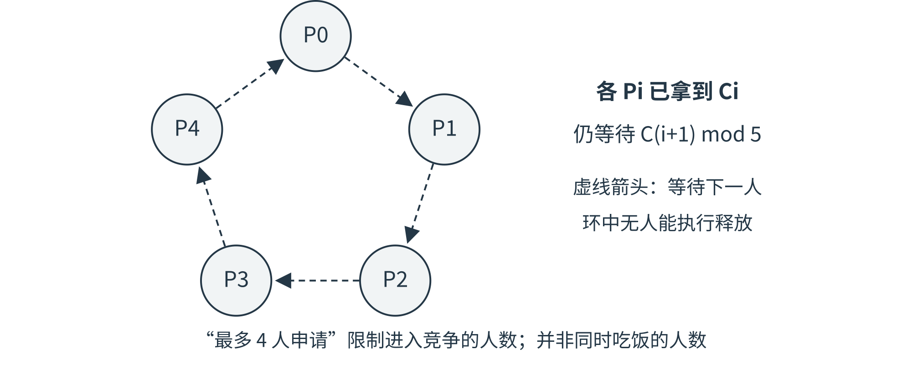

<a id="OS02-auto-19"></a>
#### 限制竞争人数，与限制同时吃饭人数不同

增加 `room=4`，使最多四人处在“开始拿筷子到全部归还”的区间内：

```text
semaphore room = 4;
semaphore C[5] = {1, 1, 1, 1, 1};

philosopher(i) {
    while (true) {
        思考;
        P(room);
        P(C[i]);
        P(C[(i+1) % 5]);
        吃饭;
        V(C[(i+1) % 5]);
        V(C[i]);
        V(room);
    }
}
```

若所有竞争者都各持一根并等待下一根，要形成完整环就必须五人都参与；`room=4` 阻止了这种状态。沿等待方向追下去，要么遇到一根还没被占用的筷子，要么遇到正在吃饭、能够归还筷子的人。只要持有者继续执行、进餐有限，就不会陷入上述整体等待环。

这里的 4 是同时申请区间内的人数上限。五根筷子最多支持 $\lfloor5/2\rfloor=2$ 人同时吃饭，不能把“最多四人申请”误读为“四人同时进餐”。该办法排除了这种死锁情形，但并不保证某个饥饿者最终抢到许可；仍需公平条件。

另一种办法是全局排序：所有人都先取编号较小、再取较大的筷子。若存在资源等待环，沿环等待的资源编号就必须严格递增，最后又回到起点，不可能成立。每人独立“先左后右”不是全局排序；编号相邻位置在取模后更须检查。

也可用额外互斥量把“拿两根”的过程串行化，拿齐后立即释放这个额外量，吃完直接归还筷子。这能断开多人各拿一根的环，但可能让一个正在等筷子的人挡住另一个本可拿齐的人。它也不等于“先原子检查两根都空闲，然后同时取得”；若题目要求整组资源同时分配，就需要更强的原子检查与分配机制。

<a id="OS02-monitor"></a>
### 管程与条件变量：等待时必须让出改变条件的机会

> **最小反例 · 通知不会留下许可**
>
> 条件变量没有等待者时发signal，随后才调用wait的线程不会获得一张已保存的通知券。相比之下，信号量V会增加可供以后P取得的许可。用“通知在前、等待在后”这一最小时间线就能排除二者作用相同的说法。

**管程**把共享数据、对数据的操作过程和初始化封装在一个同步模块中，参与者通过规定的入口访问这些数据；同一时刻至多一个进程在其中执行。这个互斥规则由实现管程的语言或运行系统保证，不要求调用者在每个入口外重复编写 P、V。管程不是一个自行运行的进程。

**课件拓展：Java 对象锁。** 实例方法上的 `synchronized` 使用调用该方法的对象作为锁。同一对象的两个同步实例方法共享这把锁，一个线程执行期间，另一个线程需等待；不同对象实例通常持有不同的锁。静态同步方法使用对应类对象的锁，不能把它与任意实例锁当作同一把锁。

```java
class Buffer {
    private int count = 0;
    public synchronized int getCount() { return count; }
    public synchronized void clear() { count = 0; }
}
```

这个例子只展示互斥入口；生产者、消费者需要等待条件时，还须正确使用条件等待和通知，单有 `synchronized` 不会自动实现完整的生产者—消费者逻辑。

但“每次只准一人进入”还不够：消费者进入后可能发现无产品。若它在管程里循环等待并一直保有管程，生产者就无法进入改变条件。**条件变量**为这种等待提供队列；实际条件由共享数据上的布尔判断表达，例如 `count>0`。条件变量本身不是保存产品数的整数。

<a id="OS02-auto-20"></a>
#### wait 负责等待，不替调用者判断条件

<a id="OS02-ex-2018"></a>
#### 例 2B-7　条件变量的 wait 做什么

**例题 · 配套例题**

【配套例题】 若 x 是管程内的条件变量，则当进程执行 x.wait() 时所做的工作是（　）。

A. 实现对变量 x 的互斥访问

B. 唤醒一个在 x 上阻塞的进程

C. 根据 x 的值判断该进程是否进入阻塞态

D. 阻塞该进程，并将之插入 x 的阻塞队列中


答案为 **D**。调用者先检查共享状态，只有需要等待时才调用 x.wait()；调用后进入 x 的等待队列，并释放管程使用权，让其他进程能进入。C 把“调用前的条件判断”放进了 wait 的职责，还把 x 当作可直接取值的资源计数。

管程中执行 x.signal()，是通知一个已经在 x 上等待的进程。若没有等待者，通知不积累；以后进入的进程须重新检查共享状态。信号量 V 即使没有等待者，也会使计数增加，留下一个可供后续 P 使用的许可。

〖2.3-029〗 “管程中 signal 操作的作用和信号量机制中的 V 操作相同”不成立。检查无等待者的边界即可区分：前者不留下通知，后者增加许可。管程作为同步模块，与一个可独立运行的进程也不是同一类对象；具体语言的管程对象能否实例化，应由语言规定。

<a id="OS02-auto-21"></a>
#### 通知以后，何时重新检查条件

不同管程定义对 signal 后的运行次序有不同规定。Hoare 式语义可立即转交管程给被唤醒者；Mesa 式语义让通知者继续，等待者以后重新竞争进入权。题目若给出特定语义，应据此推演，不能混用。

下面用 Mesa / POSIX 式条件等待说明可独立执行的做法。`wait(cv,m)` 把释放互斥锁 m 与进入等待合并为一个原子操作；返回前重新取得 m。通知不保证等待者马上运行，也不保证等它重新取得 m 时条件仍成立，所以用 `while` 重检。实际接口还可能出现虚假唤醒，同样需要重检。

<a id="fig-monitor"></a>
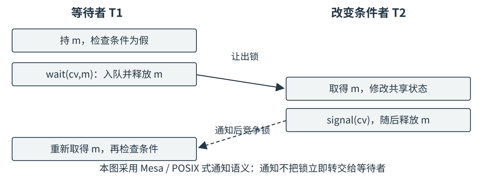

设这个模块的容量为 $n>0$，初始为空，m 初始化为未加锁；插入和取出维护同一个缓冲区。

```text
// 单个缓冲模块的共享状态
mutex m;
condition notEmpty, notFull;
int count = 0;

put(x) {
    lock(m);
    while (count == n) wait(notFull, m);
    插入 x; count++;
    signal(notEmpty);
    unlock(m);
}
```

```text
get() {
    lock(m);
    while (count == 0) wait(notEmpty, m);
    x = 取出元素; count--;
    signal(notFull);
    unlock(m);
    return x;
}
```

若消费者发现空就调用 wait，它释放 m；生产者才能取得 m 放入，并通知消费者。被通知者回来时再次检查 `count`，是因为这期间可能已有另一个消费者先取走产品。不能把 `wait` 拆成普通的“先 unlock，再单独入队”：另一线程可能恰在两步之间发出无人接收的通知，等待者随后入队，就错过了这次机会。

这里的接口语义用于把等待机制讲清，并非要求记忆 POSIX 参数及错误码。参见 The Open Group《Base Specifications Issue 8》条件等待与通知条目；管程概念与条件变量的比较见王道书 §2.3。

<a id="OS02-method"></a>
### 写出并发代码后，怎样检验

> **课程连接 · 检验方法**
>
> 检查初值、每个P/V位置、资源上限及所有阻塞路径，尤其注意持锁等待是否构成环。

题干中的名词不会直接决定信号量个数。先把每个进程的一次活动写清，标出它开始前必须成立的条件，再说明谁能使该条件成立。把“可用槽位”“某类产品”“阶段已经完成”等条件转成许可，把会冲突的共享状态操作放进相应互斥范围，才能确定变量及初值。


| 题干给出的条件 | 转成什么关系 | 应检查的代码位置 |
| --- | --- | --- |
| 必须等某操作完成 | 完成通知，初值由该事件是否已发生决定 | 前操作完成后 V，后操作开始前 P。 |
| 最多容纳 n 件 | 容量许可，有放入与归还两个方向 | 先申请空位，放入后发布产品，取出后归还空位。 |
| 只能取某一类 | 每一类独立的可取条件 | 发布对应类别，不以总的 full 代替各类别许可。 |
| 多个读者可以并行 | 读者组与写者互斥 | 保护首末读者判断，而非将整个读操作串行化。 |
| 连续取 k 件后才轮到别人 | 消费者整批排他 | 批锁覆盖 k 次，缓冲锁只覆盖单次；等待时允许补货。 |


最后手推几条会暴露错误的轨迹：后继先运行、缓冲区初始为空或已满、两个请求几乎同时到达、一个进程拿到许可但尚未实际操作、通知发出但被通知者尚未重新运行。每一步记下“持有—等待—可执行者”。检查安全性后，再分别检查死锁、饥饿与不必要的串行化；三者不能互相代替。

<a id="OS02-selfcheck"></a>
### 分支自测：先判断，再看答案

> **课程连接 · 并发复核**
>
> 对每个信号量写明其代表的资源或事件、初值，以及改变计数的具体时机。

原创回顾设问：下列问题依据本章例题与经典模型编写，用于检查中间状态和适用边界。

1. 按[记录型语义](#OS02-semaphore)，P 前 `S.value=1`，P 后为 0，要阻塞吗？一次 V 使值从 −1 变为 0，要唤醒吗？被唤醒者是否还要为这次申请再减 1？
2. 在[前驱题](#OS02-ex-2022)中，能否在 D 完成后才 signal(S_CE)？这样是否保留了图允许的所有并发？
3. 在[分类缓冲题](#OS02-ex-2009)中，初态有 $a$ 个奇数、$b$ 个偶数，三个计数信号量怎样初始化？如果缓冲区只有偶数，P2 等待能否说明整个系统死锁？
4. 在[成批取数题](#OS02-ex-2014)中，某消费者取了 3 件后暂时缺货，应继续持有哪个量、等待哪个量？生产者还能否运行？
5. 哲学家最多允许四人进入申请区，是否能有四人同时吃饭？
6. 条件变量 signal 在没有等待者时，是否留下一份以后可取得的许可？

<a id="OS02-auto-22"></a>
#### 自测答案

1. P 后为 0 不阻塞，表示取走最后一个许可。V 后为 0 仍须唤醒一个等待者；它已取得本次申请的机会，不再为同一次 P 减 1。
2. 能保证 E 不早于 C，却额外让 E 等 D，缩小并发范围。通知应在 C 完成后、D 前发出。
3. `empty=N-a-b, odd=a, even=b`；需 $a,b\ge0$、$a+b\le N$。若只有 P2 无奇数可取，不能推出整个系统无法前进。
4. 持有 `batch`、等待 `full`，此时没有持有 `mutex`。生产者不需要 `batch`，仍能取得空位与缓冲区锁，补入产品。
5. 最多两人同时吃饭，四是申请区间内的人数上限。
6. 条件变量通知不积累为以后可消费的许可；有资源初态要用共享状态表达。

条件变量等待语义另参 The Open Group 条件等待与通知接口、Oracle《Using Condition Variables》。

<a id="OS02-module-04"></a>
## 死锁：从资源分配状态判断能否继续

进程因为得不到资源而等待，并不一定发生死锁。要判断是否会死锁，还需追问：谁持有该进程所需的资源，持有者能否完成并归还，归还又依赖谁。本章把这种追踪分别用于死锁条件、资源分配图、安全检查和死锁检测。

除特别说明，讨论的是可重复使用的资源：每类可以有多个同类实例，资源只能在释放后再次分配；进程请求后若不能满足便等待，正常完成会归还已持资源。分析安全性还假定进程声明的最大需求可信，不超过系统允许的资源总量，并能在获得所需资源后有限完成。

<a id="OS02-4-1"></a>
### 死锁、饥饿和不安全状态

> **错项排除 · 有环还要看资源实例数**
>
> P持A等B、Q持B等A构成环；若A另有空闲实例，Q仍可拿到它并完成，归还B后P也能前进。单实例图中的环足以判断死锁，多实例时还须化简；不能只看箭头形状就跳过可用实例。

**死锁**指一组进程中，每个进程都在等待一个只能由组内进程引起的事件（其中也包括自身尚未执行的释放动作），因而这一组无法自行推进。最小的双资源例子是：P 持有 A 等 B，Q 持有 B 等 A；没有进程能到达释放步骤。

**饥饿**指某个进程长期得不到所需服务，而其他进程仍可能持续前进。例如读者不断加入，使写者一直拿不到写权限。**死循环**是执行路径自身不能结束，进程可能仍持续占用 CPU，不必等待其他进程。三者的机制不同，处理方法也不同。

<a id="OS02-auto-23"></a>
#### 四个必要条件是同时约束


| 条件 | 本章资源模型中的含义 | 怎样在状态中识别 |
| --- | --- | --- |
| 互斥 | 某类实例同一时刻只能给一个进程使用 | 资源不可被两个申请者同时使用 |
| 占有并等待 | 保持已有资源，同时等待新增资源 | 一个进程既有分配边，又有请求边 |
| 不可剥夺 | 未用完的资源不能被系统任意收回 | 只能由持有者按规则释放 |
| 循环等待 | 存在首尾相接的资源等待链 | P 等 Q，Q 又直接或间接等 P |


发生这类资源死锁时，四项同时成立；只满足其中一项或几项不能推出死锁。“四项必要条件都允许存在”也不等于任何时刻都已经死锁，还要检查实际持有与等待状态。单进程再次请求一个自己已经持有且不可重入的锁，也可能自我阻塞，不能把“死锁至少要两个进程”当作适用于所有锁语义的结论。

<a id="OS02-auto-24"></a>
#### 资源分配图中的环什么时候足够

进程用圆表示，资源类型用方框表示，框内点表示实例。$P_i\to R_j$ 是请求边，$R_j\to P_i$ 是一个实例的分配边。没有有向环，可排除这种资源等待死锁；有环时，若环中相关资源类型均只有一个实例，则可判定死锁。

若资源类型有多个实例，环只说明可能死锁。例如 P 持有 A 的一个实例、等待 B，Q 持有 B、等待 A，但 A 还有一个空闲实例，Q 取得它并完成后就能释放 B。图中已有等待环，却仍有解开它的执行通路。此时必须结合实例数化简或执行检测算法。

<a id="os-fig-resource"></a>
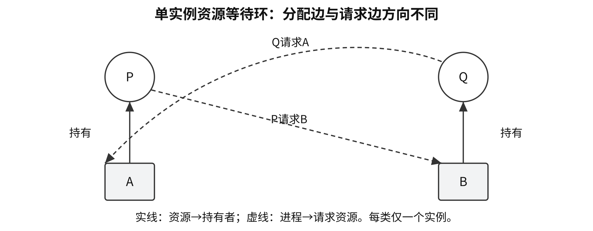

<a id="OS02-auto-25"></a>
#### 安全状态问的是“能否保证全部完成”

**安全序列**是进程的一种次序，使每个进程在轮到它时，现有可用资源加上此前已完成进程释放的资源，足以满足它尚需的最大资源量。若存在至少一个安全序列，则称当前状态安全。

安全状态并不意味着系统只能按这一序列运行；该序列是可完成性的证据。**不安全**表示无法在最大需求假设下给出这样的保证，不代表此刻已经死锁。进程可能还没提出全部需求，也可能实际少用资源或提前释放。死锁状态必不安全；不安全状态可能在以后的某种申请序列中发展成死锁。

<a id="OS02-4-2"></a>
### 死锁预防：在规则中破坏一个条件

> **课程连接 · 破坏条件**
>
> 预防死锁只需破坏四个必要条件之一，但具体规则可能牺牲利用率或增加申请约束。

**预防**是在分配规则上使至少一个必要条件不能成立，不必等到死锁已经出现。

让可共享的资源按共享方式使用，可以去掉相应的互斥条件；但打印机输出、独占锁等具有不可共享的语义，不能为了避免死锁而取消必要保护。一次性申请运行所需的全部资源，全部满足才开始，可以破坏占有并等待，但会降低利用率，并要求提前知道需求。申请失败时先释放已有资源再重试，也是破坏“占有并等待”的办法。

课件以 **SPOOLing** 为例：各进程先将打印数据送入输出井并提交请求，再由输出进程按队列驱动打印机。这样各进程可以共享逻辑上的打印服务，不必直接占有物理打印机等待输出；实际打印仍由输出进程串行管理，输出井和请求队列本身也需要正确同步。它改变的是应用进程申请打印资源的方式，并未使物理打印机同时打印多份内容。

对可保存、恢复状态的资源，可以在适当时机剥夺并回滚，例如某些处理器或存储资源；正在打印到纸张上的半份输出却不能简单撤回。对所有资源规定统一编号，只允许按严格递增次序申请，可以破坏循环等待：若有环，沿环的资源编号必须不断增大又回到起点，无法成立。各进程都只按“先拿左边、再拿右边”申请，并不等于有了统一的全局编号，仍可能形成环。

预防可能限制请求方式并造成资源闲置。**避免**则保留更多请求自由，在每次拟分配时检查分配后的状态是否仍然安全。二者都在实际进入死锁前采取措施，但依据不同。

<a id="OS02-ex4-1"></a>
#### 例 2C-1　避免与检测需要的信息不同

**例题 · 配套例题**

【配套例题】 若系统 S1 采用死锁避免方法，S2 采用死锁检测方法。下列叙述中，正确的是（　）。

Ⅰ. S1 会限制用户申请资源的顺序，而 S2 不会

Ⅱ. S1 需要进程运行所需的资源总量信息，而 S2 不需要

Ⅲ. S1 不会给可能导致死锁的进程分配资源，而 S2 会

A. 仅Ⅰ、Ⅱ　　B. 仅Ⅱ、Ⅲ　　C. 仅Ⅰ、Ⅲ　　D. Ⅰ、Ⅱ、Ⅲ


**解析。** 银行家算法这类避免方法根据最大需求和当前状态决定批准还是推迟，并不规定所有进程必须按统一资源顺序申请；Ⅰ混入了预防中的资源有序分配法。避免要判断未来最大需求是否仍可满足；检测根据当前已分配与当前等待请求判断，不要求事先掌握全过程最大需求。检测允许某些分配在以后导致死锁，事后再检测并解除。因此Ⅱ、Ⅲ正确，答案为 **B**。

<a id="OS02-4-3"></a>
### 银行家算法：可用不等于可以批准

> **不变量 · Work增加的是原持有量**
>
> 安全检查假想先借出Need、再收回Max，净效果是Work增加Allocation。若直接增加Max，就把尚未借出的资源也算成新增资源，破坏总量守恒。算法中的每次假定完成，都应能还原成这次借出与归还。

> **最小反例 · 拿得出仍可能不能批**
>
> 总量4，P最多4、Q最多3，已各持1，可用2；当前可先完成Q。若再给P一个，可用只剩1，两者都还需2，安全序列消失。这个状态通过了现存量检查，却未通过试分配后的安全检查。

设有 $n$ 个进程、$m$ 类资源。向量按同一资源次序排列，各分量逐项比较，不能用向量元素之和代替比较。


| 名称 | 含义 |
| --- | --- |
| `Available[j]` | 第 j 类当前未分配的实例数 |
| `Max[i][j]` | 进程 i 声明的第 j 类最大需求 |
| `Allocation[i][j]` | 进程 i 已持有的实例数 |
| `Need[i][j]` | 进程 i 尚可能需要的最大数量，等于 `Max-Allocation` |


<a id="OS02-auto-26"></a>
#### 安全性检查中的 Work 为什么要加 Allocation

先复制 `Work=Available`，所有 `Finish=false`。反复寻找未完成且 `Need[i] <= Work` 的进程：假定给足它的剩余需求，它完成后会归还所有资源，净效果是 `Work += Allocation[i]`，并标记完成。若最终所有进程都能标记，则安全；若再无可选者但仍有未完成者，则不安全。

之所以只加原 `Allocation`，是因为假定借给它的 `Need` 已从 Work 中暂时扣掉，完成时又随资源归还，二者相抵。若把 `Max` 直接加到 Work，就会凭空增加资源；若把 Work 逐步减到负数，再说“以后会归还”，则跳过了本算法的可完成前提。

```text
Work = Available
Finish[0..n-1] = false
while 存在 i: !Finish[i] 且 Need[i] <= Work:
    Work = Work + Allocation[i]
    Finish[i] = true
若全部 Finish 为真，则安全；否则不安全
```

<a id="OS02-ex4-2"></a>
#### 例 2C-2　能先完成两人，仍然可能不安全

**例题 · 配套例题**

【配套例题】 某时刻进程的资源使用情况如下表所示，可用资源向量为 $(0,2,1)$。


| 进程 | 已分配 $(R_1,R_2,R_3)$ | 尚需分配 $(R_1,R_2,R_3)$ |
| --- | --- | --- |
| P1 | (2,0,0) | (0,0,1) |
| P2 | (1,2,0) | (1,3,2) |
| P3 | (0,1,1) | (1,3,1) |
| P4 | (0,0,1) | (2,0,0) |


此时的安全序列是（　）。

A. P1、P2、P3、P4　　B. P1、P3、P2、P4

C. P1、P4、P3、P2　　D. 不存在


**解析。** 初始只有 P1 的 Need 不超过 Work。假定 P1 完成，Work 从 $(0,2,1)$ 变为 $(2,2,1)$。此时 P2、P3 均需要 3 个 $R_2$，只有 2 个，不能选；P4 可以完成，释放 $(0,0,1)$，Work 变为 $(2,2,2)$。


| 已假定完成 | Work | 下一步 |
| --- | --- | --- |
| 无 | (0,2,1) | 只能选 P1 |
| P1 | (2,2,1) | 只能再选 P4 |
| P1、P4 | (2,2,2) | P2、P3 均差一个 $R_2$，停止 |


没有覆盖所有进程的安全序列，答案为 **D**。C 的前两步合法，不代表整条序列合法；不能因为“已释放了不少资源”就略过逐类比较。本题没有给出每个进程此刻实际阻塞的请求，所以不据此宣称已经死锁。

<a id="OS02-ex4-3"></a>
#### 例 2C-3　把每个候选可用向量独立试一遍

**例题 · 配套例题**

〖2.4-026〗 系统有三类资源 A、B、C 和五个进程，某时刻分配如下。若系统安全，则可用资源向量 $(x,y,z)$ 可能是哪些？


| 进程 | Allocation | Max |
| --- | --- | --- |
| P0 | (0,0,3) | (0,0,4) |
| P1 | (1,0,0) | (1,7,5) |
| P2 | (1,3,5) | (2,3,5) |
| P3 | (0,0,2) | (0,6,4) |
| P4 | (0,0,1) | (0,6,5) |


Ⅰ. (1,4,0)　Ⅱ. (0,6,2)　Ⅲ. (1,1,1)　Ⅳ. (0,4,7)

A. Ⅰ、Ⅱ、Ⅳ　　B. Ⅰ、Ⅱ　　C. 仅Ⅰ　　D. Ⅰ、Ⅲ


**解析。** 五个 Need 依次为 $(0,0,1)$、$(0,7,5)$、$(1,0,0)$、$(0,6,2)$、$(0,6,4)$。每个候选都从初态重新检查，不能沿用上一候选已经“释放”的资源。

Ⅰ中，P2 可先完成，Work 从 $(1,4,0)$ 增至 $(2,7,5)$，其余四个的 Need 都能满足，因此安全。Ⅱ中可先完成 P0、P3、P4，Work 最多达到 $(0,6,8)$；P2 差 A，P1 差 B，不能继续。Ⅲ中可先完成 P0、P2，Work 到 $(2,4,9)$，其他三个都至少需要 6 个 B，仍只有 4 个。Ⅳ中只能先完成 P0，Work 到 $(0,4,10)$ 后停止。故仅Ⅰ安全，答案为 **C**。

Ⅱ和Ⅲ不安全的缘由并不相同：Ⅱ即使 C 很多，A、B 的短缺也无法互相抵补；Ⅲ也无法靠增加 A、C 弥补 B 的不足。

<a id="OS02-auto-27"></a>
#### 新请求的三个关口

进程 $i$ 请求向量 `Request`，依次检查：

1. `Request <= Need[i]`。否则超出原先声明的最大需求，不是正常等待问题。
2. `Request <= Available`。否则当前没有足够实例，应等待，不能先把 `Available` 减成负数。
3. 试分配：Available 减 Request，Allocation 加 Request，Need 减 Request；对新状态做完整安全检查。安全才提交，否则恢复原表并推迟请求。

第二步只说明“拿得出来”，第三步才说明“拿出以后仍有完成保证”。下面的最小反例用来区分这两步。**原创机制示例**：一类资源共 4 个，P、Q 分别最多要 4、3 个，已各得 1 个，可用 2 个。当前可先让 Q 取得剩余 2 个、完成后释放，再供 P，故安全。若再给 P 1 个，可用只剩 1，P 尚需 2，Q 也尚需 2，变为不安全。请求既不超最大需求，也不超现存量，仍应拒绝立即分配。

<a id="OS02-auto-28"></a>
#### 总资源界限不能代替银行家逐态检查

若 $n$ 个进程每个最多需要 $k$ 个同类不可剥夺资源，为了在**任意分配顺序**下都保证至少有一个进程能够拿齐，可用最坏状态论证：每个进程都持有 $k-1$ 个而仍未完成，共持有 $n(k-1)$ 个，再多 1 个就可使至少一个进程拿齐。所以充分的总量界限是 $m\ge n(k-1)+1$，即 $nk<m+n$。

这个结论回答的是不加安全检查时的最坏分配保证，不能当作银行家算法能够工作的必要条件。银行家可以主动推迟不安全请求，使资源较少的系统仍保持安全。例如两个进程各最多需要 3 个、系统共 3 个，完全可以先满足一个，再满足另一个；最大需求之和 6 不满足 $6<3+2$，仍能安全运行。遇到题干把这两种问题混写时，应先明确要求的是任意分配保证，还是某个状态能否批准。

<a id="OS02-course-banker"></a>
#### 王道课件：三类资源的安全性与试分配

系统资源总量为 $(10,5,7)$，当前可用资源 $Available=(3,3,2)$。各进程的最大需求、已分配量与尚需量如下，按资源分量逐项相减得到 $Need=Max-Allocation$。

| 进程 | Max | Allocation | Need |
| --- | --- | --- | --- |
| P0 | (7,5,3) | (0,1,0) | (7,4,3) |
| P1 | (3,2,2) | (2,0,0) | (1,2,2) |
| P2 | (9,0,2) | (3,0,2) | (6,0,0) |
| P3 | (2,2,2) | (2,1,1) | (0,1,1) |
| P4 | (4,3,3) | (0,0,2) | (4,3,1) |

一种安全序列为 $P1\to P3\to P0\to P2\to P4$。假定各进程顺次完成并归还自己的已分配资源，$Work$依次为 $(3,3,2)\to(5,3,2)\to(7,4,3)\to(7,5,3)\to(10,5,5)\to(10,5,7)$。存在一条安全序列即可证明当前状态安全，序列不一定唯一。

**P0请求 $(2,1,1)$。** 它逐项不超过P0的Need，也不超过Available。试分配后，$Available'=(1,2,1)$，$Allocation_0'=(2,2,1)$，$Need_0'=(5,3,2)$。再次执行安全性检查，可选 $P3\to P1\to P4\to P0\to P2$，其$Work$依次为 $(1,2,1)\to(3,3,2)\to(5,3,2)\to(5,3,4)\to(7,5,5)\to(10,5,7)$。存在完整安全序列，因此这一请求可以批准；试分配时不应把旧的Allocation当作完成后的归还量。

**另一组不安全状态。** 保持上表Allocation与初始Available，将P0、P2、P4的Max分别改为 $(8,5,3)$、$(9,5,2)$、$(4,3,6)$。P1、P3依次完成后 $Work=(7,4,3)$；剩余P0、P2、P4的Need分别为 $(8,4,3)$、$(6,5,0)$、$(4,3,4)$，各有至少一个分量超过Work，无法继续完成，因此该状态不安全。不安全表示无法保证全部进程完成，并不等同于此刻已经死锁。

<a id="OS02-bat"></a>
#### 课件银行家例子：可借出不代表可批准

一种资源总量100，三个进程B、A、T的最大需求分别为70、40、50，已分配20、10、30，因而可用量为40，尚需量为50、30、20。

| 试探请求 | 试分配后Available | 试分配后Need(B,A,T) | 安全性 |
| --- | --- | --- | --- |
| B再申请30 | 10 | $(20,30,20)$ | 没有任何进程可先满足最大剩余需求，不安全 |
| A再申请20 | 20 | $(50,10,20)$ | 可取安全序列T→B→A，或A→T→B |

第二种请求以T→B→A检查：`Work=20`先满足T，假定其完成后`Work=20+30=50`；B再完成后`Work=50+20=70`；A最后完成后`Work=70+30=100`。A的Allocation已包含试分配的20，因此最后归还量为30。

第一种状态尚未必已经死锁，因为进程可能实际需要少于申报最大值或提前释放资源；银行家算法按最大需求作保证，拒绝的是无法保证安全的分配。这里B试分配后的Allocation为$20+30=50$，资源守恒必须成立，不能把它误写成60。

<a id="OS02-4-4"></a>
### 检测、解除和恢复

> **错项排除 · Need不等于当前请求**
>
> 银行家用未来可能达到的Need验证完成保证；死锁检测用已经提出、正在等待的Request检查当前能否推进。不安全说明最坏未来缺少保证，不等于当前已经死锁，更不能直接宣布所有未标记者都已死锁。

检测允许系统运行到某种资源等待状态后，再判断是否已经死锁。单实例资源可以构造进程等待图；多实例资源要结合当前持有量、可用量和**当前未满足请求**进行化简。这里使用的 Request 是已经提出、正在等待的数量，不是未来最大 Need。

令 Work 为当前可用量。对当前请求能由 Work 满足的进程，假定其继续执行并释放已持资源，删除其相关分配与请求边，再寻找下一可化简进程。若有持有资源的进程最后仍无法化简，则该资源等待状态中存在死锁。没有占有任何资源的等待进程可能受死锁影响，却不一定属于维持资源环的核心；“死锁进程集合”的具体范围，还取决于所用定义与检测初始化规则。

例如 A、B 各 1 个，P 持 A 等 B，Q 持 B 等 A，Available 为 $(0,0)$，P、Q 的当前请求分别为 $(0,1)$、$(1,0)$。没有任何进程能化简。若第三个进程持有另一个 B 且能不等待地完成，则它归还后 P 可推进；这就是多实例有环却未必死锁的同一机制。

<a id="OS02-course-deadlock"></a>
#### 课件例：资源有多个实例时怎样化简

> **辨析 · 当前请求与可用量**
>
> 先化简可完成的进程并回收已分配实例，再检查剩余进程的当前请求；未化简的等待核心才是此例中的死锁进程。

资源 $R_1$ 有3个实例，$R_2$ 有2个实例。$P_1$ 已持有2个 $R_1$，$P_2$ 已持有1个 $R_1$ 和1个 $R_2$，并正在请求1个 $R_1$。比较以下两种资源分配状态；绿色是资源实例指向进程的分配边，蓝色是进程指向资源类型的请求边。

<a id="os02-fig-course-deadlock-1"></a>
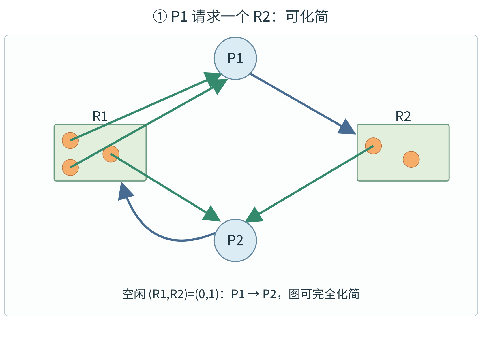

<a id="os02-fig-course-deadlock-2"></a>
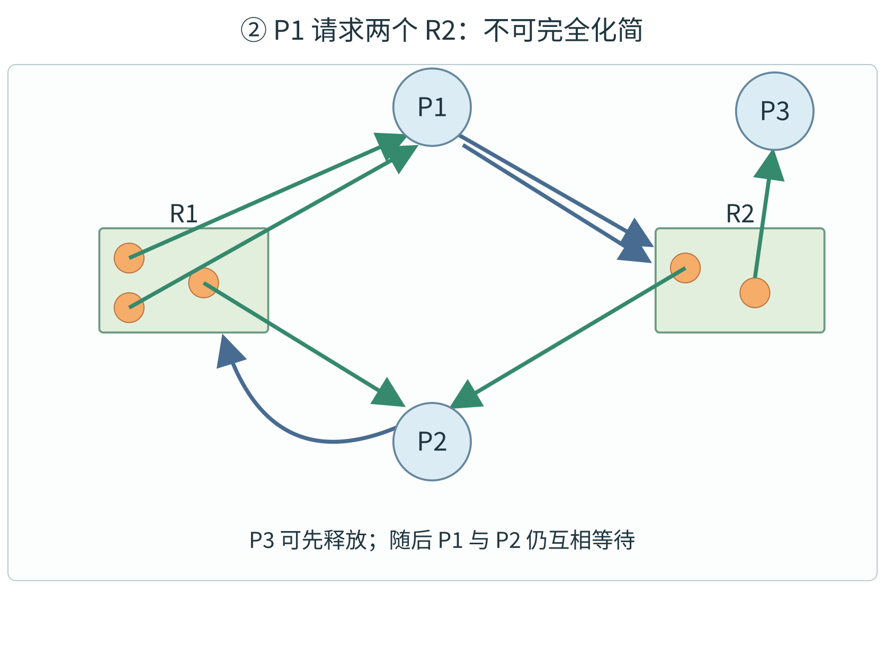

1. **$P_1$ 请求1个 $R_2$。** 另一个 $R_2$ 尚空闲，初始 `Work=(0,1)`。可先满足 $P_1$ 的当前请求；假定它执行完后归还所持资源，净增加原有分配量 $(2,0)$，于是 `Work=(2,1)`。再满足 $P_2$ 并回收 $(1,1)$，得到 `(3,2)`。所有边均可消去，图可完全化简。
2. **$P_1$ 请求2个 $R_2$，$P_3$ 持有另一个 $R_2$。** 初始 `Work=(0,0)`。$P_3$ 没有待满足请求，可以先完成并归还1个 $R_2$，得到 `Work=(0,1)`。此时 $P_1$ 仍需2个 $R_2$，$P_2$ 仍需1个 $R_1$，二者均无法继续，因此 $P_1、P_2$ 留在不可化简部分。$P_3$ 已能完成，不应把它也算作未化简的死锁进程。

检测确认死锁后，可以终止全部死锁进程，或逐个选择牺牲者直到环被打破；也可在资源允许恢复时剥夺资源，并把受影响进程回滚到安全检查点。选择牺牲者需要考虑已完成工作、资源占用、恢复代价和优先级；每次都牺牲同一个低优先级进程，可能造成饥饿。仅降低某个死锁进程的优先级，并不会使它释放正持有的资源，因此不能单独解除等待环。

<a id="OS02-auto-29"></a>
#### 三类处理策略检查的不是同一件事


| 共同维度 | 预防 | 避免 | 检测与解除 |
| --- | --- | --- | --- |
| 何时作决定 | 事先规定请求、持有或分配规则 | 每次请求拟获批准时检查新状态 | 允许正常申请，定期或按事件检测当前状态 |
| 主要依据 | 资源是否可共享、能否剥夺、申请次序等 | 最大需求 Max、已分配量和当前可用量 | 当前分配、当前未满足请求 Request 和可用量 |
| 怎样处理有风险的请求 | 不符合规则便不能按该方式申请或持有 | 试分配后不安全则回滚并推迟 | 不以安全性为每次分配的必要条件，可能事后发现死锁 |
| 保证来自哪里 | 至少一个死锁必要条件被规则破坏 | 始终保留一个能覆盖全部进程的安全序列 | 检出以后终止、剥夺或回滚，释放维持等待环的资源 |
| 主要代价 | 申请受限、资源可能闲置 | 需要可信的最大需求，且有反复安全检查开销 | 需要检测及恢复，可能丢失已经完成的工作 |


两种“假定某进程完成并释放资源”的算法外形相似，输入却不同：银行家用未来可能达到的 Need 检查完成保证，检测用已经提出的 Request 判断当前等待能否解除。不能因为化简步骤相似，就把“不安全”直接改称“已死锁”。

<a id="OS02-deadlock-detection"></a>
#### 用当前Request化简资源分配图

检测使用的是进程**当前仍在等待的请求Request**，避免死锁中的安全性检查使用的是**最大剩余需求Need**。两者的判定目标不同。

```text
Work = Available;
对每个进程i：
    Finish[i] = (Allocation[i]全部为0);
反复寻找 Finish[i]==false 且 Request[i]<=Work 的进程：
    Work = Work + Allocation[i];
    Finish[i] = true;
找不到时停止；仍未标记完成的持有资源者形成无法化简的部分。
```

向量不等式均逐资源种类比较。一个进程被假定满足当前请求并完成后，先给出的Request又随完成归还，所以可用量净增加其原Allocation。全零分配者本身不持有资源，不是资源等待环的占有者；它仍可能因等待死锁集合释放资源而无法继续。

解除时可选剥夺资源、撤销部分进程或回退到检查点。选择牺牲者时比较优先级、已执行工作量、距完成的时间、占用资源量和任务性质；反复牺牲同一进程还需防止饥饿。回退要求已有能够恢复的一致状态，不能凭空撤销已经产生的外部效果。

<a id="OS02-4-review"></a>
### 分支自测：分别判断现在和最坏未来

> **课程连接 · 资源复核**
>
> 安全性检查从现有Available开始，假设能结束的进程释放Allocation，逐步更新Work。

以下为原创回顾设问。

1. 资源分配图有环，是否立即判死锁？还缺什么信息？
2. 银行家安全检查中，一个进程可完成时，Work 应增加 Max、Need 还是 Allocation？
3. 新请求不超过 Need 且不超过 Available，能否直接批准？
4. 安全检查失败，能否立即宣布所有剩余进程已经死锁？
5. 3 个进程每个最多要 2 个同类资源，多少个资源可以在任意分配下保证不发生这种资源死锁？若只有 2 个，银行家是否一定无法运行？

<a id="OS02-auto-30"></a>
#### 自测答案

1. 要看资源实例数及可化简状态。相关类型均为单实例时环足以判定，多实例时还要检查能否由其他实例打破等待。
2. 增加 Allocation；假定借给它的 Need 在完成后归还，净效应相抵。
3. 不能，还要试分配并保持安全。
4. 不能，Need 是最大未来需求；实际当前 Request 可能更小或尚未提出。
5. $3(2-1)+1=4$ 个提供任意分配保证。只有 2 个仍可采用安全分配，先让一个进程拿齐、完成后轮到其他进程；资源总量界限不是银行家的必要条件。

<a id="OS02-recall"></a>
## 主动回忆自测

> **课程连接 · 综合检查**
>
> 区分何时能运行、先后如何约束、当前资源状态是否可能形成环形等待。

以下10题为自拟综合回忆，按导图主枝独立作答；各分支保留的练习用于进一步检查中间状态。

**主动回忆 · 从执行身份回忆到资源安全**
1. 为什么I/O完成通常使进程就绪，却不保证立即运行？
2. 同进程线程共享哪些资源，切换时仍要保存哪些独立现场？多对一模型为何不能利用多核同时运行这些用户线程？
3. 共享内存建立后，还要不要为共享计数器加同步保护？信号与信号量有何区别？
4. 无I/O时周转、等待、响应怎样计算？有I/O时等待公式应怎样修正？
5. Peterson互斥证明依赖哪些模型假设？TestAndSet为何不直接保证公平？
6. 记录型P使值从1到0要阻塞吗？V使值从−1到0要唤醒吗？
7. 容量2初始空，生产者P(empty)后未放入，能否要求empty＋full＝2？为什么？
8. 为什么Mesa式条件等待使用while复查，并原子地释放锁和进入等待？
9. 资源图有环、状态不安全、系统已经死锁，这三种说法能否互换？
10. 银行家新请求要过哪三个关口？Work为什么增加Allocation而非Max？

<a id="OS02-recall-answers"></a>
### 核对答案与边界

1. 设备事件满足后，执行条件恢复；CPU归属仍由调度决定。就绪到运行是另一条状态转换。
2. 共享地址空间、代码、数据、堆、打开文件等；独立保存PC、寄存器、栈与线程控制信息。多对一只给内核一个承载实体，无法同时派到两个核。
3. 要。映射只提供共同存储，不给出互斥与可见时序。信号通知事件；信号量通过许可计数与等待协调资源和次序。
4. $T=C-A$，无I/O时$W=T-B$，首次响应$R=S-A$；有阻塞时还须从周转中扣除相应阻塞时间，不能全部当作就绪等待。
5. 双进程、单次共享读写原子、给定内存顺序，以及持续执行和有限临界区等假设；TS的原子读改写没有规定等待者的公平次序。
6. P结果0表示取得最后许可，不阻塞；V结果0表示原先有人等待，须唤醒一个。该等待者不为同一次P再次减1。
7. 不能。许可已预留，物理空位尚未改变，数值可为empty＝1、full＝0；还须区分负数计数表示的等待者。
8. 通知不立即转交锁，重新取得锁前条件可能被别的线程改变，也可能虚假唤醒。原子释放并入队防止检查后丢失通知。
9. 不能。单实例资源图有环足以判死锁，多实例还要化简；不安全是无法保证最大未来需求，不等于当前已死锁。
10. 请求不超Need、不超Available、试分配后仍安全，失败则恢复。借出Need与完成归还的Need抵消，净增加原Allocation。


<a id="OS03"></a>
# 内存管理

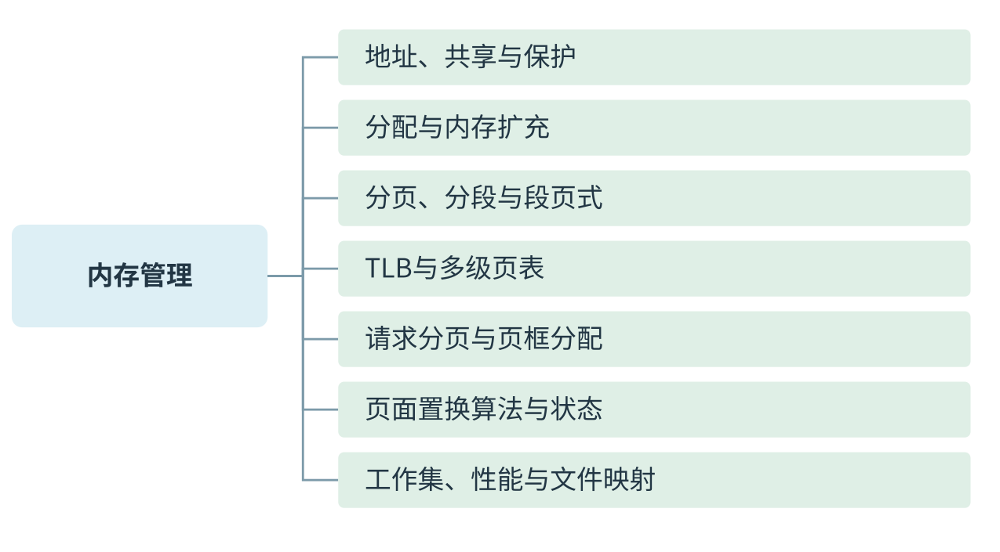

[可编辑SVG](../chapters/OS03/figures/overview.svg) · [完整知识导图](../chapters/OS03/chapter-map.pdf)

<a id="OS03-guide"></a>
## 地址、驻留、权限与访问代价

> **课程连接 · 地址转换**
>
> 先判断地址合法和权限，再确定驻留与映射；最后按题目模型计数访问和缺页代价。

**方法 · 地址与缺页综合题的顺序**
1. 写明编址单位、地址位数、页大小和表项长度，先按二进制位宽拆分字段。
2. 检查范围与权限，再根据TLB、各级页表的状态寻找有效映射。
3. 遇合法但不驻留的页面，跟踪空闲页框、置换、脏页回写、映射更新和原指令重试。
4. 沿完整引用串保存状态；最后分别汇总缺页、置换、访存和设备I/O次数，并统一时间单位。

**定义 · 一次访存要回答三个独立问题**
地址是否属于合法范围、页面此刻是否驻留、当前操作是否有权限，是三个独立判断。页号用于查映射，页内偏移定位页中的字节；页表项的位置也不是最终数据的位置。


<a id="OS03-offset-proof"></a>
### 页内偏移为何保持不变

**推导 · 从整数除法得到地址分解**
页大小为$P$字节时，任意非负字节地址$a$唯一写成$a=pP+w$，其中$0\le w<P$。页表把第$p$页整体映射到第$f$页框，页内第$w$个字节便落在$fP+w$。因此转换只替换页的整体位置，不改变页内坐标；只有$P=2^d$时，才可直接把偏移解释为低$d$个二进制位。

<a id="OS03-extension"></a>
## 内存扩充：覆盖、交换与请求调页

> **课程连接 · 覆盖与交换**
>
> 覆盖要求程序按预定结构安排共用内存区；交换将进程数据在内外存之间调度。

覆盖、交换和按需分页都在缓解内存容量限制，但管理对象与实施条件不同。**覆盖**把不会同时使用的程序段安排到同一覆盖区，在需要时替换，通常要求事先分析模块调用关系；常驻部分与覆盖区应共同满足执行需求。它并非把任意两个正要同时使用的模块强行放在一起。

**交换**按经典模型把暂不执行的进程整体或较大运行映像换到后备存储，需要时再换入；换出与进程阻塞不是同一概念，挂起状态用于表达不驻留。可否换出还受固定缓冲、正在进行的I/O与地址重定位等约束，不能随意移动设备仍在直接访问的内存。

**请求调页**把管理粒度缩小为页，合法页面可暂不驻留，真正引用时由缺页机制调入。它依赖页表状态、异常处理与后备关系，能够利用局部性；并不要求程序员预先列出覆盖模块。覆盖、交换和分页可以在不同层次讨论，不能仅凭“把内容移到磁盘”便认作同一种机制。


内存管理同时处理三个问题：程序用什么地址描述对象，这个地址此刻对应哪里，访问是否被允许。连续分配、分页和分段使用不同的映射单位；请求分页又允许某些合法内容暂不在物理内存。做题时先区分地址、映射和驻留状态，再进行位数或时间计算。

本章容量中的 KB、MB、GB 按题目所采用的二进制单位理解，即 $2^{10}$、$2^{20}$、$2^{30}$ B；需要严格区分标准时可写 KiB、MiB、GiB。地址与页号、页框号从 0 编号；十六进制数以 H 结尾。页、页框大小相同；没有特别说明时，地址按字节编址。

<a id="OS03-5-1"></a>
## 逻辑地址、物理地址和可寻址范围

> **课程连接 · 与组成原理按地址串联**
>
> 组成原理研究Cache怎样定位已得到的存储地址，操作系统还要维护虚拟地址到物理页框的转换与权限。做综合访存题时先确认Cache使用虚拟还是物理字段，再排列TLB、页表、Cache和主存路径，避免混成一次查询。

**逻辑地址或虚拟地址**是程序在自身地址空间中使用的地址；**物理地址**标识主存中的实际位置。CPU 执行访存指令形成虚拟地址，地址变换机构按当前进程的映射得到物理地址，再访问主存。操作系统创建和维护映射，MMU 等硬件完成通常的运行时查询；缺页或保护异常再进入内核处理。

若虚拟地址宽 $v$ 位、按字节编址，可表示 $2^v$ B 的虚拟地址范围；物理地址宽 $p$ 位，对应的可寻址物理范围为 $2^p$ B。实际可用空间还受保留区域、硬件实现的有效位数、进程限制及后备存储等约束。不能用“内存容量加硬盘容量”直接求虚拟地址的位数，也不能从逻辑地址位数自动推出物理地址位数。

内存以页为单位调入调出，不等于每条 CPU 访存都以整页为单位。指令仍可读取一个字节或一个字，页是映射、分配或传输的管理单位。题目中的地址单位、页大小单位和数据类型长度应分别记录。

<a id="OS03-loading"></a>
### 编译、链接、装入与重定位

源程序经编译或汇编形成目标模块，模块之间的外部引用由链接处理，形成可装入程序。静态链接在运行前把所需模块连接成整体；装入时动态链接在装入时处理外部连接；运行时动态链接把部分连接工作推迟到程序运行需要相关模块时。

**绝对装入**在生成程序时就确定绝对地址，适合已知装入位置的环境。**可重定位装入**在装入时根据实际基址修改需重定位的地址，完成后程序通常按改好的地址执行。**动态运行时装入／重定位**则把逻辑地址到物理地址的转换推迟到执行访存时，由硬件地址变换机构完成；它支持程序在运行期间按映射变化移动位置。

<a id="OS03-course-loading"></a>
### 同一程序的三种装入方式

若装入起始物理地址为100，程序中变量的逻辑地址为79，则该变量对应物理地址179。绝对装入在编译时已确定装入位置，指令直接使用179；可重定位装入在装入前使用79，装入时统一加100并把地址改为179；动态运行时装入后指令仍保留79，真正访问时由重定位寄存器提供100，得到物理地址179。三种方式的区别在于地址何时确定或转换，计算结果相同。


<a id="os-fig-loading-course"></a>
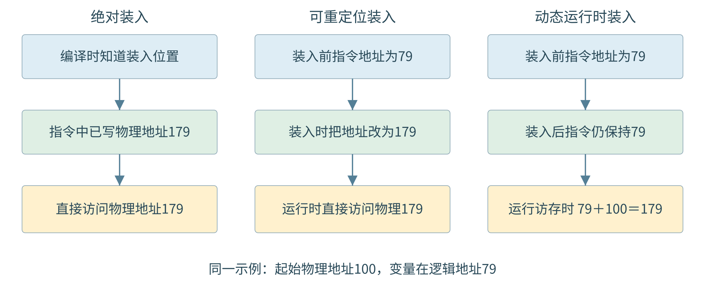


地址保护的寄存器含义要与比较式一致。若基址为100，合法逻辑地址为0～179，界限寄存器保存最大合法逻辑地址179，则应检查$0\le a\le179$，物理地址为$100+a$；若界限保存长度180，则应检查$0\le a<180$。最大地址与长度相差1，属于两种字段定义，不能只凭“界限寄存器”这个名称选择比较符。

以上下限寄存器保护物理区域时，分别比较要访问的物理地址与100、279；采用重定位寄存器和界地址寄存器时，可先将逻辑地址与最大合法值179比较，再把合法的逻辑地址80加基址100，得到物理地址180。两种结构须分别看清所比较的地址及寄存器含义。


<a id="os-fig-protection-course"></a>
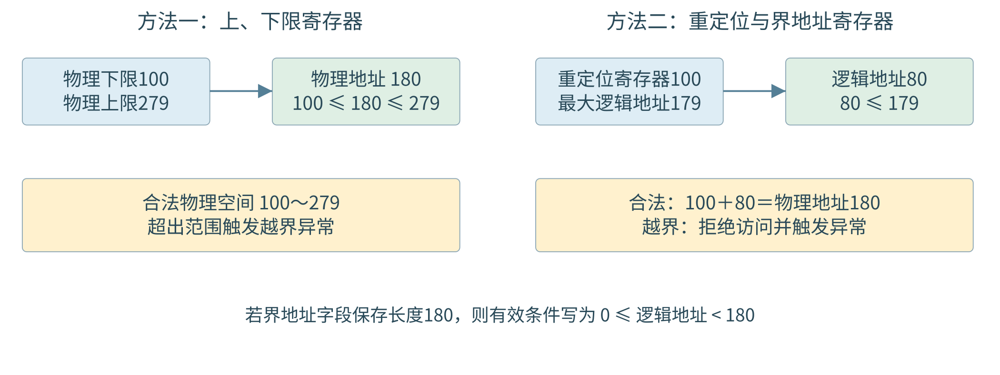


进程的典型虚拟映像可含只读代码／数据、可读写静态数据、堆、共享库映射、栈及内核映射区域。代码中的宏常量可能在预处理后被替换，并不因此单独分配一个运行时对象；局部指针自身与`malloc`得到的堆对象仍要分别定位。具体地址分布、增长方向与是否保留内核映射，以题目平台为准。


<a id="os-fig-process-image-course"></a>
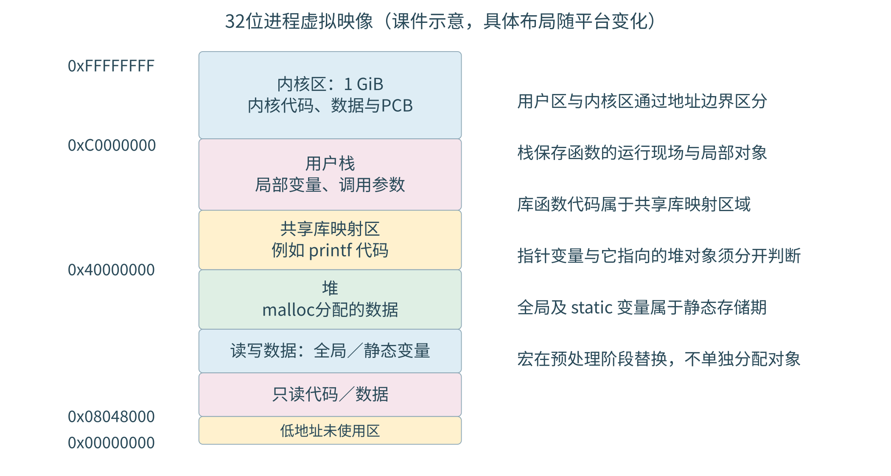


<a id="OS03-5-2"></a>
## 共享、保护、分配和回收

> **课程连接 · 独立条件**
>
> 共享对象、访问权限、地址合法性和是否驻留是不同问题，不能用其中一项代替其他检查。

分配决定哪些物理空间供谁使用，保护限制哪些操作合法，共享则允许多个映射指向同一内容。基址与界限可以保护连续区域；分页与分段通常在映射项中记录存在、读写、用户/内核等权限。一个地址有数值，不表示它属于合法映射；一个页面驻留内存，也不表示用户可以任意写入。

共享只读代码时，各进程的页表可以指向同一个物理页框，并禁止写入。共享可写数据则还需要同步。写时复制先把多个映射指向同一只读物理页，在某个进程需要写时触发受控异常，为写者分配并复制私有页，再更新映射；它与让所有写者始终修改同一共享页不同。

回收时必须维护使用计数、映射与空闲结构；若另一个进程仍在合法使用共享页，不能因为本进程退出就立即把页框分给无关对象。页表与 TLB 的映射变化也须保持一致，否则 TLB 中的过期转换可能继续生效，使访问落到已经回收或改变权限的内容上。

<a id="OS03-ex5-1"></a>
### 例 3-1　页号可以不同，共享的页框必须相同

**例题 · 配套例题**

【配套例题】 进程 R 和 S 共享数据 data。若 data 在两进程中的页号分别为 p1、p2，对应页框号分别为 f1、f2，下列叙述中，正确的是（　）。

A. p1、p2 一定相等，f1、f2 一定相等

B. p1、p2 一定相等，f1、f2 不一定相等

C. p1、p2 不一定相等，f1、f2 一定相等

D. p1、p2 不一定相等，f1、f2 不一定相等


**解析。** 两进程的虚拟布局可以不同，所以共享对象可以分别位于不同页号；题目所指的同一份共享数据在物理内存中是一份，对应页框号应相同。答案为 **C**。各自复制了一份内容相同的数据，不等于本题的共享映射。

<a id="OS03-5-3"></a>
## 连续分配与动态分区：空闲总量不等于可分配块

> **最小反例 · 空闲总量够仍不能分配**
>
> 两个不相邻的空洞各为6MB，总空闲12MB；申请连续8MB仍失败，因为没有单个足够大的洞。只有物理相邻的空闲区才能直接合并，隔着占用区时需要搬移或改用非连续分配，不能把表中相邻行直接相加。

单一连续分配把内存划分为系统区和一个用户区，不能有效支持多个驻留用户作业。固定分区预先划定若干区，每区容纳一个作业；作业小于分区时，分区内未用部分形成**内部碎片**。动态分区按请求划出连续区域，空闲洞可能被已分配区隔开，形成**外部碎片**：空闲总量够，仍可能没有一个足够大的连续洞。

<a id="OS03-fixed-partition-course"></a>
### 固定分区的划分与分区说明表

固定分区可以等大，也可以不等大。等大分区易管理，适合多个大小相近的作业；大小不等可按常见作业规模划分多个小分区、适量中等分区和少量大分区，使不同作业更容易找到合适空间。两种情况每个分区同一时刻都只装入一道作业，程序太大而没有任何分区容得下时，不能把几个不连续的固定分区直接当成一块连续区。


<a id="os03-fixed-partition-figure"></a>
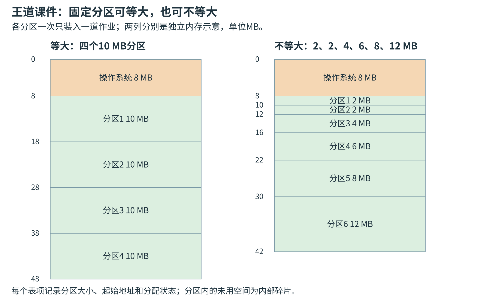


操作系统用分区说明表记录分区号、大小、起始地址及已分配状态；分配时检索可容纳作业的未分配分区，再把该表项改为已分配。课件示例表的前三项如下：

| 分区号 | 大小（MB） | 起始地址 | 状态 |
| --- | --- | --- | --- |
| 1 | 2 | 8 MB | 未分配 |
| 2 | 2 | 10 MB | 未分配 |
| 3 | 4 | 12 MB | 已分配 |

例如把1 MB作业装入一个2 MB分区，剩余1 MB仍属于该已分配分区，是**内部碎片**；它不是可独立分配的空闲分区。若题目要求计算碎片，需根据实际作业大小、分区选择和所规定的管理粒度逐一确定。

首次适应按地址顺序找第一个足够大的洞；循环首次适应从上次位置继续；最佳适应选择最小但够用的洞，常需按大小查找；最坏适应选择最大的洞。按课件的常见实现，首次适应与邻近适应将空闲链按地址递增排列，邻近适应可采用循环链并从上次检索结束处继续；最佳适应按容量递增，最坏适应按容量递减。首次适应常反复经过低地址的小洞，但也较可能保留高地址大洞；邻近适应分散检索，可能更早切分高地址大洞。最佳适应可能产生难利用的小碎片，最坏适应可能较快耗尽大洞；实际效果取决于请求序列与回收情况。算法只是在现有空闲区中选择一块，并不会把它们自动合并。最佳适应会留下很小的余量，“最接近请求”不保证长期整体利用率最好。

<a id="OS03-course-partition-choices"></a>
### 课件实例：空闲链如何随分配变化

> **辨析 · 空闲链顺序是状态**
>
> 最佳和最坏适应按容量排序，余区大小改变后应维护顺序；邻近适应还须保存查找位置。

图中的前三组以同一组空闲区开始：大小20 MB、起始地址8；大小10 MB、起始地址32；大小4 MB、起始地址60。方框中的“大小 @ 起始地址”表示一段连续空闲区，按该算法维护的空闲链次序排列；分配从所选空闲区的低地址端切出。三个算法的进程请求大小以各自课件演示为准，不能把不同演示的请求混成同一组。


<a id="os03-partition-course"></a>
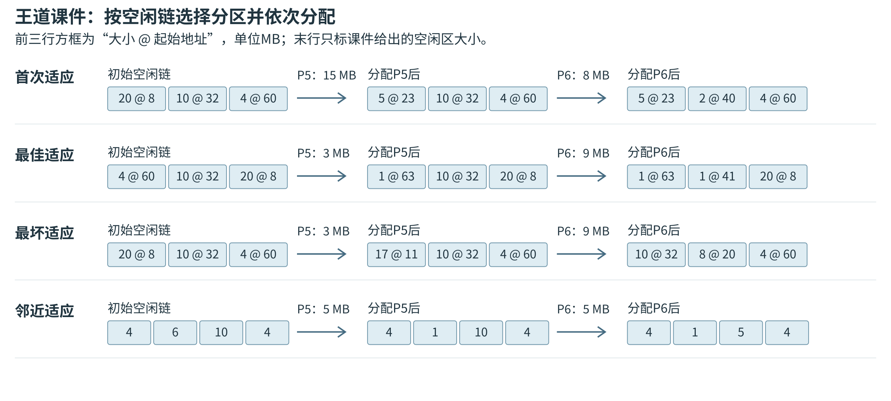


首次适应依地址递增：P5请求15 MB，从20 MB区切出后留下大小5、起始23的空闲区；P6请求8 MB，5 MB不足，再从起始32的10 MB区切出，留下大小2、起始40。最佳适应按容量递增：P5的3 MB先选起始60的4 MB区，P6的9 MB再选起始32的10 MB区，分别留下两个1 MB碎片。最坏适应按容量递减：两个请求先后从原20 MB区切出，余区依次为17 MB和8 MB；第二次分配后，空闲链须重新按大小排列，10 MB排在8 MB之前。

邻近适应的课件演示使用地址递增的循环空闲链，大小依次为4、6、10、4 MB。P5的5 MB由6 MB区分出，P6的5 MB由10 MB区分出，余区大小依次为4、1、5、4 MB。它从上次查找结束处继续，查至链尾仍未找到时回到链头；具体起始指针位置是确定下一次结果所必需的状态。四组图展示的是课件演示过程，算法长期表现还取决于请求与回收序列。

释放分区时检查物理地址是否相邻：只与前洞相邻则合并前洞，只与后洞相邻则合并后洞，前后都邻接则合并三块。在按大小排序的空闲区表中，相邻表项未必在物理地址上相邻。紧凑通过搬移已分配内容把分散空洞合成大洞，需要可重定位支持和搬移成本，这与释放时合并相邻空闲区不是一回事。

<a id="OS03-ex5-2"></a>
### 例 3-2　最佳适应每次都重新比较当前空闲区

**例题 · 配套例题**

【配套例题】 某基于动态分区存储管理的计算机，主存容量为 55 MB（初始为空闲），采用最佳适配算法。分配和释放顺序为：分配 15 MB，分配 30 MB，释放 15 MB，分配 8 MB，分配 6 MB。此时最大空闲分区为（　）。

A. 7 MB　　B. 9 MB  
C. 10 MB　　D. 15 MB


**解析。** 前两次分配后剩余 10 MB；释放最初的 15 MB 后，有两个不相邻的洞：15 MB 和 10 MB。分配 8 MB 时，最佳适应从 10 MB 中切出，留下 2 MB；分配 6 MB 时，2 MB 不够，只能从 15 MB 中切出，留下 9 MB。因此两个洞为 9 MB、2 MB，最大 9 MB，答案为 **B**。


| 操作后 | 当前空闲分区大小 |
| --- | --- |
| 分配 15 MB | 40 MB |
| 再分配 30 MB | 10 MB |
| 释放最初的 15 MB | 15 MB、10 MB |
| 分配 8 MB | 15 MB、2 MB |
| 分配 6 MB | 9 MB、2 MB |


这里不能先把 15 与 10 相加，因为中间仍有占用区；也不能在分配 8 MB 时沿用首次适应的地址顺序。

<a id="OS03-partition-recovery"></a>
### 空闲区表与回收时的四种合并

> **辨析 · 邻接按物理地址判断**
>
> 空闲表可能按地址或容量排序。两个表项相邻并不表示物理连续；合并须检查区间端点，回收量保持守恒。

动态分区用空闲区表或空闲区链记录起始地址和长度。分配时选中一块，若只使用其一部分，就更新剩余区间；释放时根据物理地址邻接关系合并，避免把已经连成一片的空闲区误保留为多个洞。

**课件中的分配更新。** 空闲表含起始8、大小20 MB，起始32、大小10 MB，以及起始60、大小4 MB的三个表项。给P5分配4 MB时，若选前20 MB区并从低地址切出，分配区为$[8,12)$，把该表项改为起始12、大小16 MB；若选末尾4 MB区，则$[60,64)$恰好用完，应删除对应空闲表项。其他空闲表项保持原值。两种情况是从同一初始状态出发的独立演示，具体选哪一块由题设采用的分配算法决定。


<a id="os03-partition-allocation-figure"></a>
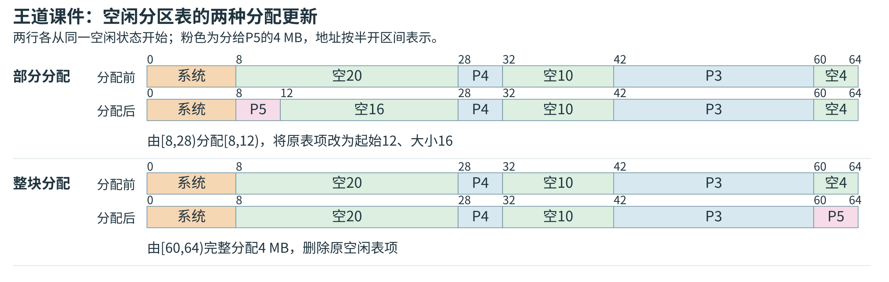


课件64 MB模型中系统区占前8 MB，空闲区可为$[8,28)$、$[32,42)$、$[60,64)$，长度分别20、10、4 MB；区间右端不包含。若释放$[28,32)$的4 MB区域，它同时连接前后两个洞，应合成$[8,42)$，长度34 MB，并保留$[60,64)$。


<a id="os-fig-partition-merge"></a>
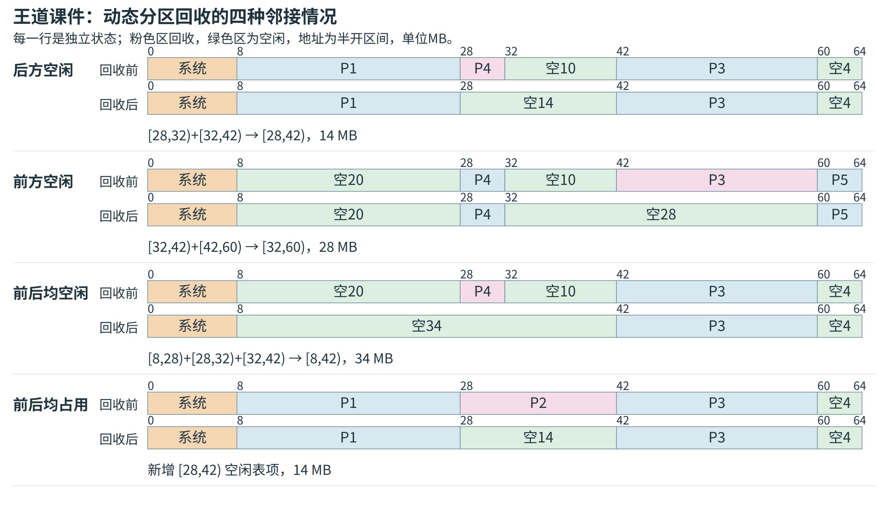


图中四行分别是独立的课件状态，并非连续的四次回收：只与后方相邻时，释放$[28,32)$并与$[32,42)$合成$[28,42)$，长度14 MB；只与前方相邻时，释放$[42,60)$并与$[32,42)$合成$[32,60)$，长度28 MB。前后都相邻时合成$[8,42)$、长度34 MB；前后均不空闲时，释放$[28,42)$后新增长度14 MB的空闲表项。

| 回收区与已有空闲区关系 | 更新方法 |
| --- | --- |
| 前后均不相邻 | 新建空闲表项 |
| 只与前方空闲区相邻 | 前方表项长度增加 |
| 只与后方空闲区相邻 | 后方表项起址前移、长度增加 |
| 前后都有相邻空闲区 | 三段合并，保留一个表项并删除多余表项 |

首次适应按地址递增检索；最佳适应按足够容纳请求的最小长度选择；最坏适应选最大长度；邻近适应从上次检索位置继续。表若按容量排列，回收后可能重新排序，因此“表项挨在一起”不是判断物理相邻的证据。

<a id="OS03-overlay-example"></a>
### 覆盖结构的容量计算

课件覆盖模型含主模块A为8 KB，B、C分别8、10 KB，D、E、F分别12、4、10 KB。把A放入固定区，让B与C共享10 KB覆盖区、D/E/F共享12 KB覆盖区，则这一安排需要$8+10+12=30$ KB，而六模块长度之和为52 KB。


<a id="os-fig-overlay-course"></a>
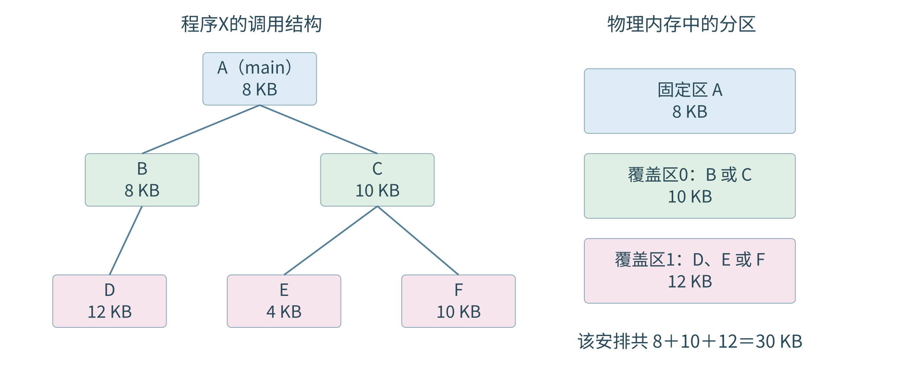


该安排依赖模块调用关系，必须保证共享覆盖区内的模块不会同时需要保留有效执行内容。30 KB是这份覆盖安排的容量，不是在任意调用、递归或返回约束下自动成立的全局最小值。覆盖通常要求程序员提供覆盖结构；交换和请求分页由操作系统按其管理策略处理，透明程度不同。

<a id="OS03-5-4"></a>
## 分页：页号查表，偏移不变

> **不变量 · 映射替换页号不改偏移**
>
> 页大小为$2^d$字节且页框同样大，转换前后低d位表示同一页内位置，保持不变；高位才由虚拟页号改成物理页框号。若计算结果的低d位发生变化，应先检查是否混入了页表项地址、字段位宽或容量单位。

**分页**把虚拟地址空间划成固定大小的页，把物理内存划成同样大小的页框，页可以装入不相邻的页框。页表记录虚拟页到物理页框的映射。分页不再要求整个进程连续分配，从而消除了连续分配造成的外部碎片，但进程最后一页可能未用满，仍有内部碎片；页表也占空间。

页大小 $P=2^d$ B，虚拟地址 $a$ 分解为

$$p=\left\lfloor\frac aP\right\rfloor,\qquad w=a\bmod P.$$

按除法与取余的抽象示例，即使页长设为50 B，逻辑地址110仍可分解为页号 $\lfloor110/50\rfloor=2$、偏移 $110\bmod50=10$。该算例说明分解方法；常见硬件采用2的幂大小，是为了直接用位字段完成分解。

查得页框号 $f$ 后，物理地址为 $fP+w$。低 $d$ 位偏移不变，高位的虚拟页号被页框号替换。页表项本身也存放在物理内存中，它的地址是另一个物理地址：单级线性页表基址为 $PTBR$、每项 $e$ B 时，页 $p$ 的项地址为 $PTBR+pe$。不要把页表项地址当成最终数据地址。

**课件位拼接例。** 页大小4 KiB，逻辑地址4097分解为页号1、页内偏移1；若页1映射到页框9，则物理地址为 $9\times4096+1=36865$。页框号9的二进制为 $1001_2$，将其与12位偏移 $000000000001_2$ 拼接，得到 $1001\,000000000001_2=9001_H=36865$。拼接时偏移必须保留完整的12位。

配套分页例中，页大小 1 KB，逻辑地址 0A6FH，页 0、1、2、3 分别映射页框 3、7、11、10。$0A6F_H=2\times400_H+26F_H$，故页号为 2，偏移 26FH；查到页框 11，即 BH，物理地址为 $B\times400_H+26F_H=2E6F_H$。偏移字段跨越十六进制数位，不能简单截取最后两位或三位。

页表项至少要能表示页框号，通常还包含存在、保护、访问和修改等信息。虚拟地址宽度决定潜在页数，物理地址宽度决定页框号所需位数；两者分别进入“页表多少项”和“每项至少多宽”的计算。

<a id="OS03-page-translation"></a>
### 基本地址变换的完整检查链

页表寄存器保存页表起始地址和表长等信息；进程未运行时，相关环境可保存在PCB中，切换时由内核恢复。设页大小$L$、页表基址$F$、表长$M$项、每项$e$字节，地址$A$对应$p=\lfloor A/L\rfloor$、$w=A\bmod L$：

1. 先检查$0\le p<M$，等于表长时已经越界。
2. 在紧密连续存放的单级页表中读取$F+pe$处的表项，得到页框号$b$及权限等。
3. 确认本次访问合法后，形成物理地址$E=bL+w$，再访问目标单元。

<a id="os-fig-page-translation"></a>
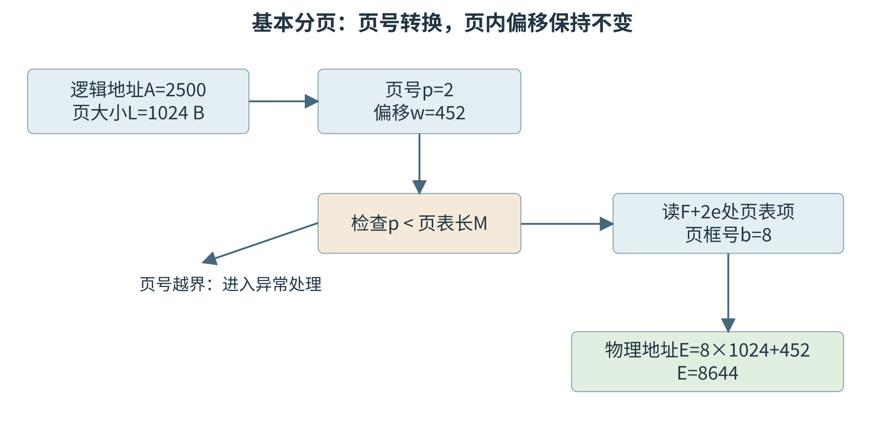

课件十进制例中$L=1024$ B、$A=2500$，故$p=2,w=452$；页2映射到页框8，物理地址为$8\times1024+452=8644$。页内偏移始终为452，不能在最后一步误换为425。页表项地址和最终数据地址则各自按对应公式计算。

<a id="OS03-pte-size"></a>
### 页表项位宽、对齐与装表空间

若可寻址物理内存为4 GiB、页大小4 KiB，共有$2^{20}$个页框，单是页框号就需20位。向上按字节取整至少3 B；还需容纳权限、存在、访问、修改等字段，实际表项可能更大。

若每项4 B，一页可放1024项，表项边界与页边界整齐对应。若每项3 B且表项不得跨页，一页最多1365项，并有1 B尾部空隙；跨到下一页时，项地址还须计入该布局的空隙。公式$F+pe$采用的是紧密线性布局，不能同时假定每页留空隙又照用同一地址式。

页表总项数、每项长度、一个页面大小分别描述“映射多少页”“一项占多大”和“映射单位多大”，三者不能互换。多级页表的扇出计算也应先确认每张下级页表是否限定占一页。

<a id="OS03-5-5"></a>
## TLB 与多级页表：空间与时间分别计算

> **错项排除 · 多级表的收益来自稀疏**
>
> 多级页表可不建立未使用虚拟区间对应的下级表，但每个有效映射仍要能表示页框和必要状态。若整个空间都使用，目录反而带来额外开销。因此不能说多级结构减少了每项位数，或对任何进程都一定节省总空间。

> **课程连接 · 缓存对象不同导致分支不同**
>
> TLB缓存地址转换，数据Cache缓存内容。TLB没找到转换时，可从主存页表补入；数据仍可能已在Cache。缺页则要检查合法页面是否不驻留。把三种事件分别列条件，才能准确计算一次访问是否需要磁盘I/O。

<a id="OS03-auto-1"></a>
### 多级页表为什么可以节省空间

若虚拟页很多，单级页表需要大量表项，即使大部分虚拟区间根本没有使用。多级页表先用高层目录找到所需下级页表，仅为实际使用区域建立相应下级表；各下级表可以分别放置，不需要一块能容纳整张大页表的连续内存。

多级页表不能减少“一个最终映射项本身需要的位数”，也不保证为一个占满全部虚拟空间的进程节省总空间；全展开时还增加目录开销。它的收益主要体现在稀疏地址空间和分级分配上，代价是未命中转换缓存时要多次查表。

<a id="OS03-course-twolevel"></a>
### 王道课件：逐级转换与级数计算

**逐级转换。** 某二级分页系统的地址依次由10位一级页号、10位二级页号和12位页内偏移构成。逻辑地址为 `(0000000000,0000000001,111111111111)`。一级页号为0，二级页号为1，页内偏移为 $2^{12}-1=4095$。按题目页表从目录项0取得下级页表，再查其第1项，得到页框号4；最终物理地址为 $4\times4096+4095=20479$。逐级查询得到的页框号才用于末步计算，不能把一级目录项中的下级页表页框号当作目标数据页框号。


<a id="os03-twolevel-course"></a>
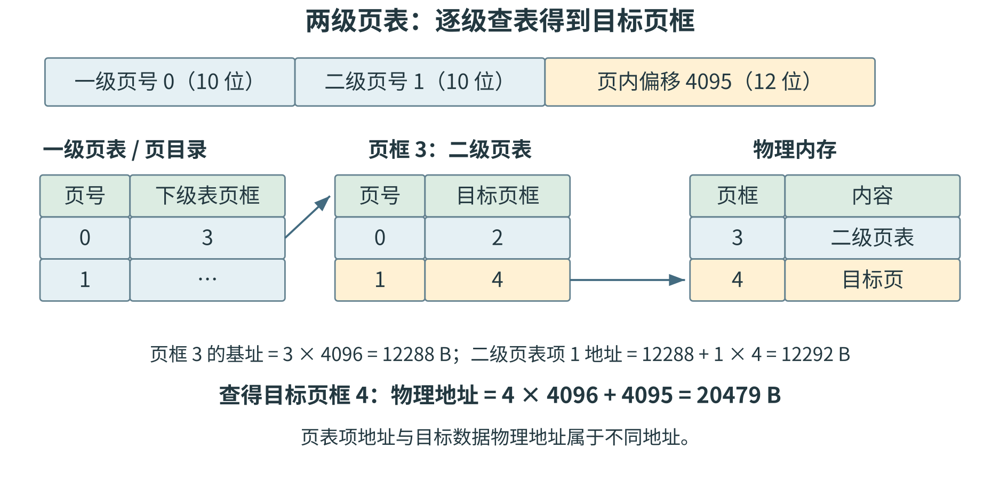


**需要多少级页表。** 逻辑地址40位，按字节编址，页面4 KB，页表项4 B，且每张页表最多占一个页面。页内偏移为12位，虚拟页号为 $40-12=28$ 位；每页最多存放 $4096/4=1024=2^{10}$ 个页表项，每级最多覆盖10位页号。因此至少需要 $\lceil28/10\rceil=3$ 级，顶层不必使用满10位。这里的“至少3级”依赖每张表最多占一页和题目给出的页表项大小；页表可跨页时须重新确定分级方案。

<a id="OS03-ex5-3"></a>
### 例 3-3　一张下级表能覆盖多少页

**例题 · 配套例题**

【配套例题】 某计算机采用二级页表，按字节编址，页大小为 $2^{10}$ B，页表项大小为 2 B，逻辑地址依次由页目录号、页号、页内偏移量组成。逻辑地址空间大小为 $2^{16}$ 页，表示整个逻辑地址空间的页目录表至少包含多少表项？

A. 64　　B. 128  
C. 256　　D. 512


**解析。** 一张按页存放的下级页表能容纳 $2^{10}/2=2^9$ 项，故能映射 $2^9$ 个虚拟页。要覆盖 $2^{16}$ 页，需要 $2^{16}/2^9=2^7=128$ 张下级表，也就是至少 128 个目录项，答案为 **B**。相应字段为目录 7 位、页号 9 位、偏移 10 位；“逻辑空间 $2^{16}$ 页”不是 16 位字节地址，而是 16 位虚拟页号。

<a id="OS03-ex5-4"></a>
### 例 3-4　10 位字段不能按十六进制整位截断

**例题 · 配套例题**

【配套例题】 某计算机主存按字节编址，二级分页地址结构依次为页目录号 10 位、页号 10 位、页内偏移 12 位。虚拟地址 2050 1225H 对应的页目录号、页号分别是（　）。

A. 081H、101H　　B. 081H、401H

C. 201H、101H　　D. 201H、401H

<a id="os-fig-address"></a>


**解析。** 偏移为低 12 位 225H。目录号为地址右移 22 位，得 081H；下级页号为地址右移 12 位后取低 10 位，得 101H。答案为 **A**。若先把“205”当成某个字段，就把十六进制的 4 位分组误当成题设的 10 位字段。

<a id="OS03-auto-2"></a>
### TLB 缓存的是转换，不是文件内容

**快表 TLB**缓存近期地址转换及相关权限信息。命中时直接得到页框和权限；未命中时遍历页表，找到有效映射后可填入 TLB。TLB 未命中只说明转换不在该缓存，页面仍可能在内存；页表项表明合法页面不驻留才可能引发缺页。数据 Cache 缓存的则是实际数据，不能把 TLB 命中当成数据已经在 Cache。

**课件中的一种状态更新策略。** 访问命中时可先更新快表中的访问状态，写操作还需更新修改状态；移除该快表项前再把更新的状态写回内存页表，以减少频繁更新慢表带来的访存。页面置换和映射失效处理必须取得一致的状态。不同硬件和系统的状态更新策略可能不同，题目有明确规定时按题设处理。


<a id="os03-tlb-page-table"></a>
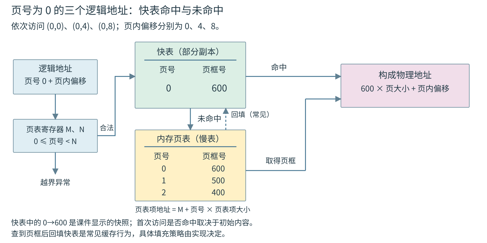


〖3.2-014〗 二级页表、TLB 命中率 75%，忽略 TLB 查询时间，页表均在内存且不考虑缺页。命中访问一次数据内存；未命中需要两次读页表和一次读数据，故平均访存次数为 $0.75\times1+0.25\times3=1.5$。这里每个分支都含最后的数据访问，不能只计算两次查表。

若 TLB 查询耗时 $t$、一次主存访问耗时 $m$，并且二者串行，则上述平均时间为 $t+1.5m$。若题目设定 TLB 与其他硬件并行查询、页表遍历缓存或不同层次命中率，必须按相应路径重列分支，不能硬套同一公式。

<a id="OS03-tlb-time"></a>
### 课件TLB例：串行与并行查询的平均时间

> **辨析 · 并行查询只重叠查表阶段**
>
> TLB与主存页表同时起查时，未命中路径已经消耗部分查表时间。命中后访问数据仍有独立费用，不能把整个访存都当成并行。

基本分页、单级页表、页面均驻留，查询TLB耗时1 μs，访问一次主存耗时100 μs，TLB命中率90%。若先查TLB，未命中后才查主存页表，命中路径为101 μs，未命中路径为201 μs：

$$E[T]=0.9\times101+0.1\times201=111\ \mu s.$$

若TLB与主存页表同时开始查询，命中时可按该模型在1 μs后得到页框、再访问目标，仍为101 μs；未命中时主存页表查询已从时刻0开始，随后再访问目标，总计200 μs：

$$E[T]=0.9\times101+0.1\times200=110.9\ \mu s.$$

无TLB时，每次查表和读数据共200 μs。以上比较限定相同存储访问模型、单级页表和无缺页；增加页表层数或引入其他缓存后，要重列每条实际访问路径。


<a id="os03-tlb-time"></a>
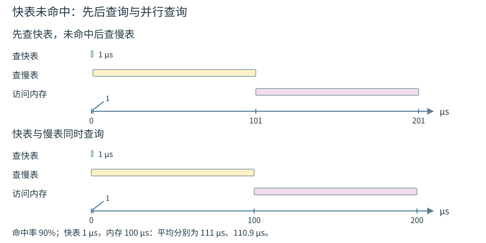


<a id="OS03-5-6"></a>
## 分段和段页式：先检查段内地址

**分段**按程序的逻辑单位划分地址空间，例如代码段、数据段、栈段，每段长度可不同。逻辑地址用“段号、段内偏移”表示；段表记录段基址、段长和保护等。段号要落在段表范围内，偏移要小于段长，权限要允许本次操作，然后才计算基址与偏移之和。

**课件分段例。** 段2的基址为40 KiB，段内偏移为1024 B。先检查段2存在、权限满足且1024小于段长；这些条件成立时，物理地址为 $40\times1024+1024=41984$。若偏移越界，不能直接用基址相加所得值作为有效访问地址。


<a id="os03-segment-course"></a>
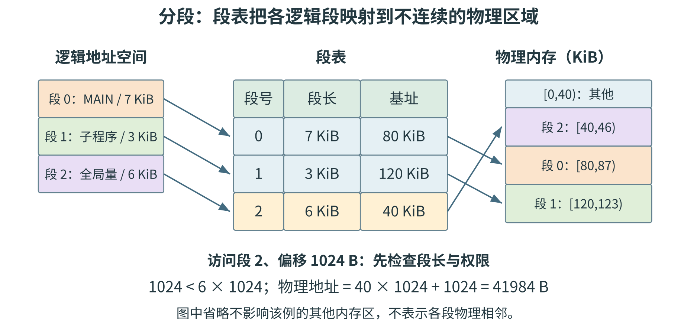


**段页式**先按逻辑意义分段，再把各段分页；段表指向本段页表，页表再映射页框。它用段组织逻辑单位，用页框安排物理存储，不是“先把物理内存分段，再统一分页”。

转换时先检查段号和段级权限，再按段表给出的页表长度检查段内页号，合法后才查该段页表。题设若另外给出以字节为单位的段长，还须检查完整段内偏移是否越界；末页存在于内存，不会自动取消这个段长限制。


| 比较维度 | 基本分页 | 基本分段 | 段页式 |
| --- | --- | --- | --- |
| 划分依据和大小 | 系统规定的定长页，与程序逻辑模块无必然对应 | 代码、数据等逻辑单位，段长可变 | 先按逻辑分段，各段再分成定长页 |
| 地址怎样解释 | 线性地址拆为页号、页内偏移 | 段号、段内偏移 | 段号、段内页号、页内偏移；后两项来自段内地址 |
| 对程序的可见性 | 分页通常对程序透明 | 显式区分各逻辑段 | 段可见，段内分页通常透明 |
| 物理连续性与碎片 | 页内连续，页间可离散；末页可能有内部碎片 | 每段连续，段间可离散；可能有外部碎片 | 每页内连续，同一段可跨离散页框；各段末页可能有内部碎片 |
| 共享与保护 | 通过页映射和逐页权限实现 | 以完整逻辑段为单位较直观 | 段级逻辑组织与页级物理映射共同起作用 |
| 基本地址转换路径 | 页表→目标单元 | 段表→目标单元 | 段表→本段页表→目标单元 |


最后一行若按**单级页表、各表均在主存、没有 TLB 或其他缓存命中，也不发生缺页、越界或权限异常**计算，分别需要2、2、3次主存访问。改为多级页表或引入 TLB 后，应按实际路径重新计数。

【配套例题】 某进程段表如下，访问段号 2、段内地址 400 的逻辑地址，结果是（　）。


| 段号 | 段长 | 内存起始地址 | 权限 |
| --- | --- | --- | --- |
| 0 | 100 | 6000 | 只读 |
| 1 | 200 | — | 读写 |
| 2 | 300 | 4000 | 读写 |


| 段号 | 状态 |
| --- | --- |
| 0 | 在内存 |
| 1 | 不在内存 |
| 2 | 在内存 |


A. 段缺失异常　　B. 内存地址 4400  
C. 越权异常　　D. 越界异常

段 2 虽驻留且可读写，但偏移 $400\ge300$，已经越界，答案为 **D**。必须先检查长度，不能直接得到 4400。这里的数字是题设地址单位，不必自行加上 KB。

<a id="OS03-segment-pages"></a>
### 段内分页的空间与地址维度

> **辨析 · 字段数与逻辑维度分开**
>
> 段页式常编码段号、页号和偏移，但页号与偏移共同来自段内地址。教材二维地址的结论是在比较独立逻辑坐标。

课件程序的三个逻辑段分别为MAIN 7 KiB、X 3 KiB、D 6 KiB，页大小4 KiB，则分别需要2、1、2页，共5页、20 KiB，最后一页未用空间分别为1、1、2 KiB，共4 KiB。每段在逻辑上完整，物理上则可分散到不同页框。

<a id="os-fig-segment-pages"></a>
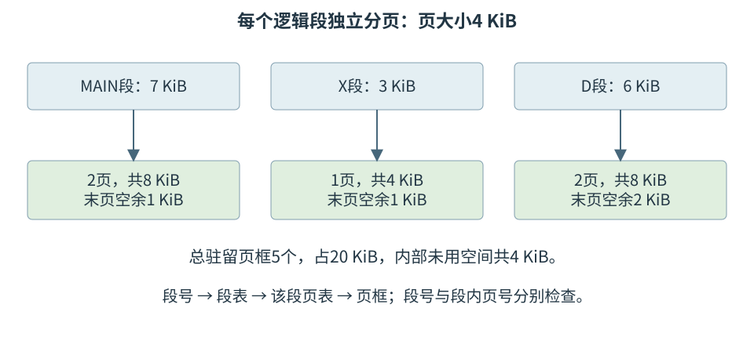

若地址字段依次为段号16位、段内页号4位、页内偏移12位，最大段数为$2^{16}$，每段最多16页，每页4 KiB。程序通常给出“段号、段内地址”两个独立逻辑坐标，硬件再把段内地址拆成页号和偏移，所以该教材模型仍把段页式地址视为二维；地址编码出现三个字段不自动等于三个独立逻辑维度。

基本转换中先读段表取得该段页表位置和长度，再读页表取得页框，最后读目标。段号与页号都要分别检查，不能因高层查到一个表项就跳过下层越界判断。

<a id="OS03-5-7"></a>
## 请求分页：合法但不驻留时会发生什么

> **错项排除 · 修改位不是写权限**
>
> 可写页面刚装入且只被读取时，可以写权限为1、修改位为0；只读页被写时，应产生保护异常，不能靠换入页面解决。修改位帮助判断淘汰是否回写，权限位限制行为，两项表示的状态不是同一件事。

> **不变量 · 调页完成还要重新执行**
>
> 合法页面不驻留时，原访存尚未成功。缺页处理把内容装入并更新映射后，通常回到原指令重试。因此费用表要区分失败查询、服务开销、重试访问；题目已包含的更新成本不能重复加，重试成本也不能漏掉。

**局部性**是程序在一段时期内倾向反复访问某些对象或其相邻位置。时间局部性来自循环与重用，空间局部性来自顺序指令、数组邻近元素等。虚拟内存利用这种特征，只保留当前所需部分，并在需要时调入其他部分，不要求整个进程同时装入。

请求分页的页表项需要区分页面是否驻留，并记录调页所需位置与状态。存在位表示是否在内存；访问位帮助估计近期使用；修改位表示装入后是否被写过，关系到淘汰时是否必须回写。**修改位不是写权限位**：允许写但尚未写的页可以是可写且 M=0；只读保护检查则发生在实际写入前。


| 比较维度 | 基本分页 | 请求分页 |
| --- | --- | --- |
| 执行前的驻留要求 | 按基本模型，待运行程序所需页面先装入内存 | 可先装入一部分，合法页面允许暂不驻留 |
| 映射记录承担什么 | 给出页到页框的映射与相应保护信息 | 还需驻留状态、调页位置及置换所需的访问、修改等信息 |
| TLB 未命中以后 | 查主存页表取得已有映射 | 先查页表；驻留则继续，不驻留才进入缺页分支 |
| 内存不足时怎样继续 | 不能只靠基本分页的地址变换解决 | 可能置换、必要时回写，再调入并更新映射 |
| 本次指令怎样结束 | 正常转换后访问目标单元 | 缺页处理完成后重试原访存；异常处理开销不能漏计 |


TLB 是地址转换缓存，基本分页和请求分页都可以使用它；是否有 TLB 与是否允许缺页是两个维度。

一次访存的处理应按执行顺序展开：检查地址合法性，查询 TLB/页表并检查存在状态与访问权限；合法但不驻留则引发缺页异常，内核定位后备内容，取得空闲页框或选择牺牲页；牺牲页若为脏页且需要保留则回写，调入所需页，更新页表和 TLB，重新执行被中断的访存。访问非法地址应按错误处理，不能一概“给它调一页”。

<a id="os-fig-fault"></a>


<a id="OS03-course-fault-states"></a>
### 课件示例：空闲页框与脏页置换

假设请求页0、页内偏移1024。页表中页0当前不驻留，其后备地址为x；页1驻留页框b，页2驻留页框c且已修改。访问字段10和6是该课件用于置换参考的记录值，不是单个访问位。

**处理前：**

| 页号 | 内存页框 | 状态位 | 访问字段 | 修改位 | 外存地址 |
| --- | --- | --- | --- | --- | --- |
| 0 | — | 0 | 0 | 0 | x |
| 1 | b | 1 | 10 | 0 | y |
| 2 | c | 1 | 6 | 1 | z |


<a id="os-fig-fault-states-course"></a>


**有空闲页框a：** 将页0从外存x调入a，页1、页2维持原映射，调入后页表为：

| 页号 | 内存页框 | 状态位 | 访问字段 | 修改位 | 外存地址 |
| --- | --- | --- | --- | --- | --- |
| 0 | a | 1 | 0 | 0 | x |
| 1 | b | 1 | 10 | 0 | y |
| 2 | c | 1 | 6 | 1 | z |

**没有空闲页框：** 假设置换算法选中页2，因修改位为1，先将页2写回外存z，再将页0从x调入框c并更新映射。页2已不驻留，状态位变为0。更新后、重试原访问前的课件页表为：

| 页号 | 内存页框 | 状态位 | 访问字段 | 修改位 | 外存地址 |
| --- | --- | --- | --- | --- | --- |
| 0 | c | 1 | 0 | 0 | x |
| 1 | b | 1 | 10 | 0 | y |
| 2 | — | 0 | 0 | 0 | z |

表中的访问字段按课件所展示的处理时刻记录，进程之后重试访问时，系统可按采用的访问统计规则更新它；页2的修改内容必须在复用c前完成相应回写。

缺页不一定发生置换：有空闲页框就可直接装入。此外，一次复杂指令可能访问多个页面，执行期间可能产生不止一次缺页，系统必须保存足够的重启状态；最少页框数还受指令寻址方式等约束。页面置换算法不能改变“一条指令所需页面无论如何无法同时提供”这一基本执行条件。

<a id="OS03-5-8"></a>
## 页框分配与置换范围

> **错项排除 · 固定分配约束页框数量**
>
> 本节固定分配把各进程拥有的页框数保持为既定值；若允许直接淘汰别人的页并占为己用，就改变了双方数量。题目采用可变分配时才可讨论相应全局调整，不能把分配策略与置换范围的名字任意拼接。

**驻留集**是进程当前在内存的页面集合。固定分配是指给每个进程固定数量的页框；可变分配允许按运行状况调整。**局部置换**只在本进程驻留集中选牺牲页；**全局置换**可从其他进程等更大集合中选择，会改变各进程实际占有的页框量。

因此经典组合中，固定分配通常配局部置换；可变分配可以局部或全局置换。把固定分配与全局置换直接组合，会使被换出进程的页框量改变，违背这里“固定”的约定。常用的分配方法有平均分配、按进程大小分配和按优先级分配等，但还须满足体系结构要求的最少页框数。

请求调页在真正缺页时装入，能减少无用装入；预调页根据局部性提前带入可能需要的内容，可以减少后续等待，也可能调入没用的页。回写策略、清洁页缓冲和空闲页队列影响缺页处理代价，不能只看替换算法的名称。

<a id="OS03-backing"></a>
### 调入来源、锁定页与虚拟内存特征

**课件容量例。** 32位字节地址的寻址上限为 $2^{32}$ B，即4 GiB。若抽象模型假设512 MiB物理内存和2 GiB后备外存均可用于该进程，则课件模型的可支持量为 $\min(4\text{ GiB},512\text{ MiB}+2\text{ GiB})=2.5\text{ GiB}$。这是在给定后备容量和使用条件下的示例：实际系统还受到地址保留、共享映射、后备策略和资源限制，不能把物理内存与整块磁盘容量相加当成无条件结论。


虚拟内存的**多次性**指运行信息可以分多次装入，**对换性**指运行期间允许将暂不用内容换出、需要时再换入，**虚拟性**指向程序提供的逻辑使用空间可以超过当前可分配物理内存。虚拟容量首先受地址表示范围约束，也受系统映射与后备能力限制；物理内存和磁盘的简单相加不能替代这些约束。

**课件容量例。** 按字节编址，逻辑地址为32位，内存为512 MiB、外存为2 GiB，地址表示范围为 $2^{32}$ B，即4 GiB。课件采用理想化估算：以给定内存、外存容量之和作为可提供空间，再取其与地址范围的较小值，得到 $\min(4,\,0.5+2)=2.5$ GiB。实际系统还受可用后备空间、保留区域和映射策略约束，不能默认整块外存都可用于该进程。

调页必须知道页面的后备位置。未修改且有有效文件副本的页面，淘汰时可以丢弃内存副本，下次从文件重读；需要保留的脏页则须写到规定的文件或对换区域。匿名页、私有映射与共享文件映射的后备关系不同，写回对象要按模型确定。

部分关键内核页或设备正在直接使用的页会被锁定，不能作为一般置换候选。

页框分配可采用平均、按大小比例或按优先级等方法，最少页框数还要满足一条指令及其寻址过程的需求。可变分配的缺页率控制依据一段运行观察调整资源，某一次缺页本身并不证明进程长期驻留集不足。

<a id="OS03-backing-course-models"></a>
### 三种调入与调出组织

下面三种组织是讨论页面后备位置的典型模型。**对换区充足**时，在进程运行之前，可将有关文件内容复制到对换区，运行中的页面调入和调出均在内存与对换区之间进行。这样可在课件给出的对换区连续分配模型下减少相应磁盘访问开销；具体性能仍取决于实际存储设备和实现。

**对换区不足**时，可将不会修改的数据保留在文件区，每次需要时从文件区调入；这类页面未被修改，换出时可以丢弃内存副本。需要保留修改的数据在换出时写入对换区，再次需要时从对换区调入。

**UNIX式模型**中，尚未使用的页面第一次可从文件区调入；页面被换出并保存到对换区后，再次使用时从对换区调入。是否确实需要回写仍由页面状态与具体实现决定，图中表示该模型的调入来源关系。


<a id="os03-backing-models"></a>


<a id="OS03-5-9"></a>
## 页面置换：必须跟踪实际状态

> **最小反例 · 命中也要更新LRU次序**
>
> 两页框先访问A、B，再命中A，随后访问C。LRU应淘汰较久未用的B；FIFO仍可能淘汰最早装入的A。只在缺页时移动队列会遗漏命中对最近使用关系的影响，得到的就不是正确的LRU轨迹。

**OPT**淘汰未来最长时间不再访问的页，未来不再访问者优先；它需要未来信息，主要用作比较基准。**FIFO**淘汰最早装入者，命中通常不改变装入顺序。**LRU**淘汰最近最久未使用者，每次命中也要更新最近使用关系。若只在缺页时更新 LRU 次序，实现出来就接近 FIFO。

<a id="OS03-course-replacement-traces"></a>
### 王道课件中的四组置换轨迹

> **辨析 · 缺页与置换**
>
> 空页框装入也缺页；置换须淘汰旧页。

下表按固定物理页框编号展示每次访问后的状态；“—”表示尚为空，“命”表示命中，“装”表示缺页后使用空框，“换x”表示缺页并淘汰页x。每组从空页框开始；缺页次数包含初次装入，置换次数只统计淘汰原页。

**OPT，3个页框。** 引用串：7、0、1、2、0、3、0、4、2、3、0、3、2、1、2、0、1、7、0、1。共缺页9次，其中置换6次。

| 步骤 | 1 | 2 | 3 | 4 | 5 | 6 |
| --- | --- | --- | --- | --- | --- | --- |
| 访问页 | 7 | 0 | 1 | 2 | 0 | 3 |
| 页框1 | 7 | 7 | 7 | 2 | 2 | 2 |
| 页框2 | — | 0 | 0 | 0 | 0 | 0 |
| 页框3 | — | — | 1 | 1 | 1 | 3 |
| 结果 | 装 | 装 | 装 | 换7 | 命 | 换1 |

| 步骤 | 7 | 8 | 9 | 10 | 11 | 12 |
| --- | --- | --- | --- | --- | --- | --- |
| 访问页 | 0 | 4 | 2 | 3 | 0 | 3 |
| 页框1 | 2 | 2 | 2 | 2 | 2 | 2 |
| 页框2 | 0 | 4 | 4 | 4 | 0 | 0 |
| 页框3 | 3 | 3 | 3 | 3 | 3 | 3 |
| 结果 | 命 | 换0 | 命 | 命 | 换4 | 命 |

| 步骤 | 13 | 14 | 15 | 16 | 17 | 18 |
| --- | --- | --- | --- | --- | --- | --- |
| 访问页 | 2 | 1 | 2 | 0 | 1 | 7 |
| 页框1 | 2 | 2 | 2 | 2 | 2 | 7 |
| 页框2 | 0 | 0 | 0 | 0 | 0 | 0 |
| 页框3 | 3 | 1 | 1 | 1 | 1 | 1 |
| 结果 | 命 | 换3 | 命 | 命 | 命 | 换2 |

| 步骤 | 19 | 20 |
| --- | --- | --- |
| 访问页 | 0 | 1 |
| 页框1 | 7 | 7 |
| 页框2 | 0 | 0 |
| 页框3 | 1 | 1 |
| 结果 | 命 | 命 |

例如第4步访问2时，在现有7、0、1中，7下一次出现在第18步，晚于0和1，故淘汰7；未来不再访问的页可优先淘汰。

**FIFO，3个页框。** 引用串：3、2、1、0、3、2、4、3、2、1、0、4。共缺页9次，其中置换6次。

| 步骤 | 1 | 2 | 3 | 4 | 5 | 6 |
| --- | --- | --- | --- | --- | --- | --- |
| 访问页 | 3 | 2 | 1 | 0 | 3 | 2 |
| 页框1 | 3 | 3 | 3 | 0 | 0 | 0 |
| 页框2 | — | 2 | 2 | 2 | 3 | 3 |
| 页框3 | — | — | 1 | 1 | 1 | 2 |
| 结果 | 装 | 装 | 装 | 换3 | 换2 | 换1 |

| 步骤 | 7 | 8 | 9 | 10 | 11 | 12 |
| --- | --- | --- | --- | --- | --- | --- |
| 访问页 | 4 | 3 | 2 | 1 | 0 | 4 |
| 页框1 | 4 | 4 | 4 | 4 | 4 | 4 |
| 页框2 | 3 | 3 | 3 | 1 | 1 | 1 |
| 页框3 | 2 | 2 | 2 | 2 | 0 | 0 |
| 结果 | 换0 | 命 | 命 | 换3 | 换2 | 命 |

**FIFO，4个页框。** 引用串：3、2、1、0、3、2、4、3、2、1、0、4。共缺页10次，其中置换6次。

| 步骤 | 1 | 2 | 3 | 4 | 5 | 6 |
| --- | --- | --- | --- | --- | --- | --- |
| 访问页 | 3 | 2 | 1 | 0 | 3 | 2 |
| 页框1 | 3 | 3 | 3 | 3 | 3 | 3 |
| 页框2 | — | 2 | 2 | 2 | 2 | 2 |
| 页框3 | — | — | 1 | 1 | 1 | 1 |
| 页框4 | — | — | — | 0 | 0 | 0 |
| 结果 | 装 | 装 | 装 | 装 | 命 | 命 |

| 步骤 | 7 | 8 | 9 | 10 | 11 | 12 |
| --- | --- | --- | --- | --- | --- | --- |
| 访问页 | 4 | 3 | 2 | 1 | 0 | 4 |
| 页框1 | 4 | 4 | 4 | 4 | 0 | 0 |
| 页框2 | 2 | 3 | 3 | 3 | 3 | 4 |
| 页框3 | 1 | 1 | 2 | 2 | 2 | 2 |
| 页框4 | 0 | 0 | 0 | 1 | 1 | 1 |
| 结果 | 换3 | 换2 | 换1 | 换0 | 换4 | 换3 |

同一引用串下，FIFO从三个页框增加到四个页框，缺页从9次增加到10次，出现Belady异常；命中不改变FIFO的装入顺序。

**LRU，4个页框。** 引用串：1、8、1、7、8、2、7、2、1、8、3、8、2、1、3、1、7、1、3、7。共缺页6次，其中置换2次。

| 步骤 | 1 | 2 | 3 | 4 | 5 | 6 |
| --- | --- | --- | --- | --- | --- | --- |
| 访问页 | 1 | 8 | 1 | 7 | 8 | 2 |
| 页框1 | 1 | 1 | 1 | 1 | 1 | 1 |
| 页框2 | — | 8 | 8 | 8 | 8 | 8 |
| 页框3 | — | — | — | 7 | 7 | 7 |
| 页框4 | — | — | — | — | — | 2 |
| 结果 | 装 | 装 | 命 | 装 | 命 | 装 |

| 步骤 | 7 | 8 | 9 | 10 | 11 | 12 |
| --- | --- | --- | --- | --- | --- | --- |
| 访问页 | 7 | 2 | 1 | 8 | 3 | 8 |
| 页框1 | 1 | 1 | 1 | 1 | 1 | 1 |
| 页框2 | 8 | 8 | 8 | 8 | 8 | 8 |
| 页框3 | 7 | 7 | 7 | 7 | 3 | 3 |
| 页框4 | 2 | 2 | 2 | 2 | 2 | 2 |
| 结果 | 命 | 命 | 命 | 命 | 换7 | 命 |

| 步骤 | 13 | 14 | 15 | 16 | 17 | 18 |
| --- | --- | --- | --- | --- | --- | --- |
| 访问页 | 2 | 1 | 3 | 1 | 7 | 1 |
| 页框1 | 1 | 1 | 1 | 1 | 1 | 1 |
| 页框2 | 8 | 8 | 8 | 8 | 7 | 7 |
| 页框3 | 3 | 3 | 3 | 3 | 3 | 3 |
| 页框4 | 2 | 2 | 2 | 2 | 2 | 2 |
| 结果 | 命 | 命 | 命 | 命 | 换8 | 命 |

| 步骤 | 19 | 20 |
| --- | --- | --- |
| 访问页 | 3 | 7 |
| 页框1 | 1 | 1 |
| 页框2 | 7 | 7 |
| 页框3 | 3 | 3 |
| 页框4 | 2 | 2 |
| 结果 | 命 | 命 |

第11步装入3时，7最近一次使用在第7步，早于其余驻留页，故淘汰7；第17步装入7时，8最久未用，故淘汰8。命中也必须更新最近使用时间。

<a id="OS03-ex5-5"></a>
### 例 3-5　缺页次数与置换次数相差初装入次数

**例题 · 配套例题**

【配套例题】 某系统采用 LRU 页置换和局部置换。为进程预分配 4 个页框，访问页号依次为 0、1、2、7、0、5、3、5、0、2、7、6。产生页面置换的总次数为（　）。

A. 3　　B. 4  
C. 5　　D. 6


**解析。** 下表按“最久未用→最近使用”记驻留页，因而每次命中也会移动相应页的位置；开始页框为空。


| 访问 | 访问后最近使用次序 | 结果 |
| --- | --- | --- |
| 0 | 0 | 缺页，空框装入 |
| 1 | 0、1 | 缺页，空框装入 |
| 2 | 0、1、2 | 缺页，空框装入 |
| 7 | 0、1、2、7 | 缺页，空框装入 |
| 0 | 1、2、7、0 | 命中 |
| 5 | 2、7、0、5 | 缺页，淘汰 1 |
| 3 | 7、0、5、3 | 缺页，淘汰 2 |
| 5 | 7、0、3、5 | 命中 |
| 0 | 7、3、5、0 | 命中 |
| 2 | 3、5、0、2 | 缺页，淘汰 7 |
| 7 | 5、0、2、7 | 缺页，淘汰 3 |
| 6 | 0、2、7、6 | 缺页，淘汰 5 |


共 9 次缺页，前 4 次利用空框，实际置换 5 次，答案为 **C**。题目问置换时，不要把所有缺页都记为替换。

<a id="OS03-auto-3"></a>
### Clock 的访问位给页面第二次机会

> **条件 · 扫描起点决定首个候选**
>
> 同类候选超过一个时，选择取决于题设给出的指针起点和扫描方向。

基本 Clock 把页框排成环，指针指向下一个候选。页面被访问时置 A=1；缺页需替换时，检查指针所指页，A=0 就选它，A=1 则清为 0 并前进，直到选中牺牲页。新装入并被本次访问的页设 A=1，指针前移。指针初始位置、装入后位置若题设另有规定，要按题设执行。

**课件Clock轨迹。** 五个空页框按1至5循环，初始指针指向页框1；引用串依次为1、3、4、2、5、6、3、4、7。装入页后访问位置1，指针前移；命中置访问位1但不移动置换指针。前五次装入后，页框为 `[1,3,4,2,5]`，访问位均为1，指针回到页框1。访问6缺页时，从页框1起依次将五个1清零，随后淘汰1并装入6，状态为 `[6,3,4,2,5]`、访问位 `[1,0,0,0,0]`，指针指向页框2。之后访问3、4命中，访问位变为 `[1,1,1,0,0]`；访问7缺页时，从页框2起依次清除3、4的访问位，在页框4遇到访问位0的2并淘汰，最终页框为 `[6,3,4,7,5]`、访问位 `[1,0,0,1,0]`，指针前移至页框5。五次初装加两次置换共7次缺页；如果题目规定了不同的指针推进规则，应按其规则重算。

| 访问页 | 页框1至5 | 对应访问位 | 下一扫描页框 | 结果 |
| --- | --- | --- | --- | --- |
| 1 | 1、—、—、—、— | 1、—、—、—、— | 2 | 装入空框 |
| 3 | 1、3、—、—、— | 1、1、—、—、— | 3 | 装入空框 |
| 4 | 1、3、4、—、— | 1、1、1、—、— | 4 | 装入空框 |
| 2 | 1、3、4、2、— | 1、1、1、1、— | 5 | 装入空框 |
| 5 | 1、3、4、2、5 | 1、1、1、1、1 | 1 | 装入空框 |
| 6 | 6、3、4、2、5 | 1、0、0、0、0 | 2 | 置换1 |
| 3 | 6、3、4、2、5 | 1、1、0、0、0 | 2 | 命中 |
| 4 | 6、3、4、2、5 | 1、1、1、0、0 | 2 | 命中 |
| 7 | 6、3、4、7、5 | 1、0、0、1、0 | 5 | 置换2 |

**机制小例（原创）。** 四页框按环依次为 $p,q,r,s$，访问位为 1、0、1、0，指针从 p 开始。需淘汰时，先将 p 的 1 清 0，再选 q；r、s 本次未被扫描，原位不变。不能每次缺页都把所有访问位统一清零。这一小例只检查扫描中间状态，未替代真题的选页任务。

改进型 Clock 再考虑修改位。在本书采用的四类优先关系中，依次考虑 (A,M) 为 (0,0)、(0,1)、(1,0)、(1,1)：先选近期未访问且不需回写者，再考虑近期未访问的脏页，近期访问过者留待后续。具体多轮扫描会修改 A，必须按当时状态判断，不能把开始扫描前的分类当作固定次序。

按课件的四轮扫描规则，各轮均从本次置换开始时的指针位置出发，沿环的同一方向最多扫描一圈：

1. 寻找第一个 $(A,M)=(0,0)$ 的页，找到即选中；本轮不修改访问位。
2. 若首轮失败，寻找第一个 $(0,1)$ 的页，找到即选中；对本轮经过但未选中的页，将其访问位清为 0。
3. 若第二轮也失败，重新寻找第一个 $(0,0)$ 的页；本轮不修改访问位。
4. 若第三轮失败，重新寻找第一个 $(0,1)$ 的页。经过完整的第二轮后，所有候选页的访问位都已清零，所以第三、第四轮中必能选出页面。

扫描过程中页的类别会变化：第二轮被清零的 $(1,0)$ 可在第三轮变为 $(0,0)$。因此，应逐轮执行并更新状态，不能只按最初的四类标签一次性排序。扫描只改变 A，M 不能因扫描而任意清零；脏内容完成相应回写后才能标记为干净。

图中的每个状态对按环次序排列，分别表示不同的候选集合；只给状态、未给扫描起点时，不能确定同类候选中最终选中的具体页框。状态1和状态3含$(0,0)$，按第一轮规则选择扫描中第一个$(0,0)$；状态2没有$(0,0)$但有$(0,1)$，首轮失败后第二轮可以选到扫描中第一个$(0,1)$；状态4全部为$(0,1)$，首轮失败，第二轮选中遇到的第一个页框。实际扫描时，应同步记录第二轮已经过页的访问位变化。


<a id="os03-clock-states"></a>


<a id="OS03-ex5-6"></a>
### 例 3-6　缺页后，旧页框字段不能直接沿用

**例题 · 配套例题**

【配套例题】 某请求分页系统页大小为 4 KB，按字节编址。为进程 P 分配 2 个固定页框，采用改进型 Clock，页表部分内容如下。


| 页号 | 页框号 | 存在位 | 访问位 |
| --- | --- | --- | --- |
| 2 | 20H | 0 | 0 |
| 3 | 60H | 1 | 1 |
| 4 | 80H | 1 | 1 |


| 页号 | 修改位 |
| --- | --- |
| 2 | 0 |
| 3 | 0 |
| 4 | 1 |


P 访问虚拟地址 02A01H，经地址变换得到的物理地址是（　）。

A. 00A01H　　B. 20A01H  
C. 60A01H　　D. 80A01H


**解析。** 低 12 位偏移为 A01H，页号为 2。其存在位为 0，旧的 20H 不是这次可以直接使用的有效驻留映射。两个页框已被页 3、4 占据，需要置换；它们都被访问过，但页 3 干净、页 4 脏，按本题改进型 Clock 先淘汰页 3，把页 2 装到 60H 页框。于是物理地址为 $60_H\times1000_H+A01_H=60A01_H$，答案为 **C**。

若有空闲页框，则不需要淘汰页 3；本题“固定 2 个且均已占用”决定了这一分支。若存在位本来为 1，则无须先执行同样的换页过程。

FIFO 可能出现 **Belady 异常**：增加页框反而增加缺页。LRU 与 OPT 具有栈性质，在相同引用串和一致初态下，增加页框不会使其缺页次数增加。不要把 FIFO 的异常推广成所有算法必有的现象，也不要把“LRU 通常利用局部性”写成对任意引用串必优于 FIFO。

<a id="OS03-5-10"></a>
## 内存映射文件：把文件内容放入虚拟地址视图

> **课程连接 · 映射写入与磁盘持久化分开**
>
> 程序通过映射地址修改内容，首先改变驻留页并可能置脏；何时写回文件还取决于映射属性和写回机制。文件系统维护后备关系，虚拟内存维护映射和驻留，二者协作不代表每一条赋值都会立即产生一次磁盘写入。

**内存映射文件**把文件的某个范围与进程一段虚拟地址范围关联，程序用普通访存指令访问映射内容，系统用分页等机制按需建立驻留页。它省去了应用反复显式调用读写、维护用户副本的部分工作，但不表示文件整体一次性进入物理内存，也不表示每次访存立即写到磁盘。

共享映射可让多个进程看到同一文件内容，因而支持进程间通信；对共享可写页的竞争仍须同步。私有映射的修改可通过写时复制保留为本进程私有，不必改原文件。页到文件块的后备关系由映射与文件系统共同维护，不能把这种机制理解成绕过文件系统而直接把磁盘地址当内存地址。


<a id="os03-mmap-shared"></a>


映射以后仍受地址范围和权限约束，映射建立、页面驻留、写回持久化是不同事件。题目若问磁盘 I/O 次数，要检查页面是否已缓存、是否发生缺页、脏页是否回写，不能仅按源代码中的读写次数计算。


<a id="OS03-5-11"></a>
## 工作集、抖动与平均访问时间

> **不变量 · 窗口先取引用再去重**
>
> 工作集窗口若规定最近6次引用，应先截出准确的6次，再对页号去重。同一页出现三次仍只占集合中一项。不能先找6个不同页，也不能从当前时刻向未来补引用，否则集合不再代表题设的近期需求。

**工作集**是在给定窗口内实际访问过的不同页面的集合。若窗口按最近 $\Delta$ 次引用定义，就从当前位置向前数 $\Delta$ 次引用，再去重；不能先数 $\Delta$ 个不同页。驻留集描述当前物理状态，工作集描述近期访问需求，工作集不必总是驻留集的子集：刚被引用、尚未调入的页就可能在工作集中而不在驻留集中。

**窗口为4的原例。** 页面引用串为 24、15、18、23、24、17、18、24、18、17、17、15。访问完前4项时，窗口含 $24,15,18,23$，工作集为 $\{24,15,18,23\}$；访问完第10项时，最近4次引用为第7至10项 $18,24,18,17$，去重得到 $\{18,24,17\}$，工作集大小为3。窗口长度是4，工作集大小可以小于4，因为同一页面可在窗口内重复出现。


<a id="os03-working-set-course"></a>


<a id="OS03-ex5-7"></a>
### 例 3-7　窗口内有重复，集合只记一次

**例题 · 配套例题**

【配套例题】 某进程访问页面的序列如下，t 位于所示竖线处，尚未访问竖线右侧的 0。

$$\ldots,1,3,4,5,6,0,3,2,3,2\;\big|_{t}\;0,4,0,3,2,9,2,1,\ldots$$

工作集窗口大小为 6，则 t 时刻工作集为（　）。

A. {6,0,3,2}　　B. {2,3,0,4}  
C. {0,4,3,2,9}　　D. {4,5,6,0,3,2}


**解析。** 向前取最近六次引用 6、0、3、2、3、2，去重为 {6,0,3,2}，答案为 **A**。集合无需保留重复次数，也不能从 t 向未来取引用；把窗口理解成“六个不同页面”会错误扩大范围。

**抖动**指页面频繁换出又很快需要换入，大量时间花在换页，实际计算进展很少。若多进程工作集所需总页框超过可用内存，过度增加并发度可能引发抖动。减少活动进程、增加相关进程的可用页框、依据工作集或缺页率调节分配，才能缓解驻留页框不足；仅扩充磁盘交换区容量或提高某进程优先级，不会自动提供它需要的页框。

<a id="OS03-auto-4"></a>
### 数组访问怎样变成页引用串

〖3.2-012〗 页框为 512 B，数组 `int a[128][128]` 按行优先存放，代码已经驻留，数据只有 1 个页框。下列代码执行会产生多少次缺页？

```c
for (int i = 0; i < 128; i++)
    for (int j = 0; j < 128; j++)
        a[j][i] = 0;
```

A. 1　　B. 2  
C. 128　　D. 16384

**解析。** 本题采用 4 B 整数，数组按页对齐，数据初始未装入；一行正好 $128\times4=512$ B，占一页。内层循环 j 增加，访问的是不同的行，即依次跨页；一份数据页框只能留下刚访问的那一行。每次引用都换到另一行，下一列回到第 0 行时，该行那一页也早已被淘汰，因此 $128\times128=16384$ 次，答案为 **D**。

这里缺页与置换算法无关，因为只有一个数据页框。若把内层访问改为 `a[i][j]`，按行连续访问且上述对齐条件不变，每行初次访问缺页一次，总共 128 次。这是**原创变式**，只改变下标次序，用来检查空间局部性，而非另一道原题。若整数大小、初始驻留或数组页对齐改变，先重建地址和页引用串，再讨论算法，不能只记住 16384 这个数。

<a id="OS03-auto-5"></a>
### 有效访问时间要列出所有分支

设不缺页的一次访问平均耗时为 $T_0$，缺页率为 $p$，一次缺页的完整分支平均耗时为 $T_f$，且 $T_f$ 已包括调页、必要写回、处理程序及重试访问，则

$$E[T]=(1-p)T_0+pT_f.$$

若题目把缺页服务时间 $D$ 定义成正常访存以外的附加开销，则可写 $E[T]=T_0+pD$，两种写法只是费用定义不同。也不能把 TLB 命中率与缺页率相加，当作一个统一的命中率；应按条件概率和完整路径分支。

**原创计算检查。** 若 $T_0=100$ ns，缺页完整分支为 10 ms，希望平均访问不超过 200 ns，则

$$p\le\frac{200-100}{10^7-100}\approx10^{-5}.$$

毫秒先换成纳秒，才可与 100 相减。这个数量级说明为什么低缺页率仍可能显著影响时间，不是对任何实机性能的统计结论。

<a id="OS03-ex5-8"></a>
### 例 3-8　一次缺页要把“失败、调页、重试”全部计时

**例题 · 配套例题**

【配套例题】 请求分页管理系统中，假设某进程的页表内容如下表所示。


| 页号 | 页框号 | 有效位（存在位） |
| --- | --- | --- |
| 0 | 101H | 1 |
| 1 | — | 0 |
| 2 | 254H | 1 |


页面大小为 4 KB，一次内存的访问时间为 100 ns，一次快表（TLB）的访问时间为 10 ns，处理一次缺页的平均时间为 $10^8$ ns（已含更新 TLB 和页表的时间）。进程的驻留集大小固定为 2，采用最近最少使用置换算法（LRU）和局部淘汰策略。假设：①TLB 初始为空；②地址转换时先访问 TLB，若 TLB 未命中，再访问页表（忽略访问页表之后的 TLB 更新时间）；③有效位为 0 表示页面不在内存中，产生缺页中断，缺页中断处理后，返回到产生缺页中断的指令处重新执行。设有虚地址访问序列 2362H、1565H、25A5H，请问：

（1）依次访问上述三个虚地址，各需多少时间？给出计算过程。

（2）基于上述访问序列，虚地址 1565H 的物理地址是多少？请说明理由。


**解析。** 4 KB=$1000_H$ B，低 12 位是页内偏移。三个地址分别访问页 2、页 1、页 2，偏移依次为 362H、565H、5A5H。先连续跟踪这三个访问，不能把每个地址都当作从“TLB 为空”开始。


| 本次访问 | 转换与驻留状态 | 耗时 |
| --- | --- | --- |
| 2362H | TLB 未命中；页 2 驻留，读页表后读目标内存；将页 2 的转换留在 TLB | $10+100+100=210$ ns |
| 1565H | TLB 未命中；页 1 不驻留；处理缺页，更新页表和 TLB；重试时命中 TLB，再读目标内存 | $10+100+10^8+10+100=100000220$ ns |
| 25A5H | 页 2 仍驻留，其转换仍在 TLB，直接命中后读目标内存 | $10+100=110$ ns |


第二次访问时两个页框已占满，需在本进程的页 0、页 2 中局部淘汰。页 2 刚被第一次访问使用，因此 LRU 选择页 0。将页 1 装入页框 101H，页 0 的存在位清零，并使其旧 TLB 转换失效；页 2 的映射不变。于是

$$PA(1565_H)=101_H\times1000_H+565_H=101565_H.$$

题目把页表、TLB 更新包含在 $10^8$ ns 中，却明确要求返回原指令重试。因此更新成本不重复加，重试的 10+100 ns 仍须加。第三次访问能命中，也依赖连续执行所得的状态；TLB 未命中、缺页、页面置换是三个不同事件。

<a id="OS03-ex5-9"></a>
### 例 3-9　数组偏移怎样逐级找到页表项

**例题 · 配套例题**

【配套例题】 某 32 位系统采用基于二级页表的请求分页存储管理方式，按字节编址，页目录项和页表项长度均为 4 字节，虚拟地址结构如下所示。


| 页目录号（10 位） | 页号（10 位） | 页内偏移量（12 位） |
| --- | --- | --- |


某 C 程序中数组 `a[1024][1024]` 的起始虚拟地址为 1080 0000H，数组元素占 4 字节，该程序运行时，其进程的页目录起始物理地址为 0020 1000H。请回答下列问题。

（1）数组元素 `a[1][2]` 的虚拟地址是什么？对应的页目录号和页号分别是什么？对应的页目录项的物理地址是什么？若该目录项中存放的页框号为 00301H，则 `a[1][2]` 所在页对应的页表项的物理地址是什么？

（2）数组 a 在虚拟地址空间中所占的区域是否必须连续？在物理地址空间中所占区域是否必须连续？

（3）已知数组 a 按行优先方式存放，若对数组 a 分别按行遍历和按列遍历，则哪种遍历方式的局部性更好？


**解析。** （1）C 的下标从 0 开始，按行优先存放。到 `a[1][2]` 的字节偏移为 $(1\times1024+2)\times4=4104=1008_H$，故其虚拟地址为

$$1080\,0000_H+1008_H=1080\,1008_H.$$

然后按位宽拆分，并把“表项地址”和“表项中保存的页框号”分开计算。


| 所求对象 | 计算 | 结果 |
| --- | --- | --- |
| 页目录号 | $VA\gg22$ | 042H |
| 页号（下级表索引） | $(VA\gg12)\mathbin{\&}3FF_H$ | 001H |
| 页内偏移 | $VA\mathbin{\&}FFF_H$ | 008H |
| 页目录项物理地址 | $0020\,1000_H+042_H\times4$ | 0020 1108H |
| 下级页表起始物理地址 | $00301_H\times1000_H$ | 0030 1000H |
| 页表项物理地址 | $0030\,1000_H+001_H\times4$ | 0030 1004H |


题目没有给出这个页表项中的最终页框号，不能把 0030 1004H 当作 `a[1][2]` 的物理地址；它是下一步需要读取的映射项的位置。

（2）该 C 数组的元素按规定连续排列，所以所占虚拟区域必须连续；相邻虚拟页可映射到离散的页框，物理区域不必连续。页内连续与跨页离散可以同时成立。

（3）每行 $1024\times4=4096$ B，恰为一页，起始地址也按页对齐。按行遍历在同一页中连续取元素，空间局部性更好；按列遍历的相邻元素相差 4096 B，会逐行跨页。但原题没有给驻留集大小、替换规则和初始状态，不能进一步声称按列必然每次缺页。地址跨度决定访问模式，缺页次数还取决于驻留状态。

<a id="OS03-5-review"></a>
## 分支自测：先写地址字段和状态，再计算

> **课程连接 · 计算顺序**
>
> 先列地址字段、页表状态和访问分支，再计算偏移、访问次数或换页代价。

以下为原创回顾设问。

1. 32 位虚拟地址、4 KB 页、4 B 页表项，单级页表若覆盖全部空间，需要多少表项和多少字节？
2. TLB 未命中而页表存在位为 1，是否一定访问磁盘？存在位为 1、写权限为 0，写访问应怎样处理？
3. 某页修改位为 0，是否表示程序没有读过该页？
4. 例 3-5中为何 9 次缺页只有 5 次置换？
5. 工作集窗口增加，集合大小是否每次恰好增加 1？

<a id="OS03-auto-6"></a>
### 自测答案

1. 页号 20 位，共 $2^{20}$ 项，占 $2^{22}$ B，即 4 MB；这与物理页框总数不是同一个计算。
2. 未命中可通过主存页表取得映射，不必读盘。写权限不足应触发保护异常，不能当作普通缺页调入后允许写。
3. 否。读访问可以使访问位置 1，却不使修改位置 1。
4. 最初四次使用空闲页框，尚未淘汰任何页；之后满框缺页才置换。
5. 不会。新纳入的一次引用可能已在集合中，窗口内重复引用只算同一个页。

<a id="OS03-recall"></a>
## 主动回忆自测

> **课程连接 · 检查清单**
>
> 对于每次引用，说明页号与偏移、命中与缺页，以及地址转换是否需要重新执行。

以下为自拟回忆题，先画地址字段或状态，再写结论。

**主动回忆 · 从合法地址追踪到完整费用**
1. 虚拟地址宽32位，页4KiB，页表项4B，覆盖全部虚拟空间的单级页表有多少项、占多少空间？
2. 两个各6MiB的不相邻空洞，能否满足连续8MiB请求？分页消除了哪类碎片，又留下哪类？
3. 页大小1KiB，虚拟地址0A6FH，页2映射到页框BH，物理地址是多少？
4. 二级页表TLB命中率75%，忽略TLB耗时且无缺页，每次查询均串行，平均需几次主存访问？
5. 段已驻留且可写，段长300，偏移400，能否访问基址加400？
6. 两页框访问A、B、A、C，LRU与FIFO分别淘汰谁？
7. 缺页9次，其中4次使用初始空页框，置换多少次？何时还要计算回写？
8. 解释工作集、驻留集、内存映射建立、脏页写回四个概念为什么不能混用。

<a id="OS03-recall-answers"></a>
### 核对答案与计算

1. 页内偏移12位，虚拟页号20位，共$2^{20}$项，占$2^{22}$B，即4MiB；物理地址宽度影响表项中页框号，而非虚拟页数。
2. 不能，连续洞不够大。分页消除对整个进程连续分配产生的外部碎片，最后一页仍可能有内部碎片，页表也有开销。
3. $A6F_H=2\times400_H+26F_H$，偏移保持$26F_H$，结果$B\times400_H+26F_H=2E6F_H$。
4. 命中1次读数据，未命中2次查表加1次读数据；$0.75\times1+0.25\times3=1.5$次。若查询并行或有缺页须重新列路径。
5. 不能。$400\ge300$越界，驻留与可写均不撤销段长检查。
6. 命中A使它在LRU中最近，故淘汰B；FIFO仍按装入先后淘汰A。
7. 置换5次；被淘汰页若脏且需保留内容，应另计写回，服务时间已包含时不重复加。
8. 工作集是近期需求集合，驻留集是当前物理状态；建立文件映射规定地址与后备关系，不代表所有页驻留；脏页写回实现相应持久化，发生时刻另由机制决定。


<a id="OS04"></a>
# 文件管理


[可编辑SVG](../chapters/OS04/figures/overview.svg) · [完整知识导图](../chapters/OS04/chapter-map.pdf)

<a id="OS04-guide"></a>
## 名称路径、数据路径与分配单位

> **课程连接 · 两条路径**
>
> 目录路径解决名称定位，文件映射解决逻辑内容到磁盘块的定位，两者的I/O可能分别发生。

**方法 · 文件题先画四类节点**
1. 名称路径：根或当前目录，逐层目录项，以及解析出的inode。
2. 使用关系：进程fd、打开实例、共享inode，标明位置指针属于哪一层。
3. 数据路径：文件内偏移到逻辑块号，再经过直接或间接索引取得物理块号。
4. 成本与容量：逐个扣除已缓存节点；分别计算数据块、索引块、inode和空闲管理的约束。

**定义 · 名称、文件本体和一次打开是三个对象**
目录项建立名字与文件标识的联系；inode保存文件本体的属性和块定位；打开实例保存这次使用的访问方式及当前位置，进程描述符再引用打开实例。三者的共享关系、计数与生命周期分别判断。

<a id="OS04-capacity-proof"></a>
### 混合索引容量的逐层推导

**推导 · 每增加一级索引，覆盖数乘一次扇出**
设块长为$B$字节，每个块号占$e$字节，一个纯索引块可容纳$q=\lfloor B/e\rfloor$个地址；inode有$d$个直接项和各一个一级、二级、三级间接项。直接区覆盖$d$个数据块；一级覆盖$q$个，二级覆盖$q^2$个，三级覆盖$q^3$个。因此理论用户数据上限为$(d+q+q^2+q^3)B$。这要求相应地址字段可表示所需块号、所有分支可用，且未遇文件大小字段或卷容量等更紧上限；索引块开销另外计算。

文件系统把“按名称找到数据”分成几步：由路径查目录项，由目录项找到文件控制信息，再把文件内偏移转换成存储块位置。目录、索引节点、打开文件表和数据块分别承担不同工作；把它们笼统当成“文件的信息”，就会把访问次数算混。

本章文件内字节偏移和逻辑块号从 0 开始；“第几个记录”若采用自然序号则从 1 开始。除题目另有定义，1 KB 为 1024 B。计算访盘次数时，要逐次说明所访问的目录块、索引块或数据块中哪些尚不在内存；已缓存的内容不重复计入。

<a id="OS04-6-1"></a>
## 文件、文件控制块与索引节点

> **错项排除 · 同号不一定同文件**
>
> inode号要在所属文件系统内解释。两个不同分区上都出现inode10，不足以证明它们指向同一文件；同一文件系统中，两个名字解析到同一个inode才表示这种对象共享。判题时先确定命名空间，再比较数字。

**文件**是具有名称和一定属性的持久数据集合。从使用者看，它可以是字节流，也可以由记录组成；从存储看，它最终占据若干物理块。文件的名称与内容不是同一个对象，一个文件可以通过多个名称被访问。

**文件控制块 FCB**是系统描述和管理文件的数据结构，通常记录类型、大小、所有者、权限、时间和存储位置等元数据。将文件名与其他描述信息分离时，目录项可只保留“文件名—索引节点号”，其余信息由**索引节点 inode**保存。inode 是这种设计中的文件控制信息载体，不是文件数据块，也不只是“指向文件的一个指针”。

索引节点号的意义局限于相应文件系统，不能只凭两个分区上的编号相同就判断是同一个文件。内存中的 inode 还可包含运行时锁、引用计数等；它与磁盘中持久保存的 inode 相关，但字段不必完全相同。

目录本身也是文件，其中存放的是用于查找对象的目录项；普通文件的名字出现在目录中，数据内容并不因此存入目录。采用 inode 的模型还应区分三个位置：名字在目录项中，属性和块地址在 inode 中，用户内容在数据块中。


| 对象 | 记录什么 | 由什么找到它 | 何时改变或回收 |
| --- | --- | --- | --- |
| 目录项 | 当前目录内的名字及 inode 号 | 逐层解析路径、查找所在目录 | 建立、重命名、增删链接时改变；关闭文件不删除它 |
| 磁盘 inode | 文件类型、大小、权限、链接数、数据块地址等持久信息 | 在本文件系统解释 inode 号 | 文件内容或属性改变时更新；须满足无链接、无有效使用引用等回收条件 |
| 内存 inode | 已载入的文件信息及运行时锁、引用状态等 | inode 缓存或打开对象引用 | 可由多个打开者共享；无打开者后是否立即释放取决于缓存模型 |
| 打开实例与进程描述符表 | 打开实例记录文件位置、访问方式；进程表把 fd 关联到实例 | 已返回的 fd 在所属进程内解释 | open 建立，dup 或继承可共享实例，close 释放相应引用 |


因此“知道文件名”“知道 inode 号”“inode 已在内存”和“数据已缓存”依次消除了不同查找步骤。访盘题要把题设明确命中（已在内存）的对象从访问路径中扣除，不能由其中一个条件推得其他对象也都在内存。

<a id="OS04-6-2"></a>
## 建立、打开、读写、关闭与删除

> **最小反例 · 关闭只撤销本次使用引用**
>
> 一个文件有名字a，进程打开后再关闭，目录里的a仍存在，文件数据也应保留。close减少的是打开使用关系，unlink取消的是名字关系。只有满足没有硬链接、没有有效使用引用等条件，才讨论对象最终回收。

**建立文件**要分配文件控制信息，在父目录增加名字与文件标识的关联，并按规则初始化属性；空文件可以暂不分配实际数据块。**打开文件**按路径查找、检查权限，在内存建立或引用打开状态，返回文件描述符。打开不等于把整个文件内容读入内存。

一个常用抽象分为三层：进程文件描述符表把小整数 `fd` 指向打开实例；打开实例保存本次打开的状态，例如当前文件位置和访问方式；内存 inode 保存文件本身的共享属性及定位信息。不同教材有时把后两层合称系统打开文件表，本书计算前会说明各字段属于哪一层，避免因表名不同把状态混在一起。

<a id="OS04-course-open"></a>
### 课件示例：打开目录 M 中的文件 A

课件模型中，外存目录 M 含 `FCB_A`、`FCB_B`、`FCB_C`、`FCB_D`，最近访问的目录项也可缓存在内存。调用 `open(.../M/A, 只读)` 时，系统沿路径查找并读入必要目录，找到 A 的目录项，建立或引用系统打开文件表项，再为调用进程建立表项并返回描述符。


<a id="os-fig-open-course"></a>


图中进程打开表的 1 号项以只读方式指向系统表的 2 号项；系统项 2 是 `FCB_A`，打开计数为 1，返回 `fd=1`。同一系统表还有 `FCB_F`、`FCB_B` 两项，其打开计数分别为 1 和 2；这两个数字用于示例中各表项的引用关系，不能看成 A 的硬链接数。目录缓存是名称查找的加速结构，打开文件表管理已经打开的对象，两者职责不同。

`read(fd,buf,n)` 根据打开状态和当前偏移找到目标数据，必要时发起 I/O，向用户区返回实际读到的字节，并更新相应文件位置。`write` 可能分配新块、改变大小、把缓存标记为脏；返回成功不必表示数据已立即持久化到盘片。文件结束、短读、权限错误等应按题给语义处理。

**关闭**释放本次打开引用，必要时更新元数据；它不等于删除文件。**删除名字**从目录取消关联，硬链接计数随之变化；文件内容何时真正回收，还要检查是否仍有其他硬链接或有效打开引用。两类计数含义不同：磁盘硬链接数统计名字关联，打开引用数统计运行中的使用关系。

<a id="OS04-ex6-1"></a>
### 例 4-1　最后关闭，释放的是哪一层

**例题 · 配套例题**

【配套例题】 若文件 F 仅被进程 P 打开并访问，则当进程 P 关闭 F 时，文件系统需要完成的是（　）。

A. 删除目录文件中 F 的目录项

B. 释放 F 的索引节点所占的内存空间

C. 释放 F 的索引节点所占的外存空间

D. 将文件磁盘索引节点中的链接计数减 1


**解析。** 本题按“最后关闭时释放相应内存控制信息”的简化模型处理，答案为 **B**。A、C 属于删除持久对象的工作，D 对应硬链接关系改变；关闭并不取消文件名。实际系统可以把暂时没有打开者的 inode 留在缓存里，缓存回收时机与本题抽象不同，不能据此把 close 与 unlink 混为一谈。

<a id="OS04-auto-1"></a>
### 文件位置可以共享，也可以独立

两个进程分别 `open` 同一文件，通常得到两个打开实例，各有自己的文件位置，但都指向同一文件的 inode。通过 `dup` 或进程继承共享同一打开实例时，文件位置也可能共享。因此“同一个文件”不决定读写位置是否相同；先看是否同一次打开的引用。

多个进程以写方式打开同一文件，不表示文件系统自动满足应用所需的完整事务互斥。要防止记录被交错修改，应使用规定的锁或其他同步方式。系统对单次写的原子性规则也不能任意推广为整个“读—修改—写”序列的原子性。

<a id="OS04-course-shared-open"></a>
### 课件示例：两个进程打开同一文件

> **辨析 · 同一文件，多次打开**
>
> 图按课件模型把指针记在进程表、文件打开计数记在系统表。具体系统的表项划分与偏移共享规则需按题目说明判断。

课件的抽象模型把每个进程的读写指针、访问权限放在各自的进程打开表中，把文件及其打开计数放在系统打开表中。进程 A 的 2 号表项以只读方式打开 `test.txt`，进程 B 的 1 号表项以读写方式打开同一文件；两个表项均指向系统表的 `k` 号表项，系统表所示打开计数为 2。


<a id="os-fig-shared-open-course"></a>


这一课件示例中，两进程的读写指针和权限各自记录。它与前面把偏移存于“打开实例”的模型采用了不同的表项划分：对具体系统要先确定表项代表共享文件信息还是一次打开，再判断偏移是否共享；同一个文件身份本身并不决定两次使用是否共享偏移。系统表中的打开计数也不能当作磁盘 inode 的硬链接数。

<a id="OS04-6-3"></a>
## 文件保护：用户类别与权限组合

> **错项排除 · 权限集合不能压成一个编号**
>
> 每类用户可能同时有读、写等多种权限；若有5个独立许可就要表达其全部子集，需要5位。给用户类别和某一操作编码，只能描述一次选择，不能保存每一类用户各自的完整许可组合，二者信息量不同。

保护回答谁能对对象执行什么操作。口令、加密和访问控制各有作用，不能相互替代：加密保护内容不被未授权读取，访问控制由系统按身份与权限限制操作；读权限、写权限、执行权限也不同于调度优先级。

访问矩阵以主体为行、对象为列，格中保存允许操作集合。按对象列存放形成访问控制表 ACL，便于查“谁能使用这个文件”；按主体行组织授权可形成能力表一类机制，便于查“这个主体能用哪些对象”。保护还涉及授权、撤销和检查时机；权限存进去之后，访问时仍须逐次检查。

课件以一个文件的访问控制表说明：1表示该用户允许对应操作，0表示不允许。此表记录的是各主体针对同一文件的权限，并非文件内容本身。

| 用户 | 读 | 写 | 执行 | 添加 | 删除 | 列表清单 |
| --- | --- | --- | --- | --- | --- | --- |
| father | 1 | 1 | 1 | 1 | 1 | 1 |
| mother | 1 | 0 | 1 | 0 | 0 | 1 |
| son | 0 | 0 | 0 | 0 | 0 | 0 |

例如mother可以读取或执行，但表中未授予写入、追加和删除。若用户很多，可以按组记录权限；课件的另一示例中，系统管理员拥有五项权限，文件主拥有执行、修改、读取和写入，文件主的伙伴拥有执行和读取，其他用户均未被授予这些权限。访问时仍须先确定主体所属组，再按表和系统冲突处理规则检查。


<a id="OS04-ex6-2"></a>
### 例 4-2　权限可以同时成立，不能只编码一种

**例题 · 配套例题**

【配套例题】 某文件系统针对每个文件，把用户分成安全管理员、文件主、文件主的伙伴、其他用户 4 类；访问权限有完全控制、执行、修改、读取、写入 5 种。若 FCB 中用二进制位串表示不同类别用户对一个文件的访问权限，至少需要多少位？

A. 5　　B. 9　　C. 12　　D. 20


**解析。** 对一类用户，五种权限可分别有或没有，需要 5 个独立二进制位。四类用户分别保存其权限组合，需要 $4\times5=20$ 位，答案为 **D**。用 2 位编码用户类别、3 位编码一种操作，只能表达“是哪一类、做哪一种”，不能同时记录四类用户各自的权限组合。题目未给权限之间必然蕴含关系，因此不能因“完全控制”这个名称擅自压缩其他位。

<a id="OS04-protection-methods"></a>
### 口令、加密与权限表的具体差别

> **辨析 · 目录权限不等于内容权限**
>
> 能遍历目录与能读文件内容属于不同操作。修改文件和修改目录项也不同，必须按被访问对象及具体动作验证。

课件的口令模型为每个文件保存验证信息，用户提交正确口令后才可访问。其空间和比较开销较小，但口令的保管、共享和泄露会影响保护效果。实际系统可以保存校验结果而不是明文口令，具体格式由系统规定。

加密将可读明文转换成密文，解密需要正确的密钥。课件用异或说明可逆性：明文`00101011000111010001`，重复使用密钥`01001`，得到密文`01100001010011111000`；再次用同一重复密钥异或恢复明文。若采用另一密钥`01111`，则不能还原同一内容。这里展示的是异或的代数过程，不能据此把这一简单重复密钥方案等同于现代保密系统。

权限表控制某主体被允许执行的操作，口令验证身份或访问凭证，加密保护数据的可读性，三者可以配合。精简ACL将用户分组，记录各组的操作位，再在访问时确定用户所属组。目录的查找、列出与修改权限还影响能否到达下级名字；目录权限与文件内容权限应按各自操作检查，不能仅凭“目录允许访问”推断所有文件均可读写。

课件还用精简 ACL 演示分组授权：表中 1 表示允许该项操作，0 表示不允许；系统据用户所属组检查相应权限。

| 用户组 | 完全控制 | 执行 | 修改 | 读取 | 写入 |
| --- | --- | --- | --- | --- | --- |
| 系统管理员 | 1 | 1 | 1 | 1 | 1 |
| 文件主 | 0 | 1 | 1 | 1 | 1 |
| 文件主的伙伴 | 0 | 1 | 0 | 1 | 0 |
| 其他用户 | 0 | 0 | 0 | 0 | 0 |

例如，将用户加入“文件主的伙伴”组后，该用户在此课件模型中具有执行和读取权限。此表是演示用权限配置；实际系统中的组成员关系、权限继承与拒绝规则须按具体机制判断。

<a id="OS04-windows-acl-demo"></a>
### 课件示例：Windows文件夹访问控制

课件以文件夹`E:\照片`和名为“临时访客”的本地账户演示访问控制。主要关系如下：

| 步骤 | 课件中的操作或现象 |
| --- | --- |
| 准备主体 | 创建“临时访客”本地账户，作为需要限制访问的用户 |
| 选择对象 | 打开`E:\照片`的属性，在“安全”设置中查看该文件夹的用户、组与权限 |
| 建立规则 | 把“临时访客”加入权限设置，对选定权限在“拒绝”列勾选 |
| 系统提示 | Windows提示：若用户所属的两个组对同一权限分别允许和拒绝，拒绝项会优先于允许项 |
| 验证结果 | 切换到“临时访客”尝试打开该文件夹，课件示例显示当前用户无权访问 |

这个例子把主体、对象和权限明确对应起来。显示的界面与具体用户组是课件运行环境的实例；实际有效权限还要按系统规则检查适用的显式条目、继承条目和用户所属组，不能仅凭一项允许就断定一定可访问。

<a id="OS04-6-4"></a>
## 逻辑结构：字节流和记录怎样被使用

> **课程连接 · 两个索引属于不同层次**
>
> 逻辑记录索引把关键字对应到记录或文件内偏移；物理索引把逻辑块号对应到磁盘块。数据结构中的查找复杂度可解释前一层，操作系统的间接索引层数解释后一层。遇到“索引”先写它的输入与输出对象。

**无结构文件**向应用提供字节序列，记录边界由应用自行解释；所谓无结构不是没有字节顺序。**有结构文件**由记录组成，可以定长或变长。定长记录且不跨块时，记录位置容易由长度计算；变长记录需要额外的边界、长度或索引信息。

顺序文件按记录次序存放，适合顺序处理；按关键字组织的顺序文件可利用有序性查找，但插入维护可能较贵。索引文件为记录或记录组维护索引，便于定位；索引顺序文件把顺序组织与索引结合。这些是应用看到的、或逻辑层规定的记录组织；它们与下面讲的物理块分配（连续、链接、索引）不是同一维度。

例如变长记录文件可以用一个逻辑索引定位记录所在字节范围，文件本身再通过物理索引块定位磁盘块。两个“索引”服务不同层次，题目问哪个对象的空间、哪个访问链，就沿对应关系计算。

<a id="OS04-sequential-records"></a>
### 顺序文件的串结构与顺序结构

顺序文件中的记录按逻辑次序排列。若记录间按存入的先后关系排列，称为**串结构**；若按关键字的顺序排列，称为**顺序结构**。这里的“串”不是把记录强制变为字符，也不规定其底层磁盘分配方式。

给定第0条记录的逻辑地址$F$，定长记录长度为$L$，若记录在逻辑文件中连续排列，则第$i$条记录起址为$F+iL$，因此支持按记录号直接定位。若记录变长，必须先知道前面记录的长度或另设索引；即使是定长记录，若逻辑记录通过链接组织，也通常要沿链接查找。

“按记录号找第$i$条”与“按关键字找某个人”是两个问题。定长、连续布局解决前者；再按关键字有序，才可利用有序性做折半等检索。串结构中的关键字一般只能顺序查找。增删时也要分别维护记录布局和关键字次序。

<a id="OS04-record-index"></a>
### 索引文件与索引顺序文件怎样折中

**索引文件**为记录建立定长索引项，如“关键字、记录长度、记录逻辑地址”。索引项连续且定长，定位第$i$个索引项容易，再沿其地址找到可变长记录。不同数据项可各建索引，例如学号索引与姓名索引；新增、删除或修改记录时，相关索引也要保持一致。

每记录一项会有空间代价：若记录平均8 B、索引项32 B，索引本身是原记录数据的4倍。**索引顺序文件**改为一组记录对应一个索引项，先定位组再在组内顺序查找；组与组之间要有能用于定位的关系，组内可按课件模型无需关键字有序。

<a id="os-fig-record-index"></a>


课件例有10000条记录，按100组、每组100条组织。顺序扫描组索引与组内记录，平均比较数近似为$100/2+100/2=100$，相对直接扫描10000条的约5000次明显减少。若严格假定成功位置等概率、各层都用包含成功比较的线性扫描，精确期望是$50.5+50.5=101$；“一半”是大规模近似口径。

一般地，$N$条记录分成$g$组，平均比较数近似为$g/2+N/(2g)$，在$g\approx\sqrt N$时两项平衡。若为$10^6$条记录建立两级索引，按每级100项分组，则顶级100项、低级共10000项、数据1000000条，查找需经过顶级、低级、组内三个100项的顺序扫描，近似$50+50+50=150$次，等概率精确值为151.5次。更一般的$k$级索引，等规模分组为$N^{1/(k+1)}$项，近似比较数为$(k+1)N^{1/(k+1)}/2$。

这些比较数属于给定的线性扫描模型。若索引层改用折半或树结构，应按新的检索方法计算，不能继续沿用各层一半的公式。

<a id="OS04-two-mappings"></a>
### 用户记录组织与系统块分配各解决哪一步

以每条记录64 B、每磁盘块1024 B为例：用户按记录号$i$得到逻辑字节偏移$64i$，所以逻辑块号为$\lfloor i/16\rfloor$，块内偏移为$(i\bmod16)64$。接下来才由文件系统将逻辑块号映射为物理块号。

用户自建的记录索引映射“关键字→记录逻辑地址”；文件系统的块索引映射“逻辑块号→物理块号”。因此索引文件可以采用连续、链接或索引分配，顺序文件也可以采用这些物理分配方式。某一层支持直接定位，不自动保证另一层也只有一次访问。

<a id="OS04-course-record-layers"></a>
### 课件示例：记录组织与磁盘块组织

> **辨析 · 两次映射先后不同**
>
> 先由记录组织确定文件内逻辑位置，再由文件系统映射逻辑块到物理块；物理连续不会自动让链式记录支持按位序直接定位。

同一份顺序文件的记录可以连续排列，也可以由用户设计的链接组织。课件示意中，学生0、1、2、3分别位于记录存储槽0、3、2、5，链接次序为`0 → 3 → 2 → 5`；记录间的链接先解决“下一个记录在哪”。在文件系统层面，文件被划分成逻辑块；这些逻辑块可另行采用连续分配或链接分配。因此，即使某种物理分配支持直接找到给定逻辑块，链式记录仍不一定能直接算出第$i$条记录的位置。


<a id="os-fig-record-layers-course"></a>


课件以学生记录给出一个按记录号读取的实例，字段定义为`number`、`name[30]`、`major[30]`；在课件平台的`int`为4 B、结构体大小为64 B时，编号5的记录从逻辑偏移$5\times64=320$ B开始。以下保留课件的记录类型与`fseek`／`fread`接口，并检查返回值：

```c
#include <stdio.h>

typedef struct {
    int number;
    char name[30];
    char major[30];
} Student_info;

int main(void) {
    FILE *fp = fopen("students.info", "rb");
    if (fp == NULL) return 1;
    Student_info stu;
    if (fseek(fp, 5L * sizeof(Student_info), SEEK_SET) == 0 &&
        fread(&stu, sizeof(Student_info), 1, fp) == 1)
        printf("学生编号：%d\n", stu.number);
    fclose(fp);
    return 0;
}
```

这里假定文件按同一实现写入、至少有6条完整记录；`sizeof(Student_info)`依赖平台的整型宽度与结构体对齐，64 B是课件平台的具体结果。课件演示使用`"r"`／`"w"`模式；读写原始结构体时使用`"rb"`／`"wb"`可以避免某些平台的文本模式转换。`fseek`指定文件中的逻辑位置，随后系统按文件分配方式完成逻辑块到物理块的转换；读取是否实际触发磁盘I/O，还受缓冲与缓存状态影响。

课件的无结构文件示例将`"Hello world!"`重复写入10000次。若每字符一字节、内容没有额外换行，文件长$12\times10000=120000$ B；从0起编号的第16个字符在每12字节循环中的位置为$16\bmod12=4$，是`o`。`fgetc`读取一个字符时可经标准I/O缓冲，因而一次库函数调用不必然对应一次底层读系统调用。

<a id="OS04-6-5"></a>
## 物理分配：连续、链接与索引

> **错项排除 · FAT少读数据块仍需追链**
>
> FAT驻留内存时，定位后面簇不必逐个读取前面数据块，但仍要沿内存中的链获取后继号。其优势是减少磁盘I/O，不能直接推成按逻辑下标常数时间定位；表规模还由整个受管卷的簇数决定。

> **不变量 · 容量与索引开销分开累计**
>
> 一个索引块可装B除以指针字节数个地址。计算最大文件长度时只累加可指向的数据块，索引块本身另占外存。若题目转问总空间消耗，才把实际使用的各级索引块加回，两个问题不能共用一个总数。

**连续分配**记录起始块与长度，逻辑块 $k$ 直接映射为起始块加 $k$，顺序和随机访问都容易；但文件增长可能受相邻空间限制，空闲空间也可能有外部碎片。按区段扩展可缓解增长问题，但不是每个文件永远只有一个连续区间。

**隐式链接分配**在各数据块内保存后继块号，目录记录首块等信息。逻辑上连续的数据可散在任意物理块；增长容易、无需一个大连续洞，但要找后面的块通常必须沿链读取，链指针也占用空间。损坏一个指针会影响后续定位。

**显式链接分配**把后继关系集中到文件分配表 FAT。表若驻留内存，沿链查找不必每步读取数据块，但定位第 $k$ 个簇仍要执行链追踪，不等于具有直接随机下标。FAT 一般为每个受管簇保存一项，规模取决于受管卷的簇数；不能仅凭某个文件的最大长度推断整个卷的 FAT 大小，除非题目另外限定了两者的关系。

**索引分配**为文件记录各逻辑块的物理块号，可单级、多级或混合索引。根据逻辑块号查相应索引项即可定位，支持随机访问；索引本身占空间，小文件使用大索引块时可能浪费。UNIX 式混合索引让小文件直接索引，大文件逐渐使用间接层级。

比较访盘次数时，先统一起点：逻辑块号 $k$ 从 0 开始，目录项或 inode 已在内存，查找路径上的数据块和索引块均未缓存，也没有预存的中间块号；FAT 行另假定分配表已驻留内存。


| 分配方式 | 怎样定位第 $k$ 个逻辑块 | 读取目标块需访盘 | 额外组织空间 |
| --- | --- | --- | --- |
| 连续 | 起始块号加 $k$，可直接定位 | 1次 | 起始块号、长度等描述信息 |
| 隐式链接 | 从首块读取后继指针，逐块追踪 | $k+1$ 次 | 数据块中的后继指针 |
| 显式链接 FAT | 在内存表中追踪 $k$ 条链接，再读目标块 | 1次，但仍有内存追链开销 | 全卷每簇的表项；驻留表占内存 |
| 单级、多级或混合索引 | 按块号确定索引项，逐级取得下层块号 | 经 $h$ 级间接索引时 $h+1$ 次；直接指针为1次 | 文件的索引项和索引块 |


| 分配方式 | 增长与碎片 |
| --- | --- |
| 连续 | 扩展受相邻空间制约；可能有外部碎片 |
| 隐式链接 | 可离散追加；无外部碎片 |
| 显式链接 FAT | 可离散追加；受空闲簇及表规模约束 |
| 单级、多级或混合索引 | 可离散追加；范围受各级索引容量限制 |


FAT 支持不读取前面数据块而访问指定块，这正是它相对隐式链接的优势；这不表示由块号定位物理块只需常数次内存访问。“无外部碎片”也不表示最后一个数据块一定装满，各方式仍可能留下块内未用空间。题目改变 inode、FAT 或索引块的缓存条件时，先删去已命中的那一级访问，再计总数。

<a id="OS04-ex6-3"></a>
### 例 4-3　混合索引中，一次访问要经过几层

**例题 · 配套例题**

【配套例题】 文件索引节点中有 10 个直接索引指针，一级和二级索引指针各 1 个。磁盘块为 1 KB，每个索引指针 4 B。某文件索引节点已在内存，把该文件偏移量为 1234 和 307400（按字节编址）处所在的磁盘块读入内存，需要访问的磁盘块个数分别是（　）。

A. 1、2　　B. 1、3　　C. 2、3　　D. 2、4

<a id="os-fig-index"></a>


**解析。** 一个索引块能存 $1024/4=256$ 项。直接索引覆盖前 10 KB；一级间接再覆盖 256 KB；二级间接再覆盖 $256^2$ KB。

1234 小于 $10\times1024$，属于直接区。inode 已在内存，可直接取目标块号，只读 1 个数据块。307400 大于 $(10+256)\times1024=272384$，进入二级区；需读二级索引块、对应的一级索引块和数据块，共 3 次，答案为 **B**。

还可定位到项：$307400=300\times1024+200$，逻辑块号 300；减去前面的 $10+256=266$ 块，二级区内偏移 34 块，即先取二级索引的第 0 项，再取其所指索引块的第 34 项。块内偏移 200 不影响要经过的索引层数。

本题结构能表示的数据长度为 $(10+256+256^2)\times1024$ B，即 64 MB + 266 KB；其中不把索引块计为文件用户数据长度。若索引块已经缓存，访盘次数会减少；若 inode 尚不在内存，还应计入取得它的相应访问。题目说“索引节点已在内存”，不能再加一次 inode 读盘。

<a id="OS04-ex6-4"></a>
### 例 4-4　链接文件修改一条记录，要把读和写都计入

**例题 · 配套例题**

〖4.2-025〗 一个记录文件采用隐式链接分配，定长逻辑记录为 100 B，采用记录成组分解，盘块为 512 B。目录项已读入内存，对第 22 个逻辑记录完成修改，共启动磁盘多少次？

A. 3　　B. 4　　C. 5　　D. 6


**解析。** 按原题记录不跨块、每块容纳 5 条记录的模型，第 1—5 条在第 1 块，依次类推，第 22 条位于第 5 块。隐式链要从第 1 块沿后继指针读到第 5 块，共读 5 次，再把修改后的第 5 块写回 1 次，总计 6 次，答案为 **D**。目录已在内存只免去目录读取，不能免去沿链的数据块读取。

盘块中的链接指针若占用部分字节，本题只要每块剩余空间仍足够容纳 5 条 100 B 记录，结论不变；若允许跨块记录、索引已缓存或采用 FAT，则必须重画访问路径。不要把“修改第 22 条”理解成写 22 次，也不要漏掉最后的回写。

<a id="OS04-fat-example"></a>
### FAT与索引表的具体块号轨迹

课件的FAT模型中，文件aaa从块2开始，后继关系为$2\to5\to0\to1\to-1$；文件bbb从块4开始，为$4\to23\to3\to-1$。-1表示链尾。aaa的第0、1、2、3号逻辑块分别映射到2、5、0、1号物理块。若FAT已驻留内存，定位第3号逻辑块需要查询内存中的三个链接，但只需为最终数据块发起一次读盘。

同一课件的索引分配例为：aaa的索引块号7，索引项依次保存2、5、13、9，因而逻辑块2直接查第2项得到物理块13。索引块7是元数据块，不是文件的第0号用户数据块。FAT按受管卷组织表项，而块索引通常按文件分别组织。

<a id="OS04-index-extensions"></a>
### 索引块装不下时：链接、多层和混合

一个索引块不够时，可以将多个索引块**链接**：目录记录首个索引块，查后面的索引块还要读取前面的索引块来获得链接。它节省单块容量限制，但不再具备直接到任意索引块的能力。

**多层索引**让顶层索引指向下层索引块。每块1024 B、地址4 B，则扇出为256；两层索引覆盖$256^2$个数据块，即64 MiB。顶层尚未缓存时，读取用户数据要访问顶层、下一层和数据块，共3次。小文件仍会承担固定层级开销。

课件的**混合索引**含8个直接地址、一个一级间接地址和一个二级间接地址，覆盖

$$(8+256+256^2)\times1\text{ KiB}=65800\text{ KiB}.$$

在顶级控制信息尚未读入内存的题设下，逻辑块0～7、8～263、264～65799分别经过直接、一级间接和二级间接路径，总读盘数为2、3、4；顶级信息已缓存则各减1。该例的8个直接地址与前例10个直接地址是两套数据，计算时各自使用其前提。

<a id="OS04-6-6"></a>
## 目录和路径解析：逐层找到名字

> **不变量 · 缓存只删去对应访问**
>
> 目录内容已在内存，只免去读取该目录内容；若目标inode和数据尚未缓存，仍要分别取到。写访盘路径时为每个节点标“已缓存/未缓存”，再计边上的实际读取，避免一个命中条件被扩张成整条路径全命中。

单级目录把所有文件名放在一张表，简单但命名冲突多；两级目录按用户分开，缓解重名但共享和多层分类受限；树形目录让目录内再有子目录，便于按层次组织。绝对路径从根开始，相对路径从当前工作目录开始；`.` 表示当前目录，`..` 表示父目录，二者的解析都受权限与挂载规则约束。

访问 `/home/u/a.txt` 并不是在一张全局名字表里直接跳到数据。典型 inode 模型先从根目录查 `home`，取得其 inode，再查 `u`，最后在该目录中查 `a.txt` 并取得文件 inode。各层目录、inode、数据是否缓存，决定实际 I/O 数；路径分量的数量本身不是总访盘次数。

采用“名字与 inode 分离”可以使目录项更小，一块容纳更多名字，从而减少线性查找的目录块数。以王道书 §4.2 的目录模型为例，3200 项、每项 16 B、每块 1024 B，需要 50 个目录块。若目标等概率落在任意一项，且逐块线性查找，各块恰有相同数量目录项，则平均读取 $(1+50)/2=25.5$ 个目录块；随后再读 1 个 inode 块，总期望 26.5 次。用 $50/2+1=26$ 是“大量目录块”的近似，不能当作相同概率模型下的精确值。

若目录使用哈希或树索引，查找次数应按相应结构计算；若预先只读入目录的一部分，也不能把剩余查找都视为零成本。当前工作目录使常用路径可以省去重复解析共同前缀，但不取消权限检查。

<a id="OS04-course-directory"></a>
### 课件示例：绝对路径与当前目录

课件的根目录含`qianlong`、`照片`和`对账单4`；`qianlong`与`照片`目录下分别有名为`demo`的文件，它们属于不同目录，可以同名。`照片`下的`2015-08`目录中有`自拍.jpg`和`自拍2.png`。


<a id="os-fig-directory-course"></a>


`自拍.jpg`的绝对路径为`/照片/2015-08/自拍.jpg`。在课件给定的简化模型里，若根目录、照片目录和2015-08目录的内容初始均不在内存，且每读取一张目录表恰需一次磁盘I/O，则从根开始依次读入三张目录表，需要3次目录读盘；这里统计到找到目录项为止，文件内容或其他未缓存元数据的读取须依题设另计。

若已打开“照片”目录且其目录表驻留内存，把它设为当前目录后，可用相对路径`./2015-08/自拍.jpg`。查找`2015-08`时无需重新读取根目录和照片目录，在同一简化模型下只需再读入2015-08目录，故为1次目录读盘。当前目录和缓存是否存在是这个数值成立的前提。

<a id="OS04-directory-dag"></a>
### 无环图目录与目录项瘦身的收益

> **辨析 · 共享不是复制**
>
> 多个目录项指向共同文件，更新可通过不同名字看到。删除一个目录项只取消一条关联，回收还需检查链接与打开使用状态。

树形目录中的每个非根节点只有一个父目录。无环图目录允许多个父目录引用同一文件，或在受控模型中共享子目录，让用户使用不同名字访问共同对象。为避免形成难以回收的目录环，实际系统通常限制任意硬链接目录；允许什么链接由文件系统政策决定。

共享计数统计指向该对象的目录关联。删除一个名字只取消一条边；仍有其他名字时保留共同内容。共享与复制也不同：共享者修改共同对象，其他名字随后仍访问该对象；复制得到的文件则拥有各自数据和元数据。

将大FCB中的文件名与其余属性分离，可提高每块目录的容纳量。课件数据为640个目录项、原FCB64 B、块长1024 B：原目录每块16项，共40块；改成文件名14 B加索引节点指针2 B后，每块64项，共10块。按成功位置均匀的逐块查找，精确平均目录读盘数分别为$(40+1)/2=20.5$与$(10+1)/2=5.5$；课件用“一半”近似为20与5。找到名字以后，再按题给缓存状态计入读取inode的成本。

这种改进让目录查询更紧凑，不是消除了文件属性，也不是所有文件属性都应直接放在一个小目录项里。

<a id="OS04-6-7"></a>
## 硬链接、软链接与什么时候回收文件

> **最小反例 · 删一个名字不等于删文件**
>
> 同一文件inode为i7，目录项a和b都指向它。删除a后仍有b这一硬链接，文件内容继续可达。把a叫作原文件不赋予它特殊地位；硬链接之间对称，不能说删除“原名字”就必然使另一个硬链接失效。
>
> 
>
> 两个目录项对应同一inode；删除名字a后，名字b仍可引用文件。

**硬链接**是另一个目录项直接指向同一文件 inode；多个名字地位相同，不存在“原名字一删，另一个就失效”的必然关系。增加一个硬链接通常增加 inode 的硬链接计数，删除一个名字减少计数；只有计数归零，并且不再有有效使用引用等其他条件，才能回收数据和 inode。硬链接通常不能跨文件系统，因为 inode 编号必须在本文件系统解释；通常也限制用户为目录建立硬链接，以避免目录环等管理问题。

**软链接或符号链接**是一个特殊文件，内容保存目标路径。访问软链接时，系统再解析这个路径；目标被删或移走后，软链接本身仍可存在，只是成为悬空链接。它可以跨文件系统，也可指向目录；相对目标路径的解释与链接所在位置有关，不能一概按调用者当前工作目录处理。

<a id="os-fig-links"></a>


<a id="OS04-course-link-path"></a>
### 课件示例：硬链接计数与符号链接的路径

> **辨析 · 符号链接认路径**
>
> 即使另一硬链接bbb仍可访问文件，删除aaa也会使保存C:/User1/aaa的ccc成为悬空链接。

课件中，User1 的目录项 `aaa` 和 User2 的目录项 `bbb` 都指向 inode 1，硬链接计数为 2；User3 的目录项 `ccc` 指向另一个 inode 2，其文件内容为目标路径 `C:/User1/aaa`。访问 `ccc` 时，系统先读取这个符号链接保存的路径，再按该路径查找目标。


<a id="os-fig-links-course"></a>


若两个硬链接对应目录项均被删除，inode 1 的硬链接计数为 0。在课件假定不存在其他有效打开引用的情形下，文件 1 可以回收。符号链接文件 2 与 `ccc` 目录项仍存在，但其保存的路径已找不到 `aaa`，因此是悬空链接；若文件仍有打开引用，实际回收还须等待相应引用释放。只删除 `aaa` 时，即使 `bbb` 仍能访问文件，`ccc` 保存的特定路径也已失效。

<a id="OS04-ex6-5"></a>
### 例 4-5　同一 inode 不要求同一读写位置

**例题 · 配套例题**

【配套例题】 若文件 f1 的硬链接为 f2，两个进程分别打开 f1、f2，获得文件描述符 fd1、fd2，则正确的是（　）。

Ⅰ. f1 和 f2 的读写指针位置保持相同

Ⅱ. f1 和 f2 共享同一个内存索引节点

Ⅲ. fd1 和 fd2 分别指向各自的用户打开文件表中的一项

A. 仅Ⅲ　　B. 仅Ⅱ、Ⅲ　　C. 仅Ⅰ、Ⅱ　　D. Ⅰ、Ⅱ、Ⅲ


**解析。** f1、f2 是同一文件的两个名字，两次打开最终引用同一个 inode，Ⅱ正确。两进程分别打开，读写位置可以独立，Ⅰ错误。每个文件描述符在相应进程的描述符表中解释，分别关联各自的打开表项，Ⅲ正确。答案为 **B**。这与共享同一个打开实例的继承或复制描述符情形不同。

<a id="OS04-fs-layers"></a>
## 文件系统分层：从用户请求到块设备

> **辨析 · 按职责识别不同分层**
>
> 名称查找、权限检查、记录地址、物理块地址和设备命令分别处理。教材与课件可合并或拆分层名，职责关系才是判断依据。

文件系统把一个名称层的请求分解为查目录、验证权限、定位记录、转换块地址和操作设备等职责。课件采用下表的分层方法；教材还可把相近职责合并为逻辑文件系统、文件组织模块、基本文件系统和I/O控制，层名有所不同，但应能将每项职责放到正确位置。

| 层次／模块 | 主要职责 |
| --- | --- |
| 用户接口 | 接收open、read、write、close等系统调用请求 |
| 文件目录系统 | 按路径查找FCB或inode，管理目录和打开信息 |
| 存取控制模块 | 检查主体是否拥有相应访问权限 |
| 逻辑文件系统与文件信息缓冲区 | 将记录号等逻辑使用位置转换为文件逻辑地址 |
| 物理文件系统 | 将文件逻辑地址转换为外存物理位置 |
| 辅助分配模块 | 分配和回收文件存储空间 |
| 设备管理模块 | I/O缓冲、设备调度、启动及完成处理等设备服务 |

<a id="os-fig-file-layers"></a>


例如删除`/工作目录/学生信息.xlsx`末尾100条记录：接口接收请求，目录系统找到文件，存取控制验证权限，逻辑层确定被删除记录的逻辑范围，物理层定位相应块，设备管理执行必要更新，辅助分配回收不再需要的空间。若末块仍含保留记录，则只调整文件长度等信息，不能把整块中有效数据一并释放。

<a id="OS04-6-8"></a>
## 文件系统的磁盘结构与内存结构

磁盘上的引导控制信息用于启动；卷控制块或超级块记录块大小、卷规模、空闲管理等总体信息；目录和 inode 区描述对象与名字；数据区保存内容。具体文件系统可采用其他布局，题目若给不同结构，应以其字段为准。超级块并不保存每个文件的索引信息。

<a id="os-fig-filesystem-layout"></a>


在课件的MBR示例中，磁盘包含主引导记录和C、D、E三个分区。对C卷逻辑格式化后，卷内依次示出引导块、超级块、空闲空间管理信息、i结点区、根目录和其他文件／目录区域；图示灰色部分已有初始化数据。MBR属于整个磁盘的引导与分区管理信息，卷内引导块属于该卷的引导信息；二者所在位置和职责不同。上述排列是该教学模型，不代表所有文件系统都按相同顺序放置。


挂载后，内存中维护已挂载文件系统信息、目录缓存、inode 缓存、系统打开对象以及进程描述符表等。缓存加快访问，但修改与写回必须遵守规定的次序和时机。一次文件扩展可能同时修改数据块、空闲位图、inode 大小和块地址；若只写了一部分就断电，会出现泄漏或结构不一致。

一致性检查可以扫描目录、inode 与块使用关系，找出不一致；日志机制先记录需要完成的更新，再按规则提交和重放，减少崩溃后恢复工作。日志不表示任意用户数据都自动获得完整事务语义，其保证取决于记录元数据还是数据、提交和写回的具体规则。这里只解释多结构更新之间的因果，不展开某种文件系统的实现细节。

<a id="OS04-6-9"></a>
## 空闲空间：位图、空闲链和成组链接

> **错项排除 · 位图长度取决于管理范围**
>
> 管理一百万个块，即使当前只剩一个空闲块，位图仍须为每个块保留一位。空闲块数量影响位值分布，不缩短受管对象集合。位图内相对位置算完后再加其起始磁盘块号，不能先从受管块号减去起点。

**空闲表**记录连续空闲区的起点与长度，适合按区段管理；**空闲链**把空闲块或空闲区串起来；**位图**为每个受管块保留一位，值表示空闲或占用，具体 0、1 意义由题目规定；**成组链接**把若干空闲块号存成一组，用组内的连接信息指向后续组，并在内存保留当前组的块号栈。

位图大小主要由受管总块数决定，不随当前空闲块数改变；空闲表、空闲链所需内容则与当前空闲分布相关。成组链接靠少量的组间连接把大量空闲块号组织起来，并不是把所有文件的数据链混在一起。

<a id="OS04-free-methods"></a>
### 空闲表、盘块链和盘区链怎样分配与回收

空闲表的每项为“起始空闲块号、连续块数”。申请连续的$K$块时，可以用首次适应、最佳适应或最坏适应选区；分配后缩小或删除表项。回收时依地址检查前邻、后邻、两侧相邻或两侧均不相邻四种情况，分别扩展、三段合并或新建表项，与内存动态分区的物理邻接判断相同。

课件示例中，空闲区依地址排列，首次适应为新文件分配3块：起始于0的2块和起始于5的1块都不足，选中10～14并分配10～12，留下13～14。此时另有空闲区18～20；回收15～17后，按物理地址合并13～14、15～17、18～20，得到起始块13、长度8的空闲区。

空闲**盘块链**把每个空闲块链接起来，内核保存链头等信息，申请$K$块就依次摘取$K$个节点，回收块再挂回链。它适合离散分配，但申请多个块可能要多次追链。空闲**盘区链**每节点代表一段连续空闲区，首块保存长度和后继盘区信息，一次可分出多个块；回收时仍要检查相邻盘区合并。

位图适用于连续或离散分配。按课件的0基模型，字长$n$位、字号$i$、位号$j$对应盘块号

$$b=ni+j,\qquad i=\lfloor b/n\rfloor,\qquad j=b\bmod n.$$

$n=16$时，$(i,j)=(1,10)$对应块26；块31对应$(1,15)$。若题目按教材另一模型让块号、字号、位号都从1开始，则应为

$$b=n(i-1)+j,\quad i=\lfloor(b-1)/n\rfloor+1,\quad j=(b-1)\bmod n+1.$$

两套定义必须整套使用。分配时找空闲位并改为占用，回收时做相反更新；0代表空闲还是占用先读题设。

<a id="OS04-grouped-free"></a>
### 成组链接：组满、组空时怎样转移

> **辨析 · 承载块交付前先读目录**
>
> 当前组最后的空闲块还保存下一组信息。必须先把组目录装入内存，再把该块用于文件数据，才能保住后续空闲块入口。

在课件每组最多100个块号的模型中，内存超级块缓存当前组；该组最后取出的某个空闲块同时存放下一组目录。组内块号不要求连续。


<a id="os-fig-grouped-free"></a>


假设当前组登记201～300共100个空闲块，300号块内登记下一组301～400。申请1块时可取出201并将计数由100改为99；申请至当前组用尽时，先把300号块中保存的下一组信息读入超级块，再把300也交给申请者。若先覆盖300的内容，下一组入口就会丢失。 课件继续给出：400号块记录的下一组含7801～7899和7900共100个块；7900号块记录末组9901～9999共99个块，连接位置的特殊值 $-1$ 表示没有后续组，不计入99个空闲块。

回收时，当前组未满则将块号压入并增加计数；当前组已满又回收一个新块$x$，先把当前100项组信息写到$x$中，再让超级块仅保存$x$作为新组入口。以后分配到$x$时，就能恢复被保存的那一组。末组以专门的结束标记表示无后续组，不能把标记当成可分配块号。

超级块的内存状态及磁盘状态要按规定同步；位图、空闲表和组目录都属于分配元数据，与文件自己的数据块索引分别管理。

<a id="OS04-ex6-6"></a>
### 例 4-6　先定位位图块，再定位块内字节

**例题 · 配套例题**

【配套例题】 文件系统用位图表示磁盘空间分配，位图存于磁盘 32—127 号块，每块 1024 B，盘块和块内字节都从 0 编号。释放盘块号 409612 时，要修改的位所在盘块号和块内字节序号分别为（　）。

A. 81、1　　B. 81、2　　C. 82、1　　D. 82、2


**解析。** 每个盘块的位图可表示 $1024\times8=8192$ 个数据块。$409612=50\times8192+12$，故目标位在位图第 50 块，即磁盘块 $32+50=82$；余数即块内第 12 位，它位于字节 $\lfloor12/8\rfloor=1$，在该字节中的位序号为 4。答案为 **C**。

位图自身的起始磁盘块号 32，只在“位图内相对块号”算出以后加；不能先把受管盘块号减去 32。修改成 0 还是 1，要看位图的空闲值约定，本题只问位置，不必自行确定。

<a id="OS04-6-10"></a>
## 虚拟文件系统与挂载

> **课程连接 · 统一接口可以隐藏多种布局**
>
> VFS把查找、打开、读写等操作抽象成共同接口，再由具体文件系统实现。它和面向接口编程相似：调用约定统一，并不要求内部数据结构一致。不能因为应用都调用read，就推断各磁盘格式具有相同的inode字段。

**虚拟文件系统 VFS**为不同具体文件系统提供共同的操作抽象，把打开、查找、读写等请求通过相应操作接口分派给具体实现。统一接口不表示磁盘格式也统一，更不要求所有设备保存相同的 inode 布局。

课件先用未统一接口的教学模型说明差异：P1 要分别使用示意的 `open(a,b)`、`fopen(x)` 和 `openf(p,q)` 访问 UFS、NTFS 和 FAT，不同接口参数与具体实现相互绑定。这里的函数名用于表达接口差异，不是对这些文件系统现实API的逐一规定。


<a id="os-fig-vfs-before-course"></a>


Linux 式抽象常区分超级块对象、inode 对象、目录项对象 dentry 和文件对象：其中超级块对象描述一个已挂载文件系统，inode 描述文件本体，dentry 缓存名字与父目录等关系，file 对象描述一次打开。dentry 与 inode 不是同一个英文术语；目录项对象的名称不能误写成 inode 对象。

**挂载**把某文件系统的根关联到现有名称空间的一个挂载点，使路径解析到该处时转入新文件系统。挂载点之下原有内容不因此被删除，只是在相应名称解析视图下被新挂载内容遮住。卸载要处理尚在使用的对象和待写回信息，不能只删一个路径字符串就认为设备已经可以安全移除。

<a id="OS04-vnode"></a>
### VFS的统一对象与具体操作入口

课件用**vnode**表示打开文件时在内存中使用的统一虚拟节点，它保存通用文件信息，并通过操作函数指针转入具体文件系统的open、read、write等实现。vnode是内存抽象，磁盘上的inode格式则由具体文件系统决定；不能要求所有磁盘都直接存放同一种vnode。


<a id="os-fig-vfs-course"></a>


例如图中用户进程通过统一接口请求操作，VFS再根据目标文件所属的具体文件系统转交给UFS、NTFS或FAT。课件示意的vnode记录文件名、大小、创建者、文件格式等通用信息，函数功能指针指向相应具体实现的 `open`、`read`、`write` 等操作。图中的磁盘、移动硬盘和U盘只表示三个具体文件系统实例，介质与文件系统的对应关系由实际格式化和挂载情况决定。

挂载时要在VFS登记文件系统信息，提供所需操作入口，并把其根关联到一个挂载点。随后同样的路径和调用接口可以转入不同底层实现。课件的vnode模型与前述Linux式inode/dentry/file等细分对象，是说明统一抽象的不同组织方法，不能用一张对象表替代另一模型的全部关系。

<a id="OS04-6-11"></a>
## 综合例题：目录、索引与容量共同约束

> **不变量 · 文件数量由最紧资源约束**
>
> 每个图像既需要一个inode，也需要足够数据簇。应分别计算inode区能容纳的个数和数据区能容纳的个数，再取较小者；若还要间接索引簇或目录空间，应按题设另计，不能只用剩余字节除文件长度。

<a id="OS04-ex6-7"></a>
### 例 4-7　同一索引节点怎样连接目录查找与文件扩展

**例题 · 配套例题**

【配套例题】 某文件系统的磁盘块大小为 4 KB，目录项由文件名和索引节点号构成，每个索引节点占 256 字节，其中包含直接地址项 10 个，一级、二级和三级间接地址项各 1 个，每个地址项占 4 字节。该文件系统中子目录 stu 的结构如下图所示，stu 包含子目录 course 和文件 doc，course 子目录包含文件 course1 和 course2。各文件的文件名、索引节点号、占用磁盘块的块号如图中表所示。请回答下列问题。

<a id="os-fig-directory2022"></a>


（1）目录文件 stu 中每个目录项的内容是什么？

（2）文件 doc 占用的磁盘块的块号 x 的值是多少？

（3）若目录文件 course 的内容已在内存，则打开文件 course1 并将其读入内存，需要读几个磁盘块？说明理由。

（4）若文件 course2 的大小增长到 6 MB，则为了存取 course2 需要使用该文件索引节点的哪几级间接地址项？说明理由。


**解析。** （1）stu 的直接子项只有 course 和 doc。目录项存名字和 inode 号，不存其数据块号，故内容分别为 `(course,2)`、`(doc,10)`；course1、course2 的目录项在 course 中，不在 stu 中。图未列出 `.`、`..`，本问按图列出两个给定子项。

（2）doc 和 course1 的索引节点号同为 10，且属于同一文件系统，说明它们是同一个文件对象的两个名字。course1 的数据在 30 号磁盘块，因此 $x=30$。不是因为名字相似而共享，也不是把 inode 号 10 直接当作数据块号。

（3）按本问给出的缓存起点，course 的目录项可在内存查到，先取得 course1 的 inode 号 10。随后读入该 inode 所在的磁盘块，从 inode 得到数据块号 30，再读 30 号数据块，共 **2 个磁盘块**。打开所需的内存表项由系统建立，不另算作磁盘块；256 B 的 inode 放在磁盘块中，读取它仍按块计。题目只说目录内容已在内存，不能顺带认定文件 inode 和数据也已经缓存；若另给这些缓存命中条件，才相应减少次数。

（4）本题按 $1\text{ MB}=1024\text{ KB}$ 计算，6 MB 文件需要

$$\frac{6\times1024\text{ KB}}{4\text{ KB}}=1536\text{ 个数据块}.$$

每个间接索引块容纳 $4096/4=1024$ 个地址项。10 个直接项与一级间接项合计覆盖 $10+1024=1034$ 个数据块，仍少 $1536-1034=502$ 块；二级间接项可再覆盖 $1024^2$ 个数据块。因此需用**一级和二级间接地址项**，不必用三级。这里的 1536 是用户数据块数，索引块另占空间；按先用直接区、再用各间接区的组织，一级区需要 1 个索引块，二级区需要 1 个二级索引块及其指向的 1 个一级索引块。

<a id="OS04-ex6-8"></a>
### 例 4-8　先算地址覆盖，再比较 inode 与数据簇的上限

**例题 · 配套例题**

【配套例题】 某文件系统采用索引节点存放文件的属性和地址信息，簇大小为 4 KB。每个文件索引节点占 64 B，有 11 个地址项，其中直接地址项 8 个，一级、二级和三级间接地址项各 1 个，每个地址项长度为 4 B。请回答下列问题。

（1）该文件系统能支持的最大文件长度是多少？（给出计算表达式即可。）

（2）文件系统用 1M（$1\mathrm{M}=2^{20}$）个簇存放文件索引节点，用 512M 个簇存放文件数据。若一个图像文件的大小为 5600 B，则该文件系统最多能存放多少个这样的图像文件？

（3）若文件 F1 的大小为 6 KB，文件 F2 的大小为 40 KB，则该文件系统获取 F1 和 F2 最后一个簇的簇号需要的时间是否相同？为什么？


**解析。** （1）一个索引簇可存 $4096/4=1024$ 个簇号。直接、一级、二级、三级区分别覆盖 $8$、$1024$、$1024^2$、$1024^3$ 个数据簇，所以最大文件长度为

$$L_{\max}=(8+1024+1024^2+1024^3)\times4096\text{ B}.$$

按二进制容量单位，这等于 4 TiB + 4 GiB + 4 MiB + 32 KiB。它只统计文件数据，不把索引簇自身算入用户文件长度。

（2）先独立计算两个容量限制。每个 inode 簇放 $4096/64=64$ 个 inode，故 inode 区能容纳 $2^{20}\times64=2^{26}=64\mathrm{M}$ 个文件。5600 B 大于一个簇而小于两个簇，每个图像占 $\lceil5600/4096\rceil=2$ 个数据簇，数据区可容纳 $512\mathrm{M}/2=256\mathrm{M}$ 个。两个数据簇都在 8 个直接地址项覆盖范围内，不额外占间接索引簇。因此最多存放

$$\min(64\mathrm{M},256\mathrm{M})=64\mathrm{M}=67\,108\,864\text{ 个图像文件}.$$

这里 M 表示个数的 $2^{20}$ 倍；数据簇尚有剩余，也不能突破 inode 的数量上限。计算采用题给的两个可用区域，不另假设目录占用或其他保留量。

（3）按本题比较的索引访问层级，时间不同。F1 占 $\lceil6/4\rceil=2$ 个簇，末簇是逻辑簇 1，其簇号就在 inode 的直接项中。F2 占 $40/4=10$ 个簇，末簇是逻辑簇 9；前 8 个逻辑簇 0—7 用直接项，逻辑簇 8—9 进入一级间接区，所以还须沿一级间接地址读索引簇，再取其第 1 项。

在 inode 同样已在内存、相关间接索引未缓存的共同起点下，F1 的末簇号可直接从内存取得，F2 多一次索引簇读盘。若连末簇数据也要读入，则路径分别是“数据簇”与“一级索引簇→数据簇”，为 1 次、2 次访盘。原问只求簇号，不能把目标数据簇的读取强行加进原问；若另有索引缓存命中，实际耗时还会改变。

<a id="OS04-6-review"></a>
## 分支自测：沿名称与数据两条线检查

> **课程连接 · 检查顺序**
>
> 区分目录查找、inode读取、索引块查询和数据块访问，再按题目缓存条件计数。

以下为原创回顾设问。

1. 关闭最后一个文件描述符，是否要求硬链接数减 1？
2. 例 4-3中，偏移恰好为 10240 B，属于直接区还是一级间接区？
3. 某文件的硬链接数从 2 减为 1，文件内容是否回收？软链接是否增加目标的硬链接计数？
4. 管理 $2^{20}$ 个块需要多少位图空间？若目前只有 1 个空闲块，位图是否只需 1 位？
5. 同一 inode 能否由两个打开实例保存不同的当前偏移？

<a id="OS04-auto-2"></a>
### 自测答案

1. 不要求。打开引用数统计运行中的打开，硬链接数统计目录名字的关联。
2. 前 10 块覆盖偏移 0—10239，10240 是一级间接区第一个字节。
3. 仍有一个硬链接，不回收内容。软链接只保存路径，不因此增加目标硬链接数。
4. $2^{20}/8=2^{17}$ B，即 128 KB。位图仍为每个受管块保留一位。
5. 可以，独立打开与 inode 共享是两个不同关系。

<a id="OS04-recall"></a>
## 主动回忆自测

> **课程连接 · 回忆层次**
>
> 从路径到目录项，再到索引节点和数据块；链接数与打开位置分别维护。

以下为自拟题，先画对象与路径，再回答。

**主动回忆 · 从名字一直追到数据与回收**
1. 两个名字指向同一inode，是否要求两个进程的当前读写位置相同？
2. close、unlink、回收inode与数据块分别改变哪种关系？
3. 同一文件的硬链接删去一个，另一名字是否失效？软链接为何可能悬空？
4. 4类用户各有5个独立权限，用位串至少需要多少位？
5. 块长1KiB、指针4B、10个直接项及一二级间接项，各区分别覆盖多少数据块？
6. inode已在内存，相关索引与数据未缓存，读二级间接区数据块需几次访盘？
7. 位图管理$2^{20}$个盘块，需多少字节？当前只有一个空闲块会缩短位图吗？
8. 挂载新文件系统会删除挂载点下原有内容吗？VFS是否要求各文件系统磁盘格式相同？

<a id="OS04-recall-answers"></a>
### 核对答案与关键条件

**主动回忆 · 文件层次与容量核对**

1. 不要求。独立open通常各有打开实例与位置；dup或继承共享打开实例时才可能共享位置。inode表示文件身份。
2. close释放打开引用；unlink取消目录名字并减少硬链接计数；最终回收还须无硬链接和有效使用引用等条件，不能混为一次操作。
3. 硬链接仍直接指向同一对象，保留名字可继续访问；软链接保存路径，目标路径失效后链接文件仍可存在。
4. 每类保存5个独立是非许可，合计$4\times5=20$位；不是“类别编号加单个操作编号”。
5. 每个索引块256项，直接区10块，一级256块，二级$256^2$块；用户容量乘块长，索引块另计。
6. 二级索引块、一级索引块、数据块，共3次；若某一级已缓存，按实际路径减去对应读取。
7. $2^{20}/8=2^{17}$B，即128KiB；管理范围未变，位图长度不变。
8. 原内容通常只是被当前名称解析视图遮住，不因此删除；VFS统一操作接口，具体磁盘布局可以不同。


<a id="OS05"></a>
# 输入输出管理


[可编辑SVG](../chapters/OS05/figures/overview.svg) · [完整知识导图](../chapters/OS05/chapter-map.pdf)

<a id="OS05-guide"></a>
## 一次I/O的职责分工与时间线

> **课程连接 · 设备到进程**
>
> I/O路径贯穿用户接口、设备无关层、驱动、控制器和中断处理；不同角色承担不同任务。

**方法 · 先定位责任，再计算过程**
1. 画请求向下和完成向上的路径，标明谁设置控制器、谁搬数据、谁唤醒等待者。
2. 对缓冲题逐块写输入、复制、分析，只有不争用同一资源且不覆盖有效数据的阶段才能重叠。
3. 对磁盘题先换单位、算真实柱面，再按当前磁头与方向逐步决定下一请求；端点和停止规则单独列出。
4. 对SSD题分别画页编程、块擦除、有效页迁移与逻辑映射更新，不套机械寻道模型。

**定义 · 控制方式、接口语义和软件层次分别判断**
轮询、中断、DMA回答如何控制传送；阻塞、非阻塞、异步回答调用者何时等待和怎样取得完成；用户库、设备无关层、驱动与中断处理回答软件职责。三组分类可以组合，不能相互替代。

<a id="OS05-pipeline-proof"></a>
### 双缓冲总时间为何包含启动与排空

**推导 · 两阶段流水的递推**
在正文规定的资源模型中，把设备输入一块看成耗时$T$的阶段A，把CPU复制与分析看成耗时$M+C$的阶段B；A与B可对不同块重叠。第一块先输入，末块仍须完成B。稳定推进的最小间隔受较慢阶段限制，为$\max(T,M+C)$，故$n\ge1$块的总时长为$T+(n-1)\max(T,M+C)+M+C$。取$n=1$得到$T+M+C$，恰好检验没有流水可重叠时的边界；如果输入、复制、分析不能遵守这些资源假设，须重新建立递推。

应用说“读一个文件块”，设备却接收具体的命令、地址和长度。操作系统在中间完成命名、保护、排队、缓冲和状态通知。本章沿一个请求追踪软件与硬件的分工，再把缓冲时间和磁盘运动转成可计算的过程。

<a id="OS05-7-1"></a>
## 设备、控制器、接口与端口

> **错项排除 · 字符单位不等于字节随机寻址**
>
> 终端按字符流收发，并不意味着可按任意字节地址跳到某个字符；磁盘作为块设备可按块号定位。数据传送单位、是否可寻址、是否独占属于不同分类维度，不能把“字符”与“内存字节地址”机械对应。

**设备**完成实际输入、输出或存储，**设备控制器**管理设备动作并向主机提供寄存器等接口。控制寄存器接收命令与参数，状态寄存器反映就绪、忙、错误等状态，数据寄存器或缓冲区承载数据。**端口**在此通常指可访问的接口寄存器位置，不是网络中传输层端口号。

独立编址的 I/O 端口由专门 I/O 指令访问；内存映射 I/O 把接口寄存器放入地址空间，通过相应访存指令访问，但这类访问的副作用和缓存属性必须按设备规则处理。接口地址是控制器寄存器的地址，不是设备所保存文件的字节偏移。

**字符设备**通常按字符流组织，不适合按任意字节地址定位，例如终端；**块设备**按可寻址数据块组织，可进行块号访问，例如磁盘。网络设备按分组收发，还涉及通信地址和协议，不宜机械套成磁盘的寻道块模型。

独占设备在一次使用期间交给一个使用者；共享设备允许多个作业在一段时期内交替提交请求。共享不要求多个物理操作在同一瞬间执行。设备是否可寻址、是否共享、是否可随机访问是不同分类维度，也不能因此把字符设备说成“可按字节地址随机访问”。

<a id="OS05-device-classes"></a>
### 分类维度与控制器的三个接口部分

按使用特性，设备可分为人机交互、外存储和网络通信；按传输速率可分低、中、高速；按信息交换单位可分字符与块设备；按共享性质又可分独占、共享和虚拟设备。这些是交叉分类，不能用一个维度替代另一个。

控制器由CPU—控制器接口、I/O控制逻辑、控制器—设备接口等部分组成。CPU侧以地址线选寄存器、以控制线表达操作、以数据线交换命令参数或数据；I/O逻辑译码命令、管理状态，设备侧传送设备所需的数据、状态和控制信号。一个控制器可以连接多个设备，因而可以有多组寄存器和设备接口。


<a id="os-fig-controller-course"></a>


状态位的0、1意义由设备定义：一种打印机可以0表示空闲，另一种则1表示空闲。驱动正是要把这些具体差异屏蔽在统一接口之下。寄存器独立编址需要相应I/O指令或I/O访问机制；内存映像方式复用地址空间和相应访存操作，但不把设备寄存器变成普通可随意缓存的数据。

<a id="OS05-7-2"></a>
## 轮询、中断和 DMA：谁搬数据，谁等待

> **课程连接 · DMA与中断可以协作**
>
> 组成原理说明DMA如何取得存储访问机会并搬运数据，操作系统说明驱动如何设置地址长度以及怎样处理完成。DMA结束常用中断通知，二者分别承担传送与通知，不能因为DMA无需逐字搬运就排除中断或内核参与。

**程序查询或轮询**由 CPU 反复读状态，设备就绪时再执行数据传送。实现简单，但忙等期间 CPU 不能有效做别的工作。**中断方式**启动设备后允许 CPU 执行其他任务，设备在需要服务或完成时发中断，CPU 进入中断服务程序处理；若每次数据通过 CPU 的读写指令搬运，数据通路仍经过 CPU。

**DMA**由专门硬件按驱动设置的地址、长度和方向，在设备与内存之间传送数据。CPU 负责启动、异常和结束处理，不必逐字执行搬运指令；DMA 需要获得总线或内存访问机会，仍可能与 CPU 竞争存储带宽。DMA 结束通常通过中断通知，所以“DMA 与中断不能共存”不成立。


| 控制方式 | 数据搬运的直接执行者 | CPU 可以从什么工作中解脱 |
| --- | --- | --- |
| 轮询 | CPU 执行数据传送指令 | 通常不能免除状态忙等 |
| 中断 | CPU 执行中断服务中的传送指令 | 不必连续轮询设备 |
| DMA | DMA 控制硬件 | 不必逐字/逐块执行软件搬运，但仍需初始化与完成处理 |


读取数据时，程序直接控制先发命令，再反复读取状态寄存器；设备就绪后，CPU把数据读入寄存器并写入内存。中断驱动在设备准备期间让CPU执行其他任务，收到中断后检查状态并由CPU完成数据搬运。以下示意采用逐字传送的教材模型，具体设备的中断粒度可不同。


<a id="os-fig-poll-interrupt-course"></a>


DMA由CPU设置方向、主存地址和计数后启动，传送期间由DMA控制器组织设备与主存的数据交换；通道则依照主存中的通道程序组织一组I/O操作。两者在完成或出现需处理的异常时通知CPU，具体中断次数由设备和控制协议决定。


<a id="os-fig-dma-channel-control-course"></a>


请求 I/O 的线程是否阻塞，是接口语义问题；设备采用哪种传送控制，是硬件和驱动问题。一个阻塞读在中断或 DMA 工作期间可以睡眠；一个非阻塞请求也可立刻返回。不能仅凭“DMA”这一点就推断用户进程必然处于阻塞态。

DMA 地址还要按系统规则提供：不能让设备直接按用户给出的地址任意写入。实际系统可能使用固定页、内核缓冲和 IOMMU 等机制；本书题目只要求按其给定的物理地址与控制模型推演，不把“DMA 无需 CPU 每字搬运”误写成“完全不需要操作系统参与”。

<a id="OS05-dma-channel"></a>
### DMA的寄存器与通道程序

> **辨析 · 谁搬数据与谁等待分开**
>
> DMA让硬件执行内存与设备间搬运，调用线程是否等待由接口语义决定。结束仍可中断CPU，二者能够组合。

课件DMA控制器包括数据寄存器DR、内存地址寄存器MAR、数据计数器DC、命令／状态寄存器CR。输入时MAR指向目标内存位置，输出时指向源位置；每完成规定的传送，地址和剩余计数按硬件规则更新，到结束条件后报告完成。

下图将DMA控制器的四类寄存器放在同一传送路径中。DR暂存设备与主存间的数据；MAR和DC共同限定当前传送位置与剩余数量；CR保存命令或状态。具体寄存器宽度及单位以设备为准。


<a id="os-fig-dma-controller-course"></a>


教材的基本DMA模型每次描述一个或多个连续设备块与连续内存区；若数据离散，CPU需发起多次操作。支持散布／聚集描述符的扩展硬件可以放宽这一限制，题目采用基本模型时应按其给定地址、长度和连续性计算。

**通道**是能执行通道指令的I/O控制硬件。CPU提供通道程序在主存中的地址及操作对象，通道再取出任务清单中的各条指令，组织一组数据块的传送，完成后中断CPU。通道程序使用主机内存，通道指令服务于I/O控制，其能力和通用CPU不同。


<a id="os-fig-channel-program-course"></a>


| 控制方式 | 教材模型的传送单位 | CPU主要介入时机 | 输入数据路径 |
| --- | --- | --- | --- |
| 程序直接控制 | 字 | 发命令、持续轮询、每字搬运 | 设备→CPU寄存器→内存 |
| 中断驱动 | 字 | 启动与每次中断服务 | 设备→CPU寄存器→内存 |
| DMA | 一块或若干连续块 | 设置参数、完成或异常处理 | 设备→内存 |
| 通道 | 一组块、由程序组织 | 给出通道程序、整组完成或异常处理 | 设备→内存 |

减少CPU介入并不免除内核的权限检查、缓冲管理和资源协调。控制器向CPU发出完成中断后，是否恢复某个用户线程，仍要通过唤醒及调度路径决定。

<a id="OS05-7-3"></a>
## I/O 软件层次与一次请求的完整路径

> **错项排除 · 驱动知道设备细节**
>
> 文件逻辑位置属于上层抽象，控制器寄存器、传统CHS参数和启动命令属于设备细节。驱动在提交时形成具体请求，中断处理在完成或异常时推进状态。若题设改为设备内部转换LBA，应按新接口重新分配职责。

用户层 I/O 库组织格式和用户缓冲；系统调用进入内核。设备无关软件处理共同的命名、权限、缓冲、分配和错误接口；设备驱动程序把抽象请求变成控制器能执行的命令，设置寄存器并启动设备；中断处理在完成或异常通知后记录状态、推进请求进度并唤醒等待者。

<a id="os-fig-io"></a>


对一个缓存未命中的阻塞式磁盘读，完整过程可以是：应用发出 read，内核查找文件块并申请缓冲，驱动把请求排队、设置 DMA 并启动；调用者等待数据而阻塞，CPU 运行其他进程；设备完成后发中断，处理程序确认状态并标记缓冲可用，唤醒等待者；调用者再次运行时完成复制和返回。若数据早已缓存，设备分支可能整个省去。

<a id="OS05-ex7-1"></a>
### 例 5-1　哪里需要知道具体设备参数

**例题 · 配套例题**

【配套例题】 用户程序发出磁盘 I/O 请求后，系统处理流程为：用户程序→系统调用处理程序→设备驱动程序→中断处理程序。其中，计算数据所在磁盘柱面号、磁头号和扇区号的程序是（　）。

A. 用户程序　　B. 系统调用处理程序　　C. 设备驱动程序　　D. 中断处理程序


**解析。** 柱面、磁头和扇区是具体磁盘寻址参数，应由屏蔽设备差异的驱动处理，答案为 **C**。中断处理主要响应已发生的完成或异常事件，并不负责在收到初始请求时重新规划文件逻辑位置。现代磁盘常接受逻辑块地址 LBA，内部几何转换可由设备完成；这不改变本题按传统 CHS 模型划分驱动职责的答案。

<a id="OS05-core-functions"></a>
### I/O核心子系统的职责怎样分层

> **辨析 · 共性管理与硬件细节**
>
> 命名、保护、缓冲与分配是通用职责；寄存器地址和状态编码依设备而变。中断处理确认已发生事件，驱动设置具体操作。

I/O核心子系统主要包含设备独立性软件、设备驱动和中断处理。共同的命名映射、保护、请求调度、分配回收、缓冲与公共差错处理通常归设备独立性软件；具体寄存器、命令格式和状态编码由驱动处理；中断入口处理完成或异常通知。

I/O调度为待处理请求选择顺序，例如磁盘选择寻道顺序，打印服务可以按到达、优先级或任务长度排队。设备保护按用户身份、设备对象及访问权限检查；设备视为特殊文件时，可复用文件访问控制机制。差错处理则需区分可重试错误与永久故障，达到规定重试次数后向上报告。

SPOOLing服务在课件模型中由用户层的假脱机进程组织，并请求内核磁盘I/O服务；它使用核心子系统的缓冲、文件和驱动功能。因此“某功能与I/O有关”不表示其所有代码都必须放在同一内核层。

不同系统的驱动可在内核或受控服务进程中执行。能否独立成为进程是实现政策，判断题应以题给架构为准，而不要把“驱动”直接等同于“永远独立调度的进程”。

<a id="OS05-7-4"></a>
## 阻塞、非阻塞与异步接口

> **最小反例 · 不阻塞仍可能忙等**
>
> 程序不断调用非阻塞read，得到暂不可用后立即再次调用，虽然每次调用都不睡眠，CPU却可能一直空转。接口不阻塞只描述本次调用的等待行为，不能直接推出自动提高利用率；异步完成通知另有接口语义。

**阻塞 I/O**在操作暂不能完成时，使调用线程等待；**非阻塞 I/O**在操作不能立即完成时返回相应状态，让程序决定重试、处理其他事务或等待通知。反复调用非阻塞接口也可能形成忙等，接口不阻塞不表示自动提高利用率。

**异步 I/O**把提交与完成分开，提交后程序继续执行，以后通过通知、完成队列等取得结果。非阻塞主要回答“本次调用等待不等待”，异步主要回答“操作完成如何与调用者联系”，不能把二者作为完全相同的术语。具体接口是否可能立即完成、如何报告部分完成，要按题设。

字符设备常有字符流、行缓冲等语义，块设备有块号和对齐约束，网络接口涉及连接与分组的收发。设备无关性是给上层适当统一的抽象，不是强求所有设备具有完全一样的操作集合。

<a id="OS05-device-interfaces"></a>
### 字符、块与网络设备接口

> **辨析 · 同名read不表示同一设备语义**
>
> 字符、块、网络接口可能共用操作名，但寻址、连接、部分完成和等待规则不同，应按各自参数与返回条件解释。

字符设备接口可提供get／put等字符读写；块设备接口可提供read／write及seek定位，参数需表达设备或文件、当前偏移、用户缓冲地址和长度。实际一次read可以返回多个字符，操作名本身不决定底层传输单位。

操作系统也为设备驱动规定统一的调用接口。课件以`read(p1,p2,p3)`示意上层调用约定：不同厂商各自实现对应驱动，上层依接口传参，驱动再处理具体设备差异。设备独立软件和中断处理程序仍各有职责；接口名称、参数和设备能力须以实际系统为准。


<a id="os-fig-interface-layers"></a>


网络设备还须说明通信对端和协议。课件用网络套接字接口说明：`socket`建立套接字，`bind`关联本地地址和端口，`connect`建立与远端的关联，再通过规定的读写操作交换数据。数据经协议栈、设备无关软件及网卡驱动下传；接收时网卡报告事件，驱动和协议处理将数据交给相应套接字，满足条件后唤醒等待者。


<a id="os-fig-socket-course"></a>


图中主机1的P1、P2和主机2的P3分别拥有自己的用户空间；P1通过文件描述符写入套接字，数据经网卡和TCP/IP网络送往主机2绑定端口6666的套接字。网卡中断后，驱动和协议层处理数据，再唤醒等待该数据的P3；P3实际运行后经自己的描述符读取。进程P2没有参与这次传送。

字符、块和网络设备可以共享某些操作名，但操作集合及参数语义并不完全相同。阻塞与非阻塞还可作为接口选项：磁盘写返回快可能只表示已经交给缓存，并不意味着任何块设备写都必定是非阻塞；有数据可直接取得的阻塞式读也可能立即完成。

<a id="OS05-7-5"></a>
## 缓冲：把输入、复制与计算放到同一时间线

> **不变量 · 缓冲复用不能覆盖未用数据**
>
> 设备只有在对应系统缓冲已可复用时才能填下一块，复制也不能覆盖仍被分析的用户工作区。按这两个约束检查每段重叠，再求max形式的周期；若复制不用CPU或存在多个工作区，原公式的资源模型已改变。

> **最小反例 · 一块数据没有流水收益**
>
> 只有一个块时，输入T、复制M、分析C仍须完成，单缓冲与双缓冲同为T＋M＋C。双缓冲的收益来自后续块输入与前一块CPU工作重叠，不能把“增加一个缓冲区”直接解释成任何工作量都耗时减半。

缓冲在生产者和使用者之间暂存数据，可以缓和速度差、适配传送单位、允许阶段重叠。若设备及控制方式允许积累一批数据后再通知CPU，缓冲还可减少中断频率，并为响应留出时间；缓冲是否改变中断次数取决于具体机制。高速磁盘缓存还可利用重复访问、预读和延迟写，减少某些实际 I/O。缓冲区不改变设备本身的物理速度，也不会无条件消除所有等待。

设每块从设备输入系统缓冲耗时 $T$，从系统缓冲复制到用户工作区耗时 $M$，CPU 分析该块耗时 $C$。假定输入可与 CPU 工作重叠，复制与分析共用相应 CPU 资源，不能互相重叠，只有一个用户工作区，并忽略其他开销。

**单缓冲**中，设备不能在缓冲尚未复制完时覆盖它；复制下一块也不能覆盖仍在分析的用户工作区。因此第一块先经 $T+M$，此后相邻两块复制完成点之间的间隔是 $\max(T,C)+M$，最后还要完成最后一块的分析。对 $n\ge1$ 块：

$$T_{\mathrm{single}}=T+M+(n-1)[\max(T,C)+M]+C.$$

**双缓冲**允许设备填另一个系统缓冲，而 CPU 使用前一个。流水可看成设备输入 $T$ 与 CPU 的复制加分析 $M+C$ 两个阶段，在上述资源模型下：

$$T_{\mathrm{double}}=T+(n-1)\max(T,M+C)+M+C.$$

这些是从阶段占用关系推出的公式。题目改成两个用户工作区、复制不用 CPU、半双工链路或其他限制时，先重画时间线，不能只凭“单缓冲/双缓冲”的名称直接套用公式。

<a id="OS05-ex7-2"></a>
### 例 5-2　首块要启动，末块要排空

**例题 · 配套例题**

【配套例题】 某文件占 10 个磁盘块，逐块读入主存缓冲，再送用户区分析。一个缓冲区与一个磁盘块大小相同，读一块到缓冲区为 100 μs，复制到用户区为 50 μs，CPU 分析一块为 50 μs。在单缓冲、双缓冲结构下，读入并分析完该文件的时间分别是（　）。

A. 1500 μs、1000 μs　　B. 1550 μs、1100 μs

C. 1550 μs、1550 μs　　D. 2000 μs、2000 μs

<a id="os-fig-buffertime"></a>


**解析。** 单缓冲第 1 块输入 0—100，复制 100—150，分析 150—200；第 2 块可在第 1 块分析时开始输入，即 150—250，然后复制 250—300、分析 300—350。以后每 150 μs 推进一块，第 10 块复制结束为 1500 μs，再分析 50 μs，合计 1550 μs。

双缓冲第 1 块输入后，设备立即在另一缓冲输入第 2 块，即 100—200；CPU 同期完成第 1 块的复制和分析，也需 100 μs。10 块输入可连续到 1000 μs，最后一块再复制、分析各 50 μs，总计 1100 μs，答案为 **B**。只算稳定流水的块数而漏掉最后排空，会误得 A。

<a id="OS05-auto-1"></a>
### 循环缓冲与缓冲池

循环缓冲让若干缓冲区按环使用，分别维护下一可填和下一可取位置；必须区分空、已填满、正在使用等状态，不能在消费者取走数据之前覆盖该缓冲区。缓冲池把多个缓冲按空闲、输入、输出等用途组织，按请求分配与回收，可让多个活动复用。

缓冲管理既要选择大小、数量，也要协调生产与消费。双缓冲若输入远快于计算，设备仍会在两个缓冲都被占用后等待；缓冲区数量有限，输入持续过快时总会发生等待。相关计数与互斥规则可回指第2章的有限缓冲区，数据传送与并发状态必须同时正确。

<a id="OS05-buffer-steady"></a>
### 稳态平均间隔与整批完成时间

> **辨析 · 稳态间隔不含首尾全部费用**
>
> 每块平均处理间隔取重复状态之间的时间；整批从空开始还需启动和排空。先统一计时起点与终点，再套对应公式。

课件常先指定一个重复初态来求“平均每处理一块”的稳态间隔。单缓冲取工作区满、系统缓冲空为初态，周期为$\max(T,C)+M$；双缓冲取一满一空且工作区空为初态，周期为$\max(T,M+C)$。前面的整批公式还包含首块装入和末块排空，两种口径不能混算。

课件的单缓冲初态是工作区已有数据、系统缓冲区为空：CPU处理工作区的同时，设备向缓冲区输入；两者都完成后才能把下一块复制到工作区。下图两组时间数值仅为自选示意，单位一致即可：$T>C$时等待输入，周期为$T+M$；$T<C$时等待CPU处理，周期为$C+M$。两者相等时周期仍为$T+M=C+M$。


<a id="os-fig-single-steady"></a>


课件的双缓冲初态是工作区为空、缓冲区1满、缓冲区2空。下图中的M1、M2分别从缓冲区1、2向工作区复制，处理与复制共享CPU、不能重叠。$T>M+C$时设备输入决定节拍；$T<M+C$时复制和处理决定节拍，设备可能等待空缓冲区。$T=M+C$时两阶段节拍相同，周期即$T=M+C$。图中数字是为展示这些条件自选的时间值，并非课件给出的数值。


<a id="os-fig-double-steady"></a>


通信缓冲也取决于用途：若一台机器只有一个共用收发缓冲，而且发送与接收都独占它，同一时刻只能使用一种方向；若分别设置发送、接收缓冲，具备相应链路和控制能力时可并行组织双向数据。双缓冲提供的是条件，并不改变半双工物理链路的限制。

<a id="OS05-buffer-pool"></a>
### 缓冲池中的三条队列与四种工作角色

> **辨析 · 工作角色不是固定四块**
>
> hin、sin、hout、sout描述缓冲被谁用于何种阶段。缓冲在队列间流转，取走与归还时都要维护状态及同步。

缓冲池按状态维护空缓冲队列、装满输入数据的输入队列、装满输出数据的输出队列。`hin`、`sin`、`hout`、`sout`分别表示收容输入、提取输入、收容输出、提取输出时占用的工作缓冲角色，不是永远固定的四块存储。

<a id="os-fig-buffer-pool"></a>


| 请求 | 取得缓冲的位置与角色 | 完成后的去向 |
| --- | --- | --- |
| 设备输入进程收容数据 | 从空队列取一块作hin | 冲满后挂入输入队列 |
| 计算进程提取输入 | 从输入队列取一块作sin | 读空后归还空队列 |
| 计算进程产生输出 | 从空队列取一块作hout | 冲满后挂入输出队列 |
| 设备输出进程提取输出 | 从输出队列取一块作sout | 取空后归还空队列 |

队列为空时，相应请求按策略等待；队列和角色转换要受同步保护，避免同一缓冲同时归两个请求所有。

<a id="OS05-7-6"></a>
## 设备分配、逻辑名称与驱动接口

> **课程连接 · 设备链也可能形成资源环**
>
> 进程拿到设备后再等控制器，另一进程持控制器又等所需设备，就可能形成占有并等待与循环等待。设备分配和进程资源分配共享死锁分析方法；仅把某张设备表标为已分配，并不代表完整传输路径已经可用。

设备分配要检查设备类型、访问权限、当前占用、逻辑名称到实际设备的映射，并选择可用设备与相关控制器、通道等资源。若需要的资源暂不可得，要按规则排队，不能只分配设备却忽略它必须使用的传输路径。资源逐项申请还可能凑成第2章所述的死锁条件。

静态分配在作业开始前取得所需设备，减少运行中占有并等待，但利用率可能低；动态分配在使用时申请，更灵活，也需处理等待和安全。独占与共享是设备使用性质，静态与动态是分配时机，不能完全一一对应。

设备独立性让应用使用逻辑名称或统一接口，设备无关软件完成适当映射；更换设备通常调整映射和驱动，上层不必重写业务逻辑。驱动还须遵守操作系统的入口、同步、内存和完成通知接口；同一硬件的驱动通常不能不加修改地用于所有操作系统。

设备释放后，要更新控制结构、处理队列并通知合适等待者。内核记录“空闲”以前必须确认上一请求确实结束，避免两个使用者同时认为自己拥有设备。

<a id="OS05-device-tables"></a>
### DCT、COCT、CHCT、SDT与LUT

设备分配不仅要找到空闲设备，还要取得它所依赖的控制器和通道。课件用以下控制结构组织资源：

| 结构 | 管理对象与关键字段 |
| --- | --- |
| 设备控制表DCT | 每设备一张，含类型、标识、忙闲／故障状态、控制器指针、重试限额、等待队列 |
| 控制器控制表COCT | 每控制器一张，含标识、状态、通道指针、控制器等待队列 |
| 通道控制表CHCT | 每通道一张，含标识、状态、所属控制器列表及通道等待队列 |
| 系统设备表SDT | 全系统设备目录，每项关联设备类型、标识、DCT与驱动入口 |
| 逻辑设备表LUT | 建立逻辑设备名、所分配物理设备名与驱动入口的对应关系 |

<a id="os-fig-device-tables"></a>


在课件的物理设备名方案中，按名称查SDT，定位DCT；设备忙则排其等待队列，空闲则分配；再由DCT查COCT，由COCT查CHCT，分别检查和分配，三者全部成功后才能启动I/O。只取得设备而未取得路径资源，不能认为此次请求已能传输。

改进方案由用户提出逻辑名称或所需类型，系统选择同类空闲设备并登记LUT，后续使用同一逻辑名即可找到原分配。课件以两台打印机说明查表结果：

| 逻辑设备名 | 物理设备标识 | 驱动程序入口地址 |
| --- | --- | --- |
| `/dev/打印机1` | 3 | 1024 |
| `/dev/打印机2` | 5 | 2046 |

例如，通过`/dev/打印机1`找到物理设备3及其驱动入口1024；这些数字只是课件的示意值。系统使用一张LUT时，逻辑名称须在该命名空间内唯一；每用户一张LUT时，不同用户可使用相同名称。名称隔离与设备实际共享性质仍是两个问题。

<a id="OS05-safe-allocation"></a>
### 安全与不安全分配的特定模型

课件的**安全分配方式**规定，进程取得一个设备后立即因本次I/O阻塞，完成后才唤醒，因此在该模型下同一进程同一时段只持有一个正在使用的设备，不会继续持有它去申请另一个。它破坏设备间的请求和保持关系，但同一进程的计算与该次I/O串行。

**不安全分配方式**允许进程取得设备后继续执行，并可继续申请其他设备，直到某请求无法满足才阻塞；这提高重叠机会，却可能构成占有并等待，需要结合死锁避免、检测或解除措施。这里“不安全”是分配方式名称，不表示每次分配后必然已经死锁。静态／动态分配描述资源取得时机，应与这组策略分别判断。

<a id="OS05-7-7"></a>
## SPOOLing：先进入磁盘井，再使用独占设备

> **错项排除 · 逻辑共享没有增加打印头**
>
> 多个作业可同时提交到输出井，由后台服务逐份交给物理打印机。应用看到可共享的服务，但真实打印装置仍一次处理一个任务。SPOOLing把提交与慢设备使用解耦，不能把这种虚拟化说成硬件同时打印多份纸张。

**SPOOLing**利用磁盘上的输入井、输出井和相应进程，把低速独占设备的使用与应用运行分开，形成假脱机工作方式。输入进程把设备数据预先送入输入井，作业随后从井取数据；输出请求先进入输出井，由输出进程按队列统一送到真实设备，井管理负责记录请求与存储位置等。


<a id="os-fig-spooling-course"></a>


打印时，假脱机管理进程先在输出井中为每个请求分配存储区，保存待打印数据，再建立记录数据位置等信息的打印请求表并排入队列。输出进程取得队首请求后，将井中的数据经输出缓冲区送至打印机。多个进程可以分别提交打印文件和请求，提交后继续做别的工作；打印守护进程再逐份占用物理打印机。用户看到逻辑上可共享的打印服务，打印机仍一次打印一个任务。不能把“将独占设备改造成共享设备”理解成硬件从此能同时输出多份互不干扰的纸张。

井通常在磁盘，不是简单把所有输出永久留在内存；SPOOLing 也不是用一台专用外围机完全脱离主机运行。多道程序设计让井管理、设备服务与用户作业可以并发，缓冲负责暂存数据，二者分别承担不同作用。

<a id="OS05-7-8"></a>
## 磁盘结构、地址与格式化

> **不变量 · 旋转延迟先看转速单位**
>
> 7200转每分先除60得到每秒120转，一圈约8.333毫秒，随机角位置平均等待半圈。若题目直接给秒每转，就改用其一半。先把单位写在每个量后面，能避免把r除2与1除2r这两种形式混用。

磁盘盘面划分成磁道，同一半径上的磁道形成柱面，磁道再分扇区。移动磁头到目标磁道需要**寻道时间**，等待目标扇区转到磁头下需要**旋转延迟**，实际数据经过磁头需要**传输时间**。常规平均模型为

$$T_{\mathrm{access}}=T_{\mathrm{seek}}+T_{\mathrm{rotation}}+T_{\mathrm{transfer}}.$$


<a id="os-fig-disk-geometry-course"></a>


图中以四个盘面为例，每个盘面对应一个磁头；同半径磁道形成柱面，磁头随同一磁臂一起移动。按传统物理地址读数据时先定位柱面，再选择对应盘面的磁头，等待扇区转到磁头下；实际设备可能通过逻辑块地址屏蔽内部几何结构。

按磁头是否随磁臂移动，磁盘可分为活动头磁盘和固定头磁盘；固定头模型为每条磁道配置磁头。按盘片能否更换，还可分为可换盘和固定盘。两组分类描述不同性质。

若一次寻道包含磁臂启动时间 $s$，且匀速跨越每条磁道耗时 $m$，跨越 $n$ 条磁道的简化模型为 $T_{\mathrm{seek}}=s+mn$；启动开销及线性假设均以题目给定为准。

若转速为 $r$ 转/秒，一圈为 $1/r$ 秒，随机角位置下平均旋转延迟为 $1/(2r)$。若题目直接给 $r$ 秒/转，则平均延迟为 $r/2$，两种 r 单位不能混用。一个磁道能传 N B，连续读取 b B、忽略跨道与间隙时，传输时间近似为 $(b/N)/r$ 秒。

例如 7200 转/分为 120 转/秒，一圈约 8.333 ms，平均旋转延迟约 4.167 ms。若平均寻道 5 ms、目标连续数据传输 0.5 ms，则平均访问约 9.667 ms。这是**原创单位示例**，用于把 rpm 换成时间；跨道访问若需额外寻道，不能继续当作同一连续磁道传输。

<a id="OS05-ex7-3"></a>
### 例 5-3　柱面、盘面、扇区是混合进位

**例题 · 配套例题**

〖5.3-016〗 磁盘有 100 个柱面，每柱面 8 个磁道，每磁道 8 个扇区。文件 A 有 6400 个逻辑记录，每记录与扇区大小相同，顺序存放；第 0 个记录在 (0 号柱面、0 号盘面、0 号扇区)。磁盘地址 (78、6、6) 存放文件的第几个逻辑记录？

A. 5045　　B. 5046　　C. 5047　　D. 5048


**解析。** 先跨 78 个柱面，每柱面 $8\times8=64$ 个记录，再跨本柱面的 6 个盘面，最后跨 6 个扇区，得到 $78\times64+6\times8+6=5046$，答案为 **B**。题目明确从 0 编号，不能再加 1。反算时先除 64 取柱面，余数再除 8 取盘面，最后余数为扇区。

<a id="OS05-auto-2"></a>
### 分区、物理格式化和逻辑格式化

物理格式化或低级格式化建立控制器识别的扇区结构及校验等信息；分区划分可独立使用的逻辑区域；逻辑格式化在某区域上建立文件系统结构，如超级块、根目录和空闲管理结构。创建文件系统不是每次开机都要做的初始化。

<a id="OS05-ex7-4"></a>
### 例 5-4　根目录属于文件系统，不属于扇区编码

**例题 · 配套例题**

【配套例题】 下列选项中，磁盘逻辑格式化程序所做的工作是（　）。

Ⅰ. 对磁盘进行分区　　Ⅱ. 建立文件系统根目录

Ⅲ. 确定磁盘扇区校验码所占位数　　Ⅳ. 初始化保存空闲磁盘块信息的数据结构

A. 仅Ⅱ　　B. 仅Ⅱ、Ⅳ　　C. 仅Ⅲ、Ⅳ　　D. 仅Ⅰ、Ⅱ、Ⅳ


**解析。** Ⅱ、Ⅳ创建的是文件系统结构；Ⅰ是分区，Ⅲ属于物理扇区组织。答案为 **B**。传统主引导扇区、分区引导区域和文件系统数据区的建立时机也不同，不能见到“引导”就一律归到 BIOS 或逻辑格式化。

<a id="OS05-boot-badblocks"></a>
### 引导块与坏块管理

物理格式化建立扇区头、数据区和尾部，记录标识及校验等信息；分区形成逻辑卷；逻辑格式化创建文件系统根目录和空闲管理结构。文件系统块可由一个或多个物理扇区组成，题目中的扇区、盘块、簇若不同长，要先换算。

启动需要一段预先可执行的固件代码，传统模型中先从ROM的自举装入程序定位磁盘引导块，再把后续启动程序及内核装入内存。引导块、主引导记录、分区引导区域不是同一个字段，具体流程应与第1章给定启动模型对应。

坏块可能由文件系统显式标记，例如在分配表中表示不可用；也可能由控制器用备用扇区重映射，对上层隐藏实际替换。物理坏块管理的目标是避用或替换位置，不是由操作系统软件修复已经损坏的介质。

<a id="OS05-7-9"></a>
## 磁盘调度：把运动顺序和运动距离分开

> **最小反例 · 最高请求不一定就是端点**
>
> 磁头58向上，剩余请求含180和15，物理端点199。LOOK可在180折返，SCAN按端点规则继续到199再折返，二者距离不同。原配套题恰好请求199只能说明那组数据相同，不能推出两算法普遍等价。
>
> 
>
> 仍有15号请求时，SCAN到199折返，LOOK可在180折返。

> **错项排除 · SSTF每走一步重算距离**
>
> 初始磁头85，服务100以后，剩余101只差1，而60差40。算法比较的是距当前磁头的距离，不能一次按距初始85的差值排完。有限固定批次最终会完成，“持续到达可能饥饿”也不等于任何批次必然饥饿。

**FCFS**按请求到达次序服务，公平直观，但相邻请求可能使磁头来回移动。**SSTF**每次选离当前磁头最近的请求，可减少当前一步的寻道，但不是求整个序列的全局最短路径；远处请求可能长期被新来的近处请求越过。

**SCAN**沿一个方向服务，达到规定端点后反向；**LOOK**到该方向最后一个请求便反向，不必到物理端点。**C-SCAN**只在一个方向服务，到端点后回到另一端，返回过程中不服务；**C-LOOK**在本方向最后请求处回跳到另一侧第一个请求。回跳是否计入移动距离、是否规定到物理端点、何时停止统计，要按题干，不能只看算法名。王道课件提示：题目没有特别说明时，SCAN按LOOK的折返点处理，C-SCAN按C-LOOK处理；若题干明确要求到物理端点，则按该要求计算。

下表按物理端点与最后请求位置区分扫描算法。若题干另给折返、回跳或停止规则，应按具体规则重建轨迹。


| 算法 | 怎样选择、沿什么方向服务 | 折返或回跳的位置 | 返回途中是否服务 |
| --- | --- | --- | --- |
| FCFS | 按请求到达顺序，方向可来回改变 | 无固定端点要求 | 不设专门回跳阶段 |
| SSTF | 每次选距当前磁头最近的请求 | 无固定端点要求 | 不设专门回跳阶段 |
| SCAN | 沿当前方向逐个服务，随后反向服务 | 到规定的物理端点再反向 | 反向扫描仍服务 |
| LOOK | 同 SCAN，沿两个方向服务 | 本方向已无待处理请求便反向 | 反向扫描仍服务 |
| C-SCAN | 只沿规定的一个方向服务 | 到物理端点，再回到另一物理端点 | 回跳不服务 |
| C-LOOK | 只沿规定的一个方向服务 | 本方向最后请求处，回到另一侧首个待处理请求 | 回跳不服务，到目标后恢复服务 |


| 算法 | 等待方面的边界 |
| --- | --- |
| FCFS | 后到者不插队；前面的请求仍可能造成很长等待 |
| SSTF | 持续近处新请求可能越过远处请求，存在饥饿风险 |
| SCAN | 扫描持续推进时按方向轮到；不同位置的服务间隔可不同 |
| LOOK | 省去无请求的端段；等待仍受负载和扫描推进规则约束 |
| C-SCAN | 循环服务次序使位置机会较均匀；不直接给出固定时间上界 |
| C-LOOK | 缩短无请求的端段；循环次序仍需配合有限处理时间等条件 |


对固定有限的一批请求，若每个请求的处理时间也有限，SSTF 同样会处理完，不能把“可能饥饿”说成“必然饥饿”。持续到达时，扫描能否保持前进还与新请求的接纳和服务规则有关；没有请求耗时、负载及推进条件，就不能宣称任何扫描变体具有无条件的固定等待上界。回跳不服务也不等于物理移动耗时为零。

<a id="OS05-ex7-5"></a>
### 例 5-5　方向决定先服务哪一侧

**例题 · 配套例题**

【配套例题】 某硬盘有 200 个磁道，最外侧磁道号为 0，请求序列为 130、42、180、15、199。当前磁头位于 58 号磁道，从外侧向内侧移动。按 SCAN 处理完这些请求，磁头移动的磁道数为（　）。

A. 208　　B. 287　　C. 325　　D. 382

<a id="os-fig-scan"></a>


**解析。** 向内是编号增大，先服务 130、180、199，再反向服务 42、15。移动距离为 $(199-58)+(199-15)=141+184=325$，答案为 **C**。不能按原输入序列依次访问，那是 FCFS；也不能先服务距 58 最近的 42，那是 SSTF 的首步。

本题最高请求就是端点 199，因此 SCAN 与 LOOK 恰好有相同折返点，不能凭这道题认为两算法永远相同。处理完最后请求 15 就停止统计，也不应继续加到 0 的距离。

若仅用相同数据比较算法：FCFS 按给定序列移动共 $72+88+138+165+184=647$；SSTF 依次 42、15、130、180、199，移动 $16+27+115+50+19=227$。这是题后方法比较，原题仍只问 SCAN；不同方法应各自重建顺序，不能复用另一个算法的轨迹。

调度主要影响寻道，但布局、顺序读预取等也能改变旋转和传输开销。把“磁头移动更少”直接等同于“任何情况下总 I/O 时间最短”，忽略了请求大小、缓存、旋转位置及设备内部重排等条件。

<a id="OS05-course-disk-traces"></a>
### 课件同一批请求的六种轨迹

> **辨析 · 平均量用当前轨迹重算**
>
> 六种调度算法分别重建服务顺序，算每段距离后累加，再除以请求数。不能复用另一个算法的平均值或先排序一次就不再更新。

初始磁头在100，磁道0～200，请求到达顺序为55、58、39、18、90、160、150、38、184。扫描类先向编号增加方向，所有请求已在队列中；本例明确规定SCAN与C-SCAN均需到物理端点，按服务完最后请求停止统计，回跳计实际移动。

| 算法 | 服务顺序（括号为非服务折返点） | 总移动量 |
| --- | --- | --- |
| FCFS | 55、58、39、18、90、160、150、38、184 | 498 |
| SSTF | 90、58、55、39、38、18、150、160、184 | 248 |
| SCAN | 150、160、184、（200）、90、58、55、39、38、18 | 282 |
| LOOK | 150、160、184、90、58、55、39、38、18 | 250 |
| C-SCAN | 150、160、184、（200）、（0）、18、38、39、55、58、90 | 390 |
| C-LOOK | 150、160、184、18、38、39、55、58、90 | 322 |

相应平均寻找长度为总移动量除以9，依次约55.333、27.556、31.333、27.778、43.333、35.778。平均量的小数要独立相除，不能将另一轨迹的近似结果直接沿用。

以下按同一位置坐标绘制各算法的完整移动路径，纵向表示处理次序；空心点是初始位置或经过但不服务的折返点，实心点对应被服务的请求。循环算法的回跳路径包含在总移动量中。


<a id="os-fig-disk-course-fcfs-sstf"></a>


<a id="os-fig-disk-course-scan-look"></a>


<a id="os-fig-disk-course-cscan-clook"></a>


<a id="OS05-sector-layout"></a>
### 交替编号、错位命名与柱面优先地址

> **辨析 · 布局优化与转速不同**
>
> 交替编号和错位命名让后继目标在处理结束时到达，减少额外等转。柱面优先的连续地址则减少不必要的磁臂移动。

读完一个扇区以后，控制器可能还需处理时间。若紧邻的下一个逻辑扇区在处理期间已经划过磁头，就要再等待一圈。**交替编号**让相邻逻辑扇区在物理角位置上留出适当间隔，使处理结束时后继扇区恰好到达。

**错位命名**考虑切换盘面或柱面也需要时间，让下一盘面的逻辑起始扇区相对当前盘面错开，避免切换后立即错过目标。二者调整数据布局和角位置，不是提高电机转速。

<a id="os-fig-sector-layout"></a>


以8个柱面、4个盘面、每磁道8扇区的模型为例，字段可用3、2、3位表示。把线性地址组织为“柱面、盘面、扇区”，连续读完一条磁道后可先切换同一柱面的盘面，无需先移动磁臂；若按“盘面、柱面、扇区”递增，则更容易在切换到下一段地址时要求寻道。实际收益仍取决于布局、控制器缓冲和切换耗时。


<a id="OS05-7-10"></a>
## SSD：没有寻道，不等于没有管理开销

> **课程连接 · 文件删除不等于立即擦除**
>
> 文件系统取消名字与块使用关系，TRIM通知设备哪些逻辑数据不再需要，FTL再按内部有效页和擦除块组织回收。三个层次的状态变化可以有时间差；闪存通常不能像内存字节那样任意原地改写，也不按单页直接擦除。

SSD 采用闪存，访问不需要机械寻道与旋转。闪存通常按页读取或编程，按更大的擦除块擦除；已写内容一般不能像内存字节那样任意原地覆盖，修改时通常异地写入新页，再更新映射。**闪存转换层 FTL**维护逻辑地址到实际闪存位置的映射，与文件系统的文件偏移映射不是同一层。

异地更新使旧页失效，垃圾回收挑选合适的块，把仍有效的内容迁走，再擦除整块以供后续使用。这会增加内部写入量，形成写放大；备用空间和回收策略会影响性能，不能只用接口带宽计算每次小写的真实代价。

擦写次数有限，**磨损均衡**避免少量块被反复使用。动态磨损均衡主要在新写入时平衡可选空闲块；静态磨损均衡还迁移长期不变的冷数据，使这些数据占用的低磨损块也参与均衡。目的是均衡磨损、延长寿命，不保证每次请求更快。

TRIM 等通知让设备知道哪些逻辑数据已不再需要，有助于回收；文件删除、文件系统取消映射和设备实际擦除也不是同一瞬间。由于没有机械位置，传统寻道调度的优势不再原样成立，但请求合并、公平性、队列深度与写入管理仍有意义。

<a id="OS05-flash-hierarchy"></a>
### 闪存芯片、块、页与磨损均衡

SSD由控制与地址转换部分及多个闪存芯片组成；每芯片包含多个擦除块，每块包含多个页。主机给出逻辑块地址，FTL将其映射到具体芯片、块和页；设备内部并行组织与主机文件索引属于不同层次。

<a id="os-fig-flash-hierarchy"></a>


王道课件用四个闪存芯片的示例展示层次：每个芯片由多个块组成，每个块包含多个页。示意中块大小约为16～512 KB、页大小约为512 B～4 KB，实际规格由设备决定。

<a id="os-fig-ssd-course"></a>


擦除后的空闲页可以被编程，已写页修改时通常需异地写。回收一个仍含有效页的擦除块，要先保存或迁移有效内容再擦除。读操作可反复进行；擦除次数有限，决定了均衡写入和预留空间的重要性。

动态磨损均衡优先从可用块中选择累计擦除次数较少者；静态磨损均衡还可以搬迁长期不变的冷数据，让磨损较少的块腾出承受更多写入，使较老块更多承担读取为主的存储。SSD具有无机械噪声、抗震、低功耗等特点，价格、容量及寿命则受具体介质和实现影响。

<a id="OS05-7-11"></a>
## 综合例题：从等待事件到设备地址

> **课程连接 · 从请求到完成**
>
> 先确定调用后进程何时阻塞，再说明设备完成、中断处理、唤醒以及之后的调度。

<a id="OS05-ex7-6"></a>
### 例 5-6　一次键盘输入怎样使阻塞者重新获得运行资格

**例题 · 配套例题**

【配套例题】 进程 P 通过执行系统调用从键盘接收一个字符的输入，已知此过程中与进程 P 相关的操作包括：①将进程 P 插入就绪队列；②将进程 P 插入阻塞队列；③将字符从键盘控制器读入系统缓冲区；④启动键盘中断处理程序；⑤进程 P 从系统调用返回；⑥用户在键盘上输入一个字符。以上编号①—⑥仅用于标记操作，与操作的先后顺序无关。请回答下列问题。

（1）按照正确的操作顺序，操作①的前一个和后一个操作分别是上述操作中的哪一个？操作⑥的后一个操作是上述操作中的哪一个？

（2）在上述哪个操作之后 CPU 一定从进程 P 切换到其他进程？在上述哪个操作之后 CPU 调度程序才能选中进程 P 执行？

（3）完成上述哪个操作的代码属于键盘驱动程序？

（4）键盘中断处理程序执行时，进程 P 处于什么状态？CPU 处于内核态还是用户态？


**解析。** 先把六个操作放入一次完整请求中。P 执行系统调用，经受控入口进入内核；此时字符尚未输入，P 等待该事件，执行②进入阻塞队列，让出 CPU。用户随后执行⑥，键盘控制器产生中断请求；CPU 响应后转入内核入口，执行④启动键盘中断处理。处理代码执行③，把控制器中的字符读到系统缓冲区；数据可用后执行①，唤醒 P。P 以后被调度运行，继续尚未完成的系统调用，按调用语义把结果交给用户，最后执行⑤返回。

因此，在题目列出的六个操作之间，先后顺序是

**② → ⑥ → ④ → ③ → ① → ⑤。**

（1）①的前一个操作是 **③**，后一个操作是 **⑤**；⑥的后一个操作是 **④**。这里“前一个、后一个”只比较题列操作，①与⑤之间仍可有中断返回、等待调度、恢复执行等步骤，不能理解为相邻的两条机器指令。

（2）**②之后**，P 已阻塞，不能继续作为当前运行者，CPU 转去运行其他进程；若没有其他普通就绪进程，则进入系统的空闲执行路径。**①之后**，P 才恢复可调度资格。就绪不等于已经运行，更不保证中断处理一结束就必然选中 P。

（3）完成 **③** 的代码属于键盘驱动程序：它知道控制器接口，执行具体的 I/O 读操作并把字符放入系统缓冲。硬件产生中断请求、CPU 响应中断和驱动代码读字符是不同步骤。这里的字符搬运由执行驱动代码的 CPU 完成，不能因 本章传送控制小节讲过 DMA 就改写成 DMA 自动搬运。

（4）在键盘中断处理入口及读取字符的阶段，P 仍在阻塞队列中，处于**阻塞态**；处理数据后执行①才转为就绪。CPU 执行内核的中断处理代码，处于**内核态**。被中断的当前执行者可能是其他进程，内核正在为 P 完成 I/O 并不意味着 P 此刻就在 CPU 上运行。硬件响应负责受控转入并保存体系结构规定的必要状态，入口和驱动代码再保存其余现场、取数据并更新进程状态。

<a id="OS05-ex7-7"></a>
### 例 5-7　把簇号转换成柱面，再逐步执行 SSTF

**例题 · 配套例题**

【配套例题】 某计算机系统中的磁盘有 300 个柱面，每个柱面有 10 个磁道，每个磁道有 200 个扇区，扇区大小为 512 B。文件系统的每个簇包含 2 个扇区。请回答下列问题。

（1）磁盘的容量是多少？

（2）假设磁头在 85 号柱面上，此时有 4 个磁盘访问请求，簇号分别为 100260、60005、101660 和 110560。若采用最短寻道时间优先（SSTF）调度算法，则系统访问簇的先后次序是什么？

（3）第 100530 簇在磁盘上的物理地址是什么？将簇号转换成磁盘物理地址的过程由 I/O 系统的什么程序完成？


**解析。** （1）先按物理扇区计总容量，簇只是文件系统的分配单位，不会把物理容量再乘 2。

$$C=300\times10\times200\times512=307\,200\,000\text{ B}=300\,000\text{ KB}.$$

本式按 $1\text{ KB}=1024\text{ B}$。每簇 $2\times512=1024$ B，每柱面有 $10\times200/2=1000$ 个簇，所以也可用 $300\times1000\times1024$ B 复核。

（2）本题按从 0 开始的线性簇号，把簇号除以 1000 取整得到柱面号。四个请求的柱面依次为 100、60、101、110。SSTF 每完成一次访问，就以新的柱面重新比较剩余请求，不能只按距初始柱面 85 的距离排序。


| 当前柱面 | 剩余请求的柱面与距离 | 选中的簇 | 到达柱面 |
| --- | --- | --- | --- |
| 85 | 100：15；60：25；101：16；110：25 | 100260 | 100 |
| 100 | 60：40；101：1；110：10 | 101660 | 101 |
| 101 | 60：41；110：9 | 110560 | 110 |
| 110 | 60：50 | 60005 | 60 |


因此访问顺序为 **100260、101660、110560、60005**。总柱面移动量可复核为 $15+1+9+50=75$；原问只要求顺序，不需假设转速或旋转位置。

（3）每磁道 $200/2=100$ 个簇。先分出柱面，再分出柱面内磁道及磁道内簇位置：

$$100530=100\times1000+530,\qquad530=5\times100+30.$$

故柱面号为 100，磁头（盘面）号为 5。磁道内第 30 簇由第 $30\times2=60$ 和 61 号扇区组成，所以该簇的起始物理地址为 **（100 号柱面，5 号磁头，60 号扇区）**，随后还有同一磁道的 61 号扇区。这里各字段都按本题的 0 基编号模型，不能额外加 1。

簇号到该传统物理地址的转换由**磁盘驱动程序**完成：上层给出抽象访问位置，驱动按设备参数形成具体命令；中断处理在设备通知完成时确认状态，不能代替发起请求前的地址转换。若实际设备以 LBA 接口隐藏几何布局，转换分工可不同，本题按给定 CHS 模型回答。

<a id="OS05-7-review"></a>
## 分支自测：先找可重叠阶段，再核单位

> **课程连接 · 计算顺序**
>
> 缓冲题先画阶段时间线，磁盘题先列访问柱面与方向，再计算总移动距离。

以下为原创回顾设问。

1. DMA 期间 CPU 能运行其他进程，是否意味着传输完全不与 CPU 竞争资源？
2. 例 5-2若只有 1 块数据，单、双缓冲各需多久？
3. 改用 LOOK 后，例 5-5总移动为何不变？若最高请求不是 199，会影响哪里？
4. 6000 转/分的磁盘，随机角位置下平均旋转延迟是多少？
5. SSD 删除一页数据后，能否立即按这一页为单位完成擦除？

<a id="OS05-auto-3"></a>
### 自测答案

1. 不能。DMA 与 CPU 可能竞争总线、内存带宽等，且还要 CPU 完成启动和结束处理。
2. 都需 $100+50+50=200$ μs。只有一个块时没有后续输入可与它重叠，双缓冲不会自动减半时间。
3. 本题最后的向内请求正好为物理端点。若最高请求更小，LOOK 提前折返，SCAN 仍按端点规则移动。
4. 100 转/秒，一圈 10 ms，平均半圈为 5 ms。
5. 通常不能。编程与读取以页为单位，擦除以较大的擦除块为单位，要结合有效页迁移和垃圾回收。

<a id="OS05-recall"></a>
## 主动回忆自测

> **课程连接 · 单位与过程**
>
> 读写等待、中断、DMA和磁盘寻道属于不同代价；计算前先确认重叠条件及单位。

以下为自拟题，先给机制理由，再计算。

**主动回忆 · 从接口职责检查到机械与闪存过程**
1. 块设备、字符设备、共享设备是同一个分类维度吗？字符设备是否能按任意字节地址随机读？
2. DMA完成后可否用中断通知？用户线程采用阻塞接口能否与DMA组合？
3. 为什么驱动负责设备细节，而唤醒的进程仍需等待CPU调度？
4. T＝100微秒、M＝50微秒、C＝50微秒、n＝1与10时，单双缓冲分别多久？
5. SPOOLing为何使打印服务看似共享，却没有让物理打印机同时输出多个任务？
6. 6000转每分的磁盘，平均旋转延迟多少？若寻道4毫秒、传输1毫秒，总平均访问多少？
7. 磁头58向上、请求180和15，规定SCAN到物理端点199再折返；SCAN与LOOK处理完两个请求时分别移动多远？
8. SSD为什么需要垃圾回收和磨损均衡？页读写与块擦除、FTL与文件索引分别处在哪一层？

<a id="OS05-recall-answers"></a>
### 核对答案与关键计算

**主动回忆 · 沿机制核对八个答案**

1. 不是。前两者涉及数据组织与寻址，是否共享是另一维度。字符流不因此获得任意字节位置随机寻址能力。
2. 可以，DMA负责搬运，结束常以中断通知；阻塞接口使请求线程等待数据，与硬件使用DMA并不冲突。
3. 驱动按控制器或设备接口生成具体命令；完成中断使等待条件满足、进程就绪，CPU归属仍由调度决定。
4. 一块时都为200微秒；十块时单缓冲$100+50+9(100+50)+50=1550$微秒，双缓冲$100+9\times100+50+50=1100$微秒。
5. 作业先把请求与内容放入磁盘输出井，后台按队列独占实际打印装置；共享的是可提交的服务视图，物理设备仍串行使用。
6. 每秒100转，一圈10毫秒，平均旋转5毫秒；总计$4+5+1=10$毫秒，按随机角位置及给定模型。
7. SCAN先到199再回15，$(199-58)+(199-15)=325$；LOOK在180折返，$(180-58)+(180-15)=287$。两者处理完最后请求后停止计数。
8. 异地更新留下失效页，回收需迁移有效页再整块擦除；磨损均衡分散有限擦写次数。FTL把逻辑块映射到闪存位置，文件系统索引先把文件内偏移映射到逻辑存储块，二者层次不同。


