# 数据结构完整笔记


<a id="DS01"></a>
# 绪论：数据结构、算法与复杂度

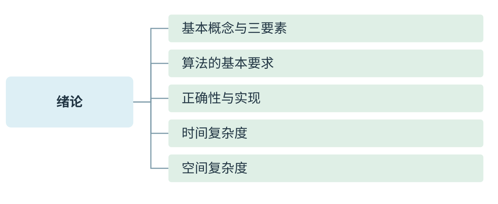

[可编辑SVG](../chapters/DS01/figures/overview.svg) · [完整知识导图](../chapters/DS01/chapter-map.pdf)

本章中，$n$ 表示输入规模。代码中的数组下标和逻辑位序分别说明；后续各类结构按教材给出的存储表示确定有效范围。指针变量保存结点地址，`p->next` 是 `p` 所指结点的后继指针域；`p=NULL` 表示 `p` 当前不指向任何有效结点。伪代码中的赋值号 `=` 不表示数学等式，循环边界和执行顺序同样是算法的一部分。

<a id="DS01-01"></a>
## 逻辑关系怎样落实到存储

> **课程连接 · 逻辑与物理**
>
> 同一逻辑关系可以用不同存储结构实现。顺序或链式描述物理安排，线性或非线性描述元素之间的关系。

**数据**是信息的载体，是能输入计算机并被程序识别和处理的符号集合。**数据元素**是数据的基本单位，一个元素可由若干数据项组成。例如一条学生记录是一个元素，学号和姓名是它的数据项。**数据对象**是性质相同的数据元素的集合。讨论数据结构时，还必须说明元素之间的关系：是排成先后序列，形成父子层次，还是由任意边相连。

**逻辑结构**描述元素之间的逻辑关系，不涉及具体地址。集合结构没有规定元素间的先后关系；线性结构中，除首尾元素外，每个元素都有一个直接前驱和一个直接后继；树形结构表达层次；图结构表达更一般的关联。栈和队列都以线性关系为基础，但允许的操作位置不同，因此属于不同的抽象数据类型。

**存储结构**是逻辑结构在计算机中的表示。顺序存储用相邻位置体现关系，链式存储用指针联系结点，索引存储另建索引以定位元素，散列存储由关键字计算位置。四者都只是表示方法，不能把“线性结构”直接等同于“连续地址”。线性表既能顺序存储，也能链式存储。

<a id="ds01-fig-logical"></a>
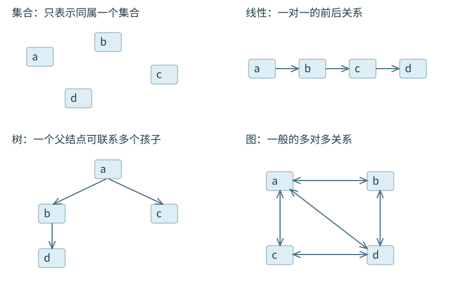

<a id="ds01-fig-storage"></a>
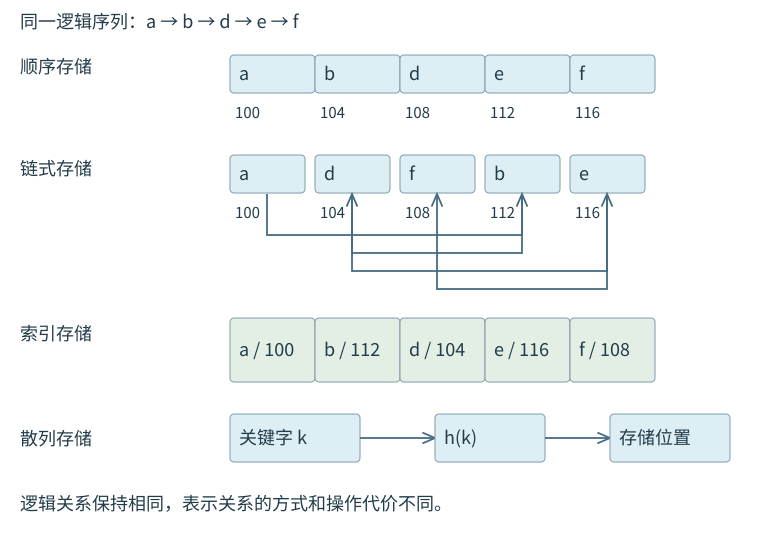

<a id="DS01-ex1"></a>
### 例 1-1　值以外还要存什么

**例题 · 配套例题**

〖1.1-005〗 在存储数据时，通常不仅要存储各数据元素的值，还要存储（　）。

A. 数据的操作方法　B. 数据元素的类型　C. 数据元素之间的关系　D. 数据的存取方法


**解析。** 若只保存若干值，就无法区分这些值原本属于一个序列、一棵树还是一张图。存储结构必须表达元素间的关系，答案为 **C**。关系未必另占一个专门字段：数组的相邻位置已隐含先后，链表则用指针显式记录后继。

运算的定义与实现也要分开。线性表的“按位序取值”是一种抽象运算；在数组上用下标访问、在链表上顺指针查找，则是两种实现。选择存储结构时，要同时考虑需要保存的关系和需要执行的运算，不能只看对象包含多少个元素。

**抽象数据类型（ADT）**把数据对象、关系和允许的操作合在一起描述，而不限定具体的机器实现。例如，栈规定 `push`、`pop` 及后进先出语义；顺序栈和链栈都能实现这一约定。

<a id="DS01-02"></a>
## 算法怎样保证结束并得到正确结果

> **错项排除 · 有穷不等于很快**
>
> 执行2的n次方步，只要对每个合法有限n都能结束，仍可满足有穷性。可行性也不是“考试规模下跑得快”；先判基本特性，再评价实际效率，不要混用两个层次。

算法是求解一类问题的有限操作序列，通常要求有穷性、确定性、可行性、输入和输出：对合法输入，执行有限步后结束；每一步含义明确，并能在有限时间内完成；可以有零个或多个输入，至少有一个输出。输出不限于屏幕打印，也可以是返回值或修改后的数据状态。

算法的有穷性针对**每一次合法输入**。运行时间很长，仍可能满足有穷性；没有终止条件的服务程序可以是有用的程序，却不属于这里所说的有限求解算法。可行性要求操作能够执行，并不要求它在现实规模下足够快。正确、可读、健壮以及时空效率是进一步评价设计的维度；“必须具备的特性”与“希望达到的设计质量”属于不同层面的问题。

证明循环正确性，可以找一个每轮前后都保持的关系，称为**循环不变式**。例如，依次扫描数组求最大值：处理前 $i$ 个元素后，`max` 等于这 $i$ 个元素的最大值。证明分三步：初始化时说明该关系为何成立；每轮用下一个元素更新后说明它仍成立；终止时 $i=n$，由不变式可知结果覆盖了全体元素。此外还要说明循环变量不断接近边界，以排除关系成立却永不终止的程序。

设计和检验算法时，要考虑空表、单元素、重复元素和查找失败等情况。若把初始化写成 `max=A[0]`，输入规模就必须满足 $n\ge1$；若允许空数组，应另行约定失败时的返回值，不能继续访问 `A[0]`。

<a id="DS01-sort-example"></a>
### 一组记录如何经过有限步骤得到结果

以年龄序列56、49、40、49、18为例，每一轮扫描尚未确定的后缀，取出最小记录并插入当前前缀的末尾。出现同龄记录时，本例先取输入中靠前的一条。

| 状态 | 年龄序列 | 已确定的前缀长度 |
| --- | --- | --- |
| 初始 | 56、49、40、49、18 | 0 |
| 第1轮 | 18、56、49、40、49 | 1 |
| 第2轮 | 18、40、56、49、49 | 2 |
| 第3轮 | 18、40、49、56、49 | 3 |
| 第4轮 | 18、40、49、49、56 | 4；末元素随之确定 |

比较的是记录中的年龄项，但搬动的是整条记录，姓名、财富等其他数据项仍须跟随对应记录。描述算法时应明确“取出再插入”还是“交换两个位置”；二者在元素相等时可能有不同的稳定性。这里只用这一过程说明输入、确定步骤与输出，第8章将进一步比较具体排序算法。

<a id="DS01-03"></a>
## 怎样由执行次数得到时间复杂度

实际运行时间受机器、编译器和输入分布影响。比较算法的增长规律时，先选择一种基本操作，统计它的执行次数 $T(n)$，再研究 $n$ 增大时的数量级。本书采用单位成本模型：定长整数的比较、赋值及一次数组访问都视为常数时间。若整数位数随输入增长，或者需要访问外存，这个假设就要重新检查。

$T(n)=O(f(n))$ 给出渐近上界；$T(n)=\Omega(f(n))$ 给出渐近下界；上下界同阶时记为 $\Theta(f(n))$。选择题通常用 $O$ 表示所要求的紧数量级。$3n^2+7n+9=\Theta(n^2)$：当规模足够大时，低次项和常数因子都不会改变增长阶。把 $O(n)$ 写成 $O(2n)$ 并没有更精确地给出渐近阶。

<a id="DS01-detail1"></a>
### 先看循环变量如何变化

`i++` 经过 $n$ 次增长到 $n$；`i*=2` 则约经 $\log_2n$ 次到达循环边界。分析嵌套循环时，不能只数层数。若内层范围依赖外层变量，应先写出每轮次数再求和。例如：

```text
for i = 1 to n:
    for j = 1 to i:
        执行一次基本操作
```

总次数为 $1+2+\cdots+n=n(n+1)/2$，所以是 $\Theta(n^2)$。外层和内层各有一个变量，并不意味着次数总是 $n\times n$；本例只是恰好达到平方阶。

<a id="DS01-ex2"></a>
### 例 1-2　循环由累计和决定何时停止

> **不变量 · 累计值与轮数不同**
>
> 第k轮结束时sum=k(k+1)/2，循环次数是满足停止不等式的最小k。sum约等于n不代表循环n次；每轮增量逐步变大，正是平方根阶出现的原因。

**例题 · 配套例题**

【2017】 下列函数的时间复杂度是（　）。

```c
int func(int n) {
    int i=0, sum=0;
    while (sum<n) sum += ++i;
    return i;
}
```

A. $O(\log n)$　B. $O(n^{1/2})$　C. $O(n)$　D. $O(n\log n)$


**解析。** 条件检查的是 `sum`，应先把它写成循环次数的函数。执行 $k$ 轮后，`i=k`，$\mathrm{sum}=1+2+\cdots+k=k(k+1)/2$。终止时，$k$ 是满足 $k(k+1)/2\ge n$ 的最小非负整数，即

$$k=\left\lceil\frac{\sqrt{1+8n}-1}{2}\right\rceil.$$

每轮只做常数次操作，故 $k=\Theta(\sqrt n)$，答案为 **B**。`sum` 最终约为 $n$，不能据此推出执行了 $n$ 轮——每轮的增量本身也在增长。分析按题目给定的整数模型进行；实际实现还应防止固定字长溢出。

<a id="DS01-ex3"></a>
### 例 1-3　两层循环为什么仍是线性时间

> **不变量 · 先列每轮工作量**
>
> 外层i取1、2、4等值，内层工作量恰与i相同。用等比和可知所有小轮之和仍受末轮的常数倍控制；“两层循环”没有提供平方阶的充分条件。

**例题 · 配套例题**

【2022】 下列程序段的时间复杂度是（　）。

```c
int sum=0;
for (int i=1; i<n; i*=2)
    for (int j=0; j<i; j++)
        sum++;
```

A. $O(\log n)$　B. $O(n)$　C. $O(n\log n)$　D. $O(n^2)$


**解析。** 外层的取值为 $1,2,4,\ldots,2^k$，其中 $2^k<n\le2^{k+1}$。各轮内层次数正好为这些值，总计

$$1+2+4+\cdots+2^k=2^{k+1}-1.$$

该和小于 $2n$，而当 $n>1$ 时又不小于 $n$ 的某个常数倍，故为 $\Theta(n)$，答案为 **B**。若把每一轮都估成最后一轮的 $O(n)$，再乘以外层轮数，得到的只是不紧的 $O(n\log n)$ 上界，忽略了前几轮内层规模很小这一事实。

<a id="DS01-detail2"></a>
### 最好、最坏与平均情况在比较什么

线性查找长度为 $n$ 的表：目标在首位时比较 1 次；在末位或不存在时，通常比较 $n$ 次。这是相同规模下不同输入造成的差异。**最坏时间**取规模为 $n$ 的合法输入中的最大执行次数；**最好时间**取最小；**平均时间**还须说明输入的概率分布。不能把“平均”直接理解为最好与最坏的算术平均。

若 $n$ 个元素被查找的概率相同，并且保证查找成功，则顺序查找的平均比较次数为 $(n+1)/2$。若还可能失败，就要把失败概率及其代价计入；第7章将按查找模型分别计算。

递归算法先写出递推关系。例如，若每次只递归求解规模为 $n-1$ 的一个子问题，并做常数工作，则 $T(n)=T(n-1)+\Theta(1)=\Theta(n)$。若产生两个规模为 $n/2$ 的子问题，并在本层做线性合并，则 $T(n)=2T(n/2)+\Theta(n)$：每层总工作为 $\Theta(n)$，约有 $\log_2n$ 层，总时间为 $\Theta(n\log n)$。不能只看到规模减半就写成对数时间；每层有多少个子问题同样决定总量。

<a id="DS01-04"></a>
## 辅助空间中为何要计入递归栈

**辅助空间复杂度**衡量算法运行时所需的额外空间随输入规模增长的情况，一般不计输入本身占用的空间；题目对输出区是否计入另有约定时，按题意处理。本书比较排序时把归并辅助数组计入额外空间，不重复计算原数组。

几个循环变量只占 $\Theta(1)$ 空间，循环执行一万次也不需要同时保存一万个变量。相反，递归调用尚未返回时，调用记录必须同时保留参数、返回位置和局部状态。递归求和每层只用常数空间，但同一时刻最多存在 $n$ 层调用，因此辅助空间为 $\Theta(n)$；时间与空间同阶只是这个例子的特点，并非所有递归都如此。

若一次调用先处理左半、返回后再处理右半，左右子树的递归调用就不会全程同时展开。二叉树遍历的调用总数为 $\Theta(n)$，最大栈深为树高 $h$，故递归辅助空间是 $O(h)$。完全二叉树中 $h=\Theta(\log n)$；单支链中 $h=\Theta(n)$。这里不能用“访问了 $n$ 个结点”代替“同时保留了多少层状态”。

**原地算法**通常允许常数个辅助单元。只数递归代码中有几个显式变量而忽略调用栈，就可能误判为原地算法。快速排序即使在原数组上划分，递归栈仍要计入：普通实现平均 $O(\log n)$，最坏 $O(n)$；第8章会解释两者分别对应怎样的划分。

<a id="DS01-map"></a>
## 辨清对象、结构、类型与运算

> **最小反例 · 链式不等于树**
>
> 三个结点a→b→c→a可以构成循环单链表的物理链接，链接图含环，不能据此认定为树。采用指针联系只是存储表示；逻辑对象究竟是线性表、树还是图，还需查看关系与操作约定。
>
> 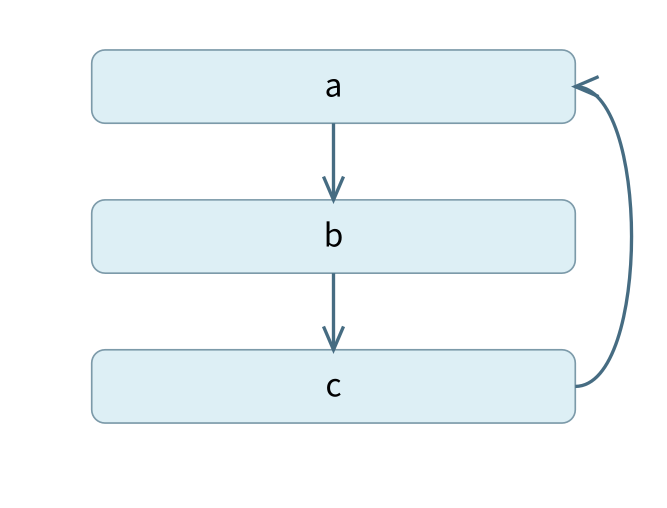
>
> 循环链接含环，链式存储不能确定树关系

**定义 · 数据结构的三要素**

数据结构的三要素是逻辑结构、存储结构和数据的运算。逻辑结构规定元素间的关系，存储结构在计算机中表示元素及关系，运算包括抽象功能的定义以及在具体表示上的实现。数据项是构成元素的不可分割单位；记录由多个数据项构成，却仍可作为一个元素整体处理。


数据类型由一个值的集合及定义在该集合上的操作组成。原子类型的值不再分解，结构类型的值可分解为成分；抽象数据类型进一步强调对使用者可见的对象、关系和操作语义，将实现细节藏在接口之后。逻辑结构与存储结构不是一一对应：同一逻辑结构可以有多种表示，同一种链式表示也能用于线性表、树、图。


| 判断维度 | 需要说明什么 | 例子 | 不能直接推出什么 |
| --- | --- | --- | --- |
| 逻辑结构 | 元素间关系 | 序列、层次、任意关联 | 是否使用连续地址 |
| 存储结构 | 地址与链接的表示 | 顺序、链式、索引、散列 | ADT允许的操作一定相同 |
| 运算定义 | 输入、输出与前后条件 | 取第i个元素、插入 | 具体执行多少次访问 |
| 运算实现 | 在已定表示上怎样执行 | 数组寻址、逐结点扫描 | 另一种表示下代价也相同 |


<a id="DS01-code"></a>
## 用一个完整算法连接特性、正确性与代价

**方法 · 先写接口契约，再写循环**

以求数组最大值为例：合法输入为长度$n\ge1$的有效数组；返回值应等于数组中某个元素，且不小于任意元素。允许空输入时，必须把失败作为接口的一部分；不能凭空取一个数充当所有整数数组的最大值。


```cpp
bool maximum(int a[], int n, int &answer) {
    if (n <= 0) return false;
    int best = a[0];
    for (int i = 1; i < n; ++i)
        if (a[i] > best) best = a[i];
    answer = best;
    return true;
}
```

接口采用教材式数组参数和引用输出参数，失败时不修改answer。合法数组必须实际包含至少n个有效元素；调用者负责保证数组对象和元素可访问。数据规模n为0时没有最大值，布尔返回值把这种情况与“最大值恰好是0”区分。

**推导 · 扫描最大值的循环证明**

进入第$i$轮前，不变量为`best=max(a[0..i-1])`。初始化$i=1$时，唯一已处理元素为$a[0]$；比较$a[i]$后取较大者，不变量扩展到前$i+1$个元素。$i$严格递增且上界为$n$，故循环终止；终止时处理全部元素，返回正确最大值。非空输入恰有$n-1$次元素大小比较，所以时间为$\Theta(n)$，额外存储为$\Theta(1)$。


<a id="DS01-rules"></a>
## 渐近分析的运算规则及适用条件

> **最小反例 · 重复申请不等于同时占用**
>
> 循环两次，每次申请一个单元并在下一轮前释放，峰值仍只占一个单元。空间分析要沿时间轴看尚未释放的状态；不能照搬“轮数×每轮空间”的时间计数方法。

**定理 · 加法取主阶，嵌套先计实际次数**

若两段代码依次执行，时间为$T_1(n)+T_2(n)$，可按最大数量级归并；若一段工作被重复$k(n)$次且每次代价有统一紧界，才可直接相乘。内层范围随外层变化时，先写求和。常数底的对数只相差常数因子。


常见增长次序（$c>1$为固定常数）为

$$1\prec\log n\prec n\prec n\log n\prec n^2\prec n^3\prec c^n\prec n!\prec n^n.$$

$O$上界并不唯一：线性算法当然也属于$O(n^2)$，但题目通常要求最紧的常见阶。最好/最坏描述同规模输入的选择，$O/\Omega/\Theta$描述函数之间的界，不能将两组概念机械配对为“O只表示最坏”。

空间必须数**同一时刻仍存活的状态**。两段代码顺序使用并释放临时数组时，峰值可取各段最大值；两个数组同时保留时才相加。循环内每轮复用一个长度$n$的临时数组，即使循环$n$轮，峰值仍为$\Theta(n)$而非$\Theta(n^2)$。递归每层若分配不同规模的数组，必须沿一条同时活跃的调用链求和，而非只用层数乘最外层空间。

<a id="DS01-count"></a>
## 从计数到增长阶的完整过程

选定基本操作后，先保留一个能说明执行次数的式子，再化简数量级。循环的初始化、条件检查、循环体和更新并非同一执行次数：执行n轮的普通for循环，条件通常检查n+1次，循环体和更新各n次。例如按单位操作计数可能得到$T(n)=3n+3$，最后才写成$O(n)$。不同计数粒度会改变常数，但不改变这一增长阶。


| 循环或工作形式 | 先列出的次数关系 | 紧数量级 |
| --- | --- | --- |
| `i=1; i<=n; ++i` | n次 | $\Theta(n)$ |
| `i=1; i<=n; i*=2` | $2^k\le n$ | $\Theta(\log n)$ |
| `i=n; i>0; i/=2` | 整数反复折半直至0 | $\Theta(\log n)$ |
| 外层i=1至n，内层j=1至i | $\sum_{i=1}^n i$ | $\Theta(n^2)$ |
| 外层i=1至n，内层j=1至n | $n\cdot n$ | $\Theta(n^2)$ |
| 固定次数执行长度n的循环 | $c n$，c与n无关 | $\Theta(n)$ |


乘法增长中，底数是大于1的固定常数，换底只改常数因子；若底数随规模变化就需重新分析。分支取决于输入数据时，最坏情况选择代价最大的合法分支；平均情况按输入概率加权，而不是随意把每条分支平均。

<a id="DS01-space-example"></a>
### 同时活跃的空间沿调用链相加

课件用局部数组展示了“递归深度”之外的另一项因素。若每层只有常数个局部变量，递归从n依次到1，峰值为$\Theta(n)$。若第k层还保留长度为k的局部数组，递归进入下一层时旧数组仍未释放，峰值为

$$n+(n-1)+\cdots+1=\frac{n(n+1)}2=\Theta(n^2).$$

若每次把规模减半且保留对应规模的局部数组，同时活跃的数组空间为$n+n/2+n/4+\cdots<2n$，故是$\Theta(n)$，而不是简单将“最外层n”乘“深度log n”。深度乘每层空间只适用于每层空间有同一紧界的情况。

<a id="ds01-fig-space"></a>
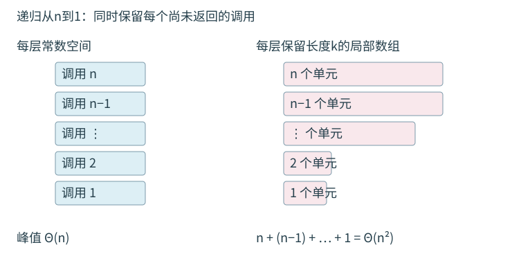

<a id="DS01-errors"></a>
## 历史错题指向的辨析

> **错项排除 · 效率不是唯一质量**
>
> 一个输出错误的程序即使时间和空间都很少，也没有解决目标问题。遇到用效率“全面衡量优劣”的说法，应先检查正确性等前提；正确性、可读性、健壮性不能被遗漏。

算法必须具备五项基本特性；正确性、可读性、健壮性以及时空效率则是进一步评价设计的维度。CPU实际耗时受机器与实现影响，并非只由抽象算法决定；也允许以更多空间换取更少时间。配套单选对“衡量优劣”的概括存在措辞歧义，复习时应掌握这几个层次的区别，不把时空效率当作全部质量条件。做复杂度题则先找真正的停止量，列累计和或等比和，避免将变量最终值直接当作循环次数。

<a id="DS01-check"></a>
## 主动回忆自测

第1题为配套题，其余为自拟补充。先遮住答案，说明停止条件、存活空间与表示关系。

**主动回忆 · 合上正文，沿导图复述**

1. 【2019】设n是描述问题规模的非负整数，程序段 `x=0; while(n>=(x+1)*(x+1)) x=x+1;` 的时间复杂度是（　）。A. $O(\log n)$　B. $O(n^{1/2})$　C. $O(n)$　D. $O(n^2)$
2. 一段算法循环调用一个无递归函数 $n$ 次，每次函数使用 10 个整数局部变量。仅考虑这些局部变量，辅助空间是 $O(n)$ 还是 $O(1)$？
3. 一个对象采用链式存储，能否据此断定它的逻辑结构是一棵树？
4. 数据项、数据元素、数据对象之间是什么关系？ADT是否规定必须用数组实现？
5. 算法的五项特性与正确性、健壮性有什么区别？“输入”必须从键盘读入吗？
6. 单个循环变量连续翻倍，和外层翻倍但内层执行i次，两者为什么不是同一个阶？
7. 顺序执行两段各需n个临时单元的代码，峰值空间一定是2n吗？
8. 递归每次将规模减半、每层只用常数空间，时间是否一定是对数阶？还缺什么信息？


<a id="DS01-recall-extra"></a>
### 核对答案

> **自查提示 · 推导与结果一起核对**
>
> 核对复杂度答案时，同时复查每轮计数、递归终止条件及同时活跃的调用层数。

**主动回忆 · 先核条件，再核结论**

1. **B**。次数恰为 $\lfloor\sqrt n\rfloor$：终止时 $x^2\le n<(x+1)^2$，仍为平方根数量级，但停止方程与例 1-2的累计和不同。2. $O(1)$：前一次调用返回后，局部空间可以复用。3. 不能。链式存储只是一种表示方法，线性表、树和图都可以采用。

4. 元素是处理的基本单位，由数据项组成；对象是同性质元素的集合。ADT规定抽象语义而不限定表示。
5. 五项特性描述作为有限求解算法的要求；正确性等描述设计质量。输入可由参数、已存数据等提供，并不限定交互方式。
6. 前者轮数为对数；后者基本操作数为1+2+4+⋯，是线性量级。
7. 不一定。若前段的临时空间结束后可复用，峰值只需n个量级；若两段结果必须同时保留才相加。两者渐近阶均为Θ(n)，但实际峰值不同。
8. 还要知道每层产生几个子问题、每个调用做多少非递归工作。两个半规模递归和一个半规模递归具有不同调用总量。


<a id="DS02"></a>
# 线性表：顺序表示、链式表示与算法

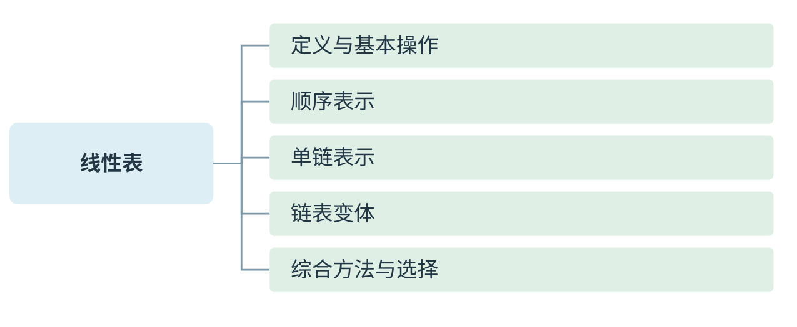

[可编辑SVG](../chapters/DS02/figures/overview.svg) · [完整知识导图](../chapters/DS02/chapter-map.pdf)

同一个线性表可以放在连续数组中，也可以由分散的结点连接起来。前者依靠数组下标定位，插入和删除常要搬移元素；后者把先后关系放在链接中，定位常要逐结点进行。分析操作复杂度时，必须把“找到位置”和“修改结构”分别计算。

<a id="DS02-01"></a>
## 位序、下标和基本操作

> **最小反例 · 容量不等于表长**
>
> 容量为100的数组可以表示空表，此时length=0；也可只保存一个元素。仅给数组上界不能推断有效元素数。插入判断必须同时检查位序是否合法与是否尚有空位。

线性表是具有相同数据类型的 $n$ 个元素的有限序列。$n=0$ 时为空表。非空表的第一个元素没有直接前驱，最后一个没有直接后继，其余元素各有一个直接前驱和一个直接后继。这里的“相同类型”不要求元素的值互不相同。

长度为 $n$ 的表，已有元素的位序是 $1\sim n$；在第 $i$ 个位置插入新元素，合法范围是 $1\le i\le n+1$。最后一个位置表示追加。若用 `A[0..n-1]` 保存，位序 $i$ 对应下标 $i-1$。查找失败的信号不能与下标 0 混淆，例如按位序返回 0 表示失败，或按下标返回 −1 表示失败。

本章约定单链表有头结点 `L`，首元结点为 `L->next`。头结点用于统一第一个位置的插入与删除，不保存有效表元素；**头指针**是指向它的指针变量，二者不是同一对象。无头结点的版本也可以实现相同运算，但修改第一个结点时必须能够修改头指针。

<a id="DS02-02"></a>
## 顺序表的寻址、插入和删除

若每个元素占 $w$ 个地址单位，首元素地址为 $b$，则第 $i$ 个元素地址为 $b+(i-1)w$。计算地址只需常数次算术运算，故可随机存取。“随机”指任意位置可以直接定位，与随机数无关。按值查找仍要比较元素，未排序时通常需要 $O(n)$ 时间。

在下标 $k$ 处插入，要把 `A[k..n-1]` 各后移一位；必须**从后向前**移动，否则后一个元素可能已被前一个覆盖。删除下标 $k$ 的元素，则把 `A[k+1..n-1]` 各前移一位，按从前向后的顺序执行。

```text
insert(A, n, capacity, k, x):
    if k<0 or k>n or n==capacity: return false
    for j=n down to k+1: A[j]=A[j-1]
    A[k]=x
    n=n+1
    return true
```

插入移动 $n-k$ 个元素，追加时为 0；删除移动 $n-k-1$ 个元素，删除末元素时为 0。等概率在 $n+1$ 个插入位置选择时，平均移动 $n/2$ 个；等概率删除 $n$ 个已有元素时，平均移动 $(n-1)/2$ 个。平均数的分母不同，来自合法位置数不同。

<a id="DS02-ex1"></a>
### 例 2-1　没有给存储方式时能否确定移动数

**例题 · 配套例题**

〖2.3-012〗 在线性表 $a_0,a_1,\ldots,a_{100}$ 中，删除元素 $a_{50}$ 需要移动（　）个元素。

A. 0　B. 50　C. 51　D. 0 或 50


**解析。** 题目没有限定存储方式。顺序表中，后面的 $a_{51}\sim a_{100}$ 共 50 个元素前移；链表中改变链接即可，无需搬移其他结点的数据，故答案为 **D**。删除前若还要从头寻找该结点，链表访问时间仍可能是 $O(n)$；“不移动数据”不等于“全过程常数时间”。

静态数组的容量固定，不意味着表长固定。动态数组可以在空间不足时申请更大的连续区并搬移旧元素，但单次扩容可能需要 $O(n)$ 时间；分析某一次插入时不能忽略这次复制。

<a id="DS02-code-seq"></a>
## 顺序表的完整状态与核心实现

> **不变量 · 搬移保护未读区**
>
> 插入向后搬移时，从后往前处理能确保源元素尚未被覆盖；删除向前搬移则从前往后读。记住需要保护的未读区，就能由目标下标推回正确循环方向。

顺序表保存数据元素以及当前表长；动态分配版本还需记录容量。静态容量与表长是不同概念：容量固定时，表长仍可在0至容量之间变化。代码沿用教材的类型名称，`ElemType`表示元素类型，本章示例取整型。

```cpp
#define MaxSize 100
typedef int ElemType;
typedef struct {
    ElemType data[MaxSize];
    int length;
} SqList;
```

静态类型使用宏`MaxSize`作数组容量，后文动态类型以成员`MaxSize`记容量。静态与动态两组类型示例独立使用；编译验证时分别组织为独立单元。

<a id="DS02-seq-query"></a>
### 初始化、查找与随机访问

静态顺序表初始化令`length=0`。`InitList(SqList &L)`中的引用参数使函数能修改调用者的表长。动态顺序表还需申请连续空间，申请成功后设定表长和容量；销毁时释放该空间。

```cpp
void InitList(SqList &L) { L.length = 0; }
ElemType GetElem(SqList L, int i) {
    return L.data[i - 1];  // 前提：1 <= i <= L.length
}
int LocateElem(SqList L, ElemType e) {
    for (int i = 0; i < L.length; ++i)
        if (L.data[i] == e) return i + 1;
    return 0;
}
```

按位查找先把位序换成数组下标，时间$O(1)$；调用前须保证位序合法。按值查找从前向后扫描，成功返回首次相等元素的位序，失败返回0，最坏$O(n)$。本章ElemType取整型，可直接用`==`；若元素为结构类型，实际代码应定义逐字段或按关键字的判等函数。若成功位置等概率，平均比较$(n+1)/2$次；有序顺序表可采用折半查找，具体算法在查找章展开。

<a id="DS02-seq-update"></a>
### 插入与删除的循环方向

> **辨析 · 失败不能改状态**
>
> 先检查位序和容量，再搬移、赋值和改表长。删除结果e只在成功时有新值。

插入合法范围是$1\le i\le n+1$，还要保证有剩余容量。将从位序i开始的后缀从后向前搬移；删除合法范围是$1\le i\le n$，先保存被删元素，再将后缀从前向后搬移。

```cpp
bool ListInsert(SqList &L, int i, ElemType e) {
    if (i < 1 || i > L.length + 1) return false;
    if (L.length >= MaxSize) return false;
    for (int j = L.length; j >= i; --j)
        L.data[j] = L.data[j - 1];
    L.data[i - 1] = e;
    ++L.length;
    return true;
}
bool ListDelete(SqList &L, int i, ElemType &e) {
    if (i < 1 || i > L.length) return false;
    e = L.data[i - 1];
    for (int j = i; j < L.length; ++j)
        L.data[j - 1] = L.data[j];
    --L.length;
    return true;
}
```

插入时先搬后面的元素，才能保存尚未读取的旧后缀；若从前向后执行`data[j+1]=data[j]`，会反复复制同一个被覆盖的值。删除时源位置比目标位置大，从前向后搬移恰好保护未读元素。失败操作不修改表长，删除输出参数只在成功时有效。

<a id="DS02-dynamic"></a>
### 动态分配与扩容

> **辨析 · 动态仍然连续**
>
> SeqList动态区仍是一个连续数组。扩容先保住新旧地址，复制成功后再释放旧区，旧元素地址会变化。

动态顺序表仍要求整个数组连续，只是容量可以重建。扩容不是在原地址后方一定能再接一段；需要取得新连续区，再搬移已有元素。下面保留教材的`SeqList`、`data`、`MaxSize`、`length`命名。`InitSize=100`是王道2027教材中的示例初始容量；课件演示取10，两者采用相同的存储结构和接口，实际值可以按需求设定。

```cpp
#define InitSize 100
typedef struct {
    ElemType *data;
    int MaxSize;
    int length;
} SeqList;
void InitList(SeqList &L) {
    L.data = (ElemType *)malloc(InitSize * sizeof(ElemType));
    L.length = 0;
    L.MaxSize = InitSize;
}
void IncreaseSize(SeqList &L, int len) {
    ElemType *p = L.data;
    L.data = (ElemType *)malloc(
        (L.MaxSize + len) * sizeof(ElemType));
    for (int i = 0; i < L.length; ++i)
        L.data[i] = p[i];
    L.MaxSize += len;
    free(p);
}
```

这两段保留教材的void接口，以申请成功为前提；扩容还要求len为正，申请长度能由机器整数和地址空间表示。实际工程应先把malloc结果存入临时指针q，检查非空后再替换data；否则直接覆盖data可能在申请失败时丢失原地址。每次扩容搬移n个元素，时间$O(n)$，新旧区同时存在时峰值临时空间也为$O(n)$。`malloc/free`成对使用；清空令长度为0，销毁则释放数组并撤销有效指针、长度和容量。动态数组支持随机存取，动态分配本身不等于链式存储。

<a id="ds02-fig-dynamic"></a>
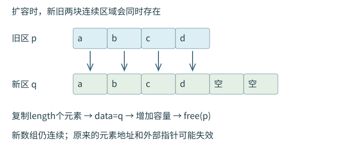


<a id="DS02-03"></a>
## 单链表：先保留哪条链接

> **最小反例 · 两句交换会丢链**
>
> p原后继为r。若先写p->next=s，再写s->next=p->next，第二句读到的是s，形成自环，r不再可从p到达。先暂存旧链接，是所有原地指针改写的基本纪律。
>
> 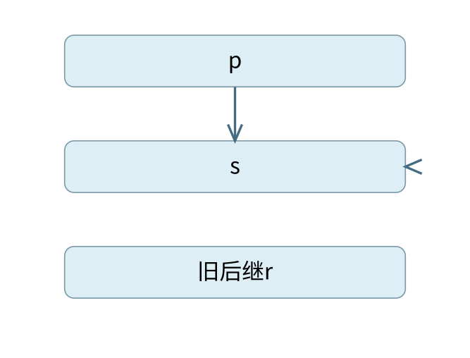
>
> 错误顺序使s自环，旧后继r不可达

本章采用教材的结点与头指针类型，申请与释放使用`malloc/free`；对应代码包含`<stdlib.h>`。

```cpp
typedef struct LNode {
    ElemType data;
    struct LNode *next;
} LNode, *LinkList;
bool InitList(LinkList &L) {
    L = (LNode *)malloc(sizeof(LNode));
    if (L == NULL) return false;
    L->next = NULL;
    return true;
}
```

结点由数据域与后继指针域构成。不同结点不要求物理相邻；同一个结构体结点所含的各域作为一个整体分配，因此不能把“结点之间地址分散”误说成“一个结点内部各域随意分散”。为了读取第 $i$ 个元素，须从链头沿 `next` 走 $i-1$ 步，所以链表不支持按位序的常数时间随机访问。

已知有效结点 `p`，在其后插入新结点 `s`：先令 `s->next=p->next` 保存旧后继，再令 `p->next=s`。若先把 `p->next` 改成 `s`，随后从 `p->next` 取得的已不是旧后继，可能产生自环并丢失后半链。

<a id="ds-fig-list-insert"></a>
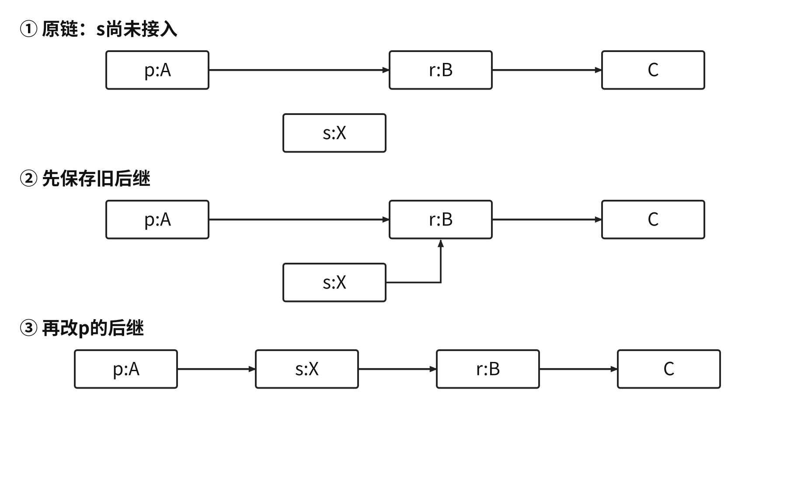

删除 `p` 的后继时，先检查 `p->next!=NULL`，再用 `q=p->next` 暂存待删结点，执行 `p->next=q->next`，最后释放 `q`。释放后不能继续读取 `q->next`。若只给待删结点的指针而不给其前驱，通常还要从头寻找前驱；用“复制后继数据再删后继”的办法不适用于尾结点，还可能改变题目要求保留的结点身份。

头插法不断把新结点接到头结点之后，输入次序会逆转；尾插法保存尾指针，每次接到尾部，能保留输入次序。两者若都维护所需指针，建立 $n$ 个结点的链表均为 $O(n)$；若每插入一个元素都重新从头找尾部，才会累积到 $O(n^2)$。

<a id="DS02-detail1"></a>
### 原地逆置：未处理部分不能丢

维护 `prev` 为已逆置部分的新首结点，`cur` 为未处理部分的首结点。每次先暂存 `nxt=cur->next`，再把 `cur->next` 指向 `prev`，随后推进两个工作指针。

```c
void reverseList(LNode *L) {       // 带头结点
    LNode *prev=NULL, *cur=L->next;
    while (cur!=NULL) {
        LNode *nxt=cur->next;
        cur->next=prev;
        prev=cur;
        cur=nxt;
    }
    L->next=prev;
}
```

每轮只移动一个结点到逆置区。空表时循环不执行，头结点仍指向空；单结点时其 `next` 仍为空。时间 $\Theta(n)$，辅助空间 $\Theta(1)$。递归逆置虽然也能线性运行，却要保留递归栈，不能与迭代实现的空间混算。

<a id="DS02-ex2"></a>
### 例 2-2　如何一次扫描找到倒数第 $k$ 个结点

> **不变量 · 固定间隔保持到尾**
>
> fast先走k步后，两指针始终相隔k条后继步。当fast到空位置时，slow距空位置也恰为k步，故指向倒数第k个结点。先走阶段遇空可直接识别k超过表长。

**例题 · 配套例题**

配套例题：已知一个带有表头结点的单链表，结点结构为 `data | next`，只给出了头指针 `list`。在不改变链表的前提下，设计尽可能高效的算法，查找倒数第 $k$ 个位置上的结点（$k$ 为正整数）。若成功，输出该结点的 `data` 值并返回 1；否则只返回 0。要求说明设计思想、实现步骤，并用 C、C++ 或 Java 描述算法，在关键处加注释。


**解析。** 倒数位置由尾部决定，但链表不能直接向前访问。让两个指针保持固定间隔：`fast` 先从首元结点前进 $k$ 步，再让 `fast` 与 `slow` 同步前进。若表长为 $n$，`fast` 到达空位置时共走了 $n$ 步，`slow` 只走了 $n-k$ 步，正好指向第 $n-k+1$ 个结点。

```c
int searchK(LNode *list, int k) {
    if (k<=0) return 0;
    LNode *fast=list->next, *slow=list->next;
    for (int j=0; j<k; ++j) {
        if (fast==NULL) return 0;   // 表长不足 k
        fast=fast->next;
    }
    while (fast!=NULL) {
        fast=fast->next;
        slow=slow->next;
    }
    printf("%d", slow->data);
    return 1;
}
```

以长度 5、$k=2$ 为例，先让 `fast` 指向第3个结点，`slow` 留在第1个；同步经过“4与2—5与3—空与4”，第4个即倒数第2个。$k=n$ 时第一阶段恰好走到空位置，第二阶段不执行，返回首元结点；$k>n$ 时在第一阶段报失败。两个指针合计走 $O(n)$ 步，辅助空间 $O(1)$，没有修改任何链接。

<a id="DS02-04"></a>
## 双链表、循环链表与静态链表

双链表为每个结点增加 `prior`，以便从当前结点访问直接前驱。已知 `p` 后，删除 `p` 可在 $O(1)$ 时间内同时接好两侧；但这不消除按位序寻找 `p` 的成本。

<a id="DS02-ex3"></a>
### 例 2-3　把结点插到双链表结点之前

> **最小反例 · 旧前驱必须还能取得**
>
> 只有r、p两个相邻结点时，在p前插q的最终关系是r↔q↔p。若第一句覆盖p->prior，之后再从它读取就失去r；四条目标链接全部成立才算插入完成。

**例题 · 配套例题**

〖2.3-015〗 在双链表中向 `p` 所指的结点之前插入结点 `q`，正确操作是（　）。

```text
A. p->prior=q; q->next=p;
   p->prior->next=q; q->prior=p->prior;
B. q->prior=p->prior; p->prior->next=q;
   q->next=p; p->prior=q->next;
C. q->next=p; p->next=q;
   q->prior->next=q; q->next=p;
D. p->prior->next=q; q->next=p;
   q->prior=p->prior; p->prior=q;
```


**解析。** 假设 `p` 有有效前驱（可以是头结点）。记旧前驱为 `r`，结果必须同时满足 `r->next=q`、`q->prior=r`、`q->next=p`、`p->prior=q`。D 在最后才修改 `p->prior`，因此前三句还可以取得旧前驱，答案为 **D**。A 的第一句过早覆盖旧前驱；B 最后把 `p->prior` 设成了 `p` 自身；C 既改错方向，又使用尚未设置的 `q->prior`。

写程序时也可先 `q->prior=p->prior; q->next=p;`，再改两侧结点的链接。若 `p` 是不带头结点链表的首元结点，前驱为空，须单独更新头指针，不能直接解引用这个空前驱。

**循环单链表**把尾结点的 `next` 指回链头。带头结点时，空表满足 `L->next==L`；`L==NULL` 只说明没有有效头结点，并非这个模型的空表条件。遍历应在重新遇到头结点时结束，而不是等待 `NULL`。

只给尾指针 `rear` 的无头循环单链表，可以用 `rear->next` 取得首元结点；两个非空循环单链表头尾相接时，交换各尾部的后继链接即可完成 $O(1)$ 拼接。若只给头指针且没有尾链接，要先找到尾部，通常需要线性时间。若存在头结点，拼接时须处理多余头结点，不能把它当作数据留在两表之间。

循环双链表的头结点同时连接首尾，空表时 `next` 与 `prior` 都指回头结点。**静态链表**用数组保存结点，用整数下标代替机器指针；逻辑后继由游标决定，不要求结点下标相邻。还须维护空闲结点链或其他管理空闲位置的结构，数组开得大不等于每个位置都是有效数据。

<a id="DS02-05"></a>
## 双指针、归并与原地处理

这些方法把题目的约束变成指针之间的不变关系。使用前先确认能否修改原数据、是否有序、是否共享结点，以及是否需要保留重复元素。

<a id="DS02-ex4"></a>
### 例 2-4　数组循环左移怎样避免反复搬移

**例题 · 配套例题**

配套例题：将 $n\ (n>1)$ 个整数存放在一维数组 $R$ 中。设计一个时间、空间都尽可能高效的算法，将序列循环左移 $p\ (0<p<n)$ 个位置，即把 $(X_0,\ldots,X_{n-1})$ 变为 $(X_p,\ldots,X_{n-1},X_0,\ldots,X_{p-1})$。给出思想、C/C++ 或 Java 实现，并说明时间与空间复杂度。


**解析。** 题目要求两个连续区段交换位置，同时保持各段内部次序。设前 $p$ 个元素为 $A$，其余为 $B$。分别逆置得 $A^RB^R$，再整体逆置，即得 $BA$。两个区段各被逆置两次，内部方向恢复，而相对位置交换。

```c
void reverse(int R[], int l, int r) {
    while (l<r) {
        int t=R[l]; R[l]=R[r]; R[r]=t;
        ++l; --r;
    }
}
void rotateLeft(int R[], int n, int p) {
    reverse(R,0,p-1);
    reverse(R,p,n-1);
    reverse(R,0,n-1);
}
```

例如 `abcdefgh` 左移3位，依次得到 `cbadefgh`、`cbahgfed`、`defghabc`。总交换次数不超过 $n$，时间 $O(n)$；只用常数临时变量，空间 $O(1)$。若将首元素移到末尾重复 $p$ 次，时间为 $O(np)$，当 $p$ 与 $n$ 同阶时会退化。三次逆置可处理 $p=1$ 和 $p=n-1$，无需另写搬移循环。

<a id="DS02-detail2"></a>
### 有序归并为什么可以一次扫描

两个递增表的当前首元素中，较小者一定是剩余全部元素中最小的。输出它并推进对应指针，重复直到某表为空，再接上另一个表的剩余部分。合并长度为 $m,n$ 的两个表需要 $O(m+n)$ 时间；数组版本通常另开输出区，链表版本在允许破坏原表时可直接重接结点。

比较相等元素时，若希望保持原相对次序，先取左表元素。若题目要求集合并集而不是多重集合合并，则相等时只输出一次并推进两个指针；这项条件会改变算法，不能只改题目的答案。

<a id="DS02-ex5"></a>
### 例 2-5　相同后缀是相同字符还是相同结点

> **错项排除 · 字符相同不等于共享**
>
> 两个结点都存字符i，也可能位于不同地址。公共后缀要求从某处起共享同一串结点，应比较指针而不是data；共享链不能再按两条独占链分别释放。

**例题 · 配套例题**

配套例题：采用带头结点的单链表保存单词，两个单词可共享相同后缀的存储空间。例如 `loading` 与 `being` 共享从字符 `i` 开始的结点。`str1`、`str2` 指向两个头结点，结点为 `data | next`。设计时间上尽可能高效的算法，找到共同后缀的起始结点，给出思想、程序及时间复杂度。

<a id="ds-fig-shared-suffix"></a>
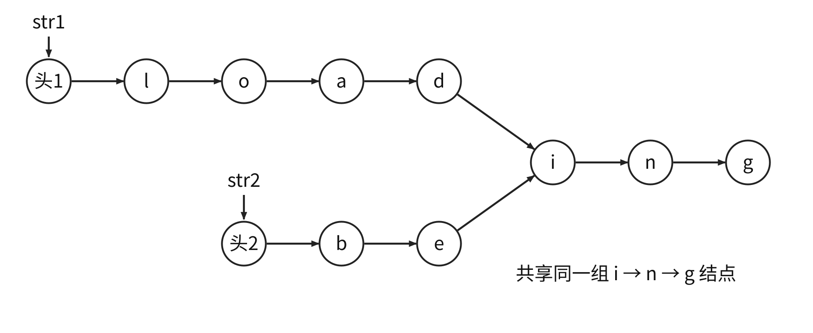


**解析。** 共享指的是地址相同，不能以 `p->data==q->data` 判断。单链表一旦在某结点汇合，其后继也相同，所以两表从公共起点到末尾的长度相等。先各扫描一次求长 $m,n$，让较长表先走 $|m-n|$ 步，两指针便处于距表尾相同的位置；此后同步前进，第一次地址相等的位置就是答案。

```c
LNode *commonSuffix(LNode *str1, LNode *str2) {
    int m=0,n=0;
    for (LNode *p=str1->next; p; p=p->next) ++m;
    for (LNode *q=str2->next; q; q=q->next) ++n;
    LNode *p=str1->next, *q=str2->next;
    while (m>n) { p=p->next; --m; }
    while (n>m) { q=q->next; --n; }
    while (p!=q) { p=p->next; q=q->next; }
    return p;                   // 无公共结点时二者同时为 NULL
}
```

图中两表长度分别为7和5，先让长表跨过 `l,o`，再比较 `a` 与 `b`、`d` 与 `e`，最后到达同一个 `i`。若两表内容相同却各自分配结点，则直到空位置才相等，返回空。总时间 $O(m+n)$，辅助空间 $O(1)$，适用于有限、无环单链表。

<a id="DS02-ex6"></a>
### 例 2-6　主元素为什么还要再计数

> **最小反例 · 剩下候选仍需复核**
>
> 序列1、2、3经抵消可留下3，但3只出现一次，未超过一半。抵消给出的是存在多数时的必要候选，并不证明多数存在；第二次计数补上充分性检验。

**例题 · 配套例题**

配套例题：整数序列 $A=(a_0,\ldots,a_{n-1})$ 满足 $0\le a_i<n$。某值出现次数超过 $n/2$ 时，称它为主元素。例如 $(0,5,5,3,5,7,5,5)$ 的主元素为5，而 $(0,5,5,3,5,1,5,7)$ 没有主元素。设计尽可能高效的算法，存在主元素时输出该值，否则输出 −1；给出思想、程序及时间、空间复杂度。


**解析。** 每次删除两个值不同的元素，不会消灭一个原本占严格多数的值：若删去一个多数元素和一个其他元素，多数仍超过剩余的一半；若删去两个其他元素，多数优势更大。用一个候选值和计数模拟这种抵消。计数为0时选新候选；相同则加1，不同则减1。

```c
int majority(int A[], int n) {
    int candidate=0, count=0;
    for (int i=0; i<n; ++i) {
        if (count==0) { candidate=A[i]; count=1; }
        else if (A[i]==candidate) ++count;
        else --count;
    }
    int actual=0;
    for (int i=0; i<n; ++i)
        if (A[i]==candidate) ++actual;
    return actual>n/2 ? candidate : -1;
}
```

抵消只保证“若有主元素，最后候选一定是它”，没有保证主元素存在。例如 `1,2,3` 最后仍可能留下候选3，它只出现一次，所以必须第二次扫描核实。两个线性扫描合计 $O(n)$ 时间，额外空间 $O(1)$。题目给出的值域也允许用计数数组，但需 $O(n)$ 辅助空间；此处没有必要为省下一次扫描而付出这部分空间。

<a id="DS02-code-link"></a>
## 单链表的类型、定位与修改

> **不变量 · 头结点不随表空而消失**
>
> 有效头结点始终存在，数据结点从L->next开始。空表并不意味着L为空；统一前驱定位时pos=0对应头结点，才能让第一个位置的插入与其他位置共用同样两步链接。

教材用`LNode`表示结点类型，用`LinkList`表示指向结点的指针类型。`LNode *`与`LinkList`在这里是同一种指针类型，名称强调的语义不同：前者常强调某个结点，后者常强调一张表的头指针。

```cpp
LNode *GetElem(LinkList L, int i) {
    if (i < 0) return NULL;
    int j = 0;
    LNode *p = L;
    while (p != NULL && j < i) {
        p = p->next;
        ++j;
    }
    return p;
}
LNode *LocateElem(LinkList L, ElemType e) {
    LNode *p = L->next;
    while (p != NULL && p->data != e) p = p->next;
    return p;
}
```

以上采用有效头结点，`GetElem(L,0)`返回头结点，`GetElem(L,i)`在i超过表长时返回空。按值查找从首元结点开始。求表长可令计数初值0，沿`L->next`逐结点递增，不能把头结点算作有效元素。

<a id="DS02-link-update"></a>
### 后插、按位插入与删除后继

后插的前提是p指向有效结点。申请成功后，先保存原后继再接入；两次指针改写的次序决定原链是否保留。

```cpp
bool InsertNextNode(LNode *p, ElemType e) {
    if (p == NULL) return false;
    LNode *s = (LNode *)malloc(sizeof(LNode));
    if (s == NULL) return false;
    s->data = e;
    s->next = p->next;
    p->next = s;
    return true;
}
bool ListInsert(LinkList &L, int i, ElemType e) {
    if (i < 1) return false;
    LNode *p = GetElem(L, i - 1);
    return InsertNextNode(p, e);
}
bool ListDelete(LinkList &L, int i, ElemType &e) {
    if (i < 1) return false;
    LNode *p = GetElem(L, i - 1);
    if (p == NULL || p->next == NULL) return false;
    LNode *q = p->next;
    e = q->data;
    p->next = q->next;
    free(q);
    return true;
}
```

`ListInsert`还要定位第i−1个结点，因此按位序操作最坏$O(n)$；已知前驱后的局部操作才是$O(1)$。删除q前保存其后继并接回链，释放后不再读取q。独占链销毁时依次保存后继、释放当前结点，最后释放头结点；两个共享后缀的表不能分别完整释放同一批共享结点。

只给结点p、希望在p前插入新值时，普通方法先找前驱。若题目允许改变p的数据，可将新结点插在p后并复制旧数据，再把新值写入p，常数时间得到相同的值序列；这种方法不保留“哪个值属于哪个结点”的身份。只给p删除自身时也可复制后继数据再删后继，但p为尾结点时失效。

<a id="DS02-nohead"></a>
### 不带头结点时，第一位需要单独处理

> **辨析 · 第一位改谁**
>
> 不带头结点时，第1位插入与删除要修改L本身；引用参数把新首元地址写回调用者。

不带头结点的空表满足`L==NULL`。在位置1插入要改头指针，因此接口用引用参数；其余位置先找前驱。

```cpp
bool ListInsert_NoHead(LinkList &L, int i, ElemType e) {
    if (i < 1) return false;
    if (i == 1) {
        LNode *s = (LNode *)malloc(sizeof(LNode));
        if (s == NULL) return false;
        s->data = e;
        s->next = L;
        L = s;
        return true;
    }
    LNode *p = L;
    int j = 1;
    while (p != NULL && j < i - 1) {
        p = p->next; ++j;
    }
    return InsertNextNode(p, e);
}
```

不带头结点删除首元时同样要令`L=L->next`并释放旧首元；带头结点则统一通过头结点的后继处理。头指针是一个变量，头结点是一个哨兵对象，首元结点是第一个实际数据对象，三者不能互换。

<a id="DS02-build"></a>
## 建表：头插逆序，尾插保持输入次序

> **辨析 · 尾插不能反复找尾**
>
> r始终指最后一个结点，每轮直接接入，总时间线性；每轮从头找尾才会累计到平方阶。

头插法每次把新元素接到头结点之后，因此输入a、b、c后，数据次序为c、b、a。尾插法维护尾指针r，始终指向当前最后一个结点，输入同样数据后次序为a、b、c。

```cpp
LinkList List_HeadInsert(LinkList &L) {
    LNode *s;
    int x;
    L = (LinkList)malloc(sizeof(LNode));
    L->next = NULL;
    scanf("%d", &x);
    while (x != 9999) {
        s = (LNode *)malloc(sizeof(LNode));
        s->data = x;
        s->next = L->next;
        L->next = s;
        scanf("%d", &x);
    }
    return L;
}
LinkList List_TailInsert(LinkList &L) {
    int x;
    L = (LinkList)malloc(sizeof(LNode));
    LNode *s, *r = L;
    scanf("%d", &x);
    while (x != 9999) {
        s = (LNode *)malloc(sizeof(LNode));
        s->data = x;
        r->next = s;
        r = s;
        scanf("%d", &x);
    }
    r->next = NULL;
    return L;
}
```

两段采用教材的返回头指针接口，以输入读取和malloc均成功为前提，输入9999结束，因此9999不能同时作为这一输入协议中的普通数据。若首次输入就是9999，头插法通过L->next=NULL得到空表，尾插法通过循环后的r->next=NULL得到空表。实际程序还应检查scanf返回值和申请结果；失败时须保存并释放已建前缀。两种建表均为$O(n)$；尾插每次若重新从头找尾部，才会变成$O(n^2)$。

<a id="ds02-fig-build"></a>
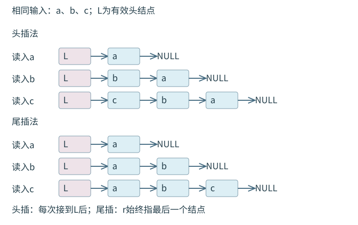

<a id="DS02-double-code"></a>
## 双链表的局部操作与循环边界

> **辨析 · 循环终止条件**
>
> 普通单链表等待NULL，循环表等待回到头结点。带头循环表空时头结点的next指向自身。

双链结点同时保存前驱和后继。以下p有有效后继时采用统一接入；非循环链尾的后继为空，需对后继的prior赋值另作检查。

```cpp
typedef struct DNode {
    ElemType data;
    struct DNode *prior, *next;
} DNode, *DLinklist;
bool InsertNextDNode(DNode *p, DNode *s) {
    if (p == NULL || s == NULL) return false;
    s->next = p->next;
    if (p->next != NULL) p->next->prior = s;
    s->prior = p;
    p->next = s;
    return true;
}
bool DeleteNextDNode(DNode *p) {
    if (p == NULL || p->next == NULL) return false;
    DNode *q = p->next;
    p->next = q->next;
    if (q->next != NULL) q->next->prior = p;
    free(q);
    return true;
}
```

带头循环双链表空时`L->next==L`且`L->prior==L`；数据结点的前后方向均可遍历，但遇头结点时要停止，不能把头结点当作普通数据删除。循环单链表查尾条件是`p->next==L`，与普通单链表的`p->next==NULL`不同。只用头指针时找尾仍需遍历；保存尾指针后可通过`rear->next`找到头部。

<a id="ds02-fig-cycles"></a>
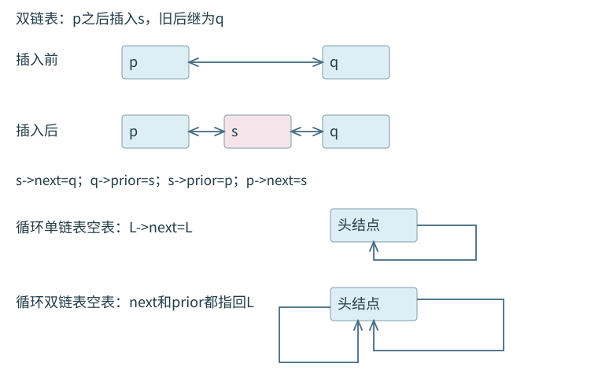

静态链表以数组下标充当游标。例如`struct { ElemType data; int next; } SLinkList[MaxSize];`中，next记录的是下一个结点占用的数组位置，并非机器地址。还需要管理空闲位置；课件的一种具体表示令0号结点为头结点，next=-1表示链尾，next=-2表示该数组位置空闲：初始化令a[0].next=-1，其余位置next=-2；插入先找空位再接游标，删除先接回前驱游标，再将被删位置标为空闲。结束和空闲是两个不同状态。静态链表仍按链接顺序定位，不因结点集中在数组就获得按逻辑位序随机访问。

课件的静态链表把同一个逻辑序列e1、e2、e3、e4分散在下列数组位置：

| 数组下标 | data | next |
| --- | --- | --- |
| 0 | 头结点 | 2 |
| 1 | e2 | 6 |
| 2 | e1 | 1 |
| 3 | e4 | −1 |
| 4、5 | 空闲 | −2 |
| 6 | e3 | 3 |
| 7、8、9 | 空闲 | −2 |

遍历游标顺序为0→2→1→6→3→−1。若每结点数据域4B、游标4B，数组首地址为addr，则e1位于addr+2×8；它是逻辑第1个元素，物理上却占数组第2号结点。


<a id="DS02-compare"></a>
## 结构选择与操作代价对照

> **课程连接 · 表示影响访问局部性**
>
> 连续数组通常能利用缓存中的相邻数据，分散结点可能增加缓存未命中。渐近复杂度相同也不保证实际用时相同；比较表示时同时检查数据规模、访问方式和存储开销。


| 操作条件 | 顺序表 | 单链表（有效头结点） | 选择时还需检查 |
| --- | --- | --- | --- |
| 按位序取值 | $O(1)$ | $O(n)$ | 是否要求随机访问 |
| 无序按值查找 | $O(n)$ | $O(n)$ | 值是否有序、是否另有索引 |
| 按位序插入/删除 | 最坏$O(n)$ | 定位最坏$O(n)$ | 是否已给有效前驱 |
| 已知前驱后的局部修改 | 仍可能搬移后缀 | $O(1)$ | 申请/释放与结点身份 |
| 存储开销 | 连续容量可能有空闲 | 每结点含链接域 | 局部性、碎片和最大规模 |


顺序表逻辑相邻通常也物理相邻，有利于连续访问；链表用额外链接换取接入灵活性，不能由此得出“链表一定更省空间”。静态链表虽然使用数组分配结点，逻辑后继仍由游标指定，所以不具备按逻辑位序直接寻址的能力。

<a id="DS02-filter"></a>
## 连续删除与有序去重的线性写法

> **不变量 · 删后检查新后继**
>
> 若当前前驱后连续两个结点都等于x，删掉第一个后马上前进，就可能跳过第二个。前驱只在保留结点时前进，才能让每个新后继都得到检查。

**方法 · 删除后留在前驱，保留后才前进**

删除单链表所有值为x的结点时，用p指向已处理部分的最后一个保留结点。若p后继应删除，就摘除后继续检查p的新后继；否则p向前走。相邻多个x正是不能在每次删除后都移动p的原因。


```cpp
void eraseAll(LNode* L, int x) {
    LNode* p = L;
    while (p->next != NULL) {
        if (p->next->data == x) {
            LNode* q = p->next;
            p->next = q->next;
            free(q);
        } else {
            p = p->next;
        }
    }
}
```

顺序表有序去重可让读指针从左到右扫描，写指针只扩展“已保留的互异前缀”。若当前值不同于最后一个保留值才写入；每个元素只处理常数次，总时间$O(n)$，额外空间$O(1)$。未排序数组中，相邻不重复不能保证全局不重复，不能悄悄去掉有序条件。

<a id="DS02-check"></a>
## 主动回忆自测

> **自查提示 · 区分定位与修改**
>
> 已知结点时的局部操作与从头查找位置的总代价应分别计算。

以下为原创补充，检查边界和不变式。

1. 允许修改单链表，要求删除所有值为 $x$ 的结点。删除一个结点后，指向前驱的指针是否应立即后移？
2. 两个无环单链表长度相同，尾结点地址相同，能否断定它们一定有公共后缀？
3. 顺序表去除相邻重复元素时，为什么可用“已保留长度”作为写指针，而不必每删一个元素都搬移后半表？

**答案。** 1. 不应立即后移；新的后继还可能等于 $x$，应继续检查当前前驱的后继。只有保留一个结点时前驱才推进。2. 能；至少尾结点本身就是公共后缀，公共起点还可能更早。3. 扫描指针只读未处理区，写指针只向前形成已保留区；每个元素最多被检查和写入常数次，总时间 $O(n)$。若原表无序，这只能消除相邻重复，不能保证全表唯一。


<a id="DS02-recall-extra"></a>
### 补充自拟回忆题

**主动回忆 · 从边界恢复算法**

4. 长度n的顺序表允许在哪些位序插入，在哪些位序删除？各自等概率模型的分母是什么？
5. 有效头结点、头指针、首元结点如何区分？带头结点空表中哪一个为空？
6. 只给单链表尾结点指针，能否总在O(1)时间内删除该结点并保留其他结点身份？
7. 主元素候选的计数归零意味着此前完全没有主元素吗？为什么最后还要核计数？
8. 两个内容相同却分别分配的单链表，公共后缀算法返回什么？适用前提是什么？


**解答 · 补充题核对答案**

4. 插入位序1到n+1，删除1到n；平均插入移动数除以n+1，平均删除移动数除以n。
5. 头指针是地址变量，头结点是哨兵对象，首元结点是第一个有效元素。有效头结点存在时，空表是L->next为空。
6. 不能。单链表尾结点无后继可复制，且没有直接前驱链接，通常要从头找前驱。
7. 不意味着不存在严格多数；抵消保证“若存在，最后候选是它”，不能反推候选一定占多数，必须再次扫描。
8. 返回NULL。地址相等才表示共享，前提是有限无环单链表且头结点和链接有效。


<a id="DS03"></a>
# 栈、队列和数组：状态约束与压缩存储

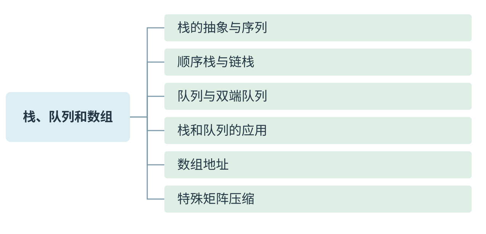

[可编辑SVG](../chapters/DS03/figures/overview.svg) · [完整知识导图](../chapters/DS03/chapter-map.pdf)

栈与队列都保存线性序列，差别在于允许从哪一端加入和取出。判断一个操作序列是否合法，必须保留操作过程中的状态；只检查输入、输出是否含有相同元素，不能排除违反栈顶或队头约束的情况。

<a id="DS03-01"></a>
## 栈的后进先出与合法序列

> **最小反例 · 数量相同仍不合法**
>
> 顺序输入a、b、c，要先输出c就必须把三者全部入栈；弹出c后栈顶为b，接着要求a便失败。输出c、a、b与输入含相同元素，却违反栈顶约束。
>
> 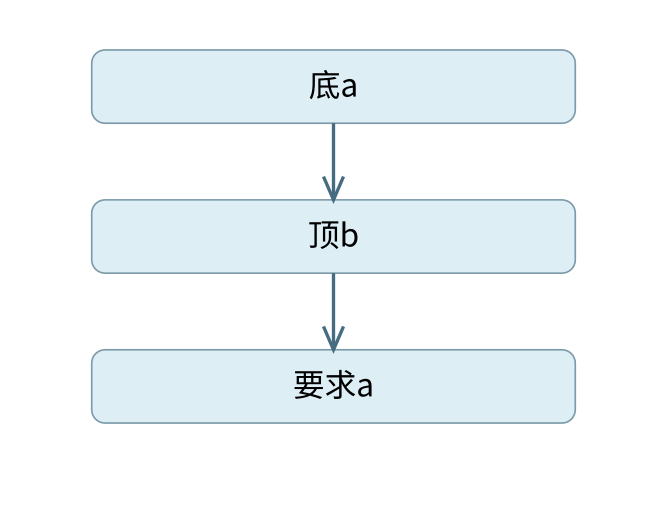
>
> c已弹出，b挡在a上方

**栈**只允许在同一端插入和删除，这一端称为栈顶，另一端称为栈底。入栈称 `push`，出栈称 `pop`。栈为空时不能出栈；固定容量栈满时不能继续入栈。若中途不出栈，一批元素的出栈次序是入栈次序的逆序；若允许交替入栈和出栈，输出就可能有多种。

检验给定输出的方法是按目标逐个模拟：若当前栈顶不是所需元素，继续把尚未入栈的元素依次压入；一旦所需元素到顶，就弹出。若输入已用尽而栈顶仍不符，输出不合法。这个过程也给出实现该输出所需的最小容量，即模拟中出现的最大栈深。

<a id="DS03-ex1"></a>
### 例 3-1　队列不会改变栈的输出次序

**例题 · 配套例题**

配套例题：栈 $S$ 和队列 $Q$ 初始均为空，元素 `a,b,c,d,e,f,g` 依次入栈 $S$。每个元素出栈后立即进入队列 $Q$，7个元素出队顺序为 `b,d,c,f,e,a,g`，则栈容量至少是（　）。

A. 1　B. 2　C. 3　D. 4


**解析。** 队列保持进入它的先后次序，因此它的输出就是栈的输出。按目标模拟，栈内状态按栈底到栈顶写：

| 需要输出 | 必须先执行的入栈 | 弹出后栈内剩余 |
| --- | --- | --- |
| b | a、b | a |
| d | c、d | a、c |
| c | 无 | a |
| f | e、f | a、e |
| e | 无 | a |
| a | 无 | 空 |
| g | g | 空 |

压入 d 或 f 后，栈深达到3；表中过程也说明3个单元足够，答案为 **C**。不能把队列当作另一处可以随意调整次序的缓冲区。

若只用入栈 `I`、出栈 `O` 表示操作，一段从空栈出发并回到空栈的合法序列须满足：两类操作的总数相等，且每个前缀中 `O` 的个数不超过 `I`。对 $n$ 个不同元素，合法出栈序列数为卡特兰数 $C_n=\frac1{n+1}\binom{2n}{n}$；这一公式用于计数，不代替具体容量与给定序列的模拟。

输入为 `a,b,c,d` 时，若输出以 `c,d` 开头，弹出 c 后栈中为 a、b，随后必须压入并弹出 d，剩余只能 b、a，因此仅有 `c,d,b,a` 一种。若题目指定的是栈的输出而让输入未知，也要反推中间栈顶。例如第3个输入是1，输出从1递增，1弹出时第2个输入压在第1个输入上方；若第1个是2，就要先弹出上面的另一个值才能到2，与“接下来输出2”矛盾，所以第1个不可能是2。

<a id="DS03-02"></a>
## 队列与双端队列

**队列**只在队尾加入、在队头删除，遵循先进先出。它适合保存等待依次处理的对象，如按发现顺序等待扩展的图顶点。队头与队尾是逻辑角色，不能凭数组下标的大小判断先后：循环队列绕回后，队尾下标可以小于队头下标。

**双端队列**允许在两端插入和删除。输入受限双端队列只允许一端输入，两端均可输出；输出受限双端队列允许两端输入，只允许一端输出。判断输出时应明确属于哪一种，不能直接套普通队列或普通栈的限制。双端队列能够模拟栈与队列，但这不表示它能按任意次序输出一组顺序输入的元素。

以1、2、3、4依次输入为例，普通栈有14种合法输出。输入受限双端队列有22种，不能输出`4,2,1,3`和`4,2,3,1`：先输出4意味着1、2、3已按次序留在队列中，2在中间，下一次无法取出。输出受限双端队列也有22种，不能输出`4,1,3,2`和`4,2,3,1`：4第一次输出前，前三个元素只能通过两端依次接入，其剩余次序只能为123、213、312或321，不能为132或231。两种受限队列的非法序列集合并不相同。


<a id="DS03-03"></a>
## 顺序栈、共享栈与循环队列

> **错项排除 · 共享栈只在相邻时满**
>
> 两栈从数组两端向中间增长，未用单元恰位于两栈顶之间。两栈顶相邻已经没有空位；等到相等才判满，就已让两个栈占用同一个位置。

顺序栈存于 `A[0..M-1]`。本章令 `top` 指向当前栈顶，初值 −1：空条件 `top==-1`，满条件 `top==M-1`；入栈为 `A[++top]=x`，出栈为 `x=A[top--]`。若题目改用“`top` 指向下一个空位”，空条件就为0，入栈与出栈的增减位置也随之改变。先画一个元素的状态，再写公式，通常比背四个表达式可靠。

两个栈共享一个数组时，可让一端从左向右长、另一端从右向左长。初值 `top1=-1, top2=M`，栈满当且仅当 `top2-top1==1`。未用空间是两栈顶之间的单元，某个栈已用多少并不单独决定全局是否栈满。入栈前必须先检查两栈顶是否相邻，不能等两个栈顶已经重合才报告满。

<a id="DS03-detail1"></a>
### 循环队列先立约定再计算

> **辨析 · 循环队列先定约定**
>
> 牺牲一个单元时，空为front=rear，满为(rear+1)%MaxSize=front；其他设计的条件需另算。

采用长度为 $M$ 的数组，令 `front` 指向队头元素，`rear` 指向下一次入队位置。出队后 `front=(front+1)%M`，入队后 `rear=(rear+1)%M`。若只有这两个下标，空与完全占满都会出现 `front==rear`，无法区分。

**牺牲一个单元**时，约定空条件为 `front==rear`，满条件为 `(rear+1)%M==front`，可保存的最大元素数是 $M-1$。当前长度为

$$\mathrm{len}=(rear-front+M)\bmod M.$$

<a id="ds-fig-circular"></a>
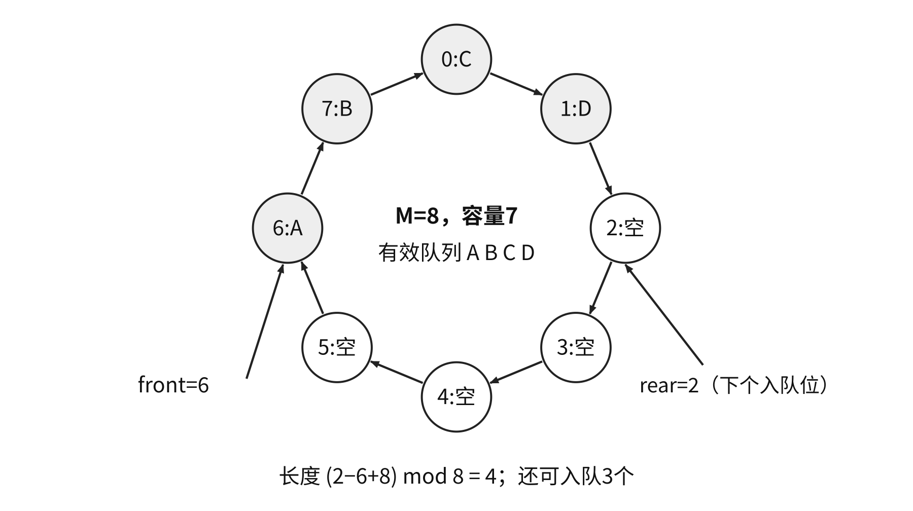

若要求 $M$ 个单元全部可用，可以增加 `size` 计数，或增加标志，区分最近一次使二者相等的是入队还是出队。此时“空”和“满”的判断依赖新增成员，不能仍照搬牺牲单元的满条件。

<a id="DS03-ex2"></a>
### 例 3-2　换了 front 含义，长度公式是否改变

**例题 · 配套例题**

〖3.2-006〗 循环队列存于数组 `A[21]`，`front` 指向队首元素的前一个位置，`rear` 指向队尾元素。当前 `front=8, rear=3`，队列长度为（　）。

A. 5　B. 6　C. 16　D. 17


**解析。** 有效元素从下标9开始，经过9至20，再经过0至3，共 $12+4=16$ 个，答案为 **C**。公式仍可写成 $(3-8+21)\bmod21=16$，是因为与前一约定相比，两个指针的含义都错开了一个位置。若只改变一个指针的含义，公式就未必不变。数组是 `A[0..n]` 时实际有 $n+1$ 个单元，取模也必须使用 $n+1$。

另一种常见表示令front仍指队头，而rear指当前队尾。可令初始front=0、rear=M−1；入队先推进rear再写入，出队先读取front再推进。牺牲一个单元时，空条件是`(rear+1)%M==front`，满条件是`(rear+2)%M==front`，长度为`(rear-front+1+M)%M`。例如M=5、front=0、rear=3时有4个元素，已经满；front=0、rear=4则为空。它与本章正式SqQueue接口是不同表示，应连同初始化、动作次序和判空判满一起使用。


<a id="DS03-04"></a>
## 链栈与链队列

> **不变量 · 尾指针不能悬空**
>
> 带头结点链队列始终让rear指向最后一个数据结点，空时指向头结点。删去唯一数据结点后，rear必须回到front；否则下次入队会经已释放地址写内存。

链栈通常把链头作为栈顶，头插与头删都是 $O(1)$。动态分配可随数据量申请结点，因而通常不受预先给定的小容量数组限制；但入栈仍可能因可用内存不足而失败，出栈时也仍可能遇到空栈。

单链队列把链头作为队头，链尾作为队尾，并保存两个指针。若反过来从单链表尾部删除，必须找到尾结点的前驱，出队会变为 $O(n)$。带头结点的链队列空时 `front==rear`，二者都指向头结点。入队时接到 `rear->next` 并更新 `rear`；出队时删除 `front->next`。

```text
dequeue(Q):
    if Q.front==Q.rear: return 失败
    p=Q.front->next
    x=p->data
    Q.front->next=p->next
    if Q.rear==p: Q.rear=Q.front
    释放 p
    return x
```

最后一个数据结点出队时，必须让尾指针退回头结点；否则它指向已释放的空间。非空且不止一个元素时，无需改变尾指针，所以对“删除是否修改头尾指针”这类问题，答案取决于被删除的是否为最后一个元素。

只带队首指针的非循环双链表，要在另一端入队仍需找尾部；循环双链表则可通过 `front->prior` 直接取得尾部。比较结构时，应检查有没有可到达另一端的短链接，而不是看到“双链”就认定所有操作都为常数时间。

<a id="DS03-05"></a>
## 多维数组的地址怎样计算

数组同一维度的下标取值范围固定，每个元素大小相同。设二维数组的行下标为 $l_1\sim u_1$，列下标为 $l_2\sim u_2$，列数 $c=u_2-l_2+1$，行数 $r=u_1-l_1+1$，每元素占 $w$ 字节，首元素地址为 $b$。

按行优先时，在 $(i,j)$ 前有 $i-l_1$ 个完整行及本行的 $j-l_2$ 个元素，故

$$\operatorname{Addr}(A[i,j])=b+[(i-l_1)c+(j-l_2)]w.$$

按列优先时，先数完整列：

$$\operatorname{Addr}(A[i,j])=b+[(j-l_2)r+(i-l_1)]w.$$

例如 `A[2..4][−1..2]` 按行优先存放，每元素4字节，`A[2][−1]` 的地址为1000。`A[4][1]` 前有 $2\times4+2=10$ 个元素，字节地址为1040。下标差先得到“元素数”，最后乘元素宽度才得到字节偏移；按字编址的题则要统一成字地址再计算。

三维数组按行优先时，最右下标变化最快：`A[i][j][k]` 的相对元素位置为 $((i-l_1)n_2+(j-l_2))n_3+(k-l_3)$。可以逐维理解，不必另背一个没有下标原点的公式。

<a id="DS03-06"></a>
## 对称、三角、三对角与稀疏矩阵

压缩存储利用元素间的确定关系，避免重复保存。**对称矩阵**满足 $a_{ij}=a_{ji}$，保存一侧三角即可；访问另一侧时交换 $i,j$。**三角矩阵**的三角区之外，元素全部相同，通常还要额外保存这个公共常量，它未必为0。**三对角矩阵**只在主对角线及相邻两条对角线上可能非零，共有 $3n-2$ 个需要保存的位置。

下三角按行保存、原矩阵与数组下标均从0开始时，位置 $(i,j)$（$i\ge j$）之前有 $1+2+\cdots+i=i(i+1)/2$ 个元素，故数组下标为 $i(i+1)/2+j$。若原矩阵从1开始而数组从0开始，公式相应变成 $i(i-1)/2+j-1$。推导的顺序始终是“前面完整行或列数＋本行或列内偏移”。

<a id="DS03-ex3"></a>
### 例 3-3　三对角矩阵的起止行不能一律算3个

> **错项排除 · 三对角首尾行少一个**
>
> n至少为2时，首行和末行各只保存2个位置，中间行才各3个。若把第i行之前全部按3个计，会从第一行就多算；先列2+3(i−2)再加本行偏移。

**例题 · 配套例题**

配套例题：100阶三对角矩阵 $M$ 的元素 $m_{i,j}\ (1\le i,j\le100)$ 按行优先依次压缩存入下标从0开始的一维数组 $N$。$m_{30,30}$ 在 $N$ 中的下标为（　）。

A. 86　B. 87　C. 88　D. 89


**解析。** 第一行有2个元素，第2至29行各有3个，共 $2+28\times3=86$ 个在第30行之前。第30行依次保存 $m_{30,29},m_{30,30},m_{30,31}$，目标是本行第2个，因此下标为 $86+1=87$，答案为 **B**。这里87是从0开始的下标，目标是第88个被保存的元素。

<a id="DS03-ex4"></a>
### 例 3-4　先用对称性换到实际保存的半边

**例题 · 配套例题**

配套例题：10×10对称矩阵 $M$ 的上三角元素 $m_{i,j}\ (1\le i\le j\le10)$ 按列优先存入 C 语言一维数组 $N$。$m_{7,2}$ 在 $N$ 中的下标为（　）。

A. 15　B. 16　C. 22　D. 23


**解析。** $m_{7,2}=m_{2,7}$，实际寻找第7列第2行。前6列各存 $1,2,\ldots,6$ 个，共21个；本列目标前还有第1行1个元素，所以从0开始的下标为 $21+1=22$，答案为 **C**。不能先把下三角坐标直接代入上三角公式，再试图以加减1修正。

上三角若改为按行优先，各行长度为 $n,n-1,\ldots,1$；第 $i$ 行之前有 $(i-1)(2n-i+2)/2$ 个保存位置。下三角若按列优先，各列长度同样递减，但列内偏移为 $i-j$。公式外形相近，决定它的是保存方向与下标原点。

**稀疏矩阵**的非零位置没有固定三角规律，需要连同位置一起保存。三元组顺序表记录 `(行,列,值)`，还须保存矩阵行列数与非零元数；十字链表为同一个非零元同时设置行链接和列链接。压缩后不能再按普通二维数组地址公式随机访问任意元素，查找与修改成本随表示方法而变。

<a id="DS03-07"></a>
## 表达式、递归与层次处理

> **最小反例 · 括号计数看不到嵌套**
>
> ([)]中每一类左右括号数都相等，但第三个字符要求圆括号配对，栈顶却是方括号。配对必须遵守最近未完成对象先结束，不能在扫描后任意重排。

<a id="DS03-detail2"></a>
### 括号与表达式中的“最近一个尚未完成对象”

左括号入栈；遇右括号时，栈顶必须是对应种类的左括号，匹配后弹出；扫描完后栈必须为空。`([)]` 中括号数量相等，但遇到第一个右圆括号时栈顶为左方括号，已经失败。这个过程正好需要最后遇到且尚未配对的对象，所以选择栈。

后缀表达式中，操作数先入栈，遇二元运算符时先弹出的数是**右操作数**，后弹出的是左操作数，计算后将结果入栈。减法、除法不能颠倒。合法的二元后缀表达式在遇到每个运算符时，栈中至少有两个可用值，最终恰好留下一个结果。

<a id="DS03-ex5"></a>
### 例 3-5　弹出次序怎样影响减法

**例题 · 配套例题**

配套例题：栈 $S_1$ 保存整数，$S_2$ 保存运算符。函数 F() 依次：（1）从 $S_1$ 弹出操作数 a、b；（2）从 $S_2$ 弹出运算符 op；（3）执行 b op a；（4）把结果压入 $S_1$。初始 $S_1$ 自底向顶为5、8、3、2，$S_2$ 自底向顶为 `*`、`−`、`+`。调用3次 F() 后，$S_1$ 栈顶值是（　）。

A. −15　B. 15　C. −20　D. 20


**解析。** 第一次弹出2、3，用加法得到 $3+2=5$，整数栈变为5、8、5。第二次弹出5、8，用减法得到 $8-5=3$，栈变为5、3。第三次得到 $5\times3=15$，答案为 **B**。若第二次按弹出先后计算 $5-8$，就会得到错误的负数。

中缀转后缀可用运算符栈：操作数直接输出；左括号入栈；右括号触发输出直到匹配左括号；遇运算符时，先输出栈顶中优先级更高的运算符。对通常左结合的 `+、−、*、/`，同级也先弹出；若加入右结合运算符，同优先级的处理规则需要调整。

例如 $x+y(z-u)/v$（其中相邻表示乘法）先把括号内写成 `zu−`，乘除按左结合形成 `yzu−*v/`，最后与 x 相加，得 `xyzu−*v/+`。这里的输出顺序表达运算依赖，而不是把原式的符号按种类重新排列。

<a id="DS03-detail3"></a>
### 递归返回前保存了什么

递归调用栈保存尚未完成的调用。调用树的一个结点表示一次调用，不能把函数返回值当作调用次数。对于

```c
int F(int n) {
    if (n<=3) return 1;
    return F(n-2)+F(n-4)+1;
}
```

令 $C(n)$ 表示含当前调用在内的调用次数，则 $n\le3$ 时 $C(n)=1$，否则 $C(n)=1+C(n-2)+C(n-4)$。因此 $C(4)=C(2)+C(0)+1=3$，$C(6)=1+3+1=5$，$C(8)=1+5+3=9$。式中返回值的“＋1”不是另一次函数调用；次数递推中的“＋1”是当前调用本身。此过程对应〖3.3-006〗的递归调用模型。

C/C++ 对加号两侧函数调用的求值先后并不一概保证从左到右。若题目问“第几个被调用”，应检查答案是否依赖这个先后，不能把一种习惯顺序当作语言保证。调用总数与最终结果在本例不受这个先后影响。另如〖3.3-007〗把递归式改为 `func(x-2)+func(x-4)`、基例返回2，并计算 `func(func(5))`：必须先完成内层func(5)，它和func(3)、func(1)共3次调用，结果为4，所以第4次是外层func(4)；内层两个基例谁先执行不影响这个结论。

层次处理需要先进先出的队列：先发现的一层结点必须先扩展，后发现的下一层排在后面。第5章层序遍历与第6章 BFS 都用这条约束，但图还需 `visited` 防止同一顶点反复入队。

<a id="DS03-recursion-model"></a>
### 阶乘、Fibonacci与重复子问题

> **辨析 · 调用次数与同时深度**
>
> Fibonacci调用树的结点总数反映总调用次数；栈空间取同时尚未返回的调用链长度。

下面两段保留课件的递归定义。输入n为非负整数，计算结果须在int可表示范围内。

```c
int factorial(int n) {
    if (n == 0 || n == 1) return 1;
    else return n * factorial(n - 1);
}
int Fib(int n) {
    if (n == 0) return 0;
    else if (n == 1) return 1;
    else return Fib(n - 1) + Fib(n - 2);
}
```

factorial(10)沿10、9、…、1依次深入，最多同时保留10层调用，随后按相反次序返回并完成乘法。Fib(4)的调用树有9个结点，返回值为3，最长未返回调用链却只有4层；Fib(2)重复出现两次。朴素Fib递归的时间满足$T(n)=T(n-1)+T(n-2)+O(1)$，呈指数增长，递归工作栈为$O(n)$。每层传递两个递归分支，不意味着空间也按整棵调用树相加；一个分支返回后，其空间可供另一个使用。保存已算子问题或改用迭代可减少重复计算，改变算法后须重新分析代价。

<a id="ds03-fig-fib"></a>
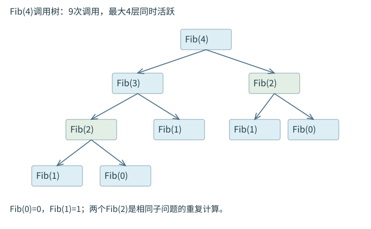

<a id="DS03-code"></a>
## 栈与队列的教材接口

> **不变量 · top含义决定增减位置**
>
> top指栈顶时，空状态为−1，入栈先加再写；top指下一空位时，空状态为0，入栈先写再加。用空栈和单元素两幅状态检查，比只背push语句更能应对改约定题。

**定义 · 先约定指针指向什么，再写边界**

顺序栈中的top可以指栈顶元素，也可以指下一空位；循环队列中的front/rear也有不同语义。表示约定决定空满条件、增减时机和长度公式。同一个变量名并不保证同一种表示，改题时先画空状态和单元素状态。


下面采用教材的`SqStack`，`top`指当前栈顶；下标从0开始，空栈`top=-1`。`ElemType`按具体应用定义为元素类型，下面可取整型。

```cpp
#define MaxSize 100
typedef int ElemType;
typedef struct {
    ElemType data[MaxSize];
    int top;
} SqStack;
void InitStack(SqStack &S) { S.top = -1; }
bool StackEmpty(SqStack S) { return S.top == -1; }
bool Push(SqStack &S, ElemType x) {
    if (S.top == MaxSize - 1) return false;
    S.data[++S.top] = x;
    return true;
}
bool Pop(SqStack &S, ElemType &x) {
    if (S.top == -1) return false;
    x = S.data[S.top--];
    return true;
}
bool GetTop(SqStack S, ElemType &x) {
    if (S.top == -1) return false;
    x = S.data[S.top];
    return true;
}
```

读栈顶不改变top，出栈才将top减1。若栈顶指向下一空位，压入顺序应为`data[top++]=x`，弹出则为`x=data[--top]`；这是一套独立表示，不能只改初始化而保留其余操作。

循环队列使用教材的`SqQueue`，front指队头元素、rear指下一入队位置，牺牲一个单元。

```cpp
typedef struct {
    ElemType data[MaxSize];
    int front, rear;
} SqQueue;
void InitQueue(SqQueue &Q) { Q.front = Q.rear = 0; }
bool QueueEmpty(SqQueue Q) { return Q.front == Q.rear; }
bool EnQueue(SqQueue &Q, ElemType x) {
    if ((Q.rear + 1) % MaxSize == Q.front) return false;
    Q.data[Q.rear] = x;
    Q.rear = (Q.rear + 1) % MaxSize;
    return true;
}
bool DeQueue(SqQueue &Q, ElemType &x) {
    if (Q.front == Q.rear) return false;
    x = Q.data[Q.front];
    Q.front = (Q.front + 1) % MaxSize;
    return true;
}
bool GetHead(SqQueue Q, ElemType &x) {
    if (Q.front == Q.rear) return false;
    x = Q.data[Q.front];
    return true;
}
```

入队先写rear位置再推进rear，出队先取front位置再推进front。空满检查均在修改之前进行，失败操作保持原状态，输出参数也不赋新值。读队头只读取，不出队。

**推导 · 环形长度公式来自有向距离**

从front沿数组下标递增方向走到rear，步数就是有效元素数。未绕回时为rear−front，绕回时为M−front+rear，合并为$(rear-front+M)\bmod M$。牺牲一个单元将步数限制在0至M−1，从而只让0表示空；若允许M个元素，模运算会把长度M也变成0，必须增加size或标志保存这一个区别。


| 环形队列策略 | 空条件 | 满条件 | 可用容量 |
| --- | --- | --- | --- |
| 牺牲一个单元 | front=rear | (rear+1) mod M=front | M−1 |
| 增加size计数 | size=0 | size=M | M |
| 增加最近操作tag | front=rear且tag为出队 | front=rear且tag为入队 | M |


tag方案初始设为“出队”态，初始化即表示空；成功入队/出队后更新tag。计数方案每次成功修改长度，失败操作不能改size。链队列没有预设数组容量，但申请新结点仍可能失败，不能将“不判数组满”理解为内存无限。

<a id="DS03-matrix-method"></a>
## 矩阵压缩：由坐标到下标，再从下标恢复坐标

> **不变量 · 先换到已保存半边**
>
> 对称矩阵访问未存的半边时，先交换i、j，再按保存方向计数。坐标转换解决的是表示对应；数组从0还是1起始解决的是编号，两步不能互相替代。

**方法 · 完整行数加行内偏移**

每次先写清：矩阵坐标从0还是1开始、压缩数组从0还是1开始、上/下三角、行/列优先。若是对称矩阵，先把目标换到实际保存的半边。最后数前面完整行或列，再加本行/列内偏移；不要用最后加减1修补错误的保存方向。


对于坐标从0开始、按行保存下三角的矩阵，令$T_i=i(i+1)/2$，则$k=T_i+j$。反向给定有效数组下标k时，先找到唯一满足$T_i\le k<T_{i+1}$的i，再令$j=k-T_i$。数学上

$$i=\left\lfloor\frac{\sqrt{8k+1}-1}{2}\right\rfloor,\qquad j=k-\frac{i(i+1)}2.$$

例如k=8，因$T_3=6\le8<T_4=10$，得$i=3,j=2$。实现时若用浮点平方根，应以整数三角数边界复核，防止舍入把边界分到相邻行。

坐标从1开始、压缩数组从0开始时，上三角行优先下标为

$$k=\frac{(i-1)(2n-i+2)}2+(j-i),\quad1\le i\le j\le n.$$

下三角列优先则为

$$k=\frac{(j-1)(2n-j+2)}2+(i-j),\quad1\le j\le i\le n.$$

三角矩阵的公共常量区可另存一个值，所需空间为$n(n+1)/2+1$；对称矩阵只保存一侧即可，不需要这个公共常量单元。三对角矩阵$n\ge2$时按行存3n−2个有效位置，坐标从1、数组从0的统一公式为$k=2i+j-3$，前提是$|i-j|\le1$且坐标不越界。n=1时只有一个元素，应按单元素矩阵处理，不再套首尾行各2个的解释。

稀疏矩阵中零元位置不具有固定三角规律。三元组的“下标”表示第几个非零记录，不能直接由坐标用普通二维地址公式得到；修改原来的零元为非零元时，可能需要插入记录并调整次序或链接。

<a id="DS03-app-method"></a>
## 典型应用的失败条件

> **错项排除 · FIFO只是具体策略**
>
> 队列ADT规定先进先出，操作系统的“就绪队列”名称却不保证所有调度算法都按FIFO选择。先来先服务可借FIFO说明，优先级等策略需要额外排序或选择规则。

中缀表达式将运算符写在左右操作数之间；前缀写在两者之前，后缀写在两者之后。前缀求值从右向左扫描，遇运算符先弹出的值是左操作数、后弹出的值是右操作数；后缀从左向右扫描则先弹出右操作数。方向与角色要一起记。

例如$x+y(z-u)/v$按通常左结合规则，前缀为`+ x / * y - z u v`，后缀为`x y z u - * v / +`。两种形式都用位置表达运算依赖而省去括号；不是简单地把所有运算符搬到字符串开头或末尾。

**方法 · 按尚未完成对象的次序选结构**

最近进入且尚未结束的对象要先处理，用栈：括号配对、函数调用、表达式中等待右操作数的运算。最早进入且尚未服务的对象先处理，用队列：层序遍历、BFS、先来先服务。操作系统的就绪队列只是管理等待对象，实际调度策略未必总是FIFO。


后缀表达式求值必须同时检查：遇二元运算符时至少有两个操作数、除数合法、扫描末尾恰好留下一个结果。仅仅“最终留下一个数”不足以排除中途栈下溢。例如`1 + 2`按后缀语法扫描，在加号处就没有两个数；`1 2 3 +`则扫描后还剩两个值。

**例题 · 自拟：括号数量正确仍可失败**

输入`([)]`中左右圆括号和左右方括号数量分别相等。用栈检查时，在哪一个字符首次失败？


前两个字符依次入栈，栈顶为`[`；读到第三个字符`)`时，它要求栈顶为`(`，因此立即失败。只统计每类括号数量看不到嵌套关系，错误发生在第三个字符，不能等扫描完再随意重新配对。

<a id="DS03-linked-code"></a>
## 链栈、链队列与共享栈的实现边界

> **辨析 · 栈顶选在链头**
>
> 单链表头插头删只改常数条链接。若从单链表尾部弹出，还要先寻找前驱，代价会增加。

链栈通常不带头结点，Ltop指向当前栈顶，空栈为NULL。以下采用教材的链栈结点定义，申请与释放使用malloc/free。

```cpp
typedef struct Linknode {
    ElemType data;
    struct Linknode *next;
} *LiStack;
bool Push(LiStack &S, ElemType x) {
    LiStack p = (LiStack)malloc(sizeof(struct Linknode));
    if (p == NULL) return false;
    p->data = x;
    p->next = S;
    S = p;
    return true;
}
bool Pop(LiStack &S, ElemType &x) {
    if (S == NULL) return false;
    LiStack p = S;
    x = p->data;
    S = p->next;
    free(p);
    return true;
}
```

链栈从链头入栈、出栈，均为$O(1)$；若改在普通单链表尾部出栈，定位尾结点前驱会变为线性时间。初始化令S为空即可；销毁时重复弹出或逐结点释放。

<a id="DS03-linkqueue-code"></a>
### 带头结点链队列

> **辨析 · 最后一删要回尾**
>
> 删除唯一数据结点后，rear必须退回front；二者共同指向仍然有效的头结点。

头结点使空队列和一般出队的前驱统一。front始终指头结点，rear指最后一个结点；空时二者指向同一个头结点。

```cpp
typedef struct LinkNode {
    ElemType data;
    struct LinkNode *next;
} LinkNode;
typedef struct {
    LinkNode *front, *rear;
} LinkQueue;
void InitQueue(LinkQueue &Q) {
    Q.front = Q.rear = (LinkNode *)malloc(sizeof(LinkNode));
    Q.front->next = NULL;
}
bool IsEmpty(LinkQueue Q) { return Q.front == Q.rear; }
void EnQueue(LinkQueue &Q, ElemType x) {
    LinkNode *s = (LinkNode *)malloc(sizeof(LinkNode));
    s->data = x;
    s->next = NULL;
    Q.rear->next = s;
    Q.rear = s;
}
bool DeQueue(LinkQueue &Q, ElemType &x) {
    if (Q.front == Q.rear) return false;
    LinkNode *p = Q.front->next;
    x = p->data;
    Q.front->next = p->next;
    if (Q.rear == p) Q.rear = Q.front;
    free(p);
    return true;
}
```

初始化和入队保留王道课件的void接口，以内存申请成功为前提。实际程序须检查malloc结果，并在申请失败时保持原队列。最后一个数据结点出队后，必须把rear退回front；随后再次入队才有有效尾指针。销毁链队列还需释放头结点。

<a id="ds03-fig-linkqueue"></a>
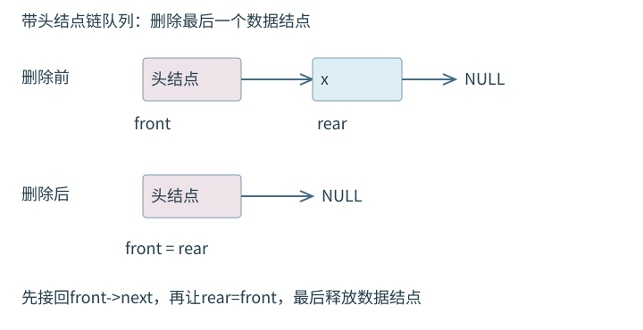

若采用不带头结点的版本，首次入队须同时建立front和rear，最后一次出队须同时置空二者。

以下是另一套独立实现，仍使用LinkQueue类型，但front指首个数据结点。不能与前面的带头结点接口混合调用。

```cpp
void InitQueue(LinkQueue &Q) {
    Q.front = Q.rear = NULL;
}
bool IsEmpty(LinkQueue Q) { return Q.front == NULL; }
void EnQueue(LinkQueue &Q, ElemType x) {
    LinkNode *s = (LinkNode *)malloc(sizeof(LinkNode));
    s->data = x;
    s->next = NULL;
    if (Q.front == NULL)
        Q.front = Q.rear = s;
    else {
        Q.rear->next = s;
        Q.rear = s;
    }
}
bool DeQueue(LinkQueue &Q, ElemType &x) {
    if (Q.front == NULL) return false;
    LinkNode *p = Q.front;
    x = p->data;
    Q.front = p->next;
    if (Q.rear == p) Q.rear = NULL;
    free(p);
    return true;
}
```


<a id="DS03-share-code"></a>
### 共享栈的容量如何协同

> **辨析 · 共享不改变次序**
>
> 共享栈只共享空闲容量，两栈仍各自后进先出。top1-top0=1表示中间已无空格。

```cpp
typedef struct {
    ElemType data[MaxSize];
    int top0, top1;
} ShStack;
void InitStack(ShStack &S) {
    S.top0 = -1;
    S.top1 = MaxSize;
}
```

教材`ShStack`的两端栈顶初值为`top0=-1,top1=MaxSize`，共享空闲区在两栈顶之间，满条件`top1-top0==1`。若入0号栈，先检查满，再令`data[++top0]=x`；入1号栈则令`data[--top1]=x`。出0号栈取`data[top0--]`，出1号栈取`data[top1++]`，各自先判空。

共享只提高同一块空间的利用率；两个栈仍各自满足后进先出。若一栈已占满全部单元，另一栈即使为空也不能继续入栈。

<a id="DS03-bracket-code"></a>
## 括号匹配的完整状态检查

用字符作为ElemType，复用顺序栈接口。新左括号意味着最近一个尚未完成对象；右括号必须关闭栈顶的同种左括号。

```cpp
bool bracketCheck(char str[], int length) {
    SqStack S;
    InitStack(S);
    for (int i = 0; i < length; ++i) {
        char c = str[i];
        if (c == '(' || c == '[' || c == '{') {
            if (!Push(S, c)) return false;
        } else if (c == ')' || c == ']' || c == '}') {
            ElemType x;
            if (!Pop(S, x)) return false;
            if ((c == ')' && x != '(') ||
                (c == ']' && x != '[') ||
                (c == '}' && x != '{')) return false;
        }
    }
    return StackEmpty(S);
}
```

遇右括号但栈为空，属于右括号过早；栈顶类型不符，属于交叉嵌套；扫描结束栈非空，属于左括号尚未关闭。每字符只处理常数次，时间$O(n)$，最坏保留n个左括号，辅助空间$O(n)$；定长栈实现还要求实际所需深度不超过容量。

<a id="DS03-expression-trace"></a>
## 按课件表达式保留完整转换过程

> **辨析 · 相同优先级看结合性**
>
> 乘除和加减通常左结合，中缀转后缀遇同级运算符时先弹栈顶。新运算符不能抢先。

中缀表达式`A+B-C*D/E+F`的运算次序为：先A+B，再C*D，再除以E，再从A+B减去该商，最后加F。按左结合规则得到后缀：

```text
A B + C D * E / - F +
```

| 当前符号 | 运算符栈（底到顶） | 已输出后缀 |
| --- | --- | --- |
| A | 空 | A |
| +、B | + | A B |
| − | − | A B + |
| C、*、D | −、* | A B + C D |
| / | −、/ | A B + C D * |
| E | −、/ | A B + C D * E |
| + | + | A B + C D * E / − |
| F、扫描结束 | 空 | A B + C D * E / − F + |

遇到`/`时先弹同级`*`，对应乘除左结合；遇到最后一个`+`时，先弹除号再弹减号。对于`A+B*(C-D)-E/F`，括号内的减法先完成，得到`A B C D - * + E F / -`。左括号只作为界限保存在栈中，不进入后缀输出。

课件的数值表达式

$$((15/(7-(1+1)))\times3)-(2+(1+1))$$

对应后缀为`15 7 1 1 + - / 3 * 2 1 1 + + -`。依次计算$1+1=2$、$7-2=5$、$15/5=3$、$3\times3=9$，右部分为$2+(1+1)=4$，结果为5。数字15是一个操作数，不能按字符1和5分开入栈。模拟可知操作数栈峰值为4个值，这和表达式的字符总数不同。

前缀形式用“运算符、左操作数、右操作数”表达同一依赖。从右向左求前缀值时，先弹出的数为左操作数；从左向右求后缀值时，先弹出的数为右操作数。把两种扫描方向混用，会在减除法中得到错误结果。

<a id="DS03-infix-eval"></a>
### 直接用两个栈计算中缀表达式

也可以将“中缀转后缀”与“后缀求值”融合：操作数立即压入操作数栈；运算符和括号按转换算法管理。每当转换规则本应输出一个运算符时，直接从操作数栈先弹右操作数、再弹左操作数，计算后将结果压回。左括号仍只作边界，不参与运算；表达式结束时清理运算符栈。

以`A+B-C*D/E+F`为例，在读到减号时，先弹出加号并把A+B压回；读到除号时，先完成C*D；读到最后一个加号时，依次完成(C*D)/E和(A+B)−(C*D)/E；最后再加F。这与后缀`A B + C D * E / - F +`表达同一依赖。两个栈分别保存“尚未归约的操作数”和“尚未确定何时执行的运算符”，不可把运算符与值混放在同一种栈元素模型中。

除括号配对外，还应检查操作数数量、运算符合法性、除零及最终结果数；若题目包含一元负号或多位数，应先按词法单元识别，再应用相应操作数个数的规则。

<a id="DS03-matrix-table"></a>
## 数组与特殊矩阵的定位总表

> **辨析 · 三角区与常量区**
>
> 对称矩阵只存半边；三角矩阵还需存另一半的公共常量。两者存储单元数相差1。

下表统一规定：原矩阵坐标从1开始，压缩数组B下标从0开始；n为阶数。先依据对称性换到实际保存的三角区，再计算k。


| 保存区域与次序 | 合法坐标 | 压缩下标k |
| --- | --- | --- |
| 下三角行优先 | $i\ge j$ | $i(i-1)/2+j-1$ |
| 上三角列优先 | $i\le j$ | $j(j-1)/2+i-1$ |
| 上三角行优先 | $i\le j$ | $(i-1)(2n-i+2)/2+j-i$ |
| 下三角列优先 | $i\ge j$ | $(j-1)(2n-j+2)/2+i-j$ |
| 三对角行优先 | $|i-j|\le1$ | $2i+j-3$ |


对称矩阵保存$n(n+1)/2$个元素即可。三角矩阵另一个区域是同一个公共常量，需再保存一个常量单元，共$n(n+1)/2+1$个；公共常量不必为0。三对角矩阵n≥2时保存$3n-2$个元素，首尾行各2个，中间每行3个。n=1时只有一个有效位置，应直接按单元素处理。

<a id="ds03-fig-matrix"></a>
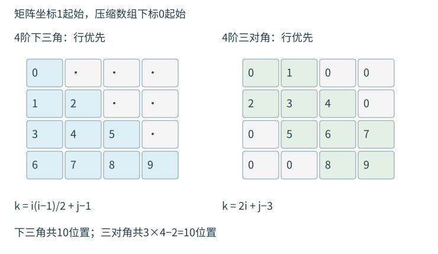

反向给定三对角压缩下标k时，第i行之前有$3(i-1)-1$个保存位置（首行单独核对），第i行结束前共$3i-1$个。因此可以取

$$i=\left\lceil\frac{k+2}{3}\right\rceil,\qquad j=k-2i+3.$$

行号也可写为$i=\lfloor(k+1)/3\rfloor+1$，与上述向上取整形式等价；应先确定i再求j。

例如k=87，$i=\lceil89/3\rceil=30$，$j=87-60+3=30$，与例3-3一致。前提是$0\le k<3n-2$且n≥2；得到坐标后还可复核$|i-j|\le1$。

课件的5行6列稀疏矩阵有六个非零项，按行次序的三元组为：

| 行i | 列j | 值v |
| --- | --- | --- |
| 1 | 3 | 4 |
| 1 | 6 | 5 |
| 2 | 2 | 3 |
| 2 | 4 | 9 |
| 3 | 5 | 7 |
| 4 | 2 | 2 |

第5行全零，仍属于矩阵；只看非零记录无法恢复总行数，所以三元组表还要记录矩阵总行数、总列数和非零元数。十字链表中同一个非零结点同时进入行链和列链，修改时须维护两套联系。稀疏仅说明非零元少，不能据此使用三角矩阵的固定位置公式。

<a id="DS03-check"></a>
## 主动回忆自测

> **自查提示 · 队列的满空条件**
>
> 写清采用牺牲一个单元、计数器还是标志位，才能计算容量并判断队满。

第2题引自王道书，其余为原创补充，检查表示约定。

1. 数组有8个单元、牺牲一个单元的循环队列，`front=6,rear=2`，长度是多少？还能再入队几个元素？
2. 〖3.1-025〗顺序共享栈 `Share[0..n−1]`，第一个栈顶top1初值−1，第二个栈顶top2初值n，栈满条件是（　）。A. `top2−top1==1`　B. `top1−top2==1`　C. `top1==top2`　D. 都不对
3. 下标从1开始的三对角矩阵，若压缩数组也从1开始，非边界行元素 $a_{i,j}$ 的位置如何计算？

**答案。** 1. 长度 $(2-6+8)\bmod8=4$，最大容量7，还能入队3个。2. **A**，两栈顶相邻时已无可用单元，不能等栈顶重合才判满。3. 前面有 $2+3(i-2)=3i-4$ 个元素，本行从 $j=i-1$ 开始，故从1开始的位置为 $3i-4+[j-(i-1)]+1=2i+j-2$；前提为 $2\le i\le n-1$ 且 $|i-j|\le1$，首尾行须按实际保存位置解释。


<a id="DS03-recall-extra"></a>
### 补充自拟回忆题

**主动回忆 · 先画状态，再作判断**

4. 入栈顺序为a、b、c，输出c、a、b是否合法？第一次失败时栈顶是谁？
5. 带头结点链队列删除最后一个数据结点时，front和rear应指向哪里？
6. 同一个n阶对称矩阵，为什么下三角行优先和上三角列优先有相同的三角数结构？坐标如何转换？
7. 后缀表达式`8 3 - 2 /`的值是多少？若按整数除法计算，先弹出的数是什么角色？
8. 递归访问n个结点，最大同时活跃调用数一定为n吗？应由哪个结构参数决定？


**解答 · 补充题核对答案**

4. 不合法。弹出c后栈中为a、b，想输出a时栈顶是b，而输入已用尽。
5. front仍指有效头结点，rear必须退回front；头结点的next为空。rear不能留在已释放的数据结点上。
6. 一边各行保存1、2、⋯个元素，另一边各列也保存1、2、⋯个。先用aij=aji交换坐标，再按对应行或列求偏移。
7. 先计算8−3=5，再作5/2，整数结果为2；每次先弹出右操作数，除法的除数是先弹出的2。
8. 不一定。由最长未返回调用链决定；树遍历通常取树高h，最坏链形树才可达到n。


<a id="DS04"></a>
# 串：存储、基本操作与模式匹配

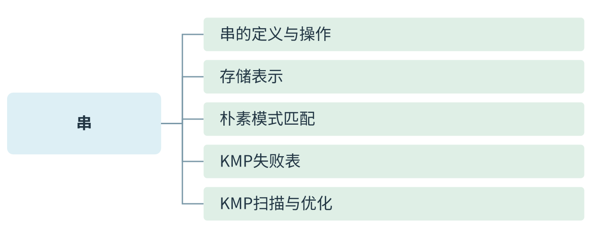

[可编辑SVG](../chapters/DS04/figures/overview.svg) · [完整知识导图](../chapters/DS04/chapter-map.pdf)

串把字符序列作为一个整体处理。学习本章要同时分清三个问题：逻辑上哪些字符属于串，存储时怎样记录字符与长度，匹配时怎样利用已经比较过的信息。本章代码采用王道的顺序串表示：字符从位置1开始，`ch[0]`弃用，`length`另存串长；位置和匹配结果均按这一约定解释。

<a id="DS04-01"></a>
## 字符串、子串与基本操作

> **辨析 · 空串也有定义**
>
> 空串长度为0；空格串的空格都是字符。子串必须连续，子序列可以不连续。

**串**是由零个或多个字符组成的有限序列，记为$S='a_1a_2\cdots a_n'$；$n$为串长。$n=0$的是空串。一个或多个空格构成空格串，它含有字符，长度大于0。串中的字符可以是字母、数字、标点或其他编码字符；具体程序必须约定一个存储单元表示什么，本章算法以一个`char`为一个比较单位。

串中任意**连续**字符组成的子序列称为子串，包含该子串的串称为主串。子串在主串中的位置用其第一个字符的位置表示；同一值可能多次出现，例如`ababa`中的`aba`从位置1和3开始。模式串是要查找的串，它可能不存在于主串中；不能先把“模式串”当成已找到的子串。

两个串相等，当且仅当长度相同且每个对应字符都相同。串的大小比较采用字典序：从前向后找第一对不同字符，按约定的字符编码次序决定大小；若一方先结束且已比较部分全相同，较短串较小。例如`wang`小于`wangdao`；比较串的大小不是比较串长，也不是将整个串当成十进制数。

串属于线性结构，但串的基本操作通常以一个串或子串作为处理对象，而普通线性表常以单个数据元素为对象。赋值、比较、连接、取子串、替换与定位是不同运算，输入输出和修改对象应写清。


| 操作 | 语义与结果 | 需要检查的条件 |
| --- | --- | --- |
| `StrAssign(T,chars)` | 将字符序列赋给T | 目标容量、字符数 |
| `StrCopy(T,S)` | 用S的值复制得到T | 独立复制还是共享存储 |
| `StrEmpty(S)`、`StrLength(S)` | 判空、取得串长 | 空串的length为0 |
| `ClearString(S)` | 使S成为空串 | 顺序串清空不必释放固定数组 |
| `DestroyString(S)` | 销毁并回收动态存储 | 堆串与定长串的资源行为不同 |
| `Concat(T,S1,S2)` | 按先后连接两串得到T | 长度之和能否容纳 |
| `SubString(Sub,S,pos,len)` | 取位置pos起、长度len的子串 | 起点、长度及末位置合法 |
| `StrCompare(S,T)` | 返回正、零或负值表示大小关系 | 字符编码比较规则 |
| `Index(S,T)` | 返回T在S中第一次出现的位置 | 本章失败返回0 |


<a id="DS04-bound"></a>
### 子串的起点和长度怎样约束

> **辨析 · 先定接口边界**
>
> 允许空子串时，pos可以等于n+1，但len只能为0；越界请求不能读取字符。

设$S$长$n$，取非空子串时须满足$1\le pos\le n$、$len>0$及$pos+len-1\le n$。若允许空子串，可将条件扩展为$1\le pos\le n+1$、$len\ge0$及$pos+len-1\le n$；这时$n+1$只允许取长度0的串。接口采用哪种边界应明确约定。本章给出的`SubString`允许后一种情况；模式匹配的主体分析采用非空模式，空模式在调用入口约定返回位置1。

<a id="DS04-storage"></a>
## 顺序串、堆串与链串

定长顺序存储用连续字符数组保存串，串长由独立成员表示。教材结构以`MAXLEN`指定数组单元数。结合本章位置0弃用的约定，可直接访问的字符位置是`1..MAXLEN-1`，所以实现时维持`0<=length<MAXLEN`。若软件接口要求可保存整整MAXLEN个字符，则需要额外分配一个单元，并同步声明容量约定。

```cpp
#define MAXLEN 255
typedef struct {
    char ch[MAXLEN];
    int length;
} SString;
```

固定数组的容量有限。清空只需令`length=0`，旧字符即使仍留在数组中，也不再属于有效串。显式记录长度时无需用`'\0'`作结束标志；若把这种串传给要求C字符串的库函数，必须额外转换表示，不能直接把`ch`作为同一种接口使用。

教材式顺序串存在不同布局：用`ch[0]`记录长度、从位置1保存字符；另设长度而从位置0保存字符；以`'\0'`结束；另设长度且字符从1开始。本章统一采用最后一种。第一种还受长度单元可表示范围限制；结束符方式需要扫描才能求长，并将结束符与有效字符区分。

**堆分配存储**用指针指向动态申请的连续区，常见定义为：

```cpp
typedef struct {
    char *ch;
    int length;
} HString;
```

动态分配能按实际需要调整空间，代价是要管理申请、复制、释放和失败情形。赋值一个指针只复制地址，不能自动得到独立字符副本。长度改变且容量不足时，应先申请新空间，成功后搬移并释放旧区，避免申请失败后丢失原串。

**链式存储**可以每结点存一个字符，也可以每结点保存多个字符形成串块。若每字符1字节而指针4字节，单字符结点只计数据与链接时，存储密度为$1/(1+4)=20\%$；一个结点存4字符时可提升至$4/(4+4)=50\%$。实际平台指针宽度和结构体对齐还会改变字节数。块结点末尾的填充符与真实字符应靠长度或其他约定区分。

<a id="ds04-fig-storage"></a>
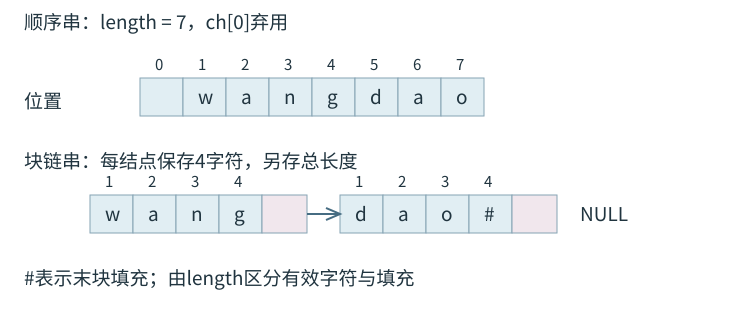

<a id="DS04-basic-code"></a>
## 基本操作怎样落实到代码

> **辨析 · 返回符号即可**
>
> 串比较的正、零、负分别表示大于、相等、小于；正值不要求恰好是1。

`SubString`先检查范围，再从主串复制；失败时保留输出串原值。按固定数组模型，最多复制`len`个字符，时间$O(len)$，除返回结果外只用常数个工作变量。

```cpp
bool SubString(SString &Sub, SString S, int pos, int len) {
    if (pos < 1 || pos > S.length + 1 || len < 0 ||
        len > S.length - pos + 1)
        return false;
    for (int i = pos; i < pos + len; ++i)
        Sub.ch[i - pos + 1] = S.ch[i];
    Sub.length = len;
    return true;
}
int StrCompare(SString S, SString T) {
    for (int i = 1; i <= S.length && i <= T.length; ++i)
        if (S.ch[i] != T.ch[i])
            return (unsigned char)S.ch[i] -
                   (unsigned char)T.ch[i];
    return S.length - T.length;
}
```

比较的时间由第一次不同的位置决定，最坏$O(\min(n,m))$。返回值只要求正、零、负正确；不能把“返回正值”误背成“必须返回1”。转为`unsigned char`后比较，可以避免某些实现中`char`有符号导致高位编码被当作负数。

连接先检查总长，再分别复制两段。若接口允许输出与输入是同一个对象，需要按实现检查覆盖问题；下例按值接收定长顺序串，输入副本使`Concat(S,S,T)`仍能读取原来的S。

```cpp
bool Concat(SString &T, SString S1, SString S2) {
    if (S1.length + S2.length >= MAXLEN) return false;
    for (int i = 1; i <= S1.length; ++i)
        T.ch[i] = S1.ch[i];
    for (int i = 1; i <= S2.length; ++i)
        T.ch[S1.length + i] = S2.ch[i];
    T.length = S1.length + S2.length;
    return true;
}
```

若用字符串基本操作描述朴素定位，可以依次取长度$m$的子串，再用`StrCompare`比较。非空模式最多有$n-m+1$个候选起点；模式长于主串时没有候选。下面改用字符位置直接实现，能更清楚地看到回溯和字符比较次数。

<a id="DS04-02"></a>
## 朴素匹配：失败后移到下一个起点

> **辨析 · 回溯到哪里**
>
> 本轮起点是i-j+1，失败后换下一起点i-j+2，模式j恢复为1。

令`i`指主串当前比较字符，`j`指模式当前比较字符，二者都从1开始。相等时同时递增；不等时，已经比较的模式前缀长为$j-1$，本轮起点是$i-j+1$，下一个起点是$i-j+2$，因此执行`i=i-j+2; j=1;`。

```cpp
int Index(SString S, SString T) {
    if (T.length == 0) return 1;
    int i = 1, j = 1;
    while (i <= S.length && j <= T.length) {
        if (S.ch[i] == T.ch[j]) {
            ++i; ++j;
        } else {
            i = i - j + 2;
            j = 1;
        }
    }
    if (j > T.length) return i - T.length;
    return 0;
}
```

成功时，`j=m+1`，`i`已越过匹配段，起点为$i-m$。主串先耗尽而模式仍未完成时失败，返回0。失败值0与合法位置1区分，不应改用另一个接口的`-1`。

<a id="DS04-naive-example"></a>
### 例：按课件主串逐次尝试

主串`S=abaabaabcabaabc`，模式`T=abaabc`。起点1处前5字符相同，第6字符`a`与`c`失配；起点2的`b`与模式首字符`a`失配；起点3先比较一个`a`，下一字符`a`与`b`失配；起点4的6个字符全部相等，第一次成功位置为4。

| 尝试起点 | 本轮字符比较次数 | 结果 |
| --- | --- | --- |
| 1 | 6 | 第6对失配 |
| 2 | 1 | 第1对失配 |
| 3 | 2 | 第2对失配 |
| 4 | 6 | 全部匹配 |

合计15次字符比较。这个总数属于这一组数据，不能当作算法的一般复杂度。

最坏情形如主串前部有大量`a`、模式为`aaaab`：每个起点都在接近末尾处失败，时间为$O((n-m+1)m)$，通常简记$O(nm)$。若首起点就完全匹配，则只比较$m$次；讨论最好情况时须说明是否保证成功及是否把建表等准备工作计入。

<a id="DS04-03"></a>
## KMP：利用已相等部分决定回退

> **辨析 · 位置与长度差1**
>
> next[j]是下一比较位置。j前的最长边界长k时，next[j]=k+1。next[1]=0另行定义。

设在位置$i,j$失配。此前有

$$S[i-j+1..i-1]=T[1..j-1].$$

这段主串已经被证明等于模式前缀。模式右移后仍能保留的部分，必须同时是$T[1..j-1]$的真后缀和模式的真前缀。设最长相等真前后缀长为$k$，那么前$k$字符无需再比较，下一次应将模式位置$k+1$与同一个主串字符比较。

因此，对$j>1$定义

$$next[j]=1+\text{串 }T[1..j-1]\text{ 的最长相等真前后缀长度},$$

并定义$next[1]=0$。`next[j]`保存的是**下次比较的位置**，不是直接保存前后缀长度。值0是首字符失配后的特殊状态：下一轮同时令`i`和`j`递增，主串进入下一字符，模式恢复到位置1。

<a id="ds04-fig-kmp"></a>
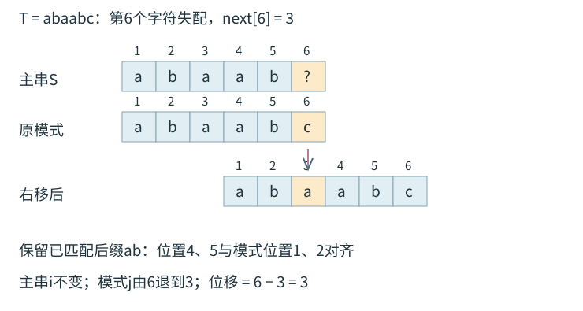

模式`abaabc`的普通next为：

| 位置j | 1 | 2 | 3 | 4 | 5 | 6 |
| --- | --- | --- | --- | --- | --- | --- |
| T.ch[j] | a | b | a | a | b | c |
| j之前的串 | 空 | a | ab | aba | abaa | abaab |
| 最长相等真前后缀长 | 特殊 | 0 | 0 | 1 | 1 | 2 |
| next[j] | 0 | 1 | 1 | 2 | 2 | 3 |

例如$j=6$前的串是`abaab`，最长相等真前后缀为`ab`，长2，所以`next[6]=3`。当第6字符失配时，只改变`j`到3，`i`不变；不是把模式移到主串位置3。

```cpp
int Index_KMP(SString S, SString T, int next[]) {
    if (T.length == 0) return 1;
    int i = 1, j = 1;
    while (i <= S.length && j <= T.length) {
        if (j == 0 || S.ch[i] == T.ch[j]) {
            ++i;
            ++j;
        } else {
            j = next[j];
        }
    }
    if (j > T.length) return i - T.length;
    return 0;
}
```

短路求值使`j==0`时不访问`T.ch[0]`。模式在逻辑上右移，主串指针单调递增；同一个主串字符仍可能与多个模式位置比较，所以不能将KMP解释成“每个主串字符恰好比较一次”。

<a id="DS04-kmp-example"></a>
### 例：同一主串上的KMP轨迹

> **辨析 · 主串没有回溯**
>
> 失配时i保持不变，先改j；只有字符相等或j退至0时才推进i。

仍取`S=abaabaabcabaabc`、`T=abaabc`。先比较位置$(1,1)$至$(5,5)$成功，在$(6,6)$失配。由`next[6]=3`，下一次比较$(6,3)$，主串位置6的`a`等于模式位置3的`a`；随后比较$(7,4)$、$(8,5)$、$(9,6)$都成功。此时`i=10,j=7`，返回$10-6=4$。

| 阶段 | 主串位置i | 模式位置j | 操作 |
| --- | --- | --- | --- |
| 已有5字符相等 | 6 | 6 | a与c失配 |
| 查next | 6 | 3 | 主串位置不变 |
| 继续比较 | 6、7、8、9 | 3、4、5、6 | 连续4对相等 |
| 完成 | 10 | 7 | 返回位置4 |

本例普通KMP共比较10次字符，少于朴素的15次；判断`j==0`不算一对字符比较。另一课件主串`abaacaabcabaabc`会产生连续回退：在$i=5,j=5$失配后$j=2$，仍失配再退$j=1$，再失配退$j=0$；此后推进主串到$i=6,j=1$。连续回退只查表，不让主串后退。

<a id="DS04-next"></a>
## 怎样在线性时间内求next

求表也可看成模式串与自身前缀的匹配。设正在求`next[i+1]`，已知`next[i]=j`。若`j==0`或`T.ch[i]==T.ch[j]`，当前相等前后缀可扩展一字符，故`next[i+1]=j+1`；否则先尝试更短的候选边界，令`j=next[j]`。

```cpp
void get_next(SString T, int next[]) {
    if (T.length == 0) return;
    int i = 1, j = 0;
    next[1] = 0;
    while (i < T.length) {
        if (j == 0 || T.ch[i] == T.ch[j]) {
            ++i; ++j;
            next[i] = j;
        } else {
            j = next[j];
        }
    }
}
```

这里的`i`是模式串内部的工作位置，与匹配函数的主串工作位置作用不同。`while(i<T.length)`保证递增后最多写到`next[T.length]`。若使用另一种定义而把`next`记成前缀函数，表值和匹配代码就必须一起换；本章始终使用教材的下一比较位置定义。

<a id="DS04-next-practice"></a>
### 三组课件手算练习

> **辨析 · 先切出j前的串**
>
> 求next[j]只看T[1..j-1]，当前位置字符不加入普通边界长度的计算。

| 模式串 | 位置 | 普通next |
| --- | --- | --- |
| google | 1、2、3、4、5、6 | 0、1、1、1、2、1 |
| ababaa | 1、2、3、4、5、6 | 0、1、1、2、3、4 |
| aaaab | 1、2、3、4、5 | 0、1、2、3、4 |

`google`在位置5前的`goog`有长度1的相等真前后缀`g`，所以`next[5]=2`；位置6前的`googl`没有非空相等真前后缀，因此`next[6]=1`。`ababaa`在位置6前的`ababa`有最长边界`aba`，所以`next[6]=4`。`aaaab`每个待考察前缀都是一串`a`，其最长真边界只比它本身短1。

课件主串`googlogoogoogle`、模式`google`的匹配过程会反复利用这些边界，第一次成功位置为10。手算时先列主串和模式的位置行，再记录每一次失配后的`j`，比仅画模式移动的外形更容易核对。

<a id="DS04-nextval"></a>
## nextval怎样跳过必然失败的比较

若当前`S.ch[i]`与`T.ch[j]`已失配，而`T.ch[next[j]]==T.ch[j]`，同一个主串字符与回退位置的字符也一定失配。可以继续沿失败链接，直接寻找字符不同的候选位置；把最终位置记为`nextval[j]`。

由普通next求优化表时，先令$nextval[1]=0$。为简化公式，记$T[j]=T.ch[j]$，对$j\ge2$有：

$$nextval[j]=\begin{cases}
next[j],&T[j]\ne T[next[j]],\\
nextval[next[j]],&T[j]=T[next[j]].
\end{cases}$$

对$j\ge2$，普通`next[j]`至少为1，所以该式不访问`T.ch[0]`。`nextval`使用已确认的失配信息，省去必定失败的比较，不改变匹配结果。

| 模式串 | 普通next | 优化nextval |
| --- | --- | --- |
| abaabc | 0、1、1、2、2、3 | 0、1、0、2、1、3 |
| ababaa | 0、1、1、2、3、4 | 0、1、0、1、0、4 |
| aaaab | 0、1、2、3、4 | 0、0、0、0、4 |

例如`abaabc`的$j=3$字符为`a`，而`next[3]=1`也指向`a`，故`nextval[3]=nextval[1]=0`；$j=5$是`b`，普通回退到2仍为`b`，故`nextval[5]=nextval[2]=1`。

```cpp
void get_nextval(SString T, int nextval[]) {
    if (T.length == 0) return;
    int i = 1, j = 0;
    nextval[1] = 0;
    while (i < T.length) {
        if (j == 0 || T.ch[i] == T.ch[j]) {
            ++i; ++j;
            if (T.ch[i] != T.ch[j])
                nextval[i] = j;
            else
                nextval[i] = nextval[j];
        } else {
            j = nextval[j];
        }
    }
}
```

将`nextval`作为`Index_KMP`的第三个实参即可使用优化表，匹配循环不变。普通next与优化nextval的具体比较次数可以不同，算题前先确认题目采用哪一张表。

<a id="DS04-opt-example"></a>
### 例：重复字符使优化效果更明显

> **辨析 · 两种表两种次数**
>
> aaaab在aaacaaaabdaaaab中首次匹配位于5；普通next比较12次，nextval比较9次。

主串`aaacaaaabdaaaab`，模式`aaaab`。普通next在主串位置4的`c`处，会依次与模式位置4、3、2、1的`a`失配；优化表在位置4第一次失配后直接退到0，跳过另外三次注定失败的比较。之后从主串位置5开始匹配，位置5至9恰为`aaaab`，故返回5。普通next共比较12次，nextval共比较9次。

<a id="DS04-analysis"></a>
## 正确性、代价和容易混淆的边界

KMP正确性的关键是：每一次跳过的对齐位置都被已经相等的前缀与后缀关系排除。模式右移后还能与旧匹配段重合的部分必须是一个边界；先尝试最长边界，失败后沿next链尝试更短边界，因此不遗漏仍可能成功的起点。

建表过程中，`i`最多递增$m-1$次；回退使`j`减小，而`j`的总增量受`i`的推进限制，故总工作$O(m)$。匹配中，主串指针`i`最多递增$n$次，每次成功比较使`j`增加，每次失败回退使`j`减少；累积回退量仍受此前的推进约束，因此匹配扫描为$O(n)$。总时间$O(n+m)$，next数组辅助空间$O(m)$。只有“已给next”的匹配阶段才可单独记为$O(n)$。


| 问题 | 本章约定或结论 | 易混点 |
| --- | --- | --- |
| 字符起始位置 | 1 | 与C数组常见0起始分别说明 |
| 匹配失败 | 返回0 | 0不是合法非空匹配起点 |
| `next[j]` | 下一次比较的模式位置 | 等于边界长度加1，而非直接等于边界长度 |
| `j==0` | 下轮推进主串并恢复j=1 | 不是读取第0个字符 |
| 字符比较次数 | 实际执行的字符相等判断 | `j==0`、循环条件不是字符对比较 |
| 匹配成功后继续查找 | 取决于是否查全部、是否允许重叠 | 只找首次出现的接口可立即返回 |


固定数组按值传参会复制整个结构体；教材复杂度通常关注字符扫描和串长变化，容量视作预设上限。若要在可增长规模的软件实现中精确计算拷贝成本，应把接口实现成本一并计入。本章算法推导仍采用教材的字符比较模型。

<a id="DS04-check"></a>
## 主动回忆与自查

> **辨析 · 失败值和合法位置**
>
> 正文所有非空串位置从1起，失败返回0；不要将另一种下标接口的返回值混入。

以下为自拟检查题，串的位置和next均采用本章约定。

1. 空串和只含三个空格的串长度分别是多少？`abc`是不是`ac`的主串？
2. 长度7的串取`pos=6,len=2`是否合法？`pos=8,len=0`呢？
3. 字符位置为1起始时，朴素匹配在$(i,j)=(8,4)$失配，下一个起点和新的指针分别是什么？
4. 写出`abaabc`、`ababaa`、`aaaab`的next与nextval，解释`next[6]=3`中3的含义。
5. KMP在同一个主串字符上连续失配，会改变哪个指针？何时才推进主串？
6. 对`S=abaabaabcabaabc,T=abaabc`，朴素与普通KMP第一次成功位置及字符比较次数分别是多少？
7. 对`S=aaacaaaabdaaaab,T=aaaab`，普通next和优化nextval各比较多少次？
8. 空模式由接口约定返回1时，是否需要访问next[1]？若模式长于主串，返回什么？
9. 只给匹配扫描的$O(n)$，为何不足以说明整个KMP的准备与扫描代价？

<a id="DS04-answers"></a>
### 核对答案

1. 分别为0和3；`ac`不是`abc`中的连续子串。2. 均合法；第二种取得串尾后的空串。3. 本轮起点为5，下一个为6，执行`i=6,j=1`。4. next和nextval分别见上表；3表示下一比较位置，保留的是长2的边界`ab`。5. 令`j=next[j]`或`j=nextval[j]`；字符相等或j退到0后推进主串。6. 都返回4；朴素15次，普通KMP10次。7. 分别12次、9次。8. 不需要建表或访问表；非空模式长于主串时返回0。9. 还要把$O(m)$建表时间和$O(m)$表空间计入，总时间$O(n+m)$。


<a id="DS05"></a>
# 树与二叉树

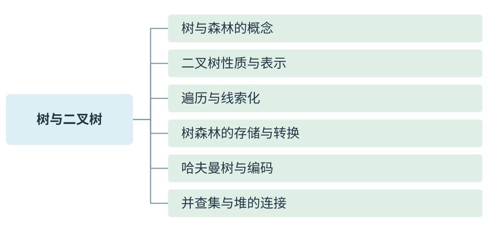

[可编辑SVG](../chapters/DS05/figures/overview.svg) · [完整知识导图](../chapters/DS05/chapter-map.pdf)

树用父子关系组织层次。二叉树在此基础上区分左、右位置，遍历把结构转成一个处理次序；哈夫曼树、并查集和堆则各自增加约束，分别处理编码、集合合并和最值访问。它们共享树的表示工具，但各自的性质不能互相替代。

<a id="DS05-map"></a>
## 本章知识结构

- **树与森林的概念**：结点与父子兄弟；有序树与无序树；结点度与树度；层次高度与路径；边数及叶数计数。
- **二叉树性质与表示**：满与完全二叉树；叶数与双孩子结点；顺序编号及空位；二叉链表空域。
- **遍历与线索化**：先中后序及层序；非递归栈状态；遍历序列还原；中序线索与标志；前驱后继及边界。
- **树森林的存储与转换**：双亲表示；孩子表示；孩子兄弟表示；左孩子右兄弟转换；先根后根与二叉遍历。
- **哈夫曼树与编码**：带权路径长度；合并两个最小权根；最优性与编码非唯一；前缀编码与剩余容量；多路归并的零权补叶。
- **并查集与堆的连接**：双亲森林与代表元；按规模合并；路径压缩不改集合；完全性与堆序；插入上滤及删根下滤。

树的概念和计数性质是后续推导的基础。读遍历时同时追踪程序、栈或队列与输出序列；读编码和并查集时，再考察它们各自增加的约束。

<a id="DS05-01"></a>
## 树的结点、度、层次与路径

> **课程连接 · 目录树和进程树**
>
> 操作系统的目录层次、进程派生关系可用树表达。硬链接若允许同一对象有多个上级入口，目录对象关系就不能直接套用“除根外唯一双亲”；先核对对象与链接的含义。

> **最小反例 · 度为2未必是二叉树**
>
> 最小情形只有根与一个孩子：普通无序树不区分这个孩子在左还是在右，二叉树却区分两种位置。因此“每结点至多两个孩子”尚未表达二叉树的全部结构语义。

**定义 · 树及结点的度**

**有序树**规定同一结点各子树的先后，交换两个孩子可能改变树；**无序树**不区分这种先后。森林是零棵或多棵互不相交的树，删去一棵非空树的根后，各子树构成森林；在一片森林上加新根、把各棵树根接为孩子，又得到一棵树。普通树的有序性与“关键字从小到大”无关。

非空树有且仅有一个根。除根外每个结点恰有一个双亲，根到任意结点只有一条简单路径；树的各子树互不相交。一个结点的孩子数称为该结点的**度**，树的度是所有结点度的最大值。度为0的结点称为叶结点。树中“度”通常指数孩子的个数，与无向图把关联边条数称为度的约定不同。


本章按王道课件约定，根为第1层，结点的层次（深度）从根向下按层计，树的高度（深度）为最大层号；结点高度从该结点向下到最深叶子按层计，叶子高度为1，空树高度为0。根到结点的路径长度仍按边数计，等于该结点层次减1。题目若另行按边数定义高度或深度，须先换算全部相关公式。

路径长度以边数计，不以沿途结点数计。树的路径长度是根到各结点路径长度的总和；树高由最长的一条路径决定，二者不同。孩子、子孙、兄弟也要区分：兄弟共有同一个双亲，与堂兄弟不是同一个概念。

<a id="DS05-ex1"></a>
### 例 5-1　怎样从非叶结点数求叶结点数

**例题 · 配套案例**

【配套例题】 一棵度为4的树，含20个度为4的结点、10个度为3的结点、1个度为2的结点、10个度为1的结点。叶结点数为（　）。

A. 41　B. 82　C. 113　D. 122


**解析。** 设叶数为 $n_0$。一方面总结点数为 $n=n_0+20+10+1+10=n_0+41$；另一方面每条边从一个双亲指向一个孩子，边数是度数总和 $4\times20+3\times10+2+10=122$。树有 $n-1$ 条边，所以 $n_0+40=122$，得 $n_0=82$，答案为 **B**。

一般地，令 $n_i$ 为度为 $i$ 的结点数，由 $\sum_i n_i-1=\sum_i i n_i$ 得

$$n_0=1+\sum_{i\ge2}(i-1)n_i.$$

度为1的结点不出现在右端，是因为在一条边上再串入一个单孩子结点，结点数、边数各增加1，叶数不变。因此只给定 $n_2,n_3$ 和叶数，未必能确定全树结点总数；还可能插入任意多个度为1的结点。

每结点至多有 $m$ 个孩子的树，第 $i$ 层至多有 $m^{i-1}$ 个结点，高度 $h$ 至多容纳 $(m^h-1)/(m-1)$ 个结点（$m>1$）。求最小高度时，找使容量至少达到 $n$ 的最小整数 $h$。例如至多3叉、50个结点，高4时最多40个，高5时最多121个，所以最小高度5。这里必须把“度为3”理解为全树最大孩子数3，不能要求每个非叶结点都恰有3个孩子。

<a id="DS05-mary"></a>
### 度为$m$的树与$m$叉树

“度为$m$”要求全树至少有一个结点恰有$m$个孩子；“$m$叉树”只要求每个结点至多有$m$个孩子。二者都满足每层的容量上界，最少结点数却不同。对非空树，按根为第1层：

| 条件 | 最少结点数 | 最多结点数 |
| --- | --- | --- |
| 高度$h$的$m$叉树 | $h$，取一条单支链 | $(m^h-1)/(m-1)$，$m>1$ |
| 高度$h$且度恰为$m$ | $h+m-1$，需存在$m$个孩子的分支 | 同上 |
| 有$n$个结点的$m$叉树 | 最小高度$\lceil\log_m(n(m-1)+1)\rceil$ | 最大高度$n$ |

第二行须有能容纳$m$个孩子的高度：$m>0$时$h\ge2$；单结点树度为0。$m=1$时是一条链，容量公式改为$n=h$，避免分母为0。公式中的“至多”允许空缺，不能据容量上界推断某一棵给定树的实际形状。

例如高度4、度为3的树至少有$4+3-1=6$个结点：在一条4结点链的某个非叶结点处再增加2个叶即可；只说“高度4的3叉树”，最少则只有4个结点。

<a id="DS05-02"></a>
## 二叉树、满二叉树与完全二叉树

> **错项排除 · 叶公式只用了二叉条件**
>
> 证明$n_0=n_2+1$时没有用到“完全”或“满”。若选项声称任意二叉树还必有至多一个度为1结点，就偷偷增加了完全性；一条三结点单支链即可排除。
>
> 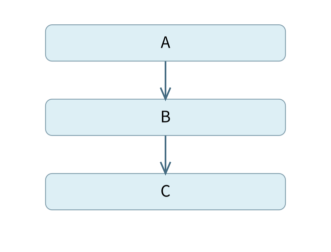
>
> 三结点单支链有2个度1结点；叶数公式仍成立。

二叉树的每个结点至多有两个孩子，而且左右有别。只有一个孩子时，左孩子与右孩子形成不同结构；二叉树也不是简单地把“度不超过2的普通树”换个名字。普通树的单孩子若不规定位置，就不区分左、右这两种形态。

高度为 $h$、每一层都达到最大结点数的二叉树称为**满二叉树**，共有 $2^h-1$ 个结点。**完全二叉树**按满二叉树从上到下、从左到右编号，已有结点恰占前 $n$ 个编号。最后一层可以不满，但只能缺右侧连续的一段；其余各层则必须排满。

“每个非叶结点恰有两个孩子”只说明不存在度为1的结点，未必是这里定义的满二叉树。叶结点可能分布在不同层。使用外文资料中的 full、perfect 等名称时，也要先看定义。

二叉树第 $i$ 层至多 $2^{i-1}$ 个结点。非空二叉树有 $n_0=n_2+1$，由上一节公式直接得到。高度为 $h$ 时，结点数满足 $h\le n\le2^h-1$；给定 $n$，最小高度为 $\lceil\log_2(n+1)\rceil$，最大为 $n$。例如50个结点，最小高度6。

完全二叉树有 $\lfloor n/2\rfloor$ 个非叶结点、$\lceil n/2\rceil$ 个叶结点，最多只有一个度为1的结点，且它只能有左孩子。普通二叉树不能沿用这些完全性结论。

**定理 · 二叉树的叶与双孩子结点**

任意非空二叉树中，若$n_i$表示度为$i$的结点数，则$n_0=n_2+1$。


**推导 · 按结点与按孩子数边**

结点总数$n=n_0+n_1+n_2$，边数一方面为$n-1$，另一方面为$n_1+2n_2$。令两式相等并消去$n_1$，即得$n_0=n_2+1$。证明只需二叉树，不要求完全、满或平衡。


<a id="DS05-03"></a>
## 顺序编号与链式表示

> **不变量 · 编号表达位置而非秩**
>
> 顺序存储中下标表达满二叉树的位置，删除缺失位置后不能把剩余元素紧凑前移而继续沿用$2i,2i+1$。链表遍历得到的次序也不是这种位置编号。

完全二叉树从1开始编号，结点 $i$ 的双亲为 $\lfloor i/2\rfloor$，左、右孩子为 $2i,2i+1$，但只有编号不超过 $n$ 的位置才存在。若下标从0开始，孩子公式改为 $2i+1,2i+2$，非根结点的双亲为 $\lfloor(i-1)/2\rfloor$。

任意二叉树也可以按满二叉树位置编号，但缺失的位置必须留空。因此实际结点少，顺序存储占用的空间未必小。高度 $h$ 的一条全右链，从1开始编号时最后编号为 $2^h-1$，只存 $h$ 个结点却可能需要指数级下标范围。

<a id="DS05-ex2"></a>
### 例 5-2　任意形态的顺序存储需要预留多少

**例题 · 配套案例**

【配套例题】 对于任意一棵高度为5、有10个结点的二叉树，采用顺序存储结构保存，每个结点占1个存储单元，只存放结点数据信息。存放该二叉树需要的存储单元数量至少为（　）。

A. 31　B. 16　C. 15　D. 10


**解析。** 本题要求容量能够保存这种约束下的任意形态。高度5的满二叉树位置编号到31；合法的10结点形态完全可能包含第31号位置（保留通往该位置的祖先，再安排其余结点）。因此为保证任意形态可保存，至少预留31个位置，答案为 **A**。并非每一棵给定的10结点树都实际用到下标31；不能把“保证任意形态”读成“在所有形态中挑一个最省空间的”。

二叉链表为每个结点保存左、右孩子指针。$n$ 个非空结点共有 $2n$ 个孩子指针域，真正指向孩子的有 $n-1$ 个，所以空域为 $n+1$ 个。若再增加双亲指针，根的双亲域为空，其他 $n-1$ 个双亲域非空；总空域为 $3n-2(n-1)=n+2$。某个结点被多少指针指向，不只由它自己有几个孩子决定：孩子的双亲域也会指回它。

<a id="DS05-bitree-code"></a>
### 二叉链表的教材定义

```cpp
typedef struct BiTNode {
    ElemType data;
    struct BiTNode *lchild, *rchild;
} BiTNode, *BiTree;
```

`BiTree T`本质上是根结点指针，空树为`T==NULL`。`T->lchild`、`T->rchild`是孩子指针，不能把一个`BiTNode`对象和指向它的`BiTree`混用。下文`visit(T)`表示处理该结点的数据；具体打印、累计或复制操作由应用决定。

顺序存储中，合法孩子编号还必须对应一个非空位置；对于有空洞的普通二叉树，`2*i<=数组容量`只说明下标未越界，并不保证该孩子实际存在。

<a id="DS05-04"></a>
## 遍历、还原与树形递归

> **最小反例 · 先序加后序的歧义**
>
> 最小反例为A与其唯一孩子B：B在左或在右，先序都是AB，后序都是BA。缺少中序时，序列没有给出这个单孩子的左右位置；重复值还会带来身份歧义。

先序、中序、后序分别把“访问根”的位置放在左、右子树递归的前、中、后；三个次序都先处理左子树再处理右子树。对下图：

<a id="ds-fig-traversal"></a>
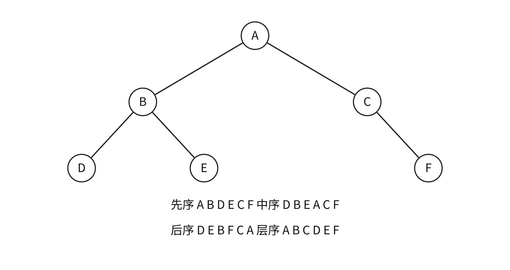

先序为 `A B D E C F`；中序为 `D B E A C F`；后序为 `D E B F C A`；层序为 `A B C D E F`。先序在深入子树之前处理结点，适合复制或输出结构；后序在左右结果齐备后处理根，适合求子树大小、高度、释放结点。访问位置应服从依赖，不能只因为某种遍历最常见就选它。

```c
int TreeDepth(BiTree T) {
    if (T==NULL) return 0;
    int hl=TreeDepth(T->lchild), hr=TreeDepth(T->rchild);
    return 1+(hl>hr ? hl : hr);
}
```

这段代码每个结点只处理一次，时间 $O(n)$；调用栈深为 $O(h)$。求高度时，叶结点返回1，与本章高度约定一致。交换所有左右子树可以递归地先交换两个子树内部，再交换两个孩子指针，从而把中序序列整体反向；交换不改变根的身份，也不改变哪些结点是叶结点。

课件中的另一棵树增加了D的右孩子G、C的左孩子F，可同时检查左右位置、访问时机与输出次序：

<a id="DS05-fig-lecture-traversal"></a>
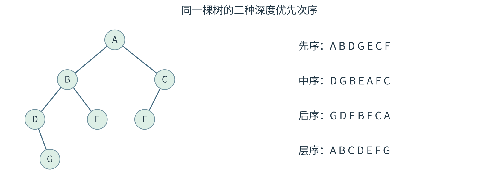

<a id="DS05-order-code"></a>
### 递归遍历的三种访问位置

> **条件辨析 · 访问位置**
>
> 先中后序共用左右递归骨架，根的访问位置分别在左递归前、两次递归间、右递归后。依赖子树结果的操作宜在返回后处理。

```cpp
void PreOrder(BiTree T) {
    if (T!=NULL) {
        visit(T);
        PreOrder(T->lchild);
        PreOrder(T->rchild);
    }
}
void InOrder(BiTree T) {
    if (T!=NULL) {
        InOrder(T->lchild);
        visit(T);
        InOrder(T->rchild);
    }
}
void PostOrder(BiTree T) {
    if (T!=NULL) {
        PostOrder(T->lchild);
        PostOrder(T->rchild);
        visit(T);
    }
}
```

把每个递归结点看成有三个停留点：进入左子树前、左子树返回后、右子树返回后。三种遍历仅改变`visit`所在停留点，递归下降和返回的骨架相同。时间都是$\Theta(n)$，最大同时存活的调用数由树高决定，辅助栈为$O(h)$；单支树可达$O(n)$，平衡形态为$O(\log n)$。表达式树的先序、后序分别产生前缀、后缀表达式；中序输出中缀表达式时要根据结构添加括号，才能保留原运算顺序。

### 先序加中序为什么能还原

假设结点标识互不相同。先序第一个元素为根，在中序中找到根后，左侧全属于左子树，右侧全属于右子树；由左子树的长度，能把先序余段分成左右两段，再递归。上图根为 A，中序左段 `D B E` 长3，故先序左段是 `B D E`，根B又把它分成D和E。

中序加后序也能唯一还原，根取后序最后一个；先序加后序一般不能区分一个单孩子在左还是在右。只给含 $n$ 个不同标识的先序序列，形态数仍为卡特兰数 $C_n$，例如4个元素为14种。结点值重复时，“在中序中找到根的位置”可能不唯一，前述唯一性需要额外身份信息。

<a id="DS05-rebuild"></a>
### 由层序和中序还原

> **条件辨析 · 层序先分根再筛子树**
>
> 层序中同一子树的相对次序保留，中序负责划分身份集合。不能只按层序剩余部分的长度直接切左右两段。

结点标识互异时，层序首项是根；中序在根处分开左右子树。把其余层序项按“是否属于左侧中序集合”稳定筛分，得到左右子树各自的层序，再递归。

课件例：层序`A B C D E`、中序`A C B E D`。根为A，中序左侧为空，所以A没有左子树；右子树层序为`B C D E`，中序为`C B E D`。该子树根B，左子树只有C；右子树根D且左孩子为E。最终为`A(空,B(C,D(E,空)))`。由此得到先序`A B C D E`、后序`C E D B A`。

课件另一组先序`D A E F B C H G I`、中序`E A F D H C B G I`，根D将中序分为`E A F`与`H C B G I`；左子树根A，孩子E、F；右子树根B，左子树为C且左孩子H，右子树根G且右孩子I。逐层分段比仅凭序列外观猜树形可靠。

| 已知序列，标识互异 | 一般能否唯一还原 | 决定子树范围的依据 |
| --- | --- | --- |
| 先序＋中序 | 能 | 先序首项定根，中序分左右 |
| 后序＋中序 | 能 | 后序末项定根，中序分左右 |
| 层序＋中序 | 能 | 层序首项定根，中序分左右并筛层序 |
| 先序＋后序 | 一般不能 | 单孩子的左右位置无法区分 |
| 先序＋层序、后序＋层序 | 一般不能 | 两结点的单左、单右树即为反例 |

“需要中序”是一般二叉树、仅按这些遍历组合还原时的结论；增加满二叉树、显式空指针标记等约束后，要按新增信息重新分析。

非递归中序遍历用显式栈保存未完成的祖先：沿左链入栈，到空位置时弹栈访问，再转到其右子树。上图先依次压入 A、B、D，弹出 D 后没有右孩子，接着弹出 B 并转到 E；E 处理完才回到仍在栈中的 A。

```text
inorder(root):
    p=root; 建空栈 S
    while p 非空 or S 非空:
        while p 非空:
            push(S,p); p=p->lchild
        p=pop(S); visit(p)
        p=p->rchild
```

非递归后序还需分辨右子树是否已经处理，可保存最近访问结点 `last`。从左子树返回时先看栈顶；它有尚未处理的右子树，就进入右子树，不能立即弹根。

```text
postorder(root):
    p=root; last=NULL; 建空栈 S
    while p 非空 or S 非空:
        if p 非空:
            push(S,p); p=p->lchild
        else:
            q=top(S)
            if q->rchild 非空 and last!=q->rchild:
                p=q->rchild
            else:
                visit(q); last=pop(S)
```

`last` 只在一次完整子树处理后更新，因此它等于 `q->rchild`，表示右子树根已经最后访问过。每个结点各入栈、出栈一次，时间仍为 $O(n)$，栈最多同时保存一条祖先路径，空间为 $O(h)$。

层序遍历把根入队，反复出队访问并依次入队左右孩子。判定完全二叉树可在层序遍历中设置“已经遇到空孩子”标志：一旦出现空位置，此后的孩子位置不得再出现非空结点。只排除“有右孩子而无左孩子”还不够，还要排除遇到首个空孩子位置后又出现非空孩子的情况；一个结点只有左孩子，本身未必违反完全性。

<a id="DS05-ex3"></a>
### 例 5-3　中序前驱和后继在哪一侧

**例题 · 配套案例**

【配套例题】 p、q、v 都是二叉树 T 中的结点，v 有两个孩子，T 的中序遍历序列形如 `…,p,v,q,…`。正确的是（　）。

A. p没有右孩子，q没有左孩子　B. p没有右孩子，q有左孩子

C. p有右孩子，q没有左孩子　D. p有右孩子，q有左孩子


**解析。** v 有左子树，紧邻它之前的 p 必在左子树的最右端；若 p 还有右孩子，应先访问那棵右子树，p 就不可能紧邻 v。对称地，q 是右子树的最左端，不可能有左孩子。答案为 **A**。这里的“最右端”指沿右孩子指针一直走到不能再走的位置，不能按图上哪个结点画得最靠右来判断。

**方法 · 遍历问题先固定三个条件**

先写清访问根的位置、左右孩子顺序、空树处理。还原问题再检查结点身份是否唯一；若给先序与中序，根由先序首项决定，子树边界由中序决定，不能按数值大小猜左右。


层序遍历的队列表示“已发现但尚未处理”的结点。以本章图为例，A出队后B、C入队，接着B出队才把D、E加入队尾，所以C在D之前处理。

```text
levelOrder(root):
    if root为空: return
    Q入队root
    while Q非空:
        p=Q出队; visit(p)
        if p.lchild非空: Q入队p.lchild
        if p.rchild非空: Q入队p.rchild
```

时间$O(n)$；队列峰值由树的宽度决定，最坏$O(n)$。不能把递归遍历的$O(h)$调用栈结论搬到层序队列。

<a id="DS05-05"></a>
## 线索二叉树：区分孩子链接与遍历线索

> **错项排除 · 先看tag再沿指针**
>
> 线索填写后，一条非空指针可能指向祖先或兄弟方向的前后继。若忽略tag把它当孩子继续递归，就可能绕回已访问位置；“指针非空”不等价于“存在子树”。

二叉链表有许多空孩子指针。把空左域改记某遍历次序下的前驱，把空右域改记后继，便得到相应的**线索二叉树**。新增 `ltag`、`rtag` 区分该域是孩子还是线索；本书约定0表示孩子，1表示线索。寻找子树时必须先看标志，不能沿一条线索继续递归，否则可能回到祖先形成循环。

中序线索树中，若结点右域为线索，可直接到中序后继；若右域为孩子，后继是右子树中沿真实左孩子链到达的第一个结点。前驱同理：左域为线索则直接取，否则到左子树最右端。图中每个结点的 L、R 分别表示左、右指针域，其后数字为对应的 `ltag`、`rtag`。E 的 R1 指向 A，C 的 L1 也指向 A；两条线索各有独立的起点和箭头落点。D 的 L1 和 F 的 R1 则分别接空前驱、空后继端点，本图采用无头结点、首尾取空的约定。

<a id="ds-fig-threads"></a>
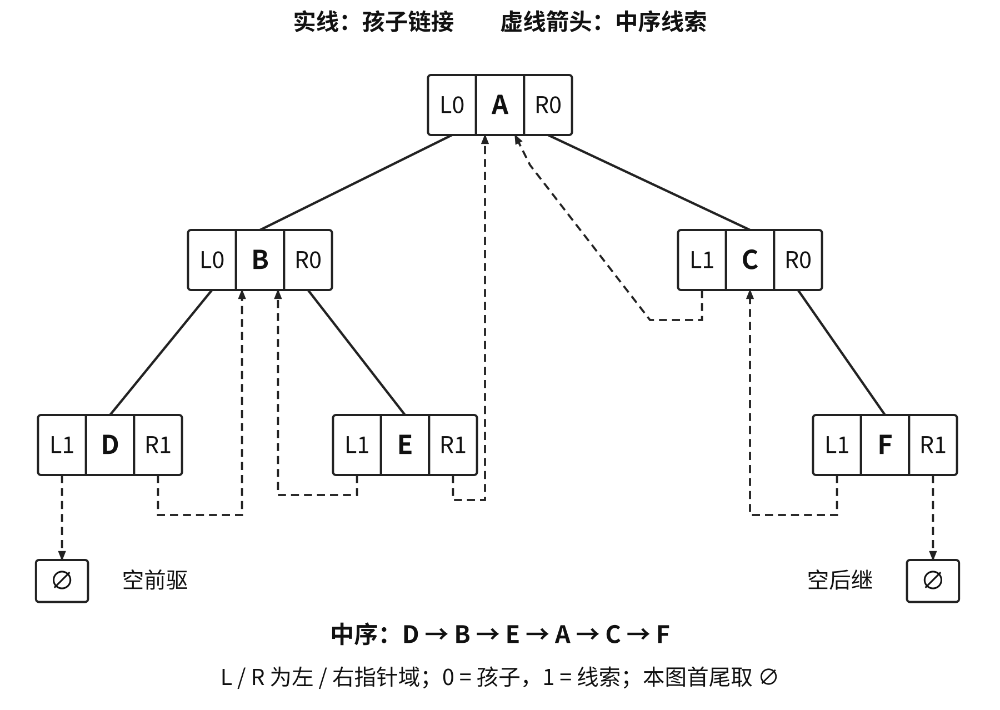

$n+1$ 个原空孩子域均可改为线索域，其中首结点的前驱和末结点的后继需约定为空或指向专设头结点。题目说“线索数为 $n+1$”时通常统计这些线索域，包含首尾边界；若只统计实际指向普通结点的线索，则边界两项另算。加头结点后，其额外指针也不应混入原树的 $2n$ 域计数。

构造中序线索时，用 `pre` 保存刚访问过的结点，初值为空。处理当前结点p时，若其左域为空，填入pre并设置左线索标志；若pre的右域为空，填入p并设置右线索标志，随后令pre=p。递归只沿真实孩子执行，避免把刚填的线索又当作子树。

```cpp
typedef struct ThreadNode {
    ElemType data;
    struct ThreadNode *lchild, *rchild;
    int ltag, rtag;  // 0：孩子；1：线索
} ThreadNode, *ThreadTree;

void InThread(ThreadTree p, ThreadTree &pre) {
    if (p!=NULL) {
        InThread(p->lchild, pre);
        if (p->lchild==NULL) {
            p->lchild=pre;
            p->ltag=1;
        }
        if (pre!=NULL && pre->rchild==NULL) {
            pre->rchild=p;
            pre->rtag=1;
        }
        pre=p;
        InThread(p->rchild, pre);
    }
}
void CreateInThread(ThreadTree T) {
    ThreadTree pre=NULL;
    if (T!=NULL) {
        InThread(T, pre);
        pre->rchild=NULL;
        pre->rtag=1;
    }
}
```

调用前所有原孩子标志为0。图中先访问D，其空左域指向空前驱；随后访问B，D的空右域才补为指向B的线索。访问E时填左线索指向B，访问A时再把E的空右域补为A。遍历结束后，pre为最后结点F，将其空右域标为后继线索，线索目标按约定为空或为头结点。若使用头结点，首结点空前驱也应统一改指头结点。

先序、后序线索的前驱后继依照各自次序，不可沿用中序规则。后序中，若叶结点 X 存在左兄弟 Y，则 X 是双亲的右孩子；左子树和右子树都处理完后才访问双亲，因此 X 的后序后继是双亲，而不是左兄弟。一般后序线索树若无双亲信息，不一定能像中序那样方便地只凭孩子和线索完成全部后继访问。

<a id="DS05-thread-access"></a>
### 线索树的访问算法与六种前驱后继

> **条件辨析 · 中序末结点的右域**
>
> 中序最后访问的是最右结点，它的右孩子必为空；后序最后访问的是根，根却可能有右孩子。收尾语句适用的遍历不能混用。

`pre`以引用传入，使左子树递归更新后的“刚访问结点”能够传回当前层；若按值传指针，调用返回后当前层仍拿着旧值。教材中序线索化只对原始、标志均为0的二叉链表调用。右递归开始前，当前结点原本非空的右孩子未被改写；因此该版本可直接递归右孩子。再次对已线索化的树调用时，必须按标志辨别真实孩子。

```cpp
ThreadNode *Firstnode(ThreadNode *p) {
    while (p->ltag==0) p=p->lchild;
    return p;
}
ThreadNode *Nextnode(ThreadNode *p) {
    if (p->rtag==0) return Firstnode(p->rchild);
    return p->rchild;
}
void InOrderThread(ThreadNode *T) {
    if (T==NULL) return;
    for (ThreadNode *p=Firstnode(T); p!=NULL; p=Nextnode(p))
        visit(p);
}
```

`Firstnode`的前提是参数非空、所有空左域均已正确标成线索；`Nextnode`接收一个实际结点。这样无需递归栈即可中序遍历。找一次后继最坏可能沿一条左链，整趟遍历每条孩子链接只走常数次，故总时间$O(n)$、额外空间$O(1)$。

| 线索类型 | 找前驱 | 找后继 |
| --- | --- | --- |
| 中序 | 左域为线索则直接取；否则左子树最右结点 | 右域为线索则直接取；否则右子树最左结点 |
| 先序 | 左域为线索则直接取；有左孩子时通常还需双亲信息 | 有左孩子先取左孩子，否则取右域（孩子或线索） |
| 后序 | 有右孩子先取右孩子，否则取左域（孩子或线索） | 右域为线索则直接取；有右孩子时通常还需双亲信息 |

先序有左孩子的结点，其前驱在子树之外；后序有右孩子的结点，其后继在子树之外，因此普通二叉线索链表未必能直接取得。若有双亲域：先序中，左孩子的前驱是双亲；右孩子无左兄弟时前驱是双亲，有左兄弟时为左兄弟子树最后一个先序结点。后序对称：右孩子的后继是双亲，左孩子无右兄弟时后继是双亲，有右兄弟时为右兄弟子树第一个后序结点。

先序线索化在访问根后才递归，刚建立的左线索可能指回祖先，故递归左侧必须检查`ltag==0`。后序先完成两棵原子树再建线索，注意结束后末结点是根，根未必原本没有右孩子；处理收尾时应判断空右域，不能照搬中序“最后结点右孩子必空”的条件。

<a id="DS05-06"></a>
## 普通树的三种存储

**双亲表示法**为每个结点保存双亲的下标，根用 −1 等特殊值标识。找双亲 $O(1)$，找全部孩子通常需扫描整个数组。它适合从结点反复向根追踪，却不便于列举孩子。

**孩子表示法**为每个结点保存孩子链表，便于依次访问所有孩子；反查双亲时若没有另外保存双亲信息，仍需搜索。**孩子兄弟表示法**只保存两个链接：`firstChild` 指向第一个孩子，`nextSibling` 指向下一个兄弟。它能用两个指针表示孩子数不定的树，却不能把 `nextSibling` 理解成普通树的孩子。

选择表示时，应先看主要方向：查双亲、枚举孩子或遍历同层兄弟，分别依赖不同的链接。多保存一个双亲域会增加空间，但上溯不必再搜索，代价降低。

<a id="DS05-tree-storage-code"></a>
### 三种树存储的教材结构

```cpp
#define MAX_TREE_SIZE 100
typedef struct {
    ElemType data;
    int parent;
} PTNode;
typedef struct {
    PTNode nodes[MAX_TREE_SIZE];
    int n;
} PTree;

typedef struct CSNode {
    ElemType data;
    struct CSNode *firstchild, *nextsibling;
} CSNode, *CSTree;
```

双亲数组中根的`parent=-1`，其余值为双亲在数组中的下标，不能把它当作元素数据。孩子表示法则在顺序顶点表的每个元素中保存孩子链首指针，链结点保存孩子下标和下一孩子指针；它是顺序与链式存储的结合。森林的双亲表示可有多个`parent=-1`，孩子表示则须保存各根的位置。孩子兄弟表示中，森林各根沿`nextsibling`相连。

<a id="DS05-07"></a>
## 树、森林怎样转换为二叉树

> **不变量 · 转换不改变数据结点**
>
> 孩子兄弟转换保留全部数据结点，但改变链接解释。原树根无兄弟，所以转换后二叉根无右孩子；森林的多个根由右链串起，不能把右链误认成原树的后代。

采用“左孩子、右兄弟”约定：普通树第一个孩子成为二叉树左孩子，后续兄弟依次以右孩子相连。原树的根没有兄弟，故其对应二叉树的根没有右孩子。森林的各棵树根互为兄弟，再沿右链连接，第一棵树的根成为二叉树的根。

<a id="ds-fig-forest"></a>
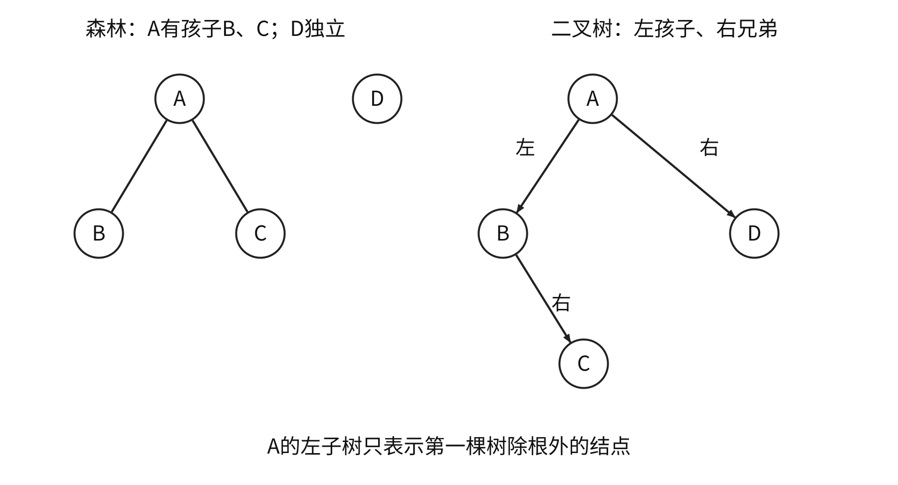

逆转换时，从某结点的左孩子出发沿右链走，沿途结点就是它的全部孩子；根及其右链上的各结点分别作为森林各棵树的根。转换改变了“左右链接的解释”，没有增加或删除数据结点。森林有4棵树、第一棵含 $a$ 个结点时，二叉树根的左子树只含第一棵树除根外的 $a-1$ 个结点，其他树由根的右子树表示。

<a id="DS05-ex4"></a>
### 例 5-4　二叉树隔两条链接，在森林中是什么关系

**例题 · 配套案例**

【配套例题】 将森林转换成对应二叉树。若二叉树中 u 是 v 的父结点的父结点，则原森林中 u 与 v 可能的关系是（　）。

Ⅰ. 父子关系　Ⅱ. 兄弟关系　Ⅲ. u 的父结点与 v 的父结点是兄弟关系

A. 只有Ⅱ　B. Ⅰ和Ⅱ　C. Ⅰ和Ⅲ　D. Ⅰ、Ⅱ和Ⅲ


**解析。** 从 u 到 v 恰经过两条二叉树链接。左—右表示“先到 u 的第一个孩子，再到其下一个兄弟”，v 仍是 u 的孩子，Ⅰ可能；右—右表示连续两个兄弟链接，u、v 互为兄弟，Ⅱ可能。左—左表示祖孙，右—左表示 u 的兄弟的孩子，它们都不能产生Ⅲ所说的父结点关系。因此答案为 **B**。应按每条链接的语义推回森林，不能把二叉树的双亲直接当作原树的双亲。

<a id="DS05-08"></a>
## 树与森林的遍历怎样对应

普通树的先根遍历先访问根，再依次先根遍历各子树；后根遍历先按顺序遍历各子树，再访问根。采用孩子兄弟转换后，树的先根次序对应二叉树先序，树的后根次序对应二叉树中序。原因是二叉树左链接深入第一个孩子，而右链接串联后续兄弟。

森林先序依次先根遍历各棵树，对应二叉树先序；森林中序先按中序处理第一棵树的子树森林，再访问该树根，最后处理其余树，对应二叉树中序。森林遍历要按定义递归到各棵树，并非在整片森林开头统一访问一次根。

层次遍历普通树时，出队一个结点后，按孩子链的次序把它的所有孩子入队；兄弟链接只用于枚举孩子，不能把整条兄弟链当成下一层的结点序列。

<a id="DS05-09"></a>
## 哈夫曼树、WPL 与前缀编码

> **课程连接 · 编码和外排使用同一棵树**
>
> 哈夫曼叶权可表示字符频数，也可表示外部归并段长。每次参加合并使该叶再负担一次权值，故总合并长度等于WPL；第8章的最佳归并由此得到。

> **错项排除 · 最优不意味着唯一**
>
> 左右子树交换不会改变叶深和WPL；同权候选的选择也可产生不同树。应排除“不同编码必有不同平均码长”，同时避免把哈夫曼最优性扩大成完全或平衡。

给每个叶结点一个权值 $w_i$，根到它的路径长度（边数）为 $d_i$，**带权路径长度**为 $\mathrm{WPL}=\sum_iw_id_i$。权值通常为频数或概率，内部结点不直接加入这项“叶权乘深度”的求和。求给定叶权下最小 WPL 的二叉树，可每次选当前两个最小权值合并为新结点，再把权值和放回候选集合，直到仅剩根。

为什么合并两个最小值：在一棵最优树中，可以让最深的一对兄弟叶承载两个最小权值而不增大 WPL；把它们收缩成一个权值为和的叶后，剩余结构仍应最优，否则替换后能得到 WPL 更小的树。每次合并都使这两棵子树中所有叶的深度增加1，因此合并权值之和也等于最终 WPL。

<a id="DS05-ex5"></a>
### 例 5-5　加权平均码长怎样从合并过程得到

**例题 · 配套案例**

【配套例题】 6个字符出现频次分别为3、4、5、6、8、10，为它们构造哈夫曼编码，加权平均长度为（　）。

A. 2.4　B. 2.5　C. 2.67　D. 2.75


**解析。** 每轮重新从当前候选中取最小的两个，不能把原始序列分成相邻对后一次配完。


| 本轮合并 | 新权值 | 合并后候选权值 |
| --- | --- | --- |
| 3与4 | 7 | 5、6、7、8、10 |
| 5与6 | 11 | 7、8、10、11 |
| 7与8 | 15 | 10、11、15 |
| 10与11 | 21 | 15、21 |
| 15与21 | 36 | 36 |


WPL 为 $7+11+15+21+36=90$，频次总和36，所以平均码长为 $90/36=2.5$ 位/字符，答案为 **B**。不能把总码长除以6，因为各字符出现频次不同。

<a id="ds-fig-huffman"></a>
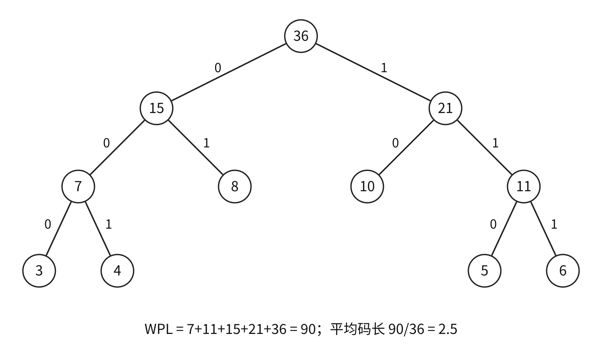

沿根到叶的0、1路径形成码字。字符只放在叶上，所以任何字符码都不是另一个字符码的前缀，这称为**前缀编码**。编码可因相等权值的选取、左右分支交换而不唯一，WPL 仍可相同。哈夫曼树没有度为1的内部结点，若有 $n$ 个叶，内部结点 $n-1$、总结点 $2n-1$；它未必完全、未必平衡，$n$ 个叶的最大高度可达 $n$。

<a id="DS05-huffman-course"></a>
### 王道课件中的合并与压缩实例

权值为`1,3,2,2,7`时，取相等权值的一种合法顺序：先合并1与2得到3，再将另一个2与新3合为5，原3与5合为8，最后7与8合为15。WPL等于全部合并权值之和：$3+5+8+15=31$。权相等时可以换选，形态和码字可能变化，最优WPL保持31。

再看课件的100题答案：C、A、B、D分别出现80、10、8、2次。固定2位编码共需200 bit；哈夫曼合并为$2+8=10$、$10+10=20$、$20+80=100$，WPL为$10+20+100=130$ bit。按图中左0右1，可取C为0、A为10、D为110、B为111，平均码长$130/100=1.3$ bit/题。与固定2位相比，编码数据长度为原来的65%，节省35%；这里暂未计入传递码表等附加信息。

<a id="DS05-fig-huffman-course"></a>
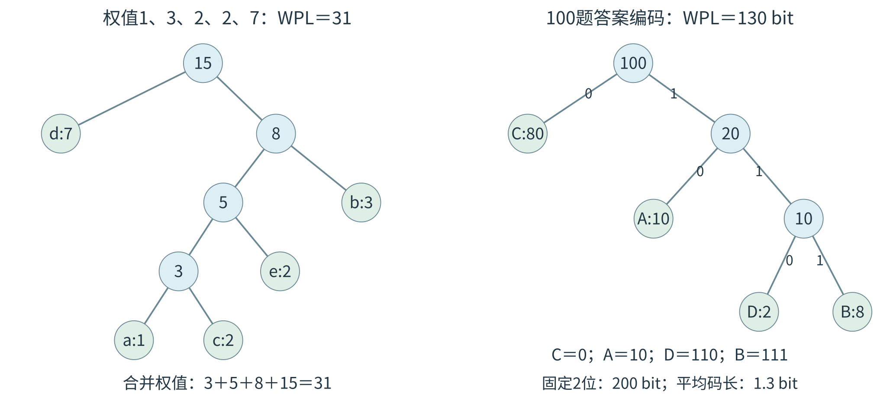

例如`CAAABD`编码为`0|10|10|10|111|110`。沿树由根读取比特，到叶即输出一个字符再回根，就能解出原串；每个字符在叶上，因此完整码字不会是另一完整码字的前缀。

<a id="DS05-ex6"></a>
### 例 5-6　已占用的码字怎样限制剩余容量

**例题 · 配套案例**

〖5.5-004〗 哈夫曼编码长度不超过4，已有两个字符编码为1和01，还最多能对几个字符编码？

A. 2　B. 3　C. 4　D. 5


**解析。** 以1开头的整棵子树已被码字1占用，以01开头的子树也被占用。剩余码字只能位于00开头的子树。长度至多4，00之后最多还放2位，最多形成 `0000、0001、0010、0011` 四个叶，答案为 **C**。使用较短的剩余码会占用其后代位置，不会增加字符总数。

推广到 $m$ 叉最优归并/编码时，每次合并最小的 $m$ 个权值。若叶数不满足满 $m$ 叉树的条件 $(n-1)\bmod(m-1)=0$，可补最少的零权虚叶。补齐后的叶数记 $n'$，内部结点数为 $(n'-1)/(m-1)=\lceil(n-1)/(m-1)\rceil$；不能直接把二叉的“内部结点 $n-1$”照搬。这里内部结点都按m叉合并计算，零权虚叶不代表额外字符。第8章最佳归并树会再次使用这项结构关系。

**方法 · 把哈夫曼的贪心选择写成可重复步骤**

候选森林初始为各带权叶；重复取两个最小权根，创建权值为两者之和的新根，并将它放回候选集合。每轮候选数减少1，故$n$个符号需$n-1$轮。优先队列实现总时间$O(n\log n)$，树与候选存储$O(n)$；单符号编码的码长需另作约定。


```text
huffman(weights):
    Q=以权值为键的小根优先队列
    while size(Q)>1:
        a=extractMin(Q); b=extractMin(Q)
        z=new Node(weight=a.weight+b.weight,left=a,right=b)
        insert(Q,z)
    return Q唯一根（若原输入为空则返回空）
```

<a id="DS05-10"></a>
## 并查集：用根结点代表一个集合

> **不变量 · 压缩路径不压缩集合**
>
> 路径压缩把沿途结点直接挂根，保留每个元素最终代表及集合划分。根的负规模只在合并两个不同根时累加；重复合并同一集合不能再增加规模。

并查集维护若干互不相交的集合，主要支持两个操作：`find(x)` 查 x 所在集合的代表元，`union(x,y)` 合并两个集合。它不要求维护集合内部元素的顺序。用数组 `parent` 表示一片双亲森林，根存负数表示集合规模，非根存双亲下标。

例如初始6个单元素集合：`parent=[−1,−1,−1,−1,−1,−1]`。合并0与1后可记 `parent[0]=−2,parent[1]=0`；再合并2与3得 `parent[2]=−2,parent[3]=2`；把这两集合合并时，把根2接到根0，根0规模记−4。查找3时沿3→2→0，不能把直接双亲2误当作最终代表。

**按规模合并**让较小树根接到较大树根，避免不断形成长链；**路径压缩**在查找后把沿途结点直接连到根。路径压缩不改变集合划分，只改变表示。两项同时使用时，连续操作的摊还复杂度极低，可用反阿克曼函数表示；单次查找仍须按当时实际路径执行，不能声称每次严格只访问一个结点。

```cpp
void Initial(int S[], int n) {
    for (int i=0; i<n; ++i) S[i]=-1;
}
int Find(int S[], int x) {
    while (S[x]>=0) x=S[x];
    return x;
}
void Union(int S[], int Root1, int Root2) {
    if (Root1==Root2) return;
    S[Root2]=Root1;
}
```

这里的`Union`参数是两个**根下标**，调用前应先`Find`。基础版本中根的负值只作根标志，合并时不维护规模。若使用按规模优化，则根负值必须始终等于负的结点总数，两种实现不能交叉调用。

```cpp
void UnionBySize(int S[], int Root1, int Root2) {
    if (Root1==Root2) return;
    if (S[Root2]>S[Root1]) {
        S[Root1]+=S[Root2];
        S[Root2]=Root1;
    } else {
        S[Root2]+=S[Root1];
        S[Root1]=Root2;
    }
}
int FindCompress(int S[], int x) {
    int root=x;
    while (S[root]>=0) root=S[root];
    while (x!=root) {
        int t=S[x];
        S[x]=root;
        x=t;
    }
    return root;
}
```

按规模合并使较小树结点每上升一层，其所属集合规模至少加倍，树高至多$\lfloor\log_2 n\rfloor+1$。路径压缩和按规模合并同时使用时，$m$次操作的总开销可写为$O(m\alpha(n))$，这是摊还界；不能把它改说成任意一棵当前树高度严格等于$\alpha(n)$。

Kruskal 选边时，若两个端点代表元相同，加边会在现有森林中形成环；代表元不同才合并。这里代表的是当前已选边连成的分量，不是原图预先固定的一个编号。

<a id="DS05-11"></a>
## 堆的结构、调整与优先队列

**二叉堆**同时满足完全二叉树的形状和堆序。大根堆中每个双亲关键字不小于孩子，小根堆中不大于孩子。于是根保存全局最大值或最小值；兄弟间没有规定，整个数组也不必有序。堆中沿根到叶的关键字单调，二叉搜索树则按左右子树区间有序，二者不是同一个约束。

本书堆用下标从1开始的数组。小根堆的最大值一定可以在叶中找到，叶下标为 $\lfloor n/2\rfloor+1\sim n$；不能确定是哪一个叶。非根结点若比所有后代都小，仍不保证它比别的子树中的元素小。

插入时先放到数组末尾，保证完全性，再与双亲比较并向上调整。删除根时，用末元素填根、缩小堆范围，再从根向下调整：选择较优孩子，与待调整的值比较，必要时交换并继续。每次最多跨越树高，时间 $O(\log n)$。原有左右子树必须已是堆，下滤才只需沿一条路径。

<a id="ds-fig-heap"></a>


建堆从最后一个非叶结点 $\lfloor n/2\rfloor$ 开始逆序下滤。叶子本身已是堆，靠下的内部结点移动距离短；按各高度结点数求和，建堆总时间为 $O(n)$，不是把每个结点都按最坏树高估成 $O(n\log n)$。逐个插入也能建堆，但对应另一种过程和复杂度上界。第8章将用同一调整规则执行完整堆排序。

<a id="DS05-sift"></a>
### 堆下滤的代码与不变式

> **错项排除 · 堆序没有兄弟顺序**
>
> 小根堆的根最小，两个孩子之间却没有规定。删除根时必须先选更优孩子，再和候选比较；只因左孩子更早出现在数组，就总往左走，会破坏右侧堆序。

以下大根堆采用1起始数组。调用前，左右子树各自满足堆序，只可能根位置过小；每轮把较大孩子提升，尚未解决的缺口沿一条链向下移动。

```cpp
void HeadAdjust(int A[], int k, int len) {
    A[0]=A[k];
    for (int i=2*k; i<=len; i*=2) {
        if (i<len && A[i]<A[i+1]) ++i;
        if (A[0]>=A[i]) break;
        A[k]=A[i]; k=i;
    }
    A[k]=A[0];
}
```

向下每轮至少下降一层，最坏$O(\log n)$，辅助$O(1)$。只比较候选与左孩子会漏掉更大的右孩子；`i<len`是检查右孩子确实存在。空堆不应调用此函数，外部循环从$n/2$开始可自然跳过$n=0,1$的情况。


| 结构 | 约束保存什么 | 操作与判断边界 |
| --- | --- | --- |
| 普通二叉树 | 左右位置有别 | 遍历还原需序列与身份条件 |
| 完全二叉树 | 编号占据前$n$个位置 | 适合数组；只排除右孩子孤立还不够 |
| 二叉堆 | 完全形状及双亲孩子间堆序 | 根为最值；兄弟不保证有序 |
| BST（第7章） | 全部左右子树的关键字区间 | 中序有序；不保证完全或平衡 |
| 哈夫曼树 | 叶权下的WPL最小 | 通常不是完全树；编码可不唯一 |


<a id="DS05-check"></a>
## 主动回忆自测

以下为自拟补充，针对表示与前置条件。

1. 一棵二叉树有8个度为2的结点、3个度为1的结点，共多少结点？它是否一定为完全二叉树？
2. 一棵二叉树的先序和中序完全相同，结点值互异，所有非叶结点的孩子位置有什么限制？
3. 并查集中 `parent[4]=2,parent[2]=0,parent[0]=−5`，执行带路径压缩的 `find(4)` 后，哪些关系改变？
4. 关键字互不相同的大根堆中，第二大元素一定在哪些可能位置？


5. 为什么一棵$n$结点二叉链表有$n+1$个空孩子域？加上双亲域后怎样变化？
6. 普通树的后根遍历转换后对应二叉树哪一种遍历？为什么不是后序？
7. 权值3、4、5合并构造哈夫曼树，WPL是多少？编码一定唯一吗？
8. 层序遍历与递归深度优先遍历分别由什么结构保存未处理状态？最坏辅助空间是否一定相同？

**答案。**

1. 由二叉树的性质 $n_0=n_2+1$，得叶结点数 $n_0=8+1=9$，所以总结点数为 $9+3+8=20$。这棵树**不是完全二叉树**：完全二叉树至多有1个度为1的结点，而题中有3个，不满足这一必要条件。
2. 只能有右孩子；若存在左子树，中序会先于根访问它，与先序矛盾。
3. 返回0，`parent[4]` 改为0，2仍指向0，根规模不变。
4. 根的孩子中；若某更深结点是第二大，其双亲严格大于它，除根外还会出现一个更大的结点，产生矛盾。存在相同值时，须先明确第二大是否按不同值计数，不能原样沿用结论。

5. $2n$个孩子域中$n-1$个非空，余$n+1$；再加$n$个双亲域，除根外$n-1$个非空，总空域$n+2$。
6. 对应中序：左链递入孩子森林、右链枚举兄弟，全部孩子完成才访问本根；右孩子在转换语义中不是原树子女，不能按原二叉后序套用。
7. 先3+4=7，再5+7=12，WPL为7+12=19；左右0/1交换可改变编码而不改变WPL。
8. 前者用队列、后者用调用栈；队列与宽度有关，调用栈与高度有关，形态不同可相差很大。


<a id="DS06"></a>
# 图

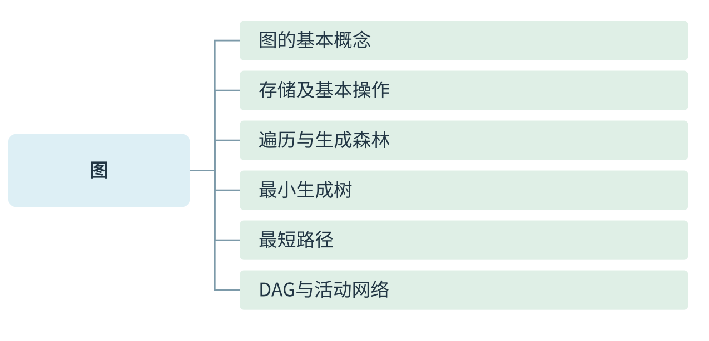

[可编辑SVG](../chapters/DS06/figures/overview.svg) · [完整知识导图](../chapters/DS06/chapter-map.pdf)

图的题目先辨认边的含义：一条边可以表示可通行的道路、需要铺设的线路，也可以表示任务之间的先后约束。最短路径、最小生成树、拓扑排序和关键路径分别优化或检查不同对象；选择算法前先把题目要求写成图上的条件。

<a id="DS06-map"></a>
## 本章知识结构

- **图的基本概念**：有向无向与带权；度入度出度；路径回路与距离；连通和强连通分量；生成树森林与完全图。
- **存储及基本操作**：邻接矩阵；邻接表及逆邻接表；十字链表；邻接多重表；增删顶点与关联边。
- **遍历与生成森林**：DFS的回退条件；BFS的发现与队列；访问标记设置时机；遍历时间与辅助空间。
- **最小生成树**：总边权目标与适用图；Prim的跨割状态；Kruskal的分量合并；同权边与唯一性。
- **最短路径**：BFS同权最短路；Dijkstra非负权与松弛；Floyd中转阶段；负边负环及不可达。
- **DAG与活动网络**：共享子表达式；拓扑排序及唯一性；AOV和AOE语义；事件最早最迟时间；活动余量与多条关键路径。

先明确图的方向、边权和存储表示，再跟踪访问标志、候选集合和路径信息。相同的图可以承载不同任务，判断算法时应始终回到它维护的状态与目标。

<a id="DS06-01"></a>
## 顶点、边、连通性与路径

> **最小反例 · n减1条边不够判树**
>
> 三点成环再加一个孤立点，共4顶点3边，恰有$n-1$条边却不连通且有环。判树还要加连通或无环条件，不能只由数量推出结构。
>
> 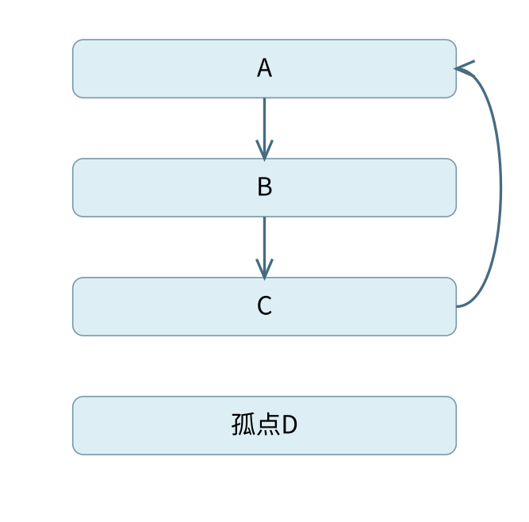
>
> 4顶点3边：三角形加孤点，满足m=n−1却不是树。

> **课程连接 · 网络拓扑只是图的一种模型**
>
> 计算机网络可把路由器视为顶点、链路视为边，但边权可能表示时延、费用或带宽的变换。先明确权的含义再选择算法；同一个物理网络可以对应不同优化问题。

**定义 · 图与本章模型**

图记为 $G=(V,E)$，$V$ 为顶点集合，$E$ 为边集合。无向边用无序顶点对表示，有向边（弧）用有序对表示。除另行说明，本章讨论无自环、无平行边的简单图，顶点数 $n=|V|>0$。无向简单图最多有 $n(n-1)/2$ 条边；有向简单图最多有 $n(n-1)$ 条弧。带权图的边还关联权值，权可以表示距离、费用或时间。


无向图顶点的度为关联边数，所有顶点度数和为 $2|E|$；有向图分别计入度、出度，各自总和都为 $|E|$。无向图度数为奇数的顶点个数必为偶数。路径长度若未加权，通常计边条数；带权长度计沿途权值和。简单路径不重复顶点，简单回路除首尾相同外不重复其他顶点。

无向图任意两顶点都有路径时称为连通图，其极大连通子图为连通分量；有向图中每对顶点相互可达时为强连通，极大强连通子图为强连通分量。单向可达不等于强连通。“极大”指不能再加入原图其他顶点而保持相应性质，不是要求分量含全图最多的顶点。

连通无向图的**生成树**含全部顶点，连通且无环，因此有 $n-1$ 条边。它是极小连通子图：再删一边即不连通。生成树一般不是原图的连通分量，因为连通分量要保留该连通块原有的全部边，不能删到只剩一棵树。非连通图的每个分量各取一棵生成树，得到生成森林。

<a id="DS06-ex1"></a>
### 例 6-1　“有可能连通”与“保证连通”不同

**例题 · 配套案例**

【配套例题】 无向图有7个顶点，要保证图在任何情况下都连通，需要的边数最少是（　）。

A. 6　B. 15　C. 16　D. 21


**解析。** 6条边可以组成一棵生成树，但也可以都集中在部分顶点上，不能保证连通。若图不连通，边数最多的分法是6个顶点组成完全图，剩1个孤立顶点，共 $\binom62=15$ 条边。超过15条就不可能仍不连通，故最少16条，答案为 **C**。

一般的 $n$ 顶点简单无向图，边数大于 $(n-1)(n-2)/2$ 可保证连通；边数至少 $n-1$ 只是连通的必要条件。若图有 $c$ 个连通分量，则每个分量至少要“顶点数减1”条边，所以 $|E|\ge n-c$。若 $|E|<n-1$，必不连通；若 $|E|=n-1$，还需检查是否无环或连通，才能认定为树。

一张 $n$ 顶点、$n$ 条边的无向图必有环，因为无环森林最多有 $n-1$ 条边。但图有环并不保证连通，也不保证只有一个环。求给定边数下最多的连通分量数时，应让边尽量集中：例如51个顶点、21条边，可在7个顶点上组成完全图，其余44个孤立，共45个分量；少于7个顶点最多15条边，无法容纳21条。

“完全图”是边达到上限的图；“连通”只要求路径存在。稠密与稀疏描述边数相对规模，具体选结构还要结合访问方式。对于$n>1$的强连通有向图，每个顶点入度、出度至少1，所以至少$n$条弧，有向环可达到下界；$n=1$时零弧图也可按零长度路径视为强连通，不能忽略这个边界。

**有向树**常指恰有一个入度为0的根、其余顶点入度为1、根沿弧可达全部顶点的有向无环图。仅仅有$n-1$条弧还不够。图中两点的距离是最短路径长；不可达时记为无穷，不把“没有路径”误记为距离0。

<a id="DS06-02"></a>
## 邻接矩阵、邻接表与基本操作

> **错项排除 · 零权边不是没有边**
>
> 带权邻接矩阵用无穷表示无边时，零是合法边权。若仍以if(A[u][v])判断有边，就会漏掉零权边；AOV的0/1邻接矩阵与这种表示的语义不同。

邻接矩阵 `A[u][v]` 表示是否存在 $u\to v$；带权时元素存放权值，用 $+\infty$ 表示不存在，不能把0既用作“无边”的标记，又用作零权边的权值。无向图矩阵对称，有向图不必。矩阵占 $\Theta(n^2)$ 空间，检查一条给定边为 $O(1)$，枚举某顶点邻边通常要扫整行 $O(n)$。

邻接表为每个顶点保存其邻接点链。无向图每条边通常出现两个表结点，有向图每条弧在出边表出现一次，空间均为 $\Theta(n+|E|)$。枚举邻边只访问实际表项，判断一条边是否存在则可能扫描相应链。逆邻接表以终点组织入边，方向与普通出边表相反。

下图同时用于说明存储表示与遍历。无向边为 `ab、ac、ae、be、cf、df、de`，各邻接表按字母升序排列。

<a id="ds-fig-graph"></a>
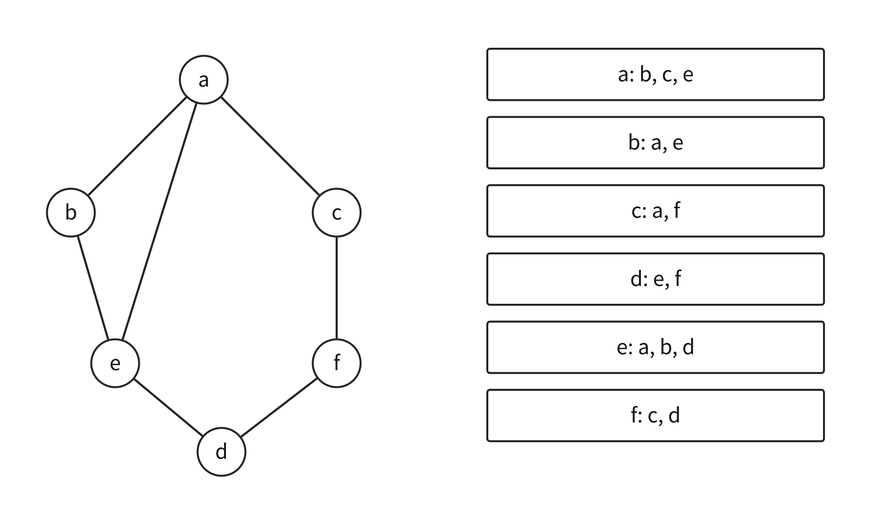

对该图，a 行有b、c、e三个非零项，b 行有a、e两个。无向图中，顶点的度等于该行非零项的个数；有向图中，行的非零项数给出出度，列的非零项数给出入度。求有向图所有顶点的入度时，矩阵要扫描 $n^2$ 个位置，邻接表只需扫描所有表项，成本不同。

删除顶点会同时删除其所有关联边。无向邻接表不能只删除该顶点自己的链，还要清除其他顶点中指向它的表项；有向图则须同时考虑入边和出边。题目若给出“只按出度计删除成本”的实现，应检查它是否另有入边索引。

<a id="DS06-storage-code"></a>
### 顶点表、边表与基本操作接口

> **条件辨析 · 编号与顶点信息**
>
> 算法使用的0起始编号是数组下标。图上V1可以对应下标0，也可以另存信息；转换一次后整章保持一致。

下面保留教材的矩阵和邻接表命名。`VertexType`为顶点信息类型，`EdgeType`为边权类型；实际使用前要根据问题定义它们。算法中的顶点编号是数组下标`0..vexnum-1`，图上显示的$V_1,V_2$等名称可以另存于顶点信息中。

```cpp
#define MaxVertexNum 100
typedef struct {
    VertexType Vex[MaxVertexNum];
    EdgeType Edge[MaxVertexNum][MaxVertexNum];
    int vexnum, arcnum;
} MGraph;

typedef struct ArcNode {
    int adjvex;
    struct ArcNode *next;
    // 带权图在此补充权值域
} ArcNode;
typedef struct VNode {
    VertexType data;
    ArcNode *first;
} VNode, AdjList[MaxVertexNum];
typedef struct {
    AdjList vertices;
    int vexnum, arcnum;
} ALGraph;
```

`arcnum`记录图中的实际边或弧条数；无向邻接表即使有$2|E|$个边表结点，也仍记录$|E|$，不能按表结点总数填入。矩阵的0/1表示与带权表示应分别初始化：带权对角线在最短路径初始化中通常取0，无边的非对角位置取无穷。

教材用下列接口屏蔽具体存储：

- `Adjacent(G,x,y)`判断边存在，`Neighbors(G,x)`枚举邻边。
- `InsertVertex`、`DeleteVertex`增删顶点；`AddEdge`、`RemoveEdge`增删边。
- `Get_edge_value`、`Set_edge_value`读写指定边的权值。
- `FirstNeighbor(G,x)`求第一个邻点；`NextNeighbor(G,x,y)`求邻点y之后的下一个邻点，无对应邻点时返回−1。

以下对这些接口采用同一方向约定：有向图的邻点指当前顶点的出弧所到达的顶点。

| 操作 | 邻接矩阵 | 普通出边邻接表 |
| --- | --- | --- |
| 判断$x\to y$是否存在 | $O(1)$ | 扫描$x$的出边链 |
| 枚举$x$的全部出邻点 | $O(|V|)$ | $O(OD(x))$ |
| 求某点出度 | 扫一行，$O(|V|)$ | 数该链结点，$O(OD(x))$ |
| 求某点入度 | 扫一列，$O(|V|)$ | 扫全体出边表，$O(|V|+|E|)$ |
| 删除顶点 | 删除关联行列并处理编号 | 清除出链与所有指向它的入弧 |

有向图若另建逆邻接表或十字链表，求入度和删除入弧的代价可随之改变。无向邻接表查度数直接数对应链即可。

无向图矩阵对称，可只保存上三角或下三角，再按对称关系恢复另半。若连同对角线保存，需要$n(n+1)/2$个单元；简单图的对角线已知全为0、另作约定时，可只存严格三角的$n(n-1)/2$项。压缩节省的是常数比例，空间阶仍为$O(n^2)$；定位公式须与保存方向和0／1起始下标一致。

<a id="DS06-matrix-power"></a>
### 矩阵幂数的是游走

设$A$是非加权图的0/1邻接矩阵，按普通整数矩阵乘法计算，则$(A^k)_{ij}$等于从$i$到$j$、恰好经过$k$条边的**游走数**，允许重复顶点和边。这来自乘法的逐中间点求和：$(A^2)_{ij}=\sum_t A_{it}A_{tj}$，每个非零乘积对应一条$i\to t\to j$。

例如只有无向边$1-2$时，$(A^2)_{11}=1$，对应$1\to2\to1$；它不是从1回到1的简单路径。题目若把这里的“路径”用作可重复的广义路径，应按这一含义理解。布尔矩阵乘法得到是否存在，普通算术乘法得到条数，二者也应区别。

<a id="DS06-03"></a>
## 十字链表与邻接多重表

> **不变量 · 一条边结点参与两条链**
>
> 邻接多重表让同一个无向边结点同时属于两个端点链。沿当前端点前进时选择其对应链接；这解释了为何可统一标记边，也解释了不能始终沿ilink。

**十字链表**面向有向图，每条弧只建立一个弧结点，记录弧尾、弧头以及两个链接：一个沿相同弧尾串联出弧，一个沿相同弧头串联入弧。每个顶点分别保存第一条出弧、第一条入弧。这样同一条弧可从源顶点的出边链或终点的入边链到达，无需存两份弧数据。

**邻接多重表**面向无向图，每条边只建一个边结点，记录两个端点 `ivex,jvex`，并有 `ilink,jlink`，分别串入两个端点的关联边链。沿顶点 u 的链前进时，须先判断 u 是这条边的哪个端点，再选择对应链接；不能始终只走 `ilink`。这种表示便于给一条边设置统一访问标记、执行删除等边操作。

普通邻接表为每条无向边保存两个表项；邻接多重表中的一个边结点同时挂在两条链上。数边时若直接数链表项，两种结构得到的数目会相差常数倍。稀疏矩阵的十字链表也使用“两种方向共享一个数据结点”的思想，但它的两维是行与列，不是有向图的弧尾与弧头。

<a id="DS06-04"></a>
## 深度优先搜索与搜索森林

DFS 从一个顶点开始，标记并访问，再递归访问尚未访问的邻接点；当前顶点已没有未访问邻点时才回退。标记用于防止沿环重复访问。遍历整张图时，还须依次检查所有顶点，对仍未访问的顶点重新启动搜索；一趟 DFS 未必到达全图。

```cpp
bool visited[MaxVertexNum];
void DFS(Graph G, int v) {
    visit(v);
    visited[v]=true;
    for (int w=FirstNeighbor(G,v); w>=0;
         w=NextNeighbor(G,v,w))
        if (!visited[w]) DFS(G,w);
}
void DFSTraverse(Graph G) {
    for (int v=0; v<G.vexnum; ++v) visited[v]=false;
    for (int v=0; v<G.vexnum; ++v)
        if (!visited[v]) DFS(G,v);
}
```

上图按字母顺序枚举邻点，从 a 开始，得到 `a,b,e,d,f,c`。首次到达新顶点的边形成 DFS 生成树；无向图的搜索树棵数等于连通分量数，有向图不能用树棵数直接认定强连通分量数。

<a id="DS06-ex2"></a>
### 例 6-2　什么时候允许回退去另一个分支

**例题 · 配套案例**

〖6.3-011〗 无向图顶点为 `{a,b,c,d,e,f}`，边为 `{ab,ae,ac,be,cf,fd,ed}`。进行深度优先遍历，不能得到的序列为（　）。

A. acfdeb　B. aebdfc　C. aedfcb　D. abecdf


**解析。** D 访问到 `a,b,e` 时，e 的邻点d尚未访问，必须深入d，不能先回退到a转去c，因此 D 不可能。A可沿a→c→f→d→e→b；B可先走a→e→b，b无未访问邻点后回到e，再走d→f→c；C可先走a→e→d→f→c，回退后再处理b。答案为 **D**。输出序列中相邻的两个顶点不一定直接相连，因为中间可能发生回退；判断时真正要看的是，回退发生时当前顶点是否还有未探索的邻点。

采用邻接表时，每个顶点和表项只处理常数次，时间 $O(n+|E|)$；矩阵要对每个访问顶点扫一整行，时间 $O(n^2)$。递归栈最坏 $O(n)$，另有访问标志数组 $O(n)$。如果改为在递归返回前才输出顶点，得到的是完成次序；对 DAG，该完成次序的逆序就是拓扑序列，第8节会说明原因。

<a id="DS06-traversal-order"></a>
### 遍历序列、存储次序与生成森林

> **条件辨析 · 三个顺序共同确定遍历**
>
> 起始顶点、外层扫描次序、邻点枚举次序都固定，DFS或BFS才有固定输出。矩阵存储本身没有禁止逆序扫描。

`Graph`在遍历代码中表示已经实现上述邻点接口的图类型；选用矩阵或邻接表后，由对应接口完成枚举。只有**起始点、外层顶点扫描顺序、邻接点枚举顺序**都固定，遍历序列才固定。对编号固定的邻接矩阵，常规逐列递增扫描会给出一种确定顺序；若改变扫描方向，同一矩阵也可得到另一序列。

每个新顶点第一次被发现时，记录其前驱，便得到搜索生成树。无向图中一棵树覆盖一个连通分量，若有$c$个分量，森林共$|V|-c$条树边。非树边仍属于原图，不能因它未出现在搜索树中就从图里删除。有向图的搜索树覆盖的是这次沿出弧可达且尚未访问的部分，外层启动次数受起点次序影响，不能拿来计算强连通分量。

DFS的递归深度、BFS的队列长度都可能达到$O(|V|)$；把访问标志数组算入辅助空间时，完整遍历至少还需$O(|V|)$标志空间。即便某个DFS实例的调用栈只有常数深度，也不能把整个实现的辅助空间一并写为$O(1)$。

<a id="DS06-05"></a>
## BFS 为什么得到无权最短路

> **最小反例 · 边最少而权更大**
>
> 三点A、B、C，AB与BC权1，AC权3。BFS从A一跳发现C，少一条边却总权3；经B两跳总权2。因此BFS的分层证明不能覆盖不等权路径目标。

BFS 用队列保存已发现、尚未扩展的顶点。起点先标记并入队；每次取出队头，将其尚未发现的邻点标记、记录距离并入队。标记应在**入队时**设置，若等到出队才标记，同一顶点可能被不同前驱重复入队。

```cpp
void BFS(Graph G, int v) {
    SqQueue Q;
    InitQueue(Q);
    visit(v);
    visited[v]=true;
    EnQueue(Q,v);
    while (!QueueEmpty(Q)) {
        DeQueue(Q,v);
        for (int w=FirstNeighbor(G,v); w>=0;
             w=NextNeighbor(G,v,w)) {
            if (!visited[w]) {
                visit(w);
                visited[w]=true;
                EnQueue(Q,w);
            }
        }
    }
}
void BFSTraverse(Graph G) {
    for (int v=0; v<G.vexnum; ++v) visited[v]=false;
    for (int v=0; v<G.vexnum; ++v)
        if (!visited[v]) BFS(G,v);
}
```

上面的队列元素为顶点编号，容量要能容纳全部可能同时入队的顶点。若采用第3章牺牲一个单元的循环队列，物理数组须比允许队列长度多1。

求从源点$u$出发的无权最短路径时，初始化全部`d[i]=INF`、`path[i]=-1`，令`d[u]=0`。在发现边$v\to w$且`visited[w]==false`的分支中增加：

```cpp
d[w]=d[v]+1;
path[w]=v;
```

每个顶点只在首次发现时赋距离。`path[w]`是其路径前驱，可从目标反向追到源点；最后把这条逆序链倒过来。源点`path[u]=-1`是终止标志，不表示源点不可达。

**推导 · BFS首次发现即最短**

队列保证按距离分层出队：距离0的顶点先于距离1的，距离1的又先于距离2的。首次发现 v 时，若还存在更短的路径，这条路径上 v 的前驱应位于更早的一层，早已被扩展，v 也就应更早被发现，矛盾。因此 `dist` 记录的是最少边数。


上图从a出发、邻点按字母枚举，出队访问序列为 `a,b,c,e,f,d`；b、c、e距离1，f、d距离2。该序列与DFS顺序不同，但也不唯一：同层邻接次序可改变，最少边数不变。带权不等长边时，少经过一条边未必总权更小，不能把这条证明直接推广为带权最短路。

邻接表与矩阵的时间同DFS，队列和标记等辅助空间为 $O(n)$。有向图中，BFS只沿弧的方向扩展；“无权最短路”并不要求图无向，但要求每条边的代价相同，只按边数计。

<a id="DS06-bfs-course"></a>
### 王道课件的八顶点最短路径实例

下图中的顶点名称为1～8，以2为源点，邻点按名称递增枚举。源点先发现1和6；随后1发现5，6发现3和7；再由3发现4、由7发现8。BFS生成树保留每个非源点的首次发现前驱，其根到各点的路径具有最少边数。

<a id="DS06-fig-bfs-course"></a>
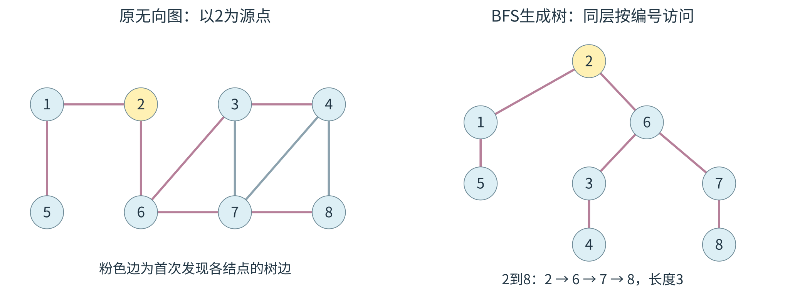

| 顶点名称 | 1 | 2 | 3 | 4 | 5 | 6 | 7 | 8 |
| --- | --- | --- | --- | --- | --- | --- | --- | --- |
| 距离d | 1 | 0 | 2 | 3 | 2 | 1 | 2 | 3 |
| 前驱path | 2 | −1 | 6 | 3 | 1 | 2 | 6 | 7 |

从目标8倒推前驱，得到$8\leftarrow7\leftarrow6\leftarrow2$，反转即为最短路径$2	o6	o7	o8$，长度3。表中使用图上的1起始名称，写入前述0起始图接口时，应把名称映射为数组下标；源点的前驱−1保留为终止标记。

**方法 · 把题意翻译成图算法的目标**

先确定有向还是无向、边权是否同一常数，再问目标是“全部顶点以最低总价接通”“某个起点到各点最短”“先后约束合法”还是“工程完成时间”。BFS只保证同权边最短，MST只控制整棵树总权；它们不能互相替代。


<a id="DS06-06"></a>
## Prim 与 Kruskal 在挑什么边

> **错项排除 · 同权不等于MST必不唯一**
>
> 若所有边权互异，MST一定唯一；逆命题不成立。一个本来就是树的连通图，即使边权相同，其生成树仍只有它本身，不能根据同权直接判不唯一。

最小生成树（MST）要求连通全部顶点、无环，并使所选 $n-1$ 条边权和最小。它不要求从某个起点到每个顶点的路径最短。若图不连通，只能得到每个分量的最小生成森林。

Prim 维护一个已连接顶点集合 U，每次从“一端在U、一端在外”的边中选最小边，加入新顶点。Kruskal 则把全部边按权非降序考虑，端点在不同当前分量时选入并合并，同一分量则跳过以避免成环。二者都利用割上的轻边性质，但状态不同：Prim始终扩展一棵树，Kruskal可能同时有多棵。

<a id="DS06-ex3"></a>
### 例 6-3　同权边怎样影响第二次选边

**例题 · 配套案例**

【配套例题】 求下图最小生成树，可能为 Kruskal 第2次选中、但不可能为从 $V_4$ 开始的 Prim 第2次选中的边是（　）。

<a id="ds-fig-mst"></a>
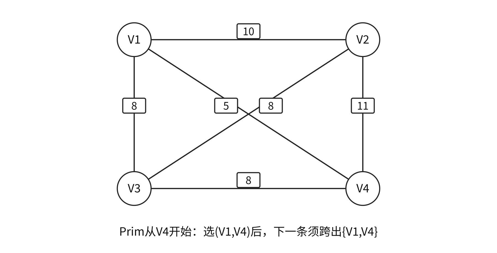

A. $(V_1,V_3)$　B. $(V_1,V_4)$　C. $(V_2,V_3)$　D. $(V_3,V_4)$


**解析。** 两个算法首先都选权5的 $(V_1,V_4)$。Kruskal 此后可选任意一条不成环的权8边，包括 $(V_2,V_3)$。Prim 此时 U 为 $\{V_1,V_4\}$，第2条边必须跨越这个集合的边界，只能在 $(V_1,V_3)$ 与 $(V_4,V_3)$ 中选权8的边；$(V_2,V_3)$ 两端都在集合外，不能选。答案为 **C**。

继续执行时，Kruskal若选 $(V_2,V_3)$，最后还要用一条权8边把两个分量连接，总权21；Prim选入V3后，再用 $(V_3,V_2)$ 权8连V2，也是21。同权边可能导致不同的MST；全部边权互异足以保证MST唯一，但存在同权边时MST仍可能唯一。

朴素Prim配矩阵为 $O(n^2)$；邻接表配专门维护候选最小值的结构可降低稀疏图中选最小边的代价。Kruskal主要花在边排序，常写 $O(|E|\log|E|)$，加并查集维护分量。具体选哪一个，还要看图的表示与选边的实现，不能只比较算法名字。

<a id="DS06-mst-code"></a>
### 最小生成树的核心伪码

> **不变量 · Prim的key不是距离**
>
> Prim只问一条跨割边接新点的代价，key更新取边权；Dijkstra问源点到新点的完整路径，需加已确定前缀。把两者公式混写可能算出另一种对象。

```text
Prim(s):
    U={s}; lowCost[v]=w(s,v)，无边记无穷
    重复直到选入全部顶点:
        u=U外lowCost最小者
        若lowCost[u]=无穷: 原图不连通，停止
        选入parent[u]到u的边；U加入u
        对每个U外邻点v:
            若w(u,v)<lowCost[v]: 更新lowCost[v]及parent[v]
```

这里`lowCost[v]`始终是U到v的最轻跨割边，**不是**从s到v的路径长度，所以更新式没有`lowCost[u]+w(u,v)`。

```text
Kruskal(G):
    将边按权非降排序；每个顶点初始化为单独集合
    对每条边(u,v,w):
        若find(u)!=find(v):
            选入此边；unite(u,v)
    若选入边数<n-1: 得到最小生成森林而非生成树
```

**推导 · 为何跨割最轻边可以安全加入**

设已有选择能扩展到某棵MST，考虑与现有分量相容的割及其一条轻边$e$。若某MST不含$e$，加入$e$形成环，环上必有另一条跨该割的边$f$，且$w(e)\le w(f)$。删$f$保连通且不增权，得到含$e$的MST；这说明选择可扩展，不表示所有MST都必须含$e$。


<a id="DS06-07"></a>
## Dijkstra 与 Floyd 的条件和中间状态

> **错项排除 · 有负边与一定算错不同**
>
> 负边意味着标准Dijkstra失去通用正确性保证，不代表每个含负边实例都会得错值。选项若用“只要有一条负边就必算错”的绝对语气，可用简单单路径反驳。

Dijkstra 求单源最短路径。维护已确定集合 S 与暂定距离 `dist[v]`；每次选择 S 外距离最小的顶点 u，确定它的最短距离，再用 `dist[u]+w(u,v)` 松弛其邻点。尚未确定的 `dist` 是已知可达路径的最好上界，不一定已是真正最短距离。

通用正确性要求边权非负：若能先经过一个当前距离更远的顶点、再经负边绕回u，u的真实距离就可能小于已确定的值，于是u被过早确定。出现负边不表示每个实例都必然算错，但标准算法不能保证正确。不可达顶点的距离保持无穷，所有剩余距离都为无穷时可停止，不能再把无穷当作普通数参与加法。

<a id="DS06-ex4"></a>
### 例 6-4　求出第二条最短路径后哪些值还可变

**例题 · 配套案例**

【配套例题】 使用 Dijkstra 求下图从顶点1到其余顶点的最短路径，`dist` 依次保存到2、3、4、5的距离。求出第二条最短路径后，`dist` 内容为（　）。

<a id="ds-fig-dijkstra"></a>
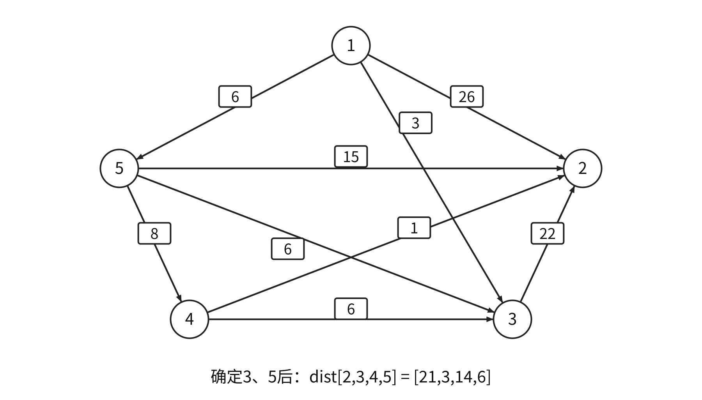

A. 26、3、14、6　B. 25、3、14、6　C. 21、3、14、6　D. 15、3、14、6


**解析。** 先把起点1确定，初始 `dist=(26,3,∞,6)`。第1条到其他顶点的确定路径是1→3，长3；用3→2的22更新到2距离为25。随后选顶点5，距离6，第2条路径确定；由5→2的15把到2更新为21，由5→4的8把到4更新为14，得到 **(21,3,14,6)，答案 C**。


| 已确定的新顶点 | 暂定距离向量(dist[2],dist[3],dist[4],dist[5]) |
| --- | --- |
| 1（初始化） | (26,3,∞,6) |
| 3 | (25,3,∞,6) |
| 5 | (21,3,14,6) |
| 4 | (15,3,14,6) |
| 2 | (15,3,14,6) |


答案要求的是第2条路径确定后，不是算法最终结果。顶点4随后才用其到2的权1把21改为15，不能把这个将来更新提前放进答案。

Floyd 求任意顶点对之间的最短路。令 $D^{(k)}[i,j]$ 表示只允许编号不超过k的顶点作为内部中转时的最短距离，则

$$D^{(k)}[i,j]=\min\{D^{(k-1)}[i,j],D^{(k-1)}[i,k]+D^{(k-1)}[k,j]\}.$$

两种候选分别是不经过k，或在k处分成两段。实现时中转顶点k必须放在最外层循环，才能对应这个阶段的含义。时间 $O(n^3)$，距离矩阵 $O(n^2)$；允许负边，但要求不存在影响所求路径的负权回路，否则不存在有限最短值。无向图中一条负权边就能往返构成负权闭合游走，不能直接套用通常的有限最短路模型。

矩阵版 Dijkstra 单源时间 $O(n^2)$；对每个源点重跑得到全源需 $O(n^3)$，不能仍写成 $O(n^2)$。BFS求的是同权边下的最少边数，MST最小化整棵树的边权总和，Floyd/Dijkstra最小化指定端点之间的路径权和；三个目标要分别辨认。

<a id="DS06-shortest-code"></a>
### 最短路径的阶段循环

> **不变量 · 已确定与暂定要分开**
>
> Dijkstra中暂定dist只是一条已知路径的最好上界。选出最小暂定点后才永久确定；过程题若提前使用未来松弛的值，就把最终答案错误放入了中间状态。

```text
Dijkstra(s):
    dist[s]=0；其余为无穷；S为空
    重复选择S外dist最小的u:
        若dist[u]=无穷: 停止
        S加入u
        对每条u到v，若v未确定且dist[u]+w(u,v)<dist[v]:
            更新dist[v]；parent[v]=u
```

最外层每次永久确定一个顶点，这是非负权前提的用处；已经确定的点不能靠未来负边回头改写。实现中先检查`dist[u]`有限，避免无穷哨兵加权溢出。

```text
Floyd(D):
    D[i][i]=0；其他位置按直接边初始化
    for k=0..n-1:
        for i=0..n-1:
            for j=0..n-1:
                若D[i][k]与D[k][j]均有限:
                    D[i][j]=min(D[i][j],D[i][k]+D[k][j])
```

`k`在外层时，“已允许的中间顶点集合”才依次扩大。若结束后某`D[v][v]<0`，说明存在负环；受该负环影响的点对没有有限最短距离，不能继续解释该数值为答案。

<a id="DS06-floyd-example"></a>
### Floyd三阶段计算实例

> **条件辨析 · path有两种语义**
>
> Floyd的path[i][j]记录中转点；BFS或Dijkstra的一维path[v]通常记录直接前驱。重建路径时分别递归拆分或反向追溯。

课件的三顶点有向图，按$V_0,V_1,V_2$排列，直接边为$V_0\to V_1=6$、$V_0\to V_2=13$、$V_1\to V_0=10$、$V_1\to V_2=4$、$V_2\to V_0=5$。无边记$\infty$，对角线为0：

$$
A^{(-1)}=\begin{pmatrix}0&6&13\\10&0&4\\5&\infty&0\end{pmatrix}.
$$

允许$V_0$中转后，$2\to1$由$\infty$更新为$5+6=11$；允许$V_1$中转后，$0\to2$由13更新为$6+4=10$；允许$V_2$中转后，$1\to0$由10更新为$4+5=9$：

$$
\begin{aligned}
A^{(0)}&=\begin{pmatrix}0&6&13\\10&0&4\\5&11&0\end{pmatrix},\\[4pt]
A^{(1)}&=\begin{pmatrix}0&6&10\\10&0&4\\5&11&0\end{pmatrix},\\[4pt]
A^{(2)}&=\begin{pmatrix}0&6&10\\9&0&4\\5&11&0\end{pmatrix}.
\end{aligned}
$$

中转记录初值`path[i][j]=-1`。每次因$k$而更新距离，就令`path[i][j]=k`；例如最终`path[0][2]=1`，说明0到2应拆为0到1、1到2。若子段还有中转点，再递归拆分。这个矩阵保存**中间顶点**，与Dijkstra或BFS保存“直接前驱”的一维`path`含义不同。

<a id="DS06-expression-dag"></a>
### DAG怎样共享子表达式

表达式树为每次运算保留一份子树；DAG可以让多个父运算共享相同子表达式。对`(a*b)*(a*b)*(a*b)*c`，先为操作数$a,b,c$各建一个顶点，建立一次$t_1=a*b$，再按左结合次序建立$t_2=t_1*t_1$、$t_3=t_2*t_1$、$t_4=t_3*c$。两个操作数相同的乘法也保留左右两个输入位置，即便它们指向同一个$t_1$。

构造时先标运算依赖，再合并相同操作数和相同运算的相同输入子图；只有操作符和有序输入都相同，才可直接共享。`a-b`和`b-a`不能合并；`a/(b*c)`与`(a/b)*c`也不能按视觉相似合并。含赋值、函数调用等副作用时，还须遵守表达式求值语义。

<a id="DS06-fig-dag"></a>
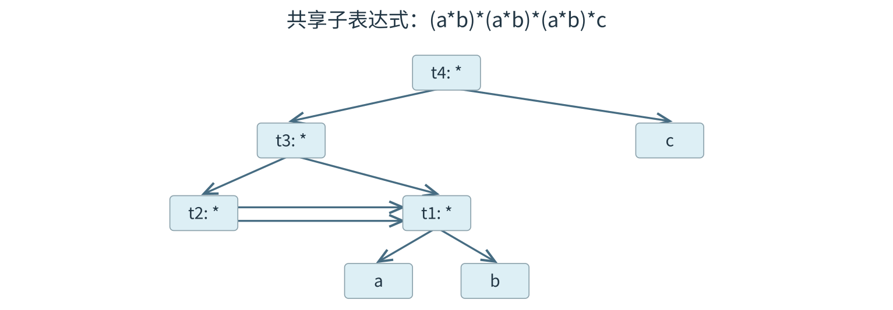

<a id="DS06-08"></a>
## 拓扑排序：由入度判断哪些任务可以先做

> **不变量 · 入度为零才可先执行**
>
> 入度表示尚未完成的直接前驱数；输出顶点并移除其出弧后，后继入度随之递减。队列为空而顶点尚未全部输出时，图中存在有向环。

有向无环图（DAG）可以用顶点表示活动、弧表示先后约束，称为 AOV 网。拓扑序列要求对每条弧 $u\to v$，u都排在v之前。算法先把所有入度为0的顶点作为候选，每次删除一个候选及其出弧，更新后继入度；若处理完的顶点数不足n，则存在有向环。

有多个候选时可以选择不同的顺序，因此拓扑序列一般不唯一。对DAG做DFS并在退出时输出，每条弧的终点必先完成，得到的是逆拓扑序列；把该完成序列反向才是拓扑序列。若存在有向环，仅取得一个DFS完成次序并不能证明拓扑合法。

<a id="DS06-ex5"></a>
### 例 6-5　怎样判定唯一拓扑序列

**例题 · 配套案例**

【配套例题】 载人航天工程包含众多子工程，为保证有序开展，需要明确前导子工程。这可抽象为有向图的拓扑序列问题。已知图G采用邻接矩阵存储：

```c
typedef struct {
    int numVertices,numEdges;
    char VerticesList[MAXV];
    int Edge[MAXV][MAXV];
} MGraph;
```

设计 `int uniquely(MGraph G)` 判定G是否存在唯一拓扑序列，是则返回1，否则返回0。给出设计思想及带关键注释的C或C++实现。


**解析。** 每一轮的候选零入度顶点必须恰有一个。若图无环且某轮至少有两个，二者都可作为下一项，交换其先后可产生至少两个拓扑序列；若某轮没有候选而尚未处理完，则余图有环，无法完成。这两种情况都不满足唯一，均可返回0。只有始终唯一且处理完全体顶点，才能返回1。

```c
int uniquely(MGraph G) {
    int n=G.numVertices, indeg[MAXV]={0};
    bool used[MAXV]={false};
    for (int u=0; u<n; ++u)
        for (int v=0; v<n; ++v)
            if (G.Edge[u][v]) ++indeg[v];
    for (int step=0; step<n; ++step) {
        int pick=-1;
        for (int v=0; v<n; ++v)
            if (!used[v] && indeg[v]==0) {
                if (pick!=-1) return 0; // 至少两个候选
                pick=v;
            }
        if (pick==-1) return 0;         // 剩余部分有环
        used[pick]=true;
        for (int v=0; v<n; ++v)
            if (G.Edge[pick][v]) --indeg[v];
    }
    return 1;
}
```

这里AOV邻接矩阵用0/1分别表示无边与有弧，不能直接把带权矩阵的“无边为无穷”搬进这个判断。总时间 $O(n^2)$，工作数组额外占 $O(n)$；题给的按值传参若实际复制整个矩阵，形参副本还占 $O(n^2)$，可按接口许可改为只读引用。若使用邻接表并维护零入度候选数，处理时间可为 $O(n+|E|)$。顶点已经按某个拓扑次序编号时，所有弧才保证由小编号指向大编号，邻接矩阵才呈严格上三角；任意编号的DAG不必原样为三角矩阵。

DAG还可表达共享子表达式：相同子式只存一份，不同上层结点可指向同一子式。它表达计算依赖而非普通树的唯一双亲关系；不能再套用“除根外每结点恰有一个双亲”。

<a id="DS06-topo-code"></a>
### 一般拓扑排序的队列实现

> **课程连接 · 同步前驱约束就是偏序**
>
> 操作系统中多个事件的前驱关系可用DAG表示，零入度事件代表当前所有前驱已完成。拓扑排序只给合法先后，不计算耗时；带持续时间的工期还需AOE时间传播。

```text
topological(G):
    统计所有顶点的入度；把入度0者入队Q
    count=0
    while Q非空:
        u=出队；输出u；count++
        对每条u到v: indeg[v]--
            若indeg[v]==0: v入队
    返回count==n
```

入度表示余图中尚未删除的前驱数，只有从1降到0时加入候选。若只关心任意拓扑序列，可以任选候选；要判断唯一，则每一步候选数都必须恰为1，原例的代码正是在增加这个约束。

<a id="DS06-reverse-topo"></a>
### 逆拓扑排序与DFS环检测

> **条件辨析 · visited不足以判有向环**
>
> 到达已完成结点不说明有环；回到当前递归栈中的结点才形成回边。三色状态区分发现与完成。

从出度为0的顶点开始，删除顶点及其入弧，得到逆拓扑序列。普通出边邻接表查找入弧不便，可使用逆邻接表维护出度变化；若直接每轮扫描全图，复杂度会改变。DFS在返回前输出顶点，也能在DAG上得到逆拓扑序列。

判断有向环时，把顶点分为未访问、正在递归栈中、已完成三种状态。沿弧到达“正在递归栈中”的顶点，说明该弧与栈上的路径形成有向环；到达已经完成的顶点本身并不表示有环。单一`visited`只能防止重复访问，不能替代三色状态判断。无向图的回边判断还需排除通往当前双亲的那条树边。

<a id="DS06-09"></a>
## 关键路径：事件与活动的时间不同

AOE 网用顶点表示事件、带权有向边表示活动，边权为持续时间。某事件要等全部进入活动都完成才能发生；它发生之后，其出边活动才能开始。以下假设该网无环、持续时间非负，且有统一的源点和汇点；若源点或汇点不止一个，可添加零时长的虚边统一。

事件最早发生时间 `ve[v]` 按拓扑序计算：从所有前驱中取 `ve[u]+w(u,v)` 的**最大值**，因为全部前导活动都得完成。令汇点的最迟发生时间等于总工期，事件的最迟发生时间 `vl[u]` 则按逆拓扑序计算，取所有后继的 `vl[v]-w(u,v)` 的**最小值**，以保证每条后续活动仍赶得上。

活动 $u\to v$ 的最早开始时间为 $e=ve[u]$，最迟开始时间为 $l=vl[v]-w(u,v)$。$l-e$ 是该活动的时间余量；余量0的活动为关键活动。关键路径是源到汇的一条最长带权路径，决定最短可完成工期；它不是边最多的路径。

<a id="DS06-ex6"></a>
### 例 6-6　多条关键路径时怎样缩短工期

**例题 · 配套案例**

【配套例题】 下图AOE网包含8个活动。通过同时加快若干活动，可缩短整个工程工期。下列选项中，加快所列活动进度就可缩短工期的是（　）。

<a id="ds-fig-aoe"></a>
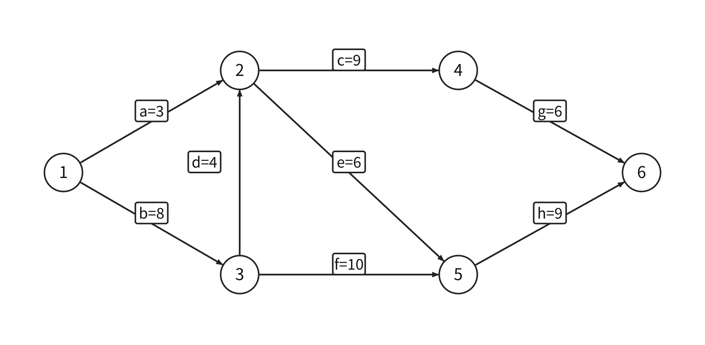

A. c和e　B. d和c　C. f和d　D. f和h


**解析。** 先按拓扑次序1、3、2、4、5、6算事件时间。


| 事件 | ve | vl |
| --- | --- | --- |
| 1 | 0 | 0 |
| 2 | 12 | 12 |
| 3 | 8 | 8 |
| 4 | 21 | 21 |
| 5 | 18 | 18 |
| 6 | 27 | 27 |


例如 `ve[2]=max(0+3,8+4)=12`，不能仅沿1→2算成3；`ve[5]=max(12+6,8+10)=18`。从汇点反推，`vl[2]=min(21−9,18−6)=12`，同时约束它通往4和5的两条后续活动。

活动a余量为9，其余b、c、d、e、f、g、h均为关键活动。关键路径有三条：`b-d-c-g`、`b-d-e-h`、`b-f-h`，长度均27。若只缩短其中一条路径上的活动，其他路径仍可能保持27。f与d合起来覆盖三条关键路径：d影响前两条，f影响第三条；两者同时适当缩短，所有原关键路径都会变短。答案为 **C**。A、B遗漏路径b-f-h，D遗漏路径b-d-c-g。

增加关键活动时长会使包含它的路径变长，进而延长工期；缩短某一关键活动却未必缩短工期，因为还可能有不包含它的其他关键路径。持续缩短还可能使原非关键路径成为新的关键路径，必须重新计算，不能无限按原余量推断。

<a id="DS06-aoe-code"></a>
### 关键路径的计算表怎样落到程序

> **错项排除 · 缩短一条关键活动未必够**
>
> 存在两条等长关键路径时，只缩短其中一条独有活动，另一条仍保持原工期。要检查所有当前关键路径是否都被影响，并在缩短后重新计算新关键路径。

```text
criticalPath(G):
    取得拓扑序T；若不存在则模型非法
    ve[*]=0
    按T正序，对每条u到v: ve[v]=max(ve[v],ve[u]+w(u,v))
    D=ve[统一汇点]；vl[*]=D
    按T逆序，对每条u到v: vl[u]=min(vl[u],vl[v]-w(u,v))
    对每条活动u到v:
        e=ve[u]；l=vl[v]-w(u,v)
        若e==l: 该边为关键活动
```

按“全部前驱都完成”取最大最早时间，按“不拖延任何后继”取最小最迟时间，方向不能交换。不能将`ve[v]`直接当作边$u\to v$的活动最早开始时间，活动开始由弧尾事件$u$决定。


| 任务 | 前提与优化对象 | 核心状态 | 典型边界 |
| --- | --- | --- | --- |
| BFS最短路 | 同权边；最少边数 | 分层队列和距离 | 非等权不能直接用 |
| MST | 带权无向图；总树权最小 | Prim跨割值或Kruskal分量 | 不保证源点路径最短 |
| Dijkstra | 非负权；单源路径和最小 | 已确定集合与暂定上界 | 负边破坏通用保证 |
| Floyd | 无相关负环；点对最短 | 允许的中转点集合 | 中转点循环在最外层 |
| 拓扑 | DAG；满足先后约束 | 余图入度 | 无候选而未结束表示有环 |
| 关键路径 | AOE DAG；总工期 | 事件ve/vl及活动e/l | 多条关键路径需同时考虑 |


<a id="DS06-check"></a>
## 主动回忆自测

以下为自拟补充，检查算法选择的边界。

1. 图有8个顶点、7条边，能否直接认定为树？若再给“连通”呢？
2. 有向图A→B、A→C、B→D、C→D有几个拓扑序列？若添加B→C，怎样变化？
3. 一条边权变大，MST总权与某一对顶点最短距离是否一定同时改变？
4. 一条关键活动缩短1，工期是否必缩短1？

5. 无向图三点A、B、C，边AB=1、AC=3、BC=1。从A作BFS得到的到C路径是否必为最短权路径？
6. Prim的`key[v]`与Dijkstra的`dist[v]`分别保存什么？为什么松弛公式不同？
7. Floyd把`k`放内层，仅执行一次三重循环还能直接沿用原证明吗？
8. DAG中某轮有两个零入度顶点，能否仍有唯一拓扑序列？

**答案。** 1. 不能；若无向且连通，7条边恰够生成树，不可能再有环，故为树。2. 原有A-B-C-D与A-C-B-D两个；添加后仅A-B-C-D。3. 不一定；该边可能不在任何当前采用的最优解中，两种优化目标也不同。4. 不一定；有另一条不含该活动的同长关键路径时工期不变。

5. 不能；BFS可一条边直接到C，权为3，实际A-B-C权为2。它最少的是边数，不是总权。
6. 前者是连接现有树集合到v的最轻边；后者是从固定源点到v的已知路径最小上界，后者需累加已确定前缀距离。
7. 不能，阶段已不再对应统一的中转集合；必须重新证明算法，而非只因循环次数相同就认定等价。
8. 不能；在无环余图中这两个候选可分别作为下一项，并可扩展为合法序列，至少产生两种拓扑序。


<a id="DS07"></a>
# 查找

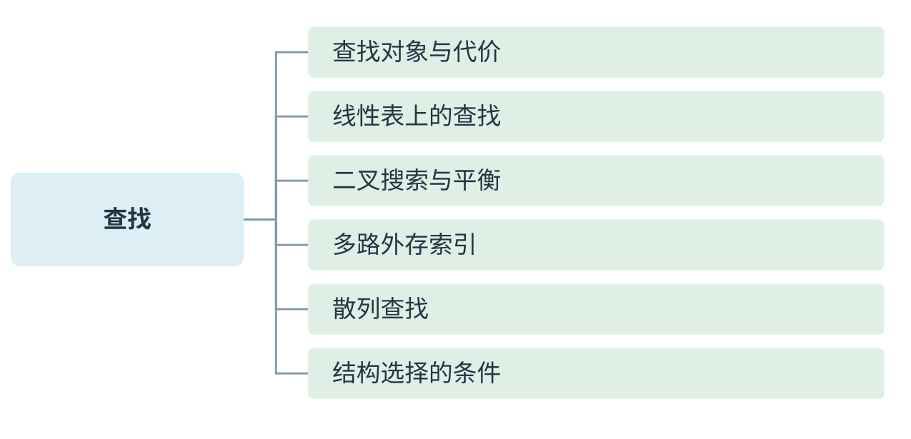

[可编辑SVG](../chapters/DS07/figures/overview.svg) · [完整知识导图](../chapters/DS07/chapter-map.pdf)

查找结构要回答两个问题：怎样缩小候选范围，插入或删除后怎样保持这种缩小范围的能力。顺序查找只依赖逐项比较；折半查找依赖顺序存储且有序；搜索树把有序关系放进分支；散列表则用关键字计算位置。外存索引还要考虑一次读入能取得多少个关键字。

<a id="DS07-map"></a>
## 本章知识结构

- **查找对象与代价**：主关键字与次关键字；静态动态查找表；成功失败事件；概率与平均查找长度；比较次数及外存页数。
- **线性表上的查找**：无序及有序顺序查找；哨兵与失败边界；分块索引与块长；折半查找的闭区间；判定树与失败外部位置。
- **二叉搜索与平衡**：BST全部子树区间；查找插入删除；AVL平衡因子；LLRRLRRL旋转；红黑性质及黑高；红黑插入删除修复。
- **多路外存索引**：m阶B树容量；分裂借位合并；根升降与叶等深；B树高度界；B+树索引及叶链；点查范围与读盘次数。
- **散列查找**：散列函数构造；冲突及同义词；链地址法；开放定址探查序列；删除标记及重复判断；装填因子与ASL。
- **结构选择的条件**：有序与随机定位；动态更新及维护；平衡性与最坏保证；外存页分支数；等值与范围检索。

按“候选范围怎样缩小、失败怎样判定、更新怎样维护结构”三条线阅读。ASL计算始终先写清事件集合、概率和计数口径，再执行实际查找路径。

<a id="DS07-01"></a>
## 关键字、成功失败与平均查找长度

> **错项排除 · 先决定ASL的事件空间**
>
> 成功概率分配给已有记录，失败概率可能分配给关键字间隙或初始散列地址。先写清每项概率再计平均；不能看到有效记录有n个，就把所有失败长度都除以n。

**定义 · 查找表、关键字与动态性**

查找表是同一类型记录的集合，**关键字**是用于识别记录的数据项。主关键字唯一标识记录，次关键字可能对应多条记录。只进行查找、不改变记录集合的表称为静态查找表；还需要插入、删除记录的表为动态查找表，不能仅凭“采用数组”判断是静态还是动态。


**查找长度**通常指一次查找中关键字的比较次数，平均查找长度为 $\mathrm{ASL}=\sum_i p_iC_i$，其中 $p_i$ 为某一查找事件的概率，$C_i$ 为该事件的比较次数。成功ASL在表内各条记录之间分配概率；失败ASL在不存在的关键字可能落入的失败区间或初始散列地址之间分配概率，分母未必是表长。

树形查找中，访问一个含多关键字的B树结点可能只触发一次外存读，却在内存中比较多个关键字。因此“读盘次数”“访问结点数”“关键字比较次数”不是同一个量，题目要求哪个就统计哪个。

<a id="DS07-02"></a>
## 顺序查找、分块查找与提前结束

无序表从一端逐项比较，成功时停止，扫描完仍未找到则失败。等概率成功时，平均比较 $(n+1)/2$ 次；失败通常比较n次。哨兵可以统一循环终止条件、减少边界判断，但不会改变比较次数的数量级。若计入哨兵自身的关键字比较，次数还须按代码约定加上相应一项。

递增有序表从头查找时，当前值等于目标时应报告成功，当前值**大于**目标才可提前失败；把“不小于”一概判为失败会把相等的目标漏掉。若仍逐个向后比较，等概率成功ASL与无序表相同，只是失败可能提前结束；有序并不自动意味着每种查找都使用折半。

<a id="DS07-seq-code"></a>
### 顺序查找的哨兵实现

> **条件辨析 · 同结构名也要看有效范围**
>
> 哨兵顺序查找的SSTable用1至n，折半查找课件用0至n-1。elem和TableLen含义相同，有效下标范围由具体算法规定。

```cpp
typedef struct {
    ElemType *elem;
    int TableLen;
} SSTable;
int Search_Seq(SSTable ST, ElemType key) {
    ST.elem[0]=key;
    int i;
    for (i=ST.TableLen; ST.elem[i]!=key; --i) ;
    return i;
}
```

本段将有效记录放在`elem[1..TableLen]`，另有可写的0号哨兵单元。从后向前查找，命中返回该下标，失败必停在0并返回0。函数虽按值传入结构体，其指针成员仍指向同一数组，所以写哨兵会修改原数组的0号单元。空表也必须存在可写哨兵位置。

等概率成功时，比较次数为$1,2,\ldots,n$，平均$(n+1)/2$；失败比较$n$个实际记录再比较哨兵，共$n+1$次。若题目只数与实际记录的比较，则最后一次哨兵另算。哨兵节省每轮边界检测，并没有省去线性扫描。

课件的非等概率例，六条记录依次命中概率为0.15、0.05、0.10、0.40、0.28、0.02，从前向后查的成功ASL为$3.67$。按命中概率非增序排列后，为0.40、0.28、0.15、0.10、0.05、0.02，ASL降为$2.18$。交换相邻两条逆概率记录可使代价降低，故这种排序适合无须维持关键字顺序的静态顺序查找表。

分块查找把表分成若干块，块内可无序，块间有序：前一块的最大关键字小于后一块所有关键字。索引保存每块最大关键字和块起始位置，先定位块，再在块内顺序找。索引查找若分别采用顺序查找与折半查找，效率并不相同。

索引保存块的最大值时，应定位**第一个最大关键字不小于目标**的块。若对索引折半后没有命中相等值，循环结束的`low`仍可指向目标所属块；只有`low`超过最后一个索引项，才能直接判断目标不在表内。例如块最大值为`10,20,30`，查17应进入最大值20对应的块，不是因索引无17而失败。

块内有序并非分块查找的必要条件。动态表可以把每块组织成链表以方便更新，但索引最大值和块间范围仍须维护。

<a id="DS07-ex1"></a>
### 例 7-1　两级顺序查找怎样选择块长

**例题 · 配套案例**

【配套例题】 查找表有400个元素，查找每个元素的概率相同，采用均匀分块。先顺序查找确定所在块，块内也顺序查找。为使查找效率最高，每块包含元素个数应为（　）。

A. 8　B. 10　C. 20　D. 25


**解析。** 设每块s个，共 $b=400/s$ 块。查成功时，索引平均比较 $(b+1)/2$ 次，块内平均比较 $(s+1)/2$ 次，总计

$$\mathrm{ASL}=\frac{400/s+s}{2}+1.$$

两项乘积固定，$400/s+s$ 在 $s=\sqrt{400}=20$ 时最小，答案为 **C**。四个选项均能整除400，无需处理尾块。若索引改为折半，这个“平方根块长”的推导不再对应实际代价。

<a id="DS07-03"></a>
## 折半查找与判定树

> **不变量 · mid比较后必须排除**
>
> 闭区间中，相等已处理后，目标只能在mid左边或右边。若更新high=mid且区间仅两个元素，可能反复取得同一mid而不缩小；循环条件与更新式必须配套。

> **课程连接 · 比较少不代表访存少**
>
> 折半查找在数组上可常数时间定位中点；链表上虽能设计相同的比较决策，走到中点还要访问中间结点。算法分析要把抽象比较与实际存储访问分开。

折半查找要求按关键字有序且能快速定位中点。本章教材代码在闭区间 `[low,high]` 中查找，取 `mid=(low+high)/2`，向下取整。它按`elem[0..TableLen-1]`存放有效记录，与上一节哨兵顺序查找的有效范围不同。目标比中点小时令 `high=mid-1`，比中点大时令 `low=mid+1`；中点已经比较过，更新区间时不能把它又留在候选范围内。

```cpp
int Binary_Search(SSTable L, ElemType key) {
    int low=0, high=L.TableLen-1, mid;
    while (low<=high) {
        mid=(low+high)/2;
        if (L.elem[mid]==key) return mid;
        else if (L.elem[mid]>key) high=mid-1;
        else low=mid+1;
    }
    return -1;
}
```

成功查找的比较次数等于对应内部结点所在层次。失败发生在候选区间为空时，空位置本身通常不做关键字比较，因此沿途比较次数等于经过的内部结点数。取上中点或下中点会改变具体路径，数量级仍是 $O(\log n)$。

对长度11的递增表`7,10,13,16,19,29,32,33,37,41,43`，第一次比较中间项29，查33依次比较29、37、32、33；查12依次比较29、13、7、10，然后`low>high`失败。

判定树以每次比较的中点为内部结点。向下取中点时，偶数长度区间分出的右子树比左子树多1项，奇数长度时两侧一样多；因此判定树高度平衡，却未必是完全二叉树。上述11项表，成功结点分布为第1层1个、第2层2个、第3层4个、第4层4个，成功ASL为3。12个失败区间中4个需3次比较、8个需4次，失败ASL为$11/3$。失败外部结点所在层次比它实际比较的内部结点数多1。

若把中点改为向上取整，左右规模关系相反，具体ASL和搜索轨迹须按新判定树计算。处理可能很大的整型下标时，`low+(high-low)/2`可避免求和溢出；本章教学表长取可安全相加的范围。

<a id="DS07-ex2"></a>
### 例 7-2　失败查找的最大比较次数

**例题 · 配套案例**

【配套例题】 长度为16的顺序表L按关键字有序，采用折半查找，查找一个不存在的元素，关键字比较次数最多为（　）。

A. 4　B. 5　C. 6　D. 7


**解析。** 用从1开始的位序、向下取中点，查找一个大于全部元素的值：区间依次为 `[1,16]→[9,16]→[13,16]→[15,16]→[16,16]→空`，比较位置为8、12、14、15、16，共5次，答案为 **B**。$\log_216=4$ 不是这里的最大比较次数；还需要最后一次区分第16个元素与它右侧的失败区间。

同一约定下，长度11时查第11个元素，比较位序为6、9、10、11；长度10、关键字依次 `b,c,d,e,f,g,q,r,s,t` 时查b，比较f、c、b。不能在不同题中改用向上取中点。

有序链表即使能逐步寻找中点，也没有数组的常数时间随机定位能力；普通折半查找的对数比较次数并不自动带来对数总访问时间。无序数组不满足排除半区的条件；静态链表虽然用数组存结点，逻辑顺序也不保证按下标连续。

**方法 · 先写查找区间不变式再写边界**

闭区间折半查找循环开始时，若目标存在，它必在`[low,high]`。比较过`mid`并排除相等后，下一区间必须去掉`mid`；每轮区间严格缩小，`low>high`才判失败。改为半开区间时，终止条件与更新式要一起改，不能从两份模板各抄一半。


<a id="DS07-04"></a>
## 二叉搜索树的区间不变式

> **最小反例 · 孩子都合格，孙子越界**
>
> 根10，左孩子5，5的右孩子12。每个直接孩子比较都合格，但12位于10左子树而大于10，违反全局区间；检验BST需中序或上下界递归。
>
> 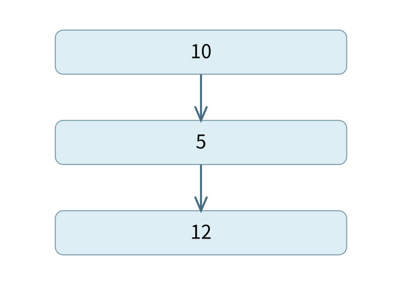
>
> 10的左子树里出现12：直接父子比较仍可能全对。

本书二叉搜索树（BST）默认关键字互异，左子树所有值小于根，右子树所有值大于根，左右子树分别满足同样性质。只检查根与两个直接孩子还不够；一个较深后代也可能越过祖先设定的区间。中序遍历严格递增是等价的整体判断。

查找从根出发，每次比较后进入相应子树；插入沿相同路径，到空位置新建叶结点。比较次数最多为树高，树可能退化成链，因此普通BST最坏为 $O(n)$，不能无条件写 $O(\log n)$。

删除叶结点直接断开双亲链接；只有一个孩子时让孩子接替位置；有两个孩子时，可把中序前驱（左子树最大值）或后继（右子树最小值）移到当前位置，再删除那个原结点。被选的前驱不会有右孩子，后继不会有左孩子，最后归结到前两种情况。若题目要求保留结点地址而非只保留关键字，那么复制数据与整体移接就是两种不同的实现，指针的改法也随之不同。

验证BST可以中序扫描并比较相邻值，也可以给每个结点传递允许区间 `(lower,upper)`。左递归把上界收紧到当前值，右递归把下界提高到当前值；这样不会漏掉“孩子合格但孙子越过祖先”的错误。当边界值可能等于整数类型极值时，用更宽类型或显式“有无边界”标记，不要随意把一个合法值当作无穷。

**定理 · BST的中序判据**

关键字互异时，二叉树是递增BST，当且仅当其中序遍历严格递增。


**推导 · 把全子树区间与中序顺序连接**

若为BST，左子树各值小于根、右子树各值大于根，分别递归中序，整体严格递增。反之，中序严格递增使每个结点左子树的全部访问项均小于它，右子树全部项均大于它；递归对子树也成立，故满足BST的全局定义。证明涉及全部后代，不能简化为只比直接孩子。


<a id="DS07-bst-code"></a>
### BST查找、插入和删除的基本路径

```cpp
typedef struct BSTNode {
    int key;
    struct BSTNode *lchild, *rchild;
} BSTNode, *BSTree;
BSTNode *BST_Search(BSTree T, int key) {
    while (T!=NULL && key!=T->key) {
        if (key<T->key) T=T->lchild;
        else T=T->rchild;
    }
    return T;
}
int BST_Insert(BSTree &T, int k) {
    if (T==NULL) {
        T=(BSTree)malloc(sizeof(BSTNode));
        T->key=k;
        T->lchild=T->rchild=NULL;
        return 1;
    } else if (k==T->key) return 0;
    else if (k<T->key) return BST_Insert(T->lchild,k);
    else return BST_Insert(T->rchild,k);
}
void Create_BST(BSTree &T, int str[], int n) {
    T=NULL;
    for (int i=0; i<n; ++i) BST_Insert(T,str[i]);
}
```

删除的递归返回值表示“删除后这棵子树的新根”，从而统一处理删除整树根与内部结点。

```text
erase(t,key):
    if t为空: return 空
    if key<t.key: t.lchild=erase(t.lchild,key)
    else if key>t.key: t.rchild=erase(t.rchild,key)
    else:
        if t.lchild为空: 保存t.rchild，释放t，返回保存值
        if t.rchild为空: 保存t.lchild，释放t，返回保存值
        q=t.rchild；沿q.lchild找到右子树最小结点
        t.key=q.key（记录有附加字段时一并复制）
        t.rchild=erase(t.rchild,q.key)
    return t
```

沿路每层常数工作，查找/插入/删除为$O(h)$；递归删除额外栈$O(h)$。这里复制记录后释放后继结点，不保留所有原结点地址；若题目约束结点身份，应改用移接方案。

`BST_Search`返回实际结点指针或`NULL`，迭代实现额外空间$O(1)$；`BST_Insert`返回1表示插入新关键字，返回0表示重复而未插入，引用`T`使空子树能够接回新结点。这里沿用教材默认内存申请成功的教学前提，实际程序还需处理分配失败。

课件按`50,66,60,26,21,30,70,68`构造BST，根为50，左子树26的孩子为21、30，右子树66的孩子为60、70，70的左孩子为68。按`50,26,21,30,66,60,70,68`插入也得到相同树，因为各子树内相对插入次序保持不变。把递增关键字依次插入则可能形成单右链，体现普通BST对插入次序的依赖。

<a id="DS07-05"></a>
## AVL：先定位最小失衡子树

> **错项排除 · 删除传播与插入不同**
>
> 插入修复最小失衡子树后一般恢复原高度，更高祖先不再受本次增高影响。删除后局部修复可能继续降低高度，仍须向上；一处调整并非所有AVL更新的共同规则。

AVL是每个结点左右子树高度差绝对值不超过1的BST。令平衡因子为“左高减右高”，合法值为−1、0、1。插入后沿查找路径向上更新高度，找到离插入位置最近的失衡祖先A，再根据新结点相对A及其较高孩子的位置分类。

LL（左孩子的左侧增高）对A右旋；RR对A左旋；LR先对A的左孩子左旋，再对A右旋；RL先对A的右孩子右旋，再对A左旋。名称描述失衡路径，不能把“LL”误当作“向左旋”。旋转必须保持中序次序：右旋时原左孩子B升为局部根，B原来的右子树移成A的左子树，因为它的值介于B与A之间。

以下数值树用于观察旋转机制。插入前各树高度均为3；灰底新结点插入后，最小失衡子树高度升为4。单旋图同时保留需要转接的中间子树：LL中40由30的右子树改接为50的左子树，RR中40的转接方向对称。

<a id="ds-fig-avl"></a>
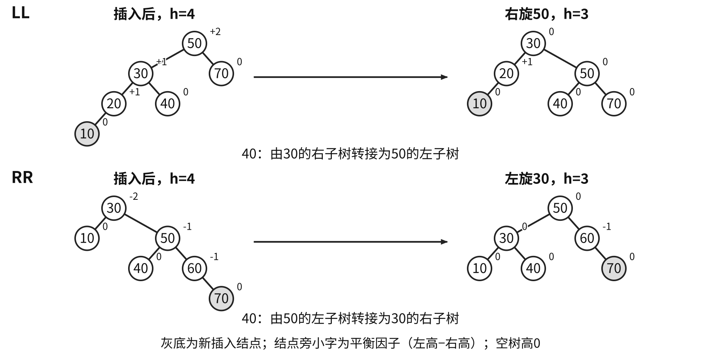

LR图在70的左孩子30的右侧插入40，先左旋30，再右旋70；第一步把40转接为30的右孩子。RL图在50的右孩子90的左侧插入80，先右旋90，再左旋50；第一步把80转接为90的左孩子。**第一步后的树仍可能失衡**，双旋应检查完整两步，不能在中间态停下。四例都保持同一组关键字的升序中序，最终高度恢复为3，所有平衡因子回到−1、0、1。

<a id="ds-fig-avl-double"></a>
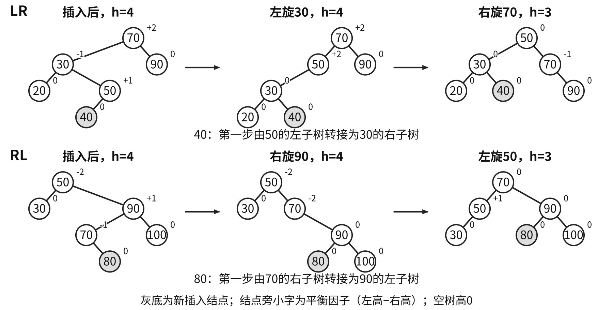

<a id="DS07-ex3"></a>
### 例 7-3　连续插入时在哪里旋转

**例题 · 配套案例**

〖7.3-003〗 把34、23、15、98、115、28、107依次插入初始为空的平衡二叉搜索树，要求每次插入后保持AVL性质，给出每步结果。


**解析。** 以下用 `根(左子树,右子树)` 表示局部结构，`∅` 表示空。


| 插入 | 失衡处与调整 | 调整后整树 |
| --- | --- | --- |
| 34 | 无 | 34 |
| 23 | 无 | 34(23,∅) |
| 15 | 34处LL，右旋 | 23(15,34) |
| 98 | 无 | 23(15,34(∅,98)) |
| 115 | 34处RR，左旋 | 23(15,98(34,115)) |
| 28 | 23处RL，先右旋98，再左旋23 | 34(23(15,28),98(∅,115)) |
| 107 | 98处RL，先右旋115，再左旋98 | 34(23(15,28),107(98,115)) |


插入28时，不能只旋转它的双亲34：34仍平衡，最先失衡的是23，新增路径是“23的右—98的左”，故为RL。每次调整后复查中序始终为已插入关键字的升序，避免只把树形画平衡而破坏搜索关系。

最小失衡子树调整后通常恢复到插入前的高度，更高的祖先不会再因这次插入而失衡。删除则可能使子树高度继续缩短，需要一路向上检查，不能把插入时“一处修复即可”的结论直接用于删除。AVL最小结点数满足 $N(h)=1+N(h-1)+N(h-2)$，由此树高是 $O(\log n)$，查找与更新路径才有对数保证。

固定高度下的形态数则是另一个量。按本书的规定，空树高0、单根高1，令 $C(h)$ 为恰高h的AVL形态数，$C(0)=C(1)=1$；恰高2的左右高度只能是 `(1,1)、(1,0)、(0,1)`，所以 $C(2)=3$。恰高3时，左右高度为 `(2,2)、(2,1)、(1,2)`，故 $C(3)=3^2+2\times3\times1=15$，对应〖7.3-013〗。这不等于固定结点数的卡特兰计数，也不等于最小结点数递推。

<a id="DS07-avl-delete"></a>
### AVL删除怎样向上传递

> **条件辨析 · 孩子平衡因子0**
>
> 这个分支在删除中常出现，可用一次单旋修复，且局部高度可能保持不变。插入口诀不能代替删除的高度传播判断。

删除先按BST规则处理实际被移除的结点，再沿其原祖先路径向上更新高度。失衡结点A若左高，考察左孩子B的平衡因子；右高情形完全对称。

| A的平衡因子 | 较高孩子的平衡因子 | 调整 |
| --- | --- | --- |
| $+2$ | B为$+1$或0 | 对A右单旋 |
| $+2$ | B为$-1$ | 先左旋B，再右旋A |
| $-2$ | B为$-1$或0 | 对A左单旋 |
| $-2$ | B为$+1$ | 先右旋B，再左旋A |

孩子平衡因子为0是删除中需要单独识别的情形：旋转后局部树高可能保持为删除前的高度，于是上层高度不再改变；其他情形旋转后仍可能比原先矮1层，需要继续向上。只看“LL/RR”口诀而漏掉孩子为0，容易选错旋转或错误停止。

最小示例：`4(2(1,3),5)`删除5后，根4左高2，左孩子2的平衡因子0。右旋得到`2(1,4(3,空))`，树高仍为3，所有结点已平衡。若删除使下层子树真正矮1层并影响更高祖先，则应在更高处继续修复。整个查找、删除和沿祖先路径调整的时间为$O(\log n)$。

<a id="DS07-fig-avl-delete"></a>
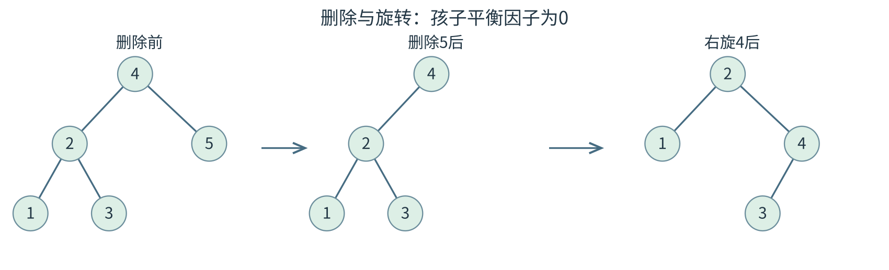

<a id="DS07-ex4"></a>
### 例 7-4　中序为降序时搜索方向怎样变

**例题 · 配套案例**

【配套例题】 一棵无重复关键字的AVL树，中序遍历得到降序序列。正确叙述是（　）。

A. 根的度一定为2　B. 最小元素一定是叶结点

C. 最后插入元素一定是叶结点　D. 最大元素一定没有左子树


**解析。** 本题的搜索方向与通常递增BST相反：左子树全大于根，右子树全小于根。最大值就是一直向左走到的那个结点，它没有左子树，答案为 **D**。AVL约束不保证根一定有两个孩子；最小值结点可以有左孩子；新结点虽然最初作为叶插入，旋转后可能成为内部结点。不要用平衡性代替关键字的方向条件。

<a id="DS07-rotate-code"></a>
### 单旋代码为何必须保存中间子树

> **不变量 · 旋转保留中序次序**
>
> 右旋时B原右子树T的关键字介于B与A之间，转接为A左子树仍符合区间。若忘记保存T，会丢失子树；若只交换数值，结点身份和其他链接语义也可能改变。

```cpp
void R_Rotate(BSTree &p) {
    BSTNode *lc=p->lchild;
    p->lchild=lc->rchild;
    lc->rchild=p;
    p=lc;
}
void L_Rotate(BSTree &p) {
    BSTNode *rc=p->rchild;
    p->rchild=rc->lchild;
    rc->lchild=p;
    p=rc;
}
```

这里以引用`p`接回旋转后局部根，调用时将原双亲的相应孩子域传入；旋转整树时传入整树根指针。若结构还保存平衡因子或高度，须在旋转后依实际子树重新维护，先处理下降结点，再处理提升结点。右旋中$B<T<A$的区间关系保证T接到A左侧仍合法；只交换两个关键字不等同于链接旋转。

AVL插入可在BST递归返回时逐层更新高度，若平衡因子超界，则按新增关键字落在重侧孩子哪一边选择LL/RR/LR/RL。最少结点递推的边界为$N(0)=0,N(1)=1$；删除时子树变矮可能继续向上传播，应沿整条祖先路径复查。

<a id="DS07-06"></a>
## 红黑树：颜色约束怎样限制高度

> **错项排除 · 红叔要先变色**
>
> 红双亲配红叔时，旋转不是第一选择：把双亲与叔变黑、祖父变红，将冲突上移，再保证根黑。黑叔的内外侧旋转情形不能覆盖这个状态。

红黑树仍是BST，另为结点标红或黑，采用以下约定：根为黑；所有空孩子视为黑色NIL叶；红结点的孩子均为黑；从任一结点到其所有后代NIL叶的路径，黑结点数相同。NIL不是普通数据结点，画图时可以省略，但计算黑高时必须把它计入。

相邻红结点不允许，所以一条路径中红结点数不会超过相应黑结点数。本书把黑高b定义为：从当前结点向下到任一NIL的路径上，不计当前结点，但把终点NIL计入，统计所含的黑结点数；NIL自身的黑高记0。黑高为b的子树至少含 $2^b-1$ 个内部结点。于是最长路径的长度至多约为最短路径的两倍，整体高度为 $O(\log n)$。它不要求每个结点左右高度差至多1，比AVL的局部高度约束宽。

按上述黑高$b$约定，根为黑的非空红黑树内部结点数满足$2^b-1\le n\le2^{2b}-1$。下界可由$b$层全黑满树达到；上界由黑、红两色交替并填满共$2b$个内部层达到。例如根黑高2时，内部结点数最少3、最多15。NIL不计入内部结点数，不能把其数量也加到这两个界中。

插入先按BST加入，通常把新结点染红，以免立即改变各路径黑结点数。双亲黑则完成；双亲红时，看祖父另一侧的叔结点：

- 叔为红：双亲与叔变黑、祖父变红，把问题上移到祖父，最后保证根黑。
- 叔为黑（含NIL）：若形成内侧折线，先在双亲处旋转为外侧；再在祖父处反向旋转，并交换提升结点与原祖父的颜色，消除红红相邻。

例如黑根10、红左孩子5，插入红1，叔为空黑，形成LL：右旋10后5成为黑根，1与10为红，黑路径数保持一致。若原来还存在红右孩子15，则插入1先使5、15变黑，祖父10暂红，最后根10恢复黑；这个情境应变色，不应直接套前一个旋转。

<a id="DS07-rb-insert-trace"></a>
### 按课件序列观察红黑插入

从空树依次插入`20,10,5,30,40`：20作为根染黑；10作为红左孩子接入；插入5使红10与红5相邻，叔为黑NIL，属于LL，右旋20并换色，得到黑根10、红孩子5和20。插入30时父20与叔5均红，把5、20染黑，祖父10暂红后恢复根黑；插入40时父30红、叔为空黑，发生RR，对20左旋、把30染黑20染红。

最终为黑根10，左孩子5黑，右孩子30黑且有红孩子20和40。每步既保持中序递增，又保持所有通往NIL的黑高相等。课件后续的`57,3,2,4,35,25,18,22,23,24,19,18`用于继续观察向上传播、内侧双旋及重复值处理；若本章按互异关键字的BST接口实现，末尾重复18应返回未插入。题目允许重复时，先说明重复项安放或计数规则。

<a id="DS07-fig-rb"></a>
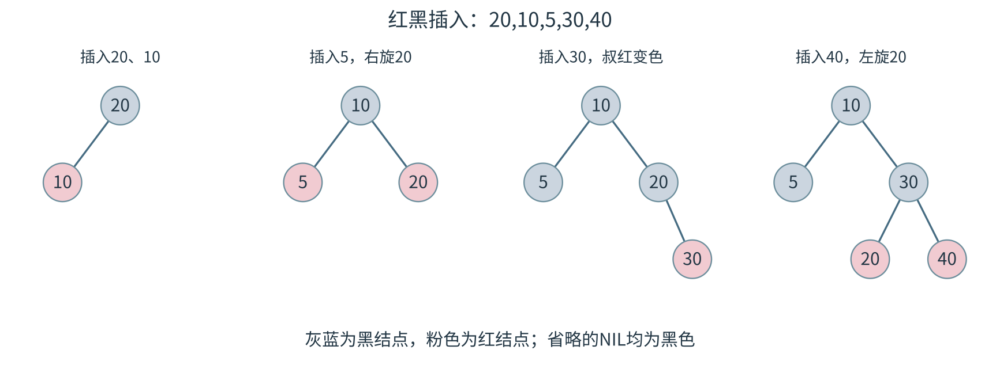

修复的旋转次数和沿祖先链变色的次数应分别统计。红黑插入至多作常数次旋转，颜色调整可能一路传播到根；整个插入仍需先搜索且最坏$O(\log n)$。红黑树不意味着一次插入的所有工作都为$O(1)$。

删除时先按BST把待删结点化为至多只有一个非空孩子的情形。删红不减少路径黑高；删黑后，若有红孩子接替，可把接替孩子染黑。若替代位置是黑或NIL，则沿该分支缺少一个黑结点，需要根据兄弟与其孩子颜色修复。

设缺黑位置x是双亲p的左孩子，兄弟w为p的右孩子。w的左孩子为近侧、右孩子为远侧，均相对x而言；NIL按黑处理。按表中的条件逐步转换，不能把“红兄弟”当作已经完成修复。


| 当前条件 | 操作与后续 |
| --- | --- |
| w红 | w染黑、p染红，对p左旋；重新取x的兄弟，再处理下列黑兄弟情况 |
| w黑、两个孩子都黑 | w染红；若p红则p染黑并结束，否则将缺黑位置上移到p继续，移到根即可结束 |
| w黑、远侧黑、近侧红 | 近侧染黑、w染红，对w右旋；重新取兄弟，转成下一行 |
| w黑、远侧红 | w继承p原颜色，p与远侧染黑，对p左旋，结束缺黑修复 |


缺黑在右侧时，左右及旋转方向对称互换。最后一行的最小例子可写成 `10黑(缺黑NIL,20黑(NIL,30红))`：左旋10并换色，得到 `20黑(10黑,30黑)`，两侧向下的黑结点数相同。旋转前后中序仍为10、20、30；修复既要补黑高，也要保持搜索次序。

这里颜色不表示访问频率，也不影响BST比较方向。做性质判断时，先检查中序有序，再检查根与NIL、红红相邻、各分支黑高；仅数红黑结点总数不能判定一棵红黑树是否合法。

<a id="DS07-07"></a>
## B树：一个结点保存多个分隔关键字

> **不变量 · B树合法性有五项**
>
> 每次操作完成后同时检查结点内有序、孩子区间、键数上下限、孩子数、叶层深度。只画出平衡外形会漏掉关键字重复或孩子接错；临时溢出框不是最终合法状态。

> **最小反例 · 5阶不能提前随意合并**
>
> 5阶非根至少2键、最多4键。两个合法最小兄弟各2键，加父分隔项共5键，已经溢出；删除后某侧只剩1键，才能按1+1+2=4合并。阶数约定决定合并时机。

本书m阶B树规定每结点最多m个孩子、最多m−1个关键字。除根外，每个数据结点至少有t−1个关键字，其中 $t=\lceil m/2\rceil$；有非空孩子的非底层数据结点至少t个孩子，非叶根至少2个孩子、1个关键字。最底层数据结点没有非空孩子，并且全部在同一层。若另外画查找失败的空外部叶，它们在下一层且不存关键字；以下高度不计这层空叶。

以下容量与高度公式采用$m\ge3$，高度为数据结点层数；“叶”若按教材专指最下层的空失败结点，就不把它混入该高度。阶数$m$、最小孩子数$t=\lceil m/2\rceil$和关键字数必须区分，不能把别处“最小度数t”的算法原样按m替换。

一个结点有k个升序关键字，就有k+1个孩子区间。先在结点内找到目标或确定区间，再读相应孩子。多路分支降低外存层数；结点内可以顺序或折半比较，读盘次数不直接等于关键字比较次数。

### 插入从叶开始，分裂向上传播

以下是**5阶B树的教学机制例**，用紧凑关键字显示分裂与合并，不对应后面原题的阶数。5阶结点最多4项，非根至少2项；非底层非根因此有3至5个孩子，非叶根仍可只有2个孩子。

初态根为 `[5,10,15,20]`，从左到右的5个叶分别为 `[1,3]`、`[6,8]`、`[11,13]`、`[16,18]`、`[21,23,25,27]`，全树共16个关键字。沿搜索路径插入29后，最右叶临时有5项。提升第3项25，叶分成 `[21,23]` 与 `[27,29]`，提升项从叶中移走。根因而临时成为 `[5,10,15,20,25]`，也有5项，不能到此结束。

再将根的第3项15提升为新根，左右内部结点分别为 `[5,10]`、`[20,25]`。原来的6个孩子按区间各接3个：左侧接 `[1,3]`、`[6,8]`、`[11,13]`，右侧接 `[16,18]`、`[21,23]`、`[27,29]`。两次分裂均为“5项→左2项、提升1项、右2项”，内部结点分裂时还须同步分配孩子。根分裂使数据层数由2增至3；局部叶分裂本身不增加全树高度。

<a id="ds-fig-btree"></a>
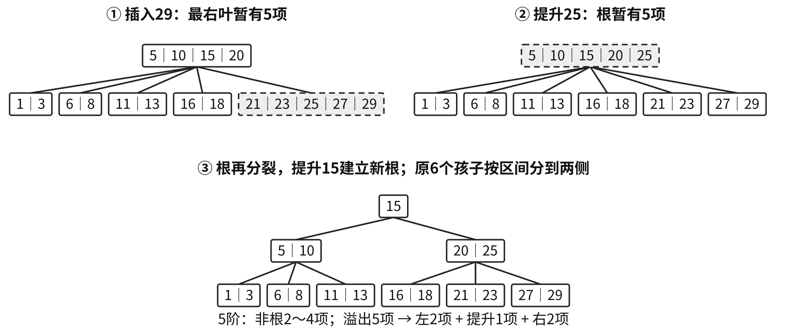

### 删除后的借位、合并与向上传播

删除内部关键字时，先用相邻前驱或后继关键字替换，再到最底层删除对应项。删除后若该结点的关键字少于最小数，先看相邻兄弟能否借：父分隔关键字下移，兄弟中最靠近当前结点的一项上移到父；若在内部层借位，右兄弟的最左孩子或左兄弟的最右孩子也要转接，保持孩子数等于关键字数加1。兄弟也只有最小数时，合并当前结点、父分隔关键字与相邻兄弟，父可能继续下溢；空根仅剩一个孩子时，由孩子接替，高度减1。

先看5阶借位小例：根 `[10]`，两个叶 `[2,5]` 与 `[12,15,18]`。删除2后左叶只剩 `[5]`，低于2项下限；右兄弟有3项，能够出借。将父10下移到左叶、右兄弟最小项12上移到父，得到根 `[12]`、叶 `[5,10]` 与 `[15,18]`。不能把12直接塞给左叶而让父仍为10，否则分隔关系就被破坏。

再从插入图的最终树删除1：左叶剩 `[3]`，相邻叶 `[6,8]` 已只有2项，不能借；合并它们与父分隔项5，成为 `[3,5,6,8]`。其双亲原为 `[5,10]`，此时只剩 `[10]` 和2个孩子，也低于非根下限。右内部兄弟 `[20,25]` 同样不能借，故将左侧 `[10]`、根15、右侧 `[20,25]` 合为 `[10,15,20,25]`，按顺序接5个原孩子。旧根为空，删除旧根后数据层数从3降为2。

<a id="ds-fig-btree-delete"></a>
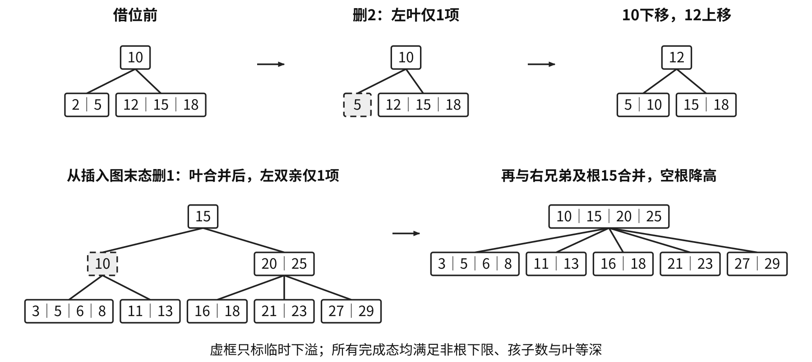

5阶B树的合并要特别注意时机：**两个各有2项的合法兄弟加父分隔项会有5项，超过上限**；本例是在删除造成一侧仅1项后，按 $1+1+2=4$ 项合并。不能把其他阶数或最小度参数下的提前合并规则直接套来。每个完成态都要复查结点内有序、孩子区间、关键字上下限、孩子数和叶等深；虚框中的临时下溢或溢出不算一个已完成的合法B树状态。

若高度h按数据结点层数计，非空m阶B树关键字总数满足 $2t^{h-1}-1\le n\le m^h-1$，其中 $t=\lceil m/2\rceil$。左端让根取1项、其余结点取最少分支，右端让各结点取满；求最大高度用左端，求最小高度用右端。

<a id="DS07-ex5"></a>
### 例 7-5　关键字总数怎样限制高度

**例题 · 配套案例**

〖7.4-009〗 一棵3阶B树共有2047个关键字，最大高度为（　），最小高度为（　）。

A. 11　B. 10　C. 8　D. 7


**解析。** 高度按数据结点层数计。要使树尽量高，各层尽量稀疏：根1项、2个孩子；其他结点至少1项、至少2个孩子。高度h时最少关键字 $1+2+\cdots+2^{h-1}=2^h-1$。因此 $2^h-1\le2047=2^{11}-1$，最大11，第一空 **A**。

要使树尽量矮，各结点取满，每层关键字数分别2、6、18……，高度h时最多 $3^h-1$。$3^6-1=728<2047\le3^7-1=2186$，所以最小7，第二空 **D**。这两端分别使用“最少容量”和“最大容量”，不能将不等式方向颠倒。

<a id="DS07-ex6"></a>
### 例 7-6　小规模B树的形态怎样完整计数

**例题 · 配套案例**

【配套例题】 给定7个不同关键字，能构造的不同4阶B树的个数最多为（　）。

A. 7　B. 8　C. 9　D. 10


**解析。** 每结点最多3项，非根至少1项；关键字的升序分配由形态与各结点项数确定，不再任意排列。

高度1最多3项，不够。高度2时，设根有r项，则有r+1个叶，叶项数和为7−r，各叶1至3项：r=1时只有 `(3,3)`，1种；r=2时是正整数三元组和5，各项至多3，包括 `(3,1,1)` 的3个排列与 `(2,2,1)` 的3个排列，共6种；r=3时只有 `(1,1,1,1)`，1种。因此高度2共8种。

高度3时，最少项数为 $1+2+4=7$，只能每结点1项且每个内部结点2个孩子，1种。高度4最少15项，已不可能。合计 $8+1=9$，答案为 **C**。只考虑根的取值而不枚举叶的分配，会漏掉不同的结点分组。

<a id="DS07-08"></a>
## B+树：索引层与叶层分工

> **课程连接 · 索引层服务外存页访问**
>
> B+内部省去整条记录，通常能在同页放更多索引项，降低层数；叶链便于范围扫描。外存优势取决于页大小、缓存和记录存放，不能改写成任何输入均比内存BST快。

B+树把记录或记录指针集中在叶结点，内部结点保存索引关键字及孩子指针；叶结点按关键字有序，并用链接便于连续访问。一次点查找沿索引降到叶；范围查找先定位起点叶，再沿叶链扫描，避免对每个值重新从根下降。

<a id="ds-fig-bplus"></a>
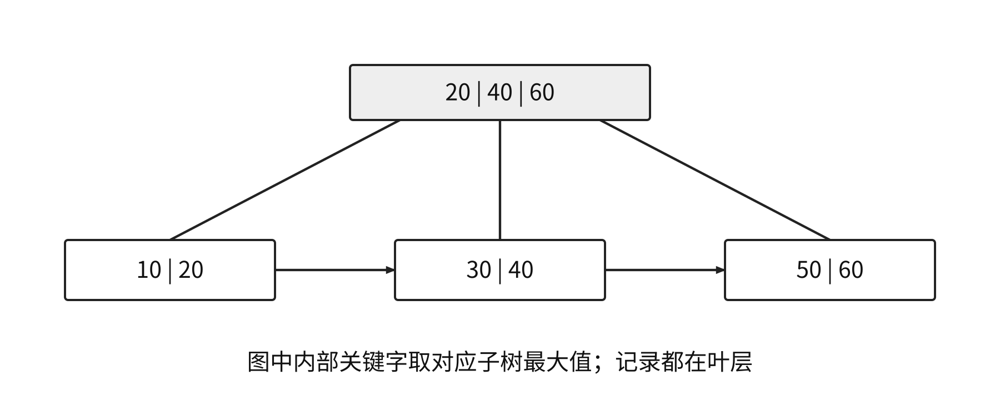

本章按王道的“内部结点每个关键字对应一棵子树最大关键字”约定。非叶根至少有2棵子树，其余分支结点至少有$\lceil m/2\rceil$棵子树，最多均为$m$棵；分支结点的关键字数与子树数相同。本图中，索引 `[20|40|60]` 指向最大值分别为20、40、60的三片子树。做题应先按给定图或定义确定，不把B树的“k键必有k+1孩子”无条件套给B+树。

B树的查找可以在内部结点命中时结束；B+树的记录查询通常仍要走到叶。叶链让B+适合区间访问，并不意味着每次点查都顺着整条叶链查找。内部不携带整条记录，通常能提高同样页大小下的分支数，减少外存层数；优势来自页组织与访问方式，不能据此声称任何规模都一定比内存BST更快。

<a id="DS07-09"></a>
## 散列表：冲突、删除与ASL

散列函数 $H(key)$ 把关键字映射到表地址；不同关键字有相同函数值称为同义词，发生地址冲突。函数应对同一关键字给出确定地址，并尽量均匀分散。随机改变同一关键字的地址会使后续查找无法复现位置，不能直接作为稳定散列函数。

<a id="DS07-hash-functions"></a>
### 散列函数的构造条件

直接定址可用$H(key)=a\,key+b$，适合关键字分布较连续且范围可控；它避免了所选模型内的碰撞，但地址范围大时空间可能浪费。除留余数法用$H(key)=key\bmod p$，通常选不大于表长且有利于分布的素数$p$；取模常数与开放定址继续探查的表长$m$是两个参数。

数字分析法利用已有关键字分布选择较均匀的数位；平方取中法先平方再取中间若干位，希望让多位信息影响结果。没有一种构造能对所有未知输入自动保证无冲突或均匀，应依据关键字类型、分布和地址范围选择；同一关键字必须能稳定复现相同初始地址。

**开放定址**在表内继续探查空位置。线性探查地址为 $(H_0+k)\bmod m$；二次探查可能规定为 $(H_0+k^2)\bmod m$，也可能按正负平方交替，须按题目公式执行。探查时的模数取表长m；散列函数内部的除数p可能小于m，两者不能混用。线性探查能够在一整轮内访问全表，二次探查不一定遍历所有位置，即使表未满也可能找不到可达空位。

**链地址法**把同义词放在一个桶的链表中，成功时沿链比较，失败时须比较到链尾。开放定址的聚集不仅来自同义词，也可能由不同初始地址的探查链交错引起。装填因子 $\alpha=n/m$ 越大，一般可用位置越少；散列并不保证任何输入下都严格常数时间。

<a id="DS07-hash-probes"></a>
### 探测公式与覆盖范围

> **条件辨析 · 互质条件检查实际步长**
>
> 素数表长也不能挽救模表长为0的步长。步长须在1至m-1范围且与m互质，才能覆盖全表。

开放定址统一写作$H_i=(H(key)+d_i)\bmod m$。增量每次加在**初始地址**上，各方法的规则如下：

| 方法 | 增量或步长 | 完整探测的条件 |
| --- | --- | --- |
| 线性探测 | $d_i=i$ | 连续$m$次能遍历全表 |
| 平方探测 | 0、1、−1、4、−4、9、−9、… | 依表长与增量范围；有空位未必能到达 |
| 双散列 | $d_i=i\cdot hash_2(key)$ | 步长与$m$互质时遍历全表 |
| 伪随机探测 | 题目规定的可复现增量序列 | 需实际检查增量模$m$覆盖的剩余类 |

当$m$为形如$4j+3$的素数并采用足够的正负平方增量时，可覆盖全部位置。若只用正平方序列，则是另一套覆盖条件，不能把这条结论直接移用。

双散列需保证步长模$m$非零且与$m$互质。例如$m=8$、步长2只能访问4个位置，步长3能访问全部8个位置。即使$m$为素数，若取`hash2(key)=m-(key%m)`，在`key%m==0`时步长等于$m$，仍会反复停在原地址；可在整数关键字场景采用`1+(key%(m-1))`产生$1..m-1$的步长，再明确负数取模规则。

<a id="DS07-hash-chain"></a>
### 链地址法的完整例

课件取表长13、$H(key)=key\bmod13$，依次插入`19,14,23,1,68,20,84,27,55,11,10,79`。若采用头插，非空桶为：

| 桶号 | 从首结点到尾结点的关键字 |
| --- | --- |
| 1 | 79→27→1→14 |
| 3 | 55→68 |
| 6 | 84→19 |
| 7 | 20 |
| 10 | 10→23 |
| 11 | 11 |

查27比较79、27，共2次；查66落桶1，比较4个关键字后失败；查21落空桶8，关键字比较次数为0。若题目统计空指针判断，则另计。等概率成功ASL为$(10+3+3+1+3+1)/12=21/12$；13个桶等概率失败时ASL为$12/13$，因为桶长之和为12。采用尾插会改变某一具体记录的成功路径，等概率成功ASL对每桶长度固定的全体记录平均仍相同。

课件还讨论了桶内保持关键字有序的链表：递增链中，查找值小于当前关键字时即可提前失败，有机会减少失败比较；代价是插入时也要维护有序位置。具体ASL须按新链序和目标值分布重新计算，不能继续沿用“所有失败都扫描到链尾”的口径。

<a id="DS07-hash-asl-course"></a>
### 表长与散列值域不同的ASL

> **条件辨析 · 分母由失败事件决定**
>
> 表长16且H取模13时，初始地址只有13种。探测经过的地址和初始地址集合不同，平均时不能见表长就除16。

同一关键字序列放入长度16的开放定址表，$H(key)=key\bmod13$，冲突时以表长16作线性探测。最终0号空，1～12号依次为`14,1,68,27,55,19,20,84,79,23,11,10`，13～15号空。成功探测次数依插入次序为`1,1,1,2,1,1,3,4,3,1,3,9`，成功ASL为$30/12=2.5$。

失败事件若按**初始地址0～12等概率**，对应探测长度为`1,13,12,11,10,9,8,7,6,5,4,3,2`，故失败ASL为$91/13=7$。13～15号仍可在探测过程中经过，但散列函数不会把它们作为初始地址；分母应为13而不是16。删除20并保留删除标记后，成功记录变11项，成功ASL为$29/11$，失败路径仍不被截断，失败ASL保持7。

<a id="DS07-fig-hash-course"></a>
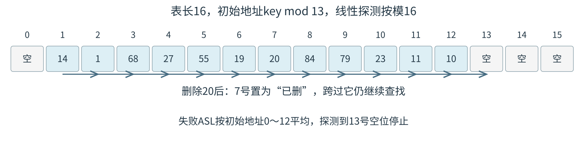

<a id="DS07-ex7"></a>
### 例 7-7　删除标记为什么继续计入失败路径

**例题 · 配套案例**

【配套例题】 长度为5、初始为空的散列表HT，$H(k)=(k+4)\bmod5$，线性探查处理冲突。依次插入2022、12、25，再删除25，查找失败的平均查找长度为（　）。

A. 1　B. 1.6　C. 1.8　D. 2.2


**解析。** 2022与12初始地址都为1，分别存1与2；25存4。删除4处关键字后应留“已删除”标记，而不是把它当作从未使用的空位置。得到：


| 地址 | 槽状态 | 从此地址起失败探查次数 |
| --- | --- | --- |
| 0 | 从未用空 | 1 |
| 1 | 2022 | 3 |
| 2 | 12 | 2 |
| 3 | 从未用空 | 1 |
| 4 | 已删除 | 2 |


失败查找遇到从未使用的空位才结束；越过删除标记还要继续。按5个初始地址等概率，ASL为 $(1+3+2+1+2)/5=1.8$，答案为 **C**。探查到空单元也计一次表访问，这是本题失败ASL的计数口径；删除标记处没有有效关键字可比，却不能在这里终止。

若把一个探查链的中间位置直接清空，后面的元素虽然还在，查找却会在这里提前失败。插入时删除位置可以复用；若不允许重复关键字，要继续查到能排除已有同关键字的位置，再决定使用哪个已删除槽。

<a id="DS07-ex8"></a>
### 例 7-8　二次探查必须回到原始地址计算

**例题 · 配套案例**

【配套例题】 将20、3、11、18、9、14、7依次插入初始为空、长度11的HT。$H(key)=(key\times3)\bmod11$，初始地址为 $H_0$，冲突时 $H_k=(H_0+k^2)\bmod11\ (k=1,2,\ldots)$。

（1）画出HT并计算装填因子。（2）给出查找14时的关键字比较序列。（3）查找8，确认失败时的散列地址是多少？


**解析。** 20、3、11、18直接存于5、9、0、10。9从5冲突后到6；14从9依次探查10、2，存2；7从10依次探查0、3，存3。


| 地址 | 关键字 |
| --- | --- |
| 0 | 11 |
| 1 | 空 |
| 2 | 14 |
| 3 | 7 |
| 4 | 空 |
| 5 | 20 |
| 6 | 9 |
| 7 | 空 |
| 8 | 空 |
| 9 | 3 |
| 10 | 18 |


装填因子为 $7/11$。查14的探查地址为9、10、2，比较关键字为3、18、14。查8时，$H_0=24\bmod11=2$，探查地址依次为2、3、6、0、7，第7号为空，所以在**地址7**确认失败。每个新地址从同一个 $H_0$ 加平方增量计算，不能在上一次地址上再加 $k^2$。

<a id="DS07-hash-code"></a>
### 开放定址的三种槽状态

> **不变量 · 墓碑保住后续探查路径**
>
> 已删除槽说明这里曾发生占用，后面可能仍有沿同一序列插入的元素。查找只能在从未用空槽或探查耗尽处失败；插入复用墓碑前还要排除后方已有同关键字。

```text
hashFind(key):
    按约定的探查序列访问地址
    若槽为有效且关键字相同: 成功
    若槽从未使用: 失败
    若槽已删除或关键字不同: 继续探查
    若可探查位置已耗尽: 失败
```

删除先按同一路径找到关键字，再把槽改为“已删除”。插入可记住第一个已删除槽，但不能立即停在那里：若后面已有同关键字且不允许重复，提前写入会制造重复。探查总步数须有界，表满或二次探查可达集合已走完时不能无限循环。

链地址法的插入在相应桶链完成，删除是真实断链并释放目标结点；它不需要开放定址的墓碑标记。链长才是比较量来源，不能拿开放定址中“遇从未用空槽终止”的规则解释链地址失败。

<a id="DS07-10"></a>
## 怎样按操作约束选择方法

下表把主要成立条件与查找代价分开。记录数为n，散列表长为m，树高记为h；B/B+树的h按数据层数计，假定每个结点占一个外存页，表中的读盘上界指索引结点路径上的页访问，还未扣除已缓存页；若叶中只存记录指针，随后取叶外记录的I/O另计。


| 方法或结构 | 成立条件 | 查找代价 | 更新、范围或外存特点 |
| --- | --- | --- | --- |
| 顺序查找 | 可无序；数组或链表 | 最坏 $O(n)$ | 不需维护有序；范围筛选仍须扫描 |
| 折半查找 | 有序且能随机定位的顺序表 | 最坏 $O(\log n)$ | 数组插删最坏移动 $O(n)$；可定位区间端点 |
| 普通BST | 满足全部子树的区间关系 | $O(h)$，最坏 $O(n)$ | 支持前驱后继；无平衡维护时可退化成链 |
| AVL | BST且任一结点两侧高差至多1 | 最坏 $O(\log n)$ | 动态插删需维护高度与旋转 |
| 红黑树 | BST及红黑性质均成立 | 最坏 $O(\log n)$ | 动态插删维护颜色、黑高与旋转 |
| B树 | 多关键字有序、容量约束、叶等深 | 至多h次结点读盘 | 内部命中可停；读入结点后的键比较另计 |
| B+树 | 按给定索引约定，叶层存全体关键字及记录或记录指针 | 点查沿根到叶，至多h次索引页读盘 | 定位起点后沿叶链作范围访问 |
| 散列表 | 散列函数、装填因子和冲突策略匹配 | 合适散列与受控负载下平均 $O(1)$；最坏链扫描 $O(n)$，开放定址探查 $O(m)$ | 扩容有维护成本；原生不保序，不直接支持有序范围定位 |


一个表可能有多种索引。不能只为某一次查找更快，就忽略频繁更新带来的维护成本；也不能用散列的平均等值查找优势替代区间检索所需的有序性。题目给出“有序、随机访问、频繁插删、外存、范围”时，分别把它们转成结构成立条件与访问成本，再作选择。

<a id="DS07-check"></a>
## 主动回忆自测

以下为自拟补充，检查维护过程与失败口径。

1. BST中每个结点都满足“左孩子小于自身、右孩子大于自身”，是否足够？给反例。
2. 4阶B树一个非根结点最多、最少有多少关键字？根为空时能否直接认定整树空？
3. 一条散列探查路径经过“有效关键字—删除标记—有效关键字—从未用空位”，目标均不等，失败探查几次？
4. 红黑树根10黑、孩子5红和15红，插入1后，首先应旋转还是变色？

5. AVL删除后只修复最深一处失衡是否总够？与插入有何不同？
6. B树一个内部结点有3个关键字，按本章约定有几个孩子区间？B+树能无条件沿用吗？
7. 在有序链表上执行折半式比较，为何不能直接承诺总时间$O(\log n)$？
8. 为什么散列表失败ASL的分母未必是有效记录数？若表长5、只存2项，按初始地址等概率应除以几？

**答案。** 1. 不够；根10，左孩子5，5的右孩子12，所有直接比较都满足，但12在10左子树却大于10。2. 最多3项、最少1项；根空但还有唯一孩子时应降层，由孩子接替，树不空。3. 4次，删除标记不能截断路径。4. 先变色，叔15红，把5、15变黑、10暂红，最后根恢复黑，无需该处旋转。

5. 不总够；删除可能让修复后子树高度继续减1，导致更高祖先失衡。插入修复最小失衡子树后通常恢复原高度，可阻断继续传播。
6. 有4个孩子区间；B+索引约定各异，若每项表示一棵子树最大关键字，键数和孩子数可以相等，需按给定定义。
7. 比较次数可能为对数，但链表不能常数时间随机定位中点，节点访问成本没有消失。
8. 失败事件分布可以是初始散列地址或失败区间，而非已有记录；该例应按5个初始地址求平均，除以5。


<a id="DS08"></a>
# 排序

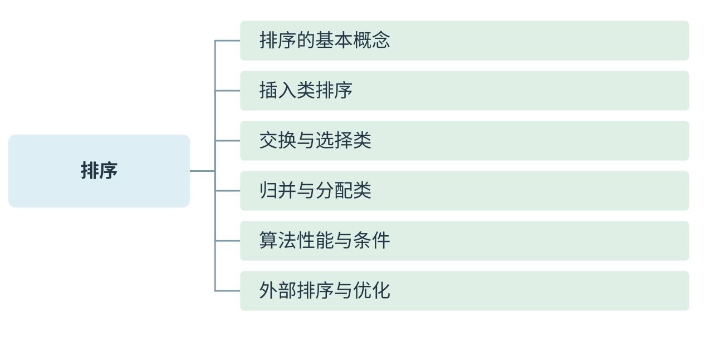

[可编辑SVG](../chapters/DS08/figures/overview.svg) · [完整知识导图](../chapters/DS08/chapter-map.pdf)

排序把记录按关键字排列，同时可能改变相等关键字记录原有的相对次序。做过程题时，先确定这一趟处理的是一个元素、一个增量分组，还是所有当前子区间；做选择算法的题时，再比较规模、初始状态、稳定性、空间和外存访问。算法名字相同、划分约定不同，产生的中间序列也可能不同。

<a id="DS08-map"></a>
## 本章知识结构

- **排序的基本概念**：关键字与记录身份；稳定与不稳定；内部外部排序；趟数比较移动空间。
- **插入类排序**：直接插入有序前缀；折半插入定位及移动；希尔同余类与增量。
- **交换与选择类**：起泡相邻逆序与早停；快速划分及枢轴就位；简单选择的比较次数；堆排序建堆及下滤。
- **归并与分配类**：二路归并及稳定合并；LSD低到高与同桶保序；MSD递归桶任务；计数范围及前缀和。
- **算法性能与条件**：最好平均最坏时间；递归栈及输出数组；稳定性条件与反例；比较排序下界。
- **外部排序与优化**：初始归并段；多路归并及输入输出缓冲；I/O计数与趟数；败者树冠军路径；置换选择与冻结；最佳归并树及补零权叶。

每种排序先固定待处理区、有序区和一趟的含义，再逐步执行移动或交换。通过同一组记录追踪身份、趟数、比较次数和空间需求，可以把算法差异落实到具体操作。

<a id="DS08-01"></a>
## 稳定性、内外排序与比较口径

> **最小反例 · 相同数字隐藏记录身份**
>
> 最小反例给相等关键字附身份：$2_a,2_b,1$经简单选择首趟成为$1,2_b,2_a$。只写数字2、2会看不出顺序改变；稳定性讨论的是整条记录的身份。
>
> 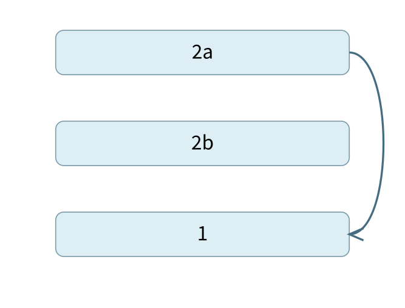
>
> 交换首项与1跨过2b，结果为1、2b、2a。

**定义 · 排序稳定性**

若两条记录关键字相等，排序后它们的相对次序与原来一致，称该排序算法**稳定**。给记录加身份下标，如 $2_a,2_b$，就能检验相等值是否被交换；只看两个相同数字无法观察稳定性。稳定性是算法对所有合法输入的保证，某个不稳定算法在一份特定数据上也可能恰好没有打乱相等记录。


内部排序指排序时待处理记录能全部放入内存；外部排序需要在内外存间分批交换。二者的区别在于处理期间是否需要外存参与，不能只按一个固定的数据量阈值划分。外部排序通常优先减少块I/O，内部排序则常比较关键字比较次数、移动次数和辅助空间。

“一趟”指什么，须按具体算法的说明确定。直接插入一趟放好一个新记录；归并一趟合并所有相邻段；本章快速排序的过程题，把同一深度上尚未确定最终位置的所有子区间各划分一次，算作一趟。若程序逐子区间调用一次划分就计一趟，应按那份程序重新解释。

<a id="DS08-02"></a>
## 直接插入与折半插入

直接插入维护左侧已排好序的前缀。取下一个记录x，从前缀末尾向左比较，把大于x的记录右移，直到找到插入位置。每次循环结束，前缀扩大1且仍有序。

```cpp
void InsertSort(int A[], int n) {
    int i,j;
    for (i=2; i<=n; ++i)
        if (A[i]<A[i-1]) {
            A[0]=A[i];
            for (j=i-1; A[0]<A[j]; --j)
                A[j+1]=A[j];
            A[j+1]=A[0];
        }
}
```

教材此版将有效元素放在`A[1..n]`，`A[0]`同时暂存待插入值并充当哨兵。若一直退到0，`A[0]<A[0]`为假，循环必停，故内层无需再判断`j>=1`。数组必须有$n+1$个单元；`n=0,1`时外层自然跳过。和下面使用0起始数组的起泡、选择、快排相比，存储范围须按各段代码分别说明。

相等时不再左移，把新记录放在已有相等记录后面，因此稳定。若条件改为 `A[j]>=x`，会把新记录放到旧相等记录之前，稳定性随之改变。初始有序时每趟只比较一次就停止，时间 $\Theta(n)$；逆序时要移动 $1+2+\cdots+(n-1)$ 个记录，最坏 $\Theta(n^2)$；仅用一个暂存记录和几个下标，空间 $O(1)$。

折半插入在有序前缀中用折半查找决定插入点，减少了关键字比较；但数组中腾出位置仍要移动元素，平均和最坏移动量仍为 $\Theta(n^2)$，因此平均和最坏总时间也为 $\Theta(n^2)$。要保持稳定，应寻找“第一个大于x”的位置，把x插到所有旧相等项之后。

本章比较表采用**每趟都完整执行折半定位**的实现，不先用前缀末项判断是否已经就位。因此即使初始有序，比较总量仍为 $\Theta(\sum_{i=1}^{n-1}\log(i+1))=\Theta(n\log n)$，最好总时间也是 $\Theta(n\log n)$；最好时只是移动少，比较代价并不随之减少。若另加“已不小于前缀末项则直接跳过折半”的判断，有序输入可变成线性时间，那是增加了提前判断的实现。

<a id="DS08-bin-insert"></a>
### 折半定位怎样保持稳定

> **不变量 · 相等时继续向右定位**
>
> 折半插入寻找首个大于x的位置，旧相等项都留在左边。定位快只减少比较，数组腾位置仍要移动；看到折半二字就写整体对数时间，漏掉了主要移动量。

```cpp
void BinaryInsertSort(int A[], int n) {
    int i,j,low,high,mid;
    for (i=2; i<=n; ++i) {
        A[0]=A[i];
        low=1; high=i-1;
        while (low<=high) {
            mid=(low+high)/2;
            if (A[mid]>A[0]) high=mid-1;
            else low=mid+1;
        }
        for (j=i-1; j>=high+1; --j) A[j+1]=A[j];
        A[high+1]=A[0];
    }
}
```

本段仍采用`A[1..n]`，0号仅暂存。相等时向右找，结束时`low==high+1`，正是有序前缀中第一个大于新值的位置。寻找位置的比较减少，腾出位置的移动仍可能为二次；“折半”描述定位方式，不是整体复杂度结论。

<a id="DS08-03"></a>
## 起泡：一次相邻交换消除一个逆序

教材版本从后向前比较相邻元素，逆序则交换，一趟后最小记录到达未排序区最前端；下趟只处理右侧尚未确定的范围。若某一趟没有发生交换，整段已无相邻逆序，可提前结束。没有这项标志的实现即使输入有序，也仍会执行全部固定比较。

例如 `4,2,3,1` 第一趟从后向前依次变为`4,2,1,3→4,1,2,3→1,4,2,3`，只保证开头1就位，不保证其余已序。每次交换仅在严格大于时进行，不会跨过相等记录，故稳定。带提前终止时最好 $\Theta(n)$，平均、最坏 $\Theta(n^2)$，空间 $O(1)$。

<a id="DS08-bubble-code"></a>
### 带提前停止的起泡代码

> **错项排除 · 最好线性依赖早停标志**
>
> 起泡有序输入一趟无交换即可停，所以线性；若程序固定执行全部趟数，即使每次都不交换，比较仍是二次。复杂度表需要与实际程序条件配套。

```cpp
void BubbleSort(int A[], int n) {
    for (int i=0; i<n-1; ++i) {
        bool flag=false;
        for (int j=n-1; j>i; --j)
            if (A[j-1]>A[j]) {
                int temp=A[j-1];
                A[j-1]=A[j]; A[j]=temp;
                flag=true;
            }
        if (flag==false) return;
    }
}
```

此段使用C++的`bool`；改用C时应包含`stdbool.h`或使用整型标志。每趟后前部已确定的最小记录不再参与下一趟，未交换则剩余后缀也已序。

<a id="DS08-04"></a>
## 简单选择：比较与移动的代价不同

简单选择每趟从未排序区找到最小记录，与该区首记录交换，使前部有序区扩大。无论初始是否有序，找最小值都要扫描当前未排序区，关键字比较总数固定为 $(n-1)+(n-2)+\cdots+1=n(n-1)/2$。至多交换n−1次，比较次数却始终为 $\Theta(n^2)$。

它通常不稳定。例如 $2_a,2_b,1$，第一趟把1与 $2_a$ 交换，得到 $1,2_b,2_a$，相等关键字次序逆转。这不是比较时相等就交换造成的，而是与远处最小记录交换时跨越了 $2_b$；仅把找最小值的条件改成严格小于，不能保证稳定。

```cpp
void SelectSort(int A[], int n) {
    for (int i=0; i<n-1; ++i) {
        int min=i;
        for (int j=i+1; j<n; ++j)
            if (A[j]<A[min]) min=j;
        if (min!=i) {
            int temp=A[i]; A[i]=A[min]; A[min]=temp;
        }
    }
}
```

省掉`min==i`时的自交换可以减少移动，却不减少寻找最小值的比较。这说明“比较固定”不等于“每份输入交换数也固定”。

<a id="DS08-05"></a>
## 希尔：一趟只保证各增量子序列有序

希尔排序选择递减增量d，对下标同余的记录分别作直接插入排序，称为d间隔有序。较大增量使远处记录较快移动，最后必须有d=1这一趟，才能保证整体有序。某个d间隔有序，不代表相邻记录有序；改用更小的增量后，也仍需再排。

<a id="DS08-ex1"></a>
### 例 8-1　两趟希尔排序怎样按下标分组

**例题 · 配套案例**

〖8.2-012〗 输入序列为 `13,24,7,1,8,9,11,56,34,51,2,77,5`，增量依次为5、3、1。两趟排序后为（　）。

A. 1,7,8,9,13,24,11,34,51,2,5,56,77

B. 1,7,5,2,8,9,24,11,34,51,13,77,56

C. 2,11,5,1,8,9,24,7,34,51,13,77,56

D. 2,5,11,1,8,9,7,24,34,13,51,77,56


**解析。** d=5按下标余数分组，例如下标0、5、10的 `13,9,2` 排为 `2,9,13`；下标2、7、12的 `7,56,5` 排为 `5,7,56`。第一趟整体为

`2,11,5,1,8,9,24,7,34,51,13,77,56`。

d=3重新分组：下标0、3、6、9、12的 `2,1,24,51,56` 排为 `1,2,24,51,56`；下标1、4、7、10的 `11,8,7,13` 排为 `7,8,11,13`；下标2、5、8、11的 `5,9,34,77` 已有序。填回原下标得

`1,7,5,2,8,9,24,11,34,51,13,77,56`，答案为 **B**。

“一趟”包含全部余数分组，不是只排第一组。最后d=1这一趟才对全序列作插入排序。希尔排序不稳定，复杂度与增量序列有关：不附增量条件，便给不出通用的精确平均阶；空间通常为 $O(1)$。

<a id="DS08-shell-code"></a>
### 希尔排序的同余类循环

> **不变量 · d间隔有序不是相邻有序**
>
> 一趟希尔处理全部同余类，得到每个间隔d子序列有序。不同余数类之间仍未比较；只有最后d=1，才把全数组约束为同一有序序列。

```cpp
void ShellSort(int A[], int n) {
    int d,i,j;
    for (d=n/2; d>=1; d=d/2)
        for (i=d+1; i<=n; ++i)
            if (A[i]<A[i-d]) {
                A[0]=A[i];
                for (j=i-d; j>0 && A[0]<A[j]; j-=d)
                    A[j+d]=A[j];
                A[j+d]=A[0];
            }
}
```

有效元素为`A[1..n]`，内层以d为步长在同一同余类中移动，因此一次i循环只处理一个新记录；完整一趟要遍历全部i。`A[0]`在此仅为暂存单元，**不是所有增量子表都能遇到的哨兵**，所以必须保留`j>0`。所有增量必须为正，否则无法保证进展；末增量1将各分组约束最终汇成整体有序。

<a id="DS08-06"></a>
## 快速排序：先划分，再递归

一趟划分选择枢轴，使左区记录不大于枢轴、右区记录不小于枢轴，并确定一个枢轴的最终位置；两侧内部仍可能无序。以下采用首记录作枢轴、双向扫描的“挖坑”方式，便于明确指针停留与填回位置。

```cpp
int Partition(int A[], int low, int high) {
    int pivot=A[low];
    while (low<high) {
        while (low<high && A[high]>=pivot) --high;
        A[low]=A[high];
        while (low<high && A[low]<=pivot) ++low;
        A[high]=A[low];
    }
    A[low]=pivot;
    return low;
}
```

```cpp
void QuickSort(int A[], int low, int high) {
    if (low<high) {
        int pivotpos=Partition(A,low,high);
        QuickSort(A,low,pivotpos-1);
        QuickSort(A,pivotpos+1,high);
    }
}
```

每次划分扫过当前区间，代价与区间长度同阶。两侧规模较均衡时，每层合计 $O(n)$、约 $\log n$ 层，时间 $O(n\log n)$；若首枢轴总是最小或最大，规模为n−1与0，累积为 $\Theta(n^2)$。原序列已经有序时，这个首枢轴实现反而落到最坏情况，不能把插入排序“有序输入最快”的结论照搬过来。

递归栈平均 $O(\log n)$、最坏 $O(n)$；数组内划分的常数临时变量不能抵消调用栈。远距离移动会改变相等记录顺序，通常不稳定。等值很多时，具体左右扫描规则会影响划分平衡；三路划分是另一种处理方式，不能把它的状态与上述程序的状态混写。

<a id="DS08-course-traces"></a>
### 同一组课件记录的分趟结果

> **条件辨析 · 相同输入，不同状态**
>
> 插入前缀有序不代表枢轴就位；快速划分左右分隔不代表内部有序。过程题先按算法检查它真正保证的关系。

初始序列为`49,38,65,97,76,13,27,49`。为观察稳定性，把前后两个49分别记为$49_a,49_b$。直接插入各趟结果如下：

| 插入的记录 | 完成后序列 |
| --- | --- |
| 38 | $38,49_a,65,97,76,13,27,49_b$ |
| 65 | $38,49_a,65,97,76,13,27,49_b$ |
| 97 | $38,49_a,65,97,76,13,27,49_b$ |
| 76 | $38,49_a,65,76,97,13,27,49_b$ |
| 13 | $13,38,49_a,65,76,97,27,49_b$ |
| 27 | $13,27,38,49_a,65,76,97,49_b$ |
| $49_b$ | $13,27,38,49_a,49_b,65,76,97$ |

采用教材首枢轴`Partition`，同一输入第一次划分得到`27,38,13,49_a,76,97,65,49_b`，枢轴位于0起始下标3。先从右向左扫描，末尾$49_b\ge49_a$而跳过，遇27填左缺口；再从左扫描遇65填右缺口，继续完成。这不是直接插入的第一趟结果。后续递归还须分别处理左右两段。

<a id="DS08-fig-course"></a>
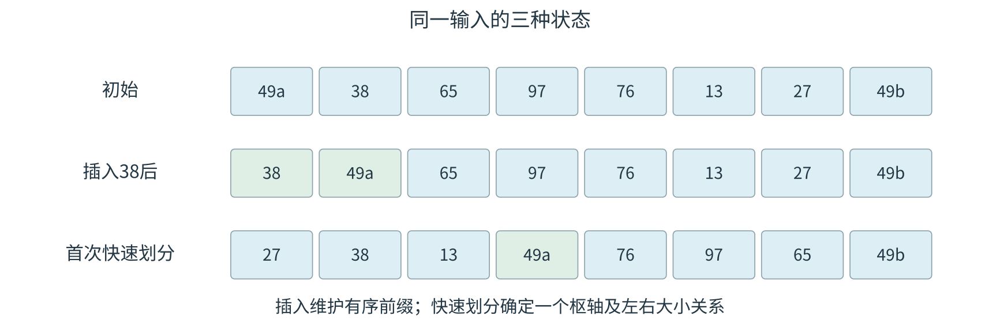

<a id="DS08-ex2"></a>
### 例 8-2　第二趟结束后应有几个枢轴就位

**例题 · 配套案例**

【配套例题】 对尚未确定最终位置的所有元素进行一遍处理称为一趟。下列序列中，不可能是快速排序第二趟结果的是（　）。

A. 5,2,16,12,28,60,32,72

B. 2,16,5,28,12,60,32,72

C. 2,12,16,5,28,32,72,60

D. 5,2,12,28,16,32,72,60


**解析。** 先确定完全有序结果为 `2,5,12,16,28,32,60,72`。一个就位枢轴还必须满足左边全不大于它、右边全不小于它。若第一枢轴在端点，第二趟只划分一个非空子区间，可能只有两个枢轴就位；若第一枢轴不在端点，两侧均非空，第二趟后至少有三个就位位置（单元素区间自身已就位）。

选项 D 中只有12与32这两个位置满足分隔关系，而且两者都不是端点。无论谁作为第一枢轴，第二趟都应在它左右再各形成一个就位位置，这与只有两个就位位置相矛盾，所以答案为 **D**。

选项 A 可先把最大值72定在末尾，再在左区把28就位；选项 B 可先把最小值2定在首位，再把72就位；选项 C 可先把28就位，再让左区的2、右区的32就位。判断时要检查每个枢轴对整个区间的分隔作用。

<a id="DS08-07"></a>
## 堆排序：堆范围与有序区分开

> **不变量 · 尾部已序，前部只是堆**
>
> 升序堆排序每轮把当前最大值固定到尾部，下一轮只调整缩小后的前部堆。前部兄弟不保证有序，不能把一次建堆的数组误判为一趟完整升序输出。

升序堆排序先建大根堆，根即未排序区的最大值；把根与当前末元素交换，这个最大值就留在末尾，堆范围减1，再对新根下滤。重复到堆范围只剩一个元素。此时数组尾部有序，前部只是一个堆，整体并未递增。

建堆 $O(n)$，每次删除最大值并调整至多 $O(\log n)$，完整排序有 $O(n\log n)$ 时间上界；常规迭代下滤空间 $O(1)$。教材常按关键字互异的模型，把各种情况都列为对数线性阶，但不能据此断言任意重复输入都要做同样多的比较：若关键字全相等且下滤在相等时立即停止，具体实现可以只做线性数量次比较。末尾与根的远距离交换使堆排序通常不稳定。小根堆反复交换到末尾得到的是降序数组，不能只看“每次取最小”就认定数组最后为升序。

<a id="DS08-ex3"></a>
### 例 8-3　删除堆顶时怎样数关键字比较

**例题 · 配套案例**

【配套例题】 小根堆为 `8,15,10,21,34,16,12`，删除关键字8之后重建堆，此过程中关键字之间的比较次数是（　）。

A. 1　B. 2　C. 3　D. 4


**解析。** 用最后的12填根，堆范围由7缩为6。先比较两个孩子15与10，选10（第1次）；再比较候选12与10（第2次），10上移、12下到原10位置。该位置只有一个孩子16，比较12与16（第3次）后停止。结果为 `10,15,12,21,34,16`，答案为 **C**，过程如下图所示。

<a id="DS08-heap-delete"></a>


无需再把16与不存在的右孩子比较，循环边界检查也不是关键字比较。若题目给了另一个下滤程序，例如始终下沉至叶再回升，应按那个程序计数，不能把本过程的3次当作所有实现的共同常数。

<a id="DS08-heap-code"></a>
### 完整堆排序的两段工作

> **课程连接 · 优先队列与选择小部分记录**
>
> 只找最小10项时可维护10项大根堆，把更小新值替换堆顶；不必完整排序。流式读入适合这种状态维护，若可原地随机访问，还可比较选择算法的期望线性方案。

```cpp
void HeadAdjust(int A[], int k, int len) {
    A[0]=A[k];
    for (int i=2*k; i<=len; i*=2) {
        if (i<len && A[i]<A[i+1]) ++i;
        if (A[0]>=A[i]) break;
        A[k]=A[i];
        k=i;
    }
    A[k]=A[0];
}
void BuildMaxHeap(int A[], int len) {
    for (int i=len/2; i>0; --i) HeadAdjust(A,i,len);
}
void HeapSort(int A[], int len) {
    BuildMaxHeap(A,len);
    for (int i=len; i>1; --i) {
        int temp=A[i]; A[i]=A[1]; A[1]=temp;
        HeadAdjust(A,1,i-1);
    }
}
```

有效元素存于`A[1..len]`，0号为暂存单元。`HeadAdjust`的前提是左右子树已经成堆，只有根位置可能违反堆序；先选较大孩子，再与暂存根比较。两个孩子相等时，代码保留左孩子，具体比较过程与此规则一致。

课件建堆数组`53,17,78,9,45,65,87,32`，依次调整根4、3、2、1。根4使32上升，根3使87上升，根2使45上升；根1使87上升，再使78上升，最终大根堆为`87,45,78,32,17,65,53,9`。排序第一轮将87放到末尾，对前7项下滤，得到`78,45,65,32,17,9,53 | 87`。竖线右侧为已确定的有序后缀，不能再参加下一轮的堆调整。

第一段自底向上建堆，第二段才把最大值逐个固定到末尾。不能把建堆$O(n)$当成完整堆排序的最坏时间。

<a id="DS08-08"></a>
## 二路归并：有序子段怎样变成长有序段

归并两个有序段时，只需比较当前未输出首记录，较小者先输出；一段耗尽后，另一段直接复制。相等时先取左段能保持稳定。归并长度分别为a、b的段，最坏作a+b−1次关键字比较：到只剩最后一个记录时，它属于哪个段已经确定，直接复制，不再作跨段比较。

自底向上先把每个记录视为长度1的段，一趟两两合并，段长最长变为2，再到4、8……；自顶向下先递归处理两半，再归并。每层总处理 $O(n)$ 个记录，层数 $O(\log n)$，故普通二路归并时间为 $O(n\log n)$，不因原序列已序就自动跳过整套过程。数组实现的归并辅助区通常为 $O(n)$，递归栈的 $O(\log n)$ 不改变总空间阶。

<a id="ds-fig-merge"></a>


<a id="DS08-ex4"></a>
### 例 8-4　比较次数不等于移动次数

**例题 · 配套案例**

【配套例题】 三个有序序列 `(3,5)`、`(7,9)`、`(6)`，按从左到右次序选择序列进行二路归并，关键字总比较次数为（　）。

A. 3　B. 4　C. 5　D. 6


**解析。** 先归并前两段，比较3与7、5与7，两次后左段耗尽，直接接7、9，得到 `3,5,7,9`。再与单元素6归并，比较3与6、5与6、7与6，共3次，之后接7、9。总数 $2+3=5$，答案为 **C**。最坏上界a+b−1只有在具体过程能一直交错到仅剩一个元素时才取到，本题第一次只比较2次，不能机械按4−1计3次。

<a id="DS08-merge-code"></a>
### 两段归并的稳定合并核心

> **错项排除 · 比较上界不等于具体次数**
>
> 归并a、b项最坏比较a+b−1次，但一段提前耗尽就直接复制另一段。计算给定值的过程题应逐次比较段首，不能每次都机械代入最坏上界。

```cpp
// B在排序开始前分配，容量至少等于A的有效数组长度。
int *B;
void Merge(int A[], int low, int mid, int high) {
    int i,j,k;
    for (k=low; k<=high; ++k) B[k]=A[k];
    for (i=low,j=mid+1,k=i; i<=mid && j<=high; ++k)
        if (B[i]<=B[j]) A[k]=B[i++];
        else A[k]=B[j++];
    while (i<=mid) A[k++]=B[i++];
    while (j<=high) A[k++]=B[j++];
}
void MergeSort(int A[], int low, int high) {
    if (low<high) {
        int mid=(low+high)/2;
        MergeSort(A,low,mid);
        MergeSort(A,mid+1,high);
        Merge(A,low,mid,high);
    }
}
```

**推导 · 相等时先取左段为何保序**

假设两个输入子段内部已经稳定有序。来自同一段的记录依次输出，相对次序不变；来自不同段的相等记录，左段原本在前，比较相等时仍先输出左段。因此合并保留所有相等记录的原相对次序，递归或分层重复后全序列仍稳定。


<a id="DS08-09"></a>
## 基数排序：低位排好后怎样保留次序

基数排序按关键字的组成部分分配、收集。LSD从最低有效位开始，逐位稳定排序；每轮收集必须保持同一桶内原顺序，才能保留先前已经排好的低位关系。处理更高位后，低位只在高位相同时才决定顺序，这也正是从低到高稳定处理的依据。

<a id="DS08-ex5"></a>
### 例 8-5　第一趟后为什么尚未整体递增

**例题 · 配套案例**

〖8.5-012〗 对 `05,46,13,55,94,17,42` 进行基数排序，一趟后的结果为（　）。

A. 05,46,13,55,94,17,42

B. 05,13,17,42,46,55,94

C. 42,13,94,05,55,46,17

D. 05,13,46,55,17,42,94


**解析。** 本题采用通常的十进制LSD，第一趟按个位分配：桶2放42，桶3放13，桶4放94，桶5依次放05、55，桶6放46，桶7放17。按桶号收集得 `42,13,94,05,55,46,17`，答案为 **C**。桶5不能把55放到05之前。第二趟按十位稳定处理，才得到 `05,13,17,42,46,55,94`。

若共d位、基数r，每轮分配n项并收集r个桶，时间为 $O(d(n+r))$。空间要按实现：已有链式记录、链接域计入原记录时，额外的桶头、桶尾指针为 $O(r)$；数组分桶另开输出数组时为 $O(n+r)$。固定十进制位数与r时可近似线性，但不能把位数随规模增长的情形也无条件写为 $O(n)$。

MSD从最高位开始，把记录分成桶后递归处理各桶；它的任务分解与LSD不同。负整数、可变长字符串、空缺位的次序都需要事先定义，不能把非负定长十进制示例原样用于所有关键字。

### 按取值计数：空间与稳定实现的条件

计数排序把关键字的值映射为计数数组的下标。若整数取值从min到max，令 $k=\mathrm{max}-\mathrm{min}+1$，以 `key-min` 为下标：先统计频次，再求前缀和，得到每个值应占据的输出位置范围。例如序列 $2_a,4,3_a,0,2_b,3_b$ 的频次数组为 `[1,0,2,2,1]`，前缀和为 `[1,1,3,5,6]`。从后向前扫描原序列，每次把记录放到该值当前最后一个输出位置，再将位置减1，得到 $0,2_a,2_b,3_a,3_b,4$，相等记录仍保序。

按这一稳定实现，时间为 $\Theta(n+k)$，输出数组与计数数组合计辅助空间 $\Theta(n+k)$。它适合整数取值范围较小的情形；k很大时，清零和累计计数本身就可能不合算。若只按次数把数值重新覆写回数组，没有保存相等记录的身份及附加数据，不能据此宣称对记录作了稳定排序。计数、基数利用关键字结构，不属于仅靠关键字两两比较来确定次序的模型，因而不直接受比较排序的 $\Omega(n\log n)$ 最坏下界约束。

<a id="DS08-distribute-code"></a>
### LSD和稳定计数的核心次序

> **不变量 · LSD依赖每轮的稳定性**
>
> 更高位相同的记录仍要靠已经排好的低位决定先后，故同桶必须保留上轮次序。改成插桶头或逆序收集可能破坏这个不变式，即使每轮单独看都按本位有序。

```text
LSD(records,d,r):
    从最低位到最高位执行d轮:
        清空r个桶
        按当前序列从前向后，把记录追加到对应桶尾
        按桶号递增、桶内先入先出收集
```

```text
stableCounting(records,min,max):
    k=max-min+1；count[0..k-1]=0
    扫描记录并按key-min累计count
    对count求前缀和
    从后向前扫描原记录x:
        count[x.key-min]--
        B[count[x.key-min]]=x
    返回B
```

计数输出位置以0开始。输出的是整条记录而非只覆写关键字，才有条件讨论相等记录身份的稳定性；若取值范围很大，必须先衡量$k$所需空间与清零代价。

<a id="DS08-count-code"></a>
### 计数排序的课件代码

```c
void CountSort(int A[], int B[], int n, int k) {
    int i, C[k];
    for (i=0; i<k; ++i) C[i]=0;
    for (i=0; i<n; ++i) ++C[A[i]];
    for (i=1; i<k; ++i) C[i]+=C[i-1];
    for (i=n-1; i>=0; --i) {
        --C[A[i]];
        B[C[A[i]]]=A[i];
    }
}
```

本段采用C99变长数组，前提为$k>0$、$n\ge0$、$0\le A[i]<k$，输出数组B至少能容纳n项。扫描方向从后向前、每次减少该值的剩余位置，使同值记录的前后身份得以保持；这里用整数展示，排序完整记录时连同附加数据一起复制。调用结束后结果位于B，A仍是输入。

课件代码附件还给出支持负整数的版本：先求最小值min、最大值max，用`A[i]-min`映射到`0..k-1`，$k=max-min+1$，动态分配计数和输出数组，完成后复制回A并释放。使用前还需检查空输入、取值范围计算是否溢出以及分配是否成功。数据`4,2,2,-3,5,0,3,3,1`排序为`-3,0,1,2,2,3,3,4,5`。

<a id="DS08-radix-links"></a>
### 基数排序的链式队列分配

对已有`next`链接的记录，每个数位设置$r$个桶头`front[]`和桶尾`rear[]`。分配一个结点p时先保存其原后继，再把它摘下并置`p->next=NULL`；桶空则同时令首尾为p，桶非空则接在`rear[digit]->next`后并更新尾指针。收集时按桶号顺序把非空桶首尾相接，并清空本轮各桶指针。

因此同一桶中先出现的记录仍在前面，收集整个桶只需接首尾，遍历全部桶为$O(r)$。若每次向桶头插入，桶内顺序会逆转，LSD已排好的低位关系就被破坏。求递减结果时，分配仍按当前序列顺序进入桶尾，只把收集桶号改成$r-1$到0，桶内保持先入先出。

<a id="DS08-10"></a>
## 外部排序：归并段、缓冲与I/O

> **课程连接 · 外排瓶颈联系操作系统I/O**
>
> 外排优先按块读写，输出缓冲攒满再写可减少细粒度I/O。多路需要更多输入缓冲，路数受实际内存约束；双缓冲与异步I/O还会改变可用块数和耗时模型。

外部归并先把可装入内存的一批记录排成有序初始归并段，再多路归并。内存可同时放B个块、每路至少1个输入缓冲块且留1个输出缓冲块时，最多支持B−1路简单归并；双缓冲或额外选择结构还可能占更多空间。提高路数可以减少趟数，但不能忽略缓冲的实际容量。

若有r个初始段，固定k路平衡归并需要 $\lceil\log_k r\rceil$ 趟，最后一组可不足k路。每一趟把全部N个数据块读入并写出，通常为2N次块传输；生成初始段也读写全文件，若计入该阶段，总量为 $2N[1+\lceil\log_k r\rceil]$，这里不计寻道、缓存命中或最后输出直送等特殊节省。

例如4500条记录，每块75条，内存能容450条，则文件60块、内存6块。直接分批内排序可得到10个初始段，每段450条、6块；若用5路归并，10→2→1，需要2趟归并。计初始段生成，总块传输 $2\times60\times3=360$ 次。记录数、块数、段数各起不同作用，不能把4500直接当作I/O次数。

<a id="DS08-external-course"></a>
### 课件中的16块外排实例

> **条件辨析 · 块与记录分开计**
>
> 16块文件每完整读写一趟是32次块传输。每块含多少条记录不应再次乘入已经按块统计的次数。

文件有16个磁盘块，内存用于生成初始段的工作区容纳2块，分8批内部排序，得到8个两块长初始段；这一阶段读16块、写16块。二路归并时，2个输入缓冲块和1个输出缓冲块就能循环归并任意长的两个段：输入块读尽才补下一块，输出块写满才写盘。

二路平衡归并的段数为$8\to4\to2\to1$，共3趟，每趟读写各16块，所以连同初始段生成总传输$32+3\times32=128$块。改成4路，须4个输入块加1个输出块，段数$8\to2\to1$，共2趟，总传输$32+2\times32=96$块。节省来自全文件读写次数减少，并非每个磁盘块本身变小。

$k$路平衡归并要求每趟把当前各段按至多$k$段一组合并，下一趟段数为$\lceil r/k\rceil$；最后一组可以不足$k$路。严格$k$叉最佳归并树的补虚段规则服务于另一种按段长优化的树模型，不能据“有一组不足$k$路”否定它是$k$路平衡归并。

### 置换—选择为什么能产生长于内存的段

工作区保存当前仍可进入本段的记录。每次输出其中最小值x，再读一个新记录y：若 $y\ge x$，它仍可参加当前段；若 $y<x$，就把它冻结，留给下一段。可用记录耗尽时结束本段，把全部冻结记录解冻，重新开始。这里工作区只保持m条候选，输出段却可以随着不断换入而增长。

<a id="DS08-ex6"></a>
### 例 8-6　冻结记录在什么时候重新参加

**例题 · 配套案例**

【配套例题】 对含 $n>0$ 个记录的文件外部排序，以置换—选择生成初始归并段，工作区能保存m个记录。

（1）文件19个关键字依次为 `51,94,37,92,14,63,15,99,48,56,23,60,31,17,43,8,90,166,100`，m=4时生成几个初始段？各是什么？

（2）对任意m（$n\gg m>0$），第一个初始段长度最大、最小值分别是多少？


**解析。** 先装入51、94、37、92，输出37后读入14，因为14<37而冻结；输出51后读入63，63仍可参加本段。前6次输出和换入如下：


| 输出 | 新读入 | 新记录归属 |
| --- | --- | --- |
| 37 | 14 | 冻结 |
| 51 | 63 | 当前段 |
| 63 | 15 | 冻结 |
| 92 | 99 | 当前段 |
| 94 | 48 | 冻结 |
| 99 | 56 | 冻结 |


此时工作区14、15、48、56全被冻结，第一段结束。解冻后继续，同样逐次选最小；读入17、43、8和100时，它们分别小于当时最后输出的31、48、56和166，留给下一段。最终得到3段：

1. `37,51,63,92,94,99`；
2. `14,15,23,31,48,56,60,90,166`；
3. `8,17,43,100`。

每个原记录恰好输出一次，三段长度 $6+9+4=19$，段内均递增。第一个初始段最多可含全部n项，输入已经非降时即如此；最少为m项，例如输入严格递减，每个新读入都冻结，但最初m个仍要全部输出才能结束。答案是**最大n、最小m**，不是每段都恰好m或2m。

<a id="ds-fig-replacement"></a>


### 败者树怎样减少每次输出后的比较

k路归并每次都要找各段当前首记录中的最小者。败者树把各路作为叶，内部结点记录一次比赛的败者，并额外保存总冠军的路号。冠军输出后，仅该路换入新首记录，它沿原比赛路径与保存的败者重新比较；每层只需一次关键字比较，更新约 $O(\log k)$。

例如4路首记录为A:3、B:5、C:2、D:7，冠军是C的2，内部保存5、7及最终败者3。C换入6后，先与7比较，再与3比较，冠军变为A的3。这次更新不必重新比较未变化的3与5。堆的下滤一般先比较两个孩子再与候选比较，败者树每层沿既定对手路径比较，过程不同；堆可以在中途已满足堆序时停止，败者树更新冠军路径则要传到总冠军位置。

<a id="ds-fig-loser"></a>


<a id="DS08-ex7"></a>
### 例 8-7　不等长有序表怎样安排合并

**例题 · 配套案例**

【配套例题】 6个升序表A、B、C、D、E、F，分别含10、35、40、50、60、200个元素。通过5次两两合并成为一个升序表，要求最坏情况下比较总次数最小。

（1）给出完整合并过程及最坏比较总次数。（2）描述N个不等长升序表的合并策略并说明理由。


**解析。** 一张表每参加一次合并，它的全部元素就再次参与一层归并工作。让长表尽量晚参加、短表尽早参加，等价于最小化以表长为叶权的二叉归并树WPL，即采用哈夫曼合并策略：


| 合并段长 | 新段长 | 本次最坏比较 |
| --- | --- | --- |
| 10与35 | 45 | 44 |
| 40与45 | 85 | 84 |
| 50与60 | 110 | 109 |
| 85与110 | 195 | 194 |
| 195与200 | 395 | 394 |


最坏比较总数 $44+84+109+194+394=825$。合并长度之和即WPL，为830；每次归并比较至多“合并长度−1”，共有5次，所以也可得830−5=825。推广到N段，就是反复选当前两个最短段合并后放回候选集合，直到只剩一段，理由与哈夫曼最优树相同。

<a id="DS08-ex8"></a>
### 例 8-8　四路最佳归并为什么补零权段

**例题 · 配套案例**

〖8.7-004〗 12个初始段长分别为30、44、8、6、3、20、60、18、9、62、68、85。进行4路外部归并，画出最佳归并树并计算WPL。


**解析。** 满4叉归并树的叶数应满足 $(r-1)\bmod3=0$。12不满足，补1个零权虚段得到13个叶。每次取4个最小权值：

`0+3+6+8=17`，`9+17+18+20=64`，`30+44+60+62=196`，最后 `64+68+85+196=413`。

所以WPL为 $17+64+196+413=690$。虚段不含真实记录，补它是为了让第一次归并允许不足4个真实输入，不会平白增加文件数据量。若每次合并段都完整读写，且段长按块计，归并阶段总块I/O为 $2\times690=1380$；这是按该模型计数，不包含此前生成初始段的读写。

<a id="DS08-external-code"></a>
### 外部归并和置换—选择的状态

> **最小反例 · 输出段可以比内存更长**
>
> 最小直观情形：工作区1条，输入1、2、3。每输出一条再换入更大者，三条属于同一段，内存始终只存1条。不能把段长固定等同工作区容量。

```text
mergeKRuns(runs):
    每路读入首缓冲块，另留输出块
    重复选择各非空路当前最小首记录，写入输出缓冲
    选中路的块用尽时读它的下一块
    输出块满时写外存；最后写出不足一块的剩余输出
```

```text
replacementSelection(input,m):
    工作区读入至多m条，标记为当前段可用
    while 工作区非空:
        若无可用记录: 结束当前段，全部冻结项解冻
        输出可用记录中最小的x
        若还有输入，读入y占用x释放的位置:
            若y<x则冻结，留下一段；否则本段可用
        否则删除该工作区位置
```

每个输入记录恰好换入并输出一次；冻结表示属于下一段，不能在当前段末尾直接按数值插回。工作区大小固定，输出段长度却可以继续增长，二者不是同一个量。

**方法 · 外部排序先统一单位再计I/O**

依次写记录数、每块记录数、内存块数、初始段数、路数与趟数。若题目包含初始段生成，另计一次全文件读写；若按归并树WPL计不等长段合并，则逐内部结点累计读写，不能再乘一个全文件的统一趟数。


<a id="DS08-11"></a>
## 怎样比较和选择排序算法

> **错项排除 · 下界没有否定计数排序**
>
> 比较排序下界假设只凭两两比较区分互异关键字排列；计数索引利用整数取值范围，成本还含k。若k很大，线性于n的口号忽略了计数数组和前缀和代价。

下表比较的是**完整排序的总时间**，同时计入比较、移动和循环工作，不把一次划分、一次下滤或只建堆当作完整排序。辅助空间不计输入记录本身，但计入递归栈和另开输出数组；$\Theta$ 表示同阶，$O$ 只给上界。$r$ 为基数，d为固定执行的位数，k为计数排序的取值范围大小。比较排序的平均列按互异关键字的等概率随机排列分析；随机枢轴快排也可对其随机选择取期望，这些都不等于每份输入的保证。


| 算法 | 最好时间 | 平均时间 | 最坏时间 |
| --- | --- | --- | --- |
| 直接插入 | $\Theta(n)$ | $\Theta(n^2)$ | $\Theta(n^2)$ |
| 折半插入 | $\Theta(n\log n)$ | $\Theta(n^2)$ | $\Theta(n^2)$ |
| 起泡 | $\Theta(n)$ | $\Theta(n^2)$ | $\Theta(n^2)$ |
| 简单选择 | $\Theta(n^2)$ | $\Theta(n^2)$ | $\Theta(n^2)$ |
| 希尔 | 依增量序列 | 依增量序列 | 依增量序列 |
| 快速 | $\Theta(n\log n)$ | $\Theta(n\log n)$ | $\Theta(n^2)$ |
| 堆 | $O(n\log n)$，见下文 | $\Theta(n\log n)$ | $\Theta(n\log n)$ |
| 二路归并 | $\Theta(n\log n)$ | $\Theta(n\log n)$ | $\Theta(n\log n)$ |
| LSD基数 | $\Theta(d(n+r))$ | $\Theta(d(n+r))$ | $\Theta(d(n+r))$ |
| 计数 | $\Theta(n+k)$ | $\Theta(n+k)$ | $\Theta(n+k)$ |


| 算法 | 辅助空间与稳定性 | 重要实现条件 |
| --- | --- | --- |
| 直接插入 | $O(1)$；稳定 | 只移动严格大于新项的记录 |
| 折半插入 | $O(1)$；稳定 | 每趟都折半定位；插在旧相等项之后 |
| 起泡 | $O(1)$；稳定 | 有无交换标志可提前停；仅逆序相邻项交换 |
| 简单选择 | $O(1)$；不稳定 | 每趟选最小后与首位交换；比较固定 |
| 希尔 | $O(1)$；不稳定 | 逐组插入，末增量为1；未给增量不填统一时间阶 |
| 快速 | 栈平均 $O(\log n)$，最坏 $O(n)$；不稳定 | 本章单枢轴划分与双支递归；平均需随机模型 |
| 堆 | $O(1)$；不稳定 | 自底向上建堆、迭代下滤；最好紧界有条件 |
| 二路归并 | $\Theta(n)$；稳定 | 数组常规归并，不跳过已有序段；相等先取左段 |
| LSD基数 | 链式额外 $O(r)$；数组 $O(n+r)$；稳定 | 固定执行d轮；同桶保序；链式原记录已有链接域 |
| 计数 | $\Theta(n+k)$；稳定 | 计数、前缀和、逆向放入输出数组的记录实现 |


堆排序的教材汇总表在关键字互异的常规模型下，把最好、平均、最坏都列为对数线性阶；本表最好一栏保留总时间上界，并提醒具体停机条件：若允许所有关键字相等，下滤比较到相等即停止，建堆和全部输出可只做 $\Theta(n)$ 工作。不能把教材汇总表的最好紧界无条件套到这类重复输入上，也不能因这一特例删去堆排序的 $\Theta(n\log n)$ 最坏时间。起泡若无提前停止标志，则有序输入仍执行固定二次比较；归并若另加跳过有序段的优化，最好情况也应随实现重算。

规模小、接近有序时，直接插入移动少、控制简单；需要可靠的最坏对数线性时间且额外空间有限时，可考虑堆；要求稳定而可用线性辅助区时，可用归并；关键字可分成少量固定位，或整数取值范围较小时，可分别比较基数排序、计数排序的代价。外存排序则优先设计初始段和多路归并，不能只把内部快排换到磁盘上逐元素访问。

移动、比较和趟数不能互相替代。简单选择比较量不受初始次序影响，交换次数却依实现而定，某次交换可以在代码中省去；折半插入比较量变化小，移动量仍依赖初始排列；LSD按固定d位执行时，分配收集的轮数固定；快速排序的划分深度取决于划分结果。并行能力也依实现：快排两子区间可独立，归并同层不同段可独立；LSD的下一位依赖本位稳定结果，但每一位内部仍可设计并行分配。不能把某个串行教材步骤的依赖，扩大成算法在任何实现下“绝不可能并行”。

**定理 · 比较排序下界的适用模型**

仅通过两两关键字比较区分$n$个互异关键字的全部排列时，最坏比较次数为$\Omega(n\log n)$。


**推导 · 决策树至少要容纳全部排列**

互异关键字有$n!$种相对次序，一棵二分比较决策树至少需要$n!$个叶。高度为$h$的二叉树至多$2^h$个叶，所以$h\ge\lceil\log_2(n!)\rceil=\Omega(n\log n)$。计数与基数利用取值或数位结构，操作不只在这棵两两比较树中分支，故不与其线性特殊模型矛盾。


<a id="DS08-check"></a>
## 主动回忆自测

第2题为配套例题，其余为自拟补充，检查模型变化。

1. 直接插入把大于条件改为大于等于，时间阶没变，哪项性质可能改变？
2. 【配套例题】n（n>100000）个数保存在一维数组M中，需要查找最小的10个数。（1）设计算法，要求平均情况下比较次数尽可能少，简述思想，不需要程序实现。（2）说明平均时间复杂度和空间复杂度。
3. 100个初始段，最多4路归并，需要几趟？若每趟完整读写500块，归并阶段多少块传输？
4. 一个不稳定排序在没有相等关键字的输入上，能否观察到稳定性差异？

5. 直接选择用严格小于找最小值，为什么仍可能不稳定？给最小三记录反例。
6. 折半插入将相等时的分支改为向左找，会影响比较次数的阶还是稳定性？
7. 两个长度分别为2、3的有序段，归并一定需要4次关键字比较吗？
8. 置换—选择工作区4条，输入已递增的100条记录，第一段最多多长？内存是否因此装入100条？

**答案。** 1. 可能破坏稳定性，新相等记录移到旧记录前。2. 用随机枢轴划分，把第10小作为选择目标，只继续处理包含这一秩的子区间；其余一侧无需继续排序。确定分界后，左侧保留10个最小数，边界有相等值时按还需个数选取。平均时间 $O(n)$，在原数组上迭代选择可用 $O(1)$ 辅助空间；题目不要求这10个数内部有序。也可维护大小10的大根堆：只用小于堆顶的数替换并下滤，适合流式读入，代价为 $O(n\log10)$、辅助 $O(10)$，不能把它误写成必须完整排序。3. $\lceil\log_4100\rceil=4$ 趟，传输 $4\times2\times500=4000$ 块；若包含初始段生成，再加1000块。4. 不能。输入中不存在相等记录，但算法的稳定性定义仍按所有合法输入判断。

5. $2_a,2_b,1$第一趟把1与$2_a$远距离交换，得到$1,2_b,2_a$，破坏稳定性；找最小值时没有因相等更新pick也无法避免。
6. 比较阶通常不变，但把新相等记录插到旧相等记录之前，稳定性可能破坏。
7. 不一定，4只是最坏上界；若较短段的所有值都小于另一段，只比较2次就直接复制余段。
8. 可长100条；输出一条就换入一条，工作区始终最多4条，段长不等于同时驻留的记录数。
