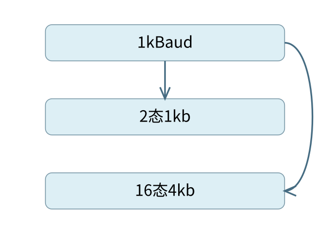
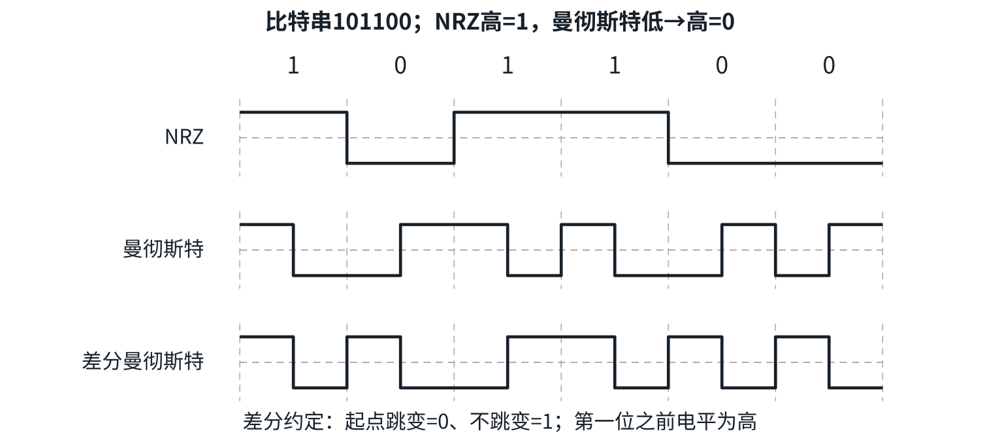
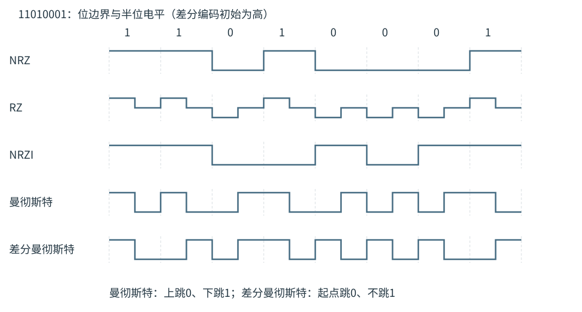

# 物理层

[可编辑SVG](figures/overview.svg) · [完整知识导图](chapter-map.pdf)

把“每秒传多少码元”换成“每秒携带多少比特”，必须知道一个码元有多少种状态；把“带宽多大”换成“容量上限”，还要区分带宽单位、噪声与调制约束。本章将这些量放回信号、介质与接口中理解。

## 数据、信号、码元与两种带宽

> **最小反例 · Baud不等于bit/s**
>
> 同为1000 Baud，二进制每码元1 bit得到1 kb/s，16态每码元4 bit得到4 kb/s。两个系统码元率相同、数据率不同，已经足以排除“波特率总等于比特率”的说法。
>
> 
>
> 同一码元率可以有不同比特率

**定义 · 数据与信号**

**数据**承载信息，**信号**是数据在介质中的物理表示。数字数据可以表示为离散电平，也可以调制在连续载波上；模拟语音可以直接调制传输，也可以采样量化后编码为数字数据。因此不能把“模拟数据”与“模拟信号”当作同一概念。

**码元**是在一个固定时间间隔内选取的一种信号波形或状态。若有 $M$ 种可区分状态，一次可表示 $\log_2M$ bit；码元速率 $R_s$ 的单位为 Baud，数据速率 $R_b$ 的单位为 bit/s。在题目把每个状态按等长二进制编码、忽略其他冗余时，

$$R_b=R_s\log_2M.$$

例如1000 Baud 达到4 kb/s，需要每码元4 bit，即 $M=2^4=16$ 种状态，不能把4误当成状态数。若题给“每 $1/8$ s 取一个可独立传送的16态符号”，则速率是 $8\times4=32$ bit/s；这里8已是每秒符号数，不必再乘2。〖2.1-007〗〖2.1-016〗

**频率带宽**指可通过频率范围的上、下限之差，单位 Hz；**数据率意义的带宽**指单位时间能传送的数据量，单位 bit/s。看到“4 kHz信道”应想到容量定理，看到“4 kb/s链路”通常已给出数据传输速率。两者单位不同，数值不能直接互换。

信道是某一方向上传送信号的通道。一条物理线路可以承载多个按频率、时间或编码区分的逻辑信道。单工只能单向传送，半双工可双向但不能同时，全双工可同时双向。两端之间有一根网线，不足以判断它采用哪一种工作方式。

## 奈奎斯特与香农：哪个条件限制了速率

> **错项排除 · 分贝不能直接入对数**
>
> 30 dB是功率比1000的对数表示，香农式需要无单位的1000。如果直接把30填入1+S/N，错误发生在输入量的含义，后续对数运算再准确也无法补救。

理想无噪声低通信道频率带宽为 $B$ Hz 时，无码间串扰的极限码元速率是 $2B$ Baud；若每码元有 $M$ 种状态，奈奎斯特式给出

$$R_b\le 2B\log_2M.$$

带宽限制了可独立辨认的变化速度。把接收端采样次数增加到 $2B$ 以上，不会自动创造更多独立码元。〖2.1-010〗中的8 kHz、8态信道，即使写“每秒采样24k次”，仍受 $2\times8000\times3=48$ kb/s 约束。

有加性高斯白噪声的带限信道，香农容量为

$$C=B\log_2(1+S/N).$$

$S/N$ 是无单位的功率比。若给出分贝数 $\gamma$，先计算 $S/N=10^{\gamma/10}$。30 dB 对应1000，不能把30直接代入对数。容量是理论上的可靠传输极限：编码合适、码长足够长时，实际速率可以趋近它，但任何具体调制器都不一定达到。

题目同时给出带宽、状态数和信噪比时，通常要检查固定调制状态数与噪声各自施加的限制，再按题目的教材信道模型取较小的上界；两式不是相加关系。若二进制信号在4 kHz、信噪比127的信道上传送，固定二进制给出8 kb/s，而香农给出28 kb/s，能采用的上界为8 kb/s。〖2.1-012〗

**方法 · 容量题的四步换算**

先把频率带宽换为Hz、分贝换为功率比，再由状态数求每码元比特数；分别计算题设允许的奈氏与香农上界，最后选有效约束。只给码元率时直接乘$\log_2M$，不要无依据再乘2。

| 已知信息 | 计算关系 | 条件与单位 |
| --- | --- | --- |
| 每秒码元数与状态数 | $R_b=R_s\log_2M$ | 理想等长编码，不计额外冗余 |
| 无噪声低通带宽 | $R_s\le2B$ | $B$用Hz，码元率用Baud |
| 带宽与功率比 | $C=B\log_2(1+S/N)$ | 高斯噪声模型，结果bit/s |
| 分贝信噪比 | $S/N=10^{\gamma/10}$ | 功率比，无单位 |

每个码元有$M$种可区分状态，连续$q$个码元共有$M^q$种序列；若想表示$k$位二进制信息，需要至少$2^k$种序列，故$k\le q\log_2M$。将每秒码元数乘进去，得到理想速率关系。状态数是指数空间，不能把$M$直接当每码元比特数。

### 例 2-1　由调制状态数求最大速率

**例题 · 配套例题**

配套例题。 在一条带宽为200 kHz的无噪声信道上，若采用4个幅值的 ASK 调制，则该信道的最大数据传输速率是（　）。

A. 200 kb/s　B. 400 kb/s　C. 800 kb/s　D. 1600 kb/s

**解析。** “无噪声、带宽、4个幅值”分别给出了奈氏模型、$B=200000$ Hz 和 $M=4$。每个码元携带2 bit，极限码元率为400 kBaud，因此最大数据率为800 kb/s，选 **C**。把200 kHz直接当成200 kb/s，会同时丢掉码元速率与每码元比特数两个转换。

### 例 2-2　增加信噪比是否一定提高固定调制的极限

**例题 · 配套例题**

〖2.1-017〗 某信道带宽为10 MHz，信噪比为30 dB，采用 QAM-32 调制。若带宽提高到20 MHz，信噪比提高到40 dB，则信道的极限数据传输速率大约提高到原来的（　）倍。

A. 2　B. 2.2　C. 2.4　D. 2.6

**解析。** QAM-32每码元5 bit。按题设模型，原奈氏上界为100 Mb/s，原香农上界约为 $10\log_2(1001)=99.67$ Mb/s；新奈氏上界为200 Mb/s，新香农上界约为 $20\log_2(10001)=265.76$ Mb/s。因此新旧上界的比值约为 $200/99.67=2.01$，最接近 **A**。

原条件下两个上界非常接近，按近似 $\log_21000\approx10$ 也得到约2倍。新增信噪比使噪声约束放宽，但固定32态调制仍限制每个码元只能携带5 bit，所以不能仅用两个香农容量之比作答。

## 编码、调制与 PCM 怎样区分

> **最小反例 · 中点不能解所有编码**
>
> 差分曼彻斯特中每位中点都会跳变，只看中点方向无法按一般规则恢复比特；起点是否跳变才携带差分编码的信息。第一位还需要前一电平，这正是读波形时应补齐的初始条件。

基带编码用电平及跳变表示数字数据。非归零 NRZ 在一个比特间隔保持某一电平，连续相同比特可能没有跳变，时钟恢复困难。反向非归零 NRZI 用比特起点是否跳变表示数据，具体0、1约定要由题目给出；长串相同比特仍可能缺少跳变，常需填充等机制。

曼彻斯特编码在每个比特中点都跳变，以跳变方向表示数据。本书示意约定低到高为0、高到低为1；题目若采用相反约定，应按题意读图。差分曼彻斯特同样在每个比特中点跳变，但由**比特起点是否跳变**表示数据，本书约定起点跳变为0、不跳变为1。判断差分编码的第一位需要知道前一电平；不能只看该位中点的升降方向。

曼彻斯特每位需要两个半位信号区间，因此在教材“每秒最多可承载多少电平区间”的模型中，数据率只有该区间变化能力的一半。不要因此认为比特中点的每次跳变都额外携带一位数据；中点跳变还承担时钟作用。

调制把数据映射到载波参数。ASK 改变振幅，FSK 改变频率，PSK 改变相位；QAM 联合使用振幅与相位区分状态。4个相位、每个相位4种振幅共有16态，每码元4 bit。QAM-64表示64种可分辨组合，不是64个比特，也不是64个独立频率。

模拟数据转为数字数据常采用 PCM：先采样取得离散时刻的幅值，再量化为有限级别，最后将级别编码。对最高频率为 $f_{\max}$ 的理想带限信号，采样频率应不低于 $2f_{\max}$；若每样本编码 $q$ bit，未计信道编码冗余的数据率为 $f_s q$。这里的“采样至少两倍”与前节“码元至多两倍带宽”分别限制采样与无码间串扰传输，不能一看到“2”就无条件相乘。

例如电话语音按8 kHz采样、每样本8 bit，产生64 kb/s数据；若再用带冗余的线路编码，物理线路需要承担的编码后速率还会增加。4B/5B用5个线路比特表示4个数据比特，编码效率为4/5；这一效率与每码元的调制阶数是两个不同因素。

## 传输介质：比较受什么条件约束

> **错项排除 · 颜色和模式不是同义**
>
> 单模/多模描述传播模式，不等于只用一种/多种波长。波分复用可以让不同波长共享光纤。比较光纤时先分清传播模式、复用方式和容量，避免拿一个维度直接替代另一个。

双绞线由两条相互绝缘的导线绞合而成，以减少电磁干扰；屏蔽双绞线进一步增加屏蔽结构。同轴电缆用内导体、绝缘层和外导体屏蔽层构成，传统条件下具有较好的屏蔽性能。介质的实际速率同时取决于编码、设备、频段、长度等条件，不宜一概断言“同轴一定比所有双绞线快”。

光纤利用光信号传播，绝缘且不受外界电磁干扰，衰减较低。多模光纤允许多种传播模式，不同模式到达时间不同，会产生模间色散；单模光纤减轻这类展宽，适用于更长距离和较高容量的通信。多模与单模的区别不只是“同时发送几种颜色”；多种波长复用是另一种复用技术。

无线介质包括无线电、微波、红外等。低频无线电较易绕射，地面微波常要求视距传播，卫星通信能覆盖较大区域，但高轨卫星的长传播距离带来明显时延。不能把光纤“速率高”理解为其中信号的传播速度一定高于无线电波在真空中的速度。

常见以太网名称也需要读出限定：10BASE-T采用双绞线；10BASE5是传统粗同轴、单段上限500 m的制式；100BASE-T主要使用双绞线。500 m不是一切同轴网的共同极限。吉比特以太网不同物理制式使用不同编码，不能沿用传统10 Mb/s以太网的曼彻斯特编码概括全部制式。

## 物理层接口规定什么，不规定什么

> **不变量 · 同是引脚也要分维度**
>
> 引脚位于何处属于机械特性；引脚承担请求发送还是接收准备属于功能特性；电压范围属于电气特性。按“这个描述回答什么问题”归类，比按“引脚”这个共同名词归类更稳。

机械特性规定连接器形状、尺寸及接点排列等；电气特性规定电压、电平、阻抗与传输速率等；功能特性说明各条信号线承担什么功能；规程特性规定信号出现的顺序和双方动作次序。接点“位于哪里”属于机械特性，接点“用来请求发送”属于功能特性，不能都按“引脚”一个词归类。

### 例 2-5　MAC 地址属于物理层接口规范吗

**例题 · 配套例题**

配套例题。 下列选项中，不属于物理层接口规范定义范畴的是（　）。

A. 接口形状　B. 引脚功能　C. 物理地址　D. 信号电平

**解析。** 形状、引脚功能和电平分别对应机械、功能与电气特性。这里的“物理地址”指 MAC 地址，是链路层寻址标识，并不因为名称中有“物理”就属于物理层接口规范，选 **C**。

## 中继器与集线器：再生比特，不解释地址

数字中继器在信号衰减、失真后再生符合规范的比特信号，重点是判决、整形和重新发送，不是把噪声和有用信号一起按幅度放大。它不检查 MAC 地址，也不学习转发表或进行网络层路由。可在满足速率、编码和协议等兼容条件时连接不同介质；“能换介质”不等于“能翻译不同网络协议”。

集线器是多端口中继器。一个端口收到比特后向其他端口转送，所有站仍共享一个冲突域、同一份总带宽。5台主机接10 Mb/s集线器，在理想均分且不计竞争开销的模型下每台平均为2 Mb/s；不是每台始终保证2 Mb/s，也不是五台主机可以同时各以10 Mb/s发送。

一个集线器两侧各100 m、传播速率 $2\times10^8$ m/s 时，最远站点间单向路径为200 m，传播1 μs，往返2 μs。〖3.6-020〗的计算先合计两侧距离，再考虑往返；只把100 m乘2得到单向路径就停下，会漏掉回程那一段。中继设备若有额外时延也应计入，不能只看电缆长度。

## 从信源到信宿：编码器与调制器各做什么

**信源**产生待传的数据，**信宿**接收数据。数据经过变换器成为适合介质的信号，接收端反变换后恢复数据。数字数据可经线路编码成为数字基带信号，也可经调制映射到载波的幅度、频率或相位上。编码器与解码器配合，调制器与解调器配合；设备的商业名称不能代替所做的信号变换。

**基带传输**直接传送适合介质的基带信号；**频带传输**将信号频谱搬移到所需频带。所谓数字数据和模拟信号并不矛盾：数据的取值类型与承载它的波形类型属于两个维度。把数字数据映射为四种载波状态后，每个状态仍可表示2 bit。

## 五种线路编码逐位怎样画

> **边界 · 第一位先看初态**
>
> 差分编码要根据前一电平判断位起点有无跳变。

读图先画比特边界，再按约定画半位电平。下表采用NRZ低0高1、NRZI起点跳变表示0、曼彻斯特中点上跳表示0、差分曼彻斯特起点跳变表示0；另设差分编码的初始电平为高。不同题图可以给出另一套合法约定，必须先确认再译码。

| 编码 | 一个比特内的规则 | 同步与代价 |
| --- | --- | --- |
| NRZ不归零 | 整个位保持相应电平 | 长串相同比特缺少边沿，自同步困难 |
| RZ归零 | 前半位按0/1给低/高电平，后半位回到零电平 | 每位有回零过程，占用更多信号变化能力 |
| NRZI反向非归零 | 位起点按数据决定是否跳变，位中保持 | 按本表约定，长串1可能无跳变，可结合限制连续码型等方法 |
| 曼彻斯特 | 位中必跳变，以跳变方向表意 | 中点提供同步；每位使用两个半位区间 |
| 差分曼彻斯特 | 位中必跳变，以位起点是否跳变表意 | 依赖相邻电平关系，读首位需给初始状态 |

以`11010001`为例，差分曼彻斯特在各位起点的判断依次是“不跳、不跳、跳、不跳、跳、跳、跳、不跳”。曼彻斯特则直接由各位中点的跳变方向恢复数据。两者都具有中点跳变，单凭这一特点不能判断编码类型。

若题目给定“每秒至多提供$2R$个半位信号区间”，曼彻斯特数据率至多$R$ bit/s；若给的已是最终比特率，则直接使用该数，不再减半。自同步能力、编码冗余、抗干扰能力分别描述不同性质，不能由某一项自动推得其他项。

## 容量与调制的两个完整计算

**带噪声条件。** 频率带宽为8 kHz、信噪比30 dB，先换算$S/N=10^3=1000$，香农容量为

$$C=8000\log_2(1001)\approx79737.8\text{ bit/s}.$$

若实际达到该上限的50%，则实际数据率约39868.9 bit/s，按题目近似为40 kb/s。不能把30代入$\log_2(1+S/N)$，也不能把“实际达到50%”再解释为编码状态数。

**无噪声条件。** 频率带宽为3 kHz，调制使用4种幅度、4种相位，并且这些组合互不重合，故共有16态，每码元4 bit。奈氏极限码元率为6000 Baud，最大数据率为$6000\times4=24000$ bit/s。若某些幅度和相位的组合实际上给出同一波形，状态数必须按可区分的实际点数计算，不能只做形式上的乘法。

## 介质和设备的边界条件

> **课程连接 · 容量不等于速度**
>
> 提高容量不等于提高传播速度；距离和介质速度决定传播时延。

传输介质本身位于物理层之下，物理层规定如何在介质上产生和识别信号。导向介质把能量约束在电缆或光纤中；非导向介质通过自由空间传送电磁波。频率和波长满足$v=f\lambda$，真空时$v=c$；某种介质能用多宽的频带，还取决于衰减、色散和设备能力。

单模光纤的“单模”指只允许一个空间传播模式，并不是只准传一个比特、一个频道或一种波长。多模的模间色散会展宽光脉冲，限制距离和速率；单模、波分复用及多芯结构可以分别用于不同目的。外皮颜色是工程习惯，不能代替实际型号参数。

传统10BASE5、10BASE2、10BASE-T中的数字和后缀应按具体标准解释：10表示10 Mb/s，BASE表示基带，5和2关联传统同轴段的长度等级，T表示双绞线。10BASE2常取实际最大185 m。具体编码、距离和双工能力依标准确定；高代际以太网采用的编码不能由“BASE”一个词推出。

中继器按规定电平判决并再生信号，无法修复已经判错的比特。集线器扩展同一共享介质，站点仍共用一个冲突域。对于8台主机共享10 Mb/s集线器，理想均分为1.25 Mb/s；它只是带宽分配模型，实际竞争与协议开销会降低有效吞吐量。

历史10BASE5网络中的“5-4-3”规则指最多5个网段、4个中继设备，其中3个网段可挂接终端，用于约束传播和中继延迟。应用到其他物理标准前，应重新检查其距离、时延和连接规范。

## 主动回忆自测

以下为自拟题，先标出单位和模型条件再作答。

1. 每秒2000个码元、每码元8态，忽略冗余，数据率是多少？改为16态而码元率不变呢？
2. 频率带宽1 MHz、信噪比30 dB，香农式应代入30还是1000？
3. 2 kHz无噪声低通信道采用16态，理想最大码元率和比特率分别为多少？
4. 曼彻斯特的中点跳变与差分曼彻斯特的起点跳变各表示什么？
5. 最高频率4 kHz的带限模拟信号每次采样编码8 bit，按最低理想采样率得到多少bit/s？
6. 连接器形状、某引脚用于请求发送、信号电平和信号出现次序分别属于哪类接口特性？
7. 五台主机连接10 Mb/s集线器，是否能同时各发10 Mb/s？
8. 光纤提高传输容量，是否必然使同距离上的传播时延比真空无线传播更短？

9. 归零编码、NRZI与差分曼彻斯特各在哪些位置允许或要求跳变？
10. 8 kHz、30 dB信道的香农容量约多少？若只达到50%呢？

### 核对答案

1. 分别6 kb/s和8 kb/s，按码元率乘每码元信息量。
2. 1000，容量为$10^6\log_2(1001)$ bit/s。
3. 4000 Baud与16 kb/s；必须保留题设低通无噪声模型。
4. 曼彻斯特中点跳变承担同步并由方向表意；差分曼彻斯特中点仍用于同步，起点是否跳变表意，具体0/1约定按题目。
5. 最低理想采样8000次/s，所得64 kb/s，未计其他冗余。
6. 依次为机械、功能、电气、规程特性。
7. 不能，它们共享总带宽和冲突域；理想均分2 Mb/s只是特定平均模型。
8. 不必然，容量与传播速度是不同量；传播时延仍按介质中的速度和距离计算。

9. RZ每位后半回零；NRZI按约定位起点跳或不跳、位中保持；差分曼彻斯特位中必跳，位起点按数据决定是否跳变。
10. 约79.74 kb/s和39.87 kb/s，题设近似可写80与40 kb/s。
