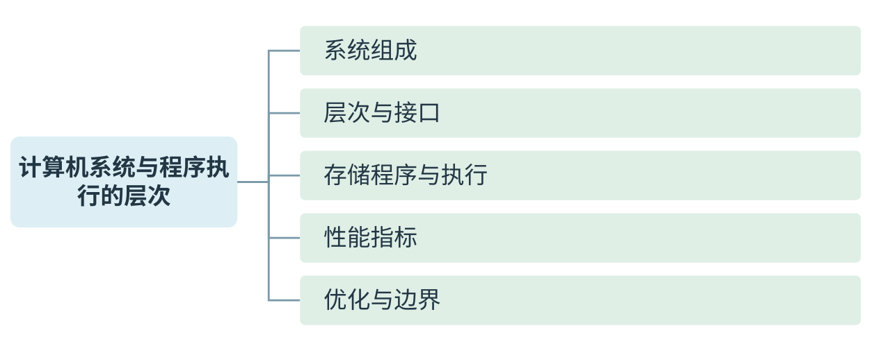
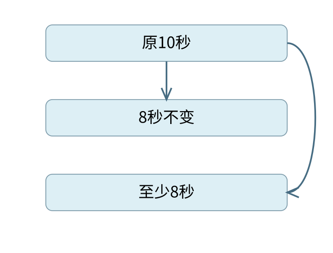
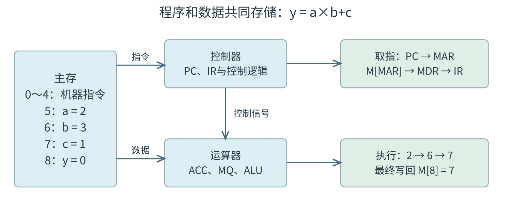

# 计算机系统与程序执行的层次

[可编辑SVG](figures/overview.svg) · [完整知识导图](chapter-map.pdf)

计算机系统将硬件、软件和运行规则结合起来，使程序能够按确定的步骤处理数据。本章从功能部件出发，沿存储程序与指令执行理解各层接口，再用CPU时间、吞吐量和容量计算分析系统性能。

## 从程序看计算机的功能部件

> **课程连接 · 功能部件接到数据通路**
>
> 把 c=a+b 分成取a、取b、相加、存c后，第5章会逐步标出寄存器传送和控制信号。这里的功能划分仍成立；一块芯片可以同时实现多种功能，不能按芯片数倒推五部件。

**定义 · 概念与适用对象**

计算机系统由硬件和软件共同构成。硬件提供保存信息、执行运算、控制步骤和输入输出的物理装置，软件用程序和数据规定装置怎样完成任务。仅凭处理器芯片无法判断一个应用能否运行；还要看指令集、操作系统、库及文件格式等条件。

计算机的五个基本功能部件是运算器、控制器、存储器、输入设备和输出设备。这个分类按**功能**划分，不是按芯片这一物理实体划分。CPU 通常包含运算器、控制器和寄存器，还可能集成若干级 Cache；一个存储控制器也可能集成在处理器芯片内。

| 部件 | 在执行 `c=a+b` 时做什么 |
|---|---|
| 运算器 | 对取来的两个数进行加法，形成结果及有关标志 |
| 控制器 | 解释指令，在合适时刻发出选择、读写和运算等控制信号 |
| 存储器 | 保存指令、a、b、c 及执行所需的其他信息 |
| 输入、输出设备 | 将系统外部的信息送入系统，或把系统内的结果送出 |

中央处理器 CPU 的数据通路包括寄存器、运算部件及其连接，控制器决定数据在通路上何时、向哪里流动。第5章将把一次加法展开为寄存器传送；这里先把“处理数据”和“控制步骤”分清。

主存储器能由 CPU 直接按地址访问，程序执行时所需的指令和数据通常要进入主存。磁盘、SSD 等外存提供较大且非易失的存储空间；文件保存在磁盘，并不意味着 CPU 每执行一条指令都直接向磁盘取一次。

### ISA 规定什么，微体系结构决定什么

> **最小反例 · 同ISA不保证文件通用**
>
> 最小反例：两系统使用同一指令集，但系统调用号、动态库和可执行文件格式不同。一份应用文件仍可能无法直接运行。ISA兼容解决指令语义，运行环境兼容还需操作系统与ABI条件。

指令集体系结构 ISA 是软件可见的机器接口，规定机器指令的功能和编码、软件可见的寄存器、数据类型、寻址方式以及相关的存储访问规则。微体系结构则指在该接口约束下怎样组织与实现机器，例如采用几级流水线、怎样转发数据、Cache 怎样实现、加法器采用何种进位结构。

同一个整数加法的机器指令，可以由不同硬件通路实现。只要软件可见的效果符合 ISA，程序不必知道内部用了串行进位还是先行进位。不过，机器码能否执行还取决于运行环境；“同一 ISA”不自动保证不同操作系统的可执行文件可直接互用。硬件与软件能实现相同逻辑功能，也不表示两者的时间、成本和可修改性相同。

## 存储程序怎样变成一次次指令执行

存储程序的基本思想是：执行前把程序指令和数据存入存储器，运行时自动取出指令、解释并执行。指令和数据都可以用二进制编码，机器根据当前操作和访问位置解释其含义。同一串位的“指令身份”或“数据身份”都离不开上下文。

冯·诺依曼型计算机按指令控制执行过程，常称控制流驱动。遇到转移、调用或异常中断时，下一步不再简单地取顺序地址上的指令，但仍由确定的控制机制改变执行位置。“存储程序”并不要求程序所在的存储内容在指令执行期间保持不变。

程序计数器 PC 保存指令执行所需的地址信息。最小的顺序执行过程可以写成：

1. 根据 PC 访问指令所在存储单元，取得指令。
2. 解释操作码和有关字段，取得操作数。
3. 执行运算、访存或控制转移，保存结果。
4. 按顺序地址或转移目标更新执行位置，继续取指。

这里的顺序地址增量取决于指令长度和地址单位。按字节编址、指令长4 B时，顺序地址通常增加4；不能把所有机器的 PC 更新都写成“加1”。流水线中取指、译码、执行还可能重叠，程序员看到的指令语义与内部时序应分开。

### 从 C 源文件到 CPU 能执行的内容

在常见的静态编译流程中，预处理展开头文件和宏等指令；编译把高级语言转换为汇编形式；汇编把汇编指令编码成可重定位目标文件；链接合并目标文件与所需库，处理符号引用和重定位，形成可执行文件。装入程序再按可执行文件的组织方式建立进程的地址空间，准备执行入口。

汇编语句 `add` 是便于人阅读的符号，CPU 取到的是其机器编码。宏、伪指令还可能展开为零条、一条或多条机器指令。一条 C 语句也可能展开为多条指令；反过来，编译优化可能把多条 C 语句合并或删除。

### 例 1-1　硬件直接执行哪一种程序

**例题 · 配套例题**

【配套例题】 计算机硬件能够直接执行的是（　）。

I. 机器语言程序　II. 汇编语言程序　III. 硬件描述语言程序

A. 仅 I　 B. 仅 I、II　 C. 仅 I、III　 D. I、II、III

**解析。** 执行普通指令的硬件按 ISA 识别机器编码，因此 I 成立。汇编语言必须经过汇编，硬件描述语言用于描述和设计硬件，不能作为普通机器指令直接送入 CPU 执行。答案为 **A**。题目问的是执行接口，而不是哪种语言更接近硬件。

解释执行是另一种程序执行方式：解释器读取源程序或中间表示，并在运行时完成相应操作。实际解释器本身仍由机器指令运行。现代语言实现也可能结合解释、预编译和即时编译，不能用“高级语言都逐行解释”概括。

## 性能计算：先确定谁的时间在改变

> **不变量 · 先数动态执行次数**
>
> 总周期数来自真正执行过的每一条指令。循环体写一份不等于只执行一次；分支未走到的代码不贡献本次动态指令数。比较性能时，要让任务、输入和计数区间保持相同。

响应时间是从提出任务到得到结果经历的时间；吞吐量是单位时间内完成的任务量。增加处理器可以让多个独立任务同时进行，因而可能提高系统吞吐量；一个不能并行的单线程任务却不因此自动缩短执行时间。

程序的总运行时间还可能包含 I/O 等待、系统调度等。CPU 时间是 CPU 为该程序工作所花的时间。本节的基本性能式只计算指定口径的 CPU 时间：

\[
T_{\mathrm{CPU}}=\frac{N\times\overline{\mathrm{CPI}}}{f}
=N\times\overline{\mathrm{CPI}}\times T_{\mathrm{clk}}.
\]

$N$ 是实际执行的指令条数，不能用程序文件中的静态指令条数代替；$f$ 是主频，单位 Hz；$T_{\mathrm{clk}}=1/f$ 是时钟周期；平均 CPI 是每条指令平均占用的时钟周期数。若第 $i$ 类指令执行 $n_i$ 条、平均 CPI 为 $c_i$，则

\[
\overline{\mathrm{CPI}}=\frac{\sum_i n_i c_i}{\sum_i n_i}.
\]

不同类指令的 CPI 必须按条数加权平均。CPI 还受 Cache 缺失、流水线停顿等影响，并非仅由指令操作码决定。流水线稳态下 CPI 可以接近1；多发射处理器的平均 CPI 也可以小于1，这并不表示一条指令的全部处理延迟小于一个时钟周期。

### 例 1-2　主频相同，怎样由指令组成求时间

**例题 · 配套例题**

【配套例题】 某计算机主频为1 GHz，程序 P 运行过程中共执行10000条指令，其中80%的指令执行平均需1个时钟周期，20%的指令执行平均需10个时钟周期。程序 P 的平均 CPI 和 CPU 执行时间分别是（　）。

A. 2.8，28 μs　 B. 28，28 μs　 C. 2.8，28 ms　 D. 28，28 ms

**解析。** 条件给的是动态指令比例，先求加权平均：$0.8\times1+0.2\times10=2.8$。总周期数为 $10000\times2.8=28000$；1 GHz 对应每周期1 ns，因此 CPU 时间为28000 ns，即28 μs。答案为 **A**。百分比必须乘各类周期数，GHz 与 μs 的换算不能略去。

### 例 1-3　CPU 加快后，I/O 时间怎样处理

> **最小反例 · 速度翻倍不等于总时减半**
>
> 最小反例：10秒任务中只有2秒可加速，即使这2秒缩短为0，总时间仍至少8秒。只有整个统计对象都按相同倍率加速，总历时才按该倍率缩短；先画出未改变的部分。
>
> 
>
> 可加速部分即使归零，总时间仍不小于8秒。

**例题 · 配套例题**

【配套例题】 假定基准程序 A 在某计算机上的运行时间为100 s，其中90 s为 CPU 时间，其余为 I/O 时间。若 CPU 速度提高50%，I/O 速度不变，则运行基准程序 A 所耗费的时间是（　）。

A. 55 s　 B. 60 s　 C. 65 s　 D. 70 s

**解析。** “速度提高50%”是原速度的1.5倍，因此原来的90 s变为 $90/1.5=60$ s，而不是减为45 s。I/O 仍占10 s，总时间为70 s，选 **D**。

一般地，原运行时间中比例 $p$ 的部分加快为原速度的 $s$ 倍，其余不变，且两部分时间可以这样相加时，加速比为

\[
S=\frac{1}{(1-p)+p/s}.
\]

该式的上限是 $1/(1-p)$，但前提是加速部分划分和时间模型成立。若 I/O 与计算本来重叠，或并行化新增了通信与同步开销，应先画出实际时间关系，不能直接把各部分都相加。

### 比较性能时，为什么不能只看主频或 MIPS

两台机器的时间之比同时取决于指令条数、平均 CPI 和主频。相同源程序在不同 ISA、不同编译器下可能有不同的动态指令条数。即使平均 CPI 相等，也不能仅凭主频断言谁完成同一任务更快。

性能变化也应放在同一任务与同一统计口径下比较：编译优化可能同时减少动态指令条数、改变指令组成；改善 Cache 通常减少访存停顿，从而改变平均 CPI；提高主频改变每周期时间，但若伴随更多流水级或等待，CPI 也可能变化；增加核心则先要问任务能并行到什么程度。只有题干明确其他量不变时，才把时间比约成某一个因子的比例。

这些变化还对应不同系统层次。ISA 规定一条指令对软件可见的效果，编译器决定怎样用指令表达任务，微体系结构决定这些指令怎样在资源和时序上实现，操作系统决定进程可使用的运行环境与资源。问机器码能否执行，要查 ISA 和运行环境；问同一机器码为何快慢不同，要沿动态指令数、CPI、主频和等待时间寻找变化。用同一个“机器更先进”概括，无法支持具体推算。

MIPS 表示每秒执行多少百万条指令，$\mathrm{MIPS}=f/(\overline{\mathrm{CPI}}\times10^6)$；IPC 是每周期平均完成的指令数，在统计区间一致时与平均 CPI 互为倒数。MFLOPS 等指标统计浮点运算次数，与机器指令条数不是同一量。跨机器比较应优先比较同一任务的实际时间，再看指标如何解释差异。

机器字长主要反映 CPU 一次处理整数数据的基本位宽。它关系到整数表示范围和相关运算能力，但不能单独推出主存容量、总线宽度或某程序的速度。“64位机器”也不表示所有数据类型都占64位。

## 从层次图走到可核算的模型

**方法 · 性能题四步**

1. 写清任务和统计范围：CPU执行时间、总历时还是单位时间完成数。
2. 数动态指令，按条数加权求CPI；把GHz、ns、微秒统一。
3. 标出变化因子：指令数、CPI、主频或可并行比例；不变条件必须来自题设。
4. 用原方案回代，再检查加速后的总时间是否仍包含不可加速部分。

### 为什么CPI按条数加权

**推导 · 从总周期数出发**

第$i$类指令执行$n_i$条，每条占$c_i$周期，故该类总周期为$n_ic_i$；各类相加得到$C=\sum_i n_ic_i$。平均每条周期必为$C/(\sum_i n_i)$，因此权重是指令条数比例，而非各类指令所占时间比例。乘上共同的时钟周期，才得到CPU时间；若各阶段频率不同，应分阶段计算。

层次结构图中的“机器”是一种抽象视角。高级语言机器依靠编译或解释实现，汇编语言机器依靠汇编工具，操作系统提供资源与服务接口，传统机器执行ISA指令，微程序机器描述某类控制器内部实现。并非所有CPU都采用微程序控制；不可把五层图误读成每个程序必经五种独立硬件。

### 从地址位数到容量

> **最小反例 · 字长不能推出地址容量**
>
> 同样是32位整数处理器，可以配较小物理内存，也可以有更宽物理地址。最小反例已表明“字长32位所以最多4GiB”缺少地址位数前提。容量必须由地址数与每地址对应的单位共同确定。

若有$m$位完整地址、按字节编址且所有地址均可用，则最多可区分$2^m$个字节位置；若按$w$位字编址，容量应为$2^m\times w$位。MDR或数据总线宽度描述一次交换的数据位数，不能单独代替地址位数。以20位字节地址为例，可编址1MiB；若同为20位地址却每地址对应16位字，则可编址2MiB。

课程图中容量常按$2^{10}$递增，而频率、传输率通常按$10^3$递增。为避免含混，容量推导写成KiB/MiB或明确“本题K=$2^{10}$”；带宽则把每次字节数乘每秒次数，最后再按题设进制换单位。

### 发展历程的背景定位

电子管、晶体管、中小规模集成电路、大规模与超大规模集成电路依次推动器件集成、可靠性和成本变化。它们帮助理解实现技术的演变；性能判断仍要回到具体任务的执行时间。教材与课件把部分发展史标为参考内容，本章保留这一背景，不以年代细节替代核心性能模型。

| 层次 | 向上说明什么 | 不能直接推出什么 |
|---|---|---|
| ISA | 软件可见指令与状态 | 具体流水段数、Cache组织 |
| 微体系结构 | 指令在部件和时序上的实现 | 应用跨操作系统直接兼容 |
| 操作系统 | 资源、进程与运行接口 | 所有应用可并行加速 |

## 五大部件怎样共同完成一次计算

> **课程连接 · 五部件的连接**
>
> 存储器提供指令与数据，控制器协调传送与运算；同一条指令还需明确数据经过哪些寄存器。

冯·诺依曼计算机把指令和数据都存放在存储器中，用地址选择存储单元。指令与数据在存储形式上都表现为二进制位串；CPU取出的内容被当作指令还是操作数，取决于当前执行阶段和指令语义。早期机器以运算器为中心，外设和主存之间的数据常经运算器；现代组织通常以存储器为中心，外设可借助接口、总线和DMA与主存交换数据。

| 功能部件 | 基本任务 | 与程序执行的关系 |
| --- | --- | --- |
| 运算器 | 算术、逻辑运算以及移位 | ALU完成运算，寄存器保存操作数和中间结果 |
| 控制器 | 取指、分析指令、产生控制信号 | 决定何时传送数据、执行哪种运算以及下一步做什么 |
| 主存储器 | 保存正在使用的指令与数据 | 提供按地址读写的存储单元 |
| 输入设备 | 将外部信息转换成机器能处理的形式 | 经接口把程序和数据送入系统 |
| 输出设备 | 将处理结果转换成人能识别或外部需要的形式 | 经接口接收输出数据和控制信息 |

主机通常指CPU和主存；CPU包括运算器与控制器。辅存、输入设备、输出设备合称外部设备。按功能划分的部件与按物理芯片划分的部件未必一一对应：一个CPU芯片可以包含多个核、多级Cache和其他控制逻辑。

### 存储字、机器字和指令字的区别

一个存储单元中保存的位串称为存储字，位数为存储字长。机器字长一般指CPU一次能处理的二进制数据位数，常与通用寄存器、运算部件的数据通路宽度相关。指令字长是某条指令所占的位数；一种ISA可以采用固定长度或可变长度的指令。

设按字编址的主存共有$2^{10}$个单元、每单元16位，则容量为$2^{10}\times16$ bit，即2 KiB；地址至少需要10位。若同样的2 KiB容量改按字节编址，则共有$2^{11}$个可编址单元，地址至少11位。求容量时先写“单元数×每单元位数”，能避免把地址线数与数据线数互换。

运算器中的ACC可暂存操作数或结果，MQ可辅助保存乘数或乘积低位，X可暂存另一个输入；这些是课件示意机器的组织约定。现代机器未必使用完全相同的专用寄存器，分析具体数据通路仍应以题设为准。

### 例：从主存中的程序求出 $y=ab+c$

设主存按字编址，地址0～4依次保存取数、乘法、加法、存数和停机指令；地址5～8分别存放$a=2$、$b=3$、$c=1$和$y=0$。取指时，PC给出的是指令地址；执行访存指令时，地址字段给出的是数据地址。

| 执行的指令 | 主要数据变化 | 完成后的状态 |
| --- | --- | --- |
| 0：取地址5中的数 | $M[5]\to\mathrm{ACC}$ | ACC=2，PC指向1 |
| 1：乘地址6中的数 | $\mathrm{ACC}\times M[6]\to\mathrm{ACC}$ | ACC=6，PC指向2 |
| 2：加地址7中的数 | $\mathrm{ACC}+M[7]\to\mathrm{ACC}$ | ACC=7，PC指向3 |
| 3：将结果存入地址8 | $\mathrm{ACC}\to M[8]$ | $M[8]=7$，PC指向4 |
| 4：停机 | 停止继续取执行指令 | 计算结束 |

同一条访存指令至少要区分“取指令”和“取操作数”：前者由PC形成地址，后者由IR的地址字段及寻址规则形成地址。MAR在不同时刻可保存这两类地址，MDR在不同时刻可保存指令或数据；寄存器名称并未限定其中只能保存一种内容。

## 系统软件、应用软件与程序翻译

> **课程连接 · 程序如何到机器上**
>
> 编译得到目标代码，链接处理符号与所需模块，加载将程序置入内存；不要把这三个阶段混为一次操作。

系统软件负责管理资源、提供运行环境和支撑程序开发，包括操作系统、语言处理程序、数据库管理系统及有关工具；应用软件面向具体任务。编译程序把高级语言程序翻译成目标语言程序，解释程序则在解释过程中组织执行，高级语言语句与机器指令通常不是一一对应关系。

软件与硬件的逻辑功能等价，是指同一逻辑功能可以用软件算法实现，也可以增加专门硬件实现。选择哪种实现取决于性能、成本、功耗和灵活性。它不意味着软件无需硬件，也不意味着两种实现的时间、空间开销相同。

从下向上可以把系统理解为微程序机器级、传统机器语言级、操作系统级、汇编语言级和高级语言级。层次中的“虚拟机器”是下层向上层提供的一套使用规则；某一功能在下层实现时，对上层可以是透明的。“透明”在体系结构语境中通常指使用者无需看见或处理其实现细节。

## 性能指标的统计口径与单位

主频$f$与时钟周期$T$互为倒数。对含有多类指令的程序，若第$i$类执行$n_i$条、每条平均需要$\mathrm{CPI}_i$个周期，则

$$N=\sum_i n_i,\qquad C=\sum_i n_i\mathrm{CPI}_i,\qquad t_{\mathrm{CPU}}=\frac{C}{f}.$$

吞吐量衡量单位时间完成多少工作，响应时间衡量从请求开始到结果完成经历多久。提高并行度可能增加吞吐量，而单个请求的响应时间还受到等待、通信和I/O影响。比较两台机器运行同一任务的性能时，性能比等于执行时间的反比。

MFLOPS表示每秒百万次浮点运算，GFLOPS、TFLOPS分别采用$10^9$、$10^{12}$量级；它们侧重浮点工作负载。MIPS为每秒百万条指令，依赖ISA、编译结果和指令组成。容量中的KiB采用$2^{10}$ B，而频率中的MHz采用$10^6$ Hz，计算时应保持量纲一致。

### 拓展：硬件技术的演进

电子管、晶体管、中小规模集成电路、大规模和超大规模集成电路是常用的发展阶段划分。集成度提高使存储容量、运算速度和可靠性提升，并推动微型化、多核、网络化以及高性能并行计算。摩尔定律描述历史上集成电路晶体管数量增长的经验趋势，不能直接据此把某个程序的运行时间按相同比例缩短。

### 计算与辨析自查

1. 为什么同一个MDR既能接收指令又能接收数据？
2. 主频2 GHz，运行$10^8$条指令，平均CPI为1.5，CPU时间是多少？
3. 4 KiB主存、存储字长32位，分别按字和按字节编址需要几位地址？

**答案。** 1. MDR保存存储器本次交换的数据位串，内容的用途由执行阶段决定。2. $10^8\times1.5/(2\times10^9)=0.075$ s。3. 按字编址有1024个单元，需10位；按字节编址有4096个单元，需12位。

## 主动回忆自测

> **课程连接 · 自查顺序**
>
> 先写公式和单位，再代入数值；题目限定的工作负载决定可以比较的指标。

### 配套自测

1. 【配套例题】程序 P 在机器 M 上的执行时间是20 s。编译优化后，P 执行的指令数减少到原来的70%，而 CPI 增加到原来的1.2倍，则 P 在 M 上的执行时间是（　）。A. 8.4 s　B. 11.7 s　C. 14 s　D. 16.8 s。
2. 原创补充：两个任务都由同一单核 CPU 各执行2 s。换成两核后，每个任务仍占用一个核执行2 s，且可同时开始。两个任务的总完成时间和单个任务的响应时间分别怎样变化？

**答案。** 1. D。主频不变，时间变为 $20\times0.7\times1.2=16.8$ s。2. 两个任务全部完成的时间从4 s降为2 s；无排队时单个任务本身的执行时间仍为2 s。该小例用于区分吞吐量改善与单任务加速。

### 遮住答案复述知识关系

**主动回忆 · 主动回忆·自拟**

1. 不看正文，画出五大功能部件，并圈出CPU与主机各自包含什么。
2. 同一ISA的两台机器为什么能执行同一类机器指令，却可能有不同CPI？
3. 一段程序CPU时间占80%，只把CPU部分加速为2倍，总加速比是多少？
4. 20位地址能否直接推出主存为1MiB？还缺哪个条件？
5. 用一句话分别说明响应时间、吞吐量、IPC和FLOPS的统计对象。

### 参考答案

1. 五部件为输入、输出、存储、运算、控制；常见模型CPU含运算与控制及寄存器，主机还含主存。
2. ISA规定可见语义，流水线、Cache、功能部件与等待时序由具体微架构决定。
3. 原时间记1，变为$0.2+0.8/2=0.6$，加速比$5/3$。
4. 须说明按字节编址、完整20位地址均可用；已安装物理容量还可能更小。
5. 响应时间按单任务历时，吞吐按单位时间完成任务数，IPC按周期完成指令数，FLOPS按秒完成浮点运算数。
