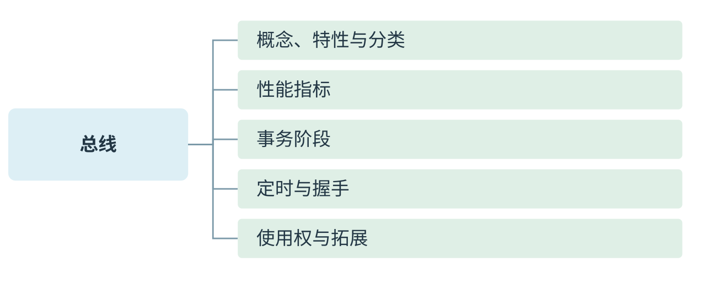
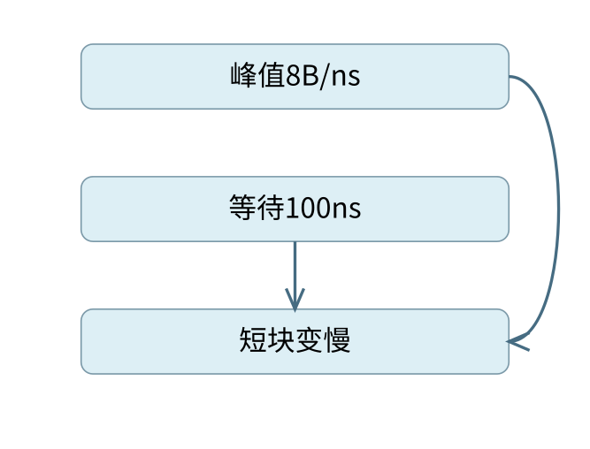
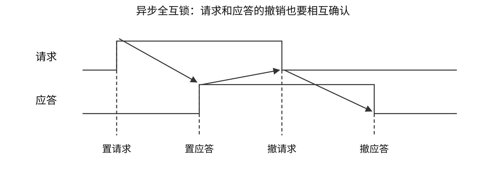
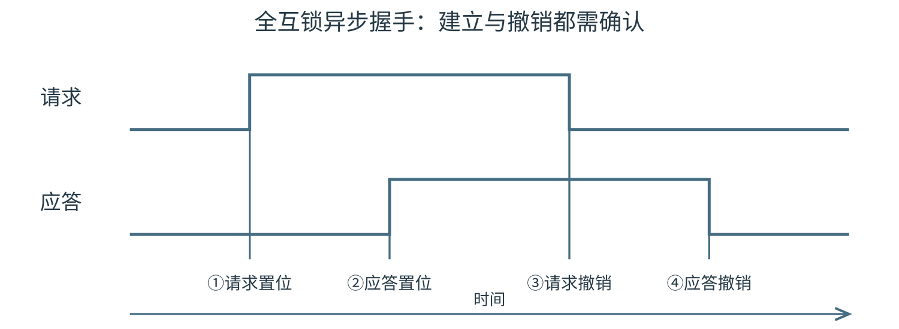

# 总线

[可编辑SVG](figures/overview.svg) · [完整知识导图](chapter-map.pdf)

## 从概念、性能到事务时序

> **最小反例 · 串行不等于慢**
>
> 一条高速串行链路与一条低频8位并行总线，谁带宽更大还需各自的传送率。位宽只决定每次能送多少，线路频率、编码和协议开销同样影响结果，不能用串/并行名称代替计算。

本章沿课件导图的四组关系展开：先由“共享通路”辨认总线的组成、分类与结构，再把位宽、周期和传送率写成可计算的量，随后按申请、寻址、传输、结束四阶段追踪一次事务。定时方式回答“何时允许推进”；仲裁回答“由谁取得使用权”，两者分属不同问题。

**定义 · 总线的共享性**

总线是一组能被多个部件分时共享的信息传送通路。连接在同一条公共通路上，不表示多个主设备可以同时任意驱动线路；同一时刻允许的驱动者、接收者及信号解释由协议决定。

总线特性可以按四个维度检查：机械特性规定连接器、尺寸和形状；电气特性规定电平、负载等；功能特性规定每根线承载什么；时间特性规定信号建立、采样及撤销关系。它们分别回答“如何接、什么电平、传什么、何时有效”。

按位置与用途可分片内总线、连接CPU/主存/I/O接口的系统总线，以及部件或系统间的通信通路；按数据形式分串行与并行；按定时分同步、异步等。一个具体接口可以同时具有“串行”“包传输”“多通道”的属性，分类维度不能混为一个互斥列表。

单总线结构让多个部件共享一条系统通路，连接简单但易形成争用；双总线、三总线以不同层次分担主存和I/O等流量。桥接器完成不同总线间的数据缓冲、协议转换和控制。增加通路能减少某类冲突，仍须核对桥接和主存是否成为瓶颈。

## 位宽、频率、传送率分别给出什么

> **最小反例 · 峰值相同，事务速率可不同**
>
> 两条总线数据拍都每ns传8 B，一条每块额外等待100 ns，另一条只等1 ns；二者峰值相同，短块的有效速率却相差很大。分母是否包含等待必须先由题问确定。
>
> 
>
> 相同数据拍峰值，等待改变事务有效速率

总线是部件之间传送信息的公共通路。按信息用途可区分地址、数据和控制：地址说明访问哪个单元或端口，数据线承载被交换的值，控制线说明操作类型、有效时刻及应答等。命令字虽然在语义上“控制设备”，CPU写命令字时仍可能在**数据线**上传送；不能只凭名称判断该走哪组线。

数据线上可以传指令、操作数、状态字、命令字和中断类型号。它们如何解释取决于传送双方和操作类型。MAR保存待访问地址，MDR暂存交换的值；主存并不靠“某个数据看起来像地址”来判定这次访问的性质，而是由相应线路与控制时序确定。

总线位宽通常指并行数据线根数。串行传送逐位使用通道，并行传送同一时刻通过多条线传若干位；多个串行通道并用，并不等于一条传统并行总线。系统可用桥接部件连接不同速度和协议的通路，靠近CPU的部件通常要求更高带宽；有多条总线，并不表示它们共用同一时钟。

**方法 · 带宽先写每次字节数与每秒次数**

若有效数据宽度为 W 位，每秒实际发生 R 次数据传送，理想单方向峰值带宽为 $R\times W/8$ B/s。R 与时钟频率不一定相同：每周期一次为R=f，每周期两次为R=2f；若已给MT/s，则已经是每秒传送次数，不能再乘“每周期次数”。

总线周期是一次规定的总线操作所占的时间，可能有多个时钟周期。带宽为每次传送的有效数据量除以这次所用时间；控制、地址、等待、校验与空闲开销会使有效数据率低于只算数据节拍的峰值。

### 例 6-1　一个总线周期占两个时钟周期

【配套例题】 假设某系统总线在一个总线周期中并行传输4 B信息，一个总线周期占用2个时钟周期，总线时钟频率为10 MHz，则总线带宽是（　）。

A. 10 MB/s　 B. 20 MB/s　 C. 40 MB/s　 D. 80 MB/s

**解析。** 时钟周期100 ns，一次总线传送需200 ns，传4 B，因此带宽 $4/(200\times10^{-9})=20\times10^6$ B/s，选 **B**。若直接用4 B×10 MHz，就忽略了每次传送占两拍。

### 例 6-2　已给传送率时不重复乘每周期次数

**例题 · 自拟数值例**

某64位并行总线每时钟周期传4次数据，实际数据传送率已明确给为1333 MT/s，求单方向理想峰值带宽。若改给的是333.25 MHz时钟频率，结果是否相同？

**解析。** 每次64位=8 B；1333 MT/s就是每秒 $1333\times10^6$ 次，带宽为 $1333\times10^6\times8=10.664$ GB/s。若给333.25 MHz且每拍4次，则先算 $R=4f=1333$ MT/s，结果相同。若改成1333 MHz时钟、仍每拍4次，才会得到42.656 GB/s。三个单位条件必须分别使用，不能把“频率”字样覆盖题干明示的物理量。

多通道带宽只有在各通道能够并行传送且工作分配允许时才相加。全双工总线要区分单方向带宽和两个方向合计带宽；校验位若不属于有效载荷，不应计入有效数据量的分子。带宽题第一步宜写出“每次有效几字节、每秒几次”，再统一单位。

## 一次总线事务从地址到应答

> **不变量 · 先数有效数据拍**
>
> 32 B块经64位数据线传送，需要4个有效数据单位。突发减少的是地址、准备等重复代价，不能把32 B整块误作一个8 B数据拍；每拍几次传送还要另核时钟口径。

总线主设备发起事务，从设备按地址被选中并完成操作。CPU常是主设备，DMA控制器也可在取得使用权后成为主设备。主从关系只就本次事务而言，不等于某个设备永久只能发送或只能接收。

一次读事务可以分为：主设备发地址和读命令；从设备译码并准备数据；从设备在数据线上给出有效数据；主设备采样，双方结束本轮操作。写事务则由主设备给出要写的数据。地址、数据若复用同一组线路，就需不同时间片分别传送，不能把这些线路同时算成两份独立的并行位宽。

### 同步定时：固定采样时刻，必要时插等待

同步总线用共同的时钟约定信号的有效和采样时刻。最短周期必须覆盖信号传播、译码、设备准备及建立时间等延迟。若从设备来不及，可按协议插入等待状态；“同步”不等于所有事务长度永远相同，也不表示每个设备可随意提供互不协调的时钟。

突发传送只给出一个首地址，再连续传送多个相邻数据，分摊地址和启动开销。非突发则可能为每个数据重复地址及准备过程。因此“读一块多长时间”应先数数据拍数，再判断地址、等待代价要付几遍。

### 例 6-3　不支持突发，就要反复准备每个数据

【配套例题】 某存储器总线宽度为64位，总线时钟频率为1 GHz，在总线上传输一个数据或地址需要一个时钟周期，不支持突发传送方式。若通过该总线连接CPU和主存，主存每次准备一个64位数据需要6 ns，主存块大小为32 B，则读取一个主存块所需的时间是（　）。

A. 8 ns　 B. 11 ns　 C. 26 ns　 D. 32 ns

**解析。** 一拍1 ns，每个64位数据为8 B，一块需要4个数据。每个数据都单独付地址1 ns、准备6 ns、传送1 ns，共8 ns，总计 $4\times8=32$ ns，选 **D**。11 ns对应只付一次地址和准备、再连传4次，是突发模型，题目已排除。

### 例 6-4　峰值带宽与整次事务的有效速率

【配套例题】 某存储器总线的时钟频率为420 MHz，总线宽度为64位，每个时钟周期传送2次数据；其总线事务支持突发传送方式，最多传送8次数据，第1个时钟周期传送地址和读/写命令，从第4个至第7个时钟周期连续传送8次数据。该总线的总线带宽（最大数据传输率）为（　）。

A. 3.84 GB/s　 B. 6.72 GB/s　 C. 30.72 GB/s　 D. 53.76 GB/s

**解析。** 问的是数据节拍的最大传送率，每周期2次、每次8 B，峰值 $420\times10^6\times2\times8=6.72$ GB/s，选 **B**。

若另问这次8次数据的事务有效速率，才把地址和等待计入分母：数据64 B、事务7周期，$64/(7/(420\times10^6))=3.84$ GB/s。A正是按整次事务口径算出的结果，不能用它回答本题已经说明的峰值带宽。第4至第7拍共4拍，每拍2次，正好8次，不是8拍。

### 峰值、事务速率与CPU占用采用不同分母

总线峰值带宽按数据节拍可持续搬多少有效字节来计，事务有效速率还把本次地址、等待等时间算入；设备速率是设备产生或消耗数据的速度；CPU占用率则是CPU执行查询、服务或设置收尾的时间比例。这四个量可能出现在同一道题中，应先分别写成“什么量除以什么时间”。

例如在例 6-4中数据节拍峰值6.72 GB/s、整次事务有效速率3.84 GB/s，都不能直接当成某个设备的实测速率；若设备只提供40 MB/s，系统还受这个供数速度限制。反过来，DMA可让设备数据直接经过总线进入主存，同时CPU仅做少量设置收尾，所以不能把总线使用率等同于CPU使用率。端到端吞吐要核最慢环节，资源占用要核实际争用的时段。

当一次突发在等待期间必须保持总线占有权时，等待也消耗总线资源；若题设明确采用分离事务、允许准备期间让出总线，则总历时与实际占用时间还会不同。画事务时间线时，应同时标出“在等什么”和“谁仍占有总线”，不能仅凭延迟长短直接推断总线忙碌比例。

### 异步定时：用握手确认进度

> **不变量 · 撤销也要确认**
>
> 全互锁中，从设备看到请求撤销后才撤应答。少看最后一步会把半互锁误作全互锁；画四个边沿并逐项标出依赖，比按波形长度猜类别可靠。

异步总线不用统一周期来强制双方同拍完成，而用请求和应答等信号交换进度。速度较慢的设备晚些应答，主设备相应等待。异步仍受顺序约束，也不能随时改变信号而不通知对方。

全互锁的四阶段握手可以写为：主设备置请求；从设备准备好后置应答；主设备看到应答后撤请求；从设备看到请求撤销后撤应答。各阶段都等待对方作出相应反应，因而不依赖预设的固定延迟来猜测对方已结束。

非互锁方式中，主设备发出请求后按预定时间撤回，不等应答；从设备发出应答后也按时撤回，不等请求撤回。半互锁方式中，主设备等待应答出现才撤请求，而从设备仍可按时撤应答。全互锁方式中，从设备还必须等请求撤回才撤应答。给出时序图时，按图中信号的建立、撤销条件来识别，不单凭信号名称猜测。全互锁通常多了等待环节，不能因为最可靠就断定它最快。

半同步通信将时钟节拍与等待/应答结合：正常情况下按时钟节拍推进，慢设备可请求延长，握手状态在规定边沿采样。这里的“半同步”不等于一半数据串行、一半数据并行，两个分类维度不同。

### 如何读总线时序图

先标出地址何时稳定、读写命令何时有效、数据何时有效和何时被接收，最后数出从事务开始到完成的时间。若图中低电平有效，应以标出的有效电平判断，不可把所有上升沿都当成开始。不同信号能否同拍出现由协议规定；“地址/数据复用”和“独立地址数据线”会改变哪些操作可以重叠。

串行异步字符传送每帧另加起始位和停止位，校验位可选。若每字符7个数据位、1个校验位、1个起始位和1个停止位，则每字符实际发送10位，480字符/s需要4800 bit/s，而有效字符数据只有3360 bit/s。不要把物理线路传送率与有效数据率混为一谈。

### 事务速率巩固

1. 【配套例题】 某存储器总线采用同步通信，时钟频率50 MHz，突发传8个字，每字4 B。1周期接收地址、3周期等待、8周期传8个字。数据传输速率为（　）。A. 114.3 MB/s　B. 126 MB/s　C. 133.3 MB/s　D. 144.3 MB/s。
2. 【配套例题】：将第1题改为每个字都独立付1周期地址、3周期等待、1周期数据，读同样8字需要多少时间，有效速率多少？

**答案。** 1. C。共12周期，每周期20 ns，32 B/240 ns≈133.3 MB/s。2. 共40周期=800 ns，32 B/800 ns=40 MB/s。两题块长相同，改变的是启动代价的重复次数。

## 总线仲裁与分离事务

> **错项排除 · 主设备角色随事务**
>
> DMA可以发起一次主存写，CPU也可能暂不占总线。主从描述谁发起并控制本次交换，并不表示某设备永远只能发送或永远只能接收。

总线传输在申请分配阶段处理多个主设备的使用权竞争，随后寻址、传输并结束。CPU和DMA都可能成为主设备，主设备与从设备的角色针对一次事务；主设备申请总线，不表示它一定是本次数据的接收者。

课件将仲裁分为集中与分布两类。集中仲裁由一个仲裁部件授予使用权：链式查询以允许信号沿设备链传递，靠近仲裁端的请求通常先被满足，控制线少但固定优先级可能使低位请求长期等待；计数器定时查询依次给出设备号，请求者在号码匹配时取得资格，起始编号和轮转规则决定公平性；独立请求为各设备设置请求/允许通路，仲裁灵活但线路及逻辑开销较大。分布仲裁由参与者依共同规则竞争或判定，不能因此推断系统没有任何仲裁规则。

课件把总线仲裁与标准列为拓展。本章保留其机制联系，不凭文件名替读者确认某一考试年度的正式范围。总线标准还约定接口、电气、功能、时序等兼容条件；串行或并行只说明传输组织，不能单独决定峰值带宽或延迟。

分离事务允许主设备发出请求后释放总线，待从设备准备好再申请并返回结果；因此“总历时”与“总线实际占用时间”可以不同。它与普通同步/异步定时的分类角度不同，还需要标识请求与响应的对应关系。

| 定时/组织 | 推进依据 | 等待是否占通路 | 不能直接推出 |
|---|---|---|---|
| 同步 | 规定时钟沿；慢设备可插等待 | 由事务协议决定 | 每事务固定一拍 |
| 异步全互锁 | 请求/应答建立和撤销均互相确认 | 由握手占用规则决定 | 不需要时序约束 |
| 半同步 | 时钟节拍与等待/应答结合 | 需看等待状态的保持规则 | 一半串行一半并行 |
| 分离事务 | 请求与响应分开争用通路 | 准备期间可释放 | 总历时等于占用时长 |

## 总线按位置、信息和连接方式分类

> **课程连接 · 分类依据**
>
> 数据、地址与控制描述信息类型；片内、系统与通信总线描述所处层次，分类角度各自独立。

总线是一组由多个部件共享的信息传输线路及配套协议。片内总线连接芯片内部部件，系统总线连接CPU、主存和I/O接口，通信总线连接计算机、外设或系统之间的通信端点。数据总线传数据，地址总线选择存储单元或端口，控制总线规定读写、请求、应答、时序和状态。

地址总线宽度主要影响可给出的地址组合数，数据总线宽度影响一次可并行传送多少位。CPU发起普通访存时地址由CPU输出；DMA控制器成为主设备时也可发地址，所以“地址线总由CPU单向输出”只适用于限定的主设备关系。总线主设备启动事务，从设备响应事务，I/O设备不必永远是从设备。

总线标准需要同时规定机械特性、电气特性、功能特性和时间特性：接插件尺寸与引脚布局属于机械规范；电压、负载等属于电气规范；各线表示什么信息属于功能规范；信号何时建立、何时采样属于时间规范。只做到插头相同并不能保证协议兼容。

### 单总线、多总线与桥接器

单总线组织连接简单、扩展方便，但不同部件争用同一通路，且速度受多方协调限制。多总线组织把CPU—主存高速流量与较慢I/O流量分开，桥接器完成不同总线间的缓冲、转换和控制。增加总线可以减少争用，却也增加连接和控制成本；跨桥事务可能引入额外延迟。

串行传输每条数据通道按先后发送位，并行传输用多条线同拍传多位。串行链路可以使用多条lane并行传包；因此“串行协议”与“只有一条数据通道”不是同一判断。并行线间偏斜、串扰和接插件复杂度，会限制频率和距离；较少线数的高速差分串行链路可通过更高信号速率取得较高带宽。

## 四种定时方式的完成条件

同步定时用共同的时钟规定信号产生和采样时刻，简单而要求各模块满足统一时序；必要时用等待状态延长事务。异步定时不依靠统一固定等待时间，而用请求和应答信号确认进度，适合速度差异较大的部件；握手也有控制开销。

异步握手可按发送方撤销请求是否等待应答，以及接收方撤销应答是否等待请求撤销，区分不互锁、半互锁和全互锁。全互锁四阶段为：主设备置请求、从设备置应答、主设备撤请求、从设备撤应答。后一动作依赖前一动作，形成完整的建立和释放确认。

半同步通信保留时钟基准，再由从设备用等待信号延长数据准备阶段，兼顾采样规则和速度适应。分离事务把请求和返回数据分成两次总线占用；从设备内部准备数据时释放总线供其他事务使用，之后再申请总线返回结果。分离事务需要标识与排队机制对应请求和响应。

## 拓展：三种集中式仲裁

> **课程连接 · 集中式仲裁**
>
> 链式查询、计数器定时查询和独立请求方式的连线与优先级规则不同，应分别判断。

多个主设备同时请求总线时，需要仲裁决定使用权。优先级决定谁先获得，公平性关系到低优先级设备会不会长期等待，二者不是同一个指标。

| 方式 | 选择机制 | 特点与限制 |
| --- | --- | --- |
| 链式查询 | 允许信号沿设备链传播 | 结构简单，近仲裁器者通常优先；链路故障敏感 |
| 计数器定时查询 | 用计数编码轮询设备号 | 起始计数方式可改变优先顺序；需编码线和比较逻辑 |
| 独立请求 | 每个设备独立请求和允许线 | 响应快、优先级灵活；线路较多 |

按课件约定，$n$个设备的链式查询可用请求、忙、允许共3条控制线；计数器方式需$\lceil\log_2n\rceil+2$条；独立请求若每设备各有请求和允许并共用忙线，则为$2n+1$条。不同教材图的公共信号统计口径可能不同，计算必须先列线的种类。

## 拓展：常见总线和接口标准

| 标准 | 主要对象或组织 | 识别要点 |
| --- | --- | --- |
| ISA／EISA | 早期PC扩展 | 传统并行总线，位宽及传送组织随版本变化 |
| VESA局部总线 | 早期高速外设 | 连接高速显示等局部流量 |
| PCI | 共享并行局部总线 | 支持总线主控、突发传输及配置机制 |
| AGP | 图形接口 | 为图形加速设计的历史接口 |
| PCI Express | 点到点串行链路 | 可多lane，全双工；带宽取决于代际与lane数 |
| USB | 主机与外设 | 串行、支持集线器、即插即用和热插拔 |
| SATA | 存储设备 | 串行存储接口，标称速率按具体版本解释 |
| SCSI | 存储及其他设备接口体系 | 支持设备寻址、命令与控制机制 |
| RS-232 | 串行通信 | 规定连接、电平及有关信号 |
| PCMCIA／CardBus | 便携设备扩展 | 历史上的卡式扩展标准 |

表中的名称用于识别结构和适用对象。某一课件列出的带宽是具体版本或理想条件下的值，不能当作该标准所有设备的统一实测速率。按编码效率、包头、方向和通道数修正标称物理速率，才能得到有效载荷带宽。

例如32位数据通路、每秒$33\times10^6$次有效数据传送时，理论数据率为$33\times10^6\times4=132\times10^6$ B/s；若事务还需地址拍、仲裁和等待，有效事务带宽低于该峰值。DDR表示每时钟周期可在两个边沿传数据，已给传送率时须避免再次乘2。

### 计算与辨析自查

1. 为什么数据线数不能直接决定最大寻址容量？2. 全互锁握手的四个动作按什么顺序发生？3. 分离事务释放的是什么资源？4. 8设备独立请求按上述计线口径需要多少条控制线？

**答案。** 1. 寻址组合由地址编码及编址单位共同决定，数据线主要影响每次传送位数。2. 请求置位、应答置位、请求撤销、应答撤销。3. 设备准备数据期间的共享总线使用权。4. $2\times8+1=17$条。

## 主动回忆自测

> **课程连接 · 单位复核**
>
> 先确定一次传输的字节数和每秒传输次数，带宽再据此计算；频率不必然等于事务完成率。

**主动回忆 · 沿导图回答，再核对单位与条件**

以下为自拟检查，先遮住答案，按导图主枝回答。

1. 地址、数据、控制三类线的分工，是否按所传信息名称里有没有“控制”二字决定？
2. 为什么32位、每拍两次的100 MHz总线，理想峰值是800 MB/s，而不是400 MB/s？
3. 给200 MT/s后，能否因“每拍两次”再乘2？
4. 连读8个字时，突发方式节省的是哪类重复开销？
5. 全互锁握手四个事件的先后顺序是什么？
6. 一次读请求等待100 ns，能否直接断言总线被独占100 ns？
7. 仲裁与定时分别解决哪两个问题？
8. 双向合计带宽与单方向带宽相差多少，是否总能用同一个倍数转换？

### 自测答案

1. 不能；命令字、状态字等编码值可走数据线，控制线规定事务类型和时序。2. 每次4 B，每秒 $2\times100\times10^6$ 次，乘得800 MB/s，前提是全部数据位均有效。3. 不能，MT/s已经计入实际传送次数。4. 首地址、启动与准备等是否只付一次，由题设确定；数据拍仍要逐项数。5. 请求置位、应答置位、请求撤销、应答撤销。6. 不能，分离事务可在设备准备时释放总线。7. 谁获得使用权；何时采样与推进。8. 需看全/半双工、两个方向是否能同时达到峰值以及题目统计口径，不可无条件翻倍。

