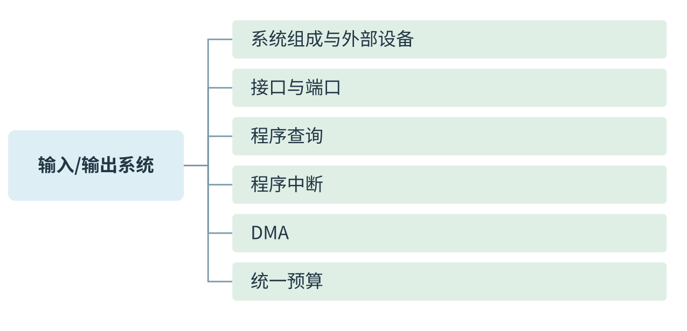
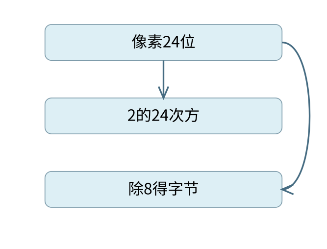
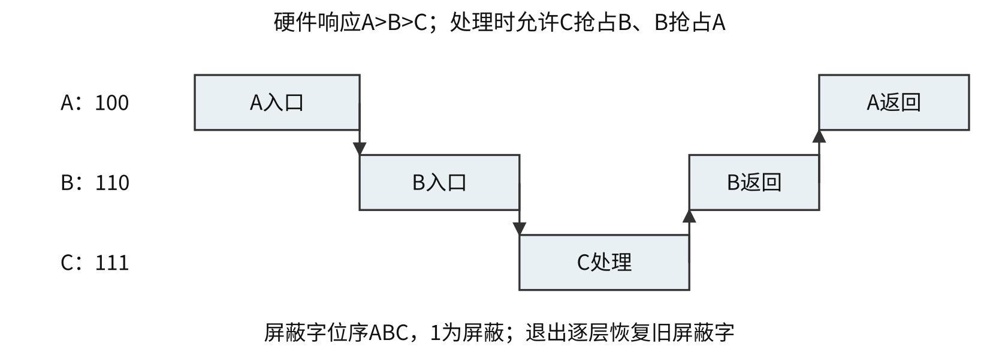
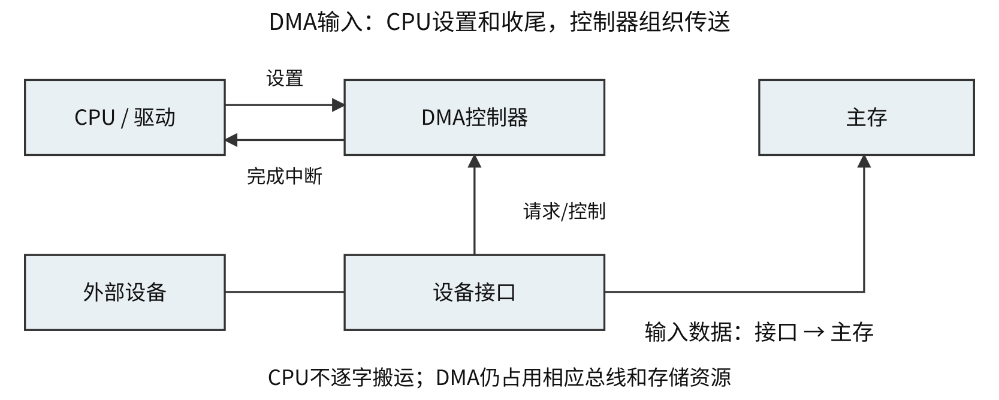
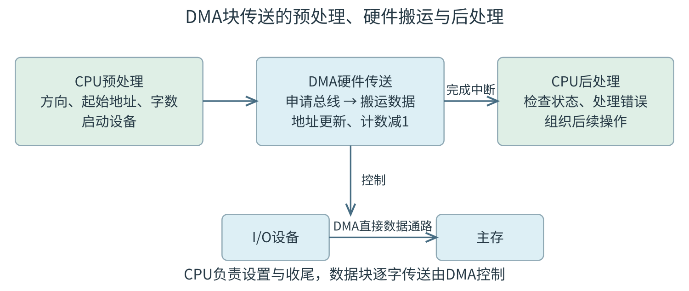

<a id="CO07"></a>
# 输入/输出系统



[可编辑SVG](figures/overview.svg) · [完整知识导图](chapter-map.pdf)

<a id="CO07-map"></a>
## 沿“谁等待、谁搬运、谁收尾”理解I/O

课件把输入/输出系统分为硬件、软件与控制方式：设备和接口负责把物理事件变成可交换的数据；I/O指令或驱动程序发出命令；查询、中断与DMA决定CPU何时介入、谁实际搬运。先固定设备速率、接口缓冲大小和每次服务粒度，再比较方式，才有统一的计数基础。

**定义 · I/O硬件、指令与通道**

I/O硬件包括输入设备、输出设备、外存和I/O接口/控制器。I/O指令是CPU执行、用于访问端口或控制I/O的机器指令；通道指令由专用通道执行，通道程序通常在主存中，CPU启动后由通道组织相应设备工作。二者不是同一指令集的两个名称。


通道在硬件支持下承担比逐字DMA更完整的I/O组织任务，减少CPU的细粒度参与；它仍需软件准备、设备协议与完成通知。这里作为课件导图的背景分支保留，不把某一种历史实现推广为现代所有设备的结构。

<a id="CO07-devices"></a>
## 外部设备及其缓冲需求

> **最小反例 · 24位不等于24种颜色**
>
> 每像素24位时最多有 $2^{24}$ 种编码，而不是24种。容量计算乘24得到位数，再除8变字节；若题给的是灰度级G，应先算编码位数 $\lceil\log_2G\rceil$。
>
> 
>
> 位数决定编码数，容量还须把bit换成B

输入设备把用户或环境的信息送入系统，例如键盘、鼠标；输出设备把结果表现出来，例如显示器、打印机；外存提供较大容量的持久数据保存，磁盘与固态盘的具体访问机制回指存储系统一章。设备分类说明主要用途，不表示具有复合功能的设备只能归入一个绝对类别。

显示器参数包括屏幕尺寸、分辨率、每像素灰度或颜色位数、刷新频率。若每帧包含N个像素、每像素b位且无压缩，则一帧显存至少需Nb位，按每秒F帧连续刷新所需的有效像素数据率为NbF位/s；空白区、编码、总线等额外开销需按题设另计。字符点阵库保存每种字符的字模，帧缓冲保存当前屏幕的像素，两者统计对象不同。

**例题 · 自拟：从分辨率算显存与数据率**

图像为1920×1080像素，每像素24位，每秒刷新60帧，不计压缩、空白区与传输编码。求单帧有效数据量、双缓冲容量及连续像素数据率。


**解析。** 单帧为 $1920\times1080\times24/8=6220800$ B；双缓冲需要12441600 B；数据率为 $6220800\times60=373248000$ B/s。24位是每像素的编码位数，不是“24种颜色”；双缓冲使存储容量翻倍，并不要求把每秒实际输出帧数也乘2。

打印机可按是否击打、按字符/行组织、按针式/喷墨/激光等机制分类。分类维度不同，不宜将“非击打”和“行式”作为互相排斥的并列项。接口中的缓冲可吸收设备与总线的瞬时速率差；持续输入超过长期消耗能力时，有限缓冲终会填满，不能靠“有缓冲”保证永不丢数据。

<a id="CO07-interface"></a>
## 端口是接口中可访问的位置

> **最小反例 · 同地址不等于同寄存器**
>
> 某端口地址读出状态、写入命令，是由读写方向和接口译码区分的两项动作。只看数字地址相同就说状态寄存器被命令字覆盖，忽略了访问类型这一条件。

CPU通常通过I/O接口访问外部设备。接口把系统总线上的读写操作转换为设备所需的信号，并提供数据缓冲、状态记录、命令控制、地址识别及必要的中断或DMA连接。设备本体和接口并不是一回事：磁盘驱动器是设备，网络控制器、打印机适配器等承担接口功能。

CPU能访问的接口寄存器或相应位置称为I/O端口。数据端口交换数据，状态端口报告就绪、忙或错误，控制端口接收启动、复位等命令。读状态与写控制可能共用同一个端口地址，由读写方向区分；不能因为地址相同就认为两个端口是同一个寄存器。

统一编址（存储器映射I/O）把端口放进主存地址空间，用访存指令访问；独立编址为I/O设单独地址空间，通常使用专门I/O指令。同一个数值地址在独立编址下可分别对应内存位置和端口，在统一编址下则要避免地址译码冲突。端口地址不是设备内部磁盘扇区地址。

<a id="CO07-example-1"></a>
### 例 7-1　命令字走哪组线

【配套例题】 下列选项中，在I/O总线的数据线上传输的信息包括（　）。

I. I/O接口中的命令字　II. I/O接口中的状态字　III. 中断类型号

A. 仅 I、II　 B. 仅 I、III　 C. 仅 II、III　 D. I、II、III

**解析。** 三者都是本次总线交换的编码值，可以由数据线承载，选 **D**。读写控制线表达“本轮读或写”等时序和操作性质，并不逐位承载所有名称里带“控制”二字的信号。

接口与设备侧交换数据、控制和设备状态，接口向CPU发送中断请求。打印机一般不会向其接口“接收中断请求信号”来获知下一个字符；这里要辨清信号的发送端与接收端。串并转换、缓冲和速度匹配也在接口或设备控制电路中完成，主机内部总线并行并不要求磁盘写入盘面的位也并行。

<a id="CO07-query"></a>
## 查询方式：等待和搬运都由 CPU 安排

> **不变量 · 最长间隔受缓冲期限限制**
>
> R B/s填满q B缓冲需要q/R秒；定时查询必须在覆盖前读走数据，还要计入实际检查与搬运延迟。平均每秒查够次数并不自动保证某个最长间隔不会超过期限。

程序查询方式先启动设备，再读状态端口，未就绪就继续检查；就绪后由CPU执行指令，在数据端口与寄存器或主存之间搬运，并更新地址与计数。数据没准备好时，CPU若一直轮询，等待时间也占用了执行机会。

```text
设置设备命令、目标地址和剩余数量
while 剩余数量 > 0:
    while 状态端口表示未就绪:
        继续检查
    从数据端口读一个单位并存入目标地址
    目标地址 += 单位大小
    剩余数量 -= 1
```

定时查询则在规定时刻检查，其余时间可以执行其他工作。是否会丢数据取决于设备速率、接口缓冲容量和最长查询间隔，不能由忙等程序的表现推出“查询方式下CPU永远不能运行其他程序”。

<a id="CO07-example-2"></a>
### 例 7-2　定时查询占多少 CPU 时间

【配套例题】 某计算机处理器主频为50 MHz，采用定时查询方式控制设备A的I/O，查询程序运行一次所用的时钟周期数至少为500。在设备A工作期间，为保证数据不丢失，每秒需对其查询至少200次，则CPU用于设备A的I/O的时间占整个CPU时间的百分比至少是（　）。

A. 0.02%　 B. 0.05%　 C. 0.20%　 D. 0.50%

**解析。** 每秒至少执行 $500\times200=100000$ 个查询周期，CPU每秒有 $50\times10^6$ 个周期，比例为0.002，即0.20%，选 **C**。200次/s只决定查询次数，不是设备每秒搬运200 B；题目也未要求把每次查询的500周期再当作500条指令。

若另给每个数据的搬运周期数，还要判断它已包含在查询程序开销中，还是必须另加。计算CPU占用率时，用CPU实际花掉的时间作分子，设备在外部独自准备数据的时间不直接算作CPU执行时间。

<a id="CO07-interrupt"></a>
## 中断方式：先请求，再响应，再运行服务程序

中断I/O允许CPU启动设备后继续做其他工作，设备或接口就绪后提出中断请求。CPU在允许响应的边界检查未屏蔽请求，完成硬件响应，再执行中断服务程序，由程序读取或写入数据端口。等待不再要求CPU持续轮询，但每次软件搬运数据仍要CPU执行指令。

请求需要保存在接口或中断控制器的触发器中，因为外设产生事件时CPU未必能立即响应。中断请求的产生、被允许响应、被调度执行以及处理完成是四个不同的时间点。CPU可能正在执行指令，处于关中断状态，或已有更高优先级请求需要先处理。

<a id="CO07-entry"></a>
### 硬件保存断点，与软件保护现场分开

典型硬件响应包括暂时禁止相应中断、保存返回位置及规定的状态、确定中断服务入口。中断向量是用于定位处理程序的信息，中断向量地址是保存向量的位置，处理程序入口地址是最终执行代码的位置。三者在某种实现中存在固定联系，但并不总是同一数值。

服务程序进入后保存其将修改且须恢复的通用寄存器，处理事件，再恢复并返回。单重中断处理期间不允许同类可屏蔽中断嵌套；多重中断则在保护必要现场、设置屏蔽后重新允许某些请求打断当前服务程序。入口处的现场保护未完成就开放嵌套，可能覆盖尚未保存的返回信息。

在教材采用的一种单重中断序列中，软件部分是“保护现场→事件处理→恢复现场→开中断→中断返回”，保存断点和初始关中断已经由硬件响应完成。实际ISA可能由中断返回指令原子恢复状态和允许位；不能把教材序列中的“开中断”和返回之间可被中断的窗口当作所有机器的共同实现。

<a id="CO07-mask"></a>
### 屏蔽改变允许谁打断谁

> **不变量 · 每层恢复自己的屏蔽字**
>
> 嵌套服务像调用栈逐层返回。C退出应先恢复B的屏蔽状态，B再恢复A；直接恢复最外层全开放状态可能允许原本不该打断B的请求，破坏题设处理关系。

中断响应优先级通常由硬件仲裁关系决定，多个未屏蔽请求同时到来时据此选一个。处理优先级描述服务过程中允许哪些请求打断当前服务，可由各服务程序设置的屏蔽字确定。屏蔽会改变参与本次仲裁的集合，不会把仲裁电路本身的固定比较顺序改写。

<a id="CO07-example-3"></a>
### 例 7-3　响应顺序与完成顺序为什么可以不同

原创补充

有A、B、C三个请求源，硬件响应优先级A>B>C。屏蔽字按A、B、C排列，1表示屏蔽。要求处理优先级C>B>A，服务程序均在保存现场并设置屏蔽字后开中断。给出三者的屏蔽字，并追踪三请求同时待处理时的一次嵌套过程。

**解析。** A处理中应屏蔽A自己，允许B、C，故为100；B处理中屏蔽A、B，允许C，故为110；C处理中三者都屏蔽，故为111。初始三者均允许响应时，硬件先选A，不能因希望C处理优先就把首次响应写成C。

<a id="co-fig-nesting"></a>


1. A保护现场、设100、开中断，B和C仍待处理，硬件在二者中选B。
2. B保护现场、设110、开中断，C可以响应，转入C。
3. C设111完成处理，恢复B的状态和屏蔽字，返回B。
4. B完成后恢复A，A最后完成。服务开始顺序A、B、C，完成顺序C、B、A。

题目要的是给定规则下的模型。各层必须保存并恢复旧屏蔽字，不能在C退出时直接恢复成最外层的全开放状态。屏蔽字的位序和0/1含义也必须从题干确定。

<a id="CO07-example-4"></a>
### 例 7-4　允许延迟不是额外的服务开销

【配套例题】 若某设备中断请求的响应和处理时间为100 ns，每400 ns发出一次中断请求，中断响应所允许的最长延迟时间为50 ns，则在该设备持续工作过程中，CPU用于该设备的I/O时间占整个CPU时间的百分比至少是（　）。

A. 12.5%　 B. 25%　 C. 37.5%　 D. 50%

**解析。** 每个请求实际占CPU100 ns，请求间隔400 ns，长期占用比例为 $100/400=25\%$，选 **B**。最长响应延迟50 ns约束请求产生后必须多快开始响应，不是额外要执行50 ns的服务程序，不能加到100 ns上。

若题给设备数据率R B/s、每次中断交换q B、每次CPU开销t秒，在每次均交换q B且持续工作的模型中，请求率为R/q，CPU比例为 $(R/q)t$。若结果超过100%，说明该模型下CPU无法及时服务；不能把它继续当作可达到的利用率。

<a id="CO07-dma"></a>
## DMA：数据不经过 CPU 寄存器逐次搬运

> **错项排除 · 块完成一次，单位传送多次**
>
> 1024 B块、4 B接口缓冲可分256个数据单位搬运，而正常完成通知可仅一次。DMA减少CPU事件数，不要求把整块压成一个总线数据拍；突发是否合并事务还需题设。

> **课程连接 · CPU预算与总线预算分列**
>
> 每块软件预处理/后处理影响CPU比例，DMA实际访存影响总线和主存占用。CPU可能在其私有Cache中继续运算，所以总线忙碌比例不能无条件等同CPU损失比例。

> **最小反例 · 平均低占用也会超期限**
>
> 每秒总共只需1ms服务，看似占用很低；若某次数据必须在10微秒内取走，而CPU最长关中断100微秒，仍可能丢数据。平均预算与最坏响应延迟必须分别核对。

DMA控制器在设备接口与主存之间组织直接传送。CPU仍需通过驱动程序设置方向、主存起始地址、传送数量和设备等参数，启动设备；传送过程中由控制器形成主存地址、请求总线、搬运数据并更新计数；结束或出错后再通知CPU处理。DMA减少逐个数据的指令开销，不表示CPU从头到尾完全不参与。

<a id="co-fig-dma"></a>


暂停CPU方式可在一块数据传送期间集中占用相关总线；周期挪用方式在设备准备好一个传送单位后申请一次或若干次总线使用；交替方式按约定把周期分给CPU和DMA。CPU能否同时访问某个存储体、Cache或另一条总线，要由具体资源结构决定。只要CPU本拍不需要被占用的资源，它仍可能继续内部运算。

周期挪用中，设备准备数据后向DMA控制器请求服务，DMA控制器再向系统申请总线。教材说“DMA请求”时可能指设备侧请求，也可能指总线申请，解题要看请求的发送者和接收者，不能只认四个字母。


DMA控制器通常包含主存地址计数器、传送长度计数器、数据缓冲寄存器、请求触发器、控制/状态逻辑以及完成中断机构。地址计数器决定下一次主存位置，长度计数器判断块是否完成；缓冲容量q B决定一次可交换的数据粒度，整块长度Q B决定CPU何时收到完成通知。两种“计数”不能交换使用。

**方法 · 先统一事件粒度，再列预算**

设设备连续速率为R B/s，接口每次可交换q B，每次CPU服务耗时t秒，则理想事件率为R/q次/s，CPU开销比例为 $(R/q)t$。若DMA每块Q B才完成一次且每块软件开销为u秒，则CPU开销比例为 $(R/Q)u$。另以总线每次占用b秒列总线占用 $(R/q)b$；这第三个式子不自动等于CPU开销。


这些式子都先假定事件持续、粒度固定且无额外未计开销；若比值超过1，说明所需服务能力超过预算。缓冲是否溢出还要核最长响应时间：平均CPU开销低于100%不是实时期限一定满足的充分条件。

<a id="CO07-example-5"></a>
### 例 7-5　周期挪用不等于整块期间封住主存

【配套例题】 若设备采用周期挪用DMA方式进行输入和输出，每次DMA传送的数据块大小为512字节，相应的I/O接口中有一个32位数据缓冲寄存器。对于数据输入过程，下列叙述中，错误的是（　）。

A. 每准备好32位数据，DMA控制器就发出一次总线请求  
B. 相对于CPU，DMA控制器的总线使用权的优先级更高  
C. 在整个数据块的传送过程中，CPU不可以访问主存储器  
D. 数据块传送结束时，会产生“DMA传送结束”中断请求

**解析。** 每次缓冲32位即4 B，512 B需要128次传送。周期挪用只在取得总线的时段占用资源，其余时段CPU仍可访问主存，不是整块传完前一直封锁，所以选 **C**。B描述本题中DMA优先取得总线的模型，不表示任何系统的任意外部请求都永久压过CPU。

一次总线占用时间为b、每次搬q B时，DMA数据率R对应的总线占用比例约为 $(R/q)b$，前提是这些占用不重叠且没有额外启动代价。CPU实际损失还取决于它原本是否需要总线，因此不能把“DMA占总线10%”无条件改写成“程序变慢10%”。

<a id="CO07-example-6"></a>
### 例 7-6　DMA 的准备与完成仍需要软件

【配套例题】 下列关于DMA方式的叙述中，正确的是（　）。

I. DMA传送前由设备驱动程序设置传送参数  
II. 数据传送前由DMA控制器请求总线使用权  
III. 数据传送由DMA控制器直接控制总线完成  
IV. DMA传送结束后的处理由中断服务程序完成

A. 仅 I、II　 B. 仅 I、III、IV　 C. 仅 II、III、IV　 D. I、II、III、IV

**解析。** I是CPU上的驱动程序做传送前准备，II、III是DMA硬件实际传输，IV是完成通知后的软件收尾，四项均正确，选 **D**。这条链把“CPU不逐字搬运”和“CPU完全不参与”清楚区分开。


| 方式 | CPU介入时机与粒度 | 数据搬运主体 | 主要约束 |
|---|---|---|---|
| 忙等查询 | 持续检查，逐单位搬运 | CPU指令 | 等待和搬运均占CPU执行机会 |
| 定时查询 | 定期检查，每次查询及搬运 | CPU指令 | 查询间隔与服务时长须满足缓冲期限 |
| 中断I/O | 每请求被允许响应后，交换q B | CPU服务程序 | 请求率×每次响应处理时间 |
| DMA | 每块Q B前设置、结束后收尾 | DMA控制器 | CPU开销、总线与主存占用分别计算 |


适用性取决于设备速率、传送粒度、缓冲和系统实现。字符型低速设备通常适合查询或中断，网络和块设备的大批量传送常用DMA；中断方式并非适用于所有设备，DMA也没有固定的速度门槛。

比较三种方式时，可先固定同一设备数据率R。若接口一次仅能容纳q B，则数据积满时间为q/R；定时查询的查询间隔要小于这个时间，中断方式每秒约响应R/q次。若DMA每块Q B才让CPU收尾一次，CPU事件率变成R/Q；但控制器可能仍按q B多次请求总线，不能把“每块一次完成中断”误作“整块只有一次总线传送”。CPU事件数、设备准备次数和总线事务数是三个不同计数。

<a id="CO07-example-7"></a>
### 例 7-7　同一接口缓冲下比较查询、中断和DMA预算

【配套例题】 假定计算机的主频为500 MHz，CPI为4。现有设备A和B，其数据传输率分别为2 MB/s和40 MB/s，对应I/O接口中各有一个32位数据缓冲寄存器。请回答下列问题，要求给出计算过程。

（1）若设备A采用定时查询I/O方式，每次输入/输出都至少执行10条指令。设备A最多间隔多长时间查询一次才能不丢失数据？CPU用于设备A输入/输出的时间占CPU总时间的百分比至少是多少？

（2）在中断I/O方式下，若每次中断响应和中断处理的总时钟周期数至少为400，则设备B能否采用中断I/O方式？为什么？

（3）若设备B采用DMA方式，每次DMA传送的数据块大小为1000 B，CPU用于DMA预处理和后处理的总时钟周期数为500，则CPU用于设备B输入/输出的时间占CPU总时间的百分比最多是多少？

**解析。** 数据率中的M按 $10^6$ 计，缓冲32位=4 B，CPU每秒有 $500\times10^6$ 个时钟周期。先分别求设备填满缓冲的时间、CPU每次服务时间，再求长期比例，不把设备工作时间直接当作CPU忙碌时间。

（1）A每准备4 B需要

\[
\Delta t_A=\frac4{2\times10^6}=2\ \mu\mathrm s.
\]

因此最多每2 μs就必须完成一次查询与取数；间隔更长，单个缓冲可能被下一组数据覆盖。每秒至少服务 $2\times10^6/4=5\times10^5$ 次；每次至少10×4=40周期，故CPU占用比例至少为

\[
\frac{(5\times10^5)\times40}{500\times10^6}=4\%.
\]

每次这项服务最少耗时80 ns，2 μs是设备产生一缓冲数据的间隔，不是CPU每次都要执行2 μs。

（2）B每4 B只允许 $4/(40\times10^6)=0.1\ \mu\mathrm s$，相当于50个CPU周期；一次中断响应与处理却至少需400周期=0.8 μs。每次服务还未完成，后续数据已连续到来，不能持续及时处理。按请求率核对，所需CPU比例为

\[
\frac{(40\times10^6/4)\times400}{500\times10^6}=8=800\%.
\]

这表示所需服务能力超过CPU预算，不能解释成实际CPU利用率能达到800%。给定单缓冲与逐次中断模型下，设备B不适合这种中断I/O方式。

（3）DMA把CPU事件粒度改成1000 B一块。以设备满速计，每秒最多 $40\times10^6/1000=40000$ 块；每块CPU预处理和后处理500周期，所以CPU开销比例最多为

\[
\frac{40000\times500}{500\times10^6}=4\%.
\]

一块设备传送时间为25 μs，CPU设置收尾共1 μs，二者相除也得4%。这一项没有再乘CPI，因为题干已直接给时钟周期数。第（1）问的4%是由“至少10条指令”得到下界，本问的4%按最大设备速率得到上界；数值相同，含义不同。

DMA的4%统计CPU设置收尾，并未把DMA占用总线的时间当作CPU执行时间。若另问整机吞吐是否可达40 MB/s，还须核对总线与主存带宽；若另问CPU程序因此慢多少，还要看CPU同时是否需要这些资源。第6章的总线预算与本题CPU预算应分别算，再按共享资源关系连接。

<a id="CO07-old-self"></a>
### 配套辨析巩固

1. 【配套例题】下列关于中断I/O方式的叙述中，错误的是（　）。A. 中断屏蔽字用于确定中断响应的优先级；B. 保存断点和程序状态字在中断响应阶段完成；C. 保存通用寄存器和设置新中断屏蔽字由软件实现；D. 单重中断方式下中断处理时CPU处于关中断状态。
2. 【配套例题】DMA控制I/O方式下，设备的输入/输出由DMA控制器控制完成，此时DMA控制器控制的数据传输通路位于（　）。A. CPU和主存之间；B. CPU和DMA控制器之间；C. 设备接口和主存之间；D. 设备接口和DMA控制器之间。
3. 原创补充：设备数据率为1 MB/s，每次中断交换4 B，开销为2 μs，CPU占用多少？若改为每1024 B一块DMA，假设CPU每块仅需20 μs设置及收尾，CPU开销比例是多少？暂不计总线竞争。

**答案。** 1. A。按本章教材口径，屏蔽字规定允许的抢占关系和处理优先级，固定的响应仲裁次序不能由它直接改写。2. C。3. 中断为 $(10^6/4)\times2\times10^{-6}=50\%$；DMA为 $(10^6/1024)\times20\times10^{-6}\approx1.953\%$。后者只是CPU设置收尾开销，尚不包含DMA占用主存总线对程序造成的影响。


<a id="CO07-peripherals-complete"></a>
## 外部设备怎样形成I/O请求

> **课程连接 · 准备数据和传送数据**
>
> 设备准备一批数据的时间与总线传送该批数据的时间各自计算；是否能重叠取决于设备与接口机制。

输入设备把外界信息转换为数字编码，例如键盘扫描按键并形成按键编码，鼠标把位移和按键状态转换为报告，扫描仪和摄像设备把光学信息采样编码。输出设备把编码转换为显示、声音或纸面记录；显示帧缓冲保存像素数据，显示控制器按时序读取并驱动显示。

若分辨率为$W\times H$、每像素$b$位、刷新率$f$帧/s，仅有效像素的单帧容量为$WHb/8$ B，最低像素载荷数据率为$WHbf/8$ B/s。实际接口还可能包含消隐、包头、编码和压缩等因素，题目给出额外条件时需分别计入。

针式打印利用撞针、色带形成字符，适合多联复写；喷墨通过喷出墨滴成像，彩色及介质要求依实现而定；激光打印利用感光鼓成像、转印和定影。外设的机械或介质工作速度通常与CPU不同，接口中的数据缓冲和状态控制用于协调这种差异。

<a id="CO07-io-structure-complete"></a>
## I/O软件、接口与端口的分工

> **课程连接 · 端口与接口**
>
> 端口是CPU访问接口寄存器的地址入口，接口提供设备状态、控制和缓冲等功能。

I/O软件包括驱动程序及上层管理程序，I/O硬件包括设备、接口及连接通路。接口承担设备选择、命令译码、数据缓冲、状态记录、格式和速度匹配，并可发出中断或DMA请求。端口是CPU可读写的接口寄存器或相应地址位置，接口通常含多个端口。

数据端口保存待传或已接收数据，状态端口报告就绪、忙、错误等状态，控制端口接收命令或工作方式。控制命令字和状态字都可能经数据总线传送；控制总线上的读写信号用于说明这次总线事务的性质，两种“控制信息”处于不同层次。

统一编址把I/O寄存器映射到与主存同一地址空间，用普通访存指令访问；独立编址设置单独I/O地址空间并用专门I/O指令访问。统一编址需要通过地址译码区分内存和设备区域；独立编址需要区分存储器事务和I/O事务的控制规则。

通道是一种可执行通道程序的专用I/O处理部件。CPU发出启动命令，通道按通道指令组织一系列I/O操作；DMA控制器主要负责设定数据块的传送，通道可承担更复杂的控制组织。它们都能减少CPU逐字搬运的工作量，实际能力取决于具体系统。

<a id="CO07-query-complete"></a>
## 查询方式的可行性先于占用率

独占查询中，CPU不断检查状态并等待，外设准备期间也不能转做普通程序；定时查询在查询间隔可执行其他程序，但必须保证缓冲区在下次查询前不会溢出。若设备每$t_d$产生一项、缓冲只能容纳一项，则查询间隔应满足及时取走的要求；存在多项缓冲时还要考虑连续到达及服务时间。

设CPU主频50 MHz，一次查询需100周期。鼠标每秒查询30次，占用率为$30\times100/(50\times10^6)=0.006\%$。若磁盘每秒输入2 MiB、每次查询传4 B，则每秒需$2^{19}$次查询，占用周期$100\times2^{19}$，占比约104.86%。这说明该查询组织即使耗尽CPU时间也来不及处理，不能把超过100%的值解释为实际可达到的CPU占用状态。

<a id="CO07-interrupt-complete"></a>
## 中断判优、屏蔽和现场恢复

中断请求标记用于记住待处理事件；判优电路在多个请求同时存在时选择响应对象。响应优先级是硬件在当前时刻选谁；处理优先级决定哪个服务程序允许被哪个中断打断，可通过屏蔽字组织。二者可以不同。

课件约定屏蔽位1表示屏蔽、0表示允许；必须在例题中先写清位序和电平语义。某服务程序运行时通常屏蔽本级及不允许打断它的源，只允许规定的更高处理优先级进入；进入服务程序时保存旧屏蔽字，返回前恢复。屏蔽字改变的是请求可见性，不会抹掉已经发生的请求事件。

多重中断的一般顺序为：硬件关中断、保存断点并进入服务入口；软件保护现场和旧屏蔽字，装入新屏蔽字；在安全位置开中断，运行服务主体；结束时关中断，恢复屏蔽字和现场，再按返回规则恢复执行。若过早开放中断，尚未保存的状态可能被下一层覆盖。

非屏蔽中断与可屏蔽中断的区别在于是否受普通中断允许控制约束。非屏蔽不表示任何时刻、任何指令内部都立即任意打断；响应时点和保存规则由体系结构规定。

<a id="CO07-overlap-example"></a>
### 例：设备准备与服务程序怎样重叠

CPU主频50 MHz，CPI为4；设备每0.5 ms准备一个字符，每字符含1位起始、7位数据、1位奇校验及1位停止，共10位。设备持续工作时最多每秒形成2000字符。

中断响应需10周期，服务程序20条指令，第15条启动设备准备下一字符。按课件的稳定重复近似，每字符完成间隔为$25000+10+15\times4=25070$周期，因为最后5条服务指令与下一字符准备重叠。1000字符总历时约$25070000$周期；CPU实际用于响应和服务的时间为$1000(10+20\times4)=90000$周期。

若从第一次启动设备准备第1个字符开始计时，到第1000次中断服务程序完全结束，且各次均采用上述理想时序，则最后5条服务指令没有下一字符的准备过程可供重叠，精确总历时为$1000\times25070+5\times4=25070020$周期。这里“约”表示采用课件的稳定重复周期近似；题目改变起止事件时，应按新端点补计启动或排空时间。

<a id="CO07-dma-complete"></a>
## DMA控制器的寄存器和传送阶段

> **课程连接 · DMA仍需控制信息**
>
> DMA控制器需知道内存地址、传送计数、方向和设备状态；数据传送期间CPU与DMA如何争用总线须依题设。

DMA控制器通常包含主存地址寄存器、传送字数计数器、数据缓冲寄存器、控制与状态逻辑以及设备相关地址信息。CPU预处理设置方向、主存起始地址、长度和设备参数并启动设备；数据准备好后，DMA申请总线，在授权后直接在设备和主存之间搬运，自动更新地址和计数；完成或出错后通知CPU后处理。



停止CPU访存的成组传送在一段时间内集中占用总线，控制简单但CPU访存受阻；周期挪用在需要时借用一个或若干存储周期，CPU正在访存时通常先让该次访问完成；交替访存按固定时隙分配CPU和DMA，减少重复仲裁但增加时序组织要求。

DMA请求是获取总线或主存访问机会，中断请求是要求CPU改变执行流去运行服务程序。DMA传数据不逐字执行CPU搬运指令，块完成通知仍可采用中断。DMA占用总线时，CPU若能在寄存器或Cache中继续执行某些操作，并不一定完全停止；是否发生停顿须看具体访问和总线关系。

<a id="CO07-extra-check"></a>
### 计算与辨析自查

1. 写控制端口时，命令字为什么仍可走数据总线？2. 查询占用率算出105%意味着什么？3. 中断响应优先级和处理优先级分别决定什么？4. DMA块传送前后CPU还要做什么？

**答案。** 1. 命令字是本次事务传送的数据，读写性质由控制线及地址共同说明。2. 该方案处理能力不足。3. 前者选择同时请求时先响应谁，后者限定服务程序间的嵌套关系。4. 预处理设置参数并启动；后处理检查结果、处理错误和唤醒后续工作。

<a id="CO07-recall"></a>
## 主动回忆自测

> **课程连接 · 先列时间线**
>
> 分别标设备准备、CPU服务、总线传送的开始与完成时间，再判断是否可以重叠。

以下为自拟检查。请沿“设备—接口—控制方式—预算”回忆，不先看答案。

1. I/O端口、接口、设备和磁盘扇区地址之间分别是什么关系？
2. 统一编址与独立编址，改变的是地址空间与指令中的哪两项约定？
3. 为什么定时查询允许CPU在两次查询间执行其他程序，而忙等查询会持续占用CPU？
4. 硬件中断响应与软件服务程序分别保存哪些类型的信息？是否所有ISA完全相同？
5. 已知响应优先级A>B>C，能否只据此确定三者最终完成顺序？
6. DMA中，块长1024 B、接口缓冲4 B，块内可能有多少次数据单位传送、多少次块完成通知？
7. 显存容量和刷新数据率分别多乘了哪一个参数？双缓冲为何不能直接让输出帧频翻倍？
8. 设备每秒1 MB、每次中断4 B、每次开销2微秒，改为每1024 B一块、每块软件开销20微秒的DMA，CPU预算分别是多少？

<a id="CO07-recall-answers"></a>
### 自测答案

1. 端口是CPU可访问的接口位置；接口连接总线与设备；扇区地址标识设备内部数据位置，不能与CPU端口地址混同。2. 统一编址共享存储器地址空间并用访存指令；独立编址有独立端口空间，通常用专门I/O指令。3. 前者在期限允许下间歇检查，后者循环执行检查；均仍需安排实际搬运。4. 典型硬件保存断点与规定状态，软件保存其需要恢复的通用寄存器等；具体保存集合和开中断/返回时序依ISA。5. 不能，还需屏蔽规则、允许嵌套关系、请求到达时间与服务时长。6. 可有256次4 B单位传送，正常块完成通常一次通知；总线突发合并会改变事务数，须看具体控制器。7. 有效容量为像素数×位数，刷新有效速率再乘帧频；双缓冲多存一帧，不自动多输出一帧。8. 中断50%；DMA约1.953%，均仅按题定CPU执行开销，另核总线与实时期限。
