
# 输入输出管理

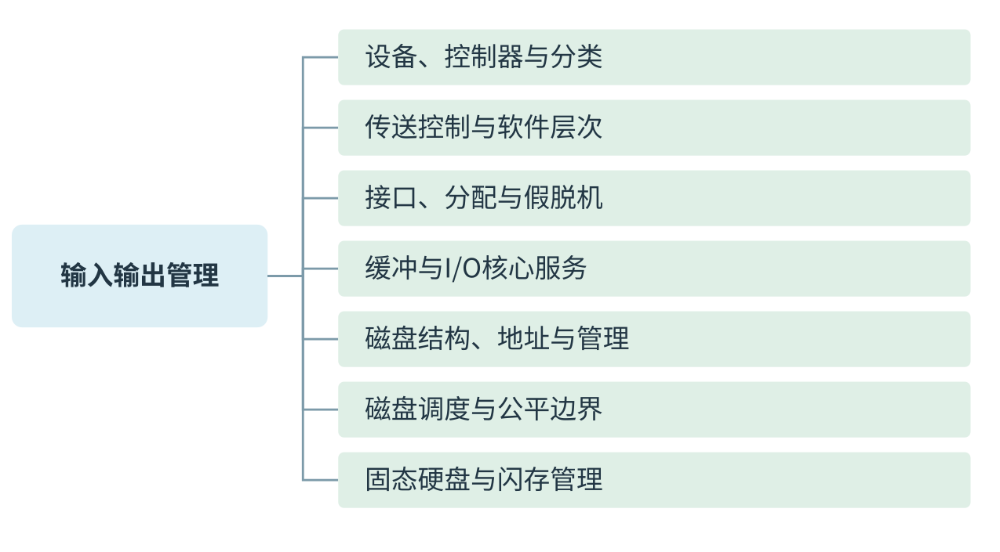

[可编辑SVG](figures/overview.svg) · [完整知识导图](chapter-map.pdf)

## 一次I/O的职责分工与时间线

> **课程连接 · 设备到进程**
>
> I/O路径贯穿用户接口、设备无关层、驱动、控制器和中断处理；不同角色承担不同任务。

**方法 · 先定位责任，再计算过程**
1. 画请求向下和完成向上的路径，标明谁设置控制器、谁搬数据、谁唤醒等待者。
2. 对缓冲题逐块写输入、复制、分析，只有不争用同一资源且不覆盖有效数据的阶段才能重叠。
3. 对磁盘题先换单位、算真实柱面，再按当前磁头与方向逐步决定下一请求；端点和停止规则单独列出。
4. 对SSD题分别画页编程、块擦除、有效页迁移与逻辑映射更新，不套机械寻道模型。

**定义 · 控制方式、接口语义和软件层次分别判断**
轮询、中断、DMA回答如何控制传送；阻塞、非阻塞、异步回答调用者何时等待和怎样取得完成；用户库、设备无关层、驱动与中断处理回答软件职责。三组分类可以组合，不能相互替代。

### 双缓冲总时间为何包含启动与排空

**推导 · 两阶段流水的递推**
在正文规定的资源模型中，把设备输入一块看成耗时$T$的阶段A，把CPU复制与分析看成耗时$M+C$的阶段B；A与B可对不同块重叠。第一块先输入，末块仍须完成B。稳定推进的最小间隔受较慢阶段限制，为$\max(T,M+C)$，故$n\ge1$块的总时长为$T+(n-1)\max(T,M+C)+M+C$。取$n=1$得到$T+M+C$，恰好检验没有流水可重叠时的边界；如果输入、复制、分析不能遵守这些资源假设，须重新建立递推。

应用说“读一个文件块”，设备却接收具体的命令、地址和长度。操作系统在中间完成命名、保护、排队、缓冲和状态通知。本章沿一个请求追踪软件与硬件的分工，再把缓冲时间和磁盘运动转成可计算的过程。

## 设备、控制器、接口与端口

> **错项排除 · 字符单位不等于字节随机寻址**
>
> 终端按字符流收发，并不意味着可按任意字节地址跳到某个字符；磁盘作为块设备可按块号定位。数据传送单位、是否可寻址、是否独占属于不同分类维度，不能把“字符”与“内存字节地址”机械对应。

**设备**完成实际输入、输出或存储，**设备控制器**管理设备动作并向主机提供寄存器等接口。控制寄存器接收命令与参数，状态寄存器反映就绪、忙、错误等状态，数据寄存器或缓冲区承载数据。**端口**在此通常指可访问的接口寄存器位置，不是网络中传输层端口号。

独立编址的 I/O 端口由专门 I/O 指令访问；内存映射 I/O 把接口寄存器放入地址空间，通过相应访存指令访问，但这类访问的副作用和缓存属性必须按设备规则处理。接口地址是控制器寄存器的地址，不是设备所保存文件的字节偏移。

**字符设备**通常按字符流组织，不适合按任意字节地址定位，例如终端；**块设备**按可寻址数据块组织，可进行块号访问，例如磁盘。网络设备按分组收发，还涉及通信地址和协议，不宜机械套成磁盘的寻道块模型。

独占设备在一次使用期间交给一个使用者；共享设备允许多个作业在一段时期内交替提交请求。共享不要求多个物理操作在同一瞬间执行。设备是否可寻址、是否共享、是否可随机访问是不同分类维度，也不能因此把字符设备说成“可按字节地址随机访问”。

### 分类维度与控制器的三个接口部分

按使用特性，设备可分为人机交互、外存储和网络通信；按传输速率可分低、中、高速；按信息交换单位可分字符与块设备；按共享性质又可分独占、共享和虚拟设备。这些是交叉分类，不能用一个维度替代另一个。

控制器由CPU—控制器接口、I/O控制逻辑、控制器—设备接口等部分组成。CPU侧以地址线选寄存器、以控制线表达操作、以数据线交换命令参数或数据；I/O逻辑译码命令、管理状态，设备侧传送设备所需的数据、状态和控制信号。一个控制器可以连接多个设备，因而可以有多组寄存器和设备接口。

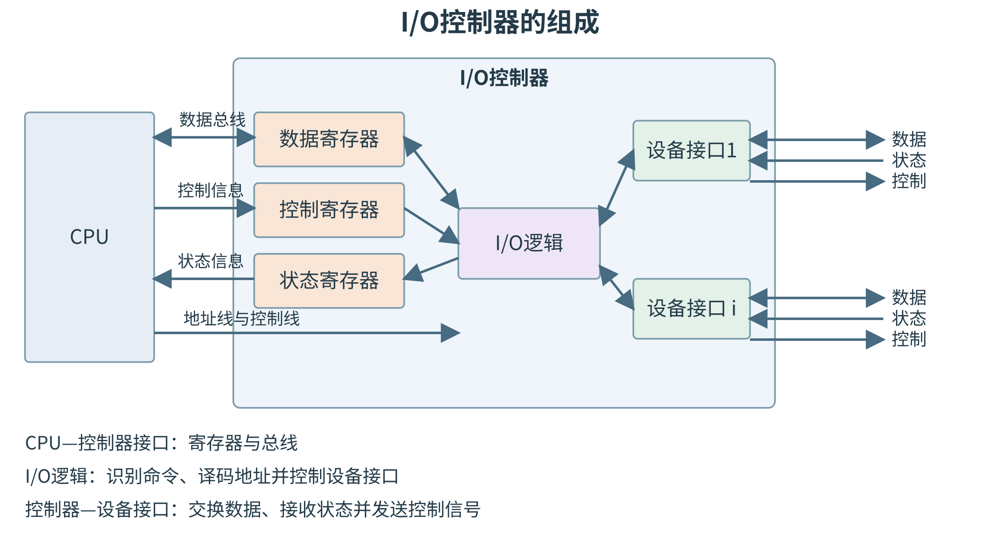

状态位的0、1意义由设备定义：一种打印机可以0表示空闲，另一种则1表示空闲。驱动正是要把这些具体差异屏蔽在统一接口之下。寄存器独立编址需要相应I/O指令或I/O访问机制；内存映像方式复用地址空间和相应访存操作，但不把设备寄存器变成普通可随意缓存的数据。

## 轮询、中断和 DMA：谁搬数据，谁等待

> **课程连接 · DMA与中断可以协作**
>
> 组成原理说明DMA如何取得存储访问机会并搬运数据，操作系统说明驱动如何设置地址长度以及怎样处理完成。DMA结束常用中断通知，二者分别承担传送与通知，不能因为DMA无需逐字搬运就排除中断或内核参与。

**程序查询或轮询**由 CPU 反复读状态，设备就绪时再执行数据传送。实现简单，但忙等期间 CPU 不能有效做别的工作。**中断方式**启动设备后允许 CPU 执行其他任务，设备在需要服务或完成时发中断，CPU 进入中断服务程序处理；若每次数据通过 CPU 的读写指令搬运，数据通路仍经过 CPU。

**DMA**由专门硬件按驱动设置的地址、长度和方向，在设备与内存之间传送数据。CPU 负责启动、异常和结束处理，不必逐字执行搬运指令；DMA 需要获得总线或内存访问机会，仍可能与 CPU 竞争存储带宽。DMA 结束通常通过中断通知，所以“DMA 与中断不能共存”不成立。

| 控制方式 | 数据搬运的直接执行者 | CPU 可以从什么工作中解脱 |
| --- | --- | --- |
| 轮询 | CPU 执行数据传送指令 | 通常不能免除状态忙等 |
| 中断 | CPU 执行中断服务中的传送指令 | 不必连续轮询设备 |
| DMA | DMA 控制硬件 | 不必逐字/逐块执行软件搬运，但仍需初始化与完成处理 |

读取数据时，程序直接控制先发命令，再反复读取状态寄存器；设备就绪后，CPU把数据读入寄存器并写入内存。中断驱动在设备准备期间让CPU执行其他任务，收到中断后检查状态并由CPU完成数据搬运。以下示意采用逐字传送的教材模型，具体设备的中断粒度可不同。

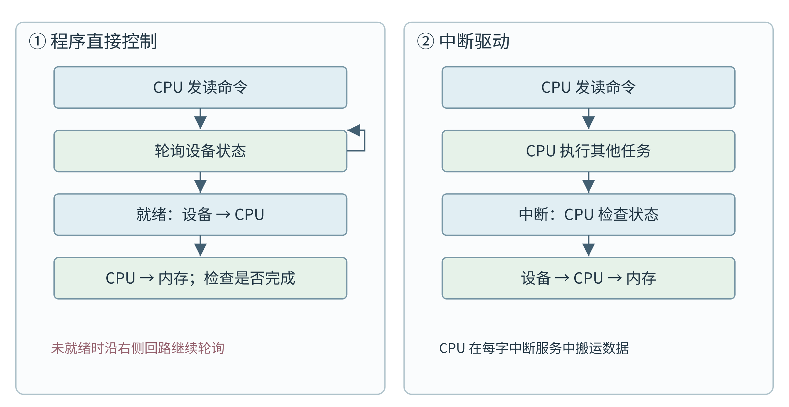

DMA由CPU设置方向、主存地址和计数后启动，传送期间由DMA控制器组织设备与主存的数据交换；通道则依照主存中的通道程序组织一组I/O操作。两者在完成或出现需处理的异常时通知CPU，具体中断次数由设备和控制协议决定。

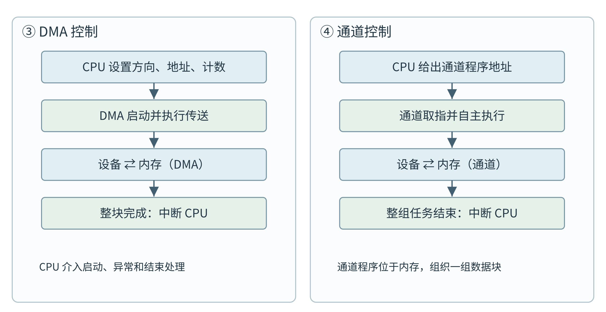

请求 I/O 的线程是否阻塞，是接口语义问题；设备采用哪种传送控制，是硬件和驱动问题。一个阻塞读在中断或 DMA 工作期间可以睡眠；一个非阻塞请求也可立刻返回。不能仅凭“DMA”这一点就推断用户进程必然处于阻塞态。

DMA 地址还要按系统规则提供：不能让设备直接按用户给出的地址任意写入。实际系统可能使用固定页、内核缓冲和 IOMMU 等机制；本书题目只要求按其给定的物理地址与控制模型推演，不把“DMA 无需 CPU 每字搬运”误写成“完全不需要操作系统参与”。

### DMA的寄存器与通道程序

> **辨析 · 谁搬数据与谁等待分开**
>
> DMA让硬件执行内存与设备间搬运，调用线程是否等待由接口语义决定。结束仍可中断CPU，二者能够组合。

课件DMA控制器包括数据寄存器DR、内存地址寄存器MAR、数据计数器DC、命令／状态寄存器CR。输入时MAR指向目标内存位置，输出时指向源位置；每完成规定的传送，地址和剩余计数按硬件规则更新，到结束条件后报告完成。

下图将DMA控制器的四类寄存器放在同一传送路径中。DR暂存设备与主存间的数据；MAR和DC共同限定当前传送位置与剩余数量；CR保存命令或状态。具体寄存器宽度及单位以设备为准。

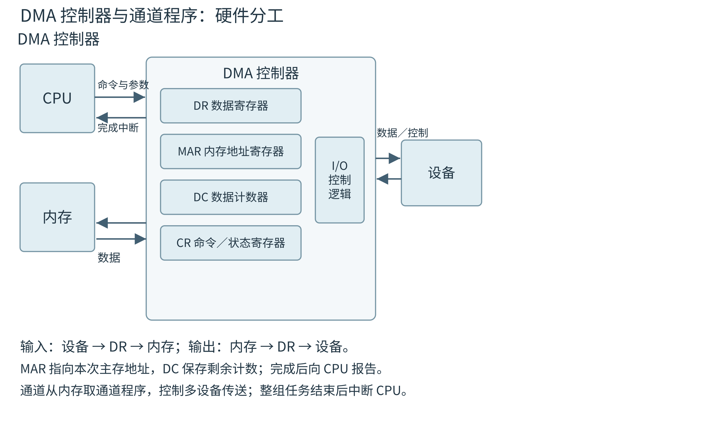

教材的基本DMA模型每次描述一个或多个连续设备块与连续内存区；若数据离散，CPU需发起多次操作。支持散布／聚集描述符的扩展硬件可以放宽这一限制，题目采用基本模型时应按其给定地址、长度和连续性计算。

**通道**是能执行通道指令的I/O控制硬件。CPU提供通道程序在主存中的地址及操作对象，通道再取出任务清单中的各条指令，组织一组数据块的传送，完成后中断CPU。通道程序使用主机内存，通道指令服务于I/O控制，其能力和通用CPU不同。

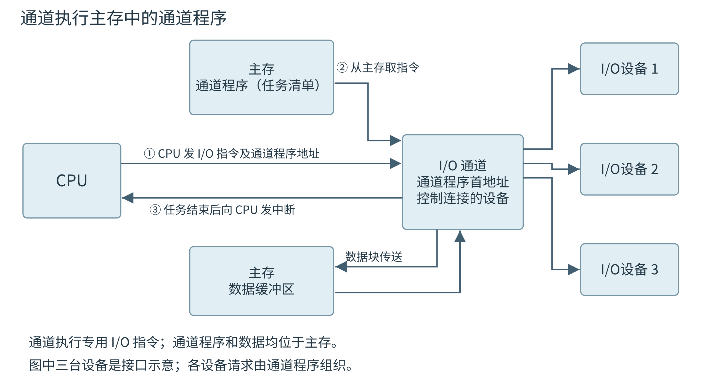

| 控制方式 | 教材模型的传送单位 | CPU主要介入时机 | 输入数据路径 |
| --- | --- | --- | --- |
| 程序直接控制 | 字 | 发命令、持续轮询、每字搬运 | 设备→CPU寄存器→内存 |
| 中断驱动 | 字 | 启动与每次中断服务 | 设备→CPU寄存器→内存 |
| DMA | 一块或若干连续块 | 设置参数、完成或异常处理 | 设备→内存 |
| 通道 | 一组块、由程序组织 | 给出通道程序、整组完成或异常处理 | 设备→内存 |

减少CPU介入并不免除内核的权限检查、缓冲管理和资源协调。控制器向CPU发出完成中断后，是否恢复某个用户线程，仍要通过唤醒及调度路径决定。

## I/O 软件层次与一次请求的完整路径

> **错项排除 · 驱动知道设备细节**
>
> 文件逻辑位置属于上层抽象，控制器寄存器、传统CHS参数和启动命令属于设备细节。驱动在提交时形成具体请求，中断处理在完成或异常时推进状态。若题设改为设备内部转换LBA，应按新接口重新分配职责。

用户层 I/O 库组织格式和用户缓冲；系统调用进入内核。设备无关软件处理共同的命名、权限、缓冲、分配和错误接口；设备驱动程序把抽象请求变成控制器能执行的命令，设置寄存器并启动设备；中断处理在完成或异常通知后记录状态、推进请求进度并唤醒等待者。

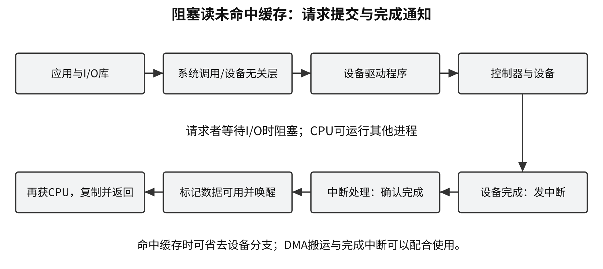

对一个缓存未命中的阻塞式磁盘读，完整过程可以是：应用发出 read，内核查找文件块并申请缓冲，驱动把请求排队、设置 DMA 并启动；调用者等待数据而阻塞，CPU 运行其他进程；设备完成后发中断，处理程序确认状态并标记缓冲可用，唤醒等待者；调用者再次运行时完成复制和返回。若数据早已缓存，设备分支可能整个省去。

### 例 5-1　哪里需要知道具体设备参数

**例题 · 配套例题**

【配套例题】 用户程序发出磁盘 I/O 请求后，系统处理流程为：用户程序→系统调用处理程序→设备驱动程序→中断处理程序。其中，计算数据所在磁盘柱面号、磁头号和扇区号的程序是（　）。

A. 用户程序　　B. 系统调用处理程序　　C. 设备驱动程序　　D. 中断处理程序

**解析。** 柱面、磁头和扇区是具体磁盘寻址参数，应由屏蔽设备差异的驱动处理，答案为 **C**。中断处理主要响应已发生的完成或异常事件，并不负责在收到初始请求时重新规划文件逻辑位置。现代磁盘常接受逻辑块地址 LBA，内部几何转换可由设备完成；这不改变本题按传统 CHS 模型划分驱动职责的答案。

### I/O核心子系统的职责怎样分层

> **辨析 · 共性管理与硬件细节**
>
> 命名、保护、缓冲与分配是通用职责；寄存器地址和状态编码依设备而变。中断处理确认已发生事件，驱动设置具体操作。

I/O核心子系统主要包含设备独立性软件、设备驱动和中断处理。共同的命名映射、保护、请求调度、分配回收、缓冲与公共差错处理通常归设备独立性软件；具体寄存器、命令格式和状态编码由驱动处理；中断入口处理完成或异常通知。

I/O调度为待处理请求选择顺序，例如磁盘选择寻道顺序，打印服务可以按到达、优先级或任务长度排队。设备保护按用户身份、设备对象及访问权限检查；设备视为特殊文件时，可复用文件访问控制机制。差错处理则需区分可重试错误与永久故障，达到规定重试次数后向上报告。

SPOOLing服务在课件模型中由用户层的假脱机进程组织，并请求内核磁盘I/O服务；它使用核心子系统的缓冲、文件和驱动功能。因此“某功能与I/O有关”不表示其所有代码都必须放在同一内核层。

不同系统的驱动可在内核或受控服务进程中执行。能否独立成为进程是实现政策，判断题应以题给架构为准，而不要把“驱动”直接等同于“永远独立调度的进程”。

## 阻塞、非阻塞与异步接口

> **最小反例 · 不阻塞仍可能忙等**
>
> 程序不断调用非阻塞read，得到暂不可用后立即再次调用，虽然每次调用都不睡眠，CPU却可能一直空转。接口不阻塞只描述本次调用的等待行为，不能直接推出自动提高利用率；异步完成通知另有接口语义。

**阻塞 I/O**在操作暂不能完成时，使调用线程等待；**非阻塞 I/O**在操作不能立即完成时返回相应状态，让程序决定重试、处理其他事务或等待通知。反复调用非阻塞接口也可能形成忙等，接口不阻塞不表示自动提高利用率。

**异步 I/O**把提交与完成分开，提交后程序继续执行，以后通过通知、完成队列等取得结果。非阻塞主要回答“本次调用等待不等待”，异步主要回答“操作完成如何与调用者联系”，不能把二者作为完全相同的术语。具体接口是否可能立即完成、如何报告部分完成，要按题设。

字符设备常有字符流、行缓冲等语义，块设备有块号和对齐约束，网络接口涉及连接与分组的收发。设备无关性是给上层适当统一的抽象，不是强求所有设备具有完全一样的操作集合。

### 字符、块与网络设备接口

> **辨析 · 同名read不表示同一设备语义**
>
> 字符、块、网络接口可能共用操作名，但寻址、连接、部分完成和等待规则不同，应按各自参数与返回条件解释。

字符设备接口可提供get／put等字符读写；块设备接口可提供read／write及seek定位，参数需表达设备或文件、当前偏移、用户缓冲地址和长度。实际一次read可以返回多个字符，操作名本身不决定底层传输单位。

操作系统也为设备驱动规定统一的调用接口。课件以`read(p1,p2,p3)`示意上层调用约定：不同厂商各自实现对应驱动，上层依接口传参，驱动再处理具体设备差异。设备独立软件和中断处理程序仍各有职责；接口名称、参数和设备能力须以实际系统为准。

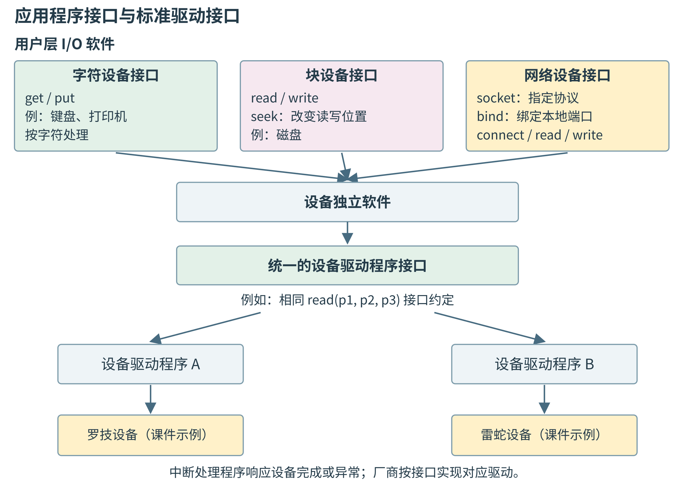

网络设备还须说明通信对端和协议。课件用网络套接字接口说明：`socket`建立套接字，`bind`关联本地地址和端口，`connect`建立与远端的关联，再通过规定的读写操作交换数据。数据经协议栈、设备无关软件及网卡驱动下传；接收时网卡报告事件，驱动和协议处理将数据交给相应套接字，满足条件后唤醒等待者。

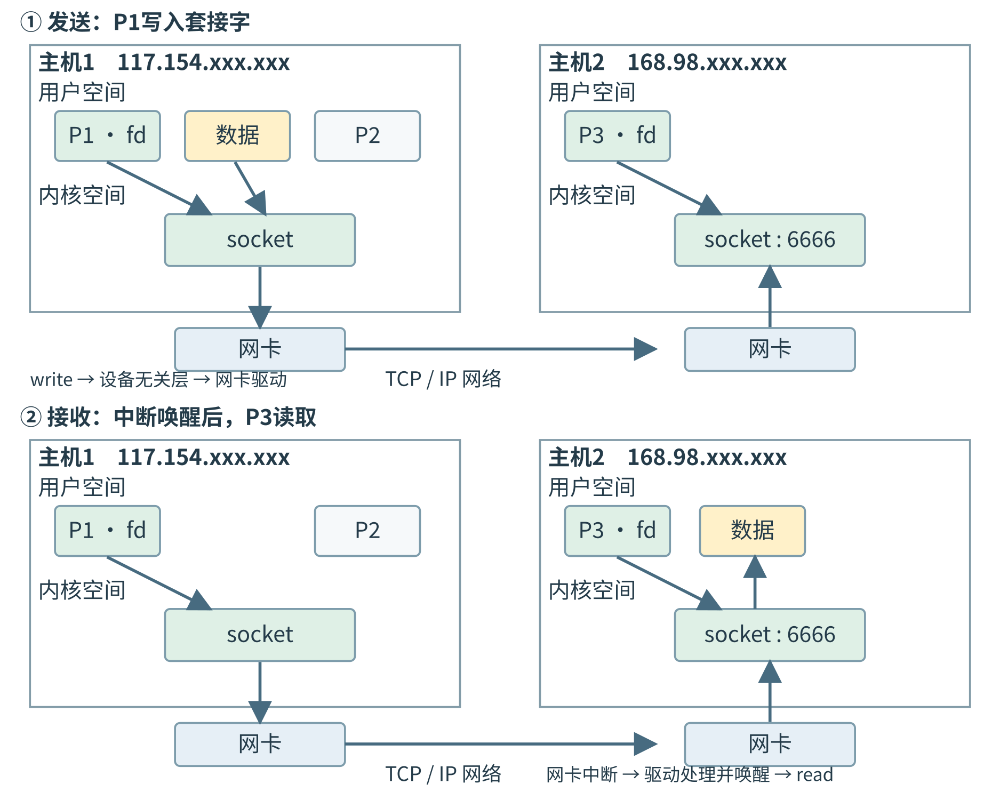

图中主机1的P1、P2和主机2的P3分别拥有自己的用户空间；P1通过文件描述符写入套接字，数据经网卡和TCP/IP网络送往主机2绑定端口6666的套接字。网卡中断后，驱动和协议层处理数据，再唤醒等待该数据的P3；P3实际运行后经自己的描述符读取。进程P2没有参与这次传送。

字符、块和网络设备可以共享某些操作名，但操作集合及参数语义并不完全相同。阻塞与非阻塞还可作为接口选项：磁盘写返回快可能只表示已经交给缓存，并不意味着任何块设备写都必定是非阻塞；有数据可直接取得的阻塞式读也可能立即完成。

## 缓冲：把输入、复制与计算放到同一时间线

> **不变量 · 缓冲复用不能覆盖未用数据**
>
> 设备只有在对应系统缓冲已可复用时才能填下一块，复制也不能覆盖仍被分析的用户工作区。按这两个约束检查每段重叠，再求max形式的周期；若复制不用CPU或存在多个工作区，原公式的资源模型已改变。

> **最小反例 · 一块数据没有流水收益**
>
> 只有一个块时，输入T、复制M、分析C仍须完成，单缓冲与双缓冲同为T＋M＋C。双缓冲的收益来自后续块输入与前一块CPU工作重叠，不能把“增加一个缓冲区”直接解释成任何工作量都耗时减半。

缓冲在生产者和使用者之间暂存数据，可以缓和速度差、适配传送单位、允许阶段重叠。若设备及控制方式允许积累一批数据后再通知CPU，缓冲还可减少中断频率，并为响应留出时间；缓冲是否改变中断次数取决于具体机制。高速磁盘缓存还可利用重复访问、预读和延迟写，减少某些实际 I/O。缓冲区不改变设备本身的物理速度，也不会无条件消除所有等待。

设每块从设备输入系统缓冲耗时 $T$，从系统缓冲复制到用户工作区耗时 $M$，CPU 分析该块耗时 $C$。假定输入可与 CPU 工作重叠，复制与分析共用相应 CPU 资源，不能互相重叠，只有一个用户工作区，并忽略其他开销。

**单缓冲**中，设备不能在缓冲尚未复制完时覆盖它；复制下一块也不能覆盖仍在分析的用户工作区。因此第一块先经 $T+M$，此后相邻两块复制完成点之间的间隔是 $\max(T,C)+M$，最后还要完成最后一块的分析。对 $n\ge1$ 块：

$$T_{\mathrm{single}}=T+M+(n-1)[\max(T,C)+M]+C.$$

**双缓冲**允许设备填另一个系统缓冲，而 CPU 使用前一个。流水可看成设备输入 $T$ 与 CPU 的复制加分析 $M+C$ 两个阶段，在上述资源模型下：

$$T_{\mathrm{double}}=T+(n-1)\max(T,M+C)+M+C.$$

这些是从阶段占用关系推出的公式。题目改成两个用户工作区、复制不用 CPU、半双工链路或其他限制时，先重画时间线，不能只凭“单缓冲/双缓冲”的名称直接套用公式。

### 例 5-2　首块要启动，末块要排空

**例题 · 配套例题**

【配套例题】 某文件占 10 个磁盘块，逐块读入主存缓冲，再送用户区分析。一个缓冲区与一个磁盘块大小相同，读一块到缓冲区为 100 μs，复制到用户区为 50 μs，CPU 分析一块为 50 μs。在单缓冲、双缓冲结构下，读入并分析完该文件的时间分别是（　）。

A. 1500 μs、1000 μs　　B. 1550 μs、1100 μs

C. 1550 μs、1550 μs　　D. 2000 μs、2000 μs

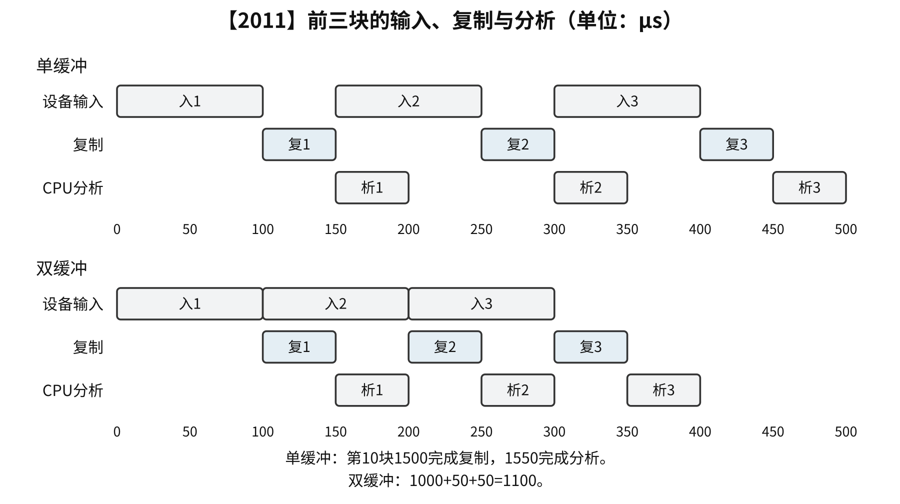

**解析。** 单缓冲第 1 块输入 0—100，复制 100—150，分析 150—200；第 2 块可在第 1 块分析时开始输入，即 150—250，然后复制 250—300、分析 300—350。以后每 150 μs 推进一块，第 10 块复制结束为 1500 μs，再分析 50 μs，合计 1550 μs。

双缓冲第 1 块输入后，设备立即在另一缓冲输入第 2 块，即 100—200；CPU 同期完成第 1 块的复制和分析，也需 100 μs。10 块输入可连续到 1000 μs，最后一块再复制、分析各 50 μs，总计 1100 μs，答案为 **B**。只算稳定流水的块数而漏掉最后排空，会误得 A。

### 循环缓冲与缓冲池

循环缓冲让若干缓冲区按环使用，分别维护下一可填和下一可取位置；必须区分空、已填满、正在使用等状态，不能在消费者取走数据之前覆盖该缓冲区。缓冲池把多个缓冲按空闲、输入、输出等用途组织，按请求分配与回收，可让多个活动复用。

缓冲管理既要选择大小、数量，也要协调生产与消费。双缓冲若输入远快于计算，设备仍会在两个缓冲都被占用后等待；缓冲区数量有限，输入持续过快时总会发生等待。相关计数与互斥规则可回指第2章的有限缓冲区，数据传送与并发状态必须同时正确。

### 稳态平均间隔与整批完成时间

> **辨析 · 稳态间隔不含首尾全部费用**
>
> 每块平均处理间隔取重复状态之间的时间；整批从空开始还需启动和排空。先统一计时起点与终点，再套对应公式。

课件常先指定一个重复初态来求“平均每处理一块”的稳态间隔。单缓冲取工作区满、系统缓冲空为初态，周期为$\max(T,C)+M$；双缓冲取一满一空且工作区空为初态，周期为$\max(T,M+C)$。前面的整批公式还包含首块装入和末块排空，两种口径不能混算。

课件的单缓冲初态是工作区已有数据、系统缓冲区为空：CPU处理工作区的同时，设备向缓冲区输入；两者都完成后才能把下一块复制到工作区。下图两组时间数值仅为自选示意，单位一致即可：$T>C$时等待输入，周期为$T+M$；$T<C$时等待CPU处理，周期为$C+M$。两者相等时周期仍为$T+M=C+M$。

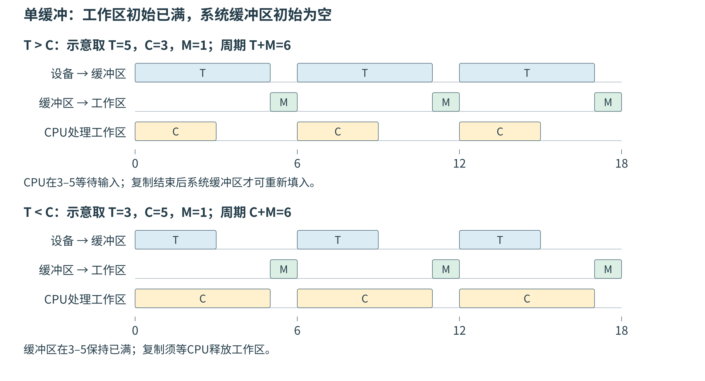

课件的双缓冲初态是工作区为空、缓冲区1满、缓冲区2空。下图中的M1、M2分别从缓冲区1、2向工作区复制，处理与复制共享CPU、不能重叠。$T>M+C$时设备输入决定节拍；$T<M+C$时复制和处理决定节拍，设备可能等待空缓冲区。$T=M+C$时两阶段节拍相同，周期即$T=M+C$。图中数字是为展示这些条件自选的时间值，并非课件给出的数值。

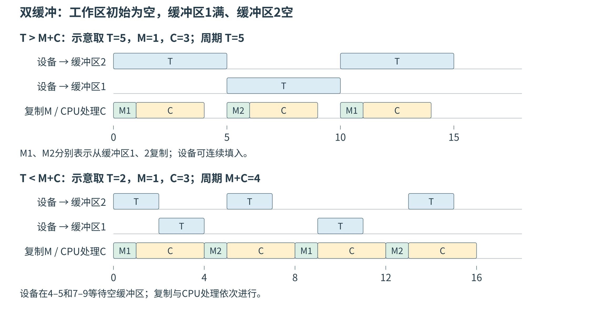

通信缓冲也取决于用途：若一台机器只有一个共用收发缓冲，而且发送与接收都独占它，同一时刻只能使用一种方向；若分别设置发送、接收缓冲，具备相应链路和控制能力时可并行组织双向数据。双缓冲提供的是条件，并不改变半双工物理链路的限制。

### 缓冲池中的三条队列与四种工作角色

> **辨析 · 工作角色不是固定四块**
>
> hin、sin、hout、sout描述缓冲被谁用于何种阶段。缓冲在队列间流转，取走与归还时都要维护状态及同步。

缓冲池按状态维护空缓冲队列、装满输入数据的输入队列、装满输出数据的输出队列。`hin`、`sin`、`hout`、`sout`分别表示收容输入、提取输入、收容输出、提取输出时占用的工作缓冲角色，不是永远固定的四块存储。

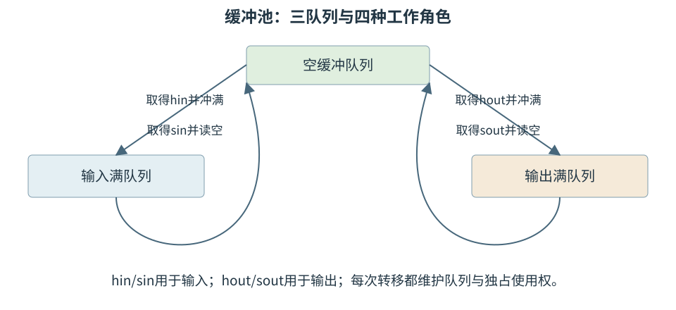

| 请求 | 取得缓冲的位置与角色 | 完成后的去向 |
| --- | --- | --- |
| 设备输入进程收容数据 | 从空队列取一块作hin | 冲满后挂入输入队列 |
| 计算进程提取输入 | 从输入队列取一块作sin | 读空后归还空队列 |
| 计算进程产生输出 | 从空队列取一块作hout | 冲满后挂入输出队列 |
| 设备输出进程提取输出 | 从输出队列取一块作sout | 取空后归还空队列 |

队列为空时，相应请求按策略等待；队列和角色转换要受同步保护，避免同一缓冲同时归两个请求所有。

## 设备分配、逻辑名称与驱动接口

> **课程连接 · 设备链也可能形成资源环**
>
> 进程拿到设备后再等控制器，另一进程持控制器又等所需设备，就可能形成占有并等待与循环等待。设备分配和进程资源分配共享死锁分析方法；仅把某张设备表标为已分配，并不代表完整传输路径已经可用。

设备分配要检查设备类型、访问权限、当前占用、逻辑名称到实际设备的映射，并选择可用设备与相关控制器、通道等资源。若需要的资源暂不可得，要按规则排队，不能只分配设备却忽略它必须使用的传输路径。资源逐项申请还可能凑成第2章所述的死锁条件。

静态分配在作业开始前取得所需设备，减少运行中占有并等待，但利用率可能低；动态分配在使用时申请，更灵活，也需处理等待和安全。独占与共享是设备使用性质，静态与动态是分配时机，不能完全一一对应。

设备独立性让应用使用逻辑名称或统一接口，设备无关软件完成适当映射；更换设备通常调整映射和驱动，上层不必重写业务逻辑。驱动还须遵守操作系统的入口、同步、内存和完成通知接口；同一硬件的驱动通常不能不加修改地用于所有操作系统。

设备释放后，要更新控制结构、处理队列并通知合适等待者。内核记录“空闲”以前必须确认上一请求确实结束，避免两个使用者同时认为自己拥有设备。

### DCT、COCT、CHCT、SDT与LUT

设备分配不仅要找到空闲设备，还要取得它所依赖的控制器和通道。课件用以下控制结构组织资源：

| 结构 | 管理对象与关键字段 |
| --- | --- |
| 设备控制表DCT | 每设备一张，含类型、标识、忙闲／故障状态、控制器指针、重试限额、等待队列 |
| 控制器控制表COCT | 每控制器一张，含标识、状态、通道指针、控制器等待队列 |
| 通道控制表CHCT | 每通道一张，含标识、状态、所属控制器列表及通道等待队列 |
| 系统设备表SDT | 全系统设备目录，每项关联设备类型、标识、DCT与驱动入口 |
| 逻辑设备表LUT | 建立逻辑设备名、所分配物理设备名与驱动入口的对应关系 |

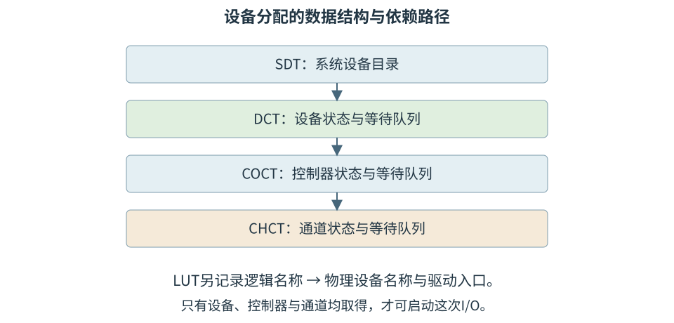

在课件的物理设备名方案中，按名称查SDT，定位DCT；设备忙则排其等待队列，空闲则分配；再由DCT查COCT，由COCT查CHCT，分别检查和分配，三者全部成功后才能启动I/O。只取得设备而未取得路径资源，不能认为此次请求已能传输。

改进方案由用户提出逻辑名称或所需类型，系统选择同类空闲设备并登记LUT，后续使用同一逻辑名即可找到原分配。课件以两台打印机说明查表结果：

| 逻辑设备名 | 物理设备标识 | 驱动程序入口地址 |
| --- | --- | --- |
| `/dev/打印机1` | 3 | 1024 |
| `/dev/打印机2` | 5 | 2046 |

例如，通过`/dev/打印机1`找到物理设备3及其驱动入口1024；这些数字只是课件的示意值。系统使用一张LUT时，逻辑名称须在该命名空间内唯一；每用户一张LUT时，不同用户可使用相同名称。名称隔离与设备实际共享性质仍是两个问题。

### 安全与不安全分配的特定模型

课件的**安全分配方式**规定，进程取得一个设备后立即因本次I/O阻塞，完成后才唤醒，因此在该模型下同一进程同一时段只持有一个正在使用的设备，不会继续持有它去申请另一个。它破坏设备间的请求和保持关系，但同一进程的计算与该次I/O串行。

**不安全分配方式**允许进程取得设备后继续执行，并可继续申请其他设备，直到某请求无法满足才阻塞；这提高重叠机会，却可能构成占有并等待，需要结合死锁避免、检测或解除措施。这里“不安全”是分配方式名称，不表示每次分配后必然已经死锁。静态／动态分配描述资源取得时机，应与这组策略分别判断。

## SPOOLing：先进入磁盘井，再使用独占设备

> **错项排除 · 逻辑共享没有增加打印头**
>
> 多个作业可同时提交到输出井，由后台服务逐份交给物理打印机。应用看到可共享的服务，但真实打印装置仍一次处理一个任务。SPOOLing把提交与慢设备使用解耦，不能把这种虚拟化说成硬件同时打印多份纸张。

**SPOOLing**利用磁盘上的输入井、输出井和相应进程，把低速独占设备的使用与应用运行分开，形成假脱机工作方式。输入进程把设备数据预先送入输入井，作业随后从井取数据；输出请求先进入输出井，由输出进程按队列统一送到真实设备，井管理负责记录请求与存储位置等。

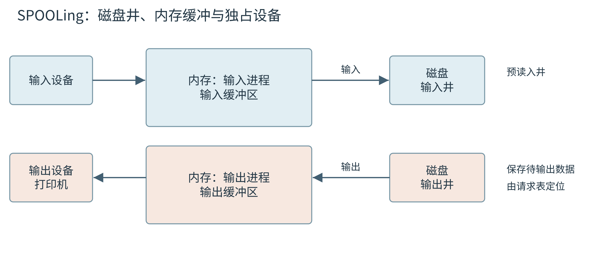

打印时，假脱机管理进程先在输出井中为每个请求分配存储区，保存待打印数据，再建立记录数据位置等信息的打印请求表并排入队列。输出进程取得队首请求后，将井中的数据经输出缓冲区送至打印机。多个进程可以分别提交打印文件和请求，提交后继续做别的工作；打印守护进程再逐份占用物理打印机。用户看到逻辑上可共享的打印服务，打印机仍一次打印一个任务。不能把“将独占设备改造成共享设备”理解成硬件从此能同时输出多份互不干扰的纸张。

井通常在磁盘，不是简单把所有输出永久留在内存；SPOOLing 也不是用一台专用外围机完全脱离主机运行。多道程序设计让井管理、设备服务与用户作业可以并发，缓冲负责暂存数据，二者分别承担不同作用。

## 磁盘结构、地址与格式化

> **不变量 · 旋转延迟先看转速单位**
>
> 7200转每分先除60得到每秒120转，一圈约8.333毫秒，随机角位置平均等待半圈。若题目直接给秒每转，就改用其一半。先把单位写在每个量后面，能避免把r除2与1除2r这两种形式混用。

磁盘盘面划分成磁道，同一半径上的磁道形成柱面，磁道再分扇区。移动磁头到目标磁道需要**寻道时间**，等待目标扇区转到磁头下需要**旋转延迟**，实际数据经过磁头需要**传输时间**。常规平均模型为

$$T_{\mathrm{access}}=T_{\mathrm{seek}}+T_{\mathrm{rotation}}+T_{\mathrm{transfer}}.$$

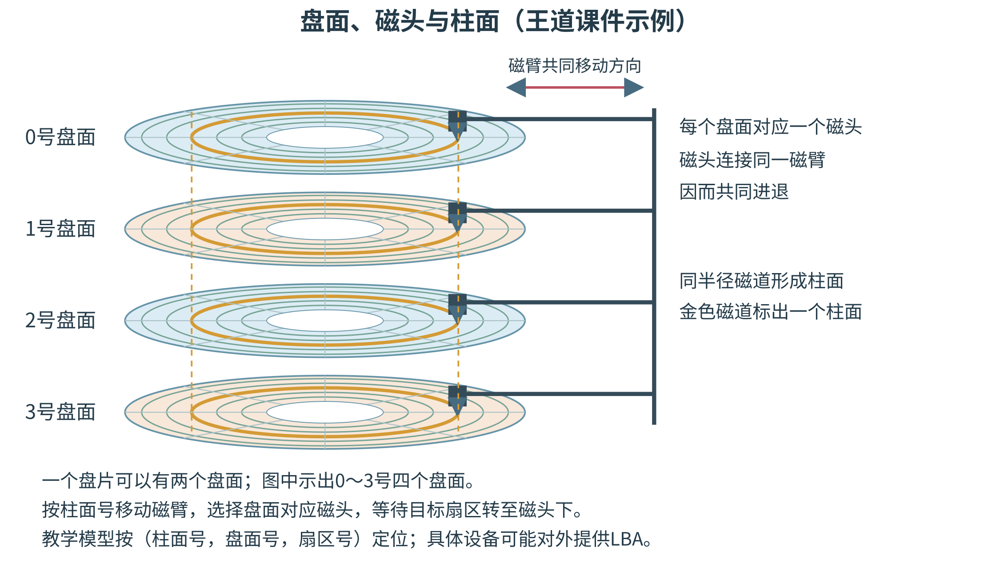

图中以四个盘面为例，每个盘面对应一个磁头；同半径磁道形成柱面，磁头随同一磁臂一起移动。按传统物理地址读数据时先定位柱面，再选择对应盘面的磁头，等待扇区转到磁头下；实际设备可能通过逻辑块地址屏蔽内部几何结构。

按磁头是否随磁臂移动，磁盘可分为活动头磁盘和固定头磁盘；固定头模型为每条磁道配置磁头。按盘片能否更换，还可分为可换盘和固定盘。两组分类描述不同性质。

若一次寻道包含磁臂启动时间 $s$，且匀速跨越每条磁道耗时 $m$，跨越 $n$ 条磁道的简化模型为 $T_{\mathrm{seek}}=s+mn$；启动开销及线性假设均以题目给定为准。

若转速为 $r$ 转/秒，一圈为 $1/r$ 秒，随机角位置下平均旋转延迟为 $1/(2r)$。若题目直接给 $r$ 秒/转，则平均延迟为 $r/2$，两种 r 单位不能混用。一个磁道能传 N B，连续读取 b B、忽略跨道与间隙时，传输时间近似为 $(b/N)/r$ 秒。

例如 7200 转/分为 120 转/秒，一圈约 8.333 ms，平均旋转延迟约 4.167 ms。若平均寻道 5 ms、目标连续数据传输 0.5 ms，则平均访问约 9.667 ms。这是**原创单位示例**，用于把 rpm 换成时间；跨道访问若需额外寻道，不能继续当作同一连续磁道传输。

### 例 5-3　柱面、盘面、扇区是混合进位

**例题 · 配套例题**

〖5.3-016〗 磁盘有 100 个柱面，每柱面 8 个磁道，每磁道 8 个扇区。文件 A 有 6400 个逻辑记录，每记录与扇区大小相同，顺序存放；第 0 个记录在 (0 号柱面、0 号盘面、0 号扇区)。磁盘地址 (78、6、6) 存放文件的第几个逻辑记录？

A. 5045　　B. 5046　　C. 5047　　D. 5048

**解析。** 先跨 78 个柱面，每柱面 $8\times8=64$ 个记录，再跨本柱面的 6 个盘面，最后跨 6 个扇区，得到 $78\times64+6\times8+6=5046$，答案为 **B**。题目明确从 0 编号，不能再加 1。反算时先除 64 取柱面，余数再除 8 取盘面，最后余数为扇区。

### 分区、物理格式化和逻辑格式化

物理格式化或低级格式化建立控制器识别的扇区结构及校验等信息；分区划分可独立使用的逻辑区域；逻辑格式化在某区域上建立文件系统结构，如超级块、根目录和空闲管理结构。创建文件系统不是每次开机都要做的初始化。

### 例 5-4　根目录属于文件系统，不属于扇区编码

**例题 · 配套例题**

【配套例题】 下列选项中，磁盘逻辑格式化程序所做的工作是（　）。

Ⅰ. 对磁盘进行分区　　Ⅱ. 建立文件系统根目录

Ⅲ. 确定磁盘扇区校验码所占位数　　Ⅳ. 初始化保存空闲磁盘块信息的数据结构

A. 仅Ⅱ　　B. 仅Ⅱ、Ⅳ　　C. 仅Ⅲ、Ⅳ　　D. 仅Ⅰ、Ⅱ、Ⅳ

**解析。** Ⅱ、Ⅳ创建的是文件系统结构；Ⅰ是分区，Ⅲ属于物理扇区组织。答案为 **B**。传统主引导扇区、分区引导区域和文件系统数据区的建立时机也不同，不能见到“引导”就一律归到 BIOS 或逻辑格式化。

### 引导块与坏块管理

物理格式化建立扇区头、数据区和尾部，记录标识及校验等信息；分区形成逻辑卷；逻辑格式化创建文件系统根目录和空闲管理结构。文件系统块可由一个或多个物理扇区组成，题目中的扇区、盘块、簇若不同长，要先换算。

启动需要一段预先可执行的固件代码，传统模型中先从ROM的自举装入程序定位磁盘引导块，再把后续启动程序及内核装入内存。引导块、主引导记录、分区引导区域不是同一个字段，具体流程应与第1章给定启动模型对应。

坏块可能由文件系统显式标记，例如在分配表中表示不可用；也可能由控制器用备用扇区重映射，对上层隐藏实际替换。物理坏块管理的目标是避用或替换位置，不是由操作系统软件修复已经损坏的介质。

## 磁盘调度：把运动顺序和运动距离分开

> **最小反例 · 最高请求不一定就是端点**
>
> 磁头58向上，剩余请求含180和15，物理端点199。LOOK可在180折返，SCAN按端点规则继续到199再折返，二者距离不同。原配套题恰好请求199只能说明那组数据相同，不能推出两算法普遍等价。
>
> 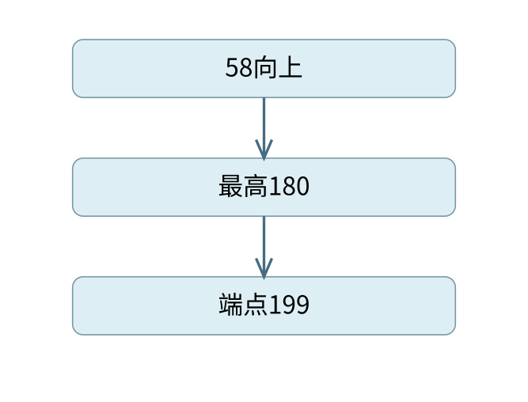
>
> 仍有15号请求时，SCAN到199折返，LOOK可在180折返。

> **错项排除 · SSTF每走一步重算距离**
>
> 初始磁头85，服务100以后，剩余101只差1，而60差40。算法比较的是距当前磁头的距离，不能一次按距初始85的差值排完。有限固定批次最终会完成，“持续到达可能饥饿”也不等于任何批次必然饥饿。

**FCFS**按请求到达次序服务，公平直观，但相邻请求可能使磁头来回移动。**SSTF**每次选离当前磁头最近的请求，可减少当前一步的寻道，但不是求整个序列的全局最短路径；远处请求可能长期被新来的近处请求越过。

**SCAN**沿一个方向服务，达到规定端点后反向；**LOOK**到该方向最后一个请求便反向，不必到物理端点。**C-SCAN**只在一个方向服务，到端点后回到另一端，返回过程中不服务；**C-LOOK**在本方向最后请求处回跳到另一侧第一个请求。回跳是否计入移动距离、是否规定到物理端点、何时停止统计，要按题干，不能只看算法名。王道课件提示：题目没有特别说明时，SCAN按LOOK的折返点处理，C-SCAN按C-LOOK处理；若题干明确要求到物理端点，则按该要求计算。

下表按物理端点与最后请求位置区分扫描算法。若题干另给折返、回跳或停止规则，应按具体规则重建轨迹。

| 算法 | 怎样选择、沿什么方向服务 | 折返或回跳的位置 | 返回途中是否服务 |
| --- | --- | --- | --- |
| FCFS | 按请求到达顺序，方向可来回改变 | 无固定端点要求 | 不设专门回跳阶段 |
| SSTF | 每次选距当前磁头最近的请求 | 无固定端点要求 | 不设专门回跳阶段 |
| SCAN | 沿当前方向逐个服务，随后反向服务 | 到规定的物理端点再反向 | 反向扫描仍服务 |
| LOOK | 同 SCAN，沿两个方向服务 | 本方向已无待处理请求便反向 | 反向扫描仍服务 |
| C-SCAN | 只沿规定的一个方向服务 | 到物理端点，再回到另一物理端点 | 回跳不服务 |
| C-LOOK | 只沿规定的一个方向服务 | 本方向最后请求处，回到另一侧首个待处理请求 | 回跳不服务，到目标后恢复服务 |

| 算法 | 等待方面的边界 |
| --- | --- |
| FCFS | 后到者不插队；前面的请求仍可能造成很长等待 |
| SSTF | 持续近处新请求可能越过远处请求，存在饥饿风险 |
| SCAN | 扫描持续推进时按方向轮到；不同位置的服务间隔可不同 |
| LOOK | 省去无请求的端段；等待仍受负载和扫描推进规则约束 |
| C-SCAN | 循环服务次序使位置机会较均匀；不直接给出固定时间上界 |
| C-LOOK | 缩短无请求的端段；循环次序仍需配合有限处理时间等条件 |

对固定有限的一批请求，若每个请求的处理时间也有限，SSTF 同样会处理完，不能把“可能饥饿”说成“必然饥饿”。持续到达时，扫描能否保持前进还与新请求的接纳和服务规则有关；没有请求耗时、负载及推进条件，就不能宣称任何扫描变体具有无条件的固定等待上界。回跳不服务也不等于物理移动耗时为零。

### 例 5-5　方向决定先服务哪一侧

**例题 · 配套例题**

【配套例题】 某硬盘有 200 个磁道，最外侧磁道号为 0，请求序列为 130、42、180、15、199。当前磁头位于 58 号磁道，从外侧向内侧移动。按 SCAN 处理完这些请求，磁头移动的磁道数为（　）。

A. 208　　B. 287　　C. 325　　D. 382

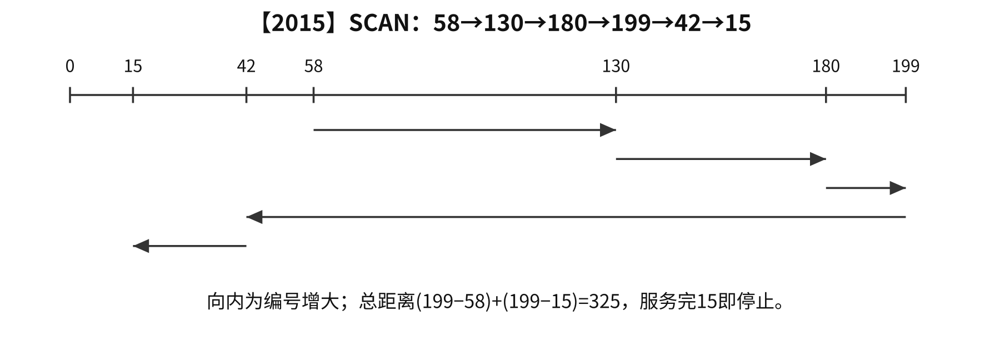

**解析。** 向内是编号增大，先服务 130、180、199，再反向服务 42、15。移动距离为 $(199-58)+(199-15)=141+184=325$，答案为 **C**。不能按原输入序列依次访问，那是 FCFS；也不能先服务距 58 最近的 42，那是 SSTF 的首步。

本题最高请求就是端点 199，因此 SCAN 与 LOOK 恰好有相同折返点，不能凭这道题认为两算法永远相同。处理完最后请求 15 就停止统计，也不应继续加到 0 的距离。

若仅用相同数据比较算法：FCFS 按给定序列移动共 $72+88+138+165+184=647$；SSTF 依次 42、15、130、180、199，移动 $16+27+115+50+19=227$。这是题后方法比较，原题仍只问 SCAN；不同方法应各自重建顺序，不能复用另一个算法的轨迹。

调度主要影响寻道，但布局、顺序读预取等也能改变旋转和传输开销。把“磁头移动更少”直接等同于“任何情况下总 I/O 时间最短”，忽略了请求大小、缓存、旋转位置及设备内部重排等条件。

### 课件同一批请求的六种轨迹

> **辨析 · 平均量用当前轨迹重算**
>
> 六种调度算法分别重建服务顺序，算每段距离后累加，再除以请求数。不能复用另一个算法的平均值或先排序一次就不再更新。

初始磁头在100，磁道0～200，请求到达顺序为55、58、39、18、90、160、150、38、184。扫描类先向编号增加方向，所有请求已在队列中；本例明确规定SCAN与C-SCAN均需到物理端点，按服务完最后请求停止统计，回跳计实际移动。

| 算法 | 服务顺序（括号为非服务折返点） | 总移动量 |
| --- | --- | --- |
| FCFS | 55、58、39、18、90、160、150、38、184 | 498 |
| SSTF | 90、58、55、39、38、18、150、160、184 | 248 |
| SCAN | 150、160、184、（200）、90、58、55、39、38、18 | 282 |
| LOOK | 150、160、184、90、58、55、39、38、18 | 250 |
| C-SCAN | 150、160、184、（200）、（0）、18、38、39、55、58、90 | 390 |
| C-LOOK | 150、160、184、18、38、39、55、58、90 | 322 |

相应平均寻找长度为总移动量除以9，依次约55.333、27.556、31.333、27.778、43.333、35.778。平均量的小数要独立相除，不能将另一轨迹的近似结果直接沿用。

以下按同一位置坐标绘制各算法的完整移动路径，纵向表示处理次序；空心点是初始位置或经过但不服务的折返点，实心点对应被服务的请求。循环算法的回跳路径包含在总移动量中。

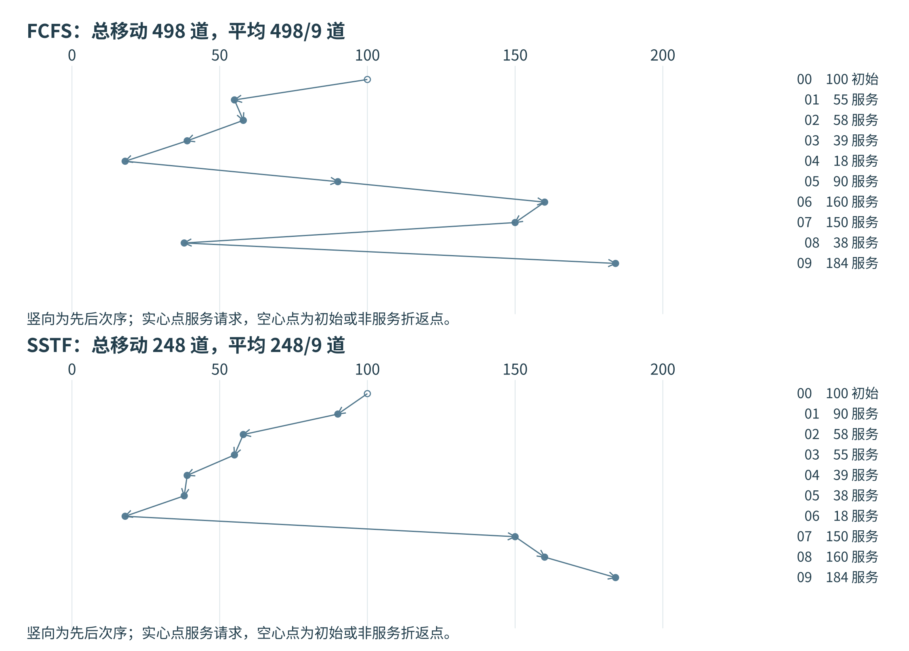

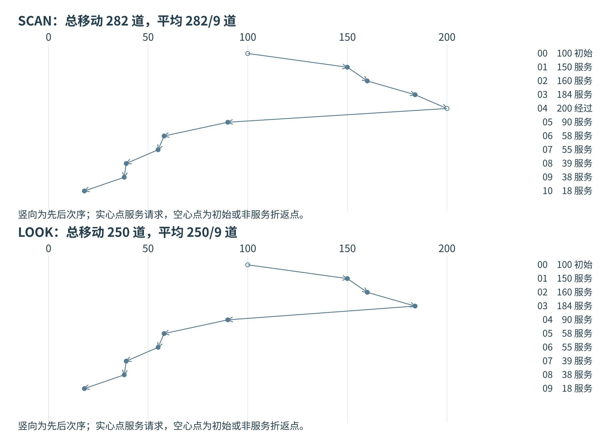

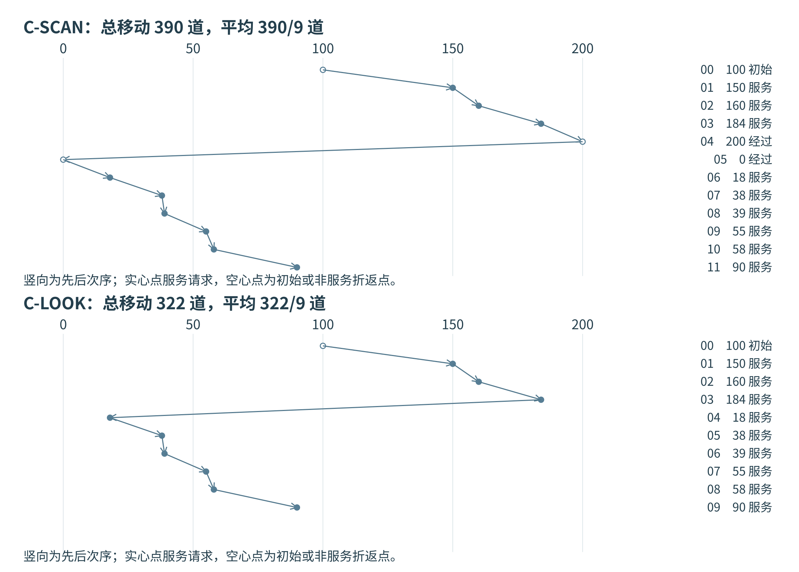

### 交替编号、错位命名与柱面优先地址

> **辨析 · 布局优化与转速不同**
>
> 交替编号和错位命名让后继目标在处理结束时到达，减少额外等转。柱面优先的连续地址则减少不必要的磁臂移动。

读完一个扇区以后，控制器可能还需处理时间。若紧邻的下一个逻辑扇区在处理期间已经划过磁头，就要再等待一圈。**交替编号**让相邻逻辑扇区在物理角位置上留出适当间隔，使处理结束时后继扇区恰好到达。

**错位命名**考虑切换盘面或柱面也需要时间，让下一盘面的逻辑起始扇区相对当前盘面错开，避免切换后立即错过目标。二者调整数据布局和角位置，不是提高电机转速。

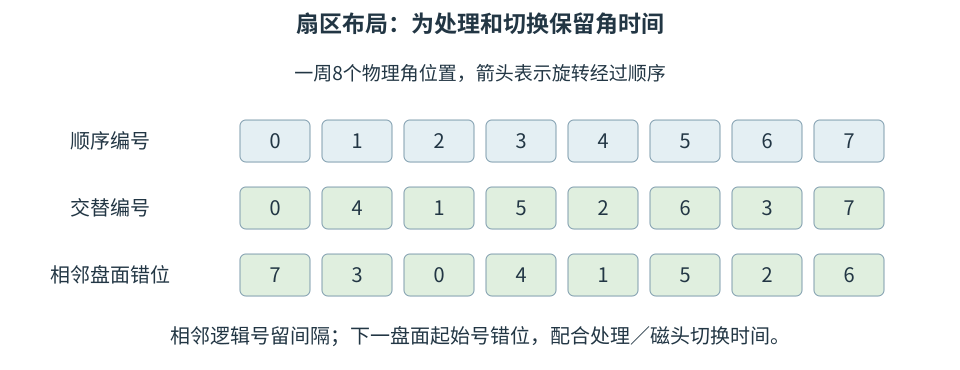

以8个柱面、4个盘面、每磁道8扇区的模型为例，字段可用3、2、3位表示。把线性地址组织为“柱面、盘面、扇区”，连续读完一条磁道后可先切换同一柱面的盘面，无需先移动磁臂；若按“盘面、柱面、扇区”递增，则更容易在切换到下一段地址时要求寻道。实际收益仍取决于布局、控制器缓冲和切换耗时。

## SSD：没有寻道，不等于没有管理开销

> **课程连接 · 文件删除不等于立即擦除**
>
> 文件系统取消名字与块使用关系，TRIM通知设备哪些逻辑数据不再需要，FTL再按内部有效页和擦除块组织回收。三个层次的状态变化可以有时间差；闪存通常不能像内存字节那样任意原地改写，也不按单页直接擦除。

SSD 采用闪存，访问不需要机械寻道与旋转。闪存通常按页读取或编程，按更大的擦除块擦除；已写内容一般不能像内存字节那样任意原地覆盖，修改时通常异地写入新页，再更新映射。**闪存转换层 FTL**维护逻辑地址到实际闪存位置的映射，与文件系统的文件偏移映射不是同一层。

异地更新使旧页失效，垃圾回收挑选合适的块，把仍有效的内容迁走，再擦除整块以供后续使用。这会增加内部写入量，形成写放大；备用空间和回收策略会影响性能，不能只用接口带宽计算每次小写的真实代价。

擦写次数有限，**磨损均衡**避免少量块被反复使用。动态磨损均衡主要在新写入时平衡可选空闲块；静态磨损均衡还迁移长期不变的冷数据，使这些数据占用的低磨损块也参与均衡。目的是均衡磨损、延长寿命，不保证每次请求更快。

TRIM 等通知让设备知道哪些逻辑数据已不再需要，有助于回收；文件删除、文件系统取消映射和设备实际擦除也不是同一瞬间。由于没有机械位置，传统寻道调度的优势不再原样成立，但请求合并、公平性、队列深度与写入管理仍有意义。

### 闪存芯片、块、页与磨损均衡

SSD由控制与地址转换部分及多个闪存芯片组成；每芯片包含多个擦除块，每块包含多个页。主机给出逻辑块地址，FTL将其映射到具体芯片、块和页；设备内部并行组织与主机文件索引属于不同层次。

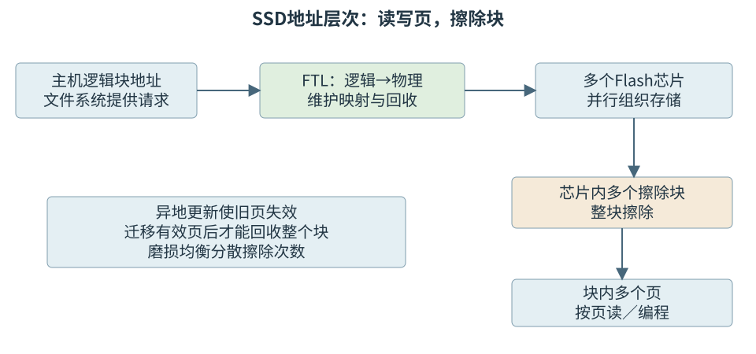

王道课件用四个闪存芯片的示例展示层次：每个芯片由多个块组成，每个块包含多个页。示意中块大小约为16～512 KB、页大小约为512 B～4 KB，实际规格由设备决定。

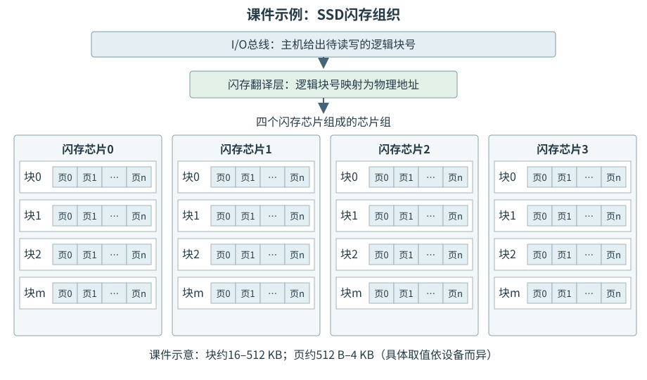

擦除后的空闲页可以被编程，已写页修改时通常需异地写。回收一个仍含有效页的擦除块，要先保存或迁移有效内容再擦除。读操作可反复进行；擦除次数有限，决定了均衡写入和预留空间的重要性。

动态磨损均衡优先从可用块中选择累计擦除次数较少者；静态磨损均衡还可以搬迁长期不变的冷数据，让磨损较少的块腾出承受更多写入，使较老块更多承担读取为主的存储。SSD具有无机械噪声、抗震、低功耗等特点，价格、容量及寿命则受具体介质和实现影响。

## 综合例题：从等待事件到设备地址

> **课程连接 · 从请求到完成**
>
> 先确定调用后进程何时阻塞，再说明设备完成、中断处理、唤醒以及之后的调度。

### 例 5-6　一次键盘输入怎样使阻塞者重新获得运行资格

**例题 · 配套例题**

【配套例题】 进程 P 通过执行系统调用从键盘接收一个字符的输入，已知此过程中与进程 P 相关的操作包括：①将进程 P 插入就绪队列；②将进程 P 插入阻塞队列；③将字符从键盘控制器读入系统缓冲区；④启动键盘中断处理程序；⑤进程 P 从系统调用返回；⑥用户在键盘上输入一个字符。以上编号①—⑥仅用于标记操作，与操作的先后顺序无关。请回答下列问题。

（1）按照正确的操作顺序，操作①的前一个和后一个操作分别是上述操作中的哪一个？操作⑥的后一个操作是上述操作中的哪一个？

（2）在上述哪个操作之后 CPU 一定从进程 P 切换到其他进程？在上述哪个操作之后 CPU 调度程序才能选中进程 P 执行？

（3）完成上述哪个操作的代码属于键盘驱动程序？

（4）键盘中断处理程序执行时，进程 P 处于什么状态？CPU 处于内核态还是用户态？

**解析。** 先把六个操作放入一次完整请求中。P 执行系统调用，经受控入口进入内核；此时字符尚未输入，P 等待该事件，执行②进入阻塞队列，让出 CPU。用户随后执行⑥，键盘控制器产生中断请求；CPU 响应后转入内核入口，执行④启动键盘中断处理。处理代码执行③，把控制器中的字符读到系统缓冲区；数据可用后执行①，唤醒 P。P 以后被调度运行，继续尚未完成的系统调用，按调用语义把结果交给用户，最后执行⑤返回。

因此，在题目列出的六个操作之间，先后顺序是

**② → ⑥ → ④ → ③ → ① → ⑤。**

（1）①的前一个操作是 **③**，后一个操作是 **⑤**；⑥的后一个操作是 **④**。这里“前一个、后一个”只比较题列操作，①与⑤之间仍可有中断返回、等待调度、恢复执行等步骤，不能理解为相邻的两条机器指令。

（2）**②之后**，P 已阻塞，不能继续作为当前运行者，CPU 转去运行其他进程；若没有其他普通就绪进程，则进入系统的空闲执行路径。**①之后**，P 才恢复可调度资格。就绪不等于已经运行，更不保证中断处理一结束就必然选中 P。

（3）完成 **③** 的代码属于键盘驱动程序：它知道控制器接口，执行具体的 I/O 读操作并把字符放入系统缓冲。硬件产生中断请求、CPU 响应中断和驱动代码读字符是不同步骤。这里的字符搬运由执行驱动代码的 CPU 完成，不能因 本章传送控制小节讲过 DMA 就改写成 DMA 自动搬运。

（4）在键盘中断处理入口及读取字符的阶段，P 仍在阻塞队列中，处于**阻塞态**；处理数据后执行①才转为就绪。CPU 执行内核的中断处理代码，处于**内核态**。被中断的当前执行者可能是其他进程，内核正在为 P 完成 I/O 并不意味着 P 此刻就在 CPU 上运行。硬件响应负责受控转入并保存体系结构规定的必要状态，入口和驱动代码再保存其余现场、取数据并更新进程状态。

### 例 5-7　把簇号转换成柱面，再逐步执行 SSTF

**例题 · 配套例题**

【配套例题】 某计算机系统中的磁盘有 300 个柱面，每个柱面有 10 个磁道，每个磁道有 200 个扇区，扇区大小为 512 B。文件系统的每个簇包含 2 个扇区。请回答下列问题。

（1）磁盘的容量是多少？

（2）假设磁头在 85 号柱面上，此时有 4 个磁盘访问请求，簇号分别为 100260、60005、101660 和 110560。若采用最短寻道时间优先（SSTF）调度算法，则系统访问簇的先后次序是什么？

（3）第 100530 簇在磁盘上的物理地址是什么？将簇号转换成磁盘物理地址的过程由 I/O 系统的什么程序完成？

**解析。** （1）先按物理扇区计总容量，簇只是文件系统的分配单位，不会把物理容量再乘 2。

$$C=300\times10\times200\times512=307\,200\,000\text{ B}=300\,000\text{ KB}.$$

本式按 $1\text{ KB}=1024\text{ B}$。每簇 $2\times512=1024$ B，每柱面有 $10\times200/2=1000$ 个簇，所以也可用 $300\times1000\times1024$ B 复核。

（2）本题按从 0 开始的线性簇号，把簇号除以 1000 取整得到柱面号。四个请求的柱面依次为 100、60、101、110。SSTF 每完成一次访问，就以新的柱面重新比较剩余请求，不能只按距初始柱面 85 的距离排序。

| 当前柱面 | 剩余请求的柱面与距离 | 选中的簇 | 到达柱面 |
| --- | --- | --- | --- |
| 85 | 100：15；60：25；101：16；110：25 | 100260 | 100 |
| 100 | 60：40；101：1；110：10 | 101660 | 101 |
| 101 | 60：41；110：9 | 110560 | 110 |
| 110 | 60：50 | 60005 | 60 |

因此访问顺序为 **100260、101660、110560、60005**。总柱面移动量可复核为 $15+1+9+50=75$；原问只要求顺序，不需假设转速或旋转位置。

（3）每磁道 $200/2=100$ 个簇。先分出柱面，再分出柱面内磁道及磁道内簇位置：

$$100530=100\times1000+530,\qquad530=5\times100+30.$$

故柱面号为 100，磁头（盘面）号为 5。磁道内第 30 簇由第 $30\times2=60$ 和 61 号扇区组成，所以该簇的起始物理地址为 **（100 号柱面，5 号磁头，60 号扇区）**，随后还有同一磁道的 61 号扇区。这里各字段都按本题的 0 基编号模型，不能额外加 1。

簇号到该传统物理地址的转换由**磁盘驱动程序**完成：上层给出抽象访问位置，驱动按设备参数形成具体命令；中断处理在设备通知完成时确认状态，不能代替发起请求前的地址转换。若实际设备以 LBA 接口隐藏几何布局，转换分工可不同，本题按给定 CHS 模型回答。

## 分支自测：先找可重叠阶段，再核单位

> **课程连接 · 计算顺序**
>
> 缓冲题先画阶段时间线，磁盘题先列访问柱面与方向，再计算总移动距离。

以下为原创回顾设问。

1. DMA 期间 CPU 能运行其他进程，是否意味着传输完全不与 CPU 竞争资源？
2. 例 5-2若只有 1 块数据，单、双缓冲各需多久？
3. 改用 LOOK 后，例 5-5总移动为何不变？若最高请求不是 199，会影响哪里？
4. 6000 转/分的磁盘，随机角位置下平均旋转延迟是多少？
5. SSD 删除一页数据后，能否立即按这一页为单位完成擦除？

### 自测答案

1. 不能。DMA 与 CPU 可能竞争总线、内存带宽等，且还要 CPU 完成启动和结束处理。
2. 都需 $100+50+50=200$ μs。只有一个块时没有后续输入可与它重叠，双缓冲不会自动减半时间。
3. 本题最后的向内请求正好为物理端点。若最高请求更小，LOOK 提前折返，SCAN 仍按端点规则移动。
4. 100 转/秒，一圈 10 ms，平均半圈为 5 ms。
5. 通常不能。编程与读取以页为单位，擦除以较大的擦除块为单位，要结合有效页迁移和垃圾回收。

## 主动回忆自测

> **课程连接 · 单位与过程**
>
> 读写等待、中断、DMA和磁盘寻道属于不同代价；计算前先确认重叠条件及单位。

以下为自拟题，先给机制理由，再计算。

**主动回忆 · 从接口职责检查到机械与闪存过程**
1. 块设备、字符设备、共享设备是同一个分类维度吗？字符设备是否能按任意字节地址随机读？
2. DMA完成后可否用中断通知？用户线程采用阻塞接口能否与DMA组合？
3. 为什么驱动负责设备细节，而唤醒的进程仍需等待CPU调度？
4. T＝100微秒、M＝50微秒、C＝50微秒、n＝1与10时，单双缓冲分别多久？
5. SPOOLing为何使打印服务看似共享，却没有让物理打印机同时输出多个任务？
6. 6000转每分的磁盘，平均旋转延迟多少？若寻道4毫秒、传输1毫秒，总平均访问多少？
7. 磁头58向上、请求180和15，规定SCAN到物理端点199再折返；SCAN与LOOK处理完两个请求时分别移动多远？
8. SSD为什么需要垃圾回收和磨损均衡？页读写与块擦除、FTL与文件索引分别处在哪一层？

### 核对答案与关键计算

**主动回忆 · 沿机制核对八个答案**

1. 不是。前两者涉及数据组织与寻址，是否共享是另一维度。字符流不因此获得任意字节位置随机寻址能力。
2. 可以，DMA负责搬运，结束常以中断通知；阻塞接口使请求线程等待数据，与硬件使用DMA并不冲突。
3. 驱动按控制器或设备接口生成具体命令；完成中断使等待条件满足、进程就绪，CPU归属仍由调度决定。
4. 一块时都为200微秒；十块时单缓冲$100+50+9(100+50)+50=1550$微秒，双缓冲$100+9\times100+50+50=1100$微秒。
5. 作业先把请求与内容放入磁盘输出井，后台按队列独占实际打印装置；共享的是可提交的服务视图，物理设备仍串行使用。
6. 每秒100转，一圈10毫秒，平均旋转5毫秒；总计$4+5+1=10$毫秒，按随机角位置及给定模型。
7. SCAN先到199再回15，$(199-58)+(199-15)=325$；LOOK在180折返，$(180-58)+(180-15)=287$。两者处理完最后请求后停止计数。
8. 异地更新留下失效页，回收需迁移有效页再整块擦除；磨损均衡分散有限擦写次数。FTL把逻辑块映射到闪存位置，文件系统索引先把文件内偏移映射到逻辑存储块，二者层次不同。

