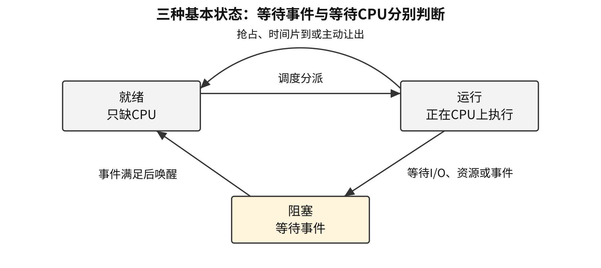
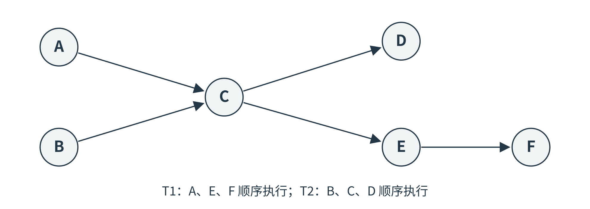
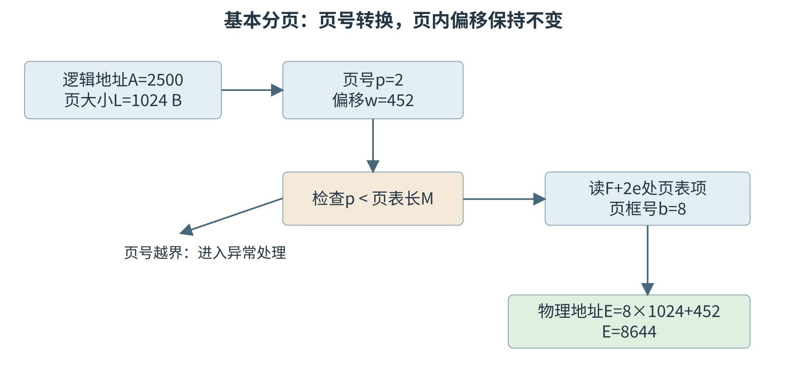
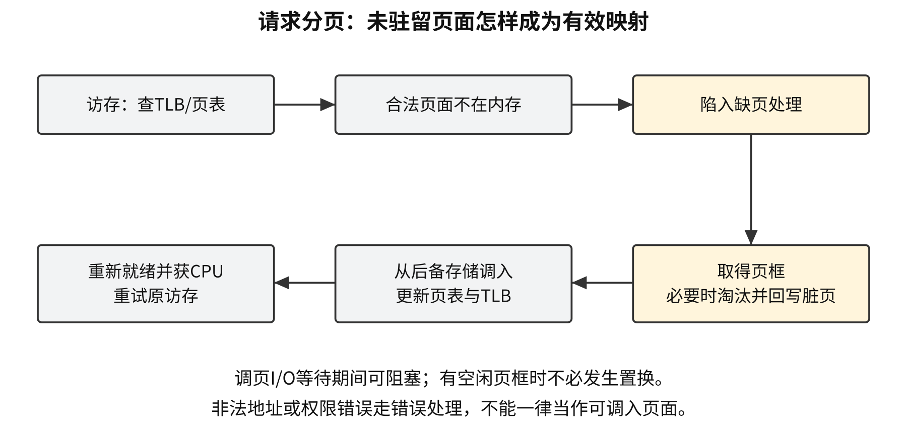
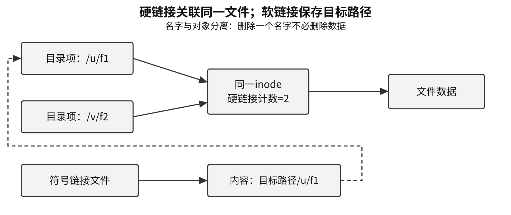
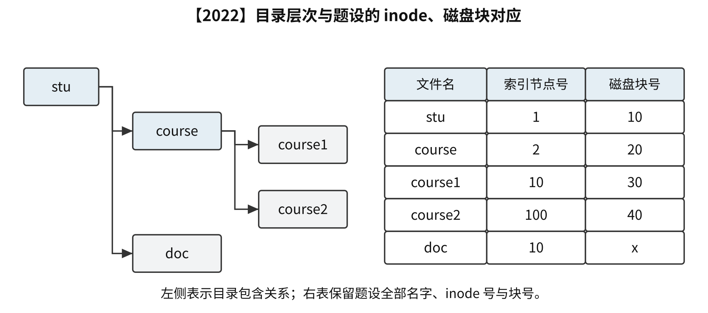

# 操作系统强化笔记


<a id="OS01"></a>
# 计算机系统概述
<a id="OS01-functions"></a>
## 操作系统的功能与接口
操作系统是控制和管理计算机硬件、软件资源，组织程序运行，并向用户和应用提供接口的系统软件；把裸机扩充为便于使用的机器。

| 管理对象 | 基本职责 |
| --- | --- |
| 处理机 | 进程、线程、调度、同步与通信 |
| 内存 | 分配回收、地址变换、保护共享与扩充 |
| 文件 | 名称目录、存储组织、访问与保护 |
| 设备 | 分配回收、驱动、缓冲与 I/O 协调 |

编译器属于系统软件，提供高级语言编译器不属于操作系统的基本管理职责。图形界面依实现配置。

| 接口 | 使用方式 |
| --- | --- |
| 联机命令接口 | 用户交互式逐条输入命令，系统解释执行 |
| 脱机命令接口 | 预先提交作业控制命令，系统成批执行 |
| 程序接口 | 应用通过系统调用请求内核服务 |
| 图形用户界面 | 用户操作窗口等对象，由应用及系统服务完成请求 |

联机、脱机描述命令提交与交互方式，与是否联网分别判断。

<a id="OS01-features"></a>
## 并发、共享、虚拟与异步
| 特征 | 结论与边界 |
| --- | --- |
| 并发 | 多个活动在同一时间间隔内推进；单核交替执行即可成立 |
| 并行 | 多个活动在同一时刻执行；单 CPU 也可与独立 I/O 设备并行 |
| 共享 | 多个并发活动共同使用资源，分为互斥共享、同时共享 |
| 虚拟 | 物理资源被抽象为逻辑资源；时分复用形成虚拟处理机，空分复用支持虚拟存储 |
| 异步 | 进程以不可预知的速度推进；自身指令依赖仍须满足 |

并发与共享互为存在条件。互斥共享要求一个使用者退出后另一使用者进入；同时共享允许同一时期多个使用者访问，具体硬件动作仍可交替完成。增加进程数的收益受切换开销和内存压力限制。

<a id="OS01-E01"></a>
### [例 1-1](../solutions/notes.md#a-OS01-E01)
下列关于多道程序系统的叙述中，不正确的是（　）。

A. 支持进程的并发执行　　B. 不必支持虚拟存储管理

C. 需要实现对共享资源的管理　　D. 进程数越多 CPU 利用率越高

<a id="OS01-systems"></a>
## 批处理、分时与实时系统
人工操作使 CPU 等待人工准备；脱机 I/O 减少主机与慢速输入输出的直接等待。单道批处理自动逐个运行作业，当前作业等待 I/O 时 CPU 仍可能空闲；多道批处理在内存保留多个作业，以其他就绪者填补等待间隙，需要中断、存储保护和资源管理。

| 系统 | 组织与目标 | 必要边界 |
| --- | --- | --- |
| 多道批处理 | 成批提交，重吞吐量、资源利用率与周转时间 | 交互性通常较弱；可不使用虚拟内存 |
| 分时 | 时间片轮转，多用户交互 | 重及时响应、独立性、交互性和同时性；时间片无需完成整个任务 |
| 实时 | 按任务期限组织响应或完成 | 硬实时须满足截止时间，软实时容忍一定超期 |

网络操作系统提供联网资源和通信服务；分布式系统组织多机协作并可提供统一资源视图。单用户／多用户、单任务／多任务是独立的分类维度。

<a id="OS01-privilege"></a>
## 用户态、内核态与原语
模式位属于程序状态信息，由硬件按受控事件改变。用户程序通过预定入口请求服务，内核检查参数和权限。内核态可执行特权指令及普通指令；用户态仅可执行允许的非特权指令。

| 操作 | 权限与用途 |
| --- | --- |
| 修改中断屏蔽、关键内存映射、直接控制受保护 I/O | 通常属于特权操作 |
| 算术、逻辑、普通寄存器操作 | 通常可在两种模式执行 |
| 陷入指令 | 用户态可执行；硬件转入规定的内核入口 |

原语完成关键状态更新，要求原子性，如保存现场、修改进程状态、移动队列。单处理器可短暂屏蔽可屏蔽中断来保护合适的内核路径；多处理器还须用原子指令或锁保护共享数据。本 CPU 关中断的作用范围不覆盖其他 CPU。时钟中断支持计时、定时等待和时间片管理。

<a id="OS01-interrupts"></a>
## 中断、异常与系统调用
| 事件 | 来源 | 典型恢复行为 |
| --- | --- | --- |
| 外部中断 | 当前指令以外的时钟、设备事件 | 通常在指令边界响应；恢复原进程或按调度切换 |
| 陷阱 trap | 主动执行陷入指令等受控事件 | 通常从规定后继指令继续 |
| 故障 fault | 当前指令执行条件不满足，如合法页面缺页 | 修复条件后重试原指令 |
| 终止 abort | 难以恢复的严重事件 | 通常结束相关执行或进入故障处理 |

中断响应硬件保存断点、程序状态等规定现场，切换权限并按中断向量定位入口；内核入口代码保存必要的通用寄存器，执行处理，恢复现场并用专门指令返回。硬件、软件保存范围以及异常断点由体系结构规定。

<a id="OS01-E02"></a>
### [例 1-2](../solutions/notes.md#a-OS01-E02)
执行系统调用的过程涉及下列操作，其中由操作系统完成的是（　）。

Ⅰ. 保存断点和程序状态字　　Ⅱ. 保存通用寄存器的内容

Ⅲ. 执行系统调用服务例程　　Ⅳ. 将 CPU 模式改为内核态

A. 仅Ⅰ、Ⅲ　　B. 仅Ⅱ、Ⅲ  
C. 仅Ⅱ、Ⅳ　　D. 仅Ⅱ、Ⅲ、Ⅳ

**系统调用路径：** 准备调用号及参数 → 陷入 → 内核检查并分派服务 → 返回结果。参数检查包括用户缓冲地址与访问权限。系统调用可立即完成，也可阻塞后再继续。

**库函数**是已有程序代码：纯计算可全在用户态完成，文件 I/O 库函数可处理格式、用户缓冲，再调用内核服务。普通函数调用保存调用现场；系统调用还跨越保护边界。中断、系统调用可以只发生模式切换，进程身份可保持不变。

<a id="OS01-loading"></a>
## 编译、链接、装入与地址绑定
编译或汇编产生目标模块；链接解析外部符号并形成可装入程序；装入建立地址空间与运行条件。静态链接在运行前完成，装入时动态链接在装入时完成，运行时动态链接推迟到运行需要时。

| 装入方式 | 地址确定或转换时机 | 移动条件 |
| --- | --- | --- |
| 绝对装入 | 编译或汇编时形成绝对地址 | 改位置通常须重生成或修补 |
| 可重定位装入 | 装入时按实际起点修改有关地址 | 装入后搬移仍须修正有关地址 |
| 动态运行时装入／重定位 | 访存时由硬件转换逻辑地址 | 修改基址或映射可改变物理位置，需要硬件支持 |

基址为 $B$、界限保存长度 $L$ 时，逻辑地址 $a$ 须满足 $0\le a<L$，物理地址为 $B+a$；界限若保存最大合法地址，上界按题设改为包含。

<a id="OS01-address-space"></a>
## 进程地址空间
| 区域 | 常规 C 运行时内容 |
| --- | --- |
| 代码区 | 机器指令，通常只读、可共享 |
| 初始化数据区 | 已初始化全局、静态存储期对象 |
| 零填充区 | 未显式初始化或零初始化的静态存储期对象 |
| 堆 | 动态申请的对象 |
| 栈 | 函数活动记录、返回信息及相应自动局部对象 |
| 映射区 | 共享库、映射文件等 |

局部指针变量自身通常属于函数活动记录，`malloc` 返回空间属于堆；优化可能将局部变量放入寄存器或消除。PCB 是内核管理结构。虚拟映像、可执行文件布局与物理页框布局分别判断；地址增长方向和实际排列采用题设。

<a id="OS01-kernel-structures"></a>
## 内核结构
| 结构 | 主要组织原则 | 收益与代价 |
| --- | --- | --- |
| 分层 | 上层调用规定下层服务 | 便于逐层验证，划层困难，调用路径可能加长 |
| 模块化 | 清晰接口，高内聚、低耦合 | 便于替换维护；预先设计接口及跨模块协调有成本 |
| 宏内核 | 较多功能处于同一内核地址空间 | 可直接调用；模块故障可能扩散 |
| 微内核 | 保留基本调度、低级地址空间管理和 IPC 等机制，较多服务在用户态 | 隔离、扩展和移植较便利；IPC 与跨域切换增加开销 |
| 外核 | 分离资源保护复用机制与高层抽象 | 应用或库操作系统自定义抽象，内核继续保护资源 |

模块划分不规定独立保护域，实际系统可混合采用多种组织方式。

<a id="OS01-E03"></a>
### [例 1-3](../solutions/notes.md#a-OS01-E03)
与宏内核操作系统相比，下列特征中，微内核操作系统具有的是（　）。

Ⅰ. 较好的性能　Ⅱ. 较高的可靠性　Ⅲ. 较高的安全性　Ⅳ. 较强的可扩展性

A. 仅Ⅱ、Ⅳ　　B. 仅Ⅰ、Ⅱ、Ⅲ  
C. 仅Ⅰ、Ⅲ、Ⅳ　　D. 仅Ⅱ、Ⅲ、Ⅳ

<a id="OS01-boot"></a>
## 系统引导
处理器复位 → 固件初始化硬件并选择启动设备 → 引导程序分阶段装入内核 → 建立中断入口、内存及设备管理 → 创建初始进程并进入调度。

传统 BIOS／MBR 模型中，MBR 可含主引导代码和分区表，卷内引导块可继续装载后续程序；UEFI／GPT 使用不同组织。分区、根目录、磁盘 inode 表等持久结构通常在分区或创建文件系统时建立；本次启动须建立运行所需的内存管理与中断结构。

<a id="OS01-E04"></a>
### [例 1-4](../solutions/notes.md#a-OS01-E04)
下列选项中，需要在操作系统进行初始化过程中创建的是（　）。

A. 中断向量表　　B. 文件系统的根目录

C. 硬盘分区表　　D. 文件系统的索引节点表

<a id="OS01-vmm"></a>
## 虚拟机与虚拟机管理程序
VMM 为客户操作系统提供虚拟 CPU、内存和设备，并复用、隔离物理资源。客户内核的高权限受 VMM 和硬件虚拟化机制约束；敏感操作通过受控执行、陷入模拟等完成。

| 维度 | 第一类 VMM | 第二类 VMM |
| --- | --- | --- |
| 依托层次 | 直接运行在硬件上 | 依托宿主操作系统 |
| 设备与存储服务 | 由 VMM 及服务组件管理 | 可利用宿主驱动，虚拟磁盘常为宿主文件 |
| 开销与迁移 | 通常少一层宿主转接 | 还占用宿主资源；镜像便于复制，迁移仍受兼容性约束 |

两类都可使用硬件加速，多虚拟机可在单核上并发、在多核上并行。进程虚拟地址空间隔离访存，系统虚拟机提供完整机器抽象；容器通常共享宿主内核。


<a id="OS02"></a>
# 进程与线程
<a id="OS02-process-thread"></a>
## 进程实体、PCB 与线程
进程是程序的一次执行过程及其资源环境，是资源分配和管理的基本单位。进程实体由程序段、数据段和 PCB 构成；PCB 是进程存在和管理的标志，记录标识、状态、调度信息、资源与处理器现场。进程具有动态性、并发性、独立性、异步性和结构性，动态性是最基本特征。

| 对象 | 共享与独有内容 |
| --- | --- |
| 不同进程 | 各有 PCB 与地址空间；通信共享须按机制建立 |
| 同进程线程 | 共享代码、数据、堆、打开文件等进程资源 |
| 每条线程 | 独有 TID、PC、寄存器现场、栈、运行状态、优先级等 TCB 信息 |

支持内核级线程时，内核按可调度线程分配处理器；纯用户级线程由线程库调度，内核仍调度其承载实体。同进程线程的栈用于各自调用链，其他线程取得有效地址后仍可能访问它。父子进程各有 PCB、可并发执行；写时复制可暂时共享物理页，逻辑地址空间仍分别管理。

<a id="OS02-states"></a>
## 状态转换与进程控制
| 转换 | 条件 |
| --- | --- |
| 就绪 → 运行 | 被调度并获得 CPU |
| 运行 → 就绪 | 时间片到期、被抢占、主动让出 CPU 且仍具执行条件 |
| 运行 → 阻塞 | 等待 I/O、资源或同步事件 |
| 阻塞 → 就绪 | 对应等待条件满足，执行唤醒 |

就绪仅缺 CPU；阻塞还缺事件。单 CPU 同一时刻至多一个相应实体运行。阻塞者须先就绪再运行；就绪者未执行，不能主动发起新的阻塞操作。



七状态模型在创建、就绪、运行、阻塞、终止上增加就绪挂起和阻塞挂起。经典模型的挂起表示映像暂不驻留内存，PCB 继续保留；阻塞挂起者事件满足后转为就绪挂起；激活后分别进入就绪或阻塞。运行者也可被挂起，创建者可按策略进入就绪或就绪挂起。

<a id="OS02-E01"></a>
### [例 2-1](../solutions/notes.md#a-OS02-E01)
下列由当前线程引起的事件或执行的操作中，可能导致该线程由执行态变为就绪态的是（　）。

A. 键盘输入　　B. 缺页异常　　C. 主动出让 CPU　　D. 执行信号量的 wait() 操作

| 控制原语 | 必须一致更新的内容 |
| --- | --- |
| 创建 | 申请标识、PCB 与资源，初始化现场，加入就绪等队列 |
| 撤销 | 停止执行、处理通知及等待关系、回收资源与 PCB；子进程政策依系统 |
| 阻塞 | 保存现场、改状态、进入对应事件等待队列并调度 |
| 唤醒 | 移出等待队列、改为就绪、加入就绪队列 |
| 切换 | 保存旧现场、更新状态队列、恢复新现场 |

PCB 可按状态链接成队列，或由索引表定位；阻塞队列可按事件细分。状态字段与队列关系必须原子维护；进程阻塞后的长时间等待允许 CPU 调度其他进程。

<a id="OS02-thread-models"></a>
## 用户级、内核级线程与映射
| 模型 | 管理与调度 | 阻塞及并行边界 |
| --- | --- | --- |
| 多对一 | 用户线程库管理多个 ULT，内核仅见一个承载实体 | 承载实体阻塞会挡住全部；这些线程不能多核并行 |
| 一对一 | 每个用户线程对应一个 KLT，由内核分别调度 | 一个阻塞时其他可运行，可多核并行；管理成本较大 |
| 多对多 | 用户线程复用若干 KLT，库与内核分层调度 | 并行度受可用 KLT 与 CPU 核数约束 |

纯用户级切换可不进入内核，开销较小。内核级描述管理方式，应用代码仍可在用户态执行。创建、切换开销随实现而变。

<a id="OS02-ipc"></a>
## 进程通信、管道与信号
| 机制 | 数据或事件的组织 | 使用条件 |
| --- | --- | --- |
| 共享内存 | 多个虚拟映射指向共同物理区，建立后普通访存交换数据 | 共享布局与访问同步由通信方约定 |
| 消息传递 | 直接指定进程，或经信箱／端口间接通信 | 发送、接收是否阻塞由接口规定 |
| 管道 | 有限容量、顺序消费的数据流；经典无名管道为半双工、常用于亲缘进程 | 双向可用两条管道；命名管道可按名称联系 |
| 信号 | 通知事件，可采用默认动作或获准的用户处理程序 | 普通信号可能合并；部分信号不可捕获、忽略或屏蔽 |

共享内存可按规定数据结构组织，也可提供存储区由进程约定布局。管道空时阻塞读、满时阻塞写；有数据即可读，有空间即可写，无须等待整管装满或读空。读出消耗数据，多读者取得不同数据；字节流通常不保留应用记录边界，原子写长度和请求大小按接口。

普通信号位向量模型：`pending` 记录待处理，`blocked` 记录暂缓递送，当前可递送集合

$$D=\mathrm{pending}\;\&\;\sim\mathrm{blocked}.$$

屏蔽信号不使整个进程进入阻塞态。递送可发生在返回用户态等适当时机，用户处理程序一般在用户态执行。信号通知、信号量许可、处理器异常分属不同机制；合法缺页可由内核修复而不递送用户信号。

<a id="OS02-scheduling-metrics"></a>
## 调度层次、时机与指标
| 层次 | 选择或管理的对象 |
| --- | --- |
| 高级／作业调度 | 后备作业进入内存并取得运行资格 |
| 中级／内存调度 | 换出、换入，调节驻留进程数量 |
| 低级／进程调度 | 从就绪执行实体中分配 CPU |

结束、主动阻塞或让出 CPU 时须选择可运行者；新到达、唤醒、时钟到期可触发抢占判断。非抢占策略让当前执行者运行到结束或主动放弃；抢占策略可在规定事件点改选。

调度器选择执行者，分派器恢复现场并交付 CPU。一次中断、一次调度条件检查、一次实际上下文切换须分别计数。内核管理队列的原子临界操作期间限制调度；持有普通资源互斥权的进程仍可能被切换。无普通就绪者时运行最低优先级的 idle 路径，保留中断响应能力。

设到达 $A_i$、首次运行 $S_i$、完成 $C_i$、CPU 服务 $B_i$，则

$$T_i=C_i-A_i,\quad R_i=S_i-A_i,\quad T_i^{\mathrm w}=T_i/B_i.$$

仅一个 CPU 段、无 I/O、忽略切换成本时，等待 $W_i=T_i-B_i$；有 I/O 时还须扣去阻塞时间。各指标逐项计算后取算术平均，平均带权周转通常无法由两项平均数相除得到。吞吐量为完成任务数／观察时长，利用率为设备忙时长／观察时长；切换、空闲与有效计算的统计口径按题设。

<a id="OS02-scheduling-algorithms"></a>
## 调度算法与事件时间线
| 算法 | 选择规则 | 条件及限制 |
| --- | --- | --- |
| FCFS | 就绪到达最早者，通常非抢占 | 长任务可使短任务等待较久，产生护航效应 |
| SJF | 当前就绪者中预计服务时间最短，通常非抢占 | 需预测时间；持续短任务可使长任务饥饿 |
| SRTF | 当前就绪者中剩余时间最短，可抢占 | 新到达时比较当前剩余量 |
| HRRN | 最大 $1+W/B$，通常非抢占 | 等待提高响应比，兼顾长短任务 |
| 优先级 | 当前就绪者中优先级最高 | 数值方向、抢占及同级顺序按题设；老化可缓解饥饿 |
| RR | 就绪队列轮转，至多运行一个时间片 | 用完未结束者回队尾；过大片接近 FCFS，过小增加开销 |
| 多级队列 | 任务通常固定所属队列 | 队间固定优先级或时间比例，队内规则分别规定 |
| 多级反馈 | 根据运行行为迁移队列，常用逐级加长时间片 | 高层可抢占低层；降级、I/O 返回及剩余片规则按题设 |

时间线只在已到达且就绪者中选择。记录每次事件的当前执行者、剩余量、各队列顺序；同刻到达与片耗尽的入队次序须明确。CPU 总服务量须与题设一致。最小平均等待等最优性结论需同时到达、已知服务、忽略开销等相应模型前提。

<a id="OS02-E02"></a>
### [例 2-2](../solutions/notes.md#a-OS02-E02)
4 个作业到达系统的时刻和运行时间如下表所示。

| 作业 | 到达时刻 | 运行时间 |
| --- | --- | --- |
| J1 | 0 | 3 |
| J2 | 1 | 3 |
| J3 | 1 | 2 |
| J4 | 3 | 1 |

系统在 $t=2$ 时开始作业调度。若分别采用先来先服务和短作业优先调度算法，则选中的作业分别是（　）。

A. J2、J3　　B. J1、J4　　C. J2、J4　　D. J1、J3

<a id="OS02-E03"></a>
### [例 2-3](../solutions/notes.md#a-OS02-E03)
进程进入就绪队列的时刻、优先级（值越大优先权越高）及 CPU 执行时间如下表所示。

| 进程 | 到达 | 优先级 | CPU 时间 |
| --- | --- | --- | --- |
| P1 | 0 ms | 1 | 60 ms |
| P2 | 20 ms | 10 | 42 ms |
| P3 | 30 ms | 100 | 13 ms |

采用基于优先权的抢占式 CPU 调度算法，从 0 ms 开始调度，三个进程的平均周转时间为（　）。

A. 60 ms　　B. 61 ms　　C. 70 ms　　D. 71 ms

<a id="OS02-E04"></a>
### [例 2-4](../solutions/notes.md#a-OS02-E04)
P0、P1、P2、P3 的到达、优先级（值越小优先权越高）和执行时间如下表所示。采用基于优先权的抢占式进程调度，从 0 ms 开始，到四个进程都运行结束为止，发生进程调度的总次数为（　）。

| 进程 | 到达 | 优先级 | CPU 时间 |
| --- | --- | --- | --- |
| P0 | 0 ms | 15 | 100 ms |
| P1 | 10 ms | 20 | 60 ms |
| P2 | 10 ms | 10 | 20 ms |
| P3 | 15 ms | 6 | 10 ms |

A. 4　　B. 5　　C. 6　　D. 7

<a id="OS02-E05"></a>
### [例 2-5](../solutions/notes.md#a-OS02-E05)
系统采用二级反馈队列调度。Q1 采用时间片轮转，时间片为 10 ms；Q2 采用短进程优先。系统优先调度 Q1，Q1 为空才调度 Q2；新创建进程先进入 Q1，在 Q1 执行一个时间片后仍未结束则转入 Q2。当前两队列为空，系统依次创建 P1、P2 后开始调度，两者需要的 CPU 时间分别为 30 ms、20 ms。平均等待时间为（　）。

A. 25 ms　　B. 20 ms　　C. 15 ms　　D. 10 ms

<a id="OS02-E06"></a>
### [例 2-6](../solutions/notes.md#a-OS02-E06)
系统有 4 个进程，预计运行时间和到达就绪队列的时刻如下，单位均为时间配额。分别采用可抢占式短进程优先和时间片轮转调度（时间片为 2），求各进程的调度次序与平均周转时间。

| 进程 | 到达时刻 | 预计运行时间 |
| --- | --- | --- |
| P1 | 0 | 8 |
| P2 | 1 | 4 |
| P3 | 2 | 9 |
| P4 | 3 | 5 |

<a id="OS02-E07"></a>
### [例 2-7](../solutions/notes.md#a-OS02-E07)
某进程调度程序采用基于优先数（priority）的调度策略，即选择优先数最小的进程运行。进程创建时由用户指定一个 nice 作为静态优先数。为了动态调整优先数，引入运行时间 cpuTime 和等待时间 waitTime，初值均为 0。进程处于执行态时，cpuTime 定时加 1，且 waitTime 置 0；进程处于就绪态时，cpuTime 置 0，waitTime 定时加 1。请回答下列问题。

（1）若调度程序只将 nice 的值作为进程的优先数，即 priority=nice，则可能会出现饥饿现象，为什么？

（2）使用 nice、cpuTime 和 waitTime 设计一种动态优先数计算方法，以避免产生饥饿现象，并说明 waitTime 的作用。

<a id="OS02-context"></a>
## 多处理机与上下文切换
公共就绪队列便于分担负载，访问须互斥；每核私有队列降低争用，需迁移平衡负载。推迁移由系统负载监测程序推动，拉迁移由空闲或较空闲 CPU 的调度程序取任务。软亲和性倾向留在原 CPU，硬亲和性限制允许 CPU 集合；迁移收益须扣除缓存、TLB 局部性和同步成本。SMT 的逻辑处理器共享核内部分执行资源。

上下文包含 PC、PSW、通用寄存器、栈等恢复状态；例如 `x++` 在寄存器已加一、尚未写回时被切换，必须保存该寄存器与下一指令位置。模式切换只改变执行权限，可仍执行原进程。

同进程线程切换需换线程现场，通常保留进程页表与文件资源；跨进程还需建立新地址空间环境。TLB 是否清空取决于地址空间标识等机制，普通数据 Cache 无须因进程切换一律全部清空。

<a id="OS02-critical-section"></a>
## 临界区与互斥要求
临界资源在同一时期只许一个进程使用；临界区是访问该资源的代码段，进入区申请、退出区释放。多个进程访问同一资源可有多段相关临界区。同步规定操作先后，互斥限制访问重叠。高级语言 `x=x+1` 的读、加、写可被交错，单核也可能丢失更新。

| 要求 | 准确含义 |
| --- | --- |
| 空闲让进 | 临界区空闲，申请者有进入机会 |
| 忙则等待 | 已有进入者时，其他相关申请者等待 |
| 有限等待 | 请求后被其他进入者越过次数有有限上界；需执行机会和有限临界区等前提 |
| 让权等待 | 无法进入时阻塞，让出 CPU |

<a id="OS02-E08"></a>
### [例 2-8](../solutions/notes.md#a-OS02-E08)
进程 A 和进程 B 通过共享缓冲区协作完成数据处理，进程 A 负责产生数据并放入缓冲区，进程 B 从缓冲区读数据并输出。进程 A 和进程 B 之间的制约关系是（　）。

A. 互斥关系　　B. 同步关系　　C. 互斥和同步关系　　D. 无制约关系

<a id="OS02-locks"></a>
## 软件互斥、原子指令与锁
双进程软件模型假定共享单次读写原子、顺序一致。`i=0,1`，`j=1-i`，`flag` 初值均为假。

| 方案 | 进入／退出规则 | 失效原因 |
| --- | --- | --- |
| 单标志 | 等 `turn==i`；退出置 `turn=j` | 强制交替，对方不申请时也可能阻挡，违背空闲让进 |
| 双标志先检查 | 等 `!flag[j]` 后置 `flag[i]=true`；退出清自身标志 | 双方可先检查通过再置真，破坏互斥 |
| 双标志后检查 | 先置自身真，再等对方假；退出清自身标志 | 双方都置真后互等，临界区空闲仍无法进入 |

Peterson 同时表达意愿与让步：

```text
flag[i] = true;
turn = j;
while (flag[j] && turn == j) { }
临界区;
flag[i] = false;
```

在上述内存模型与持续调度、有限临界区条件下，Peterson 满足互斥和有限等待；循环检查仍占 CPU。实际机器需原子变量和适当内存序。

```text
// TestAndSet 原子返回旧值并置真；lock 初值 false
while (TestAndSet(lock)) { }
临界区;
lock = false;

// Swap 原子交换；key 为进程私有
key = true;
while (key) Swap(lock, key);
临界区;
lock = false;
```

TS／Swap 的检查与占用整体原子；普通赋值展开式须额外原子化。这些自旋实现保证互斥，公平和有限等待还需另设机制。持锁很短且持有者可继续执行时可减少睡眠切换开销；较长等待适合阻塞锁。单核自旋须允许持锁者获得执行机会。本 CPU 关中断仅保护合适的单处理器内核路径，普通用户程序无权执行，亦无法阻挡其他 CPU。

<a id="OS02-semaphores"></a>
## 信号量的数值语义与前驱同步
本章 `P=wait`、`V=signal`，均采用记录型信号量；队列公平性须额外声明。P、V 的计数更新、判断与入队／唤醒须原子化。

```text
P(S): S.value--;
      if (S.value < 0) 入队并阻塞;
      // 唤醒后本次 P 返回，不再减 1
V(S): S.value++;
      if (S.value <= 0) 移出一个等待者并置为就绪;
```

`value>0` 为未分配许可数；`value=0` 为无剩余许可且无该量等待者；`value<0` 的绝对值为等待者数。P 减后为 0 可继续；V 加后为 0 仍须唤醒。V 不因缺资源而阻塞，唤醒后仍等 CPU。整型信号量在 `S<=0` 时忙等、再原子减一，通常无负值，需与记录型数值规则分开。

互斥量初值 1；容量 $n$、初存 $k$ 件时 `empty=n-k, full=k`；未完成通知初值 0。信号量初值来自初态，P 与对应 V 可分属不同进程，通常无互斥锁 API 的持有者限制。

<a id="OS02-E09"></a>
### [例 2-9](../solutions/notes.md#a-OS02-E09)
用 P、V 操作实现进程同步，信号量的初值为（　）。

A. −1　　B. 0　　C. 1　　D. 由用户确定

前驱边 $A\to B$ 可用初值 0 的 `done`：前进程 `A; V(done)`，后进程 `P(done); B`。同线程顺序已保证的边无需重复通知；多路汇合须等待每路完成，分叉须分别发布许可。通知放在前操作完成后、后操作开始前，避免增加题设未要求的先后约束。

<a id="OS02-E10"></a>
### [例 2-10](../solutions/notes.md#a-OS02-E10)
某进程的两个线程 T1 和 T2 并发执行 A、B、C、D、E 和 F 共 6 个操作，其中 T1 执行 A、E 和 F，T2 执行 B、C 和 D。题46图表示上述 6 个操作的执行顺序所必须满足的约束：C 在 A 和 B 完成后执行，D 和 E 在 C 完成后执行，F 在 E 完成后执行。请使用信号量的 wait()、signal() 操作描述 T1 和 T2 之间的同步关系，并说明所用信号量的作用及其初值。



<a id="OS02-buffer"></a>
## 生产者与消费者
容量 $n>0$，初始为空，生产和消费可反复进行，每次放取一件；共享缓冲及指针须互斥。局部生产、使用产品放在锁外。

```text
semaphore empty=n, full=0, mutex=1;
producer: while (true) {
    x=produce();
    P(empty); P(mutex);
    put(x);
    V(mutex); V(full);
}
consumer: while (true) {
    P(full); P(mutex);
    x=get();
    V(mutex); V(empty);
    consume(x);
}
```

本模板先取得容量／产品许可，再取得缓冲锁。空缓冲时若先持 `mutex` 再等 `full`，生产者无法放入，形成死锁。放入完成后两次 V 可交换，条件是消费者仍须持同一锁访问；这种可交换性依赖具体代码。

许可可能已预留或尚未发布，记录型值还可为负；逐指令执行时 `empty+full=n` 与“full 等于实存产品数”均不恒成立。静止且无预留、未发布或等待者时，才能直接对应物理数量。

<a id="OS02-E11"></a>
### [例 2-11](../solutions/notes.md#a-OS02-E11)
计算机系统中的进程之间往往需要相互协作以完成一个任务。在某网络系统中，缓冲区 B 用于存放一个数据分组，对 B 的操作有 C1、C2 和 C3。C1 将一个数据分组写入 B 中，C2 从 B 中读出一个数据分组，C3 对 B 中的数据分组进行修改。要求 B 为空时才能执行 C1，B 非空时才能执行 C2 和 C3。

（1）假设进程 P1 和 P2 均需要执行 C1，实现 C1 的代码是否为临界区？为什么？（2分）

（2）假设 B 初始为空，进程 P1 执行 C1 一次，进程 P2 执行 C2 一次。请定义尽可能少的信号量，并用 wait()、signal() 操作描述进程 P1 和 P2 之间的同步或互斥关系，说明所用信号量的作用及其初值。（3分）

（3）假设 B 初始不为空，进程 P1 和 P2 各执行 C3 一次。请定义尽可能少的信号量，并用 wait()、signal() 操作描述进程 P1 和 P2 之间的同步或互斥关系，说明所用信号量的作用及其初值。（3分）

分类产品分别设置可消费许可，共用空位和缓冲锁；连续取 $k$ 件需消费者批锁覆盖整批，单件缓冲锁只覆盖放取，等待产品时保留生产者补货通路。

<a id="OS02-E12"></a>
### [例 2-12](../solutions/notes.md#a-OS02-E12)
三个进程 P1、P2、P3 互斥使用一个包含 N（N>0）个单元的缓冲区。P1 每次用 produce() 生成一个正整数并用 put() 送入缓冲区某一空单元中；P2 每次用 getodd() 从该缓冲区中取出一个奇数并用 countodd() 统计奇数个数；P3 每次用 geteven() 从该缓冲区中取出一个偶数并用 counteven() 统计偶数个数。请用信号量机制实现这三个进程的同步与互斥活动，并说明所定义信号量的含义（要求用伪代码描述）。

<a id="OS02-E13"></a>
### [例 2-13](../solutions/notes.md#a-OS02-E13)
系统中有多个生产者进程和多个消费者进程，共享一个能存放 1000 件产品的环形缓冲区（初始为空）。当缓冲区未满时，生产者进程可以放入其生产的一件产品，否则等待；当缓冲区未空时，消费者进程可以从缓冲区取走一件产品，否则等待。要求一个消费者进程从缓冲区连续取出 10 件产品后，其他消费者进程才可以取产品。请使用信号量 P、V（或 wait()、signal()）操作实现进程间的互斥与同步，要求写出完整的过程，并说明所用信号量的含义和初值。

<a id="OS02-fruit"></a>
## 单盘水果模型
盘子容量 1，初始空；父亲放苹果、母亲放橘子，女儿取苹果、儿子取橘子：

```text
semaphore plate=1, apple=0, orange=0;
father:   while (true) { 准备苹果; P(plate); 放苹果; V(apple); }
mother:   while (true) { 准备橘子; P(plate); 放橘子; V(orange); }
daughter: while (true) { P(apple); 取苹果; V(plate); 吃苹果; }
son:      while (true) { P(orange); 取橘子; V(plate); 吃橘子; }
```

该容量及交接规则使访问权始终由一个活动持有，同步兼顾盘子互斥。容量增加后，多个生产者可同时取得空位，共享结构还需 `mutex`；在实际放取动作周围加锁。

<a id="OS02-readers"></a>
## 读者与写者
多个读者可并发读；写者与读者、写者之间互斥。`count` 记录已登记且未退出的读者，首读者为全组申请 `rw`，末读者归还，`cm` 保护计数及首末判断。

```text
semaphore rw=1, cm=1;
int count=0;
reader() {
    P(cm);
    if (count==0) P(rw);
    count++;
    V(cm);
    读文件;
    P(cm);
    count--;
    if (count==0) V(rw);
    V(cm);
}
writer() { P(rw); 写文件; V(rw); }
```

检查首末与计数修改必须在同一临界区。首读者持 `cm` 等 `rw` 时 `count=0`，无旧读者退出依赖 `cm`，写者释放也无需 `cm`。本方案读者优先，连续读者可使写者饥饿。

加入入口 `gate=1`：读者在上述登记入口前 `P(gate)`、登记后 `V(gate)`；写者 `P(gate); P(rw); 写; V(rw); V(gate)`，读者退出保持原样。写者取得 gate 后阻止新读者登记，旧读者可退出；FIFO 等公平排队、持续调度及有限读写共同支持无饥饿结论，普通信号量本身无此保证。

<a id="OS02-philosophers"></a>
## 哲学家进餐
五人 $P_i$ 需同时持有 $C_i$ 与 $C_{(i+1)\bmod5}$，各筷子初值 1。全员先取同侧会形成五人各持一根的等待环。限制最多四人进入申请到释放区间：

```text
semaphore room=4, C[5]={1,1,1,1,1};
philosopher(i) {
    while (true) {
        思考;
        P(room); P(C[i]); P(C[(i+1)%5]);
        吃饭;
        V(C[(i+1)%5]); V(C[i]); V(room);
    }
}
```

四人是申请人数上限，五根筷子最多支持两人同时进餐。其他无环方案：全局按资源编号从小到大申请；用额外互斥量串行化拿两根的过程，拿齐后释放该量，吃完直接归还筷子。所有方案的无饥饿仍需公平条件；各人独立先左后右无法形成全局递增次序。

<a id="OS02-monitor"></a>
## 管程与条件变量
管程封装共享数据、操作及初始化，同一时刻至多一个进程在其中执行，由语言或运行系统保证入口互斥。条件变量管理等待队列，布尔条件由共享状态表示。执行 `x.wait()` 即入队阻塞并释放管程；`x.signal()` 通知一个等待者，无人等待时不积累许可。信号量 V 则会留下计数。

<a id="OS02-E14"></a>
### [例 2-14](../solutions/notes.md#a-OS02-E14)
若 x 是管程内的条件变量，则当进程执行 x.wait() 时所做的工作是（　）。

A. 实现对变量 x 的互斥访问

B. 唤醒一个在 x 上阻塞的进程

C. 根据 x 的值判断该进程是否进入阻塞态

D. 阻塞该进程，并将之插入 x 的阻塞队列中

Hoare 语义可立即把管程交给被通知者；Mesa 语义允许通知者继续，等待者以后重新竞争。Mesa／POSIX 式等待应使用 `while`：

```text
put(x) {
    lock(m);
    while (count==n) wait(notFull,m);
    插入x; count++;
    signal(notEmpty); unlock(m);
}
get() {
    lock(m);
    while (count==0) wait(notEmpty,m);
    x=取出; count--;
    signal(notFull); unlock(m);
    return x;
}
```

`wait` 原子释放锁并入队，返回前重新取得锁；重检处理竞争与可能的虚假唤醒。拆开“解锁、入队”会丢失中间通知。Java 同步实例方法锁定相应对象，静态同步方法锁定类对象；多个实例的锁通常分别存在。

<a id="OS02-deadlock"></a>
## 死锁条件、资源图与安全性
以下讨论可重复使用资源，完成时归还；最大需求可信、可满足后可有限完成。死锁是一组进程各等组内才能产生的事件而无法自行推进；饥饿是个别进程长期得不到服务、其他进程仍可推进；死循环是执行路径持续重复。非重入锁可发生单进程自我死锁。

| 死锁必要条件 | 内容 |
| --- | --- |
| 互斥 | 实例同一时刻只给一个使用者 |
| 占有并等待 | 保持已有资源，再等新增资源 |
| 不可剥夺 | 使用中的资源不能被任意收回 |
| 循环等待 | 存在首尾相接的资源等待链 |

资源分配图中，进程指向资源为请求边，资源实例指向进程为分配边。无环可排除此模型的死锁；有环且相关资源每类单实例时足以判死锁，多实例时须化简。

安全序列保证每个进程的最大剩余需求可由当时可用量及前者归还量满足。安全表示存在至少一条完整序列；序列可不唯一，也无须强制按其执行。死锁必不安全，不安全可能尚未死锁。

<a id="OS02-deadlock-strategies"></a>
## 死锁预防、避免与解除
| 策略 | 实施方法 | 条件或代价 |
| --- | --- | --- |
| 预防互斥条件 | 可共享资源改按共享方式组织；SPOOLing 提供逻辑打印服务 | 物理打印仍串行，固有互斥语义须保留 |
| 预防占有并等待 | 一次申请全部，或申请失败先释放已有资源 | 需知需求、可能降低利用率 |
| 允许剥夺 | 保存恢复资源状态并回滚 | 适合可恢复资源，纸上输出难撤回 |
| 预防循环等待 | 统一编号，严格递增申请 | 所有参与者须遵循同一全局次序 |
| 避免 | 每次拟分配后检查安全性 | 需最大需求等未来信息，可能推迟现有量足够的请求 |
| 检测及解除 | 允许进入死锁，检测后终止、剥夺或回滚 | 考虑已做工作、恢复成本、优先级；反复同一牺牲者可饥饿 |

<a id="OS02-E15"></a>
### [例 2-15](../solutions/notes.md#a-OS02-E15)
若系统 S1 采用死锁避免方法，S2 采用死锁检测方法。下列叙述中，正确的是（　）。

Ⅰ. S1 会限制用户申请资源的顺序，而 S2 不会

Ⅱ. S1 需要进程运行所需的资源总量信息，而 S2 不需要

Ⅲ. S1 不会给可能导致死锁的进程分配资源，而 S2 会

A. 仅Ⅰ、Ⅱ　　B. 仅Ⅱ、Ⅲ　　C. 仅Ⅰ、Ⅲ　　D. Ⅰ、Ⅱ、Ⅲ

仅降低死锁者优先级无法使其释放资源。预防改变请求规则，避免依据当前状态和最大需求，检测依据当前等待请求。

<a id="OS02-banker"></a>
## 银行家算法
向量按同类资源逐项比较。`Need=Max-Allocation`，`Available` 为当前未分配量；始终满足总资源守恒。

```text
Work=Available; Finish[0..n-1]=false;
while 存在 i 满足 !Finish[i] && Need[i]<=Work:
    Work += Allocation[i];
    Finish[i]=true;
全部标记：安全；仍有未标记且无可选者：不安全。
```

模拟中借出的 Need 随完成归还相抵，净增为原 Allocation。检查新请求 $Q_i$：① $Q_i\le Need_i$；② $Q_i\le Available$；③试减 Available、试增 Allocation、试减 Need，完整执行安全检查，安全则提交，否则回滚并等待。

<a id="OS02-E16"></a>
### [例 2-16](../solutions/notes.md#a-OS02-E16)
某时刻进程的资源使用情况如下表所示，可用资源向量为 $(0,2,1)$。

| 进程 | 已分配 $(R_1,R_2,R_3)$ | 尚需分配 $(R_1,R_2,R_3)$ |
| --- | --- | --- |
| P1 | (2,0,0) | (0,0,1) |
| P2 | (1,2,0) | (1,3,2) |
| P3 | (0,1,1) | (1,3,1) |
| P4 | (0,0,1) | (2,0,0) |

此时的安全序列是（　）。

A. P1、P2、P3、P4　　B. P1、P3、P2、P4

C. P1、P4、P3、P2　　D. 不存在

<a id="OS02-E17"></a>
### [例 2-17](../solutions/notes.md#a-OS02-E17)
系统有三类资源 A、B、C 和五个进程，某时刻分配如下。若系统安全，则可用资源向量 $(x,y,z)$ 可能是哪些？

| 进程 | Allocation | Max |
| --- | --- | --- |
| P0 | (0,0,3) | (0,0,4) |
| P1 | (1,0,0) | (1,7,5) |
| P2 | (1,3,5) | (2,3,5) |
| P3 | (0,0,2) | (0,6,4) |
| P4 | (0,0,1) | (0,6,5) |

Ⅰ. (1,4,0)　Ⅱ. (0,6,2)　Ⅲ. (1,1,1)　Ⅳ. (0,4,7)

A. Ⅰ、Ⅱ、Ⅳ　　B. Ⅰ、Ⅱ　　C. 仅Ⅰ　　D. Ⅰ、Ⅲ

单资源模型总量 100，B、A、T 的 Max 为 70、40、50，Allocation 为 20、10、30，可用 40。给 B 再分 30 后可用 10、Need 为 20、30、20，无人可先完成，应推迟；独立从原态给 A 再分 20 后可用 20、Need 为 50、10、20，可取 T→B→A，Work 为 20→50→70→100。

若 $n$ 个进程每个最多需 $k\ge1$ 个同类资源，最坏全员各持 $k-1$ 个仍未满足；总量

$$m\ge n(k-1)+1$$

足以保证任意分配顺序下至少一人可拿齐并完成。它属于任意分配的总量保证；银行家可通过推迟不安全请求在更少资源下安全运行。

<a id="OS02-detection"></a>
## 多实例资源的死锁检测
检测用当前未满足 `Request`，避免用未来最大 `Need`。设 `Work=Available`，通常先将 Allocation 全零者标记完成；反复选择未标记且 `Request[i]<=Work` 者，令 `Work+=Allocation[i]` 并标记。最终持有资源且无法化简者构成死锁核心；无持有量的等待者也可能受其影响，集合范围按题用定义。

设 $R_1$ 共3、$R_2$ 共2：P1 持 $(2,0)$，P2 持 $(1,1)$ 并请求 $(1,0)$。若 P1 请求 $(0,1)$，初始 Work=$(0,1)$，可先 P1 后 P2 完成；若另一 $R_2$ 由无请求的 P3 持有，P1 请求 $(0,2)$，P3 归还后 Work 仅 $(0,1)$，P1、P2 仍无法化简。


<a id="OS03"></a>
# 内存管理
<a id="OS03-addresses"></a>
## 地址、装入与保护
逻辑／虚拟地址描述进程地址空间，物理地址定位主存。OS 建立并维护映射，MMU 完成通常的运行时转换；异常进入内核处理。按字节编址时，$v$ 位虚拟地址表示 $2^v$ B 范围，$p$ 位物理地址表示 $2^p$ B 可寻址范围，实际可用量还受保留区、硬件有效位和资源约束。

| 机制 | 工作与时机 |
| --- | --- |
| 编译、汇编 | 生成目标模块 |
| 静态链接 | 运行前连接模块并解析外部符号 |
| 装入时动态链接 | 装入时连接所需模块 |
| 运行时动态链接 | 运行需要时连接相应模块 |
| 绝对装入 | 编译或汇编时确定绝对地址 |
| 可重定位装入 | 装入时按实际起点修正有关地址 |
| 动态运行时装入／重定位 | 访存时硬件按当前映射转换，可支持运行中移动 |

基址 $B$、界限为长度 $L$ 时，先检查 $0\le a<L$ 再形成 $B+a$；若界限存最大合法地址，则上界包含。上下限保护须比较物理地址，基址加界限方式可先检查逻辑地址，按寄存器定义使用。

代码、数据、堆、栈、共享库等属于虚拟映像，物理位置可离散。局部指针自身与所指堆对象分别定位，编译宏不必形成运行时对象。地址范围、驻留状态、访问权限分别检查。

<a id="OS03-sharing"></a>
## 共享、写时复制与回收
共享页使多个进程映射到同一物理页框，虚拟页号可不同；共享只读代码可禁止写，共享可写数据仍需同步。写时复制先共享只读物理页，写入异常时，若仍须保留其他共享者的原内容，则为写者复制私有页并更新映射；若已无其他共享者，可按实现直接恢复写权限。共享页回收须检查其他使用者，映射或权限改变须使相应 TLB 项一致失效或更新。

<a id="OS03-E01"></a>
### [例 3-1](../solutions/notes.md#a-OS03-E01)
进程 R 和 S 共享数据 data。若 data 在两进程中的页号分别为 p1、p2，对应页框号分别为 f1、f2，下列叙述中，正确的是（　）。

A. p1、p2 一定相等，f1、f2 一定相等

B. p1、p2 一定相等，f1、f2 不一定相等

C. p1、p2 不一定相等，f1、f2 一定相等

D. p1、p2 不一定相等，f1、f2 不一定相等

<a id="OS03-partitions"></a>
## 连续分配与动态分区
| 方法 | 特征与碎片 |
| --- | --- |
| 单一连续分配 | 系统区加单个用户区，仅容纳一道用户作业 |
| 固定分区 | 可等大或不等大，每区一道作业；未用区内空间为内部碎片 |
| 动态分区 | 按请求划连续区；离散空洞为外部碎片 |

固定分区说明表保存分区号、起址、大小、状态；作业超过最大分区时，不能直接把几个离散分区拼成连续区。动态分区用空闲表或链记录起址和长度。

| 选择算法 | 查找规则及常见链序 | 主要影响 |
| --- | --- | --- |
| 首次适应 | 地址递增，选首个足够大的洞 | 较可能保留高地址大洞，反复搜索低址碎片 |
| 邻近／循环首次适应 | 地址循环，从上次位置继续 | 分散搜索，可能过早切分大洞 |
| 最佳适应 | 选最小够用洞，常按容量递增 | 易留下难用的小碎片 |
| 最坏适应 | 选最大洞，常按容量递减 | 大洞可能较快耗尽 |

每次按更新后的空闲状态重新选择；空闲总量足够仍可能无足够连续洞。分配剩余区则更新起址与长度，恰好用完则删表项；回收按物理地址邻接合并：两侧均无空闲则新增，仅一侧空闲则扩展，两侧空闲则三段合一。按容量相邻的表项未必在物理地址相邻。紧凑通过搬移已分配区聚合空洞，须重定位支持并支付搬移成本。

<a id="OS03-E02"></a>
### [例 3-2](../solutions/notes.md#a-OS03-E02)
某基于动态分区存储管理的计算机，主存容量为 55 MB（初始为空闲），采用最佳适配算法。分配和释放顺序为：分配 15 MB，分配 30 MB，释放 15 MB，分配 8 MB，分配 6 MB。此时最大空闲分区为（　）。

A. 7 MB　　B. 9 MB  
C. 10 MB　　D. 15 MB

<a id="OS03-extension"></a>
## 覆盖、交换与虚拟存储
| 机制 | 单位与条件 |
| --- | --- |
| 覆盖 | 常驻模块与覆盖区；同区模块不能同时需要有效内容，通常需程序员给覆盖结构 |
| 交换 | 经典模型按进程映像换出、换入，挂起表示不驻留；须考虑重定位与正在进行的 I/O |
| 请求调页 | 按页在实际引用时调入，利用局部性，由 OS 管理 |

覆盖安排：常驻 A 为8 KiB，B/C 共用最大10 KiB区，D/E/F 共用最大12 KiB区，共30 KiB；需满足给定调用和返回关系。设备正在直接访问的内存通常须固定，不能随意换出。

虚拟内存的多次性表示分批装入，对换性表示运行中可换出再换入，虚拟性表示逻辑使用空间可超过当前物理内存。容量受地址表示范围、后备能力及系统限制。仅在题给理想化模型中，可用 $\min(\text{地址范围},\text{可用内存}+\text{可用后备})$ 估算。

<a id="OS03-paging"></a>
## 分页地址变换与页表空间
页与页框等大，页间可映射到离散页框，页内连续；消除连续分配外部碎片，末页可有内部碎片，页表另占空间。默认字节编址，页号、页框号从0开始；容量单位按题设，本章 KiB 为 $2^{10}$ B。

页大小 $P$，地址 $a$：

$$p=\lfloor a/P\rfloor,\qquad w=a\bmod P,\qquad PA=fP+w.$$

当 $P=2^d$ 时，低 $d$ 位为偏移，转换只替换页号。单级连续紧密页表基址 $F$、表长 $N$ 项、每项 $e$ B：先检查 $0\le p<N$，表项地址 $F+pe$，取页框号、驻留与权限，再访问目标；表项地址和数据地址分别计算。



虚拟地址 $v$ 位、物理地址 $b$ 位、页 $2^d$ B 时：潜在页表项 $2^{v-d}$ 项；页框号至少 $b-d$ 位，另加状态与权限。单级全空间页表为 $2^{v-d}e$ B，不能用物理页框数代替虚拟页数。若每页留对齐空隙、表项不得跨页，项地址还须按实际布局计空隙。

<a id="OS03-tlb"></a>
## 多级页表与 TLB
多级页表只为使用区间分配下级表，适合稀疏虚拟空间；全展开会增加目录开销。下级表可分散，单个最终表项宽度仍由页框和状态决定。

每表限定一页、表项 $e$ B 时，扇出 $q=\lfloor P/e\rfloor$；若 $q=2^k$，每级最多索引 $k$ 位页号，至少需 $\lceil(v-d)/k\rceil$ 级。顶级可使用较少位。逐级用索引乘表项长度定位下一表，最终页框才用于数据地址。

<a id="OS03-E03"></a>
### [例 3-3](../solutions/notes.md#a-OS03-E03)
某计算机采用二级页表，按字节编址，页大小为 $2^{10}$ B，页表项大小为 2 B，逻辑地址依次由页目录号、页号、页内偏移量组成。逻辑地址空间大小为 $2^{16}$ 页，表示整个逻辑地址空间的页目录表至少包含多少表项？

A. 64　　B. 128  
C. 256　　D. 512

<a id="OS03-E04"></a>
### [例 3-4](../solutions/notes.md#a-OS03-E04)
某计算机主存按字节编址，二级分页地址结构依次为页目录号 10 位、页号 10 位、页内偏移 12 位。虚拟地址 2050 1225H 对应的页目录号、页号分别是（　）。

A. 081H、101H　　B. 081H、401H

C. 201H、101H　　D. 201H、401H

TLB 缓存转换及权限，数据 Cache 缓存数据。TLB 未命中可从内存页表取得驻留映射；合法页不驻留才进入缺页分支。页表与 TLB 的访问、修改状态须按题给策略保持一致。

无缺页、页表各级均在内存、无其他缓存、各查询串行，TLB 查询 $t$、主存一次 $m$、命中率 $h$、页表 $r$ 级：

$$E[T]=h(t+m)+(1-h)[t+(r+1)m].$$

忽略 TLB 查询时间，平均主存次数为 $1+(1-h)r$。并行查询须重列时间线；单级、$t=1\ \mu s,m=100\ \mu s,h=0.9$ 时，串行111 μs；TLB 与主存页表同起，按题给命中路径101、未命中路径200 μs，则平均110.9 μs。

<a id="OS03-segmentation"></a>
## 分段与段页式
分段按代码、数据等逻辑单位，段长可变；地址为段号、段内偏移。检查段号、段长、驻留与权限，合法后 $PA=\text{段基址}+\text{偏移}$。偏移等于段长即越界。

| 机制 | 地址与表路径 | 物理布局、碎片 |
| --- | --- | --- |
| 基本分页 | 页号、页内偏移；页表→目标 | 页内连续、页间离散，内部碎片 |
| 基本分段 | 段号、段内偏移；段表→目标 | 每段连续、段间离散，外部碎片 |
| 段页式 | 段号、段内页号、页内偏移；段表→本段页表→目标 | 段内页可离散，各段末页可能有内部碎片 |

上述单级各表驻留、无 TLB 及其他缓存、无异常时分别2、2、3次主存访问。段页式逻辑坐标仍可视为段号、段内地址二维；编码可把段内地址拆为两个字段。先查段范围权限，再查段内页范围；题给字节段长时还须检查完整段内偏移。

<a id="OS03-demand-paging"></a>
## 请求分页与缺页处理
时间局部性来自重复使用，空间局部性来自邻近访问。请求分页页表记录存在位、访问位 A、修改位 M、后备位置及保护信息。M 表示已写，写权限表示能否写，二者独立。

合法地址查询 → 页未驻留 → 保存重启状态并定位后备页 → 取得空框或选择牺牲页 → 必要时写回脏页 → 调入 → 更新页表、失效旧 TLB 并建立新转换 → 重试原指令。权限不足或非法地址按保护错误处理。



有空框的缺页无需置换；干净且有有效后备副本的牺牲页可直接丢弃；需保留的脏内容在复用页框前回写。一条复杂指令可引用多页、产生多次缺页，最少页框数须满足指令及寻址重启要求。锁定内核页和正在供设备直接访问的页通常不参与置换。

<a id="OS03-resident-allocation"></a>
## 页框分配与页面后备
驻留集是当前在物理内存的页面集合。固定分配保持进程页框数，可变分配按运行调整；局部置换仅选本进程页面，全局置换可影响其他进程的页框占用。经典组合为固定分配局部置换、可变分配局部置换、可变分配全局置换。页框可平均、按大小或按优先级分配，仍须满足最少页框要求。

请求调页在引用时调入，预调页提前装入预计会使用的页；预调有无用 I/O 风险。后备位置模型：对换区充分时可先复制到对换区，运行中在内存和对换区交换；对换区不足时只读文件页从文件读、淘汰丢弃，修改内容写入对换区；教材 UNIX 模型首次从文件调入、已换出者从对换区调回。匿名页、私有映射、共享文件映射具体后备关系按题设。

<a id="OS03-replacement"></a>
## 页面置换算法
| 算法 | 淘汰依据 | 状态更新与边界 |
| --- | --- | --- |
| OPT | 未来最久不用或以后不用 | 理论比较下界，需未来引用串 |
| FIFO | 最早装入 | 命中不改变装入队列；可有 Belady 异常 |
| LRU | 过去最久未使用 | 每次命中都更新最近次序，实现需额外记录 |
| Clock | 循环扫描 A=0 者；A=1 清零并跳过 | 命中置 A=1；装入、指针规则采用题设 |
| 改进 Clock | 同时考虑 A、M，优先近期未访问且干净者 | 扫描只清 A，脏内容回写后才可清 M |

LRU、OPT 在相同引用串和一致初态下具有栈性质，增框不会增加缺页；LRU 对任意串优于 FIFO 的结论不成立。缺页总数分为使用空框与淘汰旧页两类，置换次数须扣除空框初装。

<a id="OS03-E05"></a>
### [例 3-5](../solutions/notes.md#a-OS03-E05)
某系统采用 LRU 页置换和局部置换。为进程预分配 4 个页框，访问页号依次为 0、1、2、7、0、5、3、5、0、2、7、6。产生页面置换的总次数为（　）。

A. 3　　B. 4  
C. 5　　D. 6

教材改进 Clock 四轮：①自起点找首个 $(0,0)$，不改 A；②找首个 $(0,1)$，经过但未选中的页 A 清零；③若仍失败，重新从起点找 $(0,0)$，不改 A；④再找 $(0,1)$。每轮最多一圈；第2轮改变了后续候选分类，须动态更新。起点与指针推进规则决定同类中选择哪个页。

<a id="OS03-E06"></a>
### [例 3-6](../solutions/notes.md#a-OS03-E06)
某请求分页系统页大小为 4 KB，按字节编址。为进程 P 分配 2 个固定页框，采用改进型 Clock，页表部分内容如下。

| 页号 | 页框号 | 存在位 | 访问位 |
| --- | --- | --- | --- |
| 2 | 20H | 0 | 0 |
| 3 | 60H | 1 | 1 |
| 4 | 80H | 1 | 1 |

| 页号 | 修改位 |
| --- | --- |
| 2 | 0 |
| 3 | 0 |
| 4 | 1 |

P 访问虚拟地址 02A01H，经地址变换得到的物理地址是（　）。

A. 00A01H　　B. 20A01H  
C. 60A01H　　D. 80A01H

<a id="OS03-working-set"></a>
## 工作集、抖动与数组局部性
工作集是最近窗口内访问过的不同页集合；按最近 $\Delta$ 次引用定义时，先取引用再去重，集合大小可小于窗口。驻留集反映物理状态，工作集反映近期需求；工作集未必总为驻留集子集。

<a id="OS03-E07"></a>
### [例 3-7](../solutions/notes.md#a-OS03-E07)
某进程访问页面的序列如下，t 位于所示竖线处，尚未访问竖线右侧的 0。

$$\ldots,1,3,4,5,6,0,3,2,3,2\;\big|_{t}\;0,4,0,3,2,9,2,1,\ldots$$

工作集窗口大小为 6，则 t 时刻工作集为（　）。

A. {6,0,3,2}　　B. {2,3,0,4}  
C. {0,4,3,2,9}　　D. {4,5,6,0,3,2}

总工作集需求超过可用页框可引发抖动，大量时间用于换页、计算进展少。可减少活动进程、增加相应页框或用工作集／缺页率调节；扩充交换区容量无法直接补足驻留页框。

行优先数组元素 `a[i][j]` 字节偏移为 $(i\cdot\text{列数}+j)\cdot\text{元素字节数}$。先加起始地址、再分解页号，形成引用串；缺页数还依初态、对齐、页框和置换。4 B 整数、页对齐 `a[128][128]`、页512 B、仅1个数据页框且初始未装入时：行遍历每行一缺页共128次，列遍历每次跨行共16384次。

<a id="OS03-effective-time"></a>
## 有效访问时间与综合地址计算
无缺页平均耗时 $T_0$、缺页率 $p$、完整缺页分支耗时 $T_f$：

$$E[T]=(1-p)T_0+pT_f.$$

若服务时间 $D$ 定义为正常访存外的附加量，可用 $E[T]=T_0+pD$。逐项确认失败查询、调入、脏页回写、表更新与重试是否已含；统一 ns、μs、ms。TLB 命中率与缺页率按条件路径组合。

<a id="OS03-E08"></a>
### [例 3-8](../solutions/notes.md#a-OS03-E08)
请求分页管理系统中，假设某进程的页表内容如下表所示。

| 页号 | 页框号 | 有效位（存在位） |
| --- | --- | --- |
| 0 | 101H | 1 |
| 1 | — | 0 |
| 2 | 254H | 1 |

页面大小为 4 KB，一次内存的访问时间为 100 ns，一次快表（TLB）的访问时间为 10 ns，处理一次缺页的平均时间为 $10^8$ ns（已含更新 TLB 和页表的时间）。进程的驻留集大小固定为 2，采用最近最少使用置换算法（LRU）和局部淘汰策略。假设：①TLB 初始为空；②地址转换时先访问 TLB，若 TLB 未命中，再访问页表（忽略访问页表之后的 TLB 更新时间）；③有效位为 0 表示页面不在内存中，产生缺页中断，缺页中断处理后，返回到产生缺页中断的指令处重新执行。设有虚地址访问序列 2362H、1565H、25A5H，请问：

（1）依次访问上述三个虚地址，各需多少时间？给出计算过程。

（2）基于上述访问序列，虚地址 1565H 的物理地址是多少？请说明理由。

<a id="OS03-E09"></a>
### [例 3-9](../solutions/notes.md#a-OS03-E09)
某 32 位系统采用基于二级页表的请求分页存储管理方式，按字节编址，页目录项和页表项长度均为 4 字节，虚拟地址结构如下所示。

| 页目录号（10 位） | 页号（10 位） | 页内偏移量（12 位） |
| --- | --- | --- |

某 C 程序中数组 `a[1024][1024]` 的起始虚拟地址为 1080 0000H，数组元素占 4 字节，该程序运行时，其进程的页目录起始物理地址为 0020 1000H。请回答下列问题。

（1）数组元素 `a[1][2]` 的虚拟地址是什么？对应的页目录号和页号分别是什么？对应的页目录项的物理地址是什么？若该目录项中存放的页框号为 00301H，则 `a[1][2]` 所在页对应的页表项的物理地址是什么？

（2）数组 a 在虚拟地址空间中所占的区域是否必须连续？在物理地址空间中所占区域是否必须连续？

（3）已知数组 a 按行优先方式存放，若对数组 a 分别按行遍历和按列遍历，则哪种遍历方式的局部性更好？

<a id="OS03-mmap"></a>
## 内存映射文件
文件范围关联进程虚拟范围，应用用普通访存访问，系统按需驻留和写回。共享映射可指向相同文件页，修改共享数据须同步；私有映射可用写时复制。建立映射、页面驻留和脏页持久化分别发生。统计设备 I/O 时检查缓存、缺页、写回及后备位置。


<a id="OS04"></a>
# 文件管理
<a id="OS04-objects"></a>
## 文件、目录项与索引节点
文件是具有名称和属性的持久数据集合。FCB 保存类型、大小、所有者、权限、时间、存储位置等管理信息；采用 inode 时，文件名与其余属性分开，目录项建立名字到 inode 号的关联。inode 号仅在所属文件系统内解释。

| 对象 | 内容与作用 |
| --- | --- |
| 目录项 | 文件名、inode 号；目录本身也是文件 |
| 磁盘 inode | 文件属性、硬链接计数、块定位等持久信息 |
| 内存 inode | 已载入属性及运行时锁、引用状态等 |
| 打开实例 | 一次打开的访问方式、当前偏移及 inode 引用 |
| 进程描述符表 | 在本进程内把 fd 关联到打开实例 |

知道名字、知道 inode 号、inode 已缓存、数据已缓存分别消除不同访问步骤。教材若把打开实例和内存 inode 合称系统打开表，应先确定字段归属再判断共享关系。

<a id="OS04-operations"></a>
## 建立、打开、读写、关闭与删除
| 操作 | 主要变化 |
| --- | --- |
| 建立 | 分配控制信息，父目录新增名字；空文件可暂不占数据块 |
| 打开 | 路径查找、权限检查、建立或引用打开状态，返回 fd |
| 读取 | 按当前偏移定位块，必要时 I/O，复制实际字节并更新位置 |
| 写入 | 可分配新块、改变长度、标记缓存为脏，按规则写回 |
| 关闭 | 释放本次打开引用，必要时更新元数据 |
| 删除名字 | 取消目录关联，减少硬链接数，满足回收条件后释放内容 |

打开无需读入整个文件，写返回成功不必表示已持久化。短读、文件结束、缓存命中及错误按接口和题设。

<a id="OS04-E01"></a>
### [例 4-1](../solutions/notes.md#a-OS04-E01)
若文件 F 仅被进程 P 打开并访问，则当进程 P 关闭 F 时，文件系统需要完成的是（　）。

A. 删除目录文件中 F 的目录项

B. 释放 F 的索引节点所占的内存空间

C. 释放 F 的索引节点所占的外存空间

D. 将文件磁盘索引节点中的链接计数减 1

两个进程分别 `open` 同一文件通常各有打开实例与独立偏移，指向共同 inode；`dup` 或继承共享同一打开实例时可共享偏移。把各进程偏移放在进程打开表、共享属性放在系统表的教材模型，按其字段使用。打开计数与硬链接数分别统计运行引用和名字。单次写的原子性无须推出“读—改—写”事务整体原子，应用仍可能需要锁。

<a id="OS04-protection"></a>
## 文件保护
访问矩阵按主体为行、对象为列，单元格为允许操作集合；按对象列保存为 ACL，按主体行组织为能力表。检查须同时确定身份、所属组、对象和相应操作。

| 方法 | 直接作用及边界 |
| --- | --- |
| 口令 | 验证访问凭证；保存验证信息，注意凭证泄露与共享 |
| 加密 | 用密钥控制内容可读性，算法与密钥管理决定效果 |
| 权限表 | 规定主体可执行的读、写、执行等操作，访问时检查 |

每类主体每个独立权限需一位，$u$ 类、$r$ 种独立权限需 $ur$ 位。权限间逻辑蕴含关系须由题设给出。目录查找、列出、修改权限与文件数据权限分开检查。Windows 访问控制中，拒绝条目可影响有效权限；实际合并与继承按系统规则。

<a id="OS04-E02"></a>
### [例 4-2](../solutions/notes.md#a-OS04-E02)
某文件系统针对每个文件，把用户分成安全管理员、文件主、文件主的伙伴、其他用户 4 类；访问权限有完全控制、执行、修改、读取、写入 5 种。若 FCB 中用二进制位串表示不同类别用户对一个文件的访问权限，至少需要多少位？

A. 5　　B. 9　　C. 12　　D. 20

<a id="OS04-records"></a>
## 逻辑结构与记录索引
无结构文件向应用提供字节序列，应用解释记录边界；有结构文件由定长或变长记录组成。

| 记录组织 | 定位方式及限制 |
| --- | --- |
| 串结构顺序文件 | 按存入先后排列，关键字一般顺序查找 |
| 顺序结构顺序文件 | 按关键字有序；适当连续布局下可用有序检索 |
| 索引文件 | 索引项保存关键字、记录逻辑地址等，可定位变长记录 |
| 索引顺序文件 | 每组一索引，先定位组再组内查找，平衡空间与查找 |

定长、逻辑连续记录，首址 $F$、记录长 $L$，第 $i$ 条从0编号时起址 $F+iL$；变长须累加长度或另建索引。记录号直接定位、关键字查找分别处理；链接组织仍可能要追链。

$N$ 条记录分 $g$ 组，两层均线性扫描且成功位置近似均匀时，平均比较约 $g/2+N/(2g)$，$g\approx\sqrt N$ 时两项平衡；精确成功扫描平均数用各层 $(n+1)/2$。改用折半或树索引须重算。

用户记录索引映射“关键字→文件内逻辑位置”，系统块分配映射“逻辑块号→物理块号”。每记录 $L$ B、块 $B$ B 且 $B/L$ 为整数、记录不跨块时，第 $i$ 条的逻辑块为 $\lfloor iL/B\rfloor$，块内偏移 $iL\bmod B$。逻辑记录结构可搭配不同物理分配方式。

<a id="OS04-allocation"></a>
## 连续、链接与索引分配
下表从文件控制信息已在内存、相关数据和索引尚未缓存出发，访问从0编号的逻辑块 $k$。

| 方式 | 定位与访盘数 | 增长及开销 |
| --- | --- | --- |
| 连续 | 起始块号加 $k$，读数据1次 | 顺序、随机方便；扩展受邻接空间限制，有外部碎片 |
| 隐式链接 | 从首块沿数据块后继追链，共 $k+1$ 次读 | 离散追加，指针占数据块空间，不便随机访问 |
| FAT 显式链接 | 内存 FAT 追链后读目标1次 | 全卷表占内存；定位仍可有多次内存追链 |
| 索引 | 按块号逐级查索引，经 $h$ 级间接则 $h+1$ 次读 | 离散增长，索引块另占空间 |

链接、索引消除整体连续要求，最后一块仍可有内部未用空间。FAT 驻留条件只免除表的访盘。多个索引块可链接，也可用多层索引；链接索引块时查后块仍需追前面的索引块。

<a id="OS04-mixed-index"></a>
## 混合索引容量与访问路径
块 $B$ B，块号 $e$ B，每索引块扇出 $q=\lfloor B/e\rfloor$。inode 有 $d$ 个直接项和一级、二级、三级间接项各一个，则理论用户数据长度

$$L_{\max}=(d+q+q^2+q^3)B.$$

须同时满足地址字段、文件大小字段及卷容量等限制；用户长度不含索引块。直接区逻辑块为 $[0,d)$，一级为 $[d,d+q)$，二级随后 $q^2$ 块，三级再后 $q^3$ 块。

对二级区的逻辑块 $k$，先减 $d+q$ 得区内序号 $u$，两层索引依次为 $\lfloor u/q\rfloor$、$u\bmod q$。读数据前须计未缓存索引块；仅求块号时不加入最终数据块读盘。

<a id="OS04-E03"></a>
### [例 4-3](../solutions/notes.md#a-OS04-E03)
文件索引节点中有 10 个直接索引指针，一级和二级索引指针各 1 个。磁盘块为 1 KB，每个索引指针 4 B。某文件索引节点已在内存，把该文件偏移量为 1234 和 307400（按字节编址）处所在的磁盘块读入内存，需要访问的磁盘块个数分别是（　）。

A. 1、2　　B. 1、3　　C. 2、3　　D. 2、4

<a id="OS04-E04"></a>
### [例 4-4](../solutions/notes.md#a-OS04-E04)
一个记录文件采用隐式链接分配，定长逻辑记录为 100 B，采用记录成组分解，盘块为 512 B。目录项已读入内存，对第 22 个逻辑记录完成修改，共启动磁盘多少次？

A. 3　　B. 4　　C. 5　　D. 6

<a id="OS04-directory"></a>
## 目录结构与路径解析
单级目录命名冲突多；两级按用户分目录；树形支持多层分类；无环图允许多个目录关联同一对象，通常限制目录硬链接以避免环。共享目录边与独立复制分别管理生命周期。

绝对路径从根解析，相对路径从当前目录解析；`.` 为本目录，`..` 为父目录。每个分量通过目录项找到下级 inode，再查下级目录；实际 I/O 由各层目录、inode 与数据缓存决定。当前目录可省去共同前缀查找，权限检查继续执行。

分离文件名与 inode 可缩小目录项。块 $B$ B、目录项 $e$ B、项不得跨块时，每块容纳 $\lfloor B/e\rfloor$ 项。若共 $b$ 个满目录块、目标均匀分布且逐块成功查找，平均读 $(b+1)/2$ 个目录块；再按缓存补计 inode 读取。哈希、树索引或末块不满时按实际概率计算。

<a id="OS04-links"></a>
## 硬链接、符号链接与回收
| 项目 | 硬链接 | 软／符号链接 |
| --- | --- | --- |
| 保存关系 | 目录项直接指向同一 inode | 独立链接文件保存目标路径 |
| 目标计数 | 增删名字改变目标硬链接数 | 不因此增加目标硬链接数 |
| 跨文件系统 | 通常受限 | 可跨文件系统 |
| 目录与失效 | 通常限制任意目录硬链接；删除一个名其余可用 | 可指目录；保存路径消失后可悬空 |

目标硬链接数归零且无有效使用引用等条件满足后才回收数据和 inode；已打开但无名字的文件可继续使用至相应引用释放。符号链接相对目标通常相对于链接所在目录解释。两个硬链接共享文件身份，独立打开仍可有独立位置。



<a id="OS04-E05"></a>
### [例 4-5](../solutions/notes.md#a-OS04-E05)
若文件 f1 的硬链接为 f2，两个进程分别打开 f1、f2，获得文件描述符 fd1、fd2，则正确的是（　）。

Ⅰ. f1 和 f2 的读写指针位置保持相同

Ⅱ. f1 和 f2 共享同一个内存索引节点

Ⅲ. fd1 和 fd2 分别指向各自的用户打开文件表中的一项

A. 仅Ⅲ　　B. 仅Ⅱ、Ⅲ　　C. 仅Ⅰ、Ⅱ　　D. Ⅰ、Ⅱ、Ⅲ

<a id="OS04-fs-structures"></a>
## 文件系统分层与持久结构
| 职责 | 典型工作 |
| --- | --- |
| 用户接口与目录系统 | 接收系统调用、路径查找、管理打开关系 |
| 存取控制 | 检查主体权限 |
| 逻辑文件系统 | 记录号转换为文件内逻辑位置 |
| 物理文件系统 | 逻辑块到设备块位置 |
| 辅助分配 | 空间分配回收 |
| 设备管理 | 缓冲、I/O 调度、启动及完成处理 |

层名可按教材模型合并，责任对应关系保持清楚。删除末尾记录时，仍含保留数据的末块须保留，只更新长度等相关信息。

磁盘引导信息服务启动，卷控制块／超级块记录块长、规模、空闲管理等；目录、inode 区记录文件及名字，数据区保存内容。MBR 属整盘引导和分区管理，卷内引导块属于相应卷，布局采用题设。

内存维护挂载信息、目录与 inode 缓存、打开对象和进程描述符表。扩展文件可同时改变位图、inode、数据与索引，部分写入后崩溃可能不一致；一致性检查按引用与分配关系核对，日志按提交和重放规则恢复，保证范围由记录对象与写回规则决定。

<a id="OS04-free-space"></a>
## 空闲空间管理与位图
| 方法 | 组织与分配回收 |
| --- | --- |
| 空闲表 | 连续空闲区起点、长度；选区后切分，回收按物理邻接合并 |
| 空闲盘块链 | 每块为节点，申请多个块须逐次追链，适合离散分配 |
| 空闲盘区链 | 每节点是一段连续区，记录长度与后继，可批量分出 |
| 位图 | 每受管块一位，0／1 空闲约定按题设，适合连续或离散分配 |
| 成组链接 | 当前组的空闲块号栈及后续组入口，按组装入与保存 |

管理 $N$ 块，位图需 $N$ 位，向上取整为 $\lceil N/8\rceil$ B；大小由管理范围决定。块号与字、位均0基，字长 $n$ 位时：

$$b=ni+j,\quad i=\lfloor b/n\rfloor,\quad j=b\bmod n.$$

三者均1基时：$b=n(i-1)+j$，$i=\lfloor(b-1)/n\rfloor+1$，$j=(b-1)\bmod n+1$。位图磁盘起始块在算出位图内相对位置后加入。

<a id="OS04-E06"></a>
### [例 4-6](../solutions/notes.md#a-OS04-E06)
文件系统用位图表示磁盘空间分配，位图存于磁盘 32—127 号块，每块 1024 B，盘块和块内字节都从 0 编号。释放盘块号 409612 时，要修改的位所在盘块号和块内字节序号分别为（　）。

A. 81、1　　B. 81、2　　C. 82、1　　D. 82、2

成组链接在当前组最后的承载块内保存下一组：分配到它时，先读出下一组再交付承载块；回收时组未满则压栈，组已满则把整组写入新回收块，让内存组改为该块入口。终止标记不计作可分配块号，内存与磁盘分配元数据须按规定同步。

<a id="OS04-vfs"></a>
## VFS 与挂载
VFS 提供统一操作抽象，经操作函数入口分派到具体文件系统；磁盘格式可分别设计。vnode 是内存统一虚拟节点，保存通用信息与操作函数指针；Linux 式抽象进一步区分超级块、inode、dentry、file 对象，分别描述已挂载卷、文件本体、名字关系和一次打开。

挂载将新文件系统根接到现有挂载点；原有下层内容通常被当前视图遮蔽，继续保留。卸载须处理使用引用与待写回信息。具体文件系统须向 VFS 注册所需信息和操作入口。

<a id="OS04-comprehensive"></a>
## 目录、索引与容量综合
名称查找、inode 读取、索引定位、数据读取分别计未缓存成本。文件数量同时受 inode 数、每文件数据块数、间接索引开销及题给其他资源限制，取最紧上界。

<a id="OS04-E07"></a>
### [例 4-7](../solutions/notes.md#a-OS04-E07)
某文件系统的磁盘块大小为 4 KB，目录项由文件名和索引节点号构成，每个索引节点占 256 字节，其中包含直接地址项 10 个，一级、二级和三级间接地址项各 1 个，每个地址项占 4 字节。该文件系统中子目录 stu 的结构如下图所示，stu 包含子目录 course 和文件 doc，course 子目录包含文件 course1 和 course2。各文件的文件名、索引节点号、占用磁盘块的块号如图中表所示。请回答下列问题。



（1）目录文件 stu 中每个目录项的内容是什么？

（2）文件 doc 占用的磁盘块的块号 x 的值是多少？

（3）若目录文件 course 的内容已在内存，则打开文件 course1 并将其读入内存，需要读几个磁盘块？说明理由。

（4）若文件 course2 的大小增长到 6 MB，则为了存取 course2 需要使用该文件索引节点的哪几级间接地址项？说明理由。

<a id="OS04-E08"></a>
### [例 4-8](../solutions/notes.md#a-OS04-E08)
某文件系统采用索引节点存放文件的属性和地址信息，簇大小为 4 KB。每个文件索引节点占 64 B，有 11 个地址项，其中直接地址项 8 个，一级、二级和三级间接地址项各 1 个，每个地址项长度为 4 B。请回答下列问题。

（1）该文件系统能支持的最大文件长度是多少？（给出计算表达式即可。）

（2）文件系统用 1M（$1\mathrm{M}=2^{20}$）个簇存放文件索引节点，用 512M 个簇存放文件数据。若一个图像文件的大小为 5600 B，则该文件系统最多能存放多少个这样的图像文件？

（3）若文件 F1 的大小为 6 KB，文件 F2 的大小为 40 KB，则该文件系统获取 F1 和 F2 最后一个簇的簇号需要的时间是否相同？为什么？


<a id="OS05"></a>
# 输入输出管理
<a id="OS05-devices"></a>
## 设备、控制器与 I/O 地址
设备执行实际输入、输出或存储；控制器管理设备并向主机提供接口。控制器由 CPU—控制器接口、I/O 控制逻辑、控制器—设备接口构成，可连接多个设备。

| 寄存器 | 作用 |
| --- | --- |
| 控制 | 命令、方向及参数 |
| 状态 | 就绪、忙、错误等，状态编码由设备定义 |
| 数据 | 暂存待传输或已收到的数据 |

I/O 端口表示接口寄存器位置。独立编址由专门 I/O 指令或规定机制访问；内存映射 I/O 复用地址空间及访存指令，缓存属性和副作用须按设备规则。

| 分类维度 | 类别及边界 |
| --- | --- |
| 信息组织 | 字符设备通常为字符流，块设备支持块号寻址，网络设备按分组收发 |
| 共享性质 | 独占、共享、虚拟；共享可在同一时期交替服务 |
| 使用特性 | 人机交互、外存储、网络通信 |
| 传输速率 | 低、中、高速，范围按具体设备 |

字符单位传送不自动提供任意字节地址的随机访问。设备类型、共享方式和接口阻塞语义分别判断。

<a id="OS05-control"></a>
## 轮询、中断、DMA 与通道
| 控制方式 | 数据搬运与教材单位 | CPU 介入 |
| --- | --- | --- |
| 程序直接控制／轮询 | CPU 逐字读写，设备→CPU 寄存器→内存 | 启动、反复查状态、每字搬运 |
| 中断驱动 | CPU 在中断服务中读写，基本模型逐字传输 | 启动后可做其他工作，每次中断服务 |
| DMA | 控制硬件直接在设备和主存间搬一块或连续多块 | 设置地址、方向和长度，完成及异常处理 |
| 通道 | 执行主存中的通道程序，组织一组块和 I/O 操作 | 提供程序地址与对象，处理整组完成或异常 |

DMA 仍会竞争总线及内存带宽，完成可用中断通知。基本 DMA 模型传连续设备块和连续内存区；散布／聚集硬件可扩展，按题给能力使用。

DMA 控制器：DR 暂存数据，MAR 指示主存位置，DC 记录剩余计数，CR 保存命令／状态，传送中按设备规则更新。驱动须提供合法受保护的传输区，可用固定页、内核缓冲、IOMMU 等；CPU 无须逐字搬运仍需初始化与内核资源管理。

<a id="OS05-software"></a>
## 软件层次与请求完成
| 层次 | 主要职责 |
| --- | --- |
| 用户层 I/O | 格式转换、用户缓冲、部分假脱机服务，调用系统接口 |
| 设备独立性软件 | 统一命名映射、权限、分配、缓冲、请求调度、共同差错接口 |
| 设备驱动 | 具体设备地址转换、寄存器、命令与状态，排队并启动 |
| 中断处理 | 响应完成或异常，确认状态、推进请求并唤醒等待者 |
| 硬件 | 设备动作、数据传送与中断响应等规定行为 |

缓存未命中的阻塞读：应用请求 → 内核定位、申请缓冲 → 驱动设置 DMA 等并启动 → 调用者阻塞 → 完成中断 → 记录数据可用并唤醒 → 调度后复制、返回。若数据已缓存可省去设备分支。驱动运行位置及是否独立调度由系统架构规定。

<a id="OS05-E01"></a>
### [例 5-1](../solutions/notes.md#a-OS05-E01)
用户程序发出磁盘 I/O 请求后，系统处理流程为：用户程序→系统调用处理程序→设备驱动程序→中断处理程序。其中，计算数据所在磁盘柱面号、磁头号和扇区号的程序是（　）。

A. 用户程序　　B. 系统调用处理程序　　C. 设备驱动程序　　D. 中断处理程序

<a id="OS05-interfaces"></a>
## 阻塞、非阻塞、异步与设备接口
| 接口语义 | 行为 |
| --- | --- |
| 阻塞 | 暂不能完成时等待；已有数据时仍可立即返回 |
| 非阻塞 | 暂不能完成即返回相应状态；反复重试可形成忙等 |
| 异步 | 提交与完成分离，随后经通知或完成队列取得结果 |

用户线程是否等待与硬件搬运方式独立，可使用阻塞接口配合 DMA。字符接口可为 get／put，块接口可为 read／write／seek，网络接口还需通信地址与协议。设备独立性抽象共同操作，具体操作集合、对齐与返回语义仍有差别。

套接字由 `socket` 创建，`bind` 关联本地地址和端口，`connect` 建立远端关联，读写经协议栈与网卡驱动完成。接收事件经中断、驱动及协议层处理后满足套接字等待条件，进程先就绪再等 CPU。

<a id="OS05-buffer-time"></a>
## 单缓冲与双缓冲时间
缓冲缓和速度差、适配单位并支持阶段重叠；按机制积累多项再通知可减少中断，缓存还利用重用、预读及延迟写减少部分实际 I/O。缓冲数量有限，持续输入快于消费时仍会等待。

设每块输入系统缓冲耗时 $T$、复制至用户工作区 $M$、CPU 分析 $C$。条件：输入可与 CPU 工作重叠；复制与分析共用 CPU、不能重叠；仅一个用户工作区；每缓冲一块，忽略其他开销，初态全空，$n\ge1$。

**单缓冲：** 输入下一块须等当前缓冲复制完成；复制下一块须等工作区分析结束，稳态间隔 $\max(T,C)+M$，完整批次

$$T_{\mathrm{single}}=T+M+(n-1)[\max(T,C)+M]+C.$$

**双缓冲：** 设备可填另一系统缓冲，CPU 复制并分析前块，两阶段节拍 $\max(T,M+C)$，完整批次

$$T_{\mathrm{double}}=T+(n-1)\max(T,M+C)+M+C.$$

$n=1$ 时均为 $T+M+C$。稳态每块间隔与从空系统开始处理整批的时间分别使用；复制资源、工作区数量或半双工限制改变时须重画时间线。

<a id="OS05-E02"></a>
### [例 5-2](../solutions/notes.md#a-OS05-E02)
某文件占 10 个磁盘块，逐块读入主存缓冲，再送用户区分析。一个缓冲区与一个磁盘块大小相同，读一块到缓冲区为 100 μs，复制到用户区为 50 μs，CPU 分析一块为 50 μs。在单缓冲、双缓冲结构下，读入并分析完该文件的时间分别是（　）。

A. 1500 μs、1000 μs　　B. 1550 μs、1100 μs

C. 1550 μs、1550 μs　　D. 2000 μs、2000 μs

<a id="OS05-buffer-pool"></a>
## 循环缓冲与缓冲池
循环缓冲按环复用，维护空、满、正在用等状态及下一填入、取出位置。缓冲池按空闲、输入、输出三队列组织，角色随操作变化：

| 活动 | 取得角色 | 完成后 |
| --- | --- | --- |
| 设备收容输入 | 空队列取块作 hin | 满后进输入队列 |
| 计算进程取输入 | 输入队列取块作 sin | 空后回空队列 |
| 计算进程产输出 | 空队列取块作 hout | 满后进输出队列 |
| 设备提取输出 | 输出队列取块作 sout | 空后回空队列 |

队列为空按策略等待，队列与角色转移须同步。分别设置收、发缓冲且链路控制支持时可组织双向并行；共用一个独占缓冲或半双工链路仍受相应限制。

<a id="OS05-allocation"></a>
## 设备分配与控制表
静态分配在作业运行前取得设备，减少占有并等待但可能闲置；动态分配使用时申请，更灵活，需处理死锁风险。设备独占／共享描述使用性质，静态／动态描述分配时机。

| 表 | 内容与关联 |
| --- | --- |
| SDT 系统设备表 | 设备目录，设备类型、标识、DCT 及驱动入口 |
| DCT 设备控制表 | 每设备一表，状态、控制器指针、重试及等待队列 |
| COCT 控制器控制表 | 每控制器一表，状态、通道指针及等待队列 |
| CHCT 通道控制表 | 每通道一表，状态、关联控制器及等待队列 |
| LUT 逻辑设备表 | 逻辑名→物理设备及驱动入口 |

按物理名查 SDT→DCT→COCT→CHCT，逐级检查并取得设备及传输路径，全部可用才启动。释放前确认上一请求结束，再改状态、处理等待队列。逻辑名方案由系统选同类设备并登记 LUT；全系统一表时名字须全局唯一，每用户一表时可重复。驱动必须符合相应 OS 的接口、同步、内存与完成规则。

设备安全分配模型规定取得一个设备后立即因本次 I/O 阻塞、完成再继续，从而避免持设备再申请另一设备；同进程计算与该 I/O 串行。不安全分配允许取得后继续执行并再申请，可能占有并等待，需安全检查或检测解除；该名称不表示每次实际分配均已死锁。

<a id="OS05-spooling"></a>
## SPOOLing
磁盘输入井、输出井及相应进程形成假脱机：输入进程先把设备数据写入输入井，作业后续读取；输出先在井中保存数据并建立请求表，输出进程按队列经缓冲驱动实际设备。

多个作业可分别提交打印数据后继续计算，后台逐份使用物理打印机，逻辑打印服务可共享。井通常在磁盘，内存输入／输出缓冲负责传送暂存，多道程序支持服务与应用并发。

<a id="OS05-disk"></a>
## 磁盘结构、地址与访问时间
同一半径各盘面磁道组成柱面，同一时刻磁头随磁臂一起移动；盘面内再按扇区定位。设柱面 $C$ 个、每柱面磁道 $H$ 条、每道扇区 $S$ 个、每扇区 $B$ B，容量 $CHSB$。

从0编号的线性扇区 $b$：柱面 $\lfloor b/(HS)\rfloor$，磁头 $\lfloor(b\bmod HS)/S\rfloor$，扇区 $b\bmod S$。簇号先乘每簇扇区数，再按几何参数转换；跨磁道等边界按题设。

$$T_{\mathrm{access}}=T_{\mathrm{seek}}+T_{\mathrm{rotation}}+T_{\mathrm{transfer}}.$$

转速 $r$ 转／秒、随机均匀角位置时平均旋转延迟 $1/(2r)$；转速 $R$ 转／分时为 $30/R$ 秒。每道有效容量 $B_t$ B、忽略额外开销时传 $b$ B 的时间可用 $b/(rB_t)$，其他命令、排队和缓存耗时另按题设。

<a id="OS05-E03"></a>
### [例 5-3](../solutions/notes.md#a-OS05-E03)
磁盘有 100 个柱面，每柱面 8 个磁道，每磁道 8 个扇区。文件 A 有 6400 个逻辑记录，每记录与扇区大小相同，顺序存放；第 0 个记录在 (0 号柱面、0 号盘面、0 号扇区)。磁盘地址 (78、6、6) 存放文件的第几个逻辑记录？

A. 5045　　B. 5046　　C. 5047　　D. 5048

<a id="OS05-formatting"></a>
## 格式化、引导与坏块
物理／低级格式化划分扇区、建立扇区控制信息及校验等；分区划出逻辑区域；逻辑格式化创建超级块、空闲管理、inode／目录等文件系统结构。文件系统根目录及磁盘 inode 表通常在逻辑格式化建立。

<a id="OS05-E04"></a>
### [例 5-4](../solutions/notes.md#a-OS05-E04)
下列选项中，磁盘逻辑格式化程序所做的工作是（　）。

Ⅰ. 对磁盘进行分区　　Ⅱ. 建立文件系统根目录

Ⅲ. 确定磁盘扇区校验码所占位数　　Ⅳ. 初始化保存空闲磁盘块信息的数据结构

A. 仅Ⅱ　　B. 仅Ⅱ、Ⅳ　　C. 仅Ⅲ、Ⅳ　　D. 仅Ⅰ、Ⅱ、Ⅳ

固件初始引导从固定入口开始，装入磁盘后续引导程序及内核；整盘 MBR 和卷内引导块分别定位。简单设备可由 OS 记录坏块并避开；控制器也可用备用扇区重映射。不能将坏块当空闲块反复分配，实际管理者按设备模型。

<a id="OS05-disk-scheduling"></a>
## 磁盘调度与布局
| 算法 | 服务顺序与折返点 | 边界 |
| --- | --- | --- |
| FCFS | 到达顺序 | 后到者不插队，可能长距离往返 |
| SSTF | 每步选距当前磁头最近者 | 需每步重算；持续近处新请求可使远者饥饿 |
| SCAN | 沿一方向服务，到规定物理端点再反向 | 反向也服务 |
| LOOK | 本方向最后请求处反向 | 省去无请求的端段 |
| C-SCAN | 单向服务，到物理端点回另一端 | 回跳不服务，移动可仍计时 |
| C-LOOK | 单向至最后请求，再回另一侧首个请求 | 回跳不服务 |

部分教材算例将 SCAN、C-SCAN 按 LOOK、C-LOOK 折返点计算。具体题目须明确物理端点、初始方向、回跳计费及最后停止规则；服务次序与移动距离按该约定计算。距离为相邻位置差绝对值之和，平均寻道长度为总移动／请求数。固定有限请求且每次处理有限时 SSTF 可全部完成；无固定等待上界或可能饥饿的结论需结合持续到达模型。

<a id="OS05-E05"></a>
### [例 5-5](../solutions/notes.md#a-OS05-E05)
某硬盘有 200 个磁道，最外侧磁道号为 0，请求序列为 130、42、180、15、199。当前磁头位于 58 号磁道，从外侧向内侧移动。按 SCAN 处理完这些请求，磁头移动的磁道数为（　）。

A. 208　　B. 287　　C. 325　　D. 382

交替编号为连续逻辑扇区间留控制器处理时间；跨盘面／柱面错位为磁头切换留时间，减少错过目标后的整圈等待。柱面、盘面、扇区次序可使连续地址先遍历同一柱面的各盘面，减少机械寻道；收益依布局与控制器。

<a id="OS05-ssd"></a>
## SSD、FTL 与磨损均衡
SSD 无机械寻道和旋转，由芯片、擦除块、页组成；通常按页读和编程、按更大块擦除。FTL 映射主机逻辑块到闪存实际位置；文件系统先把文件偏移映射到逻辑块，两层分别处理。

已写页修改通常异地写并更新映射，旧页失效。垃圾回收迁移仍有效页后整块擦除，产生额外写入和写放大；备用空间、队列与回收策略影响性能。TRIM 通知逻辑数据已无需保留，删除文件与物理擦除可分时发生。

动态磨损均衡在新写时选择可用低磨损块；静态磨损均衡还迁移长期冷数据，使低磨损块参加后续写入。目标是平衡有限擦写次数，单次延迟仍依实际过程。无寻道后，请求公平、合并、并行深度及写管理继续有意义。

<a id="OS05-comprehensive"></a>
## I/O 状态与地址综合
完成中断使等待条件满足，阻塞者先就绪后运行；执行中断处理的 CPU 通常在内核态，当前执行身份可属于其他进程。CHS 题按设备参数由驱动转换，现代 LBA 接口可把几何转换隐藏在设备内部。

<a id="OS05-E06"></a>
### [例 5-6](../solutions/notes.md#a-OS05-E06)
进程 P 通过执行系统调用从键盘接收一个字符的输入，已知此过程中与进程 P 相关的操作包括：①将进程 P 插入就绪队列；②将进程 P 插入阻塞队列；③将字符从键盘控制器读入系统缓冲区；④启动键盘中断处理程序；⑤进程 P 从系统调用返回；⑥用户在键盘上输入一个字符。以上编号①—⑥仅用于标记操作，与操作的先后顺序无关。请回答下列问题。

（1）按照正确的操作顺序，操作①的前一个和后一个操作分别是上述操作中的哪一个？操作⑥的后一个操作是上述操作中的哪一个？

（2）在上述哪个操作之后 CPU 一定从进程 P 切换到其他进程？在上述哪个操作之后 CPU 调度程序才能选中进程 P 执行？

（3）完成上述哪个操作的代码属于键盘驱动程序？

（4）键盘中断处理程序执行时，进程 P 处于什么状态？CPU 处于内核态还是用户态？

<a id="OS05-E07"></a>
### [例 5-7](../solutions/notes.md#a-OS05-E07)
某计算机系统中的磁盘有 300 个柱面，每个柱面有 10 个磁道，每个磁道有 200 个扇区，扇区大小为 512 B。文件系统的每个簇包含 2 个扇区。请回答下列问题。

（1）磁盘的容量是多少？

（2）假设磁头在 85 号柱面上，此时有 4 个磁盘访问请求，簇号分别为 100260、60005、101660 和 110560。若采用最短寻道时间优先（SSTF）调度算法，则系统访问簇的先后次序是什么？

（3）第 100530 簇在磁盘上的物理地址是什么？将簇号转换成磁盘物理地址的过程由 I/O 系统的什么程序完成？
