# 数据结构强化笔记


<a id="DS01"></a>
# 绪论
<a id="DS01-structure"></a>
## 数据结构与抽象数据类型
| 概念 | 定义与判断依据 |
| --- | --- |
| 数据元素 | 数据处理的基本单位；由若干数据项组成 |
| 数据项 | 构成数据元素的不可分割的最小单位 |
| 数据对象 | 性质相同的数据元素的集合 |
| 逻辑结构 | 元素间的关系：集合、线性、树形、图状 |
| 存储结构 | 元素及其关系的机器表示：顺序、链式、索引、散列 |
| 数据运算 | 运算的抽象定义及其在具体存储结构上的实现 |
| 数据类型 | 值的集合及定义在该集合上的操作 |
| 抽象数据类型（ADT） | 数据对象、关系和操作的抽象描述，隐藏具体实现 |

数据结构的三要素为**逻辑结构、存储结构、数据的运算**。同一逻辑结构可采用不同存储结构；链式存储可表示线性表、树或图。栈、队列属于线性结构，允许的操作位置各有约束。顺序存储以连续位置体现关系，链式存储以链接体现关系。

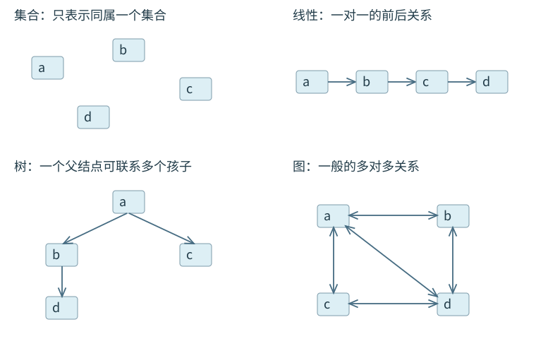

<a id="DS01-E01"></a>
### [例 1-1](../solutions/notes.md#a-DS01-E01)
在存储数据时，通常不仅要存储各数据元素的值，还要存储（　）。

A. 数据的操作方法　B. 数据元素的类型　C. 数据元素之间的关系　D. 数据的存取方法

<a id="DS01-algorithm"></a>
## 算法特性与正确性
算法是求解一类问题的有限操作序列，具有**有穷性、确定性、可行性、输入、输出**五项特性：对每次合法输入，有限步结束；每步含义明确且能在有限时间内执行；输入可为零个或多个，输出至少一个。返回值或修改后的状态均可作为输出。

算法设计还评价正确性、可读性、健壮性及时间、空间效率。可行性只要求操作可执行；时空效率取决于操作次数和所需资源。

循环正确性按**初始化—保持—终止**证明循环不变式，并说明循环确实接近终止边界。最大值扫描要求非空数组；若接受空数组，应返回失败。

```cpp
bool maximum(int a[], int n, int &answer) {
    if (n <= 0) return false;
    int best = a[0];
    for (int i = 1; i < n; ++i)
        if (a[i] > best) best = a[i];
    answer = best;
    return true;
}
```

第$i$轮前，`best`为`a[0..i-1]`的最大值；更新后扩展到`a[0..i]`。终止时覆盖全部元素。合法输入做$n-1$次元素比较，时间$\Theta(n)$、辅助空间$\Theta(1)$。比较记录中的关键字时，移动操作须携带整条记录的各数据项。

<a id="DS01-time"></a>
## 渐近时间复杂度
选择基本操作，计算其执行次数$T(n)$，再提取增长阶。单位成本模型将定长比较、赋值、数组访问看作常数时间；大整数、外存访问等需另定成本模型。

- $O(f(n))$：渐近上界；$\Omega(f(n))$：渐近下界；$\Theta(f(n))$：同阶的上下界。
- 顺序执行：相加后取主阶；重复或嵌套：按实际每轮次数求和。
- 常数因子与低次项不改变增长阶；固定底数的对数只相差常数因子。

按渐近增长率排序，$c>1$为常数，对数底数为固定大于1的常数：

$$1 < \log n < n < n\log n < n^2 < n^3 < c^n < n! < n^n.$$

| 代码特征 | 次数关系 | 紧数量级 |
| --- | --- | --- |
| `i++`到$n$ | $n$ | $\Theta(n)$ |
| `i*=2`或整数`i/=2` | 次数与$\log_2n$同阶 | $\Theta(\log n)$ |
| 第$i$轮执行$i$次，$i=1..n$ | $\sum_{i=1}^n i=n(n+1)/2$ | $\Theta(n^2)$ |
| 第$i$轮执行$2^i$次，共至$\log_2n$轮 | 等比和 | $\Theta(n)$ |
| $T(n)=T(n-1)+\Theta(1)$ | 线性层数 | $\Theta(n)$ |
| $T(n)=2T(n/2)+\Theta(n)$ | 每层线性，约$\log_2n$层 | $\Theta(n\log n)$ |

<a id="DS01-E02"></a>
### [例 1-2](../solutions/notes.md#a-DS01-E02)
下列函数的时间复杂度是（　）。

```c
int func(int n) {
    int i=0, sum=0;
    while (sum<n) sum += ++i;
    return i;
}
```

A. $O(\log n)$　B. $O(n^{1/2})$　C. $O(n)$　D. $O(n\log n)$

<a id="DS01-E03"></a>
### [例 1-3](../solutions/notes.md#a-DS01-E03)
下列程序段的时间复杂度是（　）。

```c
int sum=0;
for (int i=1; i<n; i*=2)
    for (int j=0; j<i; j++)
        sum++;
```

A. $O(\log n)$　B. $O(n)$　C. $O(n\log n)$　D. $O(n^2)$

<a id="DS01-E04"></a>
### [例 1-4](../solutions/notes.md#a-DS01-E04)
设n是描述问题规模的非负整数，程序段`x=0; while(n>=(x+1)*(x+1)) x=x+1;`的时间复杂度是（　）。

A. $O(\log n)$　B. $O(n^{1/2})$　C. $O(n)$　D. $O(n^2)$

**最好、最坏、平均**均针对相同规模的输入：分别取最少、最多、按给定概率分布加权的工作量。平均值需要概率模型。等概率且保证成功的顺序查找平均比较$(n+1)/2$次；包含失败时另加失败概率与代价。$O/\Omega/\Theta$与最好/最坏属于两套不同分类。

<a id="DS01-space"></a>
## 辅助空间与递归栈
辅助空间统计同一时刻存活的额外状态，通常排除输入，输出区按题意处理。顺序复用的空间取峰值，同时保留的空间相加。原地算法通常要求常数辅助空间。

| 同时活跃状态 | 峰值辅助空间 |
| --- | --- |
| 常数个变量反复执行$n$轮 | $\Theta(1)$ |
| 每轮复用长度$n$的数组，共$n$轮 | $\Theta(n)$ |
| 递归深度$n$，每层常数空间 | $\Theta(n)$ |
| 一条调用链各层保留$n,n-1,\ldots,1$个单元 | $\Theta(n^2)$ |
| 一条调用链各层保留$n,n/2,n/4,\ldots$个单元 | $\Theta(n)$ |
| 二叉树递归遍历，树高$h$ | $O(h)$；总时间$\Theta(n)$ |

递归树的调用总数决定总工作量，最长未返回调用链决定栈深。快速排序的普通递归实现在平均情况下需$O(\log n)$栈空间，最坏需$O(n)$。


<a id="DS02"></a>
# 线性表
<a id="DS02-definition"></a>
## 线性表、位序与表示
线性表是$n$个相同数据类型元素的有限序列；$n=0$为空表。非空表首元素无直接前驱，末元素无直接后继，其余各有一个直接前驱和直接后继。元素值可重复。

已有元素位序为$1..n$；插入位序为$1..n+1$。数组`data[0..n-1]`中，位序$i$对应下标$i-1$。本章带头单链表中，`L`为头指针，指向不保存有效数据的头结点，首元结点为`L->next`。

<a id="DS02-sequence"></a>
## 顺序表：寻址、插入与删除
首元素地址$b$、每元素占$w$个地址单位时，第$i$个元素地址为$b+(i-1)w$，按位访问$O(1)$。无序按值查找最坏$O(n)$。

```cpp
#define MaxSize 100
typedef int ElemType;
typedef struct {
    ElemType data[MaxSize];
    int length;
} SqList;
```

```cpp
void InitList(SqList &L) { L.length = 0; }
ElemType GetElem(SqList L, int i) {
    return L.data[i - 1];  // 前提：1 <= i <= L.length
}
int LocateElem(SqList L, ElemType e) {
    for (int i = 0; i < L.length; ++i)
        if (L.data[i] == e) return i + 1;
    return 0;
}
```

`GetElem`要求位序合法；`LocateElem`成功返回首次相等元素的位序，失败返回0。若元素为结构体，按题意定义比较规则。

```cpp
bool ListInsert(SqList &L, int i, ElemType e) {
    if (i < 1 || i > L.length + 1) return false;
    if (L.length >= MaxSize) return false;
    for (int j = L.length; j >= i; --j)
        L.data[j] = L.data[j - 1];
    L.data[i - 1] = e;
    ++L.length;
    return true;
}
bool ListDelete(SqList &L, int i, ElemType &e) {
    if (i < 1 || i > L.length) return false;
    e = L.data[i - 1];
    for (int j = i; j < L.length; ++j)
        L.data[j - 1] = L.data[j];
    --L.length;
    return true;
}
```

| 操作 | 搬移方向 | 位序$i$的移动数 | 等概率平均移动数 |
| --- | --- | --- | --- |
| 插入 | 后向前 | $n-i+1$ | $n/2$，共$n+1$个位置 |
| 删除 | 前向后 | $n-i$ | $(n-1)/2$，共$n$个位置 |

追加、删末元素可为$O(1)$；一般插删最坏$O(n)$。失败操作保持表长，输出参数只在删除成功后有效。

<a id="DS02-E01"></a>
### [例 2-1](../solutions/notes.md#a-DS02-E01)
在线性表 $a_0,a_1,\ldots,a_{100}$ 中，删除元素 $a_{50}$ 需要移动（　）个元素。

A. 0　B. 50　C. 51　D. 0 或 50

<a id="DS02-dynamic"></a>
### 动态顺序表
动态顺序表仍用连续数组；结构记录`data、length、MaxSize`。容量不足时申请更大的连续区，复制$n$个有效元素并释放旧区，单次扩容时间$O(n)$，新旧区共存时额外空间$O(n)$。静态容量固定时，表长仍可变化。

以下动态类型与前面的静态宏`MaxSize`示例独立使用；`ElemType`取整型，需包含`<stdlib.h>`。接口以申请成功、`len>0`且容量运算不溢出为前提。

```cpp
#define InitSize 100
typedef struct {
    ElemType *data;
    int MaxSize;
    int length;
} SeqList;
void InitList(SeqList &L) {
    L.data = (ElemType *)malloc(InitSize * sizeof(ElemType));
    L.length = 0;
    L.MaxSize = InitSize;
}
void IncreaseSize(SeqList &L, int len) {
    ElemType *p = L.data;
    L.data = (ElemType *)malloc(
        (L.MaxSize + len) * sizeof(ElemType));
    for (int i = 0; i < L.length; ++i)
        L.data[i] = p[i];
    L.MaxSize += len;
    free(p);
}
```

工程实现先用临时指针接收申请结果，成功后替换`data`。清空只令表长为0，销毁才释放连续区。

<a id="DS02-linked"></a>
## 单链表：定位与链接修改
```cpp
typedef struct LNode {
    ElemType data;
    struct LNode *next;
} LNode, *LinkList;
bool InitList(LinkList &L) {
    L = (LNode *)malloc(sizeof(LNode));
    if (L == NULL) return false;
    L->next = NULL;
    return true;
}
```

结点间无需连续；按位定位沿`next`逐个前进，最坏$O(n)$。`malloc/free`成对使用。

```cpp
LNode *GetElem(LinkList L, int i) {
    if (i < 0) return NULL;
    int j = 0;
    LNode *p = L;
    while (p != NULL && j < i) {
        p = p->next;
        ++j;
    }
    return p;
}
LNode *LocateElem(LinkList L, ElemType e) {
    LNode *p = L->next;
    while (p != NULL && p->data != e) p = p->next;
    return p;
}
```

带头结点时`GetElem(L,0)`返回头结点，超过表长返回空。按值查找从首元结点开始。

```cpp
bool InsertNextNode(LNode *p, ElemType e) {
    if (p == NULL) return false;
    LNode *s = (LNode *)malloc(sizeof(LNode));
    if (s == NULL) return false;
    s->data = e;
    s->next = p->next;
    p->next = s;
    return true;
}
bool ListInsert(LinkList &L, int i, ElemType e) {
    if (i < 1) return false;
    LNode *p = GetElem(L, i - 1);
    return InsertNextNode(p, e);
}
bool ListDelete(LinkList &L, int i, ElemType &e) {
    if (i < 1) return false;
    LNode *p = GetElem(L, i - 1);
    if (p == NULL || p->next == NULL) return false;
    LNode *q = p->next;
    e = q->data;
    p->next = q->next;
    free(q);
    return true;
}
```

插入先令新结点指向旧后继，再修改前驱链接；删除先保存被删结点和后继，再摘除、释放。已知前驱的局部修改为$O(1)$；按位序插删还需$O(n)$定位。

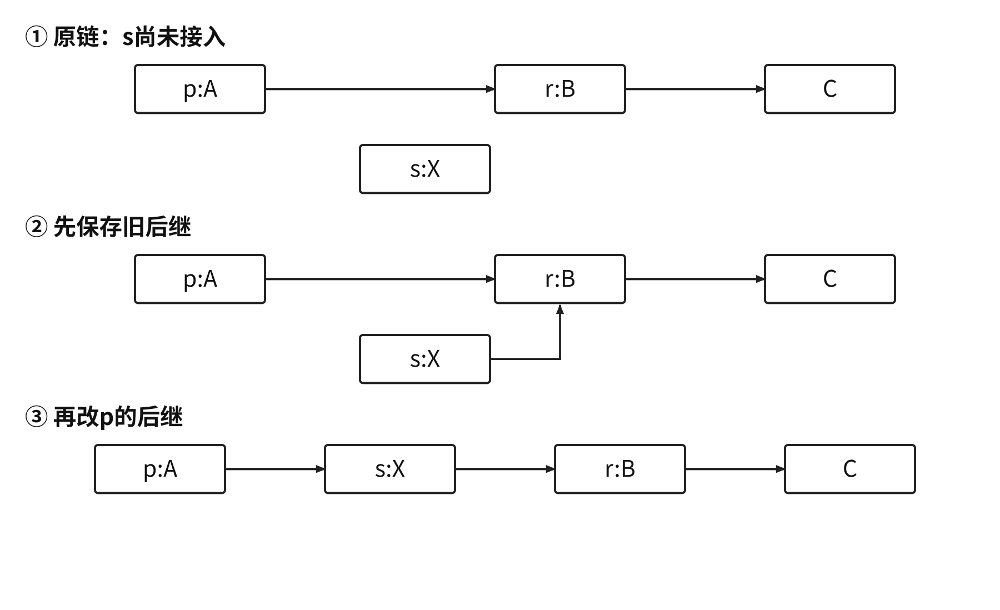

仅给结点$p$，在允许改变数据与结点身份时，可通过复制数据实现前插或删自身；删除自身的复制后继法要求$p$有后继，尾结点不适用。共享后缀结点需统一管理释放。

不带头结点时空表为`L==NULL`。位置1插入执行`s->next=L; L=s`；删除首元执行`p=L; L=L->next; free(p)`。修改头指针的接口须用引用或二级指针。

<a id="DS02-build"></a>
### 建表与原地逆置
| 方法 | 每轮接入 | 输入次序 | 建$n$结点时间 |
| --- | --- | --- | --- |
| 头插 | `s->next=L->next; L->next=s` | 逆序 | $O(n)$ |
| 尾插 | `r->next=s; r=s`，结束置`r->next=NULL` | 保序 | $O(n)$，维护尾指针 |

头插前令`L->next=NULL`；尾插前令`r=L`。每轮重新寻找尾部的尾插建表需$O(n^2)$。教材交互式建表以9999为结束标志时，9999不能同时作为普通数据。

```c
void reverseList(LNode *L) {       // 带头结点
    LNode *prev=NULL, *cur=L->next;
    while (cur!=NULL) {
        LNode *nxt=cur->next;
        cur->next=prev;
        prev=cur;
        cur=nxt;
    }
    L->next=prev;
}
```

逆置维护已逆置前缀与未处理后缀，改`cur->next`前保存后继。时间$\Theta(n)$、辅助空间$\Theta(1)$，空表与单元素表均适用。

<a id="DS02-E02"></a>
### [例 2-2](../solutions/notes.md#a-DS02-E02)
已知一个带有表头结点的单链表，结点结构为 `data | next`，只给出了头指针 `list`。在不改变链表的前提下，设计尽可能高效的算法，查找倒数第 $k$ 个位置上的结点（$k$ 为正整数）。若成功，输出该结点的 `data` 值并返回 1；否则只返回 0。要求说明设计思想、实现步骤，并用 C、C++ 或 Java 描述算法，在关键处加注释。

<a id="DS02-variants"></a>
## 双链表、循环链表与静态链表
双链表增加`prior`域。已知有效结点后可直接取得前驱；按位查找仍需遍历。非循环链的首尾边界要检查空指针。

```cpp
typedef struct DNode {
    ElemType data;
    struct DNode *prior, *next;
} DNode, *DLinklist;
bool InsertNextDNode(DNode *p, DNode *s) {
    if (p == NULL || s == NULL) return false;
    s->next = p->next;
    if (p->next != NULL) p->next->prior = s;
    s->prior = p;
    p->next = s;
    return true;
}
bool DeleteNextDNode(DNode *p) {
    if (p == NULL || p->next == NULL) return false;
    DNode *q = p->next;
    p->next = q->next;
    if (q->next != NULL) q->next->prior = p;
    free(q);
    return true;
}
```

<a id="DS02-E03"></a>
### [例 2-3](../solutions/notes.md#a-DS02-E03)
在双链表中向 `p` 所指的结点之前插入结点 `q`，正确操作是（　）。

```text
A. p->prior=q; q->next=p;
   p->prior->next=q; q->prior=p->prior;
B. q->prior=p->prior; p->prior->next=q;
   q->next=p; p->prior=q->next;
C. q->next=p; p->next=q;
   q->prior->next=q; q->next=p;
D. p->prior->next=q; q->next=p;
   q->prior=p->prior; p->prior=q;
```

| 表示 | 空状态 | 遍历终止或关键条件 |
| --- | --- | --- |
| 带头普通单链表 | `L->next==NULL` | 当前指针为NULL |
| 带头循环单链表 | `L->next==L` | 重新遇到头结点；尾满足`p->next==L` |
| 带头循环双链表 | `L->next==L && L->prior==L` | 正反向均以头结点为边界 |
| 无头循环单链表，仅尾指针`rear` | 空状态另行约定 | 首元为`rear->next` |

两个非空、无头循环单链表给定尾指针时，交换两个尾部的后继即可$O(1)$拼接；只给头指针通常须先找尾。带头结点版本还要删除或绕过多余头结点。

**静态链表**用数组保存结点、游标保存后继，逻辑顺序由游标决定；按逻辑位序访问仍需遍历。须管理空闲位置。例如底稿表示以0号为头结点、`next=-1`为链尾、`next=-2`为空闲，三个状态各有用途。物理地址可按数组下标寻址，不能将该下标直接作为逻辑位序。

<a id="DS02-methods"></a>
## 线性扫描、双指针与归并
**连续删除**：指针$p$始终指向已处理区的最后一个保留结点；删除$p$后继后继续检查新后继，保留后继时才推进$p$。

```cpp
void eraseAll(LNode* L, int x) {
    LNode* p = L;
    while (p->next != NULL) {
        if (p->next->data == x) {
            LNode* q = p->next;
            p->next = q->next;
            free(q);
        } else {
            p = p->next;
        }
    }
}
```

**有序数组去重**：读指针扫描，写指针维护互异前缀；仅当当前值不同于最后保留值时写入。时间$O(n)$、空间$O(1)$。无序输入仅消除相邻重复。

**有序归并**：每次输出两表当前首元素中较小者并推进对应指针，最后接余段。长度$m,n$的两表需$O(m+n)$时间。数组常需输出区；允许破坏原链表时可重接结点。稳定合并相等时先取左表；集合并集相等时只留一次并同时推进。

<a id="DS02-E04"></a>
### [例 2-4](../solutions/notes.md#a-DS02-E04)
将 $n\ (n>1)$ 个整数存放在一维数组 $R$ 中。设计一个时间、空间都尽可能高效的算法，将序列循环左移 $p\ (0<p<n)$ 个位置，即把 $(X_0,\ldots,X_{n-1})$ 变为 $(X_p,\ldots,X_{n-1},X_0,\ldots,X_{p-1})$。给出思想、C/C++ 或 Java 实现，并说明时间与空间复杂度。

<a id="DS02-E05"></a>
### [例 2-5](../solutions/notes.md#a-DS02-E05)
采用带头结点的单链表保存单词，两个单词可共享相同后缀的存储空间。例如 `loading` 与 `being` 共享从字符 `i` 开始的结点。`str1`、`str2` 指向两个头结点，结点为 `data | next`。设计时间上尽可能高效的算法，找到共同后缀的起始结点，给出思想、程序及时间复杂度。

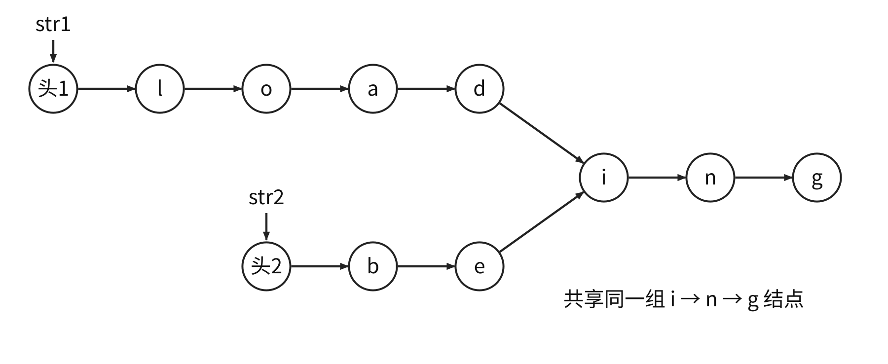{#ds-fig-shared-suffix width=94%}

<a id="DS02-E06"></a>
### [例 2-6](../solutions/notes.md#a-DS02-E06)
整数序列 $A=(a_0,\ldots,a_{n-1})$ 满足 $0\le a_i<n$。某值出现次数超过 $n/2$ 时，称它为主元素。例如 $(0,5,5,3,5,7,5,5)$ 的主元素为5，而 $(0,5,5,3,5,1,5,7)$ 没有主元素。设计尽可能高效的算法，存在主元素时输出该值，否则输出 −1；给出思想、程序及时间、空间复杂度。

<a id="DS02-comparison"></a>
## 顺序表与链表的操作代价
| 操作或资源 | 顺序表 | 带头单链表 |
| --- | --- | --- |
| 按位访问 | $O(1)$ | $O(n)$ |
| 无序按值查找 | $O(n)$ | $O(n)$ |
| 按位插入、删除 | 最坏$O(n)$ | 定位最坏$O(n)$ |
| 已知前驱后插、删后继 | 仍可能搬移后缀 | $O(1)$ |
| 额外空间 | 未用容量、扩容临时区 | 每结点链接域与分配开销 |

顺序表连续访问具有局部性；链表适合已定位后的频繁局部修改。空间比较还要计容量利用率、链接宽度和分配开销。


<a id="DS03"></a>
# 栈、队列和数组
<a id="DS03-stack"></a>
## 栈与合法出栈序列
栈只允许在栈顶插入、删除，遵循后进先出。空栈不能出栈，固定容量满栈不能入栈。

检验输出序列：按目标输出依次处理；当前栈顶不符时继续按输入次序入栈，到目标位于栈顶时弹出。输入耗尽且栈顶仍不符即失败。模拟期间最大栈深为实现该输出所需的最小容量。

从空栈出发并回到空栈的合法入出操作序列满足：入栈与出栈总数相同，每个前缀中出栈数不超过入栈数。$n$个不同元素的合法出栈序列数为

$$C_n=\frac1{n+1}\binom{2n}{n}.$$

<a id="DS03-E01"></a>
### [例 3-1](../solutions/notes.md#a-DS03-E01)
栈 $S$ 和队列 $Q$ 初始均为空，元素 `a,b,c,d,e,f,g` 依次入栈 $S$。每个元素出栈后立即进入队列 $Q$，7个元素出队顺序为 `b,d,c,f,e,a,g`，则栈容量至少是（　）。

A. 1　B. 2　C. 3　D. 4

<a id="DS03-stack-code"></a>
### 顺序栈与共享栈
顺序栈下标从0开始，`top`指当前栈顶，空时为−1。

```cpp
#define MaxSize 100
typedef int ElemType;
typedef struct {
    ElemType data[MaxSize];
    int top;
} SqStack;
void InitStack(SqStack &S) { S.top = -1; }
bool StackEmpty(SqStack S) { return S.top == -1; }
bool Push(SqStack &S, ElemType x) {
    if (S.top == MaxSize - 1) return false;
    S.data[++S.top] = x;
    return true;
}
bool Pop(SqStack &S, ElemType &x) {
    if (S.top == -1) return false;
    x = S.data[S.top--];
    return true;
}
bool GetTop(SqStack S, ElemType &x) {
    if (S.top == -1) return false;
    x = S.data[S.top];
    return true;
}
```

若`top`改指下一空位，须同时改为空时0、入栈`data[top++]=x`、出栈`x=data[--top]`。

共享栈从同一数组两端向中间增长。教材`ShStack`采用如下初值：

```cpp
typedef struct {
    ElemType data[MaxSize];
    int top0, top1;
} ShStack;
void InitStack(ShStack &S) {
    S.top0 = -1;
    S.top1 = MaxSize;
}
```

| 操作 | 0号栈 | 1号栈 |
| --- | --- | --- |
| 判空 | `top0==-1` | `top1==MaxSize` |
| 入栈 | `data[++top0]=x` | `data[--top1]=x` |
| 出栈 | `x=data[top0--]` | `x=data[top1++]` |

两栈共用的满条件为`top1-top0==1`。入栈先判满，出栈先判各自是否为空。

<a id="DS03-linked-stack"></a>
### 链栈
链栈通常无头结点，以链头为栈顶，初始化`S=NULL`。头插、头删均为$O(1)$；入栈可能因申请失败而失败。

```cpp
typedef struct Linknode {
    ElemType data;
    struct Linknode *next;
} *LiStack;
bool Push(LiStack &S, ElemType x) {
    LiStack p = (LiStack)malloc(sizeof(struct Linknode));
    if (p == NULL) return false;
    p->data = x;
    p->next = S;
    S = p;
    return true;
}
bool Pop(LiStack &S, ElemType &x) {
    if (S == NULL) return false;
    LiStack p = S;
    x = p->data;
    S = p->next;
    free(p);
    return true;
}
```

<a id="DS03-queue"></a>
## 队列、双端队列与循环表示
队列在队尾插入、队头删除，先进先出。双端队列允许两端插入和删除；输入受限版本只允许一端输入，输出受限版本只允许一端输出。两种受限模型须分别模拟。

按1、2、3、4顺序输入，输入受限双端队列有22种输出，不能得到`4,2,1,3`及`4,2,3,1`；输出受限双端队列有22种输出，不能得到`4,1,3,2`及`4,2,3,1`。普通栈有14种输出。

循环队列采用长度$M$的数组，`front`指队头，`rear`指下一入队位置。入队后推进`rear`，出队后推进`front`，均对$M$取模。

| 区分空满的方法 | 空 | 满 | 最大元素数 |
| --- | --- | --- | --- |
| 牺牲一单元 | `front==rear` | `(rear+1)%M==front` | $M-1$ |
| 增加`size` | `size==0` | `size==M` | $M$ |
| 最近操作`tag` | 指针相同且tag为出队 | 指针相同且tag为入队 | $M$ |

`tag`初始为出队态，成功操作后才更新。牺牲单元方案长度为

$$len=(rear-front+M)\bmod M.$$

```cpp
typedef struct {
    ElemType data[MaxSize];
    int front, rear;
} SqQueue;
void InitQueue(SqQueue &Q) { Q.front = Q.rear = 0; }
bool QueueEmpty(SqQueue Q) { return Q.front == Q.rear; }
bool EnQueue(SqQueue &Q, ElemType x) {
    if ((Q.rear + 1) % MaxSize == Q.front) return false;
    Q.data[Q.rear] = x;
    Q.rear = (Q.rear + 1) % MaxSize;
    return true;
}
bool DeQueue(SqQueue &Q, ElemType &x) {
    if (Q.front == Q.rear) return false;
    x = Q.data[Q.front];
    Q.front = (Q.front + 1) % MaxSize;
    return true;
}
bool GetHead(SqQueue Q, ElemType &x) {
    if (Q.front == Q.rear) return false;
    x = Q.data[Q.front];
    return true;
}
```

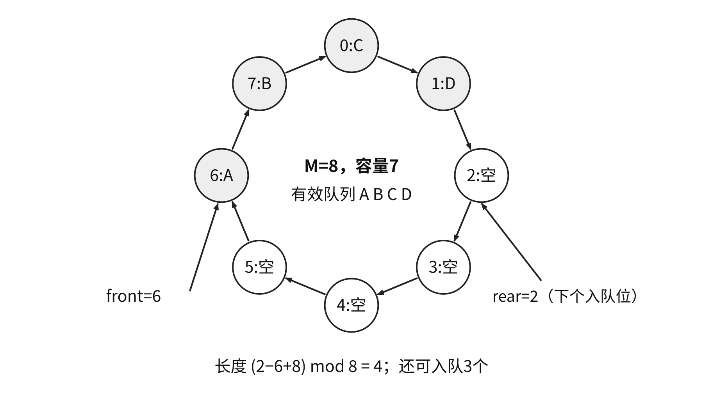

<a id="DS03-E02"></a>
### [例 3-2](../solutions/notes.md#a-DS03-E02)
循环队列存于数组 `A[21]`，`front` 指向队首元素的前一个位置，`rear` 指向队尾元素。当前 `front=8, rear=3`，队列长度为（　）。

A. 5　B. 6　C. 16　D. 17

若`front`指队头、`rear`指当前队尾，可令空状态`front=0,rear=M-1`；入队先推进`rear`再写，出队先取后推进`front`。牺牲一单元时空条件`(rear+1)%M==front`、满条件`(rear+2)%M==front`，长度`(rear-front+1+M)%M`。数组`A[0..n]`共有$n+1$单元，模数须取$n+1$。

<a id="DS03-linked-queue"></a>
### 链队列
单链队列以链头为队头、链尾为队尾，保存`front、rear`。带头结点时`front`始终指向头结点；初始化和入队的`void`接口以下均假设申请成功。

```cpp
typedef struct LinkNode {
    ElemType data;
    struct LinkNode *next;
} LinkNode;
typedef struct {
    LinkNode *front, *rear;
} LinkQueue;
void InitQueue(LinkQueue &Q) {
    Q.front = Q.rear = (LinkNode *)malloc(sizeof(LinkNode));
    Q.front->next = NULL;
}
bool IsEmpty(LinkQueue Q) { return Q.front == Q.rear; }
void EnQueue(LinkQueue &Q, ElemType x) {
    LinkNode *s = (LinkNode *)malloc(sizeof(LinkNode));
    s->data = x;
    s->next = NULL;
    Q.rear->next = s;
    Q.rear = s;
}
bool DeQueue(LinkQueue &Q, ElemType &x) {
    if (Q.front == Q.rear) return false;
    LinkNode *p = Q.front->next;
    x = p->data;
    Q.front->next = p->next;
    if (Q.rear == p) Q.rear = Q.front;
    free(p);
    return true;
}
```

删除最后一个数据结点后必须令`rear=front`。不带头结点时空状态为两个指针均为空；第一次入队同时设置二者，最后一次出队同时置空。普通单链表尾删需寻找前驱，时间$O(n)$；循环双链表可通过队头的`prior`访问尾部。

<a id="DS03-applications"></a>
## 括号、表达式与递归
括号匹配：左括号入栈；右括号必须与栈顶同型并弹出；扫描结束栈必须为空。以下代码复用顺序栈，`ElemType`改为`char`或能保存字符编码的类型。

```cpp
bool bracketCheck(char str[], int length) {
    SqStack S;
    InitStack(S);
    for (int i = 0; i < length; ++i) {
        char c = str[i];
        if (c == '(' || c == '[' || c == '{') {
            if (!Push(S, c)) return false;
        } else if (c == ')' || c == ']' || c == '}') {
            ElemType x;
            if (!Pop(S, x)) return false;
            if ((c == ')' && x != '(') ||
                (c == ']' && x != '[') ||
                (c == '}' && x != '{')) return false;
        }
    }
    return StackEmpty(S);
}
```

时间$O(n)$，最坏辅助空间$O(n)$；固定栈容量应不小于所需最大深度。`([)]`在第三个字符首次失败。

| 表达式形式 | 扫描方向 | 遇二元运算符的弹出顺序 |
| --- | --- | --- |
| 后缀 | 左至右 | 先右操作数，再左操作数 |
| 前缀 | 右至左 | 先左操作数，再右操作数 |

后缀求值中，操作数入栈；运算符弹出两个值，按左右角色计算后压回。须检查操作数不足、除零与末尾恰留一个值。

<a id="DS03-E05"></a>
### [例 3-5](../solutions/notes.md#a-DS03-E05)
栈 $S_1$ 保存整数，$S_2$ 保存运算符。函数 F() 依次：（1）从 $S_1$ 弹出操作数 a、b；（2）从 $S_2$ 弹出运算符 op；（3）执行 b op a；（4）把结果压入 $S_1$。初始 $S_1$ 自底向顶为5、8、3、2，$S_2$ 自底向顶为 `*`、`−`、`+`。调用3次 F() 后，$S_1$ 栈顶值是（　）。

A. −15　B. 15　C. −20　D. 20

**中缀转后缀**：操作数直接输出；左括号入栈；右括号触发弹出直到匹配左括号；遇运算符先输出优先级更高的栈顶运算符。左结合运算符同级也弹出，右结合运算符另按结合规则处理；最后清空运算符栈。多位数、一元符号须先识别为词法单元。

例如`A+B-C*D/E+F`转换为`A B + C D * E / - F +`。`x+y*(z-u)/v`的前缀为`+ x / * y - z u v`，后缀为`x y z u - * v / +`。

**双栈直接求中缀值**：操作数立即压入值栈；运算符栈按上述转换规则管理。每逢应输出运算符时，改为弹出左右值、计算并压回。左括号只作边界。

数值式$((15/(7-(1+1)))\times3)-(2+(1+1))$的后缀为`15 7 1 1 + - / 3 * 2 1 1 + + -`，结果为5，操作数栈峰值为4。

<a id="DS03-recursion"></a>
### 调用次数与调用栈
递归栈保存尚未返回的参数、局部变量及返回位置。调用总数与最长活跃调用链分别控制时间、栈空间。

```c
int factorial(int n) {
    if (n == 0 || n == 1) return 1;
    else return n * factorial(n - 1);
}
int Fib(int n) {
    if (n == 0) return 0;
    else if (n == 1) return 1;
    else return Fib(n - 1) + Fib(n - 2);
}
```

输入为非负整数，结果须能由`int`表示。阶乘时间$O(n)$、栈空间$O(n)$。朴素Fibonacci满足$T(n)=T(n-1)+T(n-2)+O(1)$，时间呈指数增长，栈空间$O(n)$。`Fib(4)`返回3，共9次调用，最长活跃链4层。

若`F(n)`在$n\le3$时返回1，否则返回`F(n-2)+F(n-4)+1`，调用次数满足$C(n)=1+C(n-2)+C(n-4)$、基例$C(n)=1$；因此$C(4)=3,C(6)=5,C(8)=9$。递推中的1统计当前调用。C/C++加号两侧调用的先后不保证固定；求“第几次调用”时须检查是否依赖该顺序。嵌套调用须先求实参：基例返回2、递归返回`func(x-2)+func(x-4)`时，`func(func(5))`先由3次调用求出内层结果4，第4次才调用外层`func(4)`。

按层处理用队列；树层序遍历和图BFS均遵循先发现先扩展，图还需防止重复入队。

<a id="DS03-array"></a>
## 多维数组寻址
二维数组行范围$l_1..u_1$、列范围$l_2..u_2$，行数$r=u_1-l_1+1$、列数$c=u_2-l_2+1$；首元素地址$b$，元素宽度$w$个地址单位：

$$\begin{aligned}
\text{行优先：}\quad Addr(A[i,j])&=b+[(i-l_1)c+(j-l_2)]w,\\
\text{列优先：}\quad Addr(A[i,j])&=b+[(j-l_2)r+(i-l_1)]w.
\end{aligned}$$

三维行优先的相对元素位置为$((i-l_1)n_2+(j-l_2))n_3+(k-l_3)$。先算元素偏移，再乘元素宽度；按字编址与按字节编址需统一单位。

<a id="DS03-matrix"></a>
## 特殊矩阵的压缩存储
对称矩阵满足$a_{ij}=a_{ji}$，先将目标换到保存半边。三角矩阵另一半是同一公共常量，常量可非零。三对角矩阵仅$|i-j|\le1$的位置可能非零。

下表矩阵坐标从1开始，压缩数组下标$k$从0开始，$n$为阶数：

| 保存方式 | 有效区域 | 下标$k$ |
| --- | --- | --- |
| 下三角行优先 | $i\ge j$ | $i(i-1)/2+j-1$ |
| 上三角列优先 | $i\le j$ | $j(j-1)/2+i-1$ |
| 上三角行优先 | $i\le j$ | $(i-1)(2n-i+2)/2+j-i$ |
| 下三角列优先 | $i\ge j$ | $(j-1)(2n-j+2)/2+i-j$ |
| 三对角行优先 | $|i-j|\le1$ | $2i+j-3$ |

对称矩阵保存$n(n+1)/2$个值；三角矩阵再加1个公共常量单元；三对角矩阵$n\ge2$时共$3n-2$个值，$n=1$时直接保存一个值。

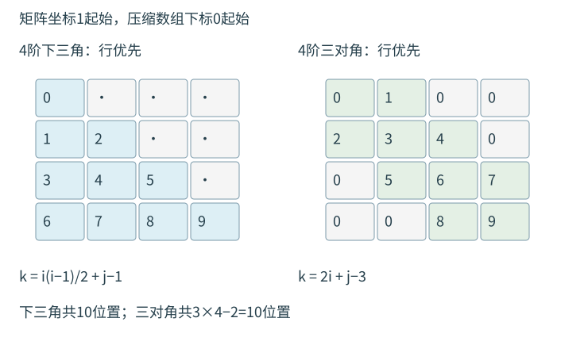

<a id="DS03-E03"></a>
### [例 3-3](../solutions/notes.md#a-DS03-E03)
100阶三对角矩阵 $M$ 的元素 $m_{i,j}\ (1\le i,j\le100)$ 按行优先依次压缩存入下标从0开始的一维数组 $N$。$m_{30,30}$ 在 $N$ 中的下标为（　）。

A. 86　B. 87　C. 88　D. 89

<a id="DS03-E04"></a>
### [例 3-4](../solutions/notes.md#a-DS03-E04)
10×10对称矩阵 $M$ 的上三角元素 $m_{i,j}\ (1\le i\le j\le10)$ 按列优先存入 C 语言一维数组 $N$。$m_{7,2}$ 在 $N$ 中的下标为（　）。

A. 15　B. 16　C. 22　D. 23

反向定位：若矩阵、数组均0起始且下三角行优先，令$T_i=i(i+1)/2$，找$T_i\le k<T_{i+1}$，再取$j=k-T_i$；等价地

$$i=\left\lfloor\frac{\sqrt{8k+1}-1}{2}\right\rfloor,\qquad j=k-i(i+1)/2.$$

浮点实现需用整数边界复核。三对角坐标1起始、数组0起始且$0\le k<3n-2,n\ge2$时：

$$i=\left\lceil\frac{k+2}{3}\right\rceil,\qquad j=k-2i+3.$$

**稀疏矩阵**非零位置无固定规律，三元组保存`(行,列,值)`并另记总行数、总列数、非零元数；全零行也计入行数。十字链表让每个非零结点同时进入行链、列链，修改须维护两组链接。坐标到压缩记录的定位依赖表示，不能直接套普通二维数组公式。


<a id="DS04"></a>
# 串
<a id="DS04-definition"></a>
## 串、子串与基本运算
串是零个或多个字符组成的有限序列，长度为字符数。空串长度0，空格串含实际空格字符。子串由主串中连续字符构成，位置取其首字符位置；相同子串可有多个出现位置。

两串相等要求长度相同且对应字符相同。字典序比较第一对不同字符；已比较部分相同且一方先结束时，较短串较小。

| 操作 | 结果与条件 |
| --- | --- |
| 赋值、复制 | 容量足够；复制地址与独立复制字符的语义须明确 |
| 判空、求长 | 依赖长度成员或结束标志 |
| 清空、销毁 | 清空保留存储；销毁回收动态存储 |
| 连接 | 总长度可容纳 |
| 取子串 | 检查起点、长度和末位置 |
| 比较 | 返回正、零、负值表示大小 |
| 定位 | 本章首次成功返回1起始位置，失败返回0 |

允许空子串时，长$n$的串须满足$1\le pos\le n+1$、$len\ge0$、$pos+len-1\le n$；`pos=n+1`只允许`len=0`。模式匹配约定空模式返回1。

<a id="DS04-storage"></a>
## 存储表示与基本操作代码
本章顺序串的字符从1开始，`ch[0]`弃用，长度另存。`ch[MAXLEN]`的有效字符容量为`MAXLEN-1`，保持$0\le length<MAXLEN$。

```cpp
#define MAXLEN 255
typedef struct {
    char ch[MAXLEN];
    int length;
} SString;
```

显式长度表示无需`'\0'`结束符；转用C字符串库前须转换布局。其他布局如首单元保存长度、0起始另存长度、结束符表示等，均有各自容量与求长规则。

```cpp
bool SubString(SString &Sub, SString S, int pos, int len) {
    if (pos < 1 || pos > S.length + 1 || len < 0 ||
        len > S.length - pos + 1)
        return false;
    for (int i = pos; i < pos + len; ++i)
        Sub.ch[i - pos + 1] = S.ch[i];
    Sub.length = len;
    return true;
}
int StrCompare(SString S, SString T) {
    for (int i = 1; i <= S.length && i <= T.length; ++i)
        if (S.ch[i] != T.ch[i])
            return (unsigned char)S.ch[i] -
                   (unsigned char)T.ch[i];
    return S.length - T.length;
}
```

```cpp
bool Concat(SString &T, SString S1, SString S2) {
    if (S1.length + S2.length >= MAXLEN) return false;
    for (int i = 1; i <= S1.length; ++i)
        T.ch[i] = S1.ch[i];
    for (int i = 1; i <= S2.length; ++i)
        T.ch[S1.length + i] = S2.ch[i];
    T.length = S1.length + S2.length;
    return true;
}
```

`SubString`时间$O(len)$；比较最坏$O(\min(n,m))$；连接时间$O(n+m)$。上述定长串按值传入副本，输出与输入同名时仍能读取原值。`unsigned char`使字符编码按无符号值比较。

堆串采用`char *ch; int length;`管理动态连续区，需处理分配、复制、释放。链串可每结点保存一字符或多字符形成块，块尾填充须与真实字符区分。仅计字符与指针时，每结点$q$个1字节字符、指针$p$字节的存储密度为$q/(q+p)$；结构体对齐另计。

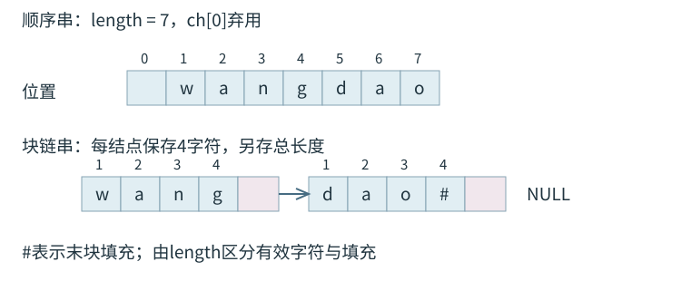

<a id="DS04-naive"></a>
## 朴素模式匹配
主串长$n$、模式长$m$，字符位置均从1开始。失配时本轮起点为$i-j+1$，改从下一起点比较：`i=i-j+2; j=1`。

```cpp
int Index(SString S, SString T) {
    if (T.length == 0) return 1;
    int i = 1, j = 1;
    while (i <= S.length && j <= T.length) {
        if (S.ch[i] == T.ch[j]) {
            ++i; ++j;
        } else {
            i = i - j + 2;
            j = 1;
        }
    }
    if (j > T.length) return i - T.length;
    return 0;
}
```

成功时$j=m+1$，返回$i-m$；主串先耗尽则失败。非空模式最多有$n-m+1$个候选起点，最坏时间$O((n-m+1)m)$，常记$O(nm)$；辅助工作空间$O(1)$。首起点成功时比较$m$次。

<a id="DS04-kmp"></a>
## KMP与next的1起始约定
在$(i,j)$失配前，$S[i-j+1..i-1]=T[1..j-1]$。模式移位后仍保留的重合部分，必须是该已匹配前缀的相等真前后缀。

$$next[1]=0,\qquad next[j]=1+\text{串}T[1..j-1]\text{的最长相等真前后缀长度}\quad(j>1).$$

`next[j]`是下一次比较的模式位置。失配令`j=next[j]`，主串位置保持；`j==0`时下一轮同时推进`i、j`，恢复模式首字符。

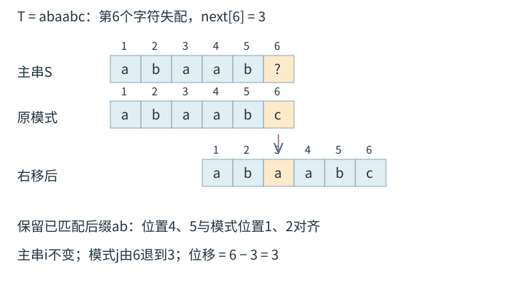

```cpp
int Index_KMP(SString S, SString T, int next[]) {
    if (T.length == 0) return 1;
    int i = 1, j = 1;
    while (i <= S.length && j <= T.length) {
        if (j == 0 || S.ch[i] == T.ch[j]) {
            ++i;
            ++j;
        } else {
            j = next[j];
        }
    }
    if (j > T.length) return i - T.length;
    return 0;
}
```

短路求值保证`j==0`时不读取`T.ch[0]`。主串位置单调递增，同一个主串字符可能与多个模式位置比较。

<a id="DS04-E01"></a>
### [例 4-1](../solutions/notes.md#a-DS04-E01)
主串`S=abaabaabcabaabc`，模式`T=abaabc`。分别用朴素匹配和普通next表的KMP查找首次出现位置，计算实际字符比较次数。字符位置与next均从1开始，`next[1]=0`。

<a id="DS04-next"></a>
### 线性时间建立next
已知`next[i]=j`：若`j==0`或`T.ch[i]==T.ch[j]`，则下一前缀的边界可扩展，写入`next[++i]=++j`；失配时沿`next[j]`尝试更短边界。

```cpp
void get_next(SString T, int next[]) {
    if (T.length == 0) return;
    int i = 1, j = 0;
    next[1] = 0;
    while (i < T.length) {
        if (j == 0 || T.ch[i] == T.ch[j]) {
            ++i; ++j;
            next[i] = j;
        } else {
            j = next[j];
        }
    }
}
```

| 模式 | 普通next |
| --- | --- |
| `google` | `0,1,1,1,2,1` |
| `abaabc` | `0,1,1,2,2,3` |
| `ababaa` | `0,1,1,2,3,4` |
| `aaaab` | `0,1,2,3,4` |

`google`在位置5之前的`goog`有长度1的边界`g`，故`next[5]=2`。主串`googlogoogoogle`首次匹配`google`的位置为10。

<a id="DS04-nextval"></a>
## nextval优化
已知`S.ch[i]`与`T.ch[j]`失配，若`T.ch[next[j]]==T.ch[j]`，退到`next[j]`后仍必败。令`nextval[1]=0`，$j\ge2$时：

$$nextval[j]=\begin{cases}
next[j],&T[j]\ne T[next[j]],\\
nextval[next[j]],&T[j]=T[next[j]].
\end{cases}$$

```cpp
void get_nextval(SString T, int nextval[]) {
    if (T.length == 0) return;
    int i = 1, j = 0;
    nextval[1] = 0;
    while (i < T.length) {
        if (j == 0 || T.ch[i] == T.ch[j]) {
            ++i; ++j;
            if (T.ch[i] != T.ch[j])
                nextval[i] = j;
            else
                nextval[i] = nextval[j];
        } else {
            j = nextval[j];
        }
    }
}
```

将优化表作为`Index_KMP`的第三个实参，匹配循环保持相同。

| 模式 | nextval |
| --- | --- |
| `abaabc` | `0,1,0,2,1,3` |
| `ababaa` | `0,1,0,1,0,4` |
| `aaaab` | `0,0,0,0,4` |

<a id="DS04-E02"></a>
### [例 4-2](../solutions/notes.md#a-DS04-E02)
主串`aaacaaaabdaaaab`，模式`aaaab`。比较普通next和优化nextval的匹配过程，求首次成功位置与两者字符比较次数。采用1起始位置和`next[1]=nextval[1]=0`。

<a id="DS04-analysis"></a>
## KMP的代价与边界
建表中$i$最多推进$m-1$次，$j$的回退总量受此前增量限制，建表$O(m)$；匹配中$i$最多推进$n$次，累积回退同样受推进约束，扫描$O(n)$。总时间$O(n+m)$，表空间$O(m)$；已给表时单独扫描记为$O(n)$。

每次跳过的对齐都由已匹配前缀的边界关系排除，故不遗漏合法起点。统计字符比较只计实际字符判等，`j==0`检查单独计控制操作。查找全部出现时还需约定是否允许重叠，以及成功后的继续位置。

固定数组按值传参的复制成本在教材分析中按预设容量处理；可增长规模的实现应把实际复制成本计入。


<a id="DS05"></a>
# 树与二叉树
<a id="DS05-tree"></a>
## 树的定义、度与计数
非空树有唯一根，除根外每结点恰有一个双亲，各子树互不相交，根到任意结点有唯一路径。结点的度为孩子数，树的度为结点度最大值，度0为叶。兄弟具有同一双亲；有序树区分各子树先后，无序树无此要求。

森林为零棵或多棵不相交的树；删去非空树根得到子树森林，给森林加统一根得到一棵树。

本章**根为第1层，叶高度1，空树高度0**；路径长按边数计，根到第$i$层的路径长为$i-1$。树高取最大层号，树的路径长度取根到所有结点路径长之和。

设$n_i$为度$i$结点数，$n$为总结点数：

$$n=\sum_i n_i,\qquad n-1=\sum_i i n_i,\qquad n_0=1+\sum_{i\ge2}(i-1)n_i.$$

度1结点可增加树高而不改变叶数，叶数与各高阶度数未必确定总结点数。

<a id="DS05-E01"></a>
### [例 5-1](../solutions/notes.md#a-DS05-E01)
一棵度为4的树，含20个度为4的结点、10个度为3的结点、1个度为2的结点、10个度为1的结点。叶结点数为（　）。

A. 41　B. 82　C. 113　D. 122

| $m>1$时的条件 | 结论 |
| --- | --- |
| $m$叉树，第$i$层 | 至多$m^{i-1}$个结点 |
| 高$h$的$m$叉树 | $h\le n\le(m^h-1)/(m-1)$ |
| 高$h$、树的度恰为$m$ | 最少$h+m-1$个结点，须$h\ge2$ |
| $n$结点$m$叉树 | 最小高度$\lceil\log_m(n(m-1)+1)\rceil$，最大$n$ |

$m$叉树允许每结点少于$m$个孩子；度恰为$m$要求至少一结点有$m$个孩子。$m=1$时为链，$n=h$；单结点树的度为0。

<a id="DS05-binary"></a>
## 二叉树、完全性与存储
二叉树每结点至多两个孩子，左右位置有别。非空二叉树满足

$$n_0=n_2+1,\qquad h\le n\le2^h-1,\qquad h_{\min}=\lceil\log_2(n+1)\rceil.$$

满二叉树高$h$时每层均满，共$2^h-1$个结点；完全二叉树的已有结点恰占满二叉树从上至下、从左至右编号的前$n$个位置。完全二叉树高$\lfloor\log_2n\rfloor+1$，非叶$\lfloor n/2\rfloor$个、叶$\lceil n/2\rceil$个，度1结点至多一个且只能有左孩子。

| 编号起点 | 双亲 | 左孩子 | 右孩子 |
| --- | --- | --- | --- |
| 1 | $\lfloor i/2\rfloor$，$i>1$ | $2i$ | $2i+1$ |
| 0 | $\lfloor(i-1)/2\rfloor$，$i>0$ | $2i+1$ | $2i+2$ |

完全树的孩子编号不超过末编号才存在；普通树顺序存储还须检查该位置是否为空。高$h$的全右链末编号为$2^h-1$，顺序存储可能浪费大量空位。

<a id="DS05-E02"></a>
### [例 5-2](../solutions/notes.md#a-DS05-E02)
对于任意一棵高度为5、有10个结点的二叉树，采用顺序存储结构保存，每个结点占1个存储单元，只存放结点数据信息。存放该二叉树需要的存储单元数量至少为（　）。

A. 31　B. 16　C. 15　D. 10

```cpp
typedef struct BiTNode {
    ElemType data;
    struct BiTNode *lchild, *rchild;
} BiTNode, *BiTree;
```

`BiTree`为根指针，空树`T==NULL`。$n$个结点的二叉链表有$2n$个孩子域、$n-1$个非空域、$n+1$个空域；再加双亲域时，共有$n+2$个空域。

<a id="DS05-traversal"></a>
## 遍历、非递归状态与还原
先序为根—左—右，中序为左—根—右，后序为左—右—根；层序以队列按层从左到右处理。

```cpp
void PreOrder(BiTree T) {
    if (T!=NULL) {
        visit(T);
        PreOrder(T->lchild);
        PreOrder(T->rchild);
    }
}
void InOrder(BiTree T) {
    if (T!=NULL) {
        InOrder(T->lchild);
        visit(T);
        InOrder(T->rchild);
    }
}
void PostOrder(BiTree T) {
    if (T!=NULL) {
        PostOrder(T->lchild);
        PostOrder(T->rchild);
        visit(T);
    }
}
```

递归遍历时间$\Theta(n)$、栈空间$O(h)$。表达式树先序、后序分别给出前缀、后缀形式；中序输出须按结构添加必要括号。后序适合在孩子结果齐备后计算高度、结点数或释放结点。

```c
int TreeDepth(BiTree T) {
    if (T==NULL) return 0;
    int hl=TreeDepth(T->lchild), hr=TreeDepth(T->rchild);
    return 1+(hl>hr ? hl : hr);
}
```

高度代码按空树0、叶1返回；时间$O(n)$、栈空间$O(h)$。交换每个结点的左右孩子会反向原中序次序，保留结点身份、叶数和树高。

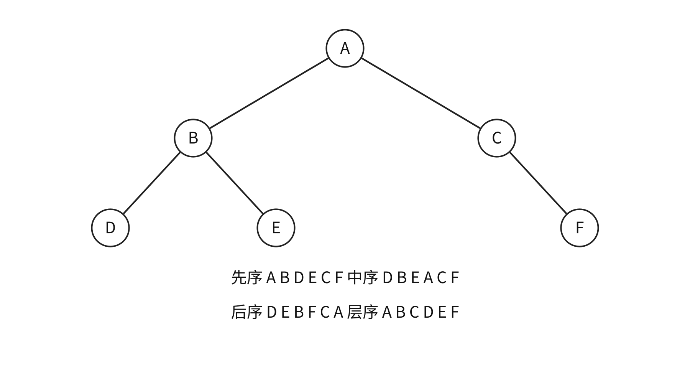

非递归中序沿左链压栈，遇空弹栈访问并进入右子树；后序须保存最近访问结点`last`判断右子树是否已完成：

```text
inorder(root):
    p=root; 建空栈 S
    while p 非空 or S 非空:
        while p 非空:
            push(S,p); p=p->lchild
        p=pop(S); visit(p)
        p=p->rchild
```

```text
postorder(root):
    p=root; last=NULL; 建空栈 S
    while p 非空 or S 非空:
        if p 非空:
            push(S,p); p=p->lchild
        else:
            q=top(S)
            if q->rchild 非空 and last!=q->rchild:
                p=q->rchild
            else:
                visit(q); last=pop(S)
```

每结点入栈、出栈各一次，时间$O(n)$、栈空间$O(h)$。层序根先入队，出队访问后依次加入非空左右孩子，时间$O(n)$、队列最坏$O(n)$。判完全二叉树可按层检查孩子位置：遇首个空位置后，所有后续位置均须为空。

<a id="DS05-reconstruction"></a>
### 由遍历序列还原
结点标识互异时：

| 给定序列 | 唯一性与步骤 |
| --- | --- |
| 先序＋中序 | 先序首项定根，中序分左右；按子树长度切先序 |
| 后序＋中序 | 后序末项定根，中序分左右；按长度切后序 |
| 层序＋中序 | 层序首项定根，中序分左右；稳定筛分余下层序 |
| 先序＋后序 | 一般不唯一，单孩子左右无法区分 |
| 先序＋层序、后序＋层序 | 一般不唯一，两结点单左与单右树即可说明 |

只给$n$个互异标识的先序序列，二叉树形态数为卡特兰数$C_n$。重复值、显式空标记或规定满树等条件需另行分析。

例如层序`A B C D E`、中序`A C B E D`还原为`A(空,B(C,D(E,空)))`，后序为`C E D B A`。

<a id="DS05-E03"></a>
### [例 5-3](../solutions/notes.md#a-DS05-E03)
p、q、v 都是二叉树 T 中的结点，v 有两个孩子，T 的中序遍历序列形如 `…,p,v,q,…`。正确的是（　）。

A. p没有右孩子，q没有左孩子　B. p没有右孩子，q有左孩子

C. p有右孩子，q没有左孩子　D. p有右孩子，q有左孩子

<a id="DS05-thread"></a>
## 线索二叉树
原空左域保存指定遍历的前驱，原空右域保存后继；`ltag、rtag`以0表示孩子、1表示线索。$n+1$个原空孩子域包括首前驱、末后继边界；若只统计指向普通结点的线索，边界另算。

中序线索化用`pre`保存刚访问结点；原链表标志须全部为0，以下采用无头结点、首尾线索指空的表示。

```cpp
typedef struct ThreadNode {
    ElemType data;
    struct ThreadNode *lchild, *rchild;
    int ltag, rtag;  // 0：孩子；1：线索
} ThreadNode, *ThreadTree;

void InThread(ThreadTree p, ThreadTree &pre) {
    if (p!=NULL) {
        InThread(p->lchild, pre);
        if (p->lchild==NULL) {
            p->lchild=pre;
            p->ltag=1;
        }
        if (pre!=NULL && pre->rchild==NULL) {
            pre->rchild=p;
            pre->rtag=1;
        }
        pre=p;
        InThread(p->rchild, pre);
    }
}
void CreateInThread(ThreadTree T) {
    ThreadTree pre=NULL;
    if (T!=NULL) {
        InThread(T, pre);
        pre->rchild=NULL;
        pre->rtag=1;
    }
}
```

```cpp
ThreadNode *Firstnode(ThreadNode *p) {
    while (p->ltag==0) p=p->lchild;
    return p;
}
ThreadNode *Nextnode(ThreadNode *p) {
    if (p->rtag==0) return Firstnode(p->rchild);
    return p->rchild;
}
void InOrderThread(ThreadNode *T) {
    if (T==NULL) return;
    for (ThreadNode *p=Firstnode(T); p!=NULL; p=Nextnode(p))
        visit(p);
}
```

`Firstnode`要求非空参数且线索标志完整；整趟中序访问时间$O(n)$、工作空间$O(1)$。已线索化的树递归时须按标志只走真实孩子，避免沿线索返回祖先。

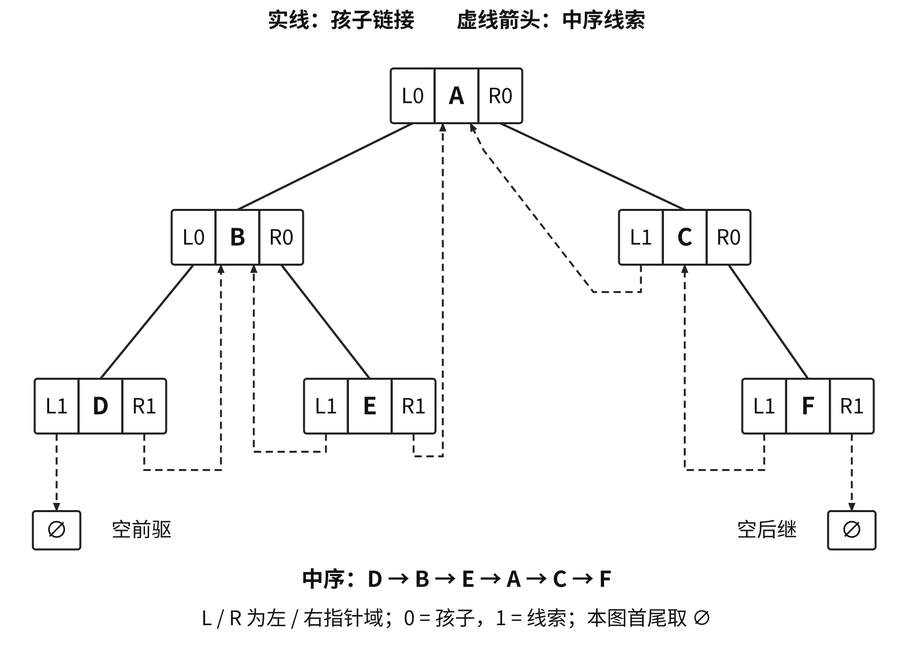

| 线索次序 | 前驱 | 后继 |
| --- | --- | --- |
| 中序 | 左线索直接取；否则左子树最右结点 | 右线索直接取；否则右子树最左结点 |
| 先序 | 左线索直接取；有左孩子时通常需双亲信息 | 有左孩子取左孩子，否则取右域 |
| 后序 | 有右孩子取右孩子，否则取左域 | 右线索直接取；有右孩子时通常需双亲信息 |

有双亲域时：先序左孩子的前驱为双亲；右孩子有左兄弟时为左兄弟子树最后一个先序结点，否则为双亲。后序右孩子的后继为双亲；左孩子有右兄弟时为右兄弟子树第一个后序结点，否则为双亲。

先序线索化访问根后新增的左线索可能回指祖先，递归左侧须查`ltag`。后序末结点为根，根可能有右孩子，收尾只处理原空右域。

<a id="DS05-forest"></a>
## 普通树、森林的存储与转换
| 表示 | 保存内容 | 直接支持的方向 |
| --- | --- | --- |
| 双亲表示 | 每结点保存双亲下标，根为−1 | 查双亲$O(1)$，找全部孩子常需全扫描 |
| 孩子表示 | 顶点表保存各自孩子链 | 枚举孩子，反查双亲需搜索或附加域 |
| 孩子兄弟表示 | `firstchild、nextsibling` | 首孩子与下一个兄弟 |

```cpp
#define MAX_TREE_SIZE 100
typedef struct {
    ElemType data;
    int parent;
} PTNode;
typedef struct {
    PTNode nodes[MAX_TREE_SIZE];
    int n;
} PTree;

typedef struct CSNode {
    ElemType data;
    struct CSNode *firstchild, *nextsibling;
} CSNode, *CSTree;
```

森林双亲数组可有多个根标志，孩子兄弟表示把各根沿兄弟链接相连。转换规则为**左孩子、右兄弟**：普通树首孩子成为左孩子，后续兄弟沿右链；单棵树根无右孩子，森林根沿右链。

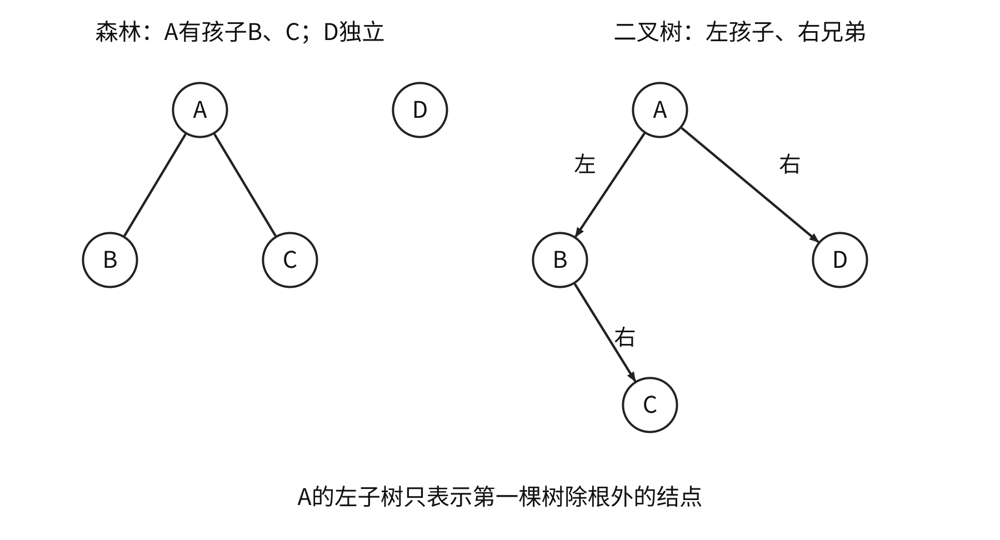

逆转换时，某结点的左孩子及其连续右链是原树全部孩子。二叉树根的左子树只含森林第一棵树除根外的结点，其余树在根的右子树中。

<a id="DS05-E04"></a>
### [例 5-4](../solutions/notes.md#a-DS05-E04)
将森林转换成对应二叉树。若二叉树中 u 是 v 的父结点的父结点，则原森林中 u 与 v 可能的关系是（　）。

Ⅰ. 父子关系　Ⅱ. 兄弟关系　Ⅲ. u 的父结点与 v 的父结点是兄弟关系

A. 只有Ⅱ　B. Ⅰ和Ⅱ　C. Ⅰ和Ⅲ　D. Ⅰ、Ⅱ和Ⅲ

| 原结构遍历 | 对应二叉树遍历 |
| --- | --- |
| 树先根、森林先序 | 先序 |
| 树后根、森林中序 | 中序 |

普通树层序遍历用兄弟链枚举出队结点的全部孩子并入队。

<a id="DS05-huffman"></a>
## 哈夫曼树与前缀编码
给定叶权$w_i$、根到叶的边数$d_i$：

$$WPL=\sum_iw_id_i=\text{所有合并生成的新权值之和},\qquad \bar L=\frac{WPL}{\sum_iw_i}.$$

每轮合并当前最小的两个权根，生成权值为和的新根并放回候选，直到一棵树。$n$个叶需$n-1$轮，有$n-1$个内部结点、$2n-1$个总结点，无度1结点；高最多$n$。优先队列实现时间$O(n\log n)$、空间$O(n)$。

```text
Q=全部带权叶构成的小根优先队列
while size(Q)>1:
    a=extractMin(Q); b=extractMin(Q)
    insert(Q, new Node(a.weight+b.weight, a, b))
返回唯一根；空输入返回空
```

最优性依据：最优树中可令两个最小权占最深兄弟叶而不增大WPL，收缩后仍为同类最优子问题。字符置于叶，根到叶的0、1路径给出前缀编码；相同权选取及左右分支互换可使形态、码字不唯一，最优WPL相同。单符号码长另作约定。

<a id="DS05-E05"></a>
### [例 5-5](../solutions/notes.md#a-DS05-E05)
6个字符出现频次分别为3、4、5、6、8、10，为它们构造哈夫曼编码，加权平均长度为（　）。

A. 2.4　B. 2.5　C. 2.67　D. 2.75

频次C、A、B、D为80、10、8、2时，合并权为10、20、100，WPL=130 bit，平均1.3 bit/字符。相比固定2位的200 bit节省35%，暂未计码表传递开销。可取C=0、A=10、D=110、B=111。

<a id="DS05-E06"></a>
### [例 5-6](../solutions/notes.md#a-DS05-E06)
哈夫曼编码长度不超过4，已有两个字符编码为1和01，还最多能对几个字符编码？

A. 2　B. 3　C. 4　D. 5

$m$叉最优合并每轮取最小$m$个权；需使$(n'-1)\bmod(m-1)=0$，缺位补最少零权虚叶，内部结点为$(n'-1)/(m-1)=\lceil(n-1)/(m-1)\rceil$。

<a id="DS05-union-find"></a>
## 并查集
双亲数组表示集合森林。根存负的集合规模，非根存双亲下标；`Find`返回根代表，合并参数应先求根。按规模将小树接到大树；路径压缩把查找路径直接接根，不改变集合划分。

```cpp
void Initial(int S[], int n) {
    for (int i=0; i<n; ++i) S[i]=-1;
}
```

```cpp
void UnionBySize(int S[], int Root1, int Root2) {
    if (Root1==Root2) return;
    if (S[Root2]>S[Root1]) {
        S[Root1]+=S[Root2];
        S[Root2]=Root1;
    } else {
        S[Root2]+=S[Root1];
        S[Root1]=Root2;
    }
}
int FindCompress(int S[], int x) {
    int root=x;
    while (S[root]>=0) root=S[root];
    while (x!=root) {
        int t=S[x];
        S[x]=root;
        x=t;
    }
    return root;
}
```

该优化组始终维护负规模；基础`Union`只写根标志的版本不能交叉调用。单独按规模合并时高不超过$\lfloor\log_2n\rfloor+1$；同时路径压缩时$m$次操作的总开销为$O(m\alpha(n))$，为摊还界。

Kruskal中两个端点代表相同表示已选边中连通，加边会成环；代表不同才选边并合并。

<a id="DS05-heap"></a>
## 堆与优先队列
二叉堆同时满足完全形状与堆序：大根堆双亲不小于孩子，小根堆双亲不大于孩子。根为全局最值，兄弟间无序。

1起始数组中叶下标$\lfloor n/2\rfloor+1..n$。小根堆最大值可在叶中取得；互异关键字大根堆的第二大值位于根的孩子中。

插入先放数组末尾再上滤；删根先以末元素填根、缩小范围，再与较优孩子比较下滤。两者最坏$O(\log n)$。下滤要求左右子树已成堆：

```cpp
void HeadAdjust(int A[], int k, int len) {
    A[0]=A[k];
    for (int i=2*k; i<=len; i*=2) {
        if (i<len && A[i]<A[i+1]) ++i;
        if (A[0]>=A[i]) break;
        A[k]=A[i]; k=i;
    }
    A[k]=A[0];
}
```

从$\lfloor n/2\rfloor$向前逐个下滤建堆，按各高度工作量求和为$O(n)$。逐个插入建堆的最坏上界为$O(n\log n)$。堆只约束祖先后代间的局部序，BST另按左右子树关键字区间有序。


<a id="DS06"></a>
# 图
<a id="DS06-definition"></a>
## 图、度、路径与连通性
图$G=(V,E)$由顶点集和边集组成。本章默认无自环、无平行边的简单图，$n=|V|>0$。无向边为无序对，有向弧为有序对；带权长度为沿途权值和，无权长度为边数。简单路径无重复顶点，简单回路仅首尾相同。

| 结论 | 条件 |
| --- | --- |
| 最大边数$n(n-1)/2$ | 无向简单图 |
| 最大弧数$n(n-1)$ | 有向简单图 |
| $\sum_v TD(v)=2|E|$，奇度顶点数为偶数 | 无向图 |
| $\sum_v ID(v)=\sum_v OD(v)=|E|$ | 有向图 |
| 生成树有$n-1$条边 | 无向连通且无环，覆盖全部顶点 |
| 生成森林有$n-c$条树边 | 无向图有$c$个连通分量 |

无向连通要求任意两顶点存在路径；强连通要求有向图任意两顶点相互可达。连通/强连通分量均为相应性质的极大子图。生成树为极小连通子图，分量保留该块原有全部边。

无向图若$|E|<n-1$必不连通；$|E|=n-1$还需连通或无环条件才能判为树；$|E|\ge n$必有环。保证连通需$|E|>(n-1)(n-2)/2$。有$c$个分量时$|E|\ge n-c$。

<a id="DS06-E01"></a>
### [例 6-1](../solutions/notes.md#a-DS06-E01)
无向图有7个顶点，要保证图在任何情况下都连通，需要的边数最少是（　）。

A. 6　B. 15　C. 16　D. 21

$n>1$的强连通有向图至少$n$条弧，有向环达到下界；单顶点零弧图按零长度路径也可强连通。有向树须唯一入度0的根、其余点入度1，根可达所有顶点且无环。距离指最短路径长，不可达记$\infty$。

<a id="DS06-storage"></a>
## 存储结构与基本操作
| 表示 | 空间 | 判断给定边 | 枚举出邻点 |
| --- | --- | --- | --- |
| 邻接矩阵 | $\Theta(n^2)$ | $O(1)$ | $O(n)$ |
| 邻接表 | $\Theta(n+|E|)$ | 扫该顶点边链 | $O(OD(v))$ |

无向矩阵对称；有向矩阵按行计出度、按列计入度。无向邻接表每边有两个表结点，有向出边表每弧一个，`arcnum`始终记实际边/弧数。带权无边用$\infty$，零权边与无边分开；最短路初始化对角线为0。

```cpp
#define MaxVertexNum 100
typedef struct {
    VertexType Vex[MaxVertexNum];
    EdgeType Edge[MaxVertexNum][MaxVertexNum];
    int vexnum, arcnum;
} MGraph;

typedef struct ArcNode {
    int adjvex;
    struct ArcNode *next;
    // 带权图在此补充权值域
} ArcNode;
typedef struct VNode {
    VertexType data;
    ArcNode *first;
} VNode, AdjList[MaxVertexNum];
typedef struct {
    AdjList vertices;
    int vexnum, arcnum;
} ALGraph;
```

顶点编号为`0..vexnum-1`；`VertexType、EdgeType`按应用定义。图遍历以下使用`Graph`抽象类型，已实现`FirstNeighbor、NextNeighbor`，无邻点返回−1；有向邻点按出弧方向。其他基本操作包括判边、枚举邻边、增删顶点/边、读写边权。

出边邻接表求全部入度可扫描所有边，时间$O(n+|E|)$；求某点入度通常同样需扫描全表。删除顶点须删除全部入边和出边。无向矩阵可保存一侧三角，连对角线需$n(n+1)/2$单元，省去已知零对角线需$n(n-1)/2$单元，空间阶仍为$O(n^2)$。

**十字链表**：每条有向弧一个结点，保存弧头、弧尾、同头链接、同尾链接；每顶点有入弧、出弧两个链头。**邻接多重表**：每条无向边一个结点，保存两端点及对应两条边链接；沿某顶点枚举须判断它位于哪一端。

0/1邻接矩阵按普通算术相乘时，$(A^k)_{ij}$为$i$到$j$恰走$k$条边的游走数，允许重复顶点和边；布尔乘法只表示存在性。

<a id="DS06-traversal"></a>
## DFS、BFS与搜索森林
DFS在当前顶点无未访问邻点时回退；每次进入新顶点即标记，外层遍历全部未访问顶点。

```cpp
bool visited[MaxVertexNum];
void DFS(Graph G, int v) {
    visit(v);
    visited[v]=true;
    for (int w=FirstNeighbor(G,v); w>=0;
         w=NextNeighbor(G,v,w))
        if (!visited[w]) DFS(G,w);
}
void DFSTraverse(Graph G) {
    for (int v=0; v<G.vexnum; ++v) visited[v]=false;
    for (int v=0; v<G.vexnum; ++v)
        if (!visited[v]) DFS(G,v);
}
```

<a id="DS06-E02"></a>
### [例 6-2](../solutions/notes.md#a-DS06-E02)
无向图顶点为 `{a,b,c,d,e,f}`，边为 `{ab,ae,ac,be,cf,fd,ed}`。进行深度优先遍历，不能得到的序列为（　）。

A. acfdeb　B. aebdfc　C. aedfcb　D. abecdf

BFS入队时标记，以防多个前驱重复入队。队列保存已发现但未扩展顶点。

```cpp
void BFS(Graph G, int v) {
    SqQueue Q;
    InitQueue(Q);
    visit(v);
    visited[v]=true;
    EnQueue(Q,v);
    while (!QueueEmpty(Q)) {
        DeQueue(Q,v);
        for (int w=FirstNeighbor(G,v); w>=0;
             w=NextNeighbor(G,v,w)) {
            if (!visited[w]) {
                visit(w);
                visited[w]=true;
                EnQueue(Q,w);
            }
        }
    }
}
void BFSTraverse(Graph G) {
    for (int v=0; v<G.vexnum; ++v) visited[v]=false;
    for (int v=0; v<G.vexnum; ++v)
        if (!visited[v]) BFS(G,v);
}
```

队列应能容纳全部可能同时等待的顶点，牺牲单元的循环队列须额外一个物理单元。完整遍历时间：邻接表$O(n+|E|)$，矩阵$O(n^2)$；访问标志、DFS栈或BFS队列最坏均$O(n)$。

遍历序列由起点、外层扫描次序、邻点枚举次序共同决定。首次发现边组成生成森林；无向图树数等于连通分量数，有向图启动次数受扫描顺序影响，不能直接据此计强连通分量。

<a id="DS06-bfs-shortest"></a>
### BFS求同权最短路
初始化`d[*]=INF,path[*]=-1`、`d[s]=0`，发现未访问邻点$w$时令`d[w]=d[v]+1; path[w]=v`。队列按距离分层扩展，首次发现即取得最少边数；适用于有向或无向同权边图。

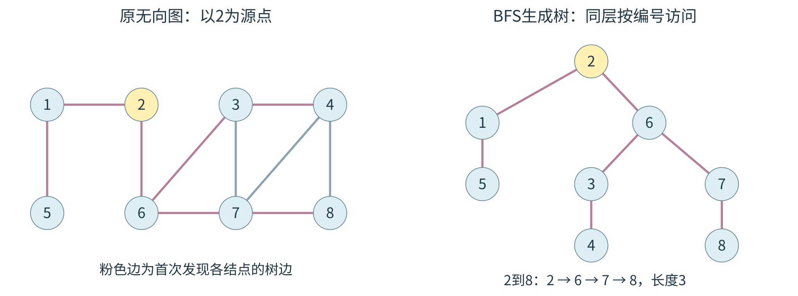

图中顶点1至8的距离依次为`1,0,2,3,2,1,2,3`，前驱为`2,-1,6,3,1,2,6,7`。目标8反向追踪得到$8\leftarrow7\leftarrow6\leftarrow2$，反转为最短路$2\to6\to7\to8$。

<a id="DS06-mst"></a>
## 最小生成树
MST在带权无向连通图中，最小化生成树的总边权；不连通时求最小生成森林。路径到某源点的距离不属于该目标。

```text
Prim(s):
    U={s}; lowCost[v]=w(s,v)，无边记无穷
    重复直到选入全部顶点:
        u=U外lowCost最小者
        若lowCost[u]=无穷: 原图不连通，停止
        选入parent[u]到u的边；U加入u
        对每个U外邻点v:
            若w(u,v)<lowCost[v]: 更新lowCost[v]及parent[v]
```

```text
Kruskal(G):
    将边按权非降排序；每个顶点初始化为单独集合
    对每条边(u,v,w):
        若find(u)!=find(v):
            选入此边；unite(u,v)
    若选入边数<n-1: 得到最小生成森林而非生成树
```

Prim的`lowCost[v]`保存当前集合到$v$的最轻跨割边；Kruskal按非降权处理边，端点属于不同当前分量时选边并合并。割的轻边可用交换论证安全加入：加入形成环后删去不更轻的跨割边，连通与最优性保持。

<a id="DS06-E03"></a>
### [例 6-3](../solutions/notes.md#a-DS06-E03)
求下图最小生成树，可能为 Kruskal 第2次选中、但不可能为从 $V_4$ 开始的 Prim 第2次选中的边是（　）。

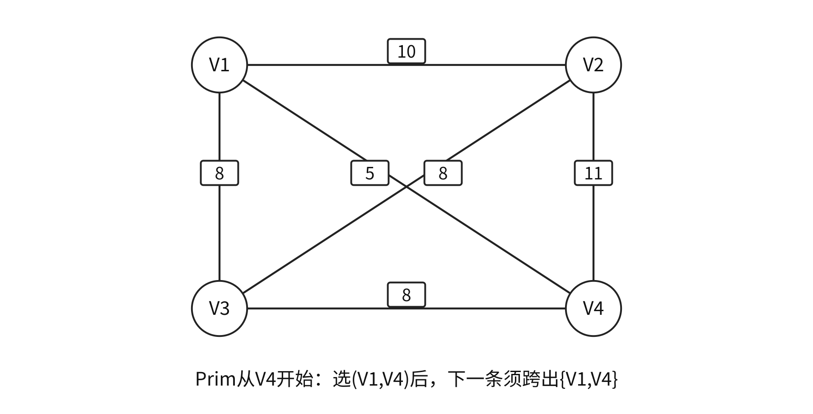{#ds-fig-mst width=78%}

A. $(V_1,V_3)$　B. $(V_1,V_4)$　C. $(V_2,V_3)$　D. $(V_3,V_4)$

矩阵朴素Prim时间$O(n^2)$；Kruskal主要为排序$O(|E|\log|E|)$，分量用并查集。边权互异足以保证MST唯一；有同权边时仍可能唯一。

<a id="DS06-shortest"></a>
## Dijkstra与Floyd
Dijkstra求非负权单源最短路。`dist`为已知路径上界，每轮永久确定集合外`dist`最小顶点，再按`dist[u]+w(u,v)`松弛。出现负边时标准算法失去通用保证；所有剩余距离为无穷时停止。

```text
Dijkstra(s):
    dist[s]=0；其余为无穷；S为空
    重复选择S外dist最小的u:
        若dist[u]=无穷: 停止
        S加入u
        对每条u到v，若v未确定且dist[u]+w(u,v)<dist[v]:
            更新dist[v]；parent[v]=u
```

<a id="DS06-E04"></a>
### [例 6-4](../solutions/notes.md#a-DS06-E04)
使用 Dijkstra 求下图从顶点1到其余顶点的最短路径，`dist` 依次保存到2、3、4、5的距离。求出第二条最短路径后，`dist` 内容为（　）。

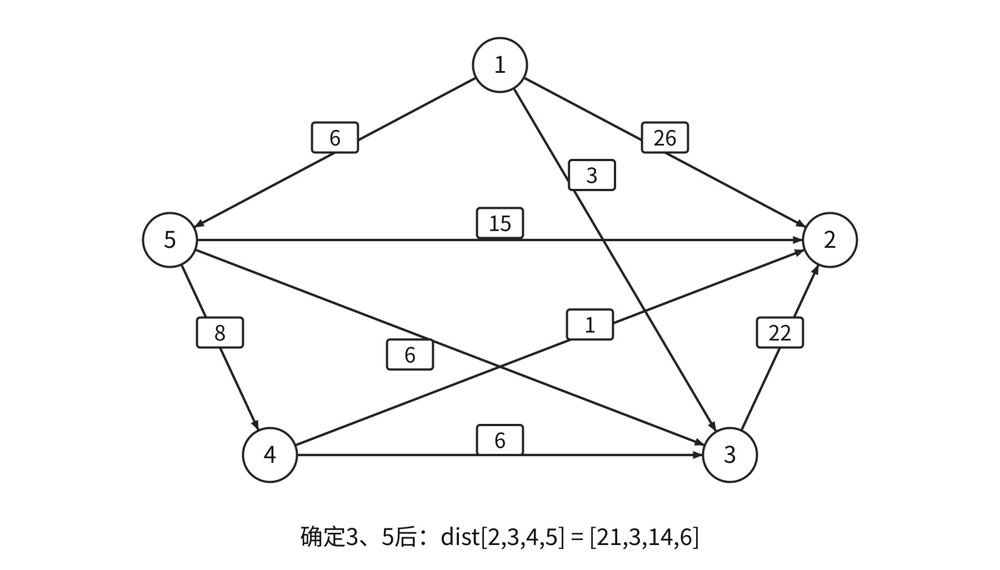{#ds-fig-dijkstra width=88%}

A. 26、3、14、6　B. 25、3、14、6　C. 21、3、14、6　D. 15、3、14、6

Floyd求任意点对最短路，允许负边，要求相关路径无负环。允许前$k$个中转点的阶段递推为

$$D^{(k)}[i,j]=\min\{D^{(k-1)}[i,j],D^{(k-1)}[i,k]+D^{(k-1)}[k,j]\}.$$

```text
Floyd(D):
    D[i][i]=0；其他位置按直接边初始化
    for k=0..n-1:
        for i=0..n-1:
            for j=0..n-1:
                若D[i][k]与D[k][j]均有限:
                    D[i][j]=min(D[i][j],D[i][k]+D[k][j])
```

中转点$k$必须在最外层；加法前检查两段距离有限。最终$D[v][v]<0$表明负环，受其影响的点对无有限最短值。无向负边可往返形成负权闭合游走。

矩阵Dijkstra单源$O(n^2)$，全源重跑$O(n^3)$；Floyd时间$O(n^3)$、距离矩阵$O(n^2)$。BFS只最小化同权边数。

例如直接矩阵

$$D=\begin{pmatrix}0&6&13\\10&0&4\\5&\infty&0\end{pmatrix}$$

依次允许0、1、2中转，分别更新$D[2,1]=11$、$D[0,2]=10$、$D[1,0]=9$。Floyd路径矩阵记录更新所用中转点，递归拆分两段；Dijkstra/BFS的`path[v]`记录直接前驱，两者解释不同。

<a id="DS06-topological"></a>
## DAG、拓扑排序与有向环
AOV网以顶点为活动、弧为先后依赖。拓扑序须使每条$u\to v$的$u$在$v$前；存在拓扑序当且仅当图为DAG。

```text
topological(G):
    统计所有顶点的入度；把入度0者入队Q
    count=0
    while Q非空:
        u=出队；输出u；count++
        对每条u到v: indeg[v]--
            若indeg[v]==0: v入队
    返回count==n
```

邻接表时间$O(n+|E|)$，矩阵$O(n^2)$。每轮零入度候选恰有一个且处理完全部顶点，拓扑序唯一。顶点按拓扑顺序编号时，邻接矩阵呈严格上三角；任意编号的DAG未必如此。

<a id="DS06-E05"></a>
### [例 6-5](../solutions/notes.md#a-DS06-E05)
载人航天工程包含众多子工程，为保证有序开展，需要明确前导子工程。这可抽象为有向图的拓扑序列问题。已知图G采用邻接矩阵存储：

```c
typedef struct {
    int numVertices,numEdges;
    char VerticesList[MAXV];
    int Edge[MAXV][MAXV];
} MGraph;
```

设计 `int uniquely(MGraph G)` 判定G是否存在唯一拓扑序列，是则返回1，否则返回0。给出设计思想及带关键注释的C或C++实现。

逆拓扑可从出度0开始删顶点及入弧，借助逆邻接表。DAG的DFS完成顺序为逆拓扑，反转即拓扑。DFS判有向环用三态：未访问、栈中、已完成；指向栈中顶点的边表明有环，指向已完成顶点无此保证。无向图检查回边须排除通往双亲的树边。

DAG可共享相同子表达式：操作符和有序输入均相同才合并。例$(a*b)*(a*b)*(a*b)*c$可共享一次$a*b$；多个输入位置可指同一结点。含副作用表达式须遵守原求值语义。

<a id="DS06-critical"></a>
## AOE网与关键路径
AOE网以顶点为事件、边为活动、非负权为持续时间，须无环。多源、多汇可用零时长虚边统一。事件等全部入活动完成才能发生。

$$\begin{aligned}
ve[v]&=\max_{u\to v}\{ve[u]+w(u,v)\},\\
vl[u]&=\min_{u\to v}\{vl[v]-w(u,v)\},\\
e(u,v)&=ve[u],\quad l(u,v)=vl[v]-w(u,v).
\end{aligned}$$

`ve`按拓扑序取最大，`vl`从汇点工期按逆拓扑取最小。活动余量$l-e$为0时为关键活动；源至汇最长带权路径为关键路径，其长度为最短总工期。

```text
criticalPath(G):
    取得拓扑序T；若不存在则模型非法
    ve[*]=0
    按T正序，对每条u到v: ve[v]=max(ve[v],ve[u]+w(u,v))
    D=ve[统一汇点]；vl[*]=D
    按T逆序，对每条u到v: vl[u]=min(vl[u],vl[v]-w(u,v))
    对每条活动u到v:
        e=ve[u]；l=vl[v]-w(u,v)
        若e==l: 该边为关键活动
```

<a id="DS06-E06"></a>
### [例 6-6](../solutions/notes.md#a-DS06-E06)
下图AOE网包含8个活动。通过同时加快若干活动，可缩短整个工程工期。下列选项中，加快所列活动进度就可缩短工期的是（　）。

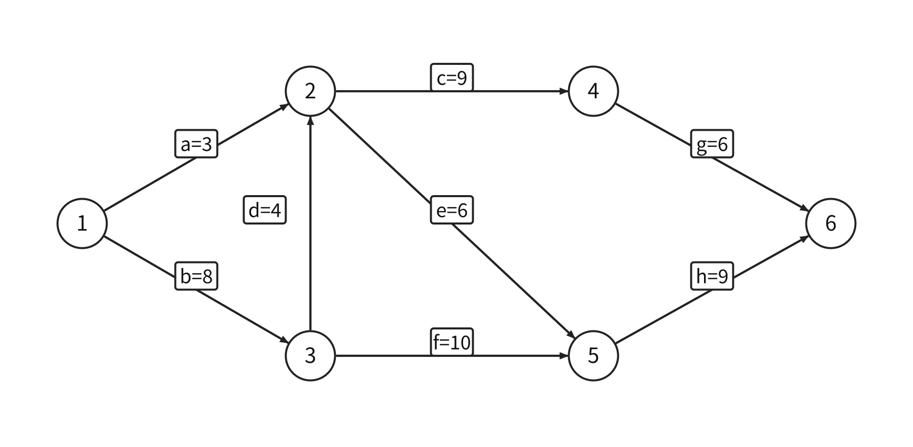{#ds-fig-aoe width=92%}

A. c和e　B. d和c　C. f和d　D. f和h

增加关键活动时长会延长工期；缩短工期须使所有当前关键路径均缩短，持续压缩还可能产生新关键路径。


<a id="DS07"></a>
# 查找
<a id="DS07-definition"></a>
## 关键字与平均查找长度
查找表为同类型记录的集合。主关键字唯一标识记录，次关键字可对应多条记录；静态表仅查找，动态表还支持插入、删除。存储为数组或链表不能单独决定静态、动态属性。

$$ASL=\sum_i p_iC_i.$$

先确定事件集合、概率$p_i$与代价$C_i$。成功事件为已有记录，失败事件可按关键字区间或初始散列地址分布；失败ASL分母未必等于表长或记录数。树结点访问次数、关键字比较次数、外存读盘次数分别统计。

<a id="DS07-sequential"></a>
## 顺序查找与分块查找
无序表逐项比较，等概率成功平均$(n+1)/2$次，失败比较$n$个实际记录。有序递增表从头查找时，当前值等于目标即成功，大于目标才可提前失败。

```cpp
typedef struct {
    ElemType *elem;
    int TableLen;
} SSTable;
int Search_Seq(SSTable ST, ElemType key) {
    ST.elem[0]=key;
    int i;
    for (i=ST.TableLen; ST.elem[i]!=key; --i) ;
    return i;
}
```

有效记录为`elem[1..TableLen]`，0号为可写哨兵，空表也需此位置。失败包括哨兵比较时为$n+1$次；返回0表示失败。结构体按值传入仍共享指针所指数组，写哨兵会改变原数组0号单元。

静态顺序查找按访问概率非增序排列可减小成功ASL。底稿六记录概率`0.15,0.05,0.10,0.40,0.28,0.02`原序ASL为3.67，按概率排序后为2.18。

**分块查找**要求块间有序、块内可无序，索引记录每块最大关键字及块起始位置。定位第一个最大关键字不小于目标的块，再块内顺序查找。索引折半未遇相等值时，结束的`low`可指目标块，超过末索引才直接失败。动态更新须维护块范围和索引最大值。

<a id="DS07-E01"></a>
### [例 7-1](../solutions/notes.md#a-DS07-E01)
查找表有400个元素，查找每个元素的概率相同，采用均匀分块。先顺序查找确定所在块，块内也顺序查找。为使查找效率最高，每块包含元素个数应为（　）。

A. 8　B. 10　C. 20　D. 25

<a id="DS07-binary"></a>
## 折半查找与判定树
折半查找要求**关键字有序且能随机定位中点**。以下有效范围为`elem[0..TableLen-1]`，采用闭区间及向下取整中点：

```cpp
int Binary_Search(SSTable L, ElemType key) {
    int low=0, high=L.TableLen-1, mid;
    while (low<=high) {
        mid=(low+high)/2;
        if (L.elem[mid]==key) return mid;
        else if (L.elem[mid]>key) high=mid-1;
        else low=mid+1;
    }
    return -1;
}
```

循环开始时若目标存在，必在`[low,high]`；排除相等后用`mid±1`去掉已比较项，`low>high`表示失败。大下标可用`low+(high-low)/2`防止求和溢出。

判定树成功次数等于内部结点层次，失败次数等于沿途内部结点数。$n\ge1$时最大比较次数为$\lfloor\log_2n\rfloor+1$。偶数区间取下中点时右子树多一项，树高平衡但未必完全；改取上中点会改变路径。

<a id="DS07-E02"></a>
### [例 7-2](../solutions/notes.md#a-DS07-E02)
长度为16的顺序表L按关键字有序，采用折半查找，查找一个不存在的元素，关键字比较次数最多为（　）。

A. 4　B. 5　C. 6　D. 7

长度11的表`7,10,13,16,19,29,32,33,37,41,43`中，查33比较`29,37,32,33`；查12比较`29,13,7,10`后失败。成功层次分布1、2、4、4个，等概率成功ASL为3；12个失败区间中4个需3次、8个需4次，失败ASL为$11/3$。

有序链表缺少常数时间中点访问，折半式比较的对数比较次数无法直接保证对数总访问时间。

<a id="DS07-bst"></a>
## 二叉搜索树
互异关键字BST的左子树全部值小于根、右子树全部值大于根，各子树递归满足。等价判据为中序严格递增。验证可传递全局允许区间；合法值包含整数极值时，用显式边界标志或更宽类型。

```cpp
typedef struct BSTNode {
    int key;
    struct BSTNode *lchild, *rchild;
} BSTNode, *BSTree;
BSTNode *BST_Search(BSTree T, int key) {
    while (T!=NULL && key!=T->key) {
        if (key<T->key) T=T->lchild;
        else T=T->rchild;
    }
    return T;
}
int BST_Insert(BSTree &T, int k) {
    if (T==NULL) {
        T=(BSTree)malloc(sizeof(BSTNode));
        T->key=k;
        T->lchild=T->rchild=NULL;
        return 1;
    } else if (k==T->key) return 0;
    else if (k<T->key) return BST_Insert(T->lchild,k);
    else return BST_Insert(T->rchild,k);
}
void Create_BST(BSTree &T, int str[], int n) {
    T=NULL;
    for (int i=0; i<n; ++i) BST_Insert(T,str[i]);
}
```

插入默认申请成功，重复关键字返回0；先搜索到空子树才建叶。操作为$O(h)$，普通BST最坏可退化到$O(n)$；迭代查找工作空间$O(1)$。

删除分三类：叶直接断开；单孩子由孩子接替；双孩子用中序前驱或后继替换，再删除原前驱/后继。前驱无右孩子、后继无左孩子，因此归结到前两类。

```text
erase(t,key):
    if t为空: return 空
    if key<t.key: t.lchild=erase(t.lchild,key)
    else if key>t.key: t.rchild=erase(t.rchild,key)
    else:
        if t.lchild为空: 保存t.rchild，释放t，返回保存值
        if t.rchild为空: 保存t.lchild，释放t，返回保存值
        q=t.rchild；沿q.lchild找到右子树最小结点
        t.key=q.key（记录有附加字段时一并复制）
        t.rchild=erase(t.rchild,q.key)
    return t
```

递归返回删除后的子树根，栈空间$O(h)$。复制须带整条记录；要求保留结点身份时采用移接。

<a id="DS07-avl"></a>
## AVL插入与删除
AVL为任意结点左右高差至多1的BST，平衡因子$BF=h_L-h_R$。插入后从新叶向上，找最近失衡祖先$A$：

| 失衡路径 | 调整 |
| --- | --- |
| LL | 对A右旋 |
| RR | 对A左旋 |
| LR | 左旋A的左孩子，再右旋A |
| RL | 右旋A的右孩子，再左旋A |

```cpp
void R_Rotate(BSTree &p) {
    BSTNode *lc=p->lchild;
    p->lchild=lc->rchild;
    lc->rchild=p;
    p=lc;
}
void L_Rotate(BSTree &p) {
    BSTNode *rc=p->rchild;
    p->rchild=rc->lchild;
    rc->lchild=p;
    p=rc;
}
```

引用参数接回新局部根。中间子树按关键字区间转接；若保存高度，先更新下降结点，再更新提升结点。只交换两个根值无法代替链接旋转。

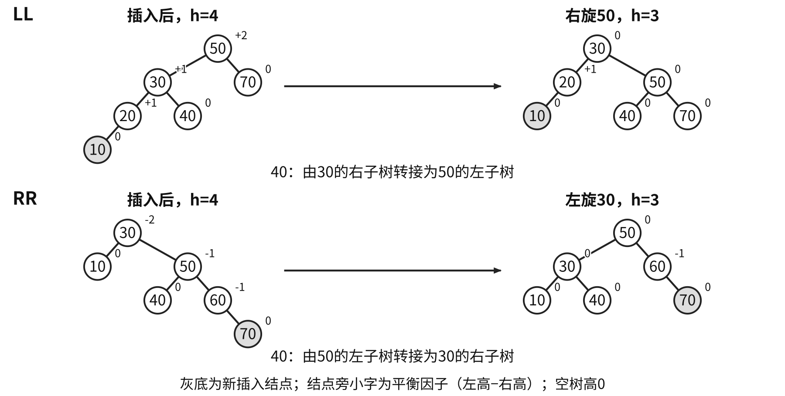

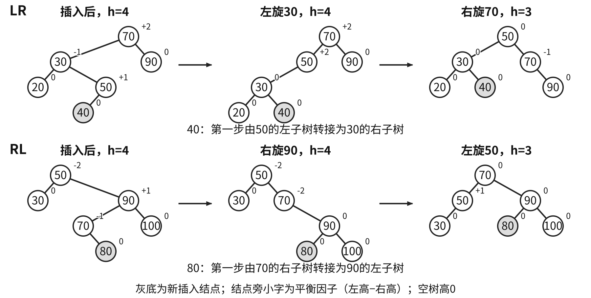

<a id="DS07-E03"></a>
### [例 7-3](../solutions/notes.md#a-DS07-E03)
把34、23、15、98、115、28、107依次插入初始为空的平衡二叉搜索树，要求每次插入后保持AVL性质，给出每步结果。

插入修复最小失衡子树后恢复原高度，可停止向上传播。最少结点数满足$N(0)=0,N(1)=1$、$N(h)=1+N(h-1)+N(h-2)$，故高$O(\log n)$。

**删除**先按BST删除，再沿实际被移除结点的祖先向上检查；修复后高度仍可能减1，需继续传播。

| A的BF | 较高孩子的BF | 调整 |
| --- | --- | --- |
| $+2$ | $+1$或0 | 右单旋A |
| $+2$ | $-1$ | 先左旋孩子，再右旋A |
| $-2$ | $-1$或0 | 左单旋A |
| $-2$ | $+1$ | 先右旋孩子，再左旋A |

孩子BF为0时，单旋后高度可保持删除前高度，上层停止受影响。例如`4(2(1,3),5)`删5后右旋为`2(1,4(3,空))`，高仍为3。查找、插删最坏均$O(\log n)$。

固定高度形态数满足$C(0)=C(1)=1$、$C(h)=C(h-1)^2+2C(h-1)C(h-2)$，故$C(2)=3,C(3)=15$；该量与固定结点数的卡特兰计数不同。

<a id="DS07-E04"></a>
### [例 7-4](../solutions/notes.md#a-DS07-E04)
一棵无重复关键字的AVL树，中序遍历得到降序序列。正确叙述是（　）。

A. 根的度一定为2　B. 最小元素一定是叶结点

C. 最后插入元素一定是叶结点　D. 最大元素一定没有左子树

<a id="DS07-redblack"></a>
## 红黑树
红黑树为BST并满足：每结点红或黑；根黑；空孩子为黑NIL；红结点的孩子黑；任一结点至后代NIL的路径黑结点数相同。

黑高$b$不计当前结点、计终点NIL，NIL自身黑高0。根黑的非空树内部结点数满足

$$2^b-1\le n\le2^{2b}-1.$$

相邻红结点受限，最长路径至多约为最短路径两倍，高度$O(\log n)$。

**插入**先按BST插入红叶：父黑直接结束；父红时看叔。红叔则父叔黑、祖父红并上移；黑叔含NIL，内侧折线先旋父转外侧，再旋祖父并交换提升结点与祖父颜色。最后根黑。旋转次数为常数，变色可能传播到根，完整插入仍$O(\log n)$。

**删除**先化为至多一非空孩子：删红无黑高损失；删黑有红孩子接替时染黑；黑/NIL接替造成缺黑。下表缺黑位置$x$为父$p$左孩子，兄弟$w$在右，近侧为$w$左孩子、远侧为$w$右孩子：

| 条件 | 修复 |
| --- | --- |
| w红 | w黑、p红，左旋p，重新取兄弟 |
| w黑、双孩子黑 | w红；p红则改黑结束，否则缺黑上移到p |
| w黑、远黑近红 | 近侧黑、w红，右旋w，转为下一行 |
| w黑、远红 | w取p原色、p与远侧黑，左旋p，结束 |

缺黑在右时左右对换；缺黑到根可结束。性质检查同时核对BST、中序、根/NIL、红红相邻及各路径黑高。

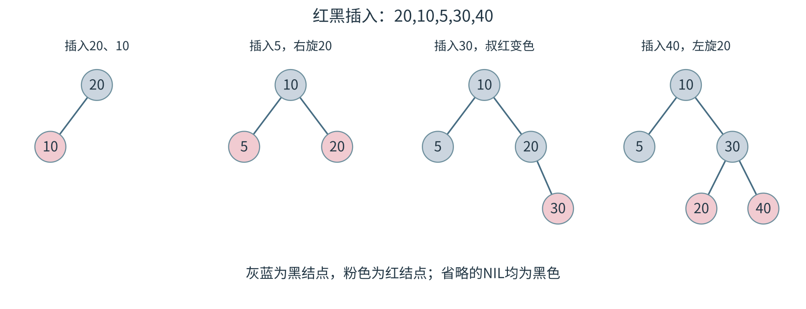

<a id="DS07-btree"></a>
## B树的容量、插入与删除
$m$阶B树每数据结点至多$m-1$键、$m$孩子；除根外至少$t-1$键，$t=\lceil m/2\rceil$。非底层数据结点$k$键对应$k+1$个孩子区间，非叶根至少1键、2孩子；底层数据结点等深。以下$m\ge3$，高度$h$只计数据层，排除失败空叶。

$$2t^{h-1}-1\le n\le m^h-1.$$

求最大高用最少容量，求最小高用最大容量。外存一结点一页时，查找最多读$h$个索引页，结点内部还需关键字比较。

**插入**沿路径到最底层数据结点插入，溢出则提升中间键、左右分裂，父溢出继续向上。内部分裂同步分配孩子，只有根分裂使高度增加。

**删除**内部键先以前驱或后继替换，再到底层删除。下溢时优先向有富余的相邻兄弟借：父分隔键下移、兄弟近侧键上移，必要时转接孩子。兄弟无富余则将下溢结点、父分隔键和兄弟合并，父可能继续下溢。空根仅剩一孩子时降层。

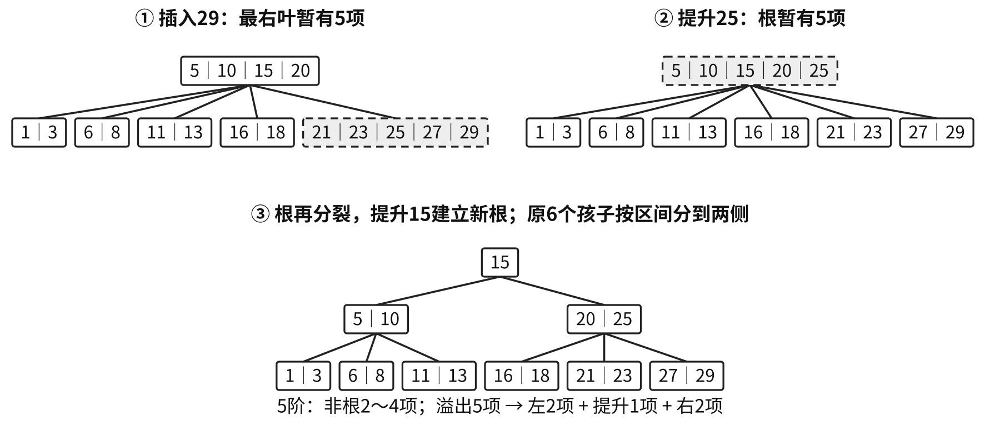

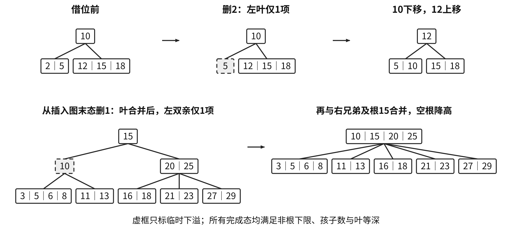

5阶每非根2至4键：两个合法2键兄弟加父键共5键，超过上限；应在删除造成一侧1键后按$1+1+2=4$合并。不能直接照搬其他阶数的提前合并规则。完成态须满足键有序、子树区间、容量、孩子数及底层等深。

<a id="DS07-E05"></a>
### [例 7-5](../solutions/notes.md#a-DS07-E05)
一棵3阶B树共有2047个关键字，最大高度为（　），最小高度为（　）。

A. 11　B. 10　C. 8　D. 7

<a id="DS07-E06"></a>
### [例 7-6](../solutions/notes.md#a-DS07-E06)
给定7个不同关键字，能构造的不同4阶B树的个数最多为（　）。

A. 7　B. 8　C. 9　D. 10

<a id="DS07-bplus"></a>
## B+树
记录或记录指针集中于叶层，内部层只存索引；叶含全体关键字并按序链接。点查沿根到叶，范围查先定位起点叶，再沿叶链扫描。

本章采用王道“每个内部索引键为一棵子树最大键”约定，内部键数等于孩子数：最多$m$，非根分支至少$\lceil m/2\rceil$，非叶根至少2。B树内部命中可结束，B+树记录查询仍降至叶。

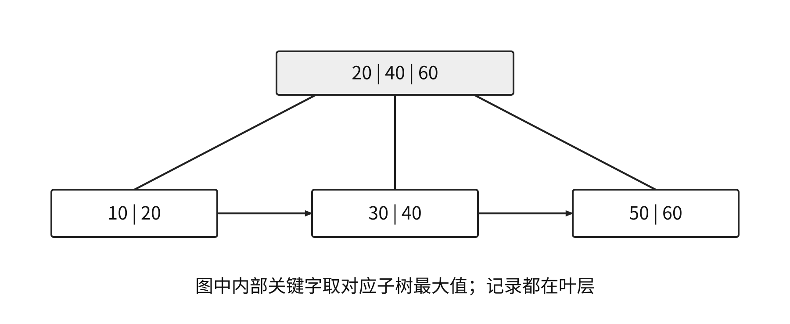

每页不携整条记录通常可提高内部扇出，减少外存层数；若叶仅存记录指针，读取叶外记录的I/O另计。

<a id="DS07-hash"></a>
## 散列函数与冲突处理
同一散列函数值的不同关键字为同义词。函数须确定、尽量均匀；装填因子$\alpha=n/m$，其中$m$为表长。

| 构造方法 | 条件与参数 |
| --- | --- |
| 直接定址$akey+b$ | 连续且范围可控的关键字 |
| 除留余数$key\bmod p$ | $p$通常取不大于表长的适当素数 |
| 数字分析 | 按已知分布选择均匀数位 |
| 平方取中 | 让多个数位共同影响结果 |

开放定址统一按$H_i=(H(key)+d_i)\bmod m$计算，每次增量加在初始地址上；初始散列模数$p$与探测模数$m$可不同。

| 探测方法 | 增量 | 覆盖条件 |
| --- | --- | --- |
| 线性 | $d_i=i$ | 连续$m$次遍历全表 |
| 正平方 | $d_i=i^2$ | 未必覆盖全表 |
| 正负平方 | $0,1,-1,4,-4,\ldots$ | $m=4j+3$为素数且增量充分时可覆盖 |
| 双散列 | $i\,hash_2(key)$ | 步长与$m$互质 |
| 伪随机 | 可复现的给定增量 | 检查模$m$的剩余类覆盖 |

双散列步长必须模$m$非零；素数表长可用`1+(key%(m-1))`生成合法步长，负数取模另约定。线性探测易聚集；平方探测即使表未满也可能到不了空位。

<a id="DS07-hash-state"></a>
### 槽状态与删除
```text
hashFind(key):
    按约定的探查序列访问地址
    若槽为有效且关键字相同: 成功
    若槽从未使用: 失败
    若槽已删除或关键字不同: 继续探查
    若可探查位置已耗尽: 失败
```

插入可记住首个删除槽；若禁止重复，仍须沿后续路径排除已存在同键。表满或可达探测位置耗尽时结束，防止无限循环。链地址法真实断链删除，无需墓碑。

<a id="DS07-E07"></a>
### [例 7-7](../solutions/notes.md#a-DS07-E07)
长度为5、初始为空的散列表HT，$H(k)=(k+4)\bmod5$，线性探查处理冲突。依次插入2022、12、25，再删除25，查找失败的平均查找长度为（　）。

A. 1　B. 1.6　C. 1.8　D. 2.2

<a id="DS07-E08"></a>
### [例 7-8](../solutions/notes.md#a-DS07-E08)
将20、3、11、18、9、14、7依次插入初始为空、长度11的HT。$H(key)=(key\times3)\bmod11$，初始地址为 $H_0$，冲突时 $H_k=(H_0+k^2)\bmod11\ (k=1,2,\ldots)$。

（1）画出HT并计算装填因子。（2）给出查找14时的关键字比较序列。（3）查找8，确认失败时的散列地址是多少？

<a id="DS07-hash-asl"></a>
### 散列ASL的事件与分母
链地址成功代价为桶内比较位置，失败代价为桶长；空桶失败的关键字比较为0，空指针判断另计。若$m$个桶等概率失败，ASL为$n/m$；桶内有序链可提前失败，须重算概率与路径。

底稿序列`19,14,23,1,68,20,84,27,55,11,10,79`以$key\bmod13$头插入桶，非空链为`1:79→27→1→14`、`3:55→68`、`6:84→19`、`7:20`、`10:10→23`、`11:11`。成功ASL为$21/12$，13桶等概率失败ASL为$12/13$。

同序列放表长16、初始$key\bmod13$、线性探测模16：0为空，1至12依次为`14,1,68,27,55,19,20,84,79,23,11,10`，13至15为空。成功ASL为$30/12=2.5$。失败初始地址只有0至12，探测长度`1,13,12,11,10,9,8,7,6,5,4,3,2`，故失败ASL为$91/13=7$。删除20留标记后，成功ASL为$29/11$，失败ASL仍为7。

<a id="DS07-comparison"></a>
## 按操作约束选择查找结构
| 结构 | 查找代价 | 适用条件与维护 |
| --- | --- | --- |
| 顺序查找 | 最坏$O(n)$ | 可无序，无有序维护 |
| 折半 | $O(\log n)$ | 有序顺序表，插删移动最坏$O(n)$ |
| 普通BST | $O(h)$，最坏$O(n)$ | 动态、有序，可能退化 |
| AVL、红黑树 | 最坏$O(\log n)$ | 动态更新并维护平衡性质 |
| B、B+树 | 至多$h$次索引页读取 | 多路外存索引；B+适合叶链范围访问 |
| 散列 | 合适函数与负载下平均$O(1)$ | 等值检索；链法最坏$O(n)$，开放定址最坏$O(m)$ |

有序范围检索需要关键字次序；散列扩容、树旋转、索引更新均属于维护代价。


<a id="DS08"></a>
# 排序
<a id="DS08-definition"></a>
## 稳定性、内外排序与计数口径
排序移动整条记录，以关键字确定次序。稳定排序保证相等关键字记录的原相对次序；用$2_a、2_b$追踪身份。稳定性为对全部合法输入的保证，单份无重复数据无法检验。

内部排序在处理期间全部记录驻内存；外部排序需分批交换内外存，主要计块I/O。比较次数、移动次数、趟数和辅助空间分别统计。

本章直接插入一趟处理一个新记录，希尔一趟处理一个增量的全部组，归并一趟处理全部相邻段。快排过程题按同一深度全部未定子区间各划分一次为一趟；程序若按单次划分计趟，以具体定义为准。

<a id="DS08-insertion"></a>
## 直接插入与折半插入
直接插入保持有序前缀，将新值前所有严格大于它的值后移，插在旧相等值后，因而稳定。以下采用`A[1..n]`、`A[0]`暂存兼哨兵，数组需$n+1$单元。

```cpp
void InsertSort(int A[], int n) {
    int i,j;
    for (i=2; i<=n; ++i)
        if (A[i]<A[i-1]) {
            A[0]=A[i];
            for (j=i-1; A[0]<A[j]; --j)
                A[j+1]=A[j];
            A[j+1]=A[0];
        }
}
```

有序输入每趟只比较一次，最好$\Theta(n)$；逆序输入的有效记录后移数为$n(n-1)/2$（暂存与写回另计），平均、最坏$\Theta(n^2)$，空间$O(1)$。

折半插入在有序前缀中找第一个大于新值的位置，减少比较，搬移仍可能二次：

```cpp
void BinaryInsertSort(int A[], int n) {
    int i,j,low,high,mid;
    for (i=2; i<=n; ++i) {
        A[0]=A[i];
        low=1; high=i-1;
        while (low<=high) {
            mid=(low+high)/2;
            if (A[mid]>A[0]) high=mid-1;
            else low=mid+1;
        }
        for (j=i-1; j>=high+1; --j) A[j+1]=A[j];
        A[high+1]=A[0];
    }
}
```

每趟均完整折半定位时，总比较$\Theta(n\log n)$，最好总时间亦$\Theta(n\log n)$；平均、最坏移动与总时间$\Theta(n^2)$。若先判断新值已不小于前缀末项并跳过定位，有序输入可线性，须按该实现重算。

<a id="DS08-exchange-selection"></a>
## 起泡与简单选择
起泡仅交换相邻逆序，稳定；教材从后向前扫描，每趟把剩余最小记录送到前端。无交换即停，最好$\Theta(n)$，平均、最坏$\Theta(n^2)$，空间$O(1)$。

```cpp
void BubbleSort(int A[], int n) {
    for (int i=0; i<n-1; ++i) {
        bool flag=false;
        for (int j=n-1; j>i; --j)
            if (A[j-1]>A[j]) {
                int temp=A[j-1];
                A[j-1]=A[j]; A[j]=temp;
                flag=true;
            }
        if (flag==false) return;
    }
}
```

简单选择每趟找未排序区最小记录，与首位交换。比较总数恒为$n(n-1)/2$，至多$n-1$次交换，所有情况时间$\Theta(n^2)$、空间$O(1)$。远距离交换可破坏稳定性：$2_a,2_b,1\to1,2_b,2_a$。

```cpp
void SelectSort(int A[], int n) {
    for (int i=0; i<n-1; ++i) {
        int min=i;
        for (int j=i+1; j<n; ++j)
            if (A[j]<A[min]) min=j;
        if (min!=i) {
            int temp=A[i]; A[i]=A[min]; A[min]=temp;
        }
    }
}
```

<a id="DS08-shell"></a>
## 希尔排序
每个正增量$d$将下标同余的记录作直接插入，完成后仅保证$d$间隔有序。增量逐步缩小，末增量必须1。希尔不稳定，复杂度依赖增量序列，空间通常$O(1)$。

```cpp
void ShellSort(int A[], int n) {
    int d,i,j;
    for (d=n/2; d>=1; d=d/2)
        for (i=d+1; i<=n; ++i)
            if (A[i]<A[i-d]) {
                A[0]=A[i];
                for (j=i-d; j>0 && A[0]<A[j]; j-=d)
                    A[j+d]=A[j];
                A[j+d]=A[0];
            }
}
```

有效范围`A[1..n]`，0号只暂存；并非每组均能经过0号，因此保留`j>0`边界。

<a id="DS08-E01"></a>
### [例 8-1](../solutions/notes.md#a-DS08-E01)
采用希尔排序算法，输入序列为 `13,24,7,1,8,9,11,56,34,51,2,77,5`，增量依次为5、3、1。两趟排序后为（　）。

A. 1,7,8,9,13,24,11,34,51,2,5,56,77

B. 1,7,5,2,8,9,24,11,34,51,13,77,56

C. 2,11,5,1,8,9,24,7,34,51,13,77,56

D. 2,5,11,1,8,9,7,24,34,13,51,77,56

<a id="DS08-quick"></a>
## 快速排序与部分选择
以下首记录为枢轴、双向挖坑划分，采用0起始或给定闭区间：

```cpp
int Partition(int A[], int low, int high) {
    int pivot=A[low];
    while (low<high) {
        while (low<high && A[high]>=pivot) --high;
        A[low]=A[high];
        while (low<high && A[low]<=pivot) ++low;
        A[high]=A[low];
    }
    A[low]=pivot;
    return low;
}
```

```cpp
void QuickSort(int A[], int low, int high) {
    if (low<high) {
        int pivotpos=Partition(A,low,high);
        QuickSort(A,low,pivotpos-1);
        QuickSort(A,pivotpos+1,high);
    }
}
```

划分后枢轴就位，左区不大于枢轴、右区不小于枢轴，两区内部继续递归。单次划分$\Theta(区间长)$；均衡划分完整时间$\Theta(n\log n)$，连续端点划分为$\Theta(n^2)$。首枢轴版本的有序输入为最坏情形。

随机排列或随机枢轴模型下平均$\Theta(n\log n)$；栈平均$O(\log n)$、最坏$O(n)$，算法不稳定。相等值多时，划分平衡性依扫描规则而变；三路划分须独立说明状态。

例如`49_a,38,65,97,76,13,27,49_b`首次划分为`27,38,13,49_a,76,97,65,49_b`，枢轴位于下标3。

<a id="DS08-E02"></a>
### [例 8-2](../solutions/notes.md#a-DS08-E02)
对尚未确定最终位置的所有元素进行一遍处理称为一趟。下列序列中，不可能是快速排序第二趟结果的是（　）。

A. 5,2,16,12,28,60,32,72

B. 2,16,5,28,12,60,32,72

C. 2,12,16,5,28,32,72,60

D. 5,2,12,28,16,32,72,60

<a id="DS08-E09"></a>
### [例 8-9](../solutions/notes.md#a-DS08-E09)
n（n>100000）个数保存在一维数组M中，需要查找最小的10个数。

（1）设计算法，要求平均情况下比较次数尽可能少，简述思想，不需要程序实现。

（2）说明平均时间复杂度和空间复杂度。

<a id="DS08-heap"></a>
## 堆排序
升序排序建大根堆，交换堆顶与当前末元素，缩小堆范围后下滤；有序后缀不再参加调整。小根堆按相同步骤将最小值放末尾，最终为降序。

```cpp
void HeadAdjust(int A[], int k, int len) {
    A[0]=A[k];
    for (int i=2*k; i<=len; i*=2) {
        if (i<len && A[i]<A[i+1]) ++i;
        if (A[0]>=A[i]) break;
        A[k]=A[i];
        k=i;
    }
    A[k]=A[0];
}
void BuildMaxHeap(int A[], int len) {
    for (int i=len/2; i>0; --i) HeadAdjust(A,i,len);
}
void HeapSort(int A[], int len) {
    BuildMaxHeap(A,len);
    for (int i=len; i>1; --i) {
        int temp=A[i]; A[i]=A[1]; A[1]=temp;
        HeadAdjust(A,1,i-1);
    }
}
```

有效元素`A[1..len]`，0号暂存。下滤要求左右子树已经成堆，每层先选较大孩子再比较候选。自底向上建堆$O(n)$，完整排序最坏$\Theta(n\log n)$，迭代辅助空间$O(1)$，不稳定。

<a id="DS08-E03"></a>
### [例 8-3](../solutions/notes.md#a-DS08-E03)
小根堆为 `8,15,10,21,34,16,12`，删除关键字8之后重建堆，此过程中关键字之间的比较次数是（　）。

A. 1　B. 2　C. 3　D. 4

`53,17,78,9,45,65,87,32`从下标4、3、2、1依次调整，建成`87,45,78,32,17,65,53,9`；第一轮排序后为`78,45,65,32,17,9,53 | 87`。

<a id="DS08-merge"></a>
## 二路归并
比较两个有序段当前首记录，相等先取左段，一段耗尽直接复制余段，保持稳定。长度$a,b$的两段最坏比较$a+b-1$次，具体过程可能更少。

```cpp
// B在排序开始前分配，容量至少等于A的有效数组长度。
int *B;
void Merge(int A[], int low, int mid, int high) {
    int i,j,k;
    for (k=low; k<=high; ++k) B[k]=A[k];
    for (i=low,j=mid+1,k=i; i<=mid && j<=high; ++k)
        if (B[i]<=B[j]) A[k]=B[i++];
        else A[k]=B[j++];
    while (i<=mid) A[k++]=B[i++];
    while (j<=high) A[k++]=B[j++];
}
void MergeSort(int A[], int low, int high) {
    if (low<high) {
        int mid=(low+high)/2;
        MergeSort(A,low,mid);
        MergeSort(A,mid+1,high);
        Merge(A,low,mid,high);
    }
}
```

`B`在排序前分配，容量覆盖有效下标范围。每层处理$\Theta(n)$记录，共$\Theta(\log n)$层；常规数组版最好、平均、最坏均$\Theta(n\log n)$，辅助区$\Theta(n)$，递归栈$O(\log n)$。

自底向上把单元素视为段，段长按1、2、4、8增长；最后一组允许不足两个完整段。

<a id="DS08-E04"></a>
### [例 8-4](../solutions/notes.md#a-DS08-E04)
三个有序序列 `(3,5)`、`(7,9)`、`(6)`，按从左到右次序选择序列进行二路归并，关键字总比较次数为（　）。

A. 3　B. 4　C. 5　D. 6

<a id="DS08-distribution"></a>
## 基数与计数排序
LSD从低位到高位稳定排序，每轮同桶按原顺序追加、收集，保留已处理低位关系。MSD先按高位分桶，再递归处理各桶。负数、可变长串和空缺位需额外约定次序。

```text
LSD(records,d,r):
    从最低位到最高位执行d轮:
        清空r个桶
        按当前序列从前向后，把记录追加到对应桶尾
        按桶号递增、桶内先入先出收集
```

$d$位、基数$r$时，时间$\Theta(d(n+r))$。已有链接域的链式记录可只用$O(r)$桶头、桶尾；数组分配需$O(n+r)$空间。链式分配须先保存原后继，再摘下并接桶尾；收集连接各桶首尾。递减输出按桶号逆序收集，桶内仍FIFO。

<a id="DS08-E05"></a>
### [例 8-5](../solutions/notes.md#a-DS08-E05)
对 `05,46,13,55,94,17,42` 进行基数排序，一趟后的结果为（　）。

A. 05,46,13,55,94,17,42

B. 05,13,17,42,46,55,94

C. 42,13,94,05,55,46,17

D. 05,13,46,55,17,42,94

<a id="DS08-counting"></a>
### 稳定计数排序
整数范围`min..max`，令$k=max-min+1$。频次累加成前缀和，再从后向前按剩余位置输出整条记录，保持稳定。

```c
void CountSort(int A[], int B[], int n, int k) {
    int i, C[k];
    for (i=0; i<k; ++i) C[i]=0;
    for (i=0; i<n; ++i) ++C[A[i]];
    for (i=1; i<k; ++i) C[i]+=C[i-1];
    for (i=n-1; i>=0; --i) {
        --C[A[i]];
        B[C[A[i]]]=A[i];
    }
}
```

该C99变长数组版本要求$k>0,n\ge0,0\le A[i]<k$，`B`容量至少$n$，输出在B。一般整数用`key-min`作计数下标；检查范围差是否溢出和数组申请是否成功。时间、空间均$\Theta(n+k)$，适合较小值域。

例如$2_a,4,3_a,0,2_b,3_b$的频次为`1,0,2,2,1`，前缀和为`1,1,3,5,6`，稳定结果为$0,2_a,2_b,3_a,3_b,4$。

<a id="DS08-external"></a>
## 外部归并：段数、缓冲与I/O
先把内存可容纳的一批记录排成初始段，再多路归并。内存$B$块，每路至少一输入缓冲、另留一输出缓冲，简单方案最多$B-1$路；双缓冲等结构需另占空间。

$r\ge1$个初始段、固定$k\ge2$路平衡归并：

$$s=\lceil\log_k r\rceil,\qquad \text{归并I/O}=2Ns,\qquad \text{含初始段生成}=2N(1+s).$$

$N$为文件块数，前提为每趟全文件读写、最后输出写盘，未计寻道和缓存节省。每趟段数变为$\lceil r/k\rceil$，末组可不足$k$路。

```text
mergeKRuns(runs):
    每路读入首缓冲块，另留输出块
    重复选择各非空路当前最小首记录，写入输出缓冲
    选中路的块用尽时读它的下一块
    输出块满时写外存；最后写出不足一块的剩余输出
```

16块文件、每批装2块生成8段，生成读写32块；二路$8\to4\to2\to1$共3趟，合计128块；四路$8\to2\to1$共2趟，需4输入加1输出缓冲，合计96块。4500记录、每块75条、内存450条时有60块、10初始段；5路归并两趟，含生成共360块I/O。

<a id="DS08-replacement"></a>
### 置换—选择
工作区$m$条，输出当前可用最小值$x$后读入$y$；$y\ge x$可留本段，$y<x$冻结至下段。可用记录耗尽才结束本段、解冻全部记录。

```text
replacementSelection(input,m):
    工作区读入至多m条，标记为当前段可用
    while 工作区非空:
        若无可用记录: 结束当前段，全部冻结项解冻
        输出可用记录中最小的x
        若还有输入，读入y占用x释放的位置:
            若y<x则冻结，留下一段；否则本段可用
        否则删除该工作区位置
```

输出段长度可超过工作区容量；随机输入常见平均段长约$2m$的结论依赖随机模型，具体输入按实际状态计算。

<a id="DS08-E06"></a>
### [例 8-6](../solutions/notes.md#a-DS08-E06)
对含 $n>0$ 个记录的文件外部排序，以置换—选择生成初始归并段，工作区能保存m个记录。

（1）文件19个关键字依次为 `51,94,37,92,14,63,15,99,48,56,23,60,31,17,43,8,90,166,100`，m=4时生成几个初始段？各是什么？

（2）对任意m（$n\gg m>0$），第一个初始段长度最大、最小值分别是多少？

<a id="DS08-optimal-merge"></a>
### 败者树与最佳归并树
$k$路归并的败者树以各路为叶，内部保存比较败者，另存冠军。冠军输出、该路换入新首记录后，只沿原比赛路径重比，每层一次，更新$O(\log k)$。

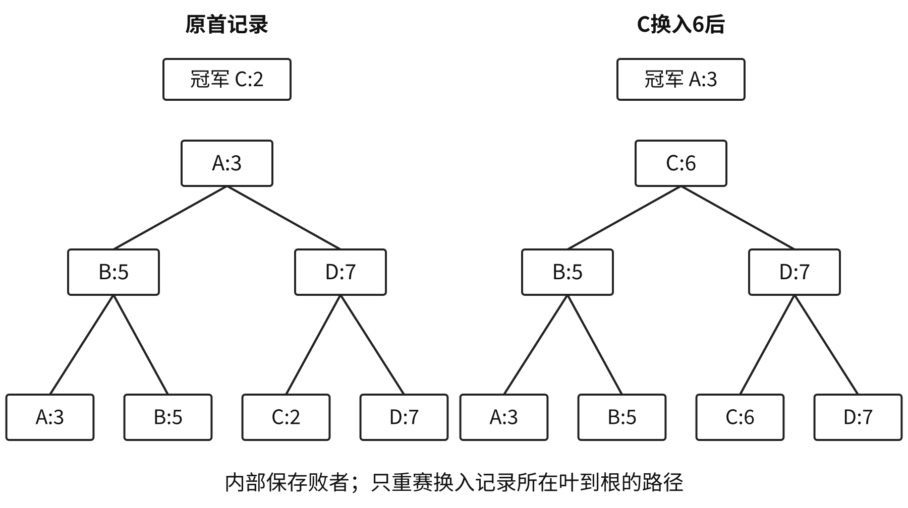

不等长段的最佳归并以段长为叶权，最小化归并树WPL。二路每次合并当前两个最短段；$k$路每次合并当前$k$个最短段，先补最少零权叶，使$(r'-1)\bmod(k-1)=0$。补虚段用于最优树的完整分支模型。

<a id="DS08-E07"></a>
### [例 8-7](../solutions/notes.md#a-DS08-E07)
6个升序表A、B、C、D、E、F，分别含10、35、40、50、60、200个元素。通过5次两两合并成为一个升序表，要求最坏情况下比较总次数最小。

（1）给出完整合并过程及最坏比较总次数。（2）描述N个不等长升序表的合并策略并说明理由。

<a id="DS08-E08"></a>
### [例 8-8](../solutions/notes.md#a-DS08-E08)
12个初始段长分别为30、44、8、6、3、20、60、18、9、62、68、85。进行4路外部归并，画出最佳归并树并计算WPL。

若段长以块计，每次归并完整读写，归并阶段I/O为$2WPL$，生成初始段另计；该口径按不等长段的各内部结点累计。

<a id="DS08-comparison"></a>
## 排序性能与选择
下表为完整排序总时间。平均列比较排序采用互异关键字等概率排列；折半插入每趟完整定位，起泡有早停，归并无跳过有序段优化。

| 算法 | 最好 | 平均 | 最坏 |
| --- | --- | --- | --- |
| 直接插入 | $\Theta(n)$ | $\Theta(n^2)$ | $\Theta(n^2)$ |
| 折半插入 | $\Theta(n\log n)$ | $\Theta(n^2)$ | $\Theta(n^2)$ |
| 起泡 | $\Theta(n)$ | $\Theta(n^2)$ | $\Theta(n^2)$ |
| 简单选择 | $\Theta(n^2)$ | $\Theta(n^2)$ | $\Theta(n^2)$ |
| 希尔 | 依增量 | 依增量 | 依增量 |
| 快速 | $\Theta(n\log n)$ | $\Theta(n\log n)$ | $\Theta(n^2)$ |
| 堆 | $O(n\log n)$ | $\Theta(n\log n)$ | $\Theta(n\log n)$ |
| 二路归并 | $\Theta(n\log n)$ | $\Theta(n\log n)$ | $\Theta(n\log n)$ |
| LSD | $\Theta(d(n+r))$ | 同左 | 同左 |
| 计数 | $\Theta(n+k)$ | 同左 | 同左 |

| 算法 | 辅助空间 | 稳定性条件 |
| --- | --- | --- |
| 直接/折半插入 | $O(1)$ | 相等新项放旧项后，稳定 |
| 起泡 | $O(1)$ | 仅严格逆序相邻交换，稳定 |
| 简单选择、希尔、堆 | $O(1)$ | 不稳定 |
| 快速 | 栈平均$O(\log n)$、最坏$O(n)$ | 不稳定 |
| 归并 | $\Theta(n)$ | 相等先取左段，稳定 |
| LSD | 链式$O(r)$；数组$O(n+r)$ | 同桶保序，稳定 |
| 计数 | $\Theta(n+k)$ | 逆向按前缀和输出整记录，稳定 |

堆排序教材常在互异关键字模型把最好列为对数线性阶；允许全相等且下滤相等即停时，本章代码的建堆与输出可总计$\Theta(n)$。起泡无早停时，有序输入仍二次；归并若另加已有序段跳过判断，最好情况随之变化。

规模小或近有序可选直接插入；需最坏对数线性且常数空间可选堆；需稳定且可用线性辅助区可选归并；少量固定位、较小整数值域分别比较基数、计数代价。快排子区间、归并同层各段可独立处理；LSD各位有依赖，每位内部仍可设计并行分配。

仅靠两两比较区分$n$个互异关键字全部排列时，决策树至少有$n!$叶，最坏比较次数至少$\lceil\log_2(n!)\rceil=\Omega(n\log n)$。计数、基数利用关键字值域或数位结构，适用另一成本模型。
