# 计算机组成原理强化笔记


<a id="CO01"></a>
# 计算机系统与程序执行的层次
<a id="CO01-components"></a>
## 系统组成与五大功能部件
计算机系统由硬件和软件组成。主机通常包含 CPU 与主存；CPU 包含运算器、控制器和寄存器。辅存、输入设备、输出设备合称外部设备。功能部件与物理芯片的划分可不同，一个 CPU 芯片可集成多个核、Cache 和存储控制器。

| 功能部件 | 基本任务 | 典型状态或部件 |
|---|---|---|
| 运算器 | 算术、逻辑与移位运算 | ALU、操作数与结果寄存器 |
| 控制器 | 取指、译码、产生控制信号、决定后继指令 | PC、IR、控制逻辑 |
| 存储器 | 按地址保存指令与数据 | 主存保存执行所需内容，辅存提供大容量非易失空间 |
| 输入设备 | 将外部信息转换成机器能处理的形式 | 经接口输入程序和数据 |
| 输出设备 | 将内部结果转换成外部所需形式 | 经接口输出数据 |

CPU 数据通路包括寄存器、运算部件及其连接；控制器决定数据流向和操作时刻。早期冯·诺依曼机以运算器为中心，现代组织通常以存储器为中心，外设可经接口、总线和 DMA 与主存交换数据。

<a id="CO01-execution"></a>
## 存储程序与指令执行
存储程序：执行前将指令和数据存入存储器，运行时自动取指、译码、执行。指令与数据均为二进制位串，其用途由当前执行阶段、地址和指令语义确定。冯·诺依曼机由指令控制执行次序，属于控制流驱动。

| 执行阶段 | 地址或数据来源 | 结果 |
|---|---|---|
| 取指 | PC 给出指令地址 | 指令经存储器读入 IR |
| 译码与取操作数 | IR 操作码、地址字段及寻址规则 | 确定操作、操作数和有效地址 |
| 执行与写回 | 数据通路完成运算、访存或转移 | 更新寄存器、存储器和标志 |
| 后继地址形成 | 顺序地址或转移、调用、异常入口 | 更新 PC，继续取指 |

PC 的顺序增量由地址单位和指令长度决定：按字节编址、定长 4 B 指令时通常加 4。流水线可使多条指令的各阶段重叠；程序可见效果仍须符合 ISA。

MAR 保存本次主存访问地址，MDR 保存本次交换的位串；二者可在不同阶段分别传送指令地址、数据地址以及指令、数据。

<a id="CO01-program"></a>
### 程序 $y=ab+c$ 的寄存器状态
按字编址，地址 0～4 存取数、乘法、加法、存数和停机指令，地址 5～8 存 $a=2,b=3,c=1,y=0$。

| 指令地址 | 数据操作 | 完成状态 |
|---|---|---|
| 0 | $M[5]\to\mathrm{ACC}$ | ACC=2，后继地址1 |
| 1 | $\mathrm{ACC}\times M[6]\to\mathrm{ACC}$ | ACC=6，后继地址2 |
| 2 | $\mathrm{ACC}+M[7]\to\mathrm{ACC}$ | ACC=7，后继地址3 |
| 3 | $\mathrm{ACC}\to M[8]$ | $M[8]=7$，后继地址4 |
| 4 | 停机 | 计算结束 |

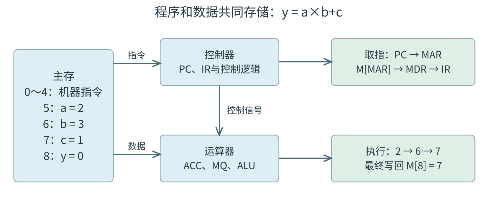

示意机器中 ACC 暂存操作数或结果，MQ 辅助保存乘数或乘积低位，X 暂存另一个输入。具体寄存器配置以题设数据通路为准。

<a id="CO01-architecture"></a>
## ISA、系统层次与软件
| 对象 | 规定或提供的内容 |
|---|---|
| ISA（指令集体系结构） | 软件可见的指令功能与编码、寄存器、数据类型、寻址方式和存储访问规则 |
| 微体系结构 | ISA 的内部实现：流水级、转发、Cache 组织、加法器结构等 |
| 操作系统 | 资源管理、进程运行环境和服务接口 |
| 系统软件 | 操作系统、语言处理程序、数据库管理系统、相关工具和库 |
| 应用软件 | 面向用户具体任务的程序 |

相同 ISA 可由不同微体系结构实现，具有不同 CPI。机器码执行还受操作系统、ABI、库及可执行文件格式约束。软硬件逻辑功能等价表示同一功能可由软件算法或专用硬件实现，选择取决于时间、空间、成本、功耗与可修改性。

常用抽象层次自下而上为微程序机器级、传统机器语言级、操作系统级、汇编语言级、高级语言级。微程序级适用于采用微程序控制的机器。“透明”表示上层使用者无需处理下层实现细节。

<a id="CO01-translation"></a>
### 程序翻译与装入
$$\begin{aligned}
\text{源程序}&\xrightarrow{\text{预处理}}\text{展开后的源程序}\\
&\xrightarrow{\text{编译}}\text{汇编程序}\xrightarrow{\text{汇编}}\text{可重定位目标文件}\\
&\xrightarrow{\text{链接}}\text{可执行文件}.
\end{aligned}$$

预处理展开头文件、宏等；链接合并目标与库，完成符号解析和重定位；装入建立进程地址空间并准备执行入口。宏和伪指令可展开为零条、一条或多条机器指令，一条高级语言语句与机器指令条数无固定对应关系。

解释器在运行时读取源程序或中间表示并完成操作，解释器自身由机器指令运行。语言实现可组合解释、预编译和即时编译。

<a id="CO01-E01"></a>
### [例 1-1](../solutions/notes.md#a-CO01-E01)
计算机硬件能够直接执行的是（　）。

I. 机器语言程序　II. 汇编语言程序　III. 硬件描述语言程序

A. 仅 I　 B. 仅 I、II　 C. 仅 I、III　 D. I、II、III

<a id="CO01-capacity"></a>
## 字长、编址与容量
| 名称 | 含义 |
|---|---|
| 机器字长 | CPU 一次整数运算通常能处理的基本位宽 |
| 存储字长 | 一个存储单元保存的位数 |
| 指令字长 | 一条指令编码所占位数，可定长或变长 |
| MAR 位数 | 可编码的主存地址位数 |
| MDR 位数 | 一次主存数据交换的位宽 |

若 $m$ 位完整地址全部可用，每个地址对应 $w$ 位，则容量为 $2^m w$ bit。按字节编址时为 $2^m$ B。已安装物理容量可以小于可编址空间。

- 20 位字节地址：1 MiB；20 位、16 位字地址：2 MiB。
- $2^{10}$ 个16位单元：2 KiB；按字编址需10位，改为按字节编址需11位。
- 4 KiB 主存、存储字长32位：按字编址需10位，按字节编址需12位。

容量常用 $1\mathrm{KiB}=2^{10}\mathrm B$、$1\mathrm{MiB}=2^{20}\mathrm B$；频率、速率的 k、M、G 通常按 $10^3,10^6,10^9$。带宽为每次传送字节数乘每秒传送次数，单位进制服从题设。

<a id="CO01-performance"></a>
## CPU 执行时间与性能指标
响应时间为从请求到得到结果的总历时；吞吐量为单位时间完成的任务量。程序总时间可包含 CPU 工作、I/O 等待和调度等。CPU 时间按实际动态执行的指令计算。

设第 $i$ 类指令执行 $n_i$ 条、平均占 $c_i$ 个周期，主频为 $f$：

$$N=\sum_i n_i,\qquad C=\sum_i n_i c_i,\qquad\overline{\mathrm{CPI}}=\frac{C}{N}=\sum_i\frac{n_i}{N}c_i,$$

$$T_{\mathrm{CPU}}=\frac{N\overline{\mathrm{CPI}}}{f}=N\overline{\mathrm{CPI}}T_{\mathrm{clk}},\qquad T_{\mathrm{clk}}=\frac1f.$$

平均 CPI 以指令条数为权重；Cache 缺失、流水停顿等也计入统计范围内的周期。多发射处理器的平均 CPI 可以小于1，单条指令仍可能经历多个周期的延迟。

| 指标 | 定义及计算条件 |
|---|---|
| IPC | 每周期平均完成指令数；同一统计区间下 $\mathrm{IPC}=1/\overline{\mathrm{CPI}}$ |
| MIPS | 每秒百万条指令，$f/(\overline{\mathrm{CPI}}\times10^6)$ |
| MFLOPS／GFLOPS／TFLOPS | 每秒浮点运算数分别除以 $10^6/10^9/10^{12}$ |
| 同一任务性能比 | $P_A/P_B=T_B/T_A$ |

不同 ISA、编译器和优化方案可改变动态指令数与指令组成。比较同一任务优先使用实际执行时间，主频、CPI、MIPS 和字长各自只描述部分条件。

<a id="CO01-E02"></a>
### [例 1-2](../solutions/notes.md#a-CO01-E02)
某计算机主频为1 GHz，程序 P 运行过程中共执行10000条指令，其中80%的指令执行平均需1个时钟周期，20%的指令执行平均需10个时钟周期。程序 P 的平均 CPI 和 CPU 执行时间分别是（　）。

A. 2.8，28 μs　 B. 28，28 μs　 C. 2.8，28 ms　 D. 28，28 ms

<a id="CO01-ratio"></a>
### 性能变化的时间比
同一任务，前后两方案满足同一 CPU 时间模型时：

$$\frac{T'}{T}=\frac{N'}N\frac{\mathrm{CPI}'}{\mathrm{CPI}}\frac f{f'}.$$

编译优化可同时改变 $N$ 与 CPI；Cache 改进通常减少停顿；升频还可能伴随 CPI 变化。若20 s程序指令数变为70%、CPI变为1.2倍且主频不变，时间为 $20\times0.7\times1.2=16.8$ s。

<a id="CO01-amdahl"></a>
## 局部加速与 Amdahl 定律
原时间中比例 $p$ 的部分加快为原速度的 $s$ 倍，其他部分不变，各部分时间可相加且无新增开销时：

$$T'=T[(1-p)+p/s],\qquad S=\frac T{T'}=\frac1{(1-p)+p/s}.$$

当 $s\to\infty$ 且 $p<1$，加速比上限为 $1/(1-p)$。“速度提高50%”对应 $s=1.5$。计算与 I/O 重叠、通信或同步开销变化时，先按实际时间关系重新建模。

<a id="CO01-E03"></a>
### [例 1-3](../solutions/notes.md#a-CO01-E03)
假定基准程序 A 在某计算机上的运行时间为100 s，其中90 s为 CPU 时间，其余为 I/O 时间。若 CPU 速度提高50%，I/O 速度不变，则运行基准程序 A 所耗费的时间是（　）。

A. 55 s　 B. 60 s　 C. 65 s　 D. 70 s

增加处理器可让独立任务并发，提高吞吐量。两个各需单核2 s的任务在双核上同时开始，全部完成历时可由4 s变为2 s；每个无排队任务的执行时间仍为2 s。

<a id="CO01-history"></a>
## 器件发展阶段
电子管 → 晶体管 → 中小规模集成电路 → 大规模与超大规模集成电路。集成度提高推动可靠性、容量、速度和微型化、多核与并行计算发展。摩尔定律描述晶体管数量增长的历史经验趋势，程序加速仍由具体执行时间模型判断。


<a id="CO02"></a>
# 数据表示、位级运算与浮点数
<a id="CO02-radix"></a>
## 进位计数制与位串解释
位串的真值由位宽、编码和小数点位置共同确定。1 B=8 bit，B 表示字节，b 表示位。

$$ (a_k\cdots a_0.a_{-1}\cdots)_r=\sum_i a_i r^i,\qquad 0\le a_i<r.$$

| 转换 | 规则 |
|---|---|
| 十进制整数转 $r$ 进制 | 除 $r$ 取余，余数倒序排列 |
| 十进制小数转 $r$ 进制 | 乘 $r$ 取整，整数顺序排列 |
| 二进制与八进制 | 从小数点向两侧每3位一组；整数端左补0，小数端右补0 |
| 二进制与十六进制 | 从小数点向两侧每4位一组，补0规则同上 |

有限十进制小数可有无限二进制展开，如0.1；有限位存储时须按规定截断或舍入。

<a id="CO02-E01"></a>
### [例 2-1](../solutions/notes.md#a-CO02-E01)
若十进制数为137.5，则其八进制数为（　）。

A. 89.8　 B. 211.4　 C. 211.5　 D. 1011111.101

<a id="CO02-fixed"></a>
## 定点数编码与范围
真值是数学数值，机器数是约定编码下的位串。定点表示约定固定小数点位置。

| $n$ 位整数编码 | 数值规则 | 范围与零 |
|---|---|---|
| 无符号 | 全部位为正权 | $0\sim2^n-1$ |
| 原码 | 最高位符号，其余为绝对值 | $-(2^{n-1}-1)\sim2^{n-1}-1$，两个零 |
| 反码 | 正数同原码，负数数值位逐位取反 | 同原码范围，两个零 |
| 补码 | 最高位权 $-2^{n-1}$，其余正权 | $-2^{n-1}\sim2^{n-1}-1$，一个零 |

补码值：

$$x=-b_{n-1}2^{n-1}+\sum_{i=0}^{n-2}b_i2^i=\begin{cases}u,&u<2^{n-1};\\u-2^n,&u\ge2^{n-1},\end{cases}$$

其中 $u$ 为该位串的无符号值。负数补码可由同宽绝对值逐位取反加1得到。8位 `FDH` 表示−3，`80H` 表示−128。最小负数的数学相反数超出同宽补码范围，同宽取反加1会保留原位串。

原码的−0为 `1000…0`，反码的−0为 `1111…1`。一位符号、$n-1$ 位小数时，原码、反码范围为 $[-(1-2^{-(n-1)}),1-2^{-(n-1)}]$；补码范围为 $[-1,1-2^{-(n-1)}]$。

整数移码采用偏置 $2^{n-1}$ 时，$E=x+2^{n-1}$，其编码由同宽补码翻转最高位得到。IEEE 阶码采用另一偏置，按字段定义计算。

<a id="CO02-conversion"></a>
## 截断、扩展与 C 类型转换
| 变换 | 位级规则与条件 |
|---|---|
| 缩短位宽 | 题设截断模型保留低位；保值需被删除高位满足原值扩展关系 |
| 无符号扩展 | 高位补0 |
| 补码扩展 | 高位复制原符号位 |
| 转 $n$ 位无符号数 | 按模 $2^n$ 的值转换 |
| 补码扩大后保值 | 新增高位均为原符号位 |

源数的解释决定扩展方式。16位无符号65530扩为32位是 `0000 FFFAH`；16位补码−32767转32位无符号是 $2^{32}-32767$，位串 `FFFF 8001H`。

<a id="CO02-E02"></a>
### [例 2-2](../solutions/notes.md#a-CO02-E02)
假定编译器规定 int 型和 short 型长度分别为32位和16位，执行下列 C 语言语句：

```c
unsigned short x = 65530;
unsigned int y = x;
```

得到 y 的机器数为（　）。

A. 0000 7FFAH　 B. 0000 FFFAH　 C. FFFF 7FFAH　 D. FFFF FFFAH

<a id="CO02-E03"></a>
### [例 2-3](../solutions/notes.md#a-CO02-E03)
在32位计算机上执行下列 C 语言代码段后，ui 的值是（　）。

```c
short si = -32767;
unsigned int ui = si;
```

A. $2^{15}-1$　 B. $2^{15}+1$　 C. $2^{32}-2^{15}-1$　 D. $2^{32}-2^{15}+1$

C 表达式先作整数提升和通常算术转换，再确定比较与运算类型。32位 `int i=-1; unsigned u=1;` 的常见模型中，`i<u` 为假，因 i 转换为 $2^{32}-1$。

本章 C11/C17 口径下：无符号运算按模 $2^n$；有符号算术溢出属未定义行为；超范围转有符号类型涉及实现规定。题设机器的截断、绕回模型应与语言保证分别使用。

<a id="CO02-shift"></a>
### 逻辑移位与算术移位
| 操作 | 补入位与保值条件 |
|---|---|
| 逻辑右移 | 高位补0，无符号值除 $2^k$ 向下取整 |
| 补码算术右移 | 高位补符号位，值除 $2^k$ 向负无穷取整 |
| 左移 | 低位补0；高位丢失可能导致溢出 |

8位补码−3算术右移1位为−2；C 整数−3/2向零截断为−1。C11/C17 负有符号数右移涉及实现规定，使用题设算术右移模型时须明确该条件。左移按位结果与 C 有符号左移的合法性分别检查。

<a id="CO02-logic"></a>
## 逻辑门、选择器与三态门
| $A,B$ | 与 $AB$ | 或 $A+B$ | 异或 $A\oplus B$ |
|---|---|---|---|
| 0,0 | 0 | 0 | 0 |
| 0,1 | 0 | 1 | 1 |
| 1,0 | 0 | 1 | 1 |
| 1,1 | 1 | 1 | 0 |

逻辑非、与、或的通常优先级依次降低；括号及非号覆盖范围优先。德摩根律：$\overline{A+B}=\bar A\bar B$，$\overline{AB}=\bar A+\bar B$。多个位异或为1，当且仅当其中1的个数为奇数；可用于本位和与奇偶校验。

$k$ 选1 MUX 至少需 $\lceil\log_2 k\rceil$ 位选择编码；2选1：$Y=\bar sD_0+sD_1$。32位 MUX 同时选择32条对应位。

三态门关闭时输出高阻态，开启时驱动0或1。高阻表示不主动驱动公共线。共享总线同一时刻须满足驱动源控制约束，多个源输出相反电平会争用。

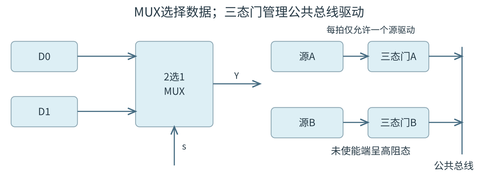

<a id="CO02-adder"></a>
## 加减运算器与进位逻辑
规定 $C_i$ 为第 $i$ 位输入进位，$C_{i+1}$ 为输出进位：

$$S_i=A_i\oplus B_i\oplus C_i,\qquad G_i=A_iB_i,\quad P_i=A_i\oplus B_i,$$

$$C_{i+1}=G_i+P_iC_i.$$

例如 $C_2=G_1+P_1G_0+P_1P_0C_0$。串行进位逐级传播；先行进位用组合逻辑展开进位，增加电路复杂度以缩短关键路径。“并行输入各位”与“并行生成进位”是两项实现性质。

加减控制位 Sub 令第二输入为 $B\oplus\mathrm{Sub}$、最低进位 $C_0=\mathrm{Sub}$：

$$\mathrm{Sub}=0:\ A+B;\qquad \mathrm{Sub}=1:\ A+\overline B+1=A-B\pmod{2^n}.$$

ALU 按操作控制选择算术、与、或、异或等功能，移位器位置以具体通路为准。数据位宽与操作选择编码位宽分别确定。

<a id="CO02-E04"></a>
### [例 2-4](../solutions/notes.md#a-CO02-E04)
某计算机字长为8位，CPU 中有一个8位加法器。已知无符号数 $x=69,y=38$，若在该加法器中计算 $x-y$，则加法器的两个输入端信息和输入的低位进位信息分别为（　）。

A. 0100 0101、0010 0110、0  
B. 0100 0101、1101 1001、1  
C. 0100 0101、1101 1010、0  
D. 0100 0101、1101 1010、1

<a id="CO02-flags"></a>
## 运算标志与条件转移
本章采用 CF=1表示减法借位的约定。设 $n$ 位加减器最高输出进位为 $C_n$：

$$\mathrm{CF}=C_n\oplus\mathrm{Sub},\quad\mathrm{OF}=C_{n-1}\oplus C_n,\quad\mathrm{SF}=S_{n-1},\quad\mathrm{ZF}=[S=0].$$

CF 判断无符号溢出或借位；OF 判断补码有符号溢出。同号相加结果异号时加法溢出；异号相减结果与被减数异号时减法溢出。采用“无借位”进位约定的 ISA 应按其定义改判 CF。

| 8位运算 | 低8位 | CF | OF | SF | ZF |
|---|---|---|---|---|---|
| `7FH+01H` | `80H` | 0 | 1 | 1 | 0 |
| `FFH+01H` | `00H` | 1 | 0 | 0 | 1 |
| `80H-01H` | `7FH` | 0 | 1 | 0 | 0 |
| `00H-01H` | `FFH` | 1 | 0 | 1 | 0 |

计算 $a-b$ 后的比较条件：

| 条件 | 标志表达式 |
|---|---|
| 相等 | ZF=1 |
| 无符号 $a<b$ | CF=1 |
| 无符号 $a>b$ | CF=0 且 ZF=0 |
| 有符号 $a<b$ | SF≠OF |
| 有符号 $a>b$ | SF=OF 且 ZF=0 |

<a id="CO02-E05"></a>
### [例 2-5](../solutions/notes.md#a-CO02-E05)
假定有符号整数采用补码表示，若 int 型变量 x 和 y 的机器数分别是 FFFF FFDFH 和0000 0041H，则 x、y 的值及 x−y 的机器数分别是（　）。

A. x=−65，y=41，x−y 的机器数溢出  
B. x=−33，y=65，x−y 的机器数为 FFFF FF9DH  
C. x=−33，y=65，x−y 的机器数为 FFFF FF9EH  
D. x=−65，y=41，x−y 的机器数为 FFFF FF96H

<a id="CO02-E06"></a>
### [例 2-6](../solutions/notes.md#a-CO02-E06)
已知 x、y 为 int 类型，当 x=100、y=200时，执行“x减y”指令得到的溢出标志 OF 和借位标志 CF 分别为0、1。那么当 x=10、y=−20时，执行该指令得到的 OF 和 CF 分别是（　）。

A. OF=0，CF=0　 B. OF=0，CF=1　 C. OF=1，CF=0　 D. OF=1，CF=1

<a id="CO02-multiply"></a>
## 无符号乘法与乘法器组织
两个 $n$ 位数完整乘积最多需 $2n$ 位。无符号顺序乘法初态 $P=0$，$Y$ 装乘数，$X$ 装被乘数。每轮：检查 $Y_0$ → 若为1则 $P\leftarrow P+X$ 并保留进位 → $(C,P,Y)$ 整体逻辑右移；共 $n$ 轮。

$X=1101,Y=1011$ 时：

| 轮次 | $Y_0$；加法后 $C,P$ | 右移后 $P,Y$ |
|---|---|---|
| 初态 | — | 0000,1011 |
| 1 | 1；0,1101 | 0110,1101 |
| 2 | 1；1,0011 | 1001,1110 |
| 3 | 0；0,1001 | 0100,1111 |
| 4 | 1；1,0001 | 1000,1111 |

结果 `10001111`=143。若只保存低 $n$ 位，高 $n$ 位非零表示无符号乘积溢出。

| 乘法器组织 | 特征 |
|---|---|
| 顺序乘法器 | 复用加法器与移位器，跨多周期完成 |
| 阵列乘法器 | 并行生成并压缩部分积，延迟由组合路径决定 |
| 流水线乘法器 | 多级寄存器分隔组合路径，多组运算可重叠，提高吞吐率 |

常数乘法可在语义与位宽允许时化为移位加减，如 $13x=(x\ll3)+(x\ll2)+x$。

<a id="CO02-booth"></a>
### Booth 补码一位乘法
乘数后附 $q_{-1}=0$，每轮观察 $(Y_0,q_{-1})$：00、11加0，01加 $X$，10减 $X$；随后 $(P,Y,q_{-1})$ 整体算术右移。符号位参加运算，跨寄存器边界传位。

$X=1101=-3,Y=0110=6$：

| 轮次 | 观察位与操作 | 右移后 $P,Y,q_{-1}$ |
|---|---|---|
| 初态 | — | 0000,0110,0 |
| 1 | 00，加0 | 0000,0011,0 |
| 2 | 10，减X | 0001,1001,1 |
| 3 | 11，加0 | 0000,1100,1 |
| 4 | 01，加X | 1110,1110,0 |

完整乘积 `11101110`=−18。保留低 $n$ 位补码时，未溢出条件为完整积的高 $n$ 位均为低半部符号位的扩展，即完整积最高 $n+1$ 位全部相同。最小负数的取负及中间操作须配置足够保护位。

<a id="CO02-division"></a>
## 除法、商溢出与余数校正
无符号双精度被除数以 $(R,Q)$ 保存，各 $n$ 位，除数 $Y$ 为 $n$ 位。单精度被除数先零扩展。除数 $Y>0$ 时，初始高半部 $R\ge Y$ 意味着商至少为 $2^n$，产生商溢出。4位商中，255/15=17溢出，200/15=13余5可表示。

| 算法 | 每轮更新与结束条件 |
|---|---|
| 恢复余数法 | 移入下一被除数位，试减除数；非负保留差、商位1；负则加回除数、商位0 |
| 不恢复余数法 | 根据上一轮余数符号决定本轮减或加除数；按新余数生成商位；最终负余数须按规则校正 |

无符号最终结果必须满足 $N=QY+R$ 且 $0\le R<Y$。试减的暂时负值需符号或借位状态支持。

<a id="CO02-restoring"></a>
### 恢复余数法的寄存器轨迹
15/2 初态 $R=0000,Q=1111,Y=0010$，每轮先整体左移 $RQ$，再试减并记录商位，共4轮，得到 $Q=0111,R=0001$。

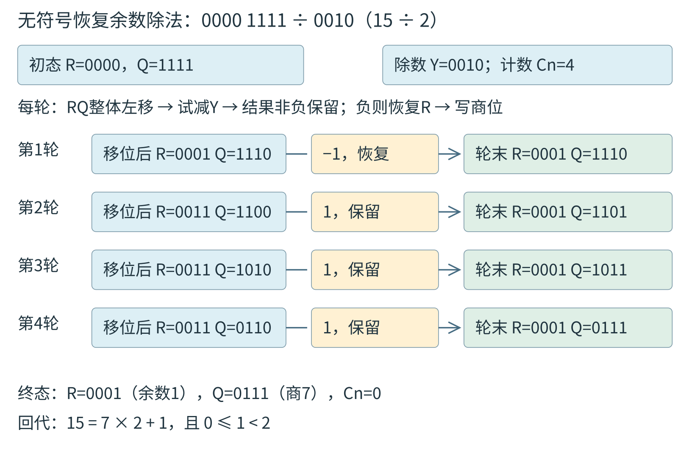

不恢复余数法的7/3，取4位有符号 $R$、3位 $Q$：

| 轮次 | 整体左移后R | 本轮操作 | 操作后R | 记商后Q |
|---|---|---|---|---|
| 初态 | — | — | 0 | 111 |
| 1 | 1 | 减3 | −2 | 110 |
| 2 | −3 | 加3 | 0 | 101 |
| 3 | 1 | 减3 | −2 | 010 |

末轮 $R<0$，再加3校正为1；商2、余1。

<a id="CO02-signed-division"></a>
### 有符号除法与异常
按向零截断约定，商符号由两操作数符号异或确定，非零余数与被除数同号，$X=QY+R$。例如−15/2的商−7、余−1；15/(−2)的商−7、余1。

课件4位补码−7/3：被除数符号扩展为 $R=1111,Q=1001$，$Y=0011$。本例负余数试加正除数；试加改变原负号时恢复，否则保留并生成商的绝对值位。

| 轮次 | 左移后R、Q | 试加R | 轮末R、Q |
|---|---|---|---|
| 1 | 1111、0010 | 0010，恢复 | 1111、0010 |
| 2 | 1110、0100 | 0001，恢复 | 1110、0100 |
| 3 | 1100、1000 | 1111，保留 | 1111、1001 |
| 4 | 1111、0010 | 0010，恢复 | 1111、0010 |

最后商绝对值2，异号取补为1110=−2；余数1111=−1。整除时需单独正确接受试算零。也可在足够宽的内部表示中先求绝对值，完成无符号除法后恢复符号。

除数0须异常处理；$-2^{n-1}/(-1)$ 超出 $n$ 位补码商范围。固定轮数除法器按位宽迭代；提前退出须由题设明确给出。

<a id="CO02-ieee"></a>
## IEEE 754 字段与特殊值
设尾数字段整数值为 $F$、位数为 $p$、阶码为 $E$、偏置为 $B$，符号为 $s$。

| 参数 | binary32 | binary64 |
|---|---|---|
| 符号／阶码／尾数字段位数 | 1／8／23 | 1／11／52 |
| 偏置 $B$ | 127 | 1023 |
| 规格化有效精度 | 24位 | 53位 |
| 规格化真阶码 | −126～127 | −1022～1023 |
| 最小正规格化数 | $2^{-126}$ | $2^{-1022}$ |
| 最小正次正规数 | $2^{-149}$ | $2^{-1074}$ |
| 最大有限正数 | $(2-2^{-23})2^{127}$ | $(2-2^{-52})2^{1023}$ |

| 字段条件 | 数值／含义 |
|---|---|
| $E=0,F=0$ | 正零或负零，由 $s$ 区分 |
| $E=0,F\ne0$ | 次正规数（非规格化数），$(-1)^s(F/2^p)2^{1-B}$，隐含前导0 |
| $E$ 既非全0也非全1 | 规格化数，$(-1)^s(1+F/2^p)2^{E-B}$，隐含前导1 |
| $E$ 全1，$F=0$ | 正无穷或负无穷 |
| $E$ 全1，$F\ne0$ | NaN |

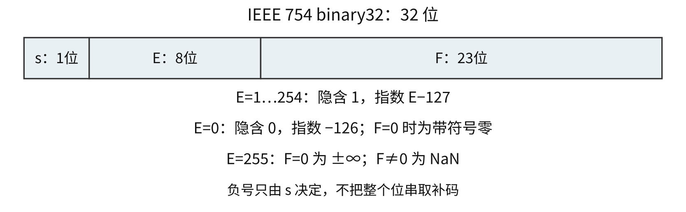

binary32位串 `00000001H` 为 $2^{-149}$，`00800000H` 为 $2^{-126}$。编码前先规格化绝对值，最后独立写符号位；负浮点数按符号、指数、尾数解读。比较有限同号负数时，绝对值较大者数值较小。

<a id="CO02-E07"></a>
### [例 2-7](../solutions/notes.md#a-CO02-E07)
−0.4375的 IEEE 754 单精度浮点数表示为（　）。

A. BEE0 0000H　 B. BF60 0000H　 C. BF70 0000H　 D. C0E0 0000H

<a id="CO02-E08"></a>
### [例 2-8](../solutions/notes.md#a-CO02-E08)
float 型数据常用 IEEE 754 单精度浮点格式表示。假设两个 float 型变量 x 和 y 分别存放在32位寄存器 f1 和 f2 中，若 `(f1)=CC90 0000H`、`(f2)=B0C0 0000H`，则 x 和 y 之间的关系为（　）。

A. x<y且符号相同　 B. x<y且符号不同　 C. x>y且符号相同　 D. x>y且符号不同

<a id="CO02-float-operation"></a>
## 浮点加减与舍入
顺序为：对阶 → 尾数加减 → 规格化 → 舍入 → 检查规格化与阶码范围。

| 步骤 | 规则与边界 |
|---|---|
| 对阶 | 小阶向大阶对齐，小阶尾数右移；最终阶码为原合法大阶，可能损失低位 |
| 右规 | 尾数出现 $10.xxx_2$ 时右移1位、阶码加1，可能上溢 |
| 左规 | 抵消后左移尾数、阶码减少，可能触及次正规区或下溢边界；精确零单独处理 |
| 舍入 | 可能使尾数进位，再右规并检查上溢 |
| 渐进下溢 | 指数过小时可能形成次正规数，接近0后才舍入为零 |

最近偶数舍入：被舍部分小于半个间隔取低端，大于半个间隔取高端，恰好居中取保留有效数最低位为0的候选。保护位 G、舍入位 R、粘滞位 S 保留舍入依据，S 为更低被舍位的逻辑或；最近偶数下，$G=1$ 且 $(R\lor S\lor\mathrm{LSB})=1$ 时向保留部分进1。

<a id="CO02-E09"></a>
### [例 2-9](../solutions/notes.md#a-CO02-E09)
下列有关浮点数加减运算的叙述中，正确的是（　）。

I. 对阶操作不会引起阶码上溢或下溢  
II. 右规和尾数舍入都可能引起阶码上溢  
III. 左规时可能引起阶码下溢  
IV. 尾数溢出时，结果不一定溢出

A. 仅 II、III　 B. 仅 I、II、IV　 C. 仅 I、III、IV　 D. I、II、III、IV

浮点加法可能不满足结合律。binary32取 $a=2^{25},b=-2^{25},c=1$，则 $(a+b)+c=1$，而 $b+c$ 先舍入回 $b$，得到 $a+(b+c)=0$。

<a id="CO02-precision"></a>
### 浮点精度与数值范围
binary32 在 $[2^e,2^{e+1})$ 中的相邻正规格化数间隔为 $2^{e-23}$。所有 $[-2^{24},2^{24}]$ 内整数可精确表示，界外部分整数仍可精确表示；在 $[2^{24},2^{25})$ 中间隔2，在 $[2^{25},2^{26})$ 中间隔4。

| 精确数学结果 | binary32 最近偶数结果 |
|---|---|
| $2^{24}+0.5$ | 16777216 |
| $2^{24}+1$ | 16777216 |
| $2^{24}+1.5$ | 16777218 |
| $(2^{24}+2)+1$ | 16777220 |

精确性由有效位与舍入决定，有限范围由指数和尾数上界共同决定。32位补码在其范围内表示连续整数；binary32的数值范围较大、有效精度为24位。

<a id="CO02-E10"></a>
### [例 2-10](../solutions/notes.md#a-CO02-E10)
已知 $f(n)=\sum_{i=0}^{n}2^i=2^{n+1}-1=\underbrace{11\cdots1}_{n+1\text{位}}{}_2$，计算 $f(n)$ 的C语言函数f1如下。

```c
int f1(unsigned n) {
    int sum = 1, power = 1;
    for (unsigned i = 0; i <= n - 1; i++) {
        power *= 2;
        sum += power;
    }
    return sum;
}
```

将f1中的int都改为float，可得到计算 $f(n)$ 的另一个函数f2。假设unsigned和int型数据都占32位，float采用IEEE 754单精度标准。请回答下列问题。

（1）当n=0时，f1会出现死循环，为什么？若将f1中的变量i和n都定义为int型，则f1是否还会出现死循环？为什么？

（2）f1(23)和f2(23)的返回值是否相等？机器数各是什么（用十六进制表示）？

（3）f1(24)和f2(24)的返回值分别为33 554 431和33 554 432.0，为什么不相等？

（4）$f(31)=2^{32}-1$，而f1(31)的返回值却为−1，为什么？若使f1(n)的返回值与f(n)相等，则最大的n是多少？

（5）f2(127)的机器数为7F80 0000H，对应的值是什么？若使f2(n)的结果不溢出，则最大的n是多少？若使f2(n)的结果精确（无舍入），则最大的n是多少？

32位 int 转 binary64 可精确，转 binary32 可能丢低位。binary32有限值扩为 binary64 可精确保留，已经丢失的信息无法恢复。浮点转整数向零截断且须检查目标范围；NaN 与任何值含自身的相等比较为假。

<a id="CO02-storage"></a>
## 字节序、边界对齐与数组地址
| 存放规则 | 最低地址保存的字节 |
|---|---|
| 大端 | 最高有效字节；`12345678H` 依次12、34、56、78 |
| 小端 | 最低有效字节；`12345678H` 依次78、56、34、12 |

字节序只改变一个多字节对象内部各字节的位置，字节内位序、数组元素先后次序保持各自规定。−6的16位补码 `FFFAH` 按小端存为FA、FF。

自然对齐模型下，2 B对象起点为2的倍数，4 B对象起点为4的倍数。成员前填充满足各成员对齐，结构末尾填充满足相邻数组元素对齐，具体规则由题设或 ABI 给出。

成员偏移可按 $\lceil d/a\rceil a$ 对齐，其中 $d$ 为前一成员结束后的偏移，$a$ 为当前成员对齐要求。结构总长按结构对齐要求取整。

<a id="CO02-E11"></a>
### [例 2-11](../solutions/notes.md#a-CO02-E11)
某计算机存储器按字节编址，采用小端方式存放数据。假定编译器规定 int 型和 short 型长度分别为32位和16位，并且数据按边界对齐存储。某 C 语言程序段如下：

```c
struct {
    int a;
    char b;
    short c;
} record;
record.a = 273;
```

若 record 变量的首地址为0xC008，则地址0xC008中的内容及 record.c 的地址分别为（　）。

A. 0x00，0xC00D　 B. 0x00，0xC00E  
C. 0x11，0xC00D　 D. 0x11，0xC00E

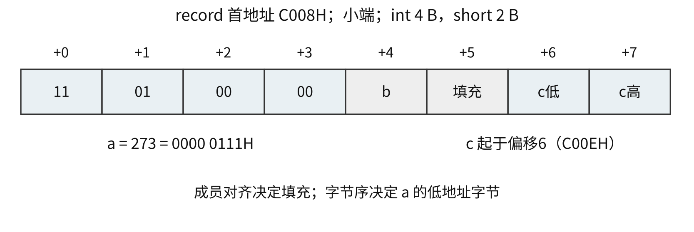

按字节编址、元素宽 $w$ B、行优先二维数组列数 $C$：

$$\operatorname{addr}(a[i][j])=\operatorname{base}(a)+(iC+j)w.$$

`struct { int id; char name[10]; int salary; }` 在 int为4 B且自然对齐时，id偏移0，name偏移4，salary偏移16，结构长20 B。数组首址 A0B0H，第二元素 id=`12345678H` 时，小端字节56H位于 A0C5H。

机器字长、存储字长与指令字长分别确定。按字节编址的32位整数占4个地址，按32位字编址则占1个地址；容量与跨界访问均先统一地址单位。


<a id="CO03"></a>
# 存储层次、地址与 Cache
<a id="CO03-hierarchy"></a>
## 存储层次与性能指标
寄存器 → Cache → 主存 → 外存，通常速度逐级降低、容量逐级增大、每位成本逐级降低。Cache—主存层次利用局部性缓解 CPU 与主存速度差；主存—辅存层次由硬件与操作系统配合实现虚拟存储。

| 存取方式 | 定位规则 | 典型对象 |
|---|---|---|
| 随机存取 RAM | 按地址访问任意单元，寻址步骤基本与位置无关 | SRAM、DRAM |
| 顺序存取 SAM | 按记录次序定位 | 磁带 |
| 直接存取 DAM | 先选区域，再在局部定位 | 磁盘 |
| 相联存取 CAM | 按内容或标记比较 | TLB 相联查找 |

| 指标 | 定义与条件 |
|---|---|
| 容量 | 单元数×每单元位数；$2^{20}$ 个8位单元为1 MiB |
| 存取时间 $t_a$ | 启动一次读写到完成该操作的延迟 |
| 存取周期 $T$ | 连续两次独立访问的最短启动间隔，可含恢复时间 |
| 带宽 | 单位时间最大传送信息量；简单单端口模型为每次传送位数／存取周期 |
| 单位成本 | 总成本／总位数 |

容量中的 KiB、MiB 按 $2^{10},2^{20}$ B；频率和速率中的 M、G 通常按 $10^6,10^9$。题源采用 KB、MB 时先依据题设确认进制。

<a id="CO03-semiconductor"></a>
## SRAM、DRAM 与 ROM
| 器件 | 保存机制 | 读出与保持 | 常见用途 |
|---|---|---|---|
| SRAM | 双稳态电路 | 非破坏性读出，供电期间无需刷新；易失 | Cache |
| DRAM | 电容电荷 | 读后再生，周期刷新；易失，集成密度高 | 主存 |
| Flash | 非易失性闪存单元 | 按规定粒度编程与擦除，寿命有限 | SSD等 |

随机存取、是否易失、是否破坏性读出是不同分类维度。主存与 Cache 是系统层次角色，SRAM、DRAM 是器件技术。

| ROM 类别 | 写入与修改方式 |
|---|---|
| 掩膜 ROM | 制造时写入，使用阶段固定 |
| PROM | 用户一次编程 |
| EPROM | 紫外线擦除后重写，通常整片擦除 |
| EEPROM | 电擦除、电改写，速度和次数受器件限制 |
| Flash | 通常按块擦除，读、编程、擦除粒度分别规定 |

<a id="CO03-dram"></a>
### DRAM 刷新与地址复用
读后再生恢复刚读单元的电荷；定时刷新保持长期未访问单元的信息。刷新通常按行进行，保持时间内所有行均须刷新。

| 刷新方式 | 时间安排 |
|---|---|
| 集中刷新 | 固定时段连续刷新全部行，形成集中死时间 |
| 分散刷新 | 正常存取与刷新交替，扩大存取周期 |
| 异步刷新 | 将各行刷新均匀分散在保持时间内，定期插入短刷新周期 |

有 $R$ 行、保持时间 $T_r$、每行刷新占 $t_f$ 时，理想均匀刷新间隔为 $T_r/R$，总占用比例为 $Rt_f/T_r$。128行、2 ms、每行0.5 μs：间隔15.625 μs，占比3.2%；4096行、64 ms、每行100 ns：间隔15.625 μs，占比0.64%。命令粒度和内部刷新行为服从题设。

$2^k\times w$ 芯片含 $2^k$ 个 $w$ 位单元。普通非复用 SRAM 通常需 $k$ 根地址线、$w$ 根数据线。DRAM 将行、列地址分时送到复用地址引脚；若行列各 $k/2$ 位，则需 $k/2$ 根地址引脚，另配行列选通及其他控制线。

<a id="CO03-E01"></a>
### [例 3-1](../solutions/notes.md#a-CO03-E01)
某容量为256 MB的存储器由若干 $4\mathrm M\times8$ 位的 DRAM 芯片构成，该 DRAM 芯片的地址引脚和数据引脚总数是（　）。

A. 19　 B. 22　 C. 30　 D. 36

双端口 RAM 有两套地址、数据和控制线，可并行访问不同单元。同一单元的读写、写写冲突按忙信号、仲裁和芯片规定处理。

<a id="CO03-expansion"></a>
## 主存地址空间与 MAR
MAR 位数由可编码主存地址空间与编址单位决定，MDR 位数反映一次交换数据的宽度。已安装容量可以小于可编址空间。

<a id="CO03-E02"></a>
### [例 3-2](../solutions/notes.md#a-CO03-E02)
某计算机存储器按字节编址，主存地址空间大小为64 MB，现用 $4\mathrm M\times8$ 位的 RAM 芯片组成32 MB的主存储器，则存储器地址寄存器 MAR 的位数至少是（　）。

A. 22位　 B. 23位　 C. 25位　 D. 26位

<a id="CO03-interleave"></a>
## 单体多字与多体交叉存储
单体多字通过扩宽一次读写数据量，提高顺序访问的带宽；多体存储包含可相对独立工作的模块。高位交叉以高位选模块，同一连续区间落在同体；低位交叉以低位选模块，连续字轮流分布到不同体。

$m$ 体低位交叉、按字编址：

$$\text{模块号}=A\bmod m,\qquad\text{模块内地址}=\lfloor A/m\rfloor.$$

若给字节地址、每字 $w$ B，先用 $\lfloor A/w\rfloor$ 求字地址。模块存取周期 $T$、连续启动间隔 $\tau$，连续访问无其他冲突且 $m\tau\ge T$ 时：

$$t_n=T+(n-1)\tau,\qquad m\ge\lceil T/\tau\rceil.$$

$T=200$ ns、$\tau=50$ ns至少需4体，连续8字为550 ns。4体步长4访问始终选同体；再次请求到达时该体尚忙才冲突。低位交叉提高连续吞吐率，第一字延迟仍由 $T$ 决定。

<a id="CO03-E03"></a>
### [例 3-3](../solutions/notes.md#a-CO03-E03)
某计算机使用4体交叉编址存储器，假定在存储器总线上出现的主存地址（十进制）序列为8005、8006、8007、8008、8001、8002、8003、8004、8000，则可能发生访存冲突的地址对是（　）。

A. 8004和8008　 B. 8002和8007　 C. 8001和8008　 D. 8000和8004

<a id="CO03-chip"></a>
## 主存芯片字位扩展
以 $n\times b$ 芯片组成 $N\times W$ 存储器，且两维均为整数倍时：

$$\text{并行片数}=W/b,\quad \text{地址组数}=N/n,\quad \text{总片数}=\frac Nn\frac Wb.$$

| 扩展 | 地址与数据连接 | 片选 |
|---|---|---|
| 位扩展 | 同组地址并联，各片负责不同数据位 | 同组选中信号相同 |
| 字扩展 | 低位送片内地址，高位选择地址区间 | 各组片选互斥 |
| 字位同时扩展 | 先按目标字长组成并行组，再增加地址组 | 组内共同选中，组间译码选择 |

两片 $16\mathrm K\times4$ 构成一组 $16\mathrm K\times8$，四组共8片构成 $64\mathrm K\times8$。低14位选片内单元，高2位作2–4译码。

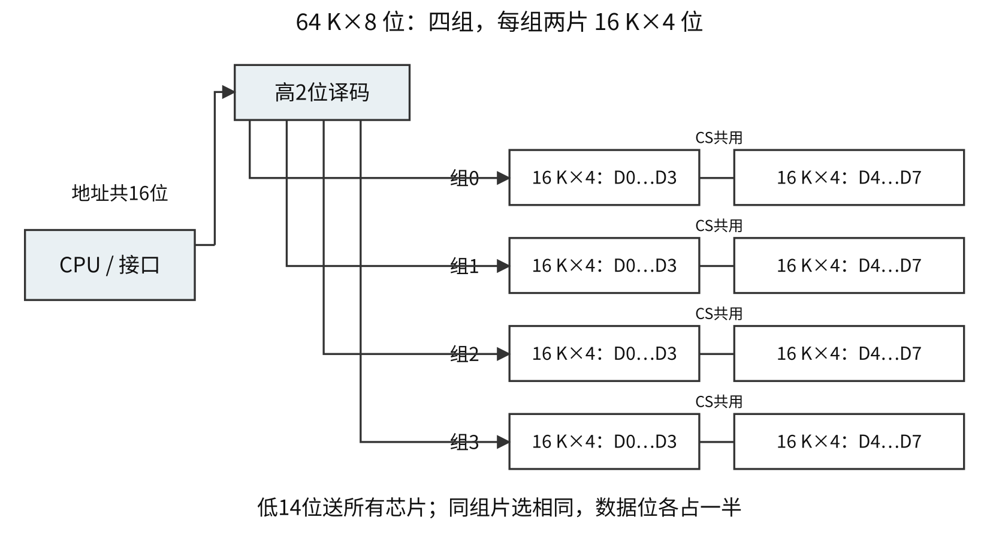

<a id="CO03-E04"></a>
### [例 3-4](../solutions/notes.md#a-CO03-E04)
某计算机主存容量为64 KB，其中 ROM 区为4 KB，其余为 RAM 区，按字节编址。现要用 $2\mathrm K\times8$ 位的 ROM 芯片和 $4\mathrm K\times4$ 位的 RAM 芯片来设计该存储器，则需要上述规格的 ROM 芯片数和 RAM 芯片数分别是（　）。

A. 1、15　 B. 2、15　 C. 1、30　 D. 2、30

<a id="CO03-decoding"></a>
### 片选译码与地址范围
| 译码方式 | 特征 |
|---|---|
| 全译码 | 使用全部需要判别的高位地址，地址映射唯一 |
| 部分译码 | 省略部分高位，可能多个地址选中同一物理单元，形成地址重叠 |
| 线选法 | 直接用地址线选片，连线简单，可用组合和连续性受限制 |

片选表达式同时考虑地址译码、访存使能及有效电平。地址线高低位由题干定义，通常 A0最低，也可有 A0最高的题设。

首地址由片选编码接片内全0组成，末地址接片内全1组成。按字编址的 $32\mathrm K\times16$ 芯片需15位片内地址，高3位片选111时，范围38000H～3FFFFH；改按字节编址后，每字2 B，须增加字节选择与字节使能信息并重算范围。

$16\mathrm K\times8$ 组成 $32\mathrm K\times16$：4片，2片一组、2组。$A_{13}\sim A_0$ 接所有芯片，$A_{14}$ 选组；按字编址组范围0000H～3FFFH、4000H～7FFFH。

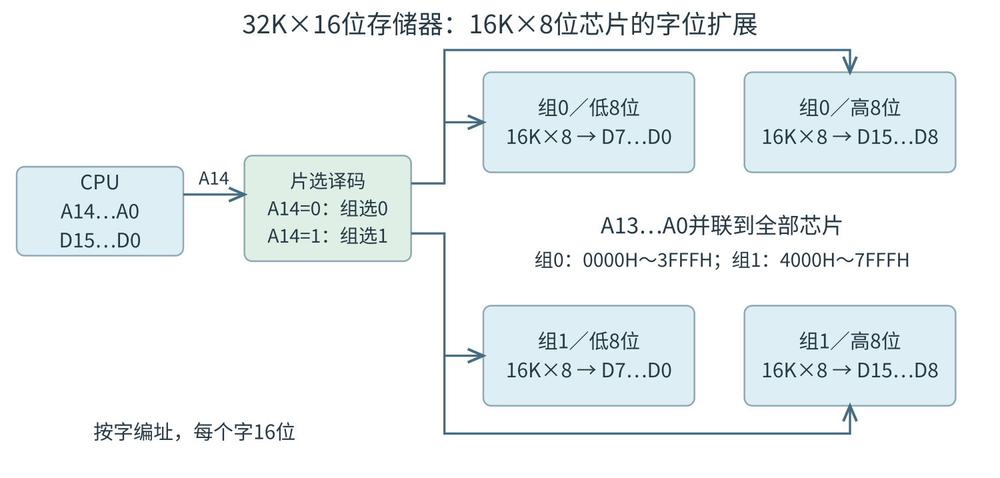

<a id="CO03-disk"></a>
## 磁盘结构、容量与访问时间
盘面包含磁道，磁道划分为扇区；不同盘面同半径的磁道组成柱面。典型定位字段为柱面号、磁头号、扇区号，磁头号确定盘面。

$$\text{容量}=\text{有效盘面数}\times\text{每面磁道数}\times\text{每道扇区数}\times\text{每扇区字节数}.$$

$$T_{\mathrm{access}}=T_{\mathrm{seek}}+T_{\mathrm{rotation}}+T_{\mathrm{transfer}}.$$

转速 $r$ 转/分，一圈 $60/r$ s；随机到达、角位置均匀时，平均旋转等待为 $30/r$ s。每道 $S$ 扇区、连续传 $k$ 扇区且忽略其他开销时，传输时间为 $(k/S)(60/r)$。控制器与排队开销按题设增加。

<a id="CO03-E05"></a>
### [例 3-5](../solutions/notes.md#a-CO03-E05)
若磁盘转速为7200转/分，平均寻道时间为8 ms，每个磁道包含1000个扇区，则访问一个扇区的平均存取时间大约是（　）。

A. 8.1 ms　 B. 12.2 ms　 C. 16.3 ms　 D. 20.5 ms

<a id="CO03-raid"></a>
### RAID 组织
| 级别 | 数据与冗余组织 | 典型性质 |
|---|---|---|
| RAID0 | 条带化，无冗余 | 提高并行带宽，单盘故障可使阵列数据丢失 |
| RAID1 | 镜像 | 常见双副本有效容量约为总容量一半 |
| RAID3 | 细粒度条带，专用校验盘 | 数据盘协调并行传输 |
| RAID4 | 块级条带，专用校验盘 | 校验盘可能成为写热点 |
| RAID5 | 块级条带，分布式校验 | 分散校验写入，通常容忍单盘故障 |

容错范围由具体级别和故障分布决定，更新数据还可能引入校验一致性开销；冗余副本会同步误写或误删，备份承担历史恢复功能。

<a id="CO03-ssd"></a>
## SSD 的页、块与磨损均衡
NAND Flash 通常按页读取或编程、按块擦除。FTL 将主机逻辑块地址映射为闪存物理页地址。具体页、块尺寸依器件而定，示例可取页512 B～4 KiB、块16～512 KiB。

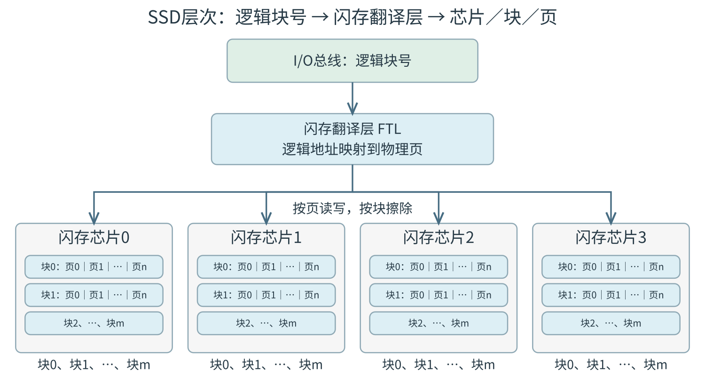

| 管理动作 | 作用 |
|---|---|
| 异地更新 | 新数据写入空闲已擦除位置，更新映射，旧页失效 |
| 垃圾回收 | 搬走块中有效页，擦除旧块，回收空间 |
| 写放大 | 实际闪存写入量因有效页搬移等大于主机写入量 |
| 动态磨损均衡 | 新写入优先使用擦除次数较少的空闲块 |
| 静态磨损均衡 | 进一步搬移冷数据，让长期少用的块参加新写入 |

SSD 无机械寻道和旋转等待，仍有闪存、控制器、接口传输和写入管理延迟；擦写次数、写放大和管理开销须按具体模型考虑。

<a id="CO03-cache-time"></a>
## Cache 局部性与平均访问时间
时间局部性：近期访问过的同一信息可能很快再访问；空间局部性：相邻位置可能很快被访问。Cache 按块调入利用空间局部性。

$$h=\frac{N_{\mathrm{hit}}}{N_{\mathrm{hit}}+N_{\mathrm{miss}}}.$$

| 时间定义／访问模型 | 平均访问时间 |
|---|---|
| 先查Cache，缺失后额外耗时 $p$ | $t_c+(1-h)p$ |
| 完整缺失访问耗时 $t_{\mathrm{miss}}$，已含查Cache | $ht_c+(1-h)t_{\mathrm{miss}}$ |
| Cache与主存同时启动，命中取Cache结果 | $ht_c+(1-h)t_m$ |
| 先Cache、缺失后启动主存，主存耗时 $t_m$ | $t_c+(1-h)t_m$ |

$t_m=5t_c,h=0.95$ 时，并行模型为 $1.2t_c$、加速约4.17倍；串行为 $1.25t_c$、加速4倍。$t_c=2$ ns、缺失额外80 ns、$h=0.95$ 时平均6 ns；若80 ns已含查Cache，则平均5.9 ns。

两级Cache的简单串行模型：$\mathrm{AMAT}=t_1+m_1(t_2+m_2p_2)$，其中 $m_2$ 为进入二级后的局部缺失率，二级全局缺失率为 $m_1m_2$。回写、调块、重访等开销是否计入缺失损失服从题设。

<a id="CO03-E06"></a>
### [例 3-6](../solutions/notes.md#a-CO03-E06)
有如下 C 语言程序段：

```c
for (k = 0; k < 1000; k++)
    a[k] = a[k] + 32;
```

若数组 a 和变量 k 均为 int 型，int 型数据占4 B，数据 Cache 采用直接映射方式，数据区大小为1 KB、块大小为16 B，该程序段执行前 Cache 为空，则该程序段执行过程中访问数组 a 的 Cache 缺失率约为（　）。

A. 1.25%　 B. 2.5%　 C. 12.5%　 D. 25%

<a id="CO03-burst"></a>
### 块传送与突发访问
取64 B块、每次传8 B，若每次均需地址1周期、准备8周期、传输1周期，独立访问需 $8(1+8+1)=80$ 周期。支持一次地址、一次首数据等待、连续8次传输的突发模型时，共 $1+8+8=17$ 周期。

<a id="CO03-cache-address"></a>
## Cache 映射与地址字段
设数据区容量 $C$ B、块大小 $B$ B、$r$ 路、$m$ 位字节地址。先求行数 $L=C/B$、组数 $G=L/r$。$B,G$ 均为2的幂时：

$$b=\log_2B,\quad g=\log_2G,\quad t=m-b-g.$$

$$q=\lfloor A/B\rfloor,\quad d=A\bmod B,\quad s=q\bmod G,\quad\mathrm{tag}=\lfloor q/G\rfloor,$$

$$A=(\mathrm{tag}\,G+s)B+d.$$

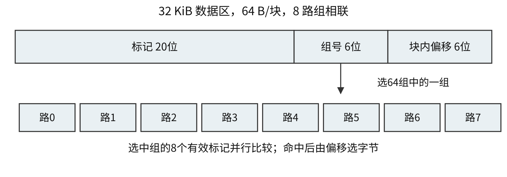

| 映射 | 可放位置 | 组选位数 | 比较范围 | 替换范围 |
|---|---|---|---|---|
| 直接映射 | 唯一一行 | $\log_2(C/B)$ | 该行1个标记 | 唯一位置 |
| $r$ 路组相联 | 唯一一组内 $r$ 行 | $\log_2(C/(Br))$ | 该组 $r$ 个有效标记 | 组内 |
| 全相联 | 任一行 | 0 | 全部有效标记 | 全Cache |

命中须同时满足有效位为1、标记匹配。组号用于选组，块内偏移用于选块中字节，二者均无需保存到每行标记。

固定地址位数、数据容量和块大小时，相联度增大使组号变短、标记变长，可能减少冲突缺失。强制缺失与容量限制仍存在。比较器数、布线、扇入和编码共同影响实际延迟，具体快慢需依据电路模型。

<a id="CO03-E07"></a>
### [例 3-7](../solutions/notes.md#a-CO03-E07)
若计算机主存地址为32位，按字节编址，某 Cache 的数据区容量为32 KB，主存块大小为64 B，采用8路组相联映射方式，该 Cache 中比较器的个数和位数分别为（　）。

A. 8，20　 B. 8，23　 C. 64，20　 D. 64，23

<a id="CO03-cache-capacity"></a>
### Cache 总容量
$$\text{总位数}=L(8B+t+V+D+\cdots)+\text{替换状态位}.$$

$V$ 为有效位，回写通常需脏位 $D$；替换位、校验位等按题设计入。给出的数据容量 $C$ 与含标记和状态位的总容量分别使用。

32位字节地址、4 KiB数据区、16 B块、2路：偏移4位、组号7位、标记21位；含有效和脏位且暂不计替换位，每行151位。直接映射无需行间替换状态。

<a id="CO03-E08"></a>
### [例 3-8](../solutions/notes.md#a-CO03-E08)
假定主存地址为32位，按字节编址，主存和 Cache 之间采用直接映射方式，主存块大小为4个字，每字32位，采用回写方式，则能存放4 K字数据的 Cache 的总容量的位数至少是（　）。

A. 146 K　 B. 147 K　 C. 148 K　 D. 158 K

<a id="CO03-replacement"></a>
## Cache 替换与写策略
优先使用目标组空行；满组后在本组选择牺牲行。

| 策略 | 状态依据 | 命中更新 |
|---|---|---|
| FIFO | 装入先后 | 保持装入次序 |
| LRU | 最近使用次序 | 置为最近使用 |
| LFU | 累计使用频次 | 更新计数，初值及并列规则须给定 |
| 随机 | 随机选择 | 无需维护精确最近次序 |

两路一组访问 A、B、A、C、B，LRU 状态从最近到最久依次为 [A]、[B,A]、[A,B]、[C,A]、[B,C]，仅第3次命中。

4行全相联、初始空，访问 $1,2,3,4,1,2,5,1,2,3,4,5$：FIFO命中第5、6次；LRU命中第5、6、8、9次。访问块5前，FIFO淘汰1，LRU淘汰3。

<a id="CO03-write"></a>
### 写命中、写缺失与脏块
| 事件与策略 | 动作 |
|---|---|
| 写命中，直写 | 同时更新Cache和下层，可用写缓冲；缓冲满时可能阻塞 |
| 写命中，回写 | 只更新Cache并置脏位，淘汰脏块时写回 |
| 写缺失，写分配 | 调块进入Cache再写 |
| 写缺失，非写分配 | 绕过当前Cache，直接写下层 |

回写常配写分配、直写常配非写分配，具体组合按题设执行。干净块可直接淘汰；脏块需按回写规则保存。多核副本及 DMA 访问还需相应一致性机制。

<a id="CO03-virtual"></a>
## 虚拟存储、页表与 TLB
虚拟存储将进程虚拟地址映射为物理地址，支持部分内容驻留外存、隔离与保护。操作系统建立并维护映射、分配和换入换出；MMU 执行运行时地址转换及权限检查。TLB 命中路径可由硬件完成。

页大小 $P=2^p$ B、虚址 $v$ 位、物理地址 $a$ 位：

$$\mathrm{VA}=\mathrm{VPN}\times P+d,\quad\mathrm{PA}=\mathrm{PPN}\times P+d,$$

VPN 为 $v-p$ 位，PPN 为 $a-p$ 位，页内偏移 $d$ 原样保留。

TLB 是页表项的高速缓存。若 TLB 共 $K$ 项、$r$ 路、低位选组，组数 $G_T=K/r$，组号 $g_T=\log_2G_T$ 位，TLB 标记为 $v-p-g_T$ 位；物理页框号位数由物理地址决定。

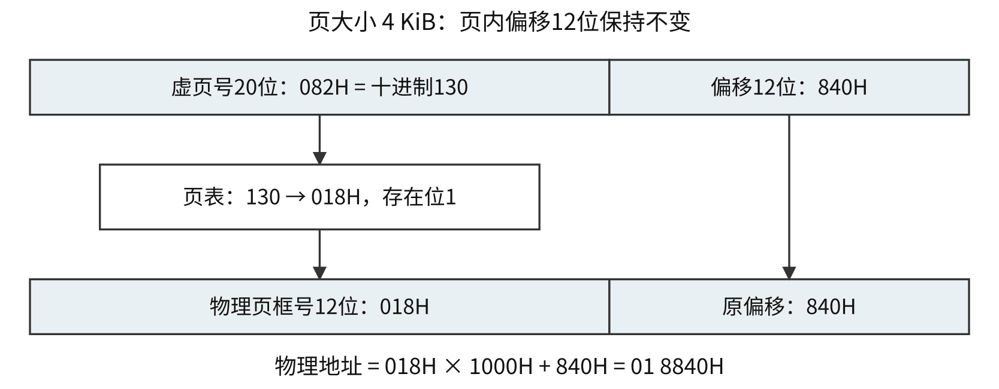

| 查找对象 | 保存内容 | 未命中或异常处理 |
|---|---|---|
| TLB | 页映射、权限等 | 未命中转页表，页面仍可能已驻留 |
| 页表 | 页框号、存在位、权限、管理状态 | 合法且未驻留时缺页；非法映射、保护失败分别处理 |
| 物理地址Cache | 主存数据块或指令块副本 | 未命中访问下一层，按策略调块 |

TLB命中与Cache命中分别判断；页表存在位为1说明页面驻留，数据Cache仍可缺失。Cache标记与页框号按各自字段求取。

<a id="CO03-E09"></a>
### [例 3-9](../solutions/notes.md#a-CO03-E09)
某计算机主存地址为24位，采用分页虚拟存储管理方式，虚拟地址空间大小为4 GB，页大小为4 KB，按字节编址。某进程的页表部分内容如下。

| 虚页号 | 实页号（页框号） | 存在位 |
|---:|---:|---:|
| 82 | 024H | 0 |
| … | … | … |
| 129 | 180H | 1 |
| 130 | 018H | 1 |

当 CPU 访问虚拟地址0008 2840H时，虚—实地址转换的结果是（　）。

A. 得到主存地址02 4840H　 B. 得到主存地址18 0840H  
C. 得到主存地址01 8840H　 D. 检测到缺页异常

<a id="CO03-E10"></a>
### [例 3-10](../solutions/notes.md#a-CO03-E10)
某计算机按字节编址，采用页式虚拟存储管理方式，虚拟地址为32位，主存地址为30位，页大小为1 KB。若 TLB 共有32个表项，采用4路组相联映射方式，则 TLB 表项中标记字段的位数至少是（　）。

A. 17　 B. 18　 C. 19　 D. 20

<a id="CO03-translation"></a>
### 地址转换路径与平均时间
先转换、后查物理Cache的串行模型：拆 VPN、页内偏移 → 查 TLB → 未命中时查各级页表 → 检查存在位与权限 → 形成物理地址 → 查Cache → 缺失时访问下层。

缺页时先处理并重试当前指令，普通数据Cache查找须等待可用映射。页表访问是否经过Cache、TLB与Cache能否并行均由题设决定。

单级页表、不计缺页、TLB和主存串行且主存数据无Cache时，TLB命中率 $h_T$、时间 $t_T$、每次主存访问 $t_M$：

$$\bar t=h_T(t_T+t_M)+(1-h_T)(t_T+2t_M).$$

多级页表增加相应查表访问；缺页需另加外存与操作系统处理时间。MMU 在地址转换中检测TLB缺失、缺页及权限问题，数据Cache缺失由Cache查找确定。

<a id="CO03-segment"></a>
## 段式与段页式存储
段式地址含段号和段内偏移。段表保存基址、段长和权限；段长 $L$ 表示字节数时，合法条件为 $0\le d<L$，物理地址为 base+$d$，末字节地址为 base+$L-1$。

段页式先由段号定位该段页表，再由段内页号查页框，最后拼接页内偏移。段界限仍须检查，最后一页的填充空间可能超出段长。

段基址10000 B、长3000 B，偏移2999对应12999 B；偏移3000越界。1 KiB页的段页式模型中，页号2、偏移952恰为段内3000，也越界。

<a id="CO03-access"></a>
## 数组访问次序与 TLB、Cache 综合推演
行优先数组、每元素 $w$ B、每行 $C$ 个元素：$\operatorname{addr}(a[i][j])=A_0+(iC+j)w$。先分别求触及页面、Cache块和每组工作集，再计算缺页与命中数。

首地址偏移 $d$、连续区域长 $n$ B、页或块大小 $P$ 时，非空区域覆盖数为 $\lceil(d+n)/P\rceil$。每组工作集超过路数才存在相应组容量压力，总容量可容纳仍可能发生组冲突。

若Cache组选位全部落在页内偏移中，虚实转换保留这些位，可直接从虚址提取本题组号。超出页内偏移时需按指定地址模型取得相关物理位。

<a id="CO03-E11"></a>
### [例 3-11](../solutions/notes.md#a-CO03-E11)
已知计算机M字长为32位，按字节编址，采用请求调页策略的虚拟存储管理方式，虚拟地址32位，页面大小为4 KB；数据Cache采用4路组相联映射方式，数据区大小为8 KB，主存块大小为32 B。现有C语言程序段如下：

```c
int a[24][64];
/* ... */
for (i = 0; i < 24; i++)
    for (j = 0; j < 64; j++) a[i][j] = 10;
```

已知二维数组a按行优先存放，在虚拟地址空间中分配的起始地址为0042 2000H，`sizeof(int)=4`。假定在M上执行上述程序段之前数组a不在主存，且在该程序执行过程中不会发生页面置换。请回答下列问题。

（1）数组分布在几个页面中？对于数组a的访问，会发生几次缺页异常？页故障地址各是什么？

（2）不考虑变量i和j，该程序段的数据访问是否具有时间局部性？为什么？

（3）计算机M的虚拟地址（A31～A0）中哪几位用作块内地址？哪几位用作Cache组号？a[1][0]的虚拟地址是多少？其所在主存块对应的Cache组号是多少？

（4）数组a占用多少主存块？假设上述程序段执行过程中数组a的访问不会和其他数据发生Cache访问冲突，则数组a的Cache命中率是多少？若将循环中i和j的次序按如下方式调换，则数组a的Cache命中率又是多少？

```c
for (j = 0; j < 64; j++)
    for (i = 0; i < 24; i++) a[i][j] = 10;
```

<a id="CO03-E12"></a>
### [例 3-12](../solutions/notes.md#a-CO03-E12)
假设计算机M的主存地址为24位，按字节编址；采用分页存储管理方式，虚拟地址为30位，页大小为4 KB；TLB采用2路组相联方式和LRU替换策略，共8组。请回答下列问题。

（1）虚拟地址中哪几位表示虚页号？哪几位表示页内地址？

（2）已知访问TLB时虚页号高位部分用作TLB标记，低位部分用作TLB组号，M的虚拟地址中哪几位是TLB标记？哪几位是TLB组号？

（3）假设TLB初始时为空，访问的虚页号依次为10、12、16、7、26、4、12和20，在此过程中，哪一个虚页号对应的TLB表项被替换？说明理由。

（4）若将M中的虚拟地址位数增加到32位，则TLB表项的位数增加几位？

<a id="CO03-E13"></a>
### [例 3-13](../solutions/notes.md#a-CO03-E13)
某系统按字节编址，虚拟地址为14位，物理地址为12位，页大小为64 B。TLB 共16项，采用4路组相联；数据 Cache 使用物理地址，采用直接映射，共16行，每行4 B。

按“先完成地址转换，再查数据 Cache”的串行模型分析。所有待访问的虚拟地址均合法，且允许读；页表存在位 $P=1$ 表示页面已在主存，$P=0$ 表示合法但尚未驻留，需要处理缺页。读 Cache 未命中时，从主存调入对应的4 B数据块。

以下给出本题所需的初始状态。表中页号、页框号、标记、Cache 行号和字节数据均用十六进制，后缀 H 表示十六进制；$V$ 为有效位，“—”表示没有可用信息。TLB 的组号和路号均在0至3之间。

**表 A　TLB 初始状态**

| 组号 | 路号 | 标记 | 有效位V | 页框号 |
|---|---|---|---|---|
| 0 | 0 | 03H | 0 | — |
| 0 | 1 | 00H | 0 | — |
| 0 | 2 | 09H | 1 | 0DH |
| 0 | 3 | 07H | 1 | 02H |
| 3 | 0 | 07H | 0 | — |
| 3 | 1 | 0AH | 1 | 34H |
| 3 | 2 | 03H | 1 | 0DH |
| 3 | 3 | 02H | 0 | — |

**表 B　页表中与本题有关的表项**

| 虚页号 | 存在位 $P$ | 页框号 |
| ---: | ---: | ---: |
| 03H | 1 | 02H |
| 08H | 0 | — |

**表 C　Cache 初始状态，数据按块内偏移排列**

| 行号 | 标记 | V | 偏移0 | 偏移1 | 偏移2 | 偏移3 |
|---|---|---|---|---|---|---|
| 5H | 0DH | 1 | 36H | 72H | F0H | 1DH |
| CH | 02H | 0 | — | — | — | — |

（1）写出查 TLB 时虚拟地址的字段划分，以及查 Cache 时物理地址的字段划分，并求各字段位数。

（2）分别读取虚拟地址03D4H、00F1H、0229H处的一个字节，依次说明 TLB 查找、必要的页表检查和 Cache 查找，指出最终从哪里取数，或在哪一步转入异常处理。能确定字节值时给出结果。

**三次访问相互独立，均从上述初始状态开始。** 某次访问引起的回填不影响另两次；不推演缺页后的页框分配与替换，也不计算访问时间。


<a id="CO04"></a>
# 指令系统与 C 程序的机器级表示
<a id="CO04-format"></a>
## 指令格式、地址字段与操作码扩展
指令由操作码、操作数/地址及寻址方式等字段组成。指令字长为编码位数，机器字长为整数处理的基本位宽，存储字长为一个存储单元的位数；三者分别确定。一个地址字段可表示寄存器编号、立即数、形式地址或位移。

| 格式 | 典型运算语义 | 隐含位置 |
|---|---|---|
| 三地址 | $M[A_3]\leftarrow M[A_1]+M[A_2]$ | 由指令定义 |
| 二地址 | $M[A_1]\leftarrow M[A_1]+M[A_2]$ | 一个源兼目的 |
| 一地址 | $\mathrm{ACC}\leftarrow\mathrm{ACC}+M[A]$ | 累加器 |
| 零地址 | 弹出栈顶两项运算，再压入结果 | 栈顶、SP |

地址字段数只计显式编码；实际操作数还包括隐含操作数。三地址运算若取指一次、源与目的均在主存，需取指1次、读源2次、写结果1次，共4次访存。多字指令、寄存器源、间接寻址分别改变对应次数。

固定操作码 $k$ 位至多编码 $2^k$ 种操作。扩展操作码逐层保留前缀：本层剩余 $r$ 个前缀，下一段扩展 $a$ 位，得到 $r2^a$ 个可分配编码；扣除已用编码后继续扩展。短操作码与更长操作码的前缀必须互斥。

16位指令、地址字段4位：分配15条三地址后剩1个4位前缀；扩为16个8位码，分配12条二地址后剩4个；扩为64个12位码，分配62条一地址后剩2个；最终可分配32条零地址。指令总长始终16位。

<a id="CO04-E01"></a>
### [例 4-1](../solutions/notes.md#a-CO04-E01)
设计某指令系统时，假设采用16位定长指令字格式，操作码使用扩展编码方式，地址码为6位，包含零地址、一地址和二地址3种格式的指令。若二地址指令有12条，一地址指令有254条，则零地址指令的条数最多为（　）。

A. 0　 B. 2　 C. 64　 D. 128

<a id="CO04-address"></a>
## 数据寻址、相对地址与访存次数
记形式地址 $A$、寄存器内容 $(R)$、存储单元内容 $M[x]$。表中读主存次数仅统计取得一个源操作数，取指与写回另计。

| 寻址方式 | 操作数或有效地址 EA | 读主存次数 |
|---|---|---|
| 立即 | 操作数为指令内的立即数字段 | 0 |
| 直接 | $\mathrm{EA}=A$，操作数 $M[A]$ | 1 |
| 一次主存间接 | $\mathrm{EA}=M[A]$，操作数 $M[\mathrm{EA}]$ | 2 |
| 寄存器 | 操作数 $(R)$ | 0 |
| 寄存器间接 | $\mathrm{EA}=(R)$ | 1 |
| 基址 | $\mathrm{EA}=(\mathrm{BR})+\text{位移}$ | 主存源1次 |
| 变址 | $\mathrm{EA}=A+(\mathrm{IX})$ | 主存源1次 |
| 相对 | $\text{目标}=\mathrm{PC}_{base}+\operatorname{sext}(\text{位移})\times\text{缩放因子}$ | 按指令语义确定 |

间接寻址可利用比指令地址字段更宽的中间地址扩大寻址范围。基址寄存器通常存程序/数据段起点，支持重定位；变址寄存器通常存变化偏移，支持数组访问。位移的符号扩展和缩放按 ISA 规定。

按字节编址、int占4 B时，$\operatorname{addr}(a[i])=\mathrm{base}+4i$。有比例变址可直接形成偏移；其他机器需先计算 $4i$。相对转移常取后继指令地址为基准，具体以题设PC更新时机为准。

<a id="CO04-E02"></a>
### [例 4-2](../solutions/notes.md#a-CO04-E02)
某机器字长为16位，主存按字节编址，转移指令采用相对寻址，由两个字节组成，第一个字节为操作码字段，第二个字节为相对位移量字段。假定取指令时，每取一个字节 PC 自动加1。若某转移指令所在主存地址为2000H，相对位移量字段的内容为06H，则该转移指令成功转移后的目标地址是（　）。

A. 2006H　 B. 2007H　 C. 2008H　 D. 2009H

无Cache、无预取、指令与操作数各占一个存储字时，读取一个直接寻址源、一次主存间接源、寄存器间接源分别至少访存2、3、2次，均已计一次取指。32位指令在16位存储字中跨两个字，取指所需访问次数按存储组织确定。

堆栈寻址隐含使用SP。向低地址增长、SP指向栈顶、每槽4 B的模型：push为先SP减4再写，pop为先读再SP加4。初值1000H，两次push、一次pop后SP=0FFCH。硬堆栈使用寄存器组，软堆栈使用主存，访存开销分别计算。

<a id="CO04-isa"></a>
## RISC、CISC 与指令副作用
| 维度 | RISC典型设计 | CISC典型设计 |
|---|---|---|
| 功能 | 常用简单操作，复杂操作由指令组合 | 丰富指令，可表达较复杂操作 |
| 编码与寻址 | 格式规整，常用定长，寻址方式较少 | 格式及寻址较多，常见变长 |
| 数据访存 | Load/Store访问数据，ALU主要操作寄存器 | 多类指令可带主存操作数 |
| 寄存器与传参 | 通用寄存器较多，常用寄存器传参 | 传统设计寄存器较少，操作数来源丰富 |
| 控制与流水 | 常用硬布线，便于流水 | 复杂指令常用微程序，也可流水 |
| 编译 | 重视选指令、分配寄存器和调度 | 同样需要编译优化 |

表中为常见倾向。指令长度、寄存器数、控制器实现和调用约定须以具体ISA、微架构和ABI为准；执行时间按指令数、CPI及周期共同计算。

数据传送复制值；算术逻辑、移位指令产生新值并可能改标志；控制转移改变PC；I/O及系统控制可能涉及权限。每条指令的访存、改标志、特权等副作用依给定语义判断。

<a id="CO04-E03"></a>
### [例 4-3](../solutions/notes.md#a-CO04-E03)
下列关于 RISC 的叙述中，错误的是（　）。

A. 多采用硬连线方式实现控制器  
B. 通常采用 Load/Store 型指令设计风格  
C. 难以采用流水线数据通路实现微架构  
D. 多采用寄存器传递过程调用时的参数

<a id="CO04-toolchain"></a>
## 编译工具链与重定位
| 阶段 | 输入与主要结果 |
|---|---|
| 预处理 | 源文件→展开宏、包含文件等后的源程序 |
| 编译 | 高级语言→汇编表示 |
| 汇编 | 汇编表示→机器码目标文件，保留符号与重定位信息 |
| 链接 | 合并节、解析跨模块符号、修改地址引用→可执行文件 |

动态链接可将部分链接工作推迟至装入或运行时。目标/可执行文件可含符号表、调试、重定位和装入组织信息。优化后的变量可在寄存器中、成为常量或被消除。

<a id="CO04-E04"></a>
### [例 4-4](../solutions/notes.md#a-CO04-E04)
将高级语言源程序转换为可执行目标文件的主要过程是（　）。

A. 预处理→编译→汇编→链接  
B. 预处理→汇编→编译→链接  
C. 预处理→编译→链接→汇编  
D. 预处理→汇编→链接→编译

<a id="CO04-x86"></a>
## x86 操作数、有效地址与条件转移
32位示例中EAX、EBX、ECX、EDX为通用寄存器，ESP为栈顶、EBP常作帧基址。AX为EAX低16位，AL与AH为最低、次低8位。

| 含义 | Intel格式：目的在前 | AT&T格式：源在前 |
|---|---|---|
| 立即数5→EAX | `mov eax, 5` | `movl $5, %eax` |
| EBX→EAX | `mov eax, ebx` | `movl %ebx, %eax` |
| 读取32位主存数 | `mov eax, dword ptr [ebx+ecx*4+8]` | `movl 8(%ebx,%ecx,4), %eax` |

AT&T的b、w、l常表示8、16、32位。x86比例因子可取1、2、4、8。`lea`仅计算有效地址表达式；`mov`传数据；`cmp`形成减法标志；`test`形成按位与标志；后两者均不保存运算结果。`shl/sal`左移，`shr`逻辑右移，`sar`符号扩展右移。

以Intel的`cmp eax, ebx`为例，标志来自EAX−EBX：

| 关系 | 有符号条件 | 无符号条件 |
|---|---|---|
| 等于 | ZF=1 | ZF=1 |
| 小于 | $\mathrm{SF}\ne\mathrm{OF}$ | CF=1 |
| 小于等于 | $\mathrm{ZF}=1\lor\mathrm{SF}\ne\mathrm{OF}$ | CF=1或ZF=1 |
| 大于 | $\mathrm{ZF}=0\land\mathrm{SF}=\mathrm{OF}$ | CF=0且ZF=0 |
| 大于等于 | SF=OF | CF=0 |

`loop`在32位计数约定下先ECX减1，再按ECX是否非零决定转移；其标志副作用须依指令定义。

<a id="CO04-flow"></a>
## 分支、循环与动态执行次数
还原控制流时标出初始化、条件、循环体、更新和回边。入口测试型n次循环通常测试n+1次；后测循环从循环体起步时通常至少执行一次。signed与unsigned选择不同分支条件。

```text
// R0=数组基址，R3=元素个数，元素4 B
R1 <- 0; R2 <- 0
TEST:
    if R1 >= R3 jump EXIT
    R4 <- R1 << 2
    R5 <- M[R0 + R4]
    R2 <- R2 + R5
    R1 <- R1 + 1
    jump TEST
EXIT:
```

R3=0时不访问数组；R3=3时访问偏移0、4、8。指针遍历每次加4，终止指针为base+4R3。动态指令数、取指次数与数据访问次数按实际路径累计。

<a id="CO04-call"></a>
## 调用约定、栈帧和递归状态
调用需传参、保存返回位置、安排局部区、传回返回值。ISA提供call/ret或链接寄存器等机制，ABI规定参数位置、栈对齐、返回值及寄存器保存责任。

| 控制方式 | 后继地址 | 额外状态 |
|---|---|---|
| 顺序 | 当前地址+指令长度 | 按指令副作用更新 |
| 条件分支 | 条件成立取目标，否则取顺序后继 | 条件及目标 |
| 调用 | 被调入口 | 保存调用后的后继地址 |
| 返回 | 已保存的返回地址 | 恢复约定现场与栈 |

链接寄存器保存返回地址时，叶子函数可无需写主存；嵌套调用/递归在再次覆盖它前保存旧返回地址。调用者保存寄存器由调用者在调用前保存仍需使用的值；被调用者保存寄存器由被调过程修改前保存、返回前恢复。

向低地址增长、SP指栈顶、槽4 B、call压入返回地址的模型：SP=1000H，返回地址2004H；call后SP=0FFCH，M[0FFCH]=2004H；保存旧FP后SP=0FF8H；分配8 B局部区后SP=0FF0H；按逆序撤销后SP恢复1000H。

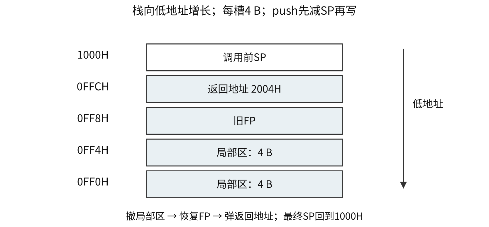

32位x86标准建帧示例：`push ebp; mov ebp, esp`，再减ESP分配局部区；返回前`mov esp, ebp; pop ebp; ret`。整数返回值常在EAX。

| 地址 | 标准建帧后的内容 |
|---|---|
| `[ebp]` | 旧EBP |
| `[ebp+4]` | 返回地址 |
| `[ebp+8]`、`[ebp+12]` | 前两个栈参数 |
| `[ebp-4]`等 | 局部变量 |

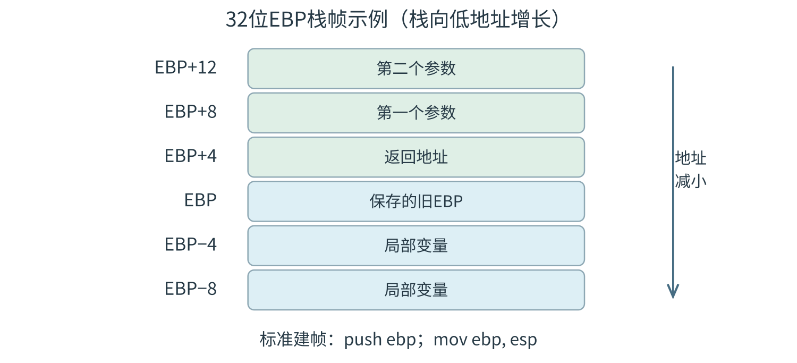

具体布局以调用约定为准。递归每层保存独立参数、返回位置和局部状态；全局变量共享。递归空间按最大同时存活层数计算。

<a id="CO04-E05"></a>
### [例 4-5](../solutions/notes.md#a-CO04-E05)
已知 $f(n)=n!=n\times(n-1)\times(n-2)\times\cdots\times2\times1$，计算 $f(n)$ 的C语言函数f1的源程序及其在32位计算机M上的部分机器级代码如下。

```c
int f1(int n) {
    if (n > 1)
        return n * f1(n - 1);
    else
        return 1;
}
```

以下按“行号／虚拟地址／机器指令（字节按地址递增排列）／汇编指令”四列给出，每行是一条代码记录；省略行仍保留四列。

```text
 1  00401000  55              push ebp
 …  …         …               …
11  00401018  83 7D 08 01     cmp dword ptr [ebp+8], 1
12  0040101C  7E 17           jle f1+35h (00401035)
13  0040101E  8B 45 08        mov eax, dword ptr [ebp+8]
14  00401021  83 E8 01        sub eax, 1
15  00401024  50              push eax
16  00401025  E8 D6 FF FF FF  call f1 (00401000)
 …  …         …               …
19  00401030  0F AF C1        imul eax, ecx
20  00401033  EB 05           jmp f1+3Ah (0040103A)
21  00401035  B8 01 00 00 00  mov eax, 1
 …  …         …               …
26  00401040  3B EC           cmp ebp, esp
 …  …         …               …
30  0040104A  C3              ret
```

其中，机器级代码行包括行号、虚拟地址、机器指令和汇编指令，计算机M按字节编址，int型数据占32位。请回答下列问题。

（1）计算f(10)需要调用函数f1多少次？执行哪条指令会递归调用f1？

（2）上述代码中，哪条指令是条件转移指令？哪几条指令一定会使程序跳转执行？

（3）根据第16行的call指令，第17行指令的虚拟地址应是多少？已知第16行的call指令采用相对寻址方式，该指令中的偏移量应是多少（给出计算过程）？已知第16行的call指令的后4字节为偏移量，M采用大端方式还是小端方式？

（4）$f(13)=6\,227\,020\,800$，但f1(13)的返回值为1 932 053 504，为什么两者不相等？要使f1(13)能返回正确的结果，应如何修改f1的源程序？

（5）第19行的imul指令（带符号整数乘）的功能是 $\mathrm R[\mathrm{eax}]\leftarrow\mathrm R[\mathrm{eax}]\times\mathrm R[\mathrm{ecx}]$，当乘法器输出的高、低32位乘积之间满足什么条件时，溢出标志OF=1？要使CPU在发生溢出时转异常处理，编译器应在imul指令后加一条什么指令？


<a id="CO05"></a>
# 中央处理器
<a id="CO05-state"></a>
## CPU 功能、寄存器与状态元件
CPU完成指令控制、操作控制、时间控制、数据加工及规定的异常/中断处理。数据通路完成数据传送和运算，控制部件CU生成选择、运算、写使能与存储器读写等控制信号。

| 部件 | 内容或作用 | 组织层次 |
|---|---|---|
| ALU、MUX、移位器 | 按当前输入形成运算或选择结果 | 组合逻辑操作元件 |
| GPRs、ACC、临时寄存器 | 操作数、地址、中间结果 | 状态元件 |
| PC | 程序执行位置，更新规则依ISA与时序 | 程序级状态 |
| IR | 当前指令编码 | 通常属实现内部 |
| MAR | 本次主存访问地址 | 通常属实现内部 |
| MDR | 本次与主存交换的指令或数据 | 通常属实现内部 |
| PSW/FR | 条件码及规定的特权、中断等状态 | 可见性与写权限依ISA |
| CMAR、CMDR | 微地址、当前微指令 | 微程序控制器内部 |

GPRs、PC及规定的状态属于程序员可见模型；可见性与用户指令能否直接读写分别由ISA及权限定义。MAR位数按可寻址单元数确定，MDR位数按一次数据交换位宽确定。例如26位字节地址、32位数据通路，可有26位MAR与32位MDR。

<a id="CO05-E01"></a>
### [例 5-1](../solutions/notes.md#a-CO05-E01)
数据通路由组合逻辑元件（操作元件）和时序逻辑元件（状态元件）组成。以下给出的元件中，属于操作元件的是（　）。

I. 算术逻辑部件（ALU）　II. 程序计数器（PC）  
III. 通用寄存器组（GPRs）　IV. 多路选择器（MUX）

A. 仅 I、II　 B. 仅 I、IV　 C. 仅 II、III　 D. 仅 I、II、IV

<a id="CO05-cycle-model"></a>
## 指令周期与三种执行组织
指令周期覆盖一条指令从开始到完成；机器周期为某实现划分的访存等基本操作周期；时钟周期为同步状态推进的时间单位。三者倍数由具体组织给出。

| 指令阶段 | 动作 | 进入条件 |
|---|---|---|
| 取指 | PC给地址、读指令入IR、更新PC | 每条指令 |
| 间址 | 取得有效地址 | 需要主存间接寻址等 |
| 执行 | 完成指令语义 | 每条指令，动作不同 |
| 中断 | 保存返回状态、进入处理入口 | 有请求且满足响应条件 |

| 组织 | 时钟约束 | 同一时刻与资源复用 |
|---|---|---|
| 单周期 | 最慢完整指令路径 | 一条指令占一长拍；同拍资源需求须同时满足 |
| 多周期 | 最慢基本步骤 | 一条指令分多拍；资源可跨拍复用 |
| 简单标量流水 | 最慢段+段寄存器开销 | 多条指令不同段重叠；同拍资源争用须消除 |

单周期CPI=1、理想标量流水稳态CPI约1，周期长度可不同。性能比较用执行时间 $N\times\mathrm{CPI}\times\tau$。

<a id="CO05-bus-operations"></a>
## 单总线数据通路与微操作时序
微操作是部件可执行的基本动作；微命令为驱动该动作的控制命令。同一内部总线每拍通常只允许一个驱动源，多个目的在有实际通路和独立写使能时可同时接收同一值。

ALU一端由Y保存第一个操作数，另一端接总线；结果先存Z，后续再上总线写回。例 $R_1\leftarrow R_1+R_2$：

| 拍 | 微操作 |
|---|---|
| 1 | $R_1\to Y$ |
| 2 | $R_2\to\mathrm{BUS}$，$Y+\mathrm{BUS}\to Z$ |
| 3 | $Z\to R_1$ |

`R1→Y`与`R2→MAR`同拍争用总线；`R1→Y`与`R1→MAR`可同时接收。结果尚未产生、访存尚未完成时，目的寄存器应等待。

取指依赖：$\mathrm{PC}\to\mathrm{MAR}$，主存读入MDR，$\mathrm{MDR}\to\mathrm{IR}$；指令地址字段需间接求址时，再送MAR并读出有效地址。PC增量能否与访存并行取决于独立增量器、总线占用与图示通路。

<a id="CO05-E02"></a>
### [例 5-2](../solutions/notes.md#a-CO05-E02)
某CPU中部分数据通路如下图所示，其中，GPRs为通用寄存器组；FR为标志寄存器，用于存放ALU产生的标志信息；带箭头虚线表示控制信号，如控制信号Read、Write分别表示主存读、主存写，MDRin表示内部总线上数据写入MDR，MDRout表示MDR的内容送内部总线。

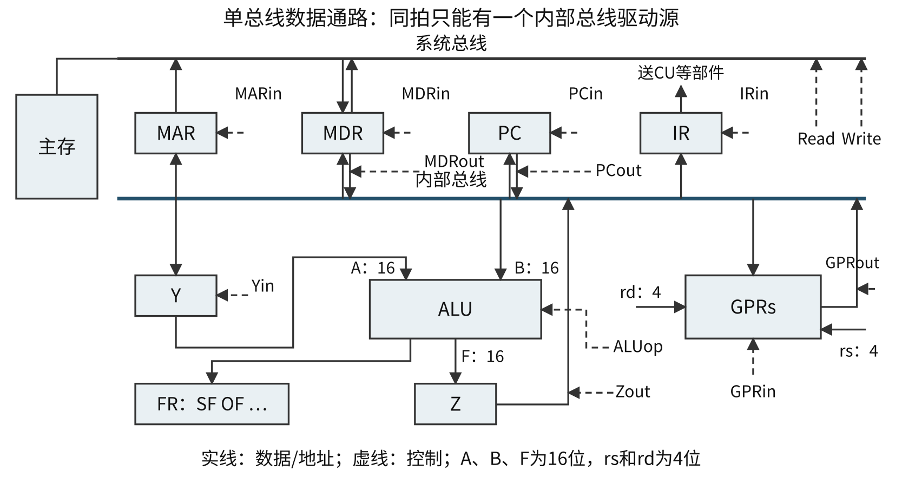{#co-fig-datapath width=98%}

（1）设ALU的输入端A、B及输出端F的最高位分别为A15、B15及F15，FR中的符号标志和溢出标志分别为SF和OF，则SF的逻辑表达式是什么？A加B、A减B时OF的逻辑表达式分别是什么？要求逻辑表达式的输入变量为A15、B15及F15。

（2）为什么要设置暂存器Y和Z？

（3）若GPRs的输入端rs、rd分别为所读、写的通用寄存器的编号，则GPRs中最多有多少个通用寄存器？rs和rd来自图中的哪个寄存器？已知GPRs内部有一个地址译码器和一个多路选择器，rd应连接地址译码器还是多路选择器？

（4）取指令阶段（不考虑PC增量操作）的控制信号序列是什么？若从发出主存读命令到主存读出数据并传送到MDR共需5个时钟周期，则取指令阶段至少需要几个时钟周期？

（5）图中控制信号由什么部件产生？图中哪些寄存器的输出信号会连到该部件的输入端？

<a id="CO05-E03"></a>
### [例 5-3](../solutions/notes.md#a-CO05-E03)
某指令功能为 $\mathrm R[r2]\leftarrow\mathrm R[r1]+\mathrm M[\mathrm R[r0]]$，其两个源操作数分别采用寄存器、寄存器间接寻址方式。对于下列给定部件，该指令在取数及执行过程中需要用到的是（　）。

I. 通用寄存器组（GPRs）　II. 算术逻辑单元（ALU）  
III. 存储器（Memory）　IV. 指令译码器（ID）

A. 仅 I、II　 B. 仅 I、II、III　 C. 仅 II、III、IV　 D. 仅 I、III、IV

<a id="CO05-controller"></a>
## 硬布线与微程序控制器
| 维度 | 硬布线控制 | 微程序控制 |
|---|---|---|
| 控制信号来源 | 操作码、节拍、周期状态及标志经逻辑电路形成 | 控存微指令的控制字段直接或译码形成 |
| 常见特点 | 控制延迟较短；修改复杂功能需改逻辑 | 便于组织复杂控制；受控存与微周期开销影响 |
| 设计步骤 | 列微操作→排节拍→合成控制逻辑 | 列微操作/节拍→选编码与下址方式→分配控存→编微码 |

硬布线中某信号在指令A的$T_1$或指令B的$T_2$发生，可写 $C=A\cdot T_1+B\cdot T_2$；加、乘分别为逻辑或、与，条件标志乘入相应项。

| 微程序对象 | 含义 |
|---|---|
| 机器指令 | ISA规定的一次软件可见操作 |
| 微程序 | 实现一条机器指令等功能的微指令序列 |
| 微指令 | 一个微周期的操作控制和顺序控制信息 |
| 微命令 | 使具体部件执行微操作的控制信号 |
| CM/CMAR/CMDR | 控制存储器/微地址寄存器/微指令寄存器 |

PC、MAR对应机器程序/主存空间；CMAR定位控存。公共取指微程序可共享，取指结束由IR操作码映射执行入口，执行结束回取指入口。间址、中断等可有公共段；入口具体地址依模型规定。

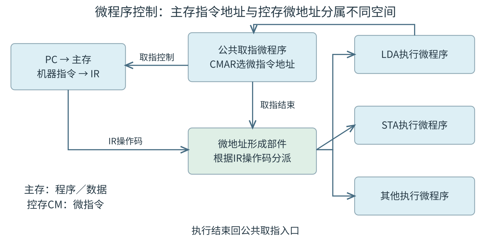

| 控制字段编码 | 位数与并行性 |
|---|---|
| 直接控制 | 每个微命令一位；宽、译码简单、并行性强 |
| 字段直接编码 | 互斥微命令同组，各组可并行；含$k$条命令及空操作需$\lceil\log_2(k+1)\rceil$位 |
| 字段间接编码 | 利用字段间依赖解释；进一步压缩并增加译码层次 |

水平型通常控制字较宽、并行微操作较多；垂直型编码较强、字短，可能需更多微指令；混合型折中。下微地址可来自下地址字段、顺序增量、操作码映射、条件测试或硬件强制入口。控存含$M$个可区分地址时，地址至少$\lceil\log_2M\rceil$位。

静态微程序通常固化于ROM；动态微程序使用可改写控存；毫微程序在微指令之下再设解释层。修改能力取决于硬件支持。

<a id="CO05-E04"></a>
### [例 5-4](../solutions/notes.md#a-CO05-E04)
某计算机的控制器采用微程序控制方式，微指令中的操作控制字段采用字段直接编码法，共有33个微命令，构成5个互斥类，分别包含7、3、12、5和6个微命令，则操作控制字段至少有（　）。

A. 5位　 B. 6位　 C. 15位　 D. 33位

<a id="CO05-E05"></a>
### [例 5-5](../solutions/notes.md#a-CO05-E05)
某计算机采用微程序控制器，共有32条指令，公共的取指令微程序包含2条微指令，各指令对应的微程序平均由4条微指令组成，采用断定法（下地址字段法）确定下条微指令地址，则微指令中下地址字段的位数至少是（　）。

A. 5　 B. 6　 C. 8　 D. 9

<a id="CO05-events"></a>
## 异常、中断与返回断点
| 事件 | 检测与处理 | 常见返回位置 |
|---|---|---|
| 故障fault，如缺页 | 当前指令未完成；修复后重试 | 当前指令起点 |
| 陷阱trap，如系统调用 | 执行有意通知/服务请求 | 通常为后继位置 |
| 终止abort | 严重异常，通常无法可靠恢复 | 依体系结构 |
| 外部中断 | 设备、定时器等；通常在指令边界响应 | 下一条尚未执行指令 |

具体分类、保存PC及可恢复规则由ISA确定。硬件响应保存规定的断点与处理器状态、切换状态并进入入口；软件继续保存所需通用寄存器现场。“中断隐指令”为硬件响应动作的教材称呼。中断服务程序为软件。

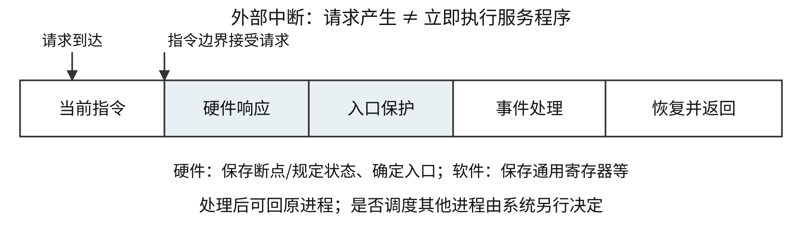

进入内核态后可返回原进程，也可由调度器切换进程；模式切换与上下文切换分开判断。

<a id="CO05-E06"></a>
### [例 5-6](../solutions/notes.md#a-CO05-E06)
异常事件在当前指令执行过程中进行检测，中断请求则在当前指令执行后进行检测。下列事件中，相应处理程序执行后，必须回到当前指令重新执行的是（　）。

A. 系统调用　 B. 页缺失　 C. DMA传送结束　 D. 打印机缺纸

<a id="CO05-pipeline"></a>
## 流水线阶段、时钟与性能公式
| 阶段 | 典型工作 |
|---|---|
| IF | 取指 |
| ID | 译码、读源寄存器 |
| EX | ALU运算、计算有效地址 |
| MEM | LOAD读数据、STORE写数据 |
| WB | 写回寄存器 |

ALU结果在EX末形成，LOAD数据通常在MEM末形成；STORE通常无寄存器写回。固定五段题可要求所有指令流出五段后才计完成。阶段寄存器须携带数据、立即数、目的寄存器号、控制位、指令地址和必要异常信息。

冻结保持原有状态；气泡是不会改变有效状态的空操作。二者须配合写使能，避免重复写入或错误访存。

等时$k$段、时钟$\tau$、每拍启动一条、无冒险时：

\[
T=(k+n-1)\tau,\quad \mathrm{TP}=\frac{n}{T},\quad
S=\frac{nk}{k+n-1},\quad E=\frac{n}{k+n-1}.
\]

$S$以非流水每条耗$k\tau$为基线；$E$假定每条有效使用全部$k$段。实际有用面积、原机器周期不同须重新计算。整体延长$s$拍时，$T=(k+n-1+s)\tau$。$\tau\ge\max t_i+t_r$，$t_r$为段寄存器开销；单条延迟约$k\tau$，稳态完成间隔为$\tau$。

<a id="CO05-E07"></a>
### [例 5-7](../solutions/notes.md#a-CO05-E07)
某计算机的指令流水线由四个功能段组成，指令流经各功能段的时间（忽略各功能段之间的缓存时间）分别为90 ns、80 ns、70 ns和60 ns，则该计算机的 CPU 时钟周期至少是（　）。

A. 90 ns　 B. 80 ns　 C. 70 ns　 D. 60 ns

按层次分部件级、处理机级、处理机间流水；按功能分单/多功能；按同一时刻功能配置分静态/动态；按有无反馈分线性/非线性。动态流水线的功能分类与指令动态调度分别判断。

<a id="CO05-hazard"></a>
## 结构、数据与控制冒险
| 类别 | 冲突及处理 |
|---|---|
| 结构冒险 | 同拍争用不足的资源；停顿、加端口、分离指令/数据存储器 |
| RAW写后读 | 消费者需前指令新值；等待、转发、合法指令调度 |
| WAR读后写 | 后写覆盖尚未读取的旧值；重命名可消除名字冲突 |
| WAW写后写 | 两次写完成次序改变最终值；重命名、按序提交 |
| 控制冒险 | 条件或后继目标未定；阻塞、预测、合法调度 |

固定五段、顺序发射、ID读且WB顺序写的简单模型通常只需处理RAW；乱序或不同延迟写回可能产生WAR/WAW。无条件转移在目标尚未获得时也可能造成控制冒险。

| 时序/旁路条件 | 消费者最早可用时刻 |
|---|---|
| 无转发，同寄存器不能同拍读写 | ID晚于生产者WB至少1拍 |
| 无转发，同拍先写后读 | ID可与生产者WB同拍 |
| EX结果向EX转发 | 生产者EX末产生，下一拍消费者EX可用 |
| LOAD的MEM结果向EX转发 | 消费者EX须晚于生产者MEM；紧邻load-use常停1拍 |

转发仅能传已有结果；STORE数据端、分支比较端是否有旁路须按图确认。硬件阻塞让前级保持、后级插气泡；编译调度只移动保持语义和副作用的指令。

<a id="CO05-E08"></a>
### [例 5-8](../solutions/notes.md#a-CO05-E08)
下列指令序列中，指令I1和I3、I2和I3之间发生数据相关。假定采用“取指、译码/取数、执行、访存、写回”五段流水线方式，那么在采用转发技术时，需要在指令I3之前加入（　）条空操作指令才能使这段程序不发生数据冒险。

```text
I1: add  r1, r0, 1    // R[r1] <- R[r0] + 1
I2: load r3, 12(r2)   // R[r3] <- M[R[r2] + 12]
I3: add  r5, r3, r1   // R[r5] <- R[r3] + R[r1]
```

A. 3　 B. 2　 C. 0　 D. 1

<a id="CO05-E09"></a>
### [例 5-9](../solutions/notes.md#a-CO05-E09)
在采用“取指、译码/取数、执行、访存、写回”5段流水线的 RISC 处理器中，执行如下指令序列，其中s0、s1、s2、s3和t2表示寄存器编号。

```text
I1: add  s2, s1, s0  // R[s2] <- R[s1] + R[s0]
I2: load s3, 0(s2)   // R[s3] <- M[R[s2] + 0]
I3: beq  t2, s3, L1  // if R[t2] = R[s3] jump to L1
I4: addi t2, t2, 20  // R[t2] <- R[t2] + 20
I5: L1: ...
```

若采用转发（旁路）技术处理数据冒险，采用硬件阻塞方式处理控制冒险，则在指令I1～I4的执行过程中，发生流水线阻塞的指令有（　）。

A. 仅 I3　 B. 仅 I2、I4　 C. 仅 I3、I4　 D. I2、I3、I4

分支预测错误时清除错误路径结果并重新取指。若分支比例为$f_b$、误判率$p_m$、每次损失$d$拍，且无重复计费，则$\mathrm{CPI}=\mathrm{CPI}_0+f_bp_md$。

<a id="CO05-parallel"></a>
## 多发射、动态调度与精确异常
| 技术 | 并行方式与约束 |
|---|---|
| 超标量 | 每周期可发射多条；实际吞吐受依赖、资源、分支及带宽约束 |
| 超流水 | 细分阶段以缩短周期；寄存器及冒险开销限制收益 |
| VLIW | 编译器将可并行操作打包到长指令；需要相应硬件支持 |
| 动态调度 | 后续就绪指令可先执行，减少长延迟造成的空闲 |
| 寄存器重命名 | 新逻辑写分配不同物理寄存器，消除WAR/WAW假相关；RAW保留 |
| 按序提交 | 保持软件可见结果符合程序顺序，支持精确异常 |

最大发射宽度$w$给出理想每拍最多完成$w$条的上限，程序速度仍须按实际CPI与周期计算。

<a id="CO05-threads"></a>
## Flynn 分类、硬件线程与共享内存
| 分类 | 指令流/数据流 | 典型组织 |
|---|---|---|
| SISD | 单/单 | 传统单指令流执行 |
| SIMD | 单/多 | 向量处理器，同类操作处理多个数据 |
| MISD | 多/单 | 按定义识别 |
| MIMD | 多/多 | 多核、多处理器、多计算机 |

向量执行有启动开销，长向量利于摊薄；分支发散可能降低利用率。SMP中处理器地位对等，共享单一物理地址空间，各自寄存器及部分Cache可私有。多计算机各有私有主存，通过消息通信。

| 硬件多线程 | 线程选择粒度 |
|---|---|
| 粗粒度 | 长延迟事件时切换，可付清空与重填代价 |
| 细粒度 | 按周期等较细粒度交替，每拍选择一个线程，可从该线程发多条 |
| SMT | 同一拍从多个线程选择就绪指令，共享执行槽 |

硬件线程需分别保存体系结构状态，可用于单核；多核为单芯片集成多个执行核。单线程加速、功耗和线程数均依实现及负载确定。共享物理地址空间还需要原子操作、同步、Cache一致性和存储顺序约束。

<a id="CO05-E10"></a>
### [例 5-10](../solutions/notes.md#a-CO05-E10)
下列关于并行处理技术的叙述中，不正确的是（　）。

A. 多核处理器属于 MIMD 结构  
B. 向量处理器属于 SIMD 结构  
C. 硬件多线程技术只可用于多核处理器  
D. SMP中所有处理器共享单一物理地址空间

<a id="CO05-E11"></a>
### [例 5-11](../solutions/notes.md#a-CO05-E11)
某16位计算机中，带符号整数用补码表示，数据Cache和指令Cache分离。下面给出了指令系统中部分指令的汇编格式及对应功能，其中Rs和Rd表示寄存器，mem表示存储单元地址，(x)表示寄存器x或存储单元x的内容。

```text
ADD   Rs, Rd
SHL   Rd
SHR   Rd
LOAD  Rd, mem
STORE Rs, mem
```

上面每行给出一种汇编格式；下表逐项给出各助记符对应的名称和功能，不改变源、目的操作数的次序。

| 名称 | 助记符 | 指令功能 |
|---|---|---|
| 加法 | `ADD` | $(\mathrm{Rs})+(\mathrm{Rd})\to\mathrm{Rd}$ |
| 算术/逻辑左移 | `SHL` | $2(\mathrm{Rd})\to\mathrm{Rd}$ |
| 算术右移 | `SHR` | $(\mathrm{Rd})/2\to\mathrm{Rd}$ |
| 取数 | `LOAD` | $(\mathrm{mem})\to\mathrm{Rd}$ |
| 存数 | `STORE` | $(\mathrm{Rs})\to\mathrm{mem}$ |

该计算机采用5段流水方式执行指令，各流水段分别是取指IF、译码/读寄存器ID、执行/计算有效地址EX、访问存储器M和结果写回寄存器WB。流水线采用“按序发射、按序完成”方式，没有采用转发技术处理数据相关，并且同一个寄存器的读和写操作不能在同一个时钟周期内进行。请回答下列问题。

（1）若int型变量x的值为−513，存放在寄存器R1中，则执行指令 `SHR R1` 后，R1的内容是多少（用十六进制表示）？

（2）若某个时间段中有连续4条指令进入流水线，在其执行过程中没有发生任何阻塞，则执行这4条指令需要多少个时钟周期？

（3）若赋值语句为 `x=a+b`，x、a、b均为int型变量，其存储单元地址分别为[x]、[a]、[b]。对应指令序列及流水过程如下，I3的ID段和I4的IF段被阻塞的原因各是什么？

```text
I1  LOAD  R1, [a]
I2  LOAD  R2, [b]
I3  ADD   R1, R2
I4  STORE R2, [x]
```

| 指令 | 成功推进的阶段与周期 | 因依赖或前级冻结而等待 |
|---|---|---|
| I1 | IF1，ID2，EX3，M4，WB5 | 无 |
| I2 | IF2，ID3，EX4，M5，WB6 | 无 |
| I3 | IF3，ID7，EX8，M9，WB10 | 第4～6拍在ID端等待 |
| I4 | IF7，ID11，EX12，M13，WB14 | 第4～6拍未获准取指；第8～10拍在ID端等待 |

上表将原图时空格紧凑写成“阶段名+周期数”，另列等待状态：I3第4～6拍在ID端等待，I4第4～6拍尚未获准取指，第8～10拍又在ID端等待；这些等待状态保留了原图中的阻塞信息；其他未列时刻表示该指令尚未进入或已经离开流水线。

（4）若赋值语句为 `x=x*2+a`，x和a均为unsigned int型变量，其存储单元地址分别为[x]、[a]，执行这条语句至少需要多少个时钟周期？要求模仿上图，画出对应指令序列及流水线执行过程示意图。


<a id="CO06"></a>
# 总线
<a id="CO06-structure"></a>
## 总线组成、特性与连接结构
总线是多个部件分时共享的信息传输线路及配套协议。每次事务由主设备发起，从设备按地址响应；CPU、取得使用权的DMA控制器均可作主设备。读事务的数据由从设备给出，写事务的数据由主设备给出。

| 信息组 | 作用与传送内容 |
|---|---|
| 地址总线 | 指定存储单元或I/O端口，宽度影响地址组合数 |
| 数据总线 | 传指令、操作数、状态字、命令字、中断类型号等编码值 |
| 控制总线 | 规定读写、有效时刻、请求、应答及状态 |

写控制端口时，命令字可经数据线传输，控制线说明读写性质。地址的驱动者由当前主设备决定。可寻址容量还需结合编址单位计算；数据线数决定一次并行数据量。

| 总线特性 | 规范内容 |
|---|---|
| 机械 | 连接器、尺寸、形状、引脚布局 |
| 电气 | 电平、电压、负载等 |
| 功能 | 每根信号线的意义 |
| 时间 | 建立、采样、保持与撤销关系 |

| 分类维度 | 类别及特点 |
|---|---|
| 位置/用途 | 片内总线；连接CPU、主存、I/O接口的系统总线；系统/设备间通信总线 |
| 数据传送 | 串行逐位发送；并行多线同拍传多位 |
| 连接结构 | 单总线共享，结构简单、争用集中；双/三/多总线分离主存及I/O等流量 |
| 桥接 | 缓冲数据、转换协议、协调控制与速率 |

多总线可减少争用，并增加连接与控制成本；跨桥及主存带宽仍可成为瓶颈。并行的线间偏斜、串扰及接插件复杂度限制频率和距离；高速串行可用多条lane并行传包。具体总线时钟及速度分别确定。

<a id="CO06-bandwidth"></a>
## 位宽、传送率、峰值与有效带宽
设每次有效数据$W$位，每秒$R$次传送，时钟频率$f$、每周期传$a$次：

\[
B_{\mathrm{peak}}=R\frac W8=af\frac W8\quad(\mathrm{B/s}).
\]

MHz为每秒时钟次数，MT/s为每秒数据传送次数；已给MT/s时直接作$R$。总线周期为一次规定操作的时间，可能占多拍。若每事务有效载荷$Q$ B、实际耗时$T$，则$B_{\mathrm{eff}}=Q/T$，分母应含相应地址、等待、仲裁等开销。

| 计算对象 | 分子/分母 |
|---|---|
| 峰值带宽 | 数据节拍的有效载荷/数据节拍时间 |
| 事务有效带宽 | 一次事务有效载荷/事务总历时 |
| 设备速率 | 设备产生或消耗的数据/时间 |
| CPU占用 | CPU执行查询、服务、设置收尾的时间/总时间 |

校验位、包头等按题设从载荷中扣除；多通道仅在可并行且负载允许时相加；全双工分别计算单方向与双向合计。端到端持续吞吐受最慢环节限制。

<a id="CO06-E01"></a>
### [例 6-1](../solutions/notes.md#a-CO06-E01)
假设某系统总线在一个总线周期中并行传输4 B信息，一个总线周期占用2个时钟周期，总线时钟频率为10 MHz，则总线带宽是（　）。

A. 10 MB/s　 B. 20 MB/s　 C. 40 MB/s　 D. 80 MB/s

<a id="CO06-E02"></a>
### [例 6-2](../solutions/notes.md#a-CO06-E02)
某64位并行总线每时钟周期传4次数据，实际数据传送率已明确给为1333 MT/s，求单方向理想峰值带宽。若改给的是333.25 MHz时钟频率，结果是否相同？

32位、100 MHz、每拍两次时，峰值$4\times2\times100\times10^6=800$ MB/s。32位、每秒$33\times10^6$次有效传送时为132 MB/s。

<a id="CO06-transactions"></a>
## 总线事务与突发传送时间
一次事务通常经过申请/分配、寻址、传输、结束。读操作：主设备发地址和读命令→从设备译码与准备→从设备给出有效数据→主设备采样→结束。写操作由主设备提供写数据。

地址/数据复用线路须分时使用；独立地址、数据线允许的重叠依协议确定。突发传送给一个首地址后连续传多个相邻数据，摊薄地址与启动开销；非突发按每个数据分别计地址、准备及传送。

| 模型 | $n$个数据的总时间（无额外重叠） |
|---|---|
| 非突发，每数据均付启动 | $n(t_a+t_p+t_d)$ |
| 突发，只付一次启动 | $t_a+t_p+nt_d$ |

主存准备是否每字重复、是否可流水/重叠须按题设确认。

<a id="CO06-E03"></a>
### [例 6-3](../solutions/notes.md#a-CO06-E03)
某存储器总线宽度为64位，总线时钟频率为1 GHz，在总线上传输一个数据或地址需要一个时钟周期，不支持突发传送方式。若通过该总线连接CPU和主存，主存每次准备一个64位数据需要6 ns，主存块大小为32 B，则读取一个主存块所需的时间是（　）。

A. 8 ns　 B. 11 ns　 C. 26 ns　 D. 32 ns

<a id="CO06-E04"></a>
### [例 6-4](../solutions/notes.md#a-CO06-E04)
某存储器总线的时钟频率为420 MHz，总线宽度为64位，每个时钟周期传送2次数据；其总线事务支持突发传送方式，最多传送8次数据，第1个时钟周期传送地址和读/写命令，从第4个至第7个时钟周期连续传送8次数据。该总线的总线带宽（最大数据传输率）为（　）。

A. 3.84 GB/s　 B. 6.72 GB/s　 C. 30.72 GB/s　 D. 53.76 GB/s

50 MHz同步总线：传8个4 B字，1拍地址+3拍等待+8拍数据，共12拍=240 ns，有效速率约133.3 MB/s。每个字独立占1+3+1拍时，共40拍=800 ns，有效速率40 MB/s。

等待期间若保持总线占有权，等待计入总线资源占用；若释放总线，总历时与占用时间分别累计。DMA的总线占用与CPU开销分别计算。

<a id="CO06-timing"></a>
## 同步、异步与半同步定时
| 定时 | 推进依据 | 时序条件 |
|---|---|---|
| 同步 | 共同的时钟边沿 | 周期容纳传播、译码、准备及建立时间；慢设备可插等待 |
| 异步 | 请求/应答等握手 | 各步按规定建立和撤销信号，适应速度差异 |
| 半同步 | 时钟加等待/应答 | 按规定边沿采样，慢设备请求延长准备阶段 |

异步握手按撤销信号是否等待对方确认分类：

| 类型 | 主设备撤请求 | 从设备撤应答 |
|---|---|---|
| 不互锁 | 发送后按预定时间撤销 | 按预定时间撤销 |
| 半互锁 | 等应答出现后撤销 | 按预定时间撤销 |
| 全互锁 | 等应答出现后撤销 | 等请求撤销后撤销 |

全互锁四阶段：请求置位→应答置位→请求撤销→应答撤销。建立和释放均相互确认，增加相应握手等待。

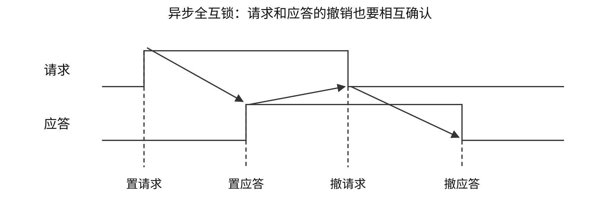

读时序图须标明：有效电平、地址稳定、读写命令有效、数据有效、采样点及事务起止。低有效信号以低电平为有效，重叠动作按协议判断。

串行异步字符帧需计起始、数据、校验、停止位。例如7数据+1校验+1起始+1停止=10位/字符；480字符/s对应线路4800 bit/s、有效数据3360 bit/s。

<a id="CO06-arbitrate"></a>
## 仲裁优先级与分离事务
仲裁决定多个主设备中谁获使用权；定时决定信号何时有效和事务何时推进。优先级给出先后关系，公平性衡量低优先级请求能否长期得到服务。

| 集中式仲裁 | 选择机制 | 特点 |
|---|---|---|
| 链式查询 | 允许信号沿链传播 | 控制线少；靠近仲裁器者通常优先，链路故障敏感，低位可能长期等待 |
| 计数器定时查询 | 输出设备编号，请求者比较匹配 | 起始编号、循环规则可改变优先级与公平性 |
| 独立请求 | 各设备独立请求/允许 | 响应快、优先级灵活；线路和逻辑开销较大 |

按公共请求、忙、允许的教材计线口径：$n$设备链式3条；计数器式$\lceil\log_2n\rceil+2$条；独立请求式每设备请求/允许加公共忙，$2n+1$条。8设备独立请求为17条。计算先确认公共信号是否计入。

分布式仲裁由各参与者按共同规则竞争或判定使用权。分离事务将请求和响应分两次占用总线：发请求后释放，准备好再申请返回结果；需用标识与排队机制匹配请求/响应。它可与同步/异步定时组合，总历时可大于总线实际占用时长。

<a id="CO06-standards"></a>
## 常见总线和接口标准
| 标准 | 组织与主要对象 |
|---|---|
| ISA/EISA | 早期PC并行扩展总线 |
| VESA局部总线 | 早期显示等高速局部外设 |
| PCI | 共享并行局部总线，支持总线主控、突发和配置 |
| AGP | 历史图形加速接口 |
| PCI Express | 点到点串行、多lane、全双工 |
| USB | 主机与外设串行连接，支持集线器、即插即用、热插拔 |
| SATA | 串行存储接口 |
| SCSI | 设备寻址、命令与控制的接口体系 |
| RS-232 | 串行通信连接、电平与信号规范 |
| PCMCIA/CardBus | 历史便携设备卡式扩展 |

代际、lane数、编码效率、包头与方向共同决定载荷带宽；具体版本标称值须按题给条件使用。DDR每周期在两个边沿传数据，已给传送率时直接按该传送率计算。


<a id="CO07"></a>
# 输入/输出系统
<a id="CO07-peripherals"></a>
## 外部设备、显示存储与缓冲
I/O硬件包括设备、接口/控制器及连接通路；软件包括驱动与上层管理程序。输入设备将外界信息采样编码，输出设备将编码转换成显示、声音或纸面记录，外存提供持久保存。

| 设备 | 基本机制或参数 |
|---|---|
| 键盘、鼠标 | 按键扫描编码，位移和按键形成报告 |
| 扫描仪、摄像设备 | 光学信息采样编码 |
| 显示器 | 屏幕尺寸、分辨率、每像素位数、刷新频率 |
| 针式打印机 | 撞针经色带成像，可用于多联复写 |
| 喷墨打印机 | 喷墨滴成像 |
| 激光打印机 | 感光鼓成像、转印、定影 |

分辨率$W\times H$、每像素$b$位、刷新率$f$时，无压缩有效像素量：

\[
Q_{\mathrm{frame}}=\frac{WHb}{8}\ \mathrm B,\qquad
R_{\mathrm{pixel}}=\frac{WHbf}{8}\ \mathrm{B/s}.
\]

双缓冲容量为两帧，实际输出率按刷新频率计算。字模库存每种字符点阵，帧缓冲存当前画面像素；消隐、编码、包头与压缩按题设计入。1920×1080、24位、60帧/s：单帧6220800 B，双缓冲12441600 B，有效速率373248000 B/s。

接口缓冲吸收瞬时速率差；持续输入高于长期消耗能力时，有限缓冲终会填满。

<a id="CO07-ports"></a>
## I/O 接口、端口、编址与通道
接口连接系统总线与设备，承担设备选择、地址识别、命令译码、数据缓冲、状态记录、串并转换、速度匹配，以及中断/DMA请求。端口是CPU可访问的接口寄存器或地址位置，一个接口通常包含多个端口。

| 端口 | 内容与操作 |
|---|---|
| 数据 | 读已接收数据、写待发送数据 |
| 状态 | 读就绪、忙、错误等状态 |
| 控制 | 写启动、复位、工作方式等命令 |

状态读与控制写可共享地址并由读写方向区分。端口地址定位接口位置，扇区地址定位设备内部数据。命令字、状态字、中断类型号均可经数据线传送；读写等控制线规定事务性质。

<a id="CO07-E01"></a>
### [例 7-1](../solutions/notes.md#a-CO07-E01)
下列选项中，在I/O总线的数据线上传输的信息包括（　）。

I. I/O接口中的命令字　II. I/O接口中的状态字　III. 中断类型号

A. 仅 I、II　 B. 仅 I、III　 C. 仅 II、III　 D. I、II、III

| 编址 | 地址空间 | 访问方式 |
|---|---|---|
| 统一编址/存储器映射I/O | 与主存共用；译码须区分内存和设备区域 | 普通访存指令 |
| 独立编址 | 单独I/O空间；同数值可各对应内存和端口 | 通常用专门I/O指令 |

接口与设备交换数据、命令和状态；接口向CPU提出中断请求。通道为执行通道程序的专用I/O处理部件，CPU启动后由其组织系列设备操作；通道指令由通道执行，I/O指令由CPU执行。DMA主要搬运设定数据块，通道可承担更完整控制组织。

<a id="CO07-polling"></a>
## 程序查询与服务期限
查询流程：设置命令、地址与数量→检查状态→就绪后CPU读/写数据端口→更新地址和计数→完成或继续。忙等查询持续检查，等待及搬运均占CPU；定时查询在两次检查间可运行其他程序。

设设备速率$R$ B/s、缓冲/每次交换$q$ B，持续到达且每次取走一缓冲时：

\[
\Delta t_{\mathrm{buffer}}=\frac qR,\qquad
\lambda=\frac Rq\ \text{次/s},\qquad
U_{\mathrm{CPU}}=\lambda t_{\mathrm{service}}.
\]

查询与取数必须在缓冲覆盖前完成；单缓冲的服务间隔至多为$q/R$，还须将服务时长、相位及最长延迟纳入期限。已给每次服务$c$个周期、主频$f$时，$U=\lambda c/f$；已给$I$条指令时，$c=I\times\mathrm{CPI}$。

<a id="CO07-E02"></a>
### [例 7-2](../solutions/notes.md#a-CO07-E02)
某计算机处理器主频为50 MHz，采用定时查询方式控制设备A的I/O，查询程序运行一次所用的时钟周期数至少为500。在设备A工作期间，为保证数据不丢失，每秒需对其查询至少200次，则CPU用于设备A的I/O的时间占整个CPU时间的百分比至少是（　）。

A. 0.02%　 B. 0.05%　 C. 0.20%　 D. 0.50%

50 MHz、每次查询100周期：鼠标每秒30次占0.006%；磁盘2 MiB/s、每次4 B需$2^{19}$次/s，占约104.86%，说明该组织服务能力不足。查询开销已包含搬运时，搬运费用只计一次。

<a id="CO07-service"></a>
## 中断响应、现场与返回
中断I/O流程：CPU启动设备→执行其他程序→设备/接口发请求并用触发器保留→CPU在允许边界判定未屏蔽请求→硬件响应→服务程序搬运与处理→恢复返回。请求产生、允许响应、开始处理及完成分别计时。

| 环节 | 典型动作 |
|---|---|
| 硬件响应 | 暂时禁止相应中断、保存断点和规定状态、定位入口 |
| 软件入口 | 保存将修改且须恢复的通用寄存器及旧屏蔽字 |
| 服务主体 | 读写数据端口、处理事件、设置控制信息 |
| 软件退出/返回 | 关中断、恢复现场与屏蔽字、按ISA规则恢复断点和状态 |

中断向量为定位入口的信息，向量地址为保存向量的位置，处理程序入口为代码地址，具体映射由实现规定。单重中断在处理期间关闭相应可屏蔽中断。多重中断在现场保护和屏蔽设置完成后开放允许的嵌套。

教材单重序列常写“保护现场→事件处理→恢复现场→开中断→中断返回”；实际ISA也可由返回指令原子恢复状态与允许位。非屏蔽中断的响应时点及保存规则仍由体系结构规定。

<a id="CO07-priority"></a>
## 中断判优、屏蔽字与嵌套
响应优先级由硬件在当前未屏蔽请求中选谁先响应；处理优先级规定服务程序间谁可打断谁，通过屏蔽字组织。屏蔽改变可参与响应的集合，保留已经发生的请求记录。

按屏蔽位1=禁止、0=允许的约定，服务程序通常屏蔽本级及不允许打断它的源，只开放更高处理优先级。每层进入时保存旧屏蔽字，退出时恢复上一层状态。

<a id="CO07-E03"></a>
### [例 7-3](../solutions/notes.md#a-CO07-E03)
有A、B、C三个请求源，硬件响应优先级A>B>C。屏蔽字按A、B、C排列，1表示屏蔽。要求处理优先级C>B>A，服务程序均在保存现场并设置屏蔽字后开中断。给出三者的屏蔽字，并追踪三请求同时待处理时的一次嵌套过程。

请求的到达时间、屏蔽状态、嵌套关系和服务时长共同决定开始及完成顺序。初始响应按硬件优先级，嵌套返回按栈顺序。

<a id="CO07-E04"></a>
### [例 7-4](../solutions/notes.md#a-CO07-E04)
若某设备中断请求的响应和处理时间为100 ns，每400 ns发出一次中断请求，中断响应所允许的最长延迟时间为50 ns，则在该设备持续工作过程中，CPU用于该设备的I/O时间占整个CPU时间的百分比至少是（　）。

A. 12.5%　 B. 25%　 C. 37.5%　 D. 50%

允许响应的最长延迟为期限；CPU占用只计实际响应/服务执行时间。每400 ns请求一次、服务100 ns，CPU占25%；允许延迟50 ns另作实时性约束。

<a id="CO07-direct"></a>
## DMA 控制器、传送阶段与访存方式
DMA由控制器在设备接口与主存之间直接传数据。典型组成：主存地址寄存器/计数器、传送长度计数器、数据缓冲寄存器、设备地址、请求触发器、控制/状态逻辑及完成中断机构。

| 阶段 | 执行主体与动作 |
|---|---|
| 预处理 | CPU驱动设置方向、主存起址、设备、长度等参数并启动 |
| 数据传送 | 设备准备→请求DMA→DMA申请总线→授权后传送→更新地址和计数 |
| 后处理 | 块结束/出错通知CPU，软件检查结果、处理错误、唤醒后续工作 |

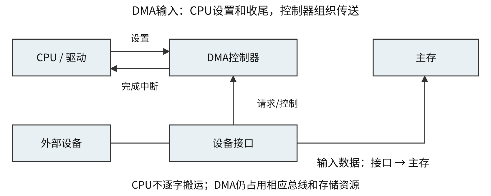

| DMA访存方式 | 占用与CPU行为 |
|---|---|
| 停止CPU访存/成组传送 | 集中占用相关总线，期间CPU所需同资源访存受阻 |
| 周期挪用 | 准备好一个/若干单位后借用存储周期，通常让已开始CPU访存先完成 |
| 交替访存 | CPU与DMA按固定时隙分配，减少重复仲裁，需组织时序 |

DMA占用共享资源时，CPU可在可用寄存器、Cache或其他独立资源上继续；停顿由实际资源需求决定。设备向DMA请求服务、DMA向系统申请总线为两层请求；DMA申请与请求CPU运行服务程序的中断分别判断。

<a id="CO07-E05"></a>
### [例 7-5](../solutions/notes.md#a-CO07-E05)
若设备采用周期挪用DMA方式进行输入和输出，每次DMA传送的数据块大小为512字节，相应的I/O接口中有一个32位数据缓冲寄存器。对于数据输入过程，下列叙述中，错误的是（　）。

A. 每准备好32位数据，DMA控制器就发出一次总线请求  
B. 相对于CPU，DMA控制器的总线使用权的优先级更高  
C. 在整个数据块的传送过程中，CPU不可以访问主存储器  
D. 数据块传送结束时，会产生“DMA传送结束”中断请求

<a id="CO07-E06"></a>
### [例 7-6](../solutions/notes.md#a-CO07-E06)
下列关于DMA方式的叙述中，正确的是（　）。

I. DMA传送前由设备驱动程序设置传送参数  
II. 数据传送前由DMA控制器请求总线使用权  
III. 数据传送由DMA控制器直接控制总线完成  
IV. DMA传送结束后的处理由中断服务程序完成

A. 仅 I、II　 B. 仅 I、III、IV　 C. 仅 II、III、IV　 D. I、II、III、IV

<a id="CO07-budget"></a>
## 查询、中断和 DMA 的开销预算
设持续设备速率$R$ B/s、每次数据交换$q$ B、每块$Q$ B、每次CPU服务$t$ s、每块预后处理$u$ s、每数据单位占总线$b$ s：

| 量 | 计算式 | 条件 |
|---|---|---|
| 查询/中断事件率 | $R/q$ | 每次交换$q$ B |
| 查询/中断CPU比例 | $(R/q)t$ | 服务开销均已计入 |
| DMA完成事件率 | $R/Q$ | 每块正常完成通知一次 |
| DMA软件CPU比例 | $(R/Q)u$ | 预处理及后处理按块计 |
| 数据总线占用比例 | $(R/q)b$ | 单位传输不重叠，无额外未计开销 |

CPU预算与总线预算分别核算。比例大于1表示处理能力不足；平均CPU开销低于100%后，还需核最长响应时间及缓冲期限。多级缓冲、批量中断、突发合并等条件改变事件粒度时，重新计数。

| 方式 | CPU介入 | 搬运主体 |
|---|---|---|
| 忙等查询 | 连续检查、逐单位搬运 | CPU指令 |
| 定时查询 | 定期查询并搬运 | CPU指令 |
| 中断I/O | 每请求响应后运行服务程序 | CPU指令 |
| DMA | 每块设置、完成后收尾 | DMA控制器 |

字符等低速设备常用查询/中断，大批量块传送常用DMA；选择依速率、粒度、缓冲和实现。512 B块、4 B缓冲为128次数据单位传送，正常完成通知一次。1024 B块则为256次4 B单位；总线事务数还取决于突发合并。

<a id="CO07-E07"></a>
### [例 7-7](../solutions/notes.md#a-CO07-E07)
假定计算机的主频为500 MHz，CPI为4。现有设备A和B，其数据传输率分别为2 MB/s和40 MB/s，对应I/O接口中各有一个32位数据缓冲寄存器。请回答下列问题，要求给出计算过程。

（1）若设备A采用定时查询I/O方式，每次输入/输出都至少执行10条指令。设备A最多间隔多长时间查询一次才能不丢失数据？CPU用于设备A输入/输出的时间占CPU总时间的百分比至少是多少？

（2）在中断I/O方式下，若每次中断响应和中断处理的总时钟周期数至少为400，则设备B能否采用中断I/O方式？为什么？

（3）若设备B采用DMA方式，每次DMA传送的数据块大小为1000 B，CPU用于DMA预处理和后处理的总时钟周期数为500，则CPU用于设备B输入/输出的时间占CPU总时间的百分比最多是多少？

1 MB/s、每中断4 B、CPU开销2 μs，需50% CPU；改为1024 B块、每块CPU开销20 μs，约1.953%。两值均仅计软件执行，另核总线占用和服务期限。

<a id="CO07-overlap"></a>
## 设备准备与服务执行的重叠时间
计算总历时先标出“启动下一单位”的时刻，CPU占用累计实际响应和服务指令。CPU 50 MHz、CPI=4；每字符设备准备0.5 ms=25000周期；每字符10线路位（1起始、7数据、1校验、1停止），持续设备最多2000字符/s。

若每中断响应10周期，服务20条指令，第15条启动下一字符，则后5条服务指令可与下一次准备重叠。稳定重复间隔为$25000+10+15\times4=25070$周期；1000字符约25070000周期，CPU实际用$1000(10+20\times4)=90000$周期。

若从首次启动准备计到第1000次服务完全结束，最后5条无后续准备可重叠，精确总历时为$1000\times25070+5\times4=25070020$周期。
