# 计算机网络强化笔记


<a id="CN01"></a>
# 计算机网络体系结构
<a id="CN01-network"></a>
## 网络组成、分类与拓扑
计算机网络将具有独立功能的计算设备通过链路和网络设备连接，按共同协议实现数据通信、资源共享和分布式处理。

| 分类依据 | 划分及含义 |
| --- | --- |
| 工作方式 | 边缘：端系统与应用；核心：互联网络和转发设备 |
| 功能 | 资源子网：计算、存储与共享资源；通信子网：数据传送 |
| 覆盖范围 | PAN、LAN、MAN、WAN；名称没有统一公里数界限 |
| 传输方式 | 广播式：多站共享介质；点到点式：链路连接两端 |
| 其他维度 | 公用/专用、有线/无线，可独立组合 |

internet 泛指网络互连；Internet 指采用 TCP/IP 协议族的全球互联网。ISP 提供互联网接入等服务。网络组成包括硬件、软件和协议。服务复制可提高可用性，还须配合故障检测和一致性机制。

总线、星形、环形、网状描述连接关系。集线器组成物理星形、逻辑共享介质；交换机星形各端口可并行。路径由多段链路组成：H1—R1—R2—H2 有3段链路、2个中间节点。

<a id="CN01-delay"></a>
## 速率、吞吐量与时延
速率单位 bit/s，数据单位换算为 $1\mathrm{B}=8\mathrm{bit}$；$\mathrm{k},\mathrm{M},\mathrm{G}$ 分别为 $10^3,10^6,10^9$，二进制量使用 KiB、MiB 或题设约定。

| 指标 | 公式或定义 | 使用条件 |
| --- | --- | --- |
| 发送时延 | $t_{tx}=L/R$ | 从首比特进入链路至末比特进入；$L$ 用 bit |
| 传播时延 | $t_{prop}=d/v$ | 同一比特走完链路；距离与速度单位统一 |
| 单跳完整接收时间 | $L/R+d/v$ | 无排队、处理开销 |
| 总时延 | 各跳发送、传播、处理、排队按事件累加 | 流水重叠部分只计一次 |
| 时延带宽积 | $R t_{prop}$ | 单向传播中可容纳的比特数 |
| 往返在途量 | $R\cdot RTT$ | 为覆盖反馈等待估计所需窗口 |

带宽在性能题中常指额定速率；吞吐量是观察期间实际通过的数据率；有效吞吐量只计有效载荷。路径单流长期吞吐量不超过最慢链路速率，竞争和协议开销会继续降低它。

RTT须读清计时边界。题给往返传播时延时，数据与确认的发送时间另计；给出实际请求响应时间时，按题意避免重复累加。信道利用率按题设确定分子，可指忙时比例，也可特指发送有效数据所占比例。

理想排队模型 $D=D_0/(1-U)$ 仅用于给定模型：$D_0$为空闲时延，$U$为归一化利用率。独立比特误码概率为 $p$、帧长为 $L$ bit 时，帧错概率 $1-(1-p)^L$；$pL\ll1$ 时近似 $pL$，突发错误不能直接沿用此模型。

<a id="CN01-layers"></a>
## 协议、服务、接口与封装
| 概念 | 约束关系与内容 |
| --- | --- |
| 协议 | 对等实体的水平规则；语法规定格式，语义规定含义和动作，时序规定事件次序 |
| 服务 | 本层与下层协作后向上层提供的能力 |
| 接口、SAP | 同机相邻层使用服务的方式、服务访问位置 |
| 体系结构 | 规定分层、功能及相互关系；内部算法和数据结构由实现选择 |

服务原语描述同机层间事件：请求、指示，以及需应答时的响应、证实。一次原语可引起多次协议报文、超时或重试。

$n$层PDU由控制信息PCI和服务数据SDU封装：$n\text{-PDU}=n\text{-PCI}+n\text{-SDU}$。上层PDU成为下层SDU；PCI可位于首部或尾部。接收端逐层解封装，对等通信依靠本机下层实际传送。

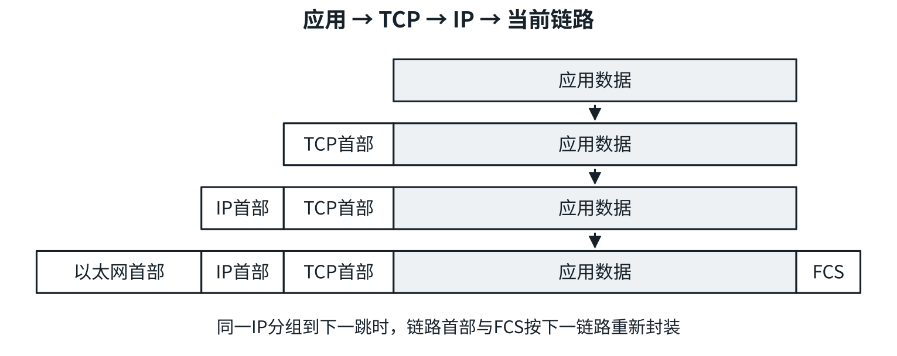{#cn-fig-encapsulation width=96%}

| 标识 | 所属层及长度 | 普通跨路由转发 |
| --- | --- | --- |
| MAC | 链路层，以太网48 bit | 每跳重新封装，目的为当前下一跳接口 |
| IP | 网络层，IPv4为32 bit | 无NAT时源、目的通常保持 |
| 端口 | 传输层，16 bit | 无端口转换时保持，用于进程端点分用 |

面向连接服务通常先建立、再传送、后释放；无连接服务独立提交数据单元。可靠交付、是否确认、是否预留资源分别由协议规定。以太网CRC只检错；802.11单播ACK只确认当前无线跳；端到端可靠性由端系统协议保障。

<a id="CN01-models"></a>
## OSI与TCP/IP功能对应
| OSI层次 | 对象与主要功能 | TCP/IP对应 |
| --- | --- | --- |
| 应用 | Web、邮件、名称服务等应用功能 | 应用层 |
| 表示 | 表示转换、压缩、加密 | 应用层 |
| 会话 | 对话管理、同步与恢复 | 应用层 |
| 传输 | 进程端到端复用分用；按协议提供可靠性、流控 | TCP、UDP |
| 网络 | 跨网络分组寻址、路由和转发 | 网际层IP，尽最大努力数据报 |
| 数据链路 | 相邻节点成帧、检错、介质访问；可含流控和重传 | 网络接口层 |
| 物理 | 原始比特、电平、编码和接口 | 网络接口层 |

五层教学模型把网络接口层展开为数据链路层和物理层。流控所属层由控制范围决定：相邻节点用链路层，应用进程端到端用传输层。具体协议是否实现某项功能，须查该协议提供的服务。

<a id="CN01-E01"></a>
### [例 1-1](../solutions/notes.md#a-CN01-E01)
在 OSI 参考模型中，自下而上第一个提供端到端服务的层次是（　）。

A. 数据链路层　B. 传输层　C. 会话层　D. 应用层

<a id="CN01-E02"></a>
### [例 1-2](../solutions/notes.md#a-CN01-E02)
在 ISO/OSI 参考模型中，实现两个相邻结点间流量控制功能的是（　）。

A. 物理层　B. 数据链路层　C. 网络层　D. 传输层

<a id="CN01-switching"></a>
## 交换方式与存储转发计算
| 方式 | 转发条件 | 主要时间和资源代价 |
| --- | --- | --- |
| 电路交换 | 先建立电路，再连续传送比特流 | 建立时间、源端发送、全程传播；空闲时可仍占资源 |
| 报文交换 | 中间节点收全整份报文后转发 | 长报文逐跳发送与缓存 |
| 分组交换 | 存储转发时收全一组再转发 | 分组首部、处理、排队；可跨链路流水 |

固定路径含 $h$ 段等速链路，$n$个等长分组，每组总长 $L$ bit、速率 $R$，无竞争和处理开销时：

$$T=(n+h-1)\frac LR+\sum_{i=1}^h t_{prop,i}.$$

第一组完成需 $hL/R+\sum t_{prop,i}$，后续每组间隔 $L/R$。报文长 $F$ bit，整报文存储转发发送项为 $hF/R$；已建立理想电路发送项为 $F/R$，再加传播及题给开销。

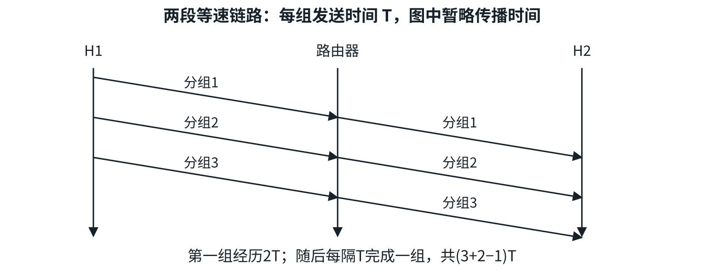{#cn-fig-pipeline width=96%}

异速、变长、含处理时延时用事件递推。令 $F_{i,j}$ 为第$j$组在链路$i$发送完的时刻，$p_{i-1,j}$为上一节点收到后处理时间：

$$F_{i,j}=\max\{F_{i,j-1},\ F_{i-1,j}+t_{prop,i-1}+p_{i-1,j}\}+L_j/R_i.$$

源端准备时刻作边界条件；目的收齐时间为 $F_{h,n}+t_{prop,h}$。若处理器串行且会排队，另记录处理器空闲时刻。

<a id="CN01-E03"></a>
### [例 1-3](../solutions/notes.md#a-CN01-E03)
在下图所示的分组交换网络中，主机 H1 和 H2 通过路由器互连，2段链路的带宽均为100 Mb/s，时延带宽积（即单向传播时延×带宽）均为1000 bit。若 H1 向 H2 发送1个大小为1 MB的文件，分组长度为1000 B，则从 H1 开始发送时刻起到 H2 收到文件全部数据时刻止，所需的时间至少是（注：$M=10^6$）（　）。

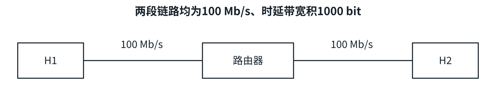{#cn-fig-2023links width=95%}

A. 80.02 ms　B. 80.08 ms　C. 80.09 ms　D. 80.10 ms

<a id="CN01-datagram-vc"></a>
## 数据报与虚电路
| 比较项 | 数据报 | 虚电路 |
| --- | --- | --- |
| 准备与路由 | 无预建逐跳连接；各分组独立选路 | 建立时选路并保存状态 |
| 转发依据 | 分组目的地址 | 输入链路和局部VCID映射 |
| 顺序 | 路径可不同，可乱序 | 通常沿既定路径，保持顺序 |
| 链路资源 | 分组动态共享 | 仍可动态共享，保障由具体服务规定 |

VCID可逐跳变化；永久虚电路可长期保留。虚电路的逻辑连接与电路交换的专用资源分配分别判断。

<a id="CN01-E04"></a>
### [例 1-4](../solutions/notes.md#a-CN01-E04)
下列关于虚电路网络的叙述中，错误的是（　）。

A. 可以确保数据分组传输顺序

B. 需要为每条虚电路预分配带宽

C. 建立虚电路时需要进行路由选择

D. 依据虚电路号（VCID）进行数据分组转发


<a id="CN02"></a>
# 物理层
<a id="CN02-signal"></a>
## 数据、信号与码元速率
数据承载信息，信号是数据在介质中的表示。数字或模拟数据均可通过相应变换形成数字或模拟信号。信源产生数据，信宿接收数据；编码器/解码器处理编码，调制器/解调器处理载波映射。

码元是在固定时间间隔内选择的一种波形或状态。有 $M$ 种可区分状态，理想等长二进制编码每码元携带 $\log_2M$ bit：

$$R_b=R_s\log_2M.$$

$R_s$ 用 Baud（码元/s），$R_b$ 用 bit/s；每秒已给的码元数直接代入。频率带宽 $B$ 为频率上下限之差，用Hz；链路数据率意义的带宽用bit/s。

单工只单向；半双工双向交替；全双工双向同时。一条物理线路可按频率、时间或编码承载多个逻辑信道。基带传输直接传基带信号，频带传输通过调制搬移到载波频带。

<a id="CN02-capacity"></a>
## 奈奎斯特极限与香农容量
| 已知条件 | 关系 | 前提 |
| --- | --- | --- |
| 无噪声低通信道、带宽 $B$ | $R_s\le2B$；$R_b\le2B\log_2M$ | 无码间串扰，$M$为可区分状态数 |
| 带限高斯噪声信道 | $C=B\log_2(1+S/N)$ | $S/N$为无量纲功率比；可靠传输理论极限 |
| 信噪比 $\gamma$ dB | $S/N=10^{\gamma/10}$ | 30 dB对应1000 |

同时给出固定调制状态数和信噪比时，按教材信道模型分别计算两项上界，取有效限制的较小值。仅提高信噪比，固定状态数仍可能限制速率。采样次数超过 $2B$ 不能增加带限信道的独立码元数。

<a id="CN02-E01"></a>
### [例 2-1](../solutions/notes.md#a-CN02-E01)
在一条带宽为200 kHz的无噪声信道上，若采用4个幅值的 ASK 调制，则该信道的最大数据传输速率是（　）。

A. 200 kb/s　B. 400 kb/s　C. 800 kb/s　D. 1600 kb/s

<a id="CN02-E02"></a>
### [例 2-2](../solutions/notes.md#a-CN02-E02)
某信道带宽为10 MHz，信噪比为30 dB，采用 QAM-32 调制。若带宽提高到20 MHz，信噪比提高到40 dB，则信道的极限数据传输速率大约提高到原来的（　）倍。

A. 2　B. 2.2　C. 2.4　D. 2.6

<a id="CN02-coding"></a>
## 线路编码与调制
| 编码 | 逐位规则 | 同步与代价 |
| --- | --- | --- |
| NRZ不归零 | 每位保持相应电平 | 长串相同位可缺少跳变 |
| RZ归零 | 前半位按数据取电平，后半位回零 | 每位含回零，占更多变化能力 |
| NRZI | 位起点是否跳变表意，位中保持 | 0/1约定按题意；某种长连码可缺少跳变 |
| 曼彻斯特 | 每位中点必跳，方向表意 | 中点同步，每位占两个半位区间 |
| 差分曼彻斯特 | 中点必跳，起点是否跳变表意 | 首位须给前一电平；依赖相对关系 |

本图约定NRZ低0高1、NRZI起点跳变为0、曼彻斯特中点上跳为0、差分曼彻斯特起点跳变为0，差分初始电平为高。题目约定优先。

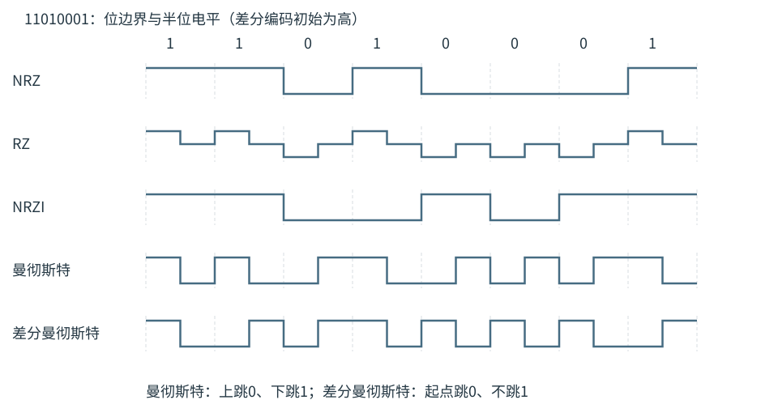{#cn-course-five-codes width=100%}

每秒最多承载 $2R$ 个半位信号区间时，曼彻斯特比特率至多 $R$；若题给最终比特率，直接使用。4B/5B效率为 $4/5$，传同量数据需线路比特数乘 $5/4$。

ASK改变振幅，FSK改变频率，PSK改变相位，QAM组合振幅与相位。4种振幅×4种相位在波形互不重合时为16态，每码元4 bit；状态数按实际可区分的星座点计算。

<a id="CN02-pcm"></a>
## PCM采样、量化与编码
PCM流程：采样取得离散时刻幅值，量化到有限级别，编码成比特。理想带限模拟信号最高频率为 $f_{max}$：

$$f_s\ge2f_{max},\qquad R_b=f_s q,$$

其中 $q$ 为每样本编码位数，量化级数最多 $2^q$，上式未计额外信道编码。8 kHz采样、每样本8 bit得到64 kb/s。采样定理约束信号恢复，奈氏码元极限约束传输，两者按各自场景使用。

<a id="CN02-media"></a>
## 传输介质与物理制式
| 介质 | 性质与适用条件 |
| --- | --- |
| 双绞线 | 绞合减小电磁干扰；屏蔽型再加屏蔽结构 |
| 同轴电缆 | 内导体、绝缘层、外导体屏蔽层；速率仍取决于标准、长度和设备 |
| 多模光纤 | 多种空间模式，模间色散展宽脉冲，限制距离和速率 |
| 单模光纤 | 单一空间模式，减轻模间色散，适合较长距离及高容量；可另做波分复用 |
| 无线电、微波、红外 | 传播条件依频率而定；地面微波常要求视距，高轨卫星传播时延大 |

光纤电绝缘、抗电磁干扰、衰减低；容量与传播速度分别计算。频率、波长满足 $v=f\lambda$，真空中 $v=c$。介质位于物理层之下，物理层规定其信号收发方式。

10BASE5：10 Mb/s、基带、传统粗同轴单段500 m；10BASE2最大段常取185 m；10BASE-T使用双绞线。100BASE-T主要使用双绞线。曼彻斯特适用于传统10 Mb/s以太网，更高速制式按相应物理标准取编码。

<a id="CN02-interface"></a>
## 物理层接口四类特性
| 特性 | 规定内容 |
| --- | --- |
| 机械 | 连接器形状、尺寸、接点排列 |
| 电气 | 电压、电平、阻抗、传输速率 |
| 功能 | 各信号线承担的作用 |
| 规程 | 信号出现与双方动作的顺序 |

<a id="CN02-E03"></a>
### [例 2-3](../solutions/notes.md#a-CN02-E03)
下列选项中，不属于物理层接口规范定义范畴的是（　）。

A. 接口形状　B. 引脚功能　C. 物理地址　D. 信号电平

<a id="CN02-repeater"></a>
## 中继器与集线器
中继器判决、整形并再生比特信号；已判错的比特无法靠再生恢复。它不检查MAC、不学习转发表。连接不同介质须满足速率、编码及协议等兼容条件。

集线器是多端口中继器，一个端口收到比特便向其他端口转送，所有站共享带宽和冲突域。$n$站共享 $R$ 的理想均分为 $R/n$，实际竞争和协议开销另计。

最远站传播时延先累计途经各段距离，再除传播速度；冲突反馈需要往返，设备时延也计入。传统10BASE5的5-4-3规则：最多5段、4个中继设备，其中3段可挂接终端；其他标准按各自距离、延迟和连接规范。


<a id="CN03"></a>
# 数据链路层
<a id="CN03-framing"></a>
## 链路功能与成帧
数据链路层在物理链路上组织帧，完成帧定界、透明传输、差错检测；可靠性、流量控制和介质访问由具体协议提供。流量控制保护接收能力，差错控制处理损坏、丢失、重复与次序；链路确认的范围为相邻节点。

| 成帧方法 | 边界依据 | 透明传输与限制 |
| --- | --- | --- |
| 字符计数 | 首部长度字段 | 字段损坏可使后续边界错位 |
| 字节填充 | 定界字节 | 数据中的定界与转义字节均须转义 |
| 零比特填充 | 标志`01111110` | 被扫描区每连续5个1后插0，连续计数跨字节；标志自身不填充 |
| 违规编码 | 保留的数据编码禁用组合 | 取决于具体物理编码 |

去填充只删第五个连续1后的填入0，原数据中的0须保留。例如`111110`变成`1111100`。

<a id="CN03-E01"></a>
### [例 3-1](../solutions/notes.md#a-CN03-E01)
HDLC 协议对 `01111100 01111110` 组帧后对应的比特串为（　）。

A. `01111100 00111110 10`

B. `01111100 01111101 01111110`

C. `01111100 01111101 0`

D. `01111100 01111110 01111101`

<a id="CN03-error-code"></a>
## CRC、奇偶校验与码距
奇偶校验保证检测奇数位翻转，偶数位错可能漏检，一位校验不能定位单错。

生成多项式 $G(x)$ 次数为 $r$，二进制形式有 $r+1$ 位。CRC发送端计算 $D(x)x^r$ 模2除以 $G(x)$ 的余数 $R(x)$，发送 $D\,R$；余数固定写成 $r$ bit。模2减法逐位异或。接收端对完整接收串直接除以 $G$，余数非零则检出错误，余数0表示检验通过，存在漏检。

| CRC条件 | 保证 |
| --- | --- |
| 生成式最高、最低系数为1，次数$r$ | 所有长度不超过$r$的突发错误可检出 |
| 含因子$x+1$ | 所有奇数位错误可检出 |
| 双错位间距为$k$ | 当$G(x)$不整除$x^k+1$时可检出；须结合码长判断全部双错 |
| 特定码长单错余数均非0且互异 | 可建综合征表定位单错；实际链路通常用CRC检错重传 |

较长突发错误的 $2^{-r}$ 漏检概率须有相应随机模型，不能用于某个确定错误模式。

<a id="CN03-E02"></a>
### [例 3-2](../solutions/notes.md#a-CN03-E02)
若甲向乙发送数据时采用 CRC 校验，生成多项式为 $G(X)=X^4+X+1$（即 $G=10011$），则乙接收到下列比特串时，可以断定其在传输过程中未发生错误的是（　）。

A. `1 0111 0000`　B. `1 0111 0100`

C. `1 0111 1000`　D. `1 0111 1100`

最小海明距离 $d_{min}$ 为任意两合法等长码字不同位数的最小值：保证检出 $e$ 位错需 $d_{min}\ge e+1$；保证纠正 $t$ 位错需 $d_{min}\ge2t+1$。

<a id="CN03-E03"></a>
### [例 3-3](../solutions/notes.md#a-CN03-E03)
若某差错编码的编码集为 `{1001 1010, 0101 1100, 1111 0000, 0000 1111}`，则该差错编码的检错和纠错能力是（　）。

A. 不超过2位错的100%检错、不超过1位错的纠错

B. 不超过2位错的100%检错、不超过2位错的纠错

C. 不超过3位错的100%检错、不超过1位错的纠错

D. 不超过3位错的100%检错、不超过2位错的纠错

<a id="CN03-hamming"></a>
## 海明码校验分组与综合征
$m$个信息位、$r$个单错校验位须满足 $2^r\ge m+r+1$。校验位置为1、2、4、8……，数据填其余位置；位号二进制中相应位为1的所有位置归该校验组。7位码分组为：1组检查1、3、5、7；2组检查2、3、6、7；4组检查4、5、6、7。

偶校验综合征 $s_4s_2s_1$ 在单错假设下给出错位编号。先固定位置编号、数据位映射和字符串方向。例如数据放3、5、6、7且依次为1、0、1、0，校验位为1、0、1，按位号递增写为`1011010`。

普通海明码通常 $d_{min}=3$，单错纠正；增加总体偶校验可实现SECDED，在最多两错的模型下：

| 原海明综合征 | 总体校验 | 判决 |
| --- | --- | --- |
| 0 | 通过 | 无错 |
| 非0 | 失败 | 原海明部分单错，按综合征纠正 |
| 0 | 失败 | 总体校验位单错 |
| 非0 | 通过 | 双错，只检出 |

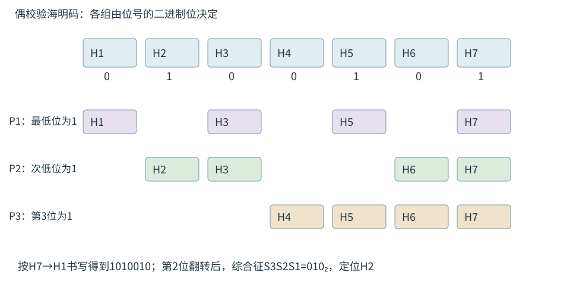{#cn-course-cn_course_hamming_groups width=100%}

<a id="CN03-arq"></a>
## ARQ协议、窗口与利用率
检错发现位错，ACK反馈接收进度，计时器恢复无反馈状态，序号识别新数据与重复。ACK丢失也会引起重传，接收方须防止重复交付；NAK本身也可能丢失，仍需超时机制。

本章一般`ACK i`表示已收到$i$号帧，题干指定“下一期待帧”时按题意。$k$位帧序号按模 $2^k$循环，窗口以帧数计。

| 项目 | 停止—等待 | GBN后退N帧 | SR选择重传 |
| --- | --- | --- | --- |
| 发送/接收窗口 | $1/1$，0、1交替序号 | $W_s\le2^k-1$，$W_r=1$ | $W_s+W_r\le2^k$；对称时各$\le2^{k-1}$ |
| 确认 | 确认当前帧 | 累计确认连续收到的帧 | 各帧分别确认 |
| 失序正确帧 | 下一新帧尚未发送 | 通常丢弃并重复旧ACK | 窗口内缓存，补缺后连续交付 |
| 超时 | 重传当前帧 | 从最早未确认至最后已发帧全重传 | 只重传相应超时帧 |
| 状态成本 | 一个计时器 | 通常计时最早未确认帧 | 各帧计时，保存失序帧 |

SR教材常用配置还满足 $W_r\le W_s$；不对称时先用两窗和条件。若窗口左沿缺口未确认或未交付，即使高号帧已收到也不能越过左沿。序号空间过小会使旧重传与下一轮新帧混淆。

无错、立即确认、全双工、确认链路不构成额外瓶颈，数据发送时间 $T_d=L_d/R$、ACK发送时间 $T_a=L_a/R$、单向传播 $\tau$：

$$U_{stop}=\frac{T_d}{T_d+2\tau+T_a},\qquad U_W=\min\left(1,\frac{WT_d}{T_d+2\tau+T_a}\right).$$

填满链路要求 $W\ge\lceil(T_d+2\tau+T_a)/T_d\rceil$，再按协议窗口上限求序号位数。捎带ACK用承载确认的数据帧发送时间，题给RTT按其边界代替相应传播项。

<a id="CN03-E04"></a>
### [例 3-4](../solutions/notes.md#a-CN03-E04)
假设主机甲采用停—等协议向主机乙发送数据帧，数据帧长与确认帧长均为1000 B，数据传输速率是10 kb/s，单向传播延时是200 ms。则甲的最大信道利用率为（　）。

A. 80%　B. 66.7%　C. 44.4%　D. 40%

<a id="CN03-E05"></a>
### [例 3-5](../solutions/notes.md#a-CN03-E05)
数据链路层采用后退帧（GBN）协议，发送方已经发送了编号为0～7的帧。当计时器超时时，若发送方只收到0、2、3号帧的确认，则发送方需要重发的帧数是（　）。

A. 2　B. 3　C. 4　D. 5

<a id="CN03-E06"></a>
### [例 3-6](../solutions/notes.md#a-CN03-E06)
假设两台主机之间采用后退 N 帧协议传输数据，数据传输速率为16 kb/s，单向传播时延为250 ms，数据帧长度为128 B，确认帧长度也是128 B。为使信道利用率达到最高，帧序号的比特数至少为（　）。

A. 2　B. 3　C. 4　D. 5

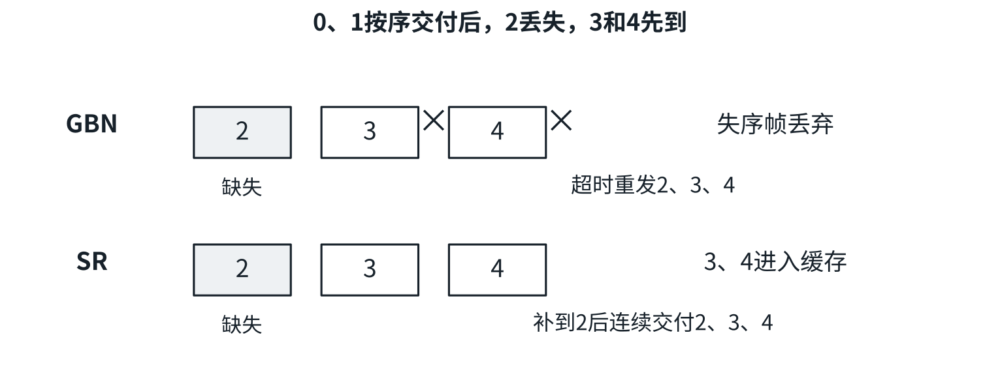{#cn-fig-arq width=96%}

<a id="CN03-E12"></a>
### [例 3-7](../solutions/notes.md#a-CN03-E12)
甲乙双方均采用后退 N 帧协议（GBN）持续进行双向数据传输，始终采用捎带确认，帧长均为1000 B。$S_{x,y}$、$R_{x,y}$分别表示甲方、乙方发送的数据帧，$x$为发送序号，$y$为确认序号，表示希望接收对方的下一帧序号。两个序号字段均为3 bit，信道传输速率为100 Mb/s，RTT=0.96 ms。下图为甲方发送和接收数据帧的两种场景；$t_0$时甲方的发送序号和确认序号均为0，$t_1$时甲方有足够多的数据待发送。

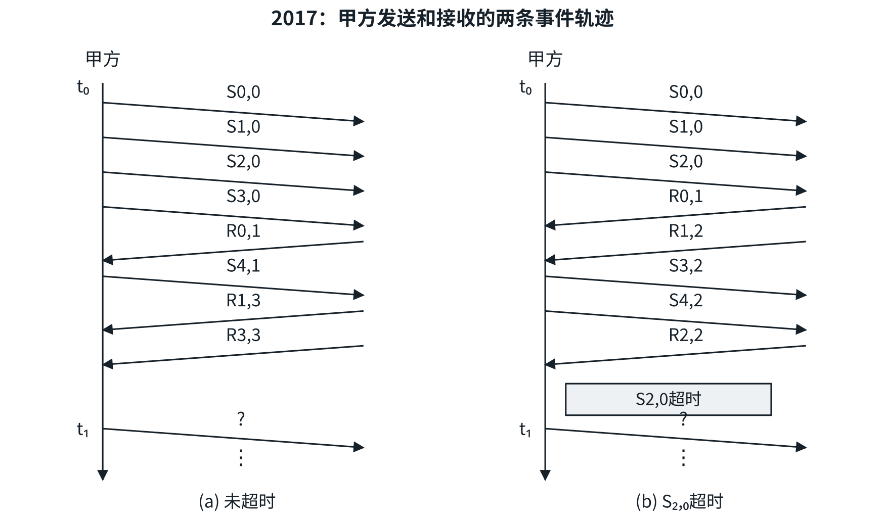{#cn-fig-gbn2017 width=100%}

（1）对于图(a)，$t_0$到$t_1$期间，甲方可以断定乙方已正确接收多少个数据帧？是哪几个帧？请用$S_{x,y}$表示。

（2）对于图(a)，从$t_1$起，在不出现超时且未收到乙方新的数据帧之前，甲方最多还可以发送多少个数据帧？第一个和最后一个分别是什么？请用$S_{x,y}$表示。

（3）对于图(b)，从$t_1$起，在不出现新的超时且未收到乙方新的数据帧之前，需要重发多少个数据帧？重发的第一个帧是什么？请用$S_{x,y}$表示。

（4）甲方可以达到的最大信道利用率是多少？

<a id="CN03-multiplex"></a>
## 复用与受控介质访问
| 方法 | 分配维度或操作 |
| --- | --- |
| FDM | 频带并行，设保护频带；数字数据调制后也可使用 |
| 同步TDM | 固定周期时隙，用户无数据时其时隙可闲置 |
| 统计TDM | 按需求分配，需标识归属与排队规则 |
| WDM | 光波长复用 |
| CDMA | 码片序列分离用户 |
| 轮询 | 控制站依次给站点发送机会，承担控制开销和单点失效风险 |
| 令牌 | 持有唯一有效令牌者发送，限制持有时间或额度；需处理丢失、重复与失效 |

理想同步、等功率、正交码模型中，比特1发送$c$，0发送$-c$，未发为0；接收叠加信号 $s$ 对目标码长$m$的码$c$计算 $(s\cdot c)/m$，结果+1、−1、0分别判1、0、未发。

<a id="CN03-E07"></a>
### [例 3-8](../solutions/notes.md#a-CN03-E07)
站点 A、B、C通过 CDMA 共享链路，A、B、C的码片序列分别是 `(1,1,1,1)`、`(1,−1,1,−1)` 和 `(1,1,−1,−1)`。若 C 从链路上收到的序列是 `(2,0,2,0,0,−2,0,−2,0,2,0,2)`，则 C 收到 A 发送的数据是（　）。

A. 000　B. 101　C. 110　D. 111

令牌环目的站复制数据并设置状态，帧回源站后由源站移除，再按协议释放令牌。无数据及时转交，有数据也须遵守额度；单有效令牌、正常运行模型可避免数据争用冲突。

<a id="CN03-csma"></a>
## ALOHA、CSMA与CSMA/CD
等长帧发送时间$T$、经典泊松负载$G$模型：纯ALOHA易冲突区间$2T$，吞吐$Ge^{-2G}$，最大$1/(2e)$；时隙ALOHA只在时隙边界开始，区间$T$，吞吐$Ge^{-G}$，最大$1/e$。

| CSMA策略 | 遇忙 | 遇空闲 |
| --- | --- | --- |
| 1坚持 | 持续监听 | 立即发送 |
| 非坚持 | 随机等待再监听 | 发送 |
| $p$坚持（时隙） | 继续按协议监听 | 概率$p$发送，$1-p$延后一时隙 |

传播期间远站尚未听到载波，仍可能同时发送。共享半双工以太网用CSMA/CD：边发边检，冲突后停止正常发送、发强化信号、随机退避。最坏单向传播$\tau$时：

$$L_{min}/R\ge2\tau,\qquad L_{min}\ge2R\tau.$$

计入中继器等最坏往返延迟；提高速率而固定帧长会缩小允许跨度。全双工点到点以太网不使用CSMA/CD。

第$n$次冲突，$k=\min(n,10)$，随机整数$r\in[0,2^k-1]$，退避$r$个争用时间片；传统10 Mb/s时间片51.2 μs。达到重试上限则报告失败。

<a id="CN03-E08"></a>
### [例 3-9](../solutions/notes.md#a-CN03-E08)
在一个采用 CSMA/CD 协议的网络中，传输介质是一根完整的电缆，传输速率为1 Gb/s，电缆中的信号传播速度为200000 km/s。若最小数据帧长度减少800 bit，则最远的两个站点之间的距离至少需要（　）。

A. 增加160 m　B. 增加80 m　C. 减少160 m　D. 减少80 m

<a id="CN03-wlan"></a>
## 802.11访问、NAV与无线地址
CSMA/CA结合物理/虚拟载波监听、帧间间隔和随机退避；倒计时遇忙冻结，空闲并满足间隔后继续。SIFS短于DIFS，使当前交换的CTS、ACK等响应优先于新数据竞争。普通单播正确接收后发ACK，缺ACK按协议重试；广播、组播不套用该逐帧确认流程。

可选RTS/CTS流程：RTS—SIFS—CTS—SIFS—DATA—SIFS—ACK。隐藏站听到CTS后按持续期设置NAV，表示本帧结束后的剩余预约时间；RTS/CTS有开销，也不能消除所有冲突。基本RTS为20 B，CTS和ACK各14 B；三者属于控制帧，探测与关联属于管理帧。

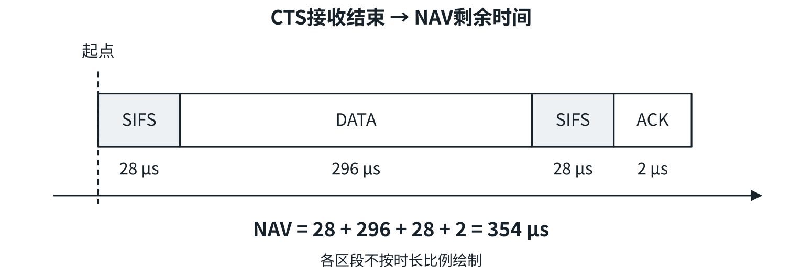{#cn-fig-nav width=96%}

<a id="CN03-E09"></a>
### [例 3-10](../solutions/notes.md#a-CN03-E09)
在采用 CSMA/CA 协议的802.11无线局域网中，DIFS=128 μs，SIFS=28 μs，RTS帧、CTS帧和ACK帧的传输时延分别是3 μs、2 μs和2 μs，忽略信号传播时延。若主机A要向AP发送一个总长度为1998 B的数据帧，无线链路带宽为54 Mb/s，则隐藏站B收到AP发送的CTS帧时，设置的NAV值是（　）。

A. 326 μs　B. 354 μs　C. 385 μs　D. 513 μs

BSS为AP与关联站点，BSA为覆盖范围，SSID为服务集名称，BSSID通常为AP无线接口MAC；多个BSS经分布式系统DS组成ESS，门户连接其他局域网。AP负责接入和桥接，跨子网路由须有三层功能。

| ToDS/FromDS | 地址1 | 地址2 | 地址3 |
| --- | --- | --- | --- |
| 1/0，站点→AP | AP接收接口 | 当前站点发送接口 | 最终目的 |
| 0/1，AP→站点 | 当前接收站点 | AP发送接口 | 原始源 |
| 0/0，自组织 | 目的 | 源 | BSSID |

1/1的无线分布式转发可用第四地址。无线链路ACK只反馈当前无线跳，TCP ACK反馈端到端字节流。

<a id="CN03-ethernet"></a>
## Ethernet II、VLAN与交换机
IEEE 802把链路层分为LLC和MAC；局域网技术通常覆盖物理层与链路层，网卡同时处理信号和帧。

无标签Ethernet II：目的6 B、源6 B、类型2 B、数据及填充46～1500 B、FCS4 B；帧头14 B，完整MAC帧64～1518 B，MTU1500 B约束完整上层PDU。类型`0800`为IPv4、`0806`为ARP；802.3在对应位置采用长度字段。

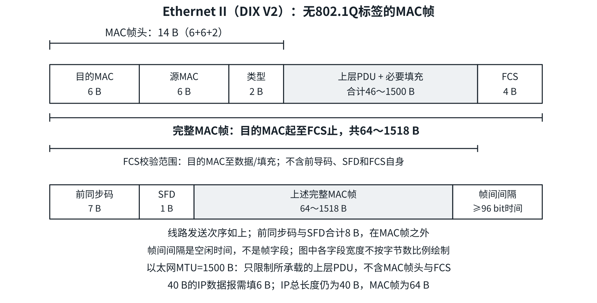{#cn-fig-ethernet-format width=100%}

7 B前同步码和1 B SFD在MAC帧外；帧间间隔96 bit时间也在帧外。FCS检验从目的MAC至数据/填充，不含前导部分和间隔；错误帧丢弃，基本以太网无MAC逐帧确认重传。MAC通常48 bit，目的全1为广播，首字节最低位区分单播/组播。

40 B IP分组装入无标签帧须填6 B，IP总长度保持40 B。最短MAC帧若计前导和间隔，一个周期为$(8+64)\times8+96=672$ bit时间，吞吐量分母按题设边界选取。

VLAN划分逻辑广播域，不同VLAN通信需要三层转发。接入口可收发无标签帧，干道携多个VLAN；802.1Q在源MAC之后加4 B标签，VID12 bit，普通ID为1～4094；单标签常见最大帧1522 B，FCS随内容更新。教材最短64 B模型下，含标签首尾共22 B、数据下限42 B。

<a id="CN03-E10"></a>
### [例 3-11](../solutions/notes.md#a-CN03-E10)
一个长度为40 B的IP数据报需要封装成802.1Q帧进行传输，则此802.1Q帧的数据载荷部分需要填充的字节数是（　）。

A. 2　B. 4　C. 6　D. 8

交换机按源MAC和入端口学习，按目的MAC转发：已知且异端口定向转发；同入端口过滤；未知、广播在当前VLAN除入端口外泛洪。表项会老化，环形拓扑需生成树等防循环机制。

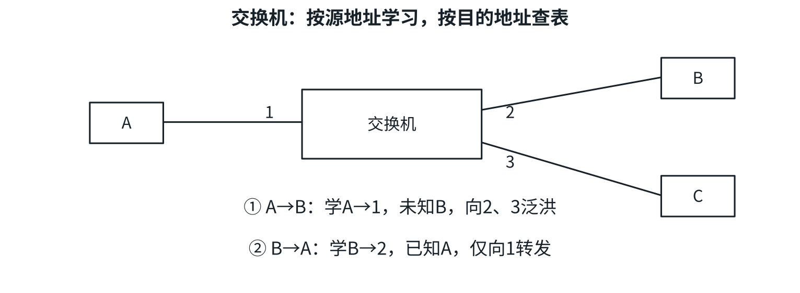{#cn-fig-switch width=96%}

交换机各端口独立冲突域，广播域由VLAN或三层边界划分。不同输出端口可并行，同一低速出口仍共享瓶颈。存储转发收全并可检验FCS；直通至少收到目的MAC后决策，帧尾尚未到达，不能预先排除尾部差错。吞吐量需区分单向发送与收发合计。

<a id="CN03-E11"></a>
### [例 3-12](../solutions/notes.md#a-CN03-E11)
对于100 Mb/s的以太网交换机，当输出端口无排队，以直通交换方式转发一个以太网帧（不包括前导码）时，引入的转发时延至少是（　）。

A. 0 μs　B. 0.48 μs　C. 5.12 μs　D. 121.44 μs

<a id="CN03-ppp"></a>
## PPP封装与链路建立
PPP用于点到点链路，无多站竞争和争用时间片所需的64 B最短帧限制。基本帧：`7E | FF | 03 | 协议 | 信息 | FCS | 7E`；协议字段分用IPv4、LCP、NCP等，固定地址不作以太网式多站寻址。

建立过程：物理连接→LCP配置和测试→可选鉴别→相应NCP配置→网络层传送；关闭时撤销网络层配置、LCP和物理连接。LCP负责链路，NCP是一族网络层配置协议。

异步PPP：`7E→7D 5E`，`7D→7D 5D`；同步教材模型使用零比特填充。PPP基本协议用FCS检错，不靠数据帧编号与逐帧ACK实现可靠交付。PPPoE从外到内为以太网、PPPoE/PPP、被封装的网络层分组。


<a id="CN04"></a>
# 网络层
<a id="CN04-forwarding"></a>
## 路由、转发、SDN与拥塞
IP在不同链路技术之上提供统一的尽最大努力数据报服务。路由选择依据可达性、度量和策略形成路径信息；转发对当前分组查表选输出接口和下一跳。普通路由器处理到网络层，下一跳用新的链路格式封装；协议转换须有明确的转换功能。

| 路由方式 | 性质 |
| --- | --- |
| 静态 | 人工配置，开销低，故障适应依赖维护 |
| 动态 | 交换信息自动更新，有报文、计算和收敛成本 |
| 层次 | 区域或AS内部掌握细节，对外汇总；减少信息量，可能牺牲全局最短路径 |

SDN逻辑分离控制平面与数据平面：控制器计算并下发规则，交换设备匹配流表执行转发、丢弃、改写或上送。逻辑集中可由多个物理控制器实现；已有匹配规则无需逐包询问控制器。北向接口连接应用与控制器，南向连接控制器与设备，OpenFlow是南向协议之一。流表可按入端口、MAC、IP、协议、端口匹配，含优先级、计数器和动作。

拥塞源于多个输入竞争共享资源，持续到达速率超过服务速率会积压、丢包；加缓存只能吸收部分突发，可能增加时延。流量控制保护接收端，拥塞控制保护网络承载。可采用准入、整形、调度、主动丢弃/标记和反馈减速。全双工每方向分别合计汇聚流量，与该方向容量比较。

<a id="CN04-routing-algorithms"></a>
## 距离向量与链路状态算法
距离向量由邻居通告到各目的的距离：

$$D_x(d)=\min_{v\in N(x)}\{c(x,v)+D_v(d)\}.$$

先加本机到邻居代价，再比较候选；取最小者作为下一跳，同值按题意处理。坏消息可形成环路并计数到无穷，水平分割、毒性逆转和触发更新只能按各自条件缓解。

<a id="CN04-E01"></a>
### [例 4-1](../solutions/notes.md#a-CN04-E01)
某网络中的所有路由器均采用距离向量路由算法。路由器E与邻居A、B、C、D的直接链路距离分别是8、10、12、6，收到的距离向量如下。E更新后到Net1～Net4的距离分别是（　）。


| 目的网络 | A、B的通告 | C、D的通告 |
| --- | --- | --- |
| Net1 | 1，23 | 20，22 |
| Net2 | 12，35 | 30，28 |
| Net3 | 24，18 | 16，36 |
| Net4 | 36，30 | 8，24 |

A. 9，10，12，6　B. 9，10，28，20

C. 9，20，12，20　D. 9，20，28，20

链路状态流程：发现邻居和测量代价→在规定范围洪泛本地链路状态→建立拓扑数据库→各自以本机为根运行最短路径算法。通告用序号和老化区分新旧。非负权Dijkstra每轮选暂定距离最小的未确定节点，确定后松弛相邻边，保存前驱并推出下一跳。

<a id="CN04-ipv4"></a>
## IPv4首部与分片
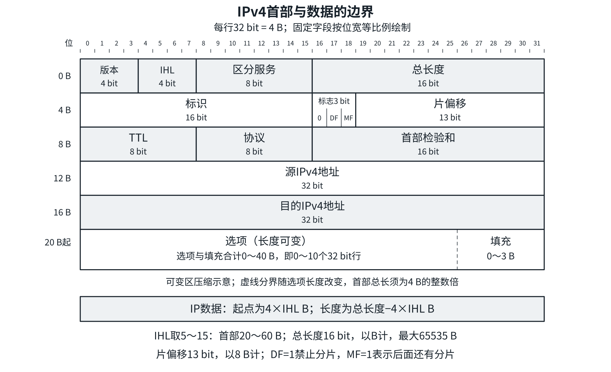{#cn-fig-ipv4-format width=100%}

| 字段 | 位数 | 单位、含义与条件 |
| --- | --- | --- |
| 版本、IHL | 各4 | 版本4；首长$H=4IHL$ B，IHL=5～15，首部20～60 B |
| 区分服务 | 8 | 服务分类与拥塞标记 |
| 总长度 | 16 | 首部与数据共计，B，最大65535 |
| 标识 | 16 | 同一原数据报分片保持；重组还结合源、目的、协议 |
| 标志 | 3 | 保留0；DF=1禁分片；MF=1原数据后面还有片 |
| 片偏移 | 13 | 8 B单位，相对原始IP数据区起点 |
| TTL | 8 | 转发每跳减1，耗尽丢弃，条件允许时报告超时 |
| 协议 | 8 | ICMP=1、TCP=6、UDP=17，用于网络层分用 |
| 首部检验和 | 16 | 只覆盖IPv4首部，TTL或地址变化须更新 |
| 源、目的地址 | 各32 | 标识源、目的IP接口 |

MTU约束完整IP分组。超MTU且DF=0可分片，每片有独立IP首部，目的主机重组；DF=1则丢弃并在允许时通知源端。非末片数据长度须为8 B整数倍，偏移不计任何IP首部。未分片为MF=0且偏移0，末片MF=0但偏移可非0。

首部固定$H$、出口MTU为$M$时，非末片最大数据量：

$$D_{max}=8\left\lfloor\frac{M-H}{8}\right\rfloor.$$

先算原数据长“总长减原首长”，列各片原数据区间，再填总长、偏移和MF。再次分片仍用原数据坐标，原片MF=1时，其最后子片也为MF=1。分片只切IP数据，不给每片再添TCP/UDP首部。

<a id="CN04-E02"></a>
### [例 4-2](../solutions/notes.md#a-CN04-E02)
若路由器向MTU=800 B的链路转发一个总长度为1580 B的IP数据报（首部长度为20 B）时进行了分片，且每个分片尽可能大，则第2个分片的总长度字段和MF标志位的值分别是（　）。

A. 796，0　B. 796，1　C. 800，0　D. 800，1

<a id="CN04-addresses"></a>
## CIDR、特殊地址与子网划分
IPv4按32位处理。地址$A$、掩码$M$、前缀$p$：网络地址$N=A\mathbin{\&}M$；地址块大小$2^{32-p}$；广播地址$N+2^{32-p}-1$。普通多址子网主机位$h$，可分配$2^h-2$，网关接口也占地址。点对点`/31`、主机路由`/32`按特殊用途处理。

| 地址或类别 | 用途 |
| --- | --- |
| `0.0.0.0` | 未获地址时可作本机源地址 |
| `255.255.255.255` | 本地受限广播，路由器不转发 |
| `127.0.0.0/8` | 回环，不作外部链路普通地址 |
| 主机位全1 | 子网定向广播，跨路由转发受配置限制 |
| `10/8`、`172.16/12`、`192.168/16` | 私有地址，可在不同私网重复使用 |
| 历史A/B/C类 | 首字节普通范围1～126、128～191、192～223，默认前缀/8、/16、/24 |
| `224/4` | D类组播；E类为保留类别 |

CIDR按显式前缀判断，独立于历史分类。两主机是否同网须分别与发送方掩码按位与。异常不同掩码时，两个方向的本地判断可能不一致。

<a id="CN04-E03"></a>
### [例 4-3](../solutions/notes.md#a-CN04-E03)
主机 `168.16.84.24/20` 所在子网的最小可分配IP地址和最大可分配IP地址分别是（　）。

A. 168.16.80.1，168.16.84.254

B. 168.16.80.1，168.16.95.254

C. 168.16.84.1，168.16.84.254

D. 168.16.84.1，168.16.95.254

定长划分借$s$位得$2^s$个等长子网，采用允许全0、全1子网号的口径。VLSM按主机需求从大到小，先计网关等接口，选满足容量的最小地址块，再按块边界对齐分配，保证不重叠。

若一个原块被**完整**二分为$n$个子网，总拆分$n-1$次，最深分支最多延长$n-1$位；此结论依赖完整覆盖条件。子网增加不会增加总地址数，普通子网的网络/广播地址开销会增加。

<a id="CN04-E04"></a>
### [例 4-4](../solutions/notes.md#a-CN04-E04)
若将 `101.200.16.0/20` 划分为5个子网，则可能的最小子网的可分配IP地址数是（　）。

A. 126　B. 254　C. 510　D. 1022

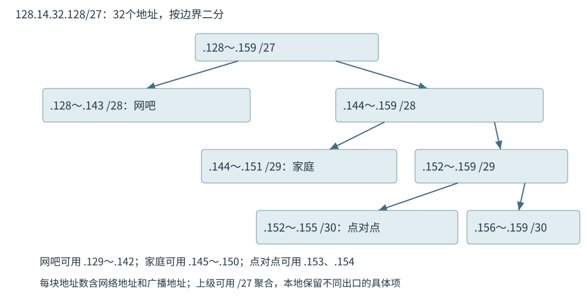{#cn-course-vlsm width=100%}

<a id="CN04-prefix"></a>
## 路由聚合与最长前缀匹配
精确聚合须连续、对齐、同出口，汇总块完全覆盖且不额外包含其他地址；等长$2^s$块聚合时前缀缩短$s$位。允许覆盖空隙时，须保留需要的更具体路由，并检查未分配范围的丢弃或回程环路。

<a id="CN04-E05"></a>
### [例 4-5](../solutions/notes.md#a-CN04-E05)
某路由表中有转发接口相同的4条路由表项，其目的网络地址分别为 `35.230.32.0/21`、`35.230.40.0/21`、`35.230.48.0/21` 和 `35.230.56.0/21`，将该4条路由聚合后的目的网络地址为（　）。

A. 35.230.0.0/19　B. 35.230.0.0/20

C. 35.230.32.0/19　D. 35.230.32.0/20

查表先选匹配位数最多的前缀，再读取输出接口及下一跳；不同前缀长度间不直接比较度量。`/32`仅匹配一主机，`/0`为无更具体匹配时的默认路由，仍遵守广播、TTL等限制。本地出口与下一跳IP是两个字段。

<a id="CN04-E11"></a>
### [例 4-6](../solutions/notes.md#a-CN04-E11)
Internet的两个自治系统构成的网络如下图所示。AS1由R1连接两个子网构成；AS2由R2、R3互联并连接三个子网构成。各子网地址、R2的接口名以及R1、R3的部分接口IP地址均在图中标出。

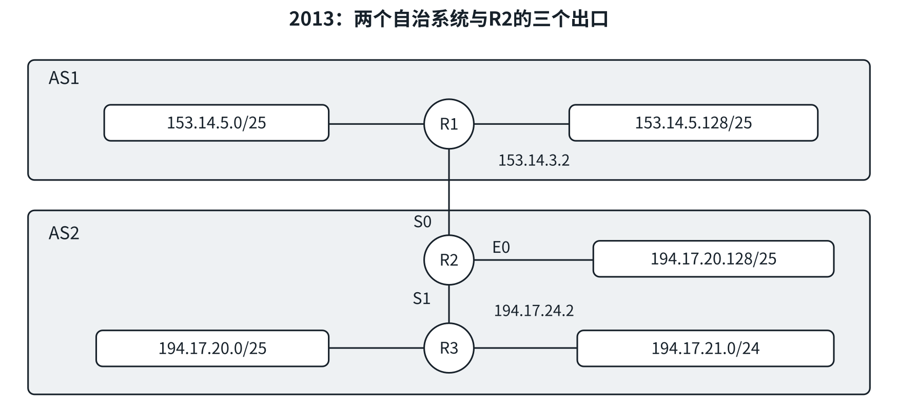{#cn-fig-aggregate2013 width=100%}

（1）路由表结构为“目的网络、下一跳、接口”。利用路由聚合技术给出R2的路由表，要求包括到达图中所有子网的路由，且路由项尽可能少。

（2）若R2收到目的IP地址为194.17.20.200的IP分组，会通过哪个接口转发？

（3）R1与R2之间利用哪个路由协议交换路由信息？该协议报文封装到哪个协议的数据单元中传输？

<a id="CN04-arp-nat"></a>
## ARP、逐跳封装与NAT
发送步骤：按掩码和路由判定下一跳→查下一跳IP的ARP缓存→缺项时在本广播域广播ARP请求→目标通常单播回复→以本机出口MAC为源、下一跳MAC为目的封装。

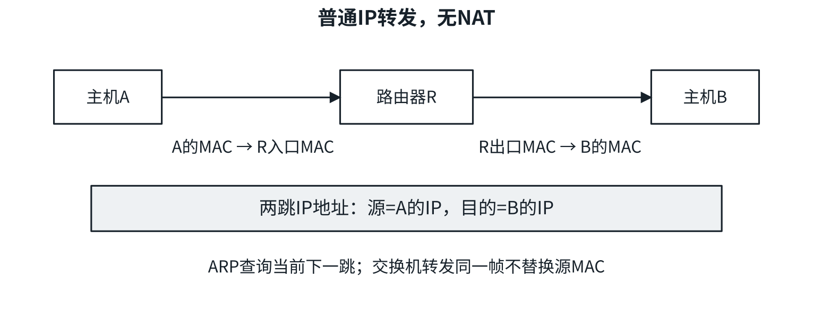{#cn-fig-arp width=96%}

目的在本地，ARP查询目的IP；目的在外地，通常查询默认网关或路由指定邻居IP。普通路由器不转发ARP广播。二层交换机转发同一帧时保留源MAC，路由器下一跳重新封装。ARP缓存会老化，代理ARP须有明确条件。

<a id="CN04-E06"></a>
### [例 4-7](../solutions/notes.md#a-CN04-E06)
某以太网中，甲IP为211.71.136.23，子网掩码255.255.240.0，网关211.71.136.1。若甲向乙211.71.130.25发送IP分组，则（　）。

A. 直接发给乙，帧目的MAC为网关MAC

B. 直接发给乙，帧目的MAC为乙MAC

C. 交网关转发，帧目的MAC为网关MAC

D. 交网关转发，帧目的MAC为乙MAC

NAT在边界维护内部/外部地址映射；NAPT再用端口复用公网IP。普通源NAT出向改源IP，NAPT还可改源端口，回包按映射恢复；远端目的通常保持。IP首部校验随地址改写更新，TCP/UDP伪首部也含IP地址，启用的传输层校验须相应更新。IPv4 UDP全0未启用的情况单独处理。外部主动访问通常需要静态映射、端口转发等机制。

<a id="CN04-control"></a>
## DHCP与ICMP
DHCP提供IP、掩码、网关、DNS及租期，UDP服务器67、客户端68。初次获取：Discover寻找→Offer提议→Request选择→ACK确认使用；初始Request源`0.0.0.0`、目的受限广播，申请地址通过Requested IP Address选项携带。续租状态可单播；跨网段可用DHCP中继。

<a id="CN04-E07"></a>
### [例 4-8](../solutions/notes.md#a-CN04-E07)
一台新接入网络的主机H通过DHCP服务器动态请求IP地址过程中，与DHCP服务器交换DHCP报文的部分过程如下图。封装DHCPREQUEST报文的IP数据报的目的IP地址和源IP地址分别是（　）。

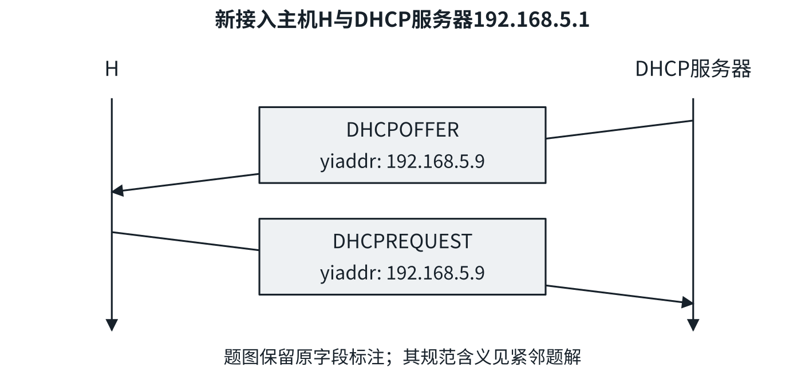{#cn-fig-dhcp width=86%}

A. 192.168.5.1，0.0.0.0

B. 192.168.5.1，192.168.5.9

C. 255.255.255.255，0.0.0.0

D. 255.255.255.255，192.168.5.9

ICMP由IP封装，报告目的不可达、时间超过、参数问题等，回送请求/应答用于Ping；错误报告通常含原IP首部及一部分数据，返回原源端，不负责重传。ICMP差错自身、非首片、广播/组播目的和某些特殊源地址通常不再触发ICMP差错。IP首部检验错误通常直接丢弃。

Traceroute逐增TTL，通过沿途超时回复定位，探测可用UDP、ICMP或TCP变体。历史“源点抑制”类型已由RFC 6633废弃；旧题按年代识别，现行拥塞处理使用适用反馈机制。

<a id="CN04-E08"></a>
### [例 4-9](../solutions/notes.md#a-CN04-E08)
若路由器R因为拥塞丢弃IP分组，则此时R可向发出该IP分组的源主机发送的ICMP报文类型是（　）。

A. 路由重定向　B. 目的不可达　C. 源点抑制　D. 超时

<a id="CN04-ipv6"></a>
## IPv6首部、地址与过渡
IPv6地址128 bit，8组16位十六进制，单组可省前导0，`::`最多一次，恢复至8组。基本首部固定40 B：版本4 bit、流量类别8 bit、流标签20 bit、有效载荷长度16 bit、下一首部8 bit、跳数限制8 bit、源/目的各128 bit。

| 项目 | IPv6规则 |
| --- | --- |
| 长度 | 有效载荷长度计基本首部后的扩展首部和上层数据 |
| 扩展 | 下一首部可指扩展首部或上层协议，基本首部无首部校验和 |
| 转发与分片 | 路由器不分片，过大时发Packet Too Big；源端按路径MTU调整或加分片扩展首部 |
| 邻居与广播 | 无广播；用ICMPv6邻居发现取代ARP |
| 地址 | 未指定`::`，回环`::1`，链路本地`fe80::/10`，组播`ff00::/8` |
| 任播 | 多接口共地址，按路由交付其中一个 |
| 配置 | 支持无状态自动配置和DHCPv6，接口标识生成不限于MAC |

IPv6地址空间/IPv4地址空间为$2^{96}$。双栈同时运行两协议；隧道把一类IP分组封装到另一类IP分组中，内外端点分别解释。流量类别、流标签仅提供分类信息，服务保证还需要资源和机制。

<a id="CN04-E09"></a>
### [例 4-10](../solutions/notes.md#a-CN04-E09)
下列关于IPv4和IPv6的叙述中，正确的是（　）。

I. IPv6地址空间是IPv4地址空间的96倍

II. IPv4首部和IPv6基本首部的长度均可变

III. IPv4向IPv6过渡可以采用双协议栈和隧道技术

IV. IPv6首部的Hop Limit字段等价于IPv4首部的TTL字段

A. 仅I、II　B. 仅I、IV　C. 仅II、III　D. 仅III、IV

<a id="CN04-routing-protocols"></a>
## RIP、OSPF与BGP
自治系统AS为统一管理和路由策略下的一组网络与路由器。IGP负责AS内部，域间协议交换AS间可达性；AS可含多子网、多出口。

| 项目 | RIP | OSPF | BGP |
| --- | --- | --- | --- |
| 方法 | 距离向量，跳数 | 链路状态，SPF | 路径向量，策略 |
| 范围 | AS内 | AS内、区域 | AS间，并在AS内传播BGP路由 |
| 核心信息 | 到目的的距离 | 本地链路状态，范围内洪泛 | 前缀、AS_PATH、NEXT_HOP等属性 |
| 承载 | UDP520 | IP协议89 | TCP179 |
| 更新 | 通常30 s周期及触发；坏消息慢 | 变化更新、刷新、老化和可靠洪泛 | 会话建立后增量发布/撤销，保活另行 |

RIP最大可达15，16为不可达；教材直连网距离计1，邻居报告加1并改下一跳为邻居。未登记则加入；候选更优则替换；原下一跳就是该邻居时，采用其新距离，即使变差；其他邻居较差通常保留原项。失效判断课件示例180 s。

OSPF区域内同步拓扑，跨区经骨干区域，边界路由器参与多个区域。LSDB为数据库，LSA为通告，五种分组如下。

| 类型 | 分组 | 作用 |
| --- | --- | --- |
| 1 | Hello | 发现、维持邻居 |
| 2 | DD | 数据库摘要，LSA头 |
| 3 | LSR | 请求缺失或更新LSA |
| 4 | LSU | 发送LSA正文并洪泛 |
| 5 | LSAck | 确认收到LSA |

BGP的AS_PATH用于AS环检测和策略，含本AS号通常拒绝；NEXT_HOP还需IGP递归求本机出口。eBGP两端属不同AS，iBGP同AS且不必物理直连；完整网状iBGP可由路由反射等机制扩展。OPEN交换会话参数，UPDATE发布/撤销，KEEPALIVE保活，NOTIFICATION报告错误并结束。按题给本地偏好、AS路径等规则选路；属性相同的教材题才进一步比较到出口域内代价。

<a id="CN04-E12"></a>
### [例 4-11](../solutions/notes.md#a-CN04-E12)
网络空间是继陆海空天之后的“第五疆域”，路由算法与协议是网络核心技术之一。现有互联网中4个自治系统的互连拓扑如下图。AS1运行RIP；AS3内任意两台主机通信经过的路由器不超过15个，AS4内可能超过20个。本题采用下图拓扑：**R13与R16不直接相连**。

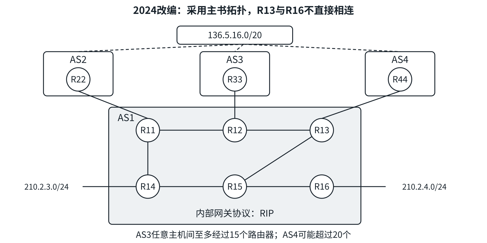{#cn-fig-routing2024 width=100%}

（1）若仅有RIP、OSPF可选，AS4应选择哪个内部网关协议？

（2）AS3中的某主机向本AS另一主机发送一个IP分组，为保证正常接收，初始TTL至少应为多少？

（3）AS1的路由器同时启动，立即构建并交换初始距离向量，此后每隔30 s交换一次最新距离向量。从交换初始向量的时刻算起，R11～R16全部获得到达210.2.3.0/24的正确路由至少需多久？全部获得到达210.2.4.0/24的正确路由至少需多久？

（4）R44向R13通告136.5.16.0/20的路由，由哪类BGP会话完成、通过哪种BGP报文通告？R13又通过哪类会话将该可达性信息通告给R14、R15？

（5）R14、R15均收到下表可达性信息。在无策略约束的情况下，更新后两者到136.5.16.0/20的下一跳各是谁？


| 目的网络 | AS路径 | 下一跳 |
|---|---|---|
| 136.5.16.0/20 | AS2、AS8、AS19 | R11 |
| 136.5.16.0/20 | AS3、AS7、AS11、AS19 | R12 |
| 136.5.16.0/20 | AS4、AS10、AS19 | R13 |

<a id="CN04-multicast-mobility"></a>
## 组播与移动IP
IPv4组播`224.0.0.0/4`表示接收者组，公共路径只传一份，在分叉接口复制。以太网组播MAC由`01:00:5E`和IP低23位映射，32个IP组播地址可映射同一MAC，上层仍须检查组成员。IGMP管理主机与相邻路由器的本地成员关系，跨网转发树由组播路由协议建立。

移动IPv4保留归属地址，用转交地址表示当前位置，向归属代理注册绑定。传统三角路由：对端→归属网络→归属代理隧道送转交地址→解封装交移动节点；内层目的为归属地址，外层目的为转交地址。基础模型中移动节点可直接发给对端，源地址过滤等条件下可用反向隧道。

<a id="CN04-router"></a>
## 路由器结构与综合计算
输入端口接收、链路检查、查表；交换结构把分组送到输出端；输出端排队、封装、发送；路由处理器维护控制协议和表。交换结构可用内存、总线或互联网络，容量和并行性各异。多个输入争同一输出会排队；输入队首等待忙出口可阻挡后续去空闲出口的分组，称队首阻塞。

普通IPv4转发顺序：接收帧并检查→取出IP→若目的本机按协议上交→否则检查TTL、最长前缀选出口和下一跳→按MTU/DF处理→解析下一跳地址→出口排队并重封装。直通等特殊实现的启动时间按题设。

<a id="CN04-E10"></a>
### [例 4-12](../solutions/notes.md#a-CN04-E10)
某公司的网络如下图所示。IP地址空间192.168.1.0/24被均分给销售部和技术部两个子网，并已分别为部分主机和路由器接口分配了IP地址。销售部子网的MTU=1500 B，技术部子网的MTU=800 B。

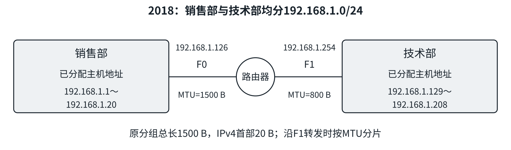{#cn-fig-subnet2018 width=100%}

（1）销售部子网的广播地址是什么？技术部子网的子网地址是什么？若每个主机仅分配一个IP地址，则技术部子网还可以连接多少台主机？

（2）主机192.168.1.1向主机192.168.1.208发送一个总长度为1500 B、首部长度为20 B的IP分组。路由器通过F1转发时进行分片，且尽可能分为最大片。一个最大IP分片封装数据的字节数是多少？至少需要几个分片？每个分片的片偏移量是多少？

<a id="CN04-E13"></a>
### [例 4-13](../solutions/notes.md#a-CN04-E13)
某公司工程部长期驻扎偏远山区，租用天通一号卫星通信链路连接工程部R1和总部R2，网络如下图。S1、S2为千兆以太网交换机；TR1、TR2是卫星地面收发设备，实现全双工调制解调。卫星轨道高度36000 km，电磁波传播速度300000 km/s；卫星链路为R1、R2提供对称全双工信道，每方向数据传输速率200 kb/s。

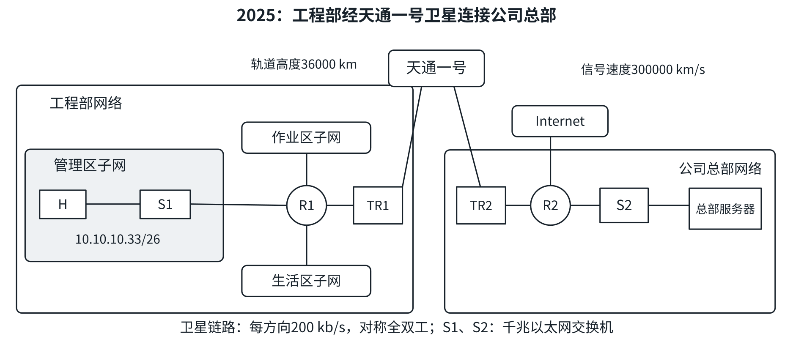{#cn-fig-satellite2025 width=100%}

（1）忽略卫星中继及TR1、TR2调制解调开销，卫星链路单向传播时延是多少？H向总部服务器传输数据可达到的最大吞吐量是多少？忽略各层首部开销与以太网内传播时延，上传4000 B工程进度报告文件至少需要多久？

（2）用GBN为卫星链路设计单向可靠的数据链路层协议SLP，支持R1向R2发送数据。SLP数据帧长1500 B，忽略ACK帧长度；要求单向信道利用率不低于80%，发送窗口至少为多少？帧序号字段至少需要几位？

（3）总部分配10.10.10.0/24给工程部，需划给三个子网：生活区可分配地址不少于120个，作业区、管理区分别不少于60个，H的地址配置正确。作业区、管理区、生活区的子网地址分别是什么？请用CIDR表示。


<a id="CN05"></a>
# 传输层
<a id="CN05-endpoints"></a>
## 端口、连接与数据边界
传输层为不同主机的进程端点提供逻辑通信，完成复用与分用。端口16 bit，TCP与UDP端口空间独立；熟知端口0～1023、登记1024～49151、动态/私有49152～65535。端口标识应用端点，具体进程可管理多个套接字。

TCP连接由源IP、源端口、目的IP、目的端口四元组区分，服务器同一服务端口可对应多个客户。UDP基本分用按目的端口等本地端点信息，实际绑定或连接方式可再限定远端。

<a id="CN05-E01"></a>
### [例 5-1](../solutions/notes.md#a-CN05-E01)
UDP协议实现分用时所依据的头部字段是（　）。

A. 源端口号　B. 目的端口号　C. 长度　D. 校验和

| 比较项 | UDP | TCP |
| --- | --- | --- |
| 服务 | 无连接、尽最大努力；可按下层能力单播/组播/广播 | 面向连接、一对一、全双工可靠有序字节流 |
| 应用边界 | 保留每个报文边界 | 不保留写入边界，应用自行定界 |
| 首部 | 固定8 B | 20～60 B |
| 可靠性与控制 | 无自身确认重传、顺序恢复或拥塞窗口 | 序号、累计ACK、重传、接收窗口与拥塞控制 |

TCP发送缓冲保留未确认字节以便重传；接收缓冲可存失序字节，按序交付。应用读取后释放接收空间。MSS限制单段应用数据上限，分段可跨越应用写入边界；普通MTU1500、IP/TCP各20 B时简单模型MSS1460 B，选项或路径改变须重算。

<a id="CN05-udp-checksum"></a>
## UDP长度与反码检验和
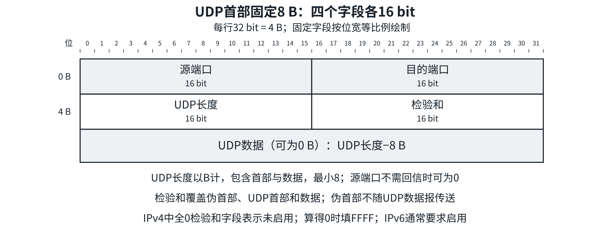{#cn-fig-udp-format width=100%}

UDP源端口供回复，不需回复时可为0；目的端口分用；长度计首部加数据，最小8 B；校验和检错。普通IPv4首部20 B时UDP应用数据最大$65535-20-8=65507$ B。UDP不自行拆成多个UDP报文，承载IP可分片，目的IP重组后交UDP。

发送端校验和置0，按16 bit分组求反码和：进位回卷到最低位，直到无进位，再按位取反；奇数字节末尾补0仅参与计算。接收端连同校验和求反码和应为`FFFF`，仍存在抵消漏检。

| 检验 | 覆盖内容 | 零字段规则 |
| --- | --- | --- |
| IPv4首部 | IP首部、选项、填充 | 无关闭校验语义 |
| UDP | 伪首部、UDP首部与数据 | IPv4可用全0表示未启用；算得0传全1；普通IPv6 UDP通常必须启用 |
| TCP | 伪首部、TCP首部与数据 | 无以全0关闭校验约定 |

IPv4伪首部12 B：源IP、目的IP、0、协议号、传输层长度；UDP协议17，TCP协议6。伪首部及求和补0不在线上传输，不计入应用长度。NAT改IP会影响伪首部，启用的传输校验需更新；普通TTL变化只影响IPv4首部检验和。

<a id="CN05-E02"></a>
### [例 5-2](../solutions/notes.md#a-CN05-E02)
若UDP协议在计算校验和过程中，计算得到中间结果为 `1011 1001 1011 0110` 时，还需要加上最后一个16位数 `0110 0101 1100 0101`，则最终计算得到的校验和是（　）。

A. `0001 1111 0111 1011`

B. `0001 1111 0111 1100`

C. `1110 0000 1000 0011`

D. `1110 0000 1000 0100`

<a id="CN05-tcp-header"></a>
## TCP首部、序号与累计确认
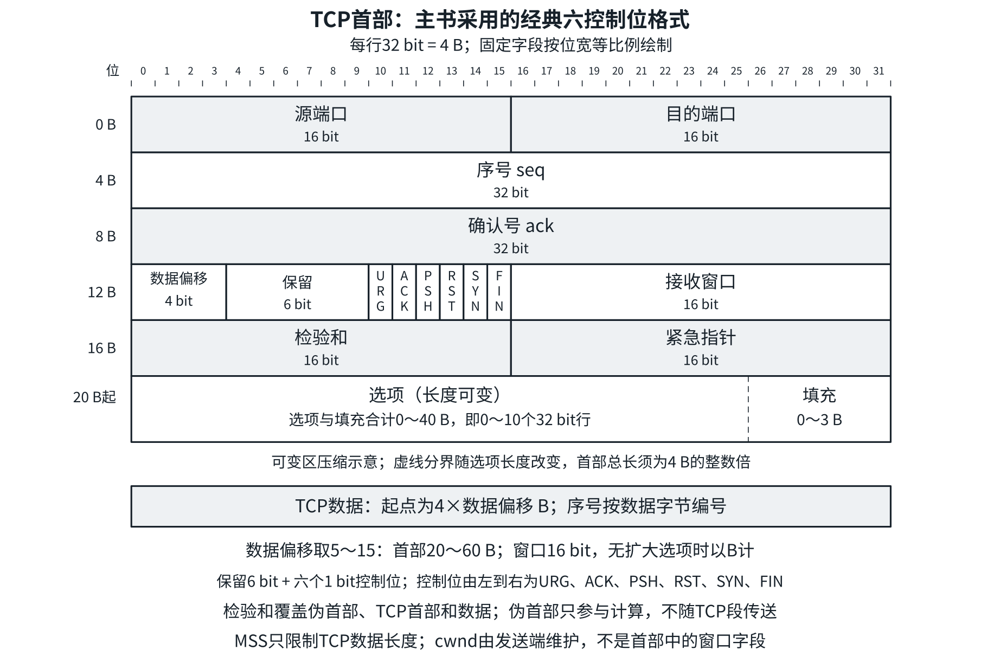{#cn-fig-tcp-format width=100%}

源/目的端口各16 bit，seq/ack各32 bit；数据偏移4 bit、单位4 B，表示TCP首长，取5～15；接收窗口16 bit，未扩大时以B计、最大65535；检验和和紧急指针各16 bit，选项填充至4 B对齐。题图采用教材六控制位口径，扩展位按题设解释。

未分片或已重组的普通IPv4仅承载一个TCP段时：

$$L_{TCP数据}=IP总长-4IHL-4\times TCP数据偏移.$$

| 控制位 | 含义 |
| --- | --- |
| SYN | 同步初始序号，占1个序号 |
| ACK | 为1时确认号有效；纯ACK不占序号 |
| FIN | 本方向不再发送，占1个序号 |
| RST | 复位、拒绝不适当连接或段 |
| PSH | 请求及时向应用交付 |
| URG | 紧急指针有效；指针相对seq给出紧急数据边界，按教材前置紧急数据模型理解 |

TCP按字节编号，序号模$2^{32}$；无回绕时，seq=$s$、数据长$L$覆盖$s$～$s+L-1$，下一号$s+L$。ack=$a$累计确认连续收到至$a-1$，期望$a$。两方向序号空间独立，捎带段中的seq和ack分别记账。SYN序号$x$后首数据$x+1$；FIN后确认号也加1，这些消耗不计为应用字节。

<a id="CN05-E03"></a>
### [例 5-3](../solutions/notes.md#a-CN05-E03)
主机甲与主机乙之间已建立一个TCP连接，甲向乙发送了两个连续TCP段，分别包含300 B和500 B有效载荷，第一个段的序列号为200，乙正确接收到两个段后，发送给甲的确认序列号是（　）。

A. 500　B. 700　C. 800　D. 1000

<a id="CN05-connection"></a>
## 三次握手、半关闭与TIME-WAIT
| 事件 | 客户状态/动作 | 服务器状态/动作 |
| --- | --- | --- |
| 客户发SYN，seq=$x$ | SYN-SENT | LISTEN等待 |
| 服务器收SYN并回SYN+ACK，seq=$y$、ack=$x+1$ | 等待回复 | SYN-RECEIVED |
| 客户收到并回ACK，seq=$x+1$、ack=$y+1$ | ESTABLISHED，可带数据 | 收到此ACK后ESTABLISHED |

第三次握手确认服务器初始序号，避免服务器仅凭迟到旧SYN就长期保留无效连接。

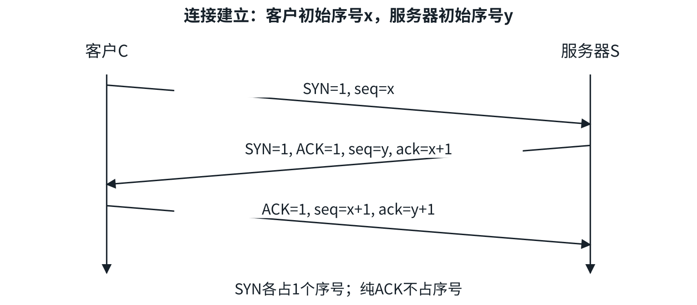{#cn-fig-handshake width=94%}

主动端发FIN进入FIN-WAIT-1；收其ACK到FIN-WAIT-2；收对方FIN并回ACK到TIME-WAIT；2MSL后CLOSED。被动端收FIN回ACK到CLOSE-WAIT，本方向仍可发数据；应用关闭后发FIN到LAST-ACK，收确认后CLOSED。ACK与FIN可合并；同时关闭可经CLOSING，按事件次序判断。

TIME-WAIT的2MSL使最后ACK丢失时仍可响应重传FIN，并让旧连接报文消散。两端关闭时间分别按本端状态进入事件计算。

<a id="CN05-E04"></a>
### [例 5-4](../solutions/notes.md#a-CN05-E04)
假设客户C和服务器S已建立TCP连接，RTT=50 ms，最长报文段寿命MSL=800 ms，数据传输结束后C主动请求断开连接。若从C主动向S发出FIN段时刻算起，则C和S进入CLOSED状态所需的时间至少分别是（　）。

A. 850 ms，50 ms　B. 1650 ms，50 ms

C. 850 ms，75 ms　D. 1650 ms，75 ms

<a id="CN05-retransmission"></a>
## 重传、重复ACK与RTT估计
失序到达时累计ACK保持缺口首字节；接收方可缓存，SACK另报已收分块而不改变累计ACK。发送端保留未确认字节，超时重传相关未确认数据。经典快重传在3个重复ACK时触发，不计最初推进确认号的正常ACK。

例如622到达返回ACK623，623丢失；624、625、626依次到达分别产生重复ACK1、2、3，第三份才触发快重传。若已缓存624～626，补齐623后ACK可推进至627。

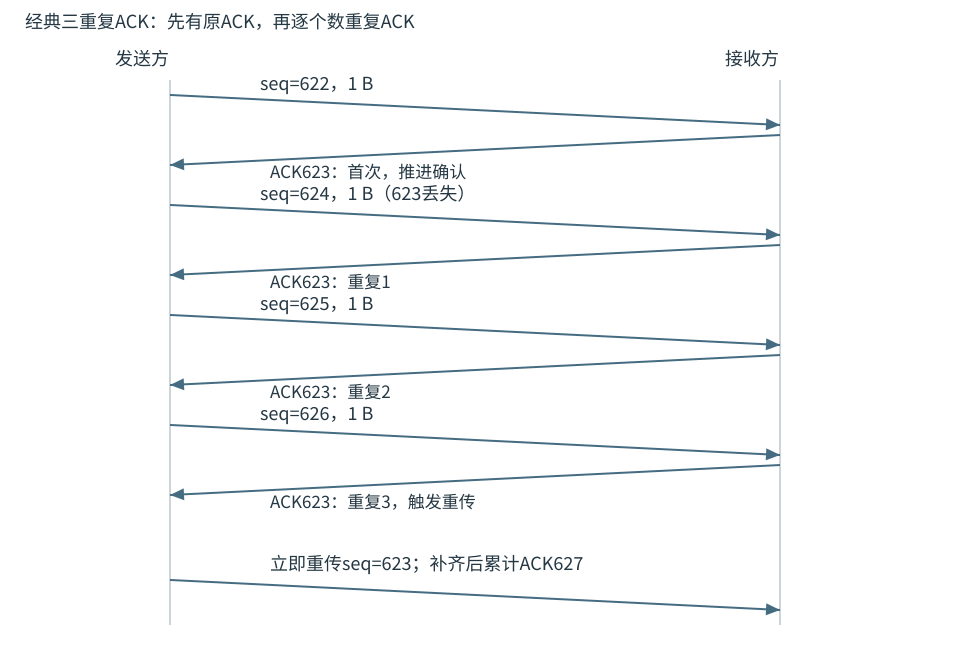{#cn-course-duplicate-acks width=100%}

$$SRTT\leftarrow(1-\alpha)SRTT+\alpha RTT_{sample}.$$

RTO结合平滑RTT及偏差估计，题给$RTO=\beta SRTT$时按其简化式；超时后RTO退避。Karn原则排除有重传歧义的RTT样本。旧SRTT100 ms、$\alpha=1/8$、有效样本140 ms，则新值105 ms。

<a id="CN05-windows"></a>
## 接收窗口、拥塞窗口与可新发额度
rwnd由接收方依据当前接收能力通告，cwnd由发送方依据网络反馈维护。ack=$a$、rwnd=$w$允许范围$a$～$a+w-1$；首部窗口字段反映本段发送者的接收能力。扩大选项在握手协商，未给则不自行放大。

当最新ACK与窗口左沿一致，已发未确认字节量$F$：

$$W=\min(cwnd,rwnd),\qquad A=\max(0,W-F).$$

$W$为总发送额度，$A$为还可新发；已在途量继续占额度，窗口缩小不要求撤回已发数据。复杂窗口更新按实际字节区间和有效右边界记录。

零窗口暂停普通数据发送，持续计时器触发零窗口探测，防止窗口重开通知丢失造成永久等待。它与重传、保活、TIME-WAIT计时器分别处理不同事件。

接收缓存8 B且应用不读，从seq600开始，依次收到600～602、603～604、605～606、607：ACK/rwnd为603/5、605/3、607/1、608/0；应用读走8 B后为608/8，确认号保持。

<a id="CN05-E06"></a>
### [例 5-5](../solutions/notes.md#a-CN05-E06)
主机甲通过TCP向主机乙发送数据的部分过程如下图。seq为序号，ack_seq为确认序号，rcvwnd为接收窗口。甲在 $t_0$ 的拥塞窗口和发送窗口均为2000 B，拥塞控制阈值为8000 B，MSS=1000 B，甲始终以MSS发送TCP段。若甲在 $t_1$ 收到图示确认段，则未收到新的确认之前，还可以继续发送的TCP段数是（　）。

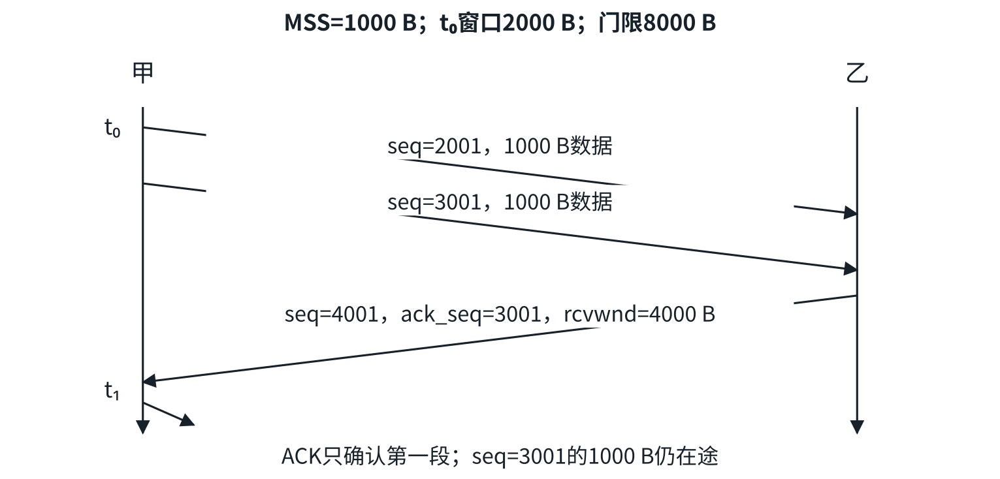{#cn-fig-tcp-window width=93%}

A. 2　B. 3　C. 4　D. 5

<a id="CN05-congestion"></a>
## 慢开始、拥塞避免与Reno恢复
以下为教材逐段确认、持续有数据、无其他限制的简化模型，初始窗口按题设，常用1 MSS。慢开始每个新数据ACK增加约1 MSS，完整一轮约翻倍；达到ssthresh后拥塞避免，每RTT约增1 MSS。延迟ACK、应用受限、rwnd受限会改变轨迹，轮次须注明发送前或确认后记录。

| 事件 | ssthresh | cwnd及后续 |
| --- | --- | --- |
| 超时 | 教材常取丢包时cwnd一半 | 回1 MSS，再慢开始 |
| Reno三重复ACK | 教材常取原窗口一半 | 快重传，快恢复临时为门限+3 MSS；新ACK确认缺失数据后回门限，转拥塞避免 |
| Tahoe三重复ACK | 减半门限 | 回1 MSS并慢开始 |

课件稳定轮次图通常记录快恢复完成后的cwnd=ssthresh，恢复中临时+3另算。规范实现设门限还参考在途量，题目明确模型优先。

初始1、门限8，未受其他限制时轮次1、2、4、8、9、10……；若在12超时，门限6，后续1、2、4、6、7……。

<a id="CN05-E05"></a>
### [例 5-6](../solutions/notes.md#a-CN05-E05)
若主机甲与主机乙已建立TCP连接，MSS为1 KB，RTT为2 ms，则在不出现拥塞的前提下，拥塞窗口从8 KB增长到32 KB所需的最长时间是（　）。

A. 4 ms　B. 8 ms　C. 24 ms　D. 48 ms

<a id="CN05-E07"></a>
### [例 5-7](../solutions/notes.md#a-CN05-E07)
主机甲和乙已建立TCP连接，甲始终以MSS=1 KB大小的段发送数据，并一直有数据发送；乙每收到一个数据段都会发出一个接收窗口为10 KB的确认段。若甲在 $t$ 时刻发生超时时拥塞窗口为8 KB，则从 $t$ 起不再发生超时的情况下，经过10个RTT后，甲的发送窗口是（　）。

A. 10 KB　B. 12 KB　C. 14 KB　D. 15 KB

<a id="CN05-integrated"></a>
## TCP字段与接收缓存综合计算
按“IP长度和首长→TCP起点与数据偏移→控制位→两方向seq/ack→窗口”解码。以太网填充比较整个IP长度与最小数据区，填充不占IP总长或TCP序号。TTL差计路由器跳数，交换机不减TTL；有NAT时结合IP标识和TCP字段识别对应分组。

<a id="CN05-E08"></a>
### [例 5-8](../solutions/notes.md#a-CN05-E08)
主机H通过快速以太网连接Internet，IP地址为192.168.0.8；服务器S的IP地址为211.68.71.80。H与S使用TCP通信，在H上捕获的5个IP分组及其中一个分组在S发出时的前40字节如下图，均为十六进制、按网络字节序排列。**第2包首字节采用45，第3包TCP数据偏移与控制字节采用50 10**。

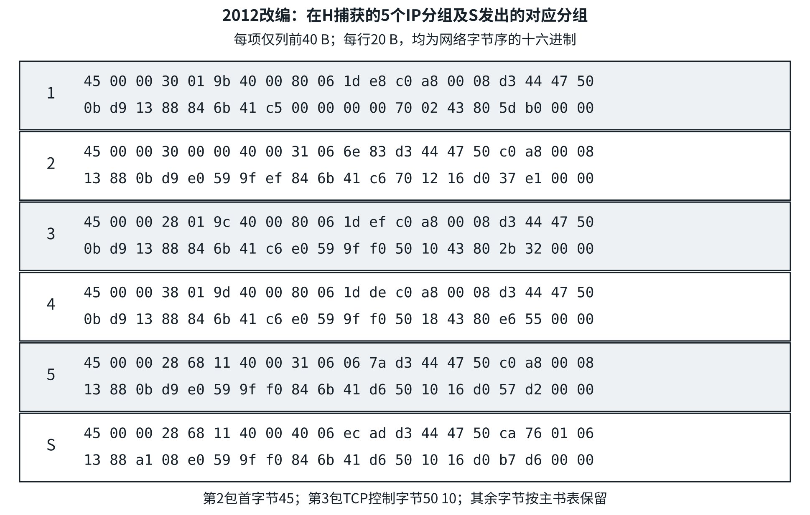{#cn-fig-packets2012 width=100%}

字段布局参照第4章IPv4首部格式和本章[TCP首部图](#cn-fig-tcp-format)：IPv4源、目的地址分别位于第13～16、第17～20字节，TTL位于第9字节；IHL与TCP数据偏移字段均以4 B为单位。

（1）5个IP分组中，哪几个由H发送？哪几个完成TCP连接建立过程？哪几个在通过快速以太网传输时进行了填充？

（2）根据这5个IP分组，分析S已经收到的应用层数据有多少字节。

（3）若某个IP分组在S发出时的前40字节为图中S行，该IP分组到达H时经过了多少个路由器？

缓存只进不出时，累计接收量决定rwnd；每轮发送量同时受cwnd和剩余缓存限制。求零窗口时间须计至零窗口通告返回发送端；平均应用速率用总应用字节/题定时间，KB和kb/s分别按题设换算。

<a id="CN05-E09"></a>
### [例 5-9](../solutions/notes.md#a-CN05-E09)
下图中H3访问Web服务器S。S为新建TCP连接分配20 KB（K=1024）接收缓存，MSS=1 KB，平均RTT=200 ms。H3建立连接时初始序号为100，持续按MSS大小发送数据，拥塞窗口初始阈值32 KB；S对收到的每个段确认并通告新接收窗口。连接建立后，S的TCP接收缓存只有数据存入、没有数据取出。图中R2的E0侧采用201.1.1.0/24。

{#cn-fig-window2016 width=98%}

（1）连接建立时，H3收到的第二次握手TCP段的SYN、ACK标志位分别是多少？确认号是多少？

（2）H3收到的第8个确认段所通告的接收窗口是多少？此时拥塞窗口变为多少？发送窗口变为多少？

（3）发送窗口等于0时，下一个待发送的数据段序号是多少？从H3发送第1个数据段到发送窗口等于0，平均数据传输速率是多少？忽略段的传输时延。

（4）H3与S通信已结束，H3在$t$时刻请求断开连接。从$t$起，S释放该连接的最短时间是多少？


<a id="CN06"></a>
# 应用层
<a id="CN06-model"></a>
## C/S、P2P与协议承载
C/S由客户主动请求、长期运行的服务器提供服务，可集中管理但可能形成瓶颈；副本与负载均衡可扩展。P2P对等方同时获取和提供资源，节点动态变化，需解决定位、访问控制和内容一致性；集中索引可以只定位资源，数据仍由对等方传送。

| 协议 | 作用 | 典型承载与端口 |
| --- | --- | --- |
| DNS | 名称解析、资源记录查询 | UDP/TCP53 |
| FTP | 文件传送，控制/数据连接分离 | TCP，控制21，主动数据传统源20 |
| SMTP | 提交、服务器间邮件推送 | TCP，服务器间25 |
| POP3 | 用户代理读取邮件 | TCP110 |
| HTTP/1.x | 请求响应获取或处理资源 | TCP，HTTP通常80 |

应用按可靠性、时延、吞吐和通信模式选择下层服务。一条应用消息可跨多个TCP段，一个TCP段也可含多个应用写入片段。

<a id="CN06-dns"></a>
## DNS层次、资源记录与查询
域名由右至左层级降低，顶级域包括国家/地区类、通用类和arpa等基础设施类。普通主机名标签通常用字母、数字、连字符，大小写不敏感；单标签最长63 B，完整DNS线格式最长255 B（含长度字节与根标签），普通不带末尾根点的文本常限253 B。

域是名称空间子树；区是权威服务器管理的范围，子域委派后域与区可不同。根服务器提供顶级域委派，权威服务器负责本区记录；本地DNS为递归解析器，不要求与客户处同一LAN。

| 记录 | 值及作用 |
| --- | --- |
| A、AAAA | 名称对应IPv4、IPv6地址 |
| NS | 权威服务器名称 |
| CNAME | 别名指向规范名称 |
| MX | 邮件交换服务器名称和优先级 |
| TTL | 资源记录可缓存的有效期 |

NS/MX中的名称可能继续需要地址解析。名称、IP与主机无一一对应关系，一个名称可有多个地址，多个名称可共享地址。

递归：被询问者负责继续解析并返回答案/失败。迭代：被询问者可返回下一站，当前查询者继续询问。常见流程为主机向本地DNS递归，本地DNS向根、顶级、权威迭代；按实际委派层数展开。

有效最终记录命中可0次远程查询；有中间委派缓存则从对应级继续；无相关缓存从根开始。查询次数固定计数主体，并按题意排除或包含别名链、失败重试。DNS常用UDP，也支持TCP区域传送、较大响应或回退等场景。

<a id="CN06-E01"></a>
### [例 6-1](../solutions/notes.md#a-CN06-E01)
假设所有域名服务器均采用迭代查询方式进行域名解析。当H4访问规范域名为 `www.abc.xyz.com` 的网站时，域名服务器201.1.1.1完成该域名解析过程中，可能发出DNS查询的最少和最多次数分别是（　）。共用网络拓扑如下。

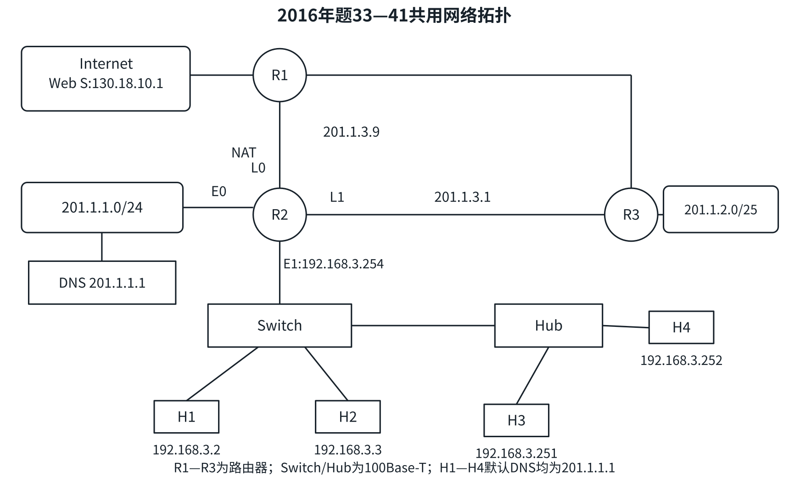{#cn-fig-dns2016 width=98%}

A. 0，3　B. 1，3　C. 0，4　D. 1，4

<a id="CN06-ftp"></a>
## FTP控制、数据连接与传输模式
控制连接用TCP连接服务器21端口，承载登录、目录、传送命令及状态，通常持续整个会话；数据连接按需要建立，承载文件与目录列表。`LIST`命令走控制，列表内容走数据。

主动模式：客户告知接收地址/端口，服务器主动建立数据连接，传统服务器数据源端口20。被动模式：服务器通告监听端点，客户主动连接。实现可用进程、线程或事件模型维护各会话，连接与OS进程不要求一一对应。

<a id="CN06-E02"></a>
### [例 6-2](../solutions/notes.md#a-CN06-E02)
FTP客户和服务器间传递FTP命令时，使用的连接是（　）。

A. 建立在TCP之上的控制连接

B. 建立在TCP之上的数据连接

C. 建立在UDP之上的控制连接

D. 建立在UDP之上的数据连接

<a id="CN06-mail"></a>
## 邮件系统、SMTP、POP3与MIME
邮件系统由用户代理、邮件服务器和传送/读取协议组成。路径：用户代理SMTP提交→发送服务器按MX等确定收件服务器→服务器间SMTP转送→收件用户POP3、IMAP或Web读取。

邮件由首部、空行、正文组成，`From:`、`To:`、`Subject:`属于可见邮件内容；SMTP的`MAIL FROM`、`RCPT TO`属于投递信封，实际投递地址可与显示地址不同。基本交互为TCP建立→问候→信封发件人→一个或多个收件人→DATA内容→结束；正文终止标志按透明传输规则处理。

基础SMTP按7 bit ASCII背景理解。MIME定义内容类型、字符集、传输编码和多部分边界，支持非ASCII文本及附件；Base64把3 B变4个ASCII字符，净编码约膨胀4/3，另有格式开销。公开编码可逆，不提供保密性；扩展SMTP按协商能力解释。

POP3经历授权、事务、更新；同一TCP连接可读取多封邮件，删除通常在更新阶段落实，也可下载并保留。Web邮箱浏览器使用HTTP类交互，后端仍可运行邮件协议。提交被接受与用户已读取是不同事件。

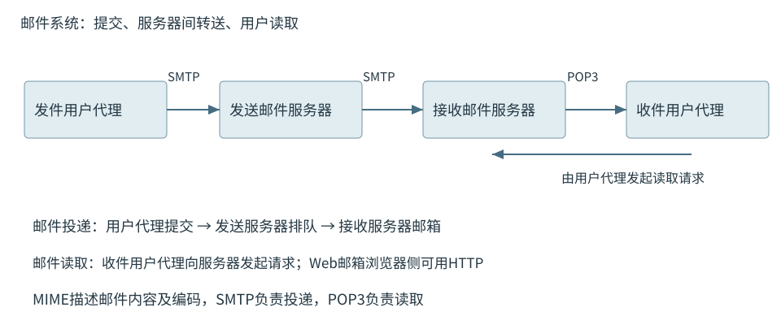{#cn-course-cn_course_mail_flow width=100%}

<a id="CN06-E03"></a>
### [例 6-3](../solutions/notes.md#a-CN06-E03)
下列关于POP3协议的叙述中，正确的是（　）。

I. 支持用户代理从邮件服务器读取邮件

II. 支持用户代理向邮件服务器发送邮件

III. 支持邮件服务器之间发送与接收邮件

IV. 支持通过一条TCP连接收取多封邮件

A. 仅I、IV　B. 仅II、III　C. 仅I、II、III　D. 仅I、III、IV

<a id="CN06-http"></a>
## URL与HTTP报文语义
URL包含方案、主机、可选端口、路径、查询和片段。`http://www.abc.com:80/index.html?q=408#part1`的请求目标为`/index.html?q=408`，片段`part1`由浏览器文档内定位，不进入普通HTTP请求目标。HTML可引用多个对象、不同域名，可能需要额外DNS和连接。

HTTP/1.x请求含请求行、首部、空行、可选消息体；响应含状态行、首部、空行、可选消息体。

```text
GET /index.html?q=408 HTTP/1.1
Host: www.abc.com
If-None-Match: "v2"

```

| 方法或状态 | 语义 |
| --- | --- |
| GET、HEAD | 获取资源、获取相应首部；按规定语义属安全方法 |
| POST | 提交内容供处理，可改变状态 |
| 200 | 成功 |
| 301/302 | 重定向 |
| 304 | 条件请求中资源未改动，复用缓存实体；验证仍有往返 |
| 404、5xx | 未找到、服务器错误类别 |

有效的新鲜缓存可直接使用，无需访问源站；过期或需验证时，可用`If-Modified-Since`或`If-None-Match`条件请求。代理缓存可缩短访问路径、降低上游流量，是否发起验证由新鲜度及缓存策略决定。

HTTP无状态表示处理请求不自动要求保留上次会话；`Set-Cookie`设置客户端标识，后续`Cookie`带回以关联服务器状态。持久连接减少TCP建立开销，Cookie和连接复用分别判断，认证安全依实际机制。

HTTP/1.x题按其TCP与流水模型计算；HTTPS还需题给TLS等开销；HTTP/2多路复用和HTTP/3 QUIC按相应题设处理。

<a id="CN06-http-delay"></a>
## HTTP连接复用与访问时延
条件：DNS已完成、TCP未建，先收HTML才发现其中$m\ge1$个同站小对象；不并行建连接，忽略发送、处理、窗口与其他开销，往返均RTT。

| 模型 | 依赖过程 | 总时延 |
| --- | --- | --- |
| 非持久串行 | 每对象重新TCP建立并请求响应，共$m+1$对象 | $2(m+1)RTT$ |
| 持久非流水 | 首次建立，HTML及$m$对象逐个请求响应 | $(m+2)RTT$ |
| 持久流水 | 首次建立、HTML、已知对象并发请求三个阶段 | $3RTT$ |

若TCP已建立，减首次握手1RTT；允许并行连接时，仅在资源发现后按并行数分批。较大对象还受发送时间、拥塞/接收窗口限制。DNS所需各次查询按依赖累加，有效缓存或已知权威入口可跳过对应阶段。

<a id="CN06-E04"></a>
### [例 6-4](../solutions/notes.md#a-CN06-E04)
若浏览器不支持并行TCP连接，使用非持久的HTTP/1.0协议请求浏览1个Web页，该页中引用同一网站上的7个小图像文件，则从浏览器为传输Web页请求建立TCP连接开始，到接收完所有内容为止，所需要的RTT数至少是（　）。

A. 4　B. 9　C. 14　D. 16

<a id="CN06-E05"></a>
### [例 6-5](../solutions/notes.md#a-CN06-E05)
假设主机通过HTTP/1.1流水线方式请求Web服务器上的rfc.html，它引用同目录下3个JPEG小图像，只有收到rfc.html后才能发送对应图像请求。一次请求响应为RTT，忽略其他时延，不考虑拥塞与流量控制。从发出HTTP请求报文开始，到收到全部内容，所耗时间是（　）。

A. 2RTT　B. 2.5RTT　C. 4RTT　D. 4.5RTT

<a id="CN06-E06"></a>
### [例 6-6](../solutions/notes.md#a-CN06-E06)
假设下图网络中的本地域名服务器只提供递归查询服务，其他域名服务器均只提供迭代查询服务；局域网内主机访问Internet上各服务器的RTT均为10 ms，忽略其他各种时延。若主机H通过超链接 `http://www.abc.com/index.html` 请求浏览纯文本Web页index.html，从单击超链接到浏览器收到页面，所需的最短与最长时间分别是（　）。

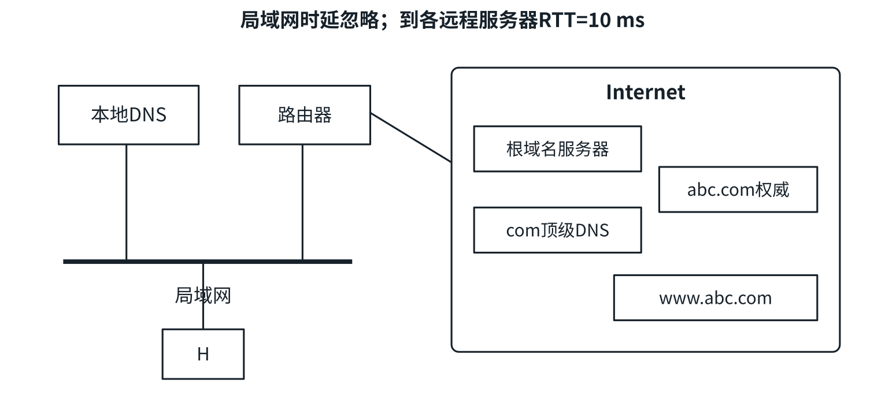{#cn-fig-dns2020 width=97%}

A. 10 ms，40 ms　B. 10 ms，50 ms

C. 20 ms，40 ms　D. 20 ms，50 ms

<a id="CN06-E07"></a>
### [例 6-7](../solutions/notes.md#a-CN06-E07)
假设主机H通过HTTP/1.1请求Web服务器S上的news408.html，它引用同目录下1幅图像。HTML文件大小为1 MSS，图像3 MSS，RTT=10 ms，忽略HTTP响应首部开销和TCP段传输时延。若H已完成域名解析，则从H请求与S建立TCP连接时刻起，到收到全部内容，所需的时间至少是（　）。

A. 30 ms　B. 40 ms　C. 50 ms　D. 60 ms

<a id="CN06-integrated"></a>
## 名称解析、连接与逐跳封装综合
访问依赖：DNS或缓存取得服务器IP→路由决定下一跳→ARP取得下一跳MAC→TCP握手→HTTP请求HTML→解析引用对象→按复用、并行与窗口条件传送。ARP缓存、本地DNS缓存、交换机转发表分别记录不同信息。

发送DNS查询时，若DNS在本子网，ARP解析DNS；服务器在外网，HTTP/TCP帧目的为网关MAC。交换机仅从实际帧的源MAC与入端口学习，未发送帧的站不会仅因收到广播就被登记。NAT按映射改变边界处地址/端口，端到端字节序号仍按连接方向追踪。

<a id="CN06-E08"></a>
### [例 6-8](../solutions/notes.md#a-CN06-E08)
某网络拓扑如下图。H登录FTP服务器后，向服务器上传18000 B文件F。H为传输F建立数据连接时选择初始序号100，MSS=1000 B，拥塞控制初始阈值4 MSS，RTT=10 ms，忽略TCP段的传输时延。在F的传输过程中，H均按MSS大小发送数据，未发生差错、丢包和乱序。

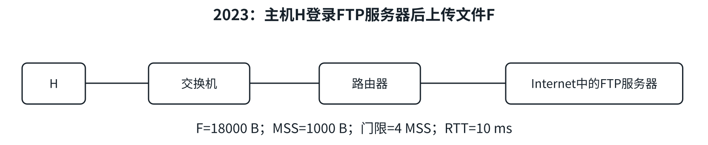{#cn-fig-ftp2023 width=100%}

（1）FTP控制连接是持久的还是非持久的？数据连接是持久的还是非持久的？H登录服务器时建立的TCP连接是控制连接还是数据连接？

（2）H通过数据连接发送F时，F第1个字节的序号是多少？断开数据连接过程中，FTP服务器发送的第二次挥手ACK段的确认号是多少？

（3）当H收到确认号2101的确认段时，拥塞窗口调整为多少？收到确认号7101的确认段时，拥塞窗口调整为多少？

（4）H从请求建立数据连接开始，到确认F已被服务器全部接收，至少需要多久？期间应用层数据的平均发送速率是多少？

<a id="CN06-E09"></a>
### [例 6-9](../solutions/notes.md#a-CN06-E09)
某网络拓扑如下图，以太网交换机S通过路由器R与Internet互联。路由器接口、本地DNS、H1、H2的IP地址与MAC地址如图。$t_0$时H1的ARP表和S的交换表均为空；H1此时用浏览器通过域名www.abc.com请求访问Web服务器。$t_1>t_0$时，S第一次收到封装HTTP请求报文的以太网帧。其间没有与此次Web访问无关的网络通信。

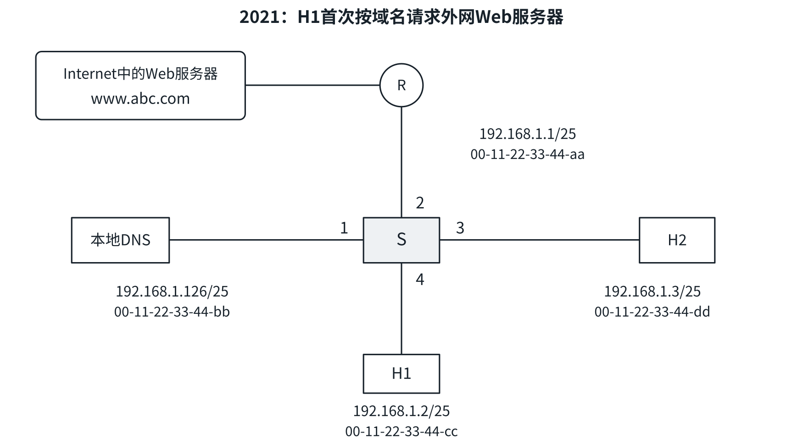{#cn-fig-dns-switch2021 width=100%}

（1）从$t_0$到$t_1$，H1除HTTP外还运行哪个应用层协议？从应用层到数据链路层，该协议报文经过哪些协议逐层封装？

（2）S交换表结构为“MAC地址、端口”，$t_1$时交换表内容是什么？

（3）其间H2至少接收多少个与此次Web访问有关的帧？是什么帧？目的MAC地址是什么？
