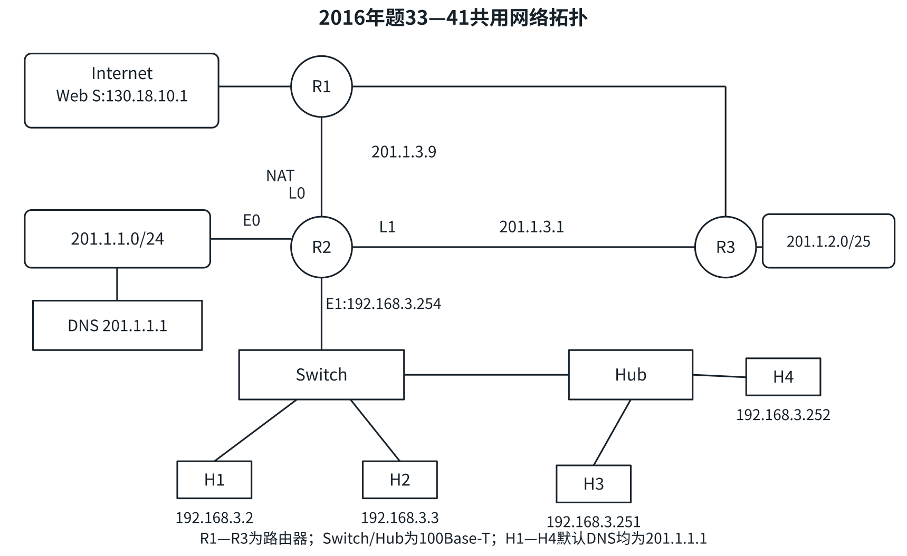
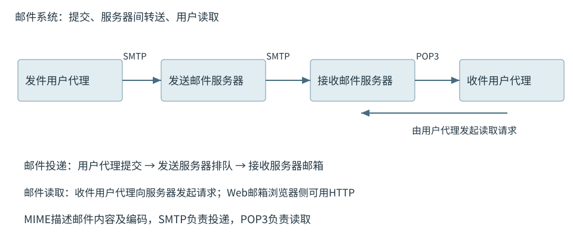
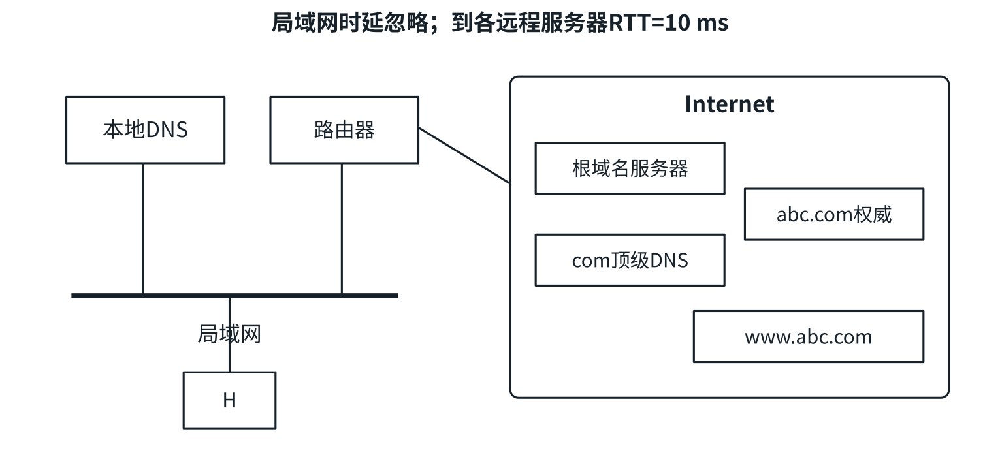
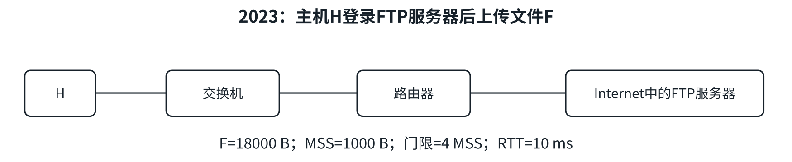
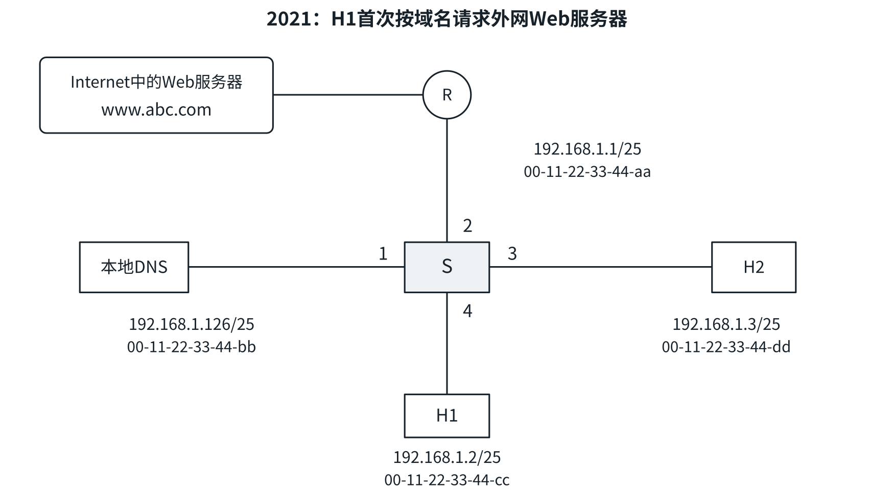

<a id="CN06"></a>
# 应用层
<a id="CN06-model"></a>
## C/S、P2P与协议承载
C/S由客户主动请求、长期运行的服务器提供服务，可集中管理但可能形成瓶颈；副本与负载均衡可扩展。P2P对等方同时获取和提供资源，节点动态变化，需解决定位、访问控制和内容一致性；集中索引可以只定位资源，数据仍由对等方传送。

| 协议 | 作用 | 典型承载与端口 |
| --- | --- | --- |
| DNS | 名称解析、资源记录查询 | UDP/TCP53 |
| FTP | 文件传送，控制/数据连接分离 | TCP，控制21，主动数据传统源20 |
| SMTP | 提交、服务器间邮件推送 | TCP，服务器间25 |
| POP3 | 用户代理读取邮件 | TCP110 |
| HTTP/1.x | 请求响应获取或处理资源 | TCP，HTTP通常80 |

应用按可靠性、时延、吞吐和通信模式选择下层服务。一条应用消息可跨多个TCP段，一个TCP段也可含多个应用写入片段。

<a id="CN06-dns"></a>
## DNS层次、资源记录与查询
域名由右至左层级降低，顶级域包括国家/地区类、通用类和arpa等基础设施类。普通主机名标签通常用字母、数字、连字符，大小写不敏感；单标签最长63 B，完整DNS线格式最长255 B（含长度字节与根标签），普通不带末尾根点的文本常限253 B。

域是名称空间子树；区是权威服务器管理的范围，子域委派后域与区可不同。根服务器提供顶级域委派，权威服务器负责本区记录；本地DNS为递归解析器，不要求与客户处同一LAN。

| 记录 | 值及作用 |
| --- | --- |
| A、AAAA | 名称对应IPv4、IPv6地址 |
| NS | 权威服务器名称 |
| CNAME | 别名指向规范名称 |
| MX | 邮件交换服务器名称和优先级 |
| TTL | 资源记录可缓存的有效期 |

NS/MX中的名称可能继续需要地址解析。名称、IP与主机无一一对应关系，一个名称可有多个地址，多个名称可共享地址。

递归：被询问者负责继续解析并返回答案/失败。迭代：被询问者可返回下一站，当前查询者继续询问。常见流程为主机向本地DNS递归，本地DNS向根、顶级、权威迭代；按实际委派层数展开。

有效最终记录命中可0次远程查询；有中间委派缓存则从对应级继续；无相关缓存从根开始。查询次数固定计数主体，并按题意排除或包含别名链、失败重试。DNS常用UDP，也支持TCP区域传送、较大响应或回退等场景。

<a id="CN06-E01"></a>
### [例 6-1](../../solutions/notes.md#a-CN06-E01)
假设所有域名服务器均采用迭代查询方式进行域名解析。当H4访问规范域名为 `www.abc.xyz.com` 的网站时，域名服务器201.1.1.1完成该域名解析过程中，可能发出DNS查询的最少和最多次数分别是（　）。共用网络拓扑如下。

{#cn-fig-dns2016 width=98%}

A. 0，3　B. 1，3　C. 0，4　D. 1，4

<a id="CN06-ftp"></a>
## FTP控制、数据连接与传输模式
控制连接用TCP连接服务器21端口，承载登录、目录、传送命令及状态，通常持续整个会话；数据连接按需要建立，承载文件与目录列表。`LIST`命令走控制，列表内容走数据。

主动模式：客户告知接收地址/端口，服务器主动建立数据连接，传统服务器数据源端口20。被动模式：服务器通告监听端点，客户主动连接。实现可用进程、线程或事件模型维护各会话，连接与OS进程不要求一一对应。

<a id="CN06-E02"></a>
### [例 6-2](../../solutions/notes.md#a-CN06-E02)
FTP客户和服务器间传递FTP命令时，使用的连接是（　）。

A. 建立在TCP之上的控制连接

B. 建立在TCP之上的数据连接

C. 建立在UDP之上的控制连接

D. 建立在UDP之上的数据连接

<a id="CN06-mail"></a>
## 邮件系统、SMTP、POP3与MIME
邮件系统由用户代理、邮件服务器和传送/读取协议组成。路径：用户代理SMTP提交→发送服务器按MX等确定收件服务器→服务器间SMTP转送→收件用户POP3、IMAP或Web读取。

邮件由首部、空行、正文组成，`From:`、`To:`、`Subject:`属于可见邮件内容；SMTP的`MAIL FROM`、`RCPT TO`属于投递信封，实际投递地址可与显示地址不同。基本交互为TCP建立→问候→信封发件人→一个或多个收件人→DATA内容→结束；正文终止标志按透明传输规则处理。

基础SMTP按7 bit ASCII背景理解。MIME定义内容类型、字符集、传输编码和多部分边界，支持非ASCII文本及附件；Base64把3 B变4个ASCII字符，净编码约膨胀4/3，另有格式开销。公开编码可逆，不提供保密性；扩展SMTP按协商能力解释。

POP3经历授权、事务、更新；同一TCP连接可读取多封邮件，删除通常在更新阶段落实，也可下载并保留。Web邮箱浏览器使用HTTP类交互，后端仍可运行邮件协议。提交被接受与用户已读取是不同事件。

{#cn-course-cn_course_mail_flow width=100%}

<a id="CN06-E03"></a>
### [例 6-3](../../solutions/notes.md#a-CN06-E03)
下列关于POP3协议的叙述中，正确的是（　）。

I. 支持用户代理从邮件服务器读取邮件

II. 支持用户代理向邮件服务器发送邮件

III. 支持邮件服务器之间发送与接收邮件

IV. 支持通过一条TCP连接收取多封邮件

A. 仅I、IV　B. 仅II、III　C. 仅I、II、III　D. 仅I、III、IV

<a id="CN06-http"></a>
## URL与HTTP报文语义
URL包含方案、主机、可选端口、路径、查询和片段。`http://www.abc.com:80/index.html?q=408#part1`的请求目标为`/index.html?q=408`，片段`part1`由浏览器文档内定位，不进入普通HTTP请求目标。HTML可引用多个对象、不同域名，可能需要额外DNS和连接。

HTTP/1.x请求含请求行、首部、空行、可选消息体；响应含状态行、首部、空行、可选消息体。

```text
GET /index.html?q=408 HTTP/1.1
Host: www.abc.com
If-None-Match: "v2"

```

| 方法或状态 | 语义 |
| --- | --- |
| GET、HEAD | 获取资源、获取相应首部；按规定语义属安全方法 |
| POST | 提交内容供处理，可改变状态 |
| 200 | 成功 |
| 301/302 | 重定向 |
| 304 | 条件请求中资源未改动，复用缓存实体；验证仍有往返 |
| 404、5xx | 未找到、服务器错误类别 |

有效的新鲜缓存可直接使用，无需访问源站；过期或需验证时，可用`If-Modified-Since`或`If-None-Match`条件请求。代理缓存可缩短访问路径、降低上游流量，是否发起验证由新鲜度及缓存策略决定。

HTTP无状态表示处理请求不自动要求保留上次会话；`Set-Cookie`设置客户端标识，后续`Cookie`带回以关联服务器状态。持久连接减少TCP建立开销，Cookie和连接复用分别判断，认证安全依实际机制。

HTTP/1.x题按其TCP与流水模型计算；HTTPS还需题给TLS等开销；HTTP/2多路复用和HTTP/3 QUIC按相应题设处理。

<a id="CN06-http-delay"></a>
## HTTP连接复用与访问时延
条件：DNS已完成、TCP未建，先收HTML才发现其中$m\ge1$个同站小对象；不并行建连接，忽略发送、处理、窗口与其他开销，往返均RTT。

| 模型 | 依赖过程 | 总时延 |
| --- | --- | --- |
| 非持久串行 | 每对象重新TCP建立并请求响应，共$m+1$对象 | $2(m+1)RTT$ |
| 持久非流水 | 首次建立，HTML及$m$对象逐个请求响应 | $(m+2)RTT$ |
| 持久流水 | 首次建立、HTML、已知对象并发请求三个阶段 | $3RTT$ |

若TCP已建立，减首次握手1RTT；允许并行连接时，仅在资源发现后按并行数分批。较大对象还受发送时间、拥塞/接收窗口限制。DNS所需各次查询按依赖累加，有效缓存或已知权威入口可跳过对应阶段。

<a id="CN06-E04"></a>
### [例 6-4](../../solutions/notes.md#a-CN06-E04)
若浏览器不支持并行TCP连接，使用非持久的HTTP/1.0协议请求浏览1个Web页，该页中引用同一网站上的7个小图像文件，则从浏览器为传输Web页请求建立TCP连接开始，到接收完所有内容为止，所需要的RTT数至少是（　）。

A. 4　B. 9　C. 14　D. 16

<a id="CN06-E05"></a>
### [例 6-5](../../solutions/notes.md#a-CN06-E05)
假设主机通过HTTP/1.1流水线方式请求Web服务器上的rfc.html，它引用同目录下3个JPEG小图像，只有收到rfc.html后才能发送对应图像请求。一次请求响应为RTT，忽略其他时延，不考虑拥塞与流量控制。从发出HTTP请求报文开始，到收到全部内容，所耗时间是（　）。

A. 2RTT　B. 2.5RTT　C. 4RTT　D. 4.5RTT

<a id="CN06-E06"></a>
### [例 6-6](../../solutions/notes.md#a-CN06-E06)
假设下图网络中的本地域名服务器只提供递归查询服务，其他域名服务器均只提供迭代查询服务；局域网内主机访问Internet上各服务器的RTT均为10 ms，忽略其他各种时延。若主机H通过超链接 `http://www.abc.com/index.html` 请求浏览纯文本Web页index.html，从单击超链接到浏览器收到页面，所需的最短与最长时间分别是（　）。

{#cn-fig-dns2020 width=97%}

A. 10 ms，40 ms　B. 10 ms，50 ms

C. 20 ms，40 ms　D. 20 ms，50 ms

<a id="CN06-E07"></a>
### [例 6-7](../../solutions/notes.md#a-CN06-E07)
假设主机H通过HTTP/1.1请求Web服务器S上的news408.html，它引用同目录下1幅图像。HTML文件大小为1 MSS，图像3 MSS，RTT=10 ms，忽略HTTP响应首部开销和TCP段传输时延。若H已完成域名解析，则从H请求与S建立TCP连接时刻起，到收到全部内容，所需的时间至少是（　）。

A. 30 ms　B. 40 ms　C. 50 ms　D. 60 ms

<a id="CN06-integrated"></a>
## 名称解析、连接与逐跳封装综合
访问依赖：DNS或缓存取得服务器IP→路由决定下一跳→ARP取得下一跳MAC→TCP握手→HTTP请求HTML→解析引用对象→按复用、并行与窗口条件传送。ARP缓存、本地DNS缓存、交换机转发表分别记录不同信息。

发送DNS查询时，若DNS在本子网，ARP解析DNS；服务器在外网，HTTP/TCP帧目的为网关MAC。交换机仅从实际帧的源MAC与入端口学习，未发送帧的站不会仅因收到广播就被登记。NAT按映射改变边界处地址/端口，端到端字节序号仍按连接方向追踪。

<a id="CN06-E08"></a>
### [例 6-8](../../solutions/notes.md#a-CN06-E08)
某网络拓扑如下图。H登录FTP服务器后，向服务器上传18000 B文件F。H为传输F建立数据连接时选择初始序号100，MSS=1000 B，拥塞控制初始阈值4 MSS，RTT=10 ms，忽略TCP段的传输时延。在F的传输过程中，H均按MSS大小发送数据，未发生差错、丢包和乱序。

{#cn-fig-ftp2023 width=100%}

（1）FTP控制连接是持久的还是非持久的？数据连接是持久的还是非持久的？H登录服务器时建立的TCP连接是控制连接还是数据连接？

（2）H通过数据连接发送F时，F第1个字节的序号是多少？断开数据连接过程中，FTP服务器发送的第二次挥手ACK段的确认号是多少？

（3）当H收到确认号2101的确认段时，拥塞窗口调整为多少？收到确认号7101的确认段时，拥塞窗口调整为多少？

（4）H从请求建立数据连接开始，到确认F已被服务器全部接收，至少需要多久？期间应用层数据的平均发送速率是多少？

<a id="CN06-E09"></a>
### [例 6-9](../../solutions/notes.md#a-CN06-E09)
某网络拓扑如下图，以太网交换机S通过路由器R与Internet互联。路由器接口、本地DNS、H1、H2的IP地址与MAC地址如图。$t_0$时H1的ARP表和S的交换表均为空；H1此时用浏览器通过域名www.abc.com请求访问Web服务器。$t_1>t_0$时，S第一次收到封装HTTP请求报文的以太网帧。其间没有与此次Web访问无关的网络通信。

{#cn-fig-dns-switch2021 width=100%}

（1）从$t_0$到$t_1$，H1除HTTP外还运行哪个应用层协议？从应用层到数据链路层，该协议报文经过哪些协议逐层封装？

（2）S交换表结构为“MAC地址、端口”，$t_1$时交换表内容是什么？

（3）其间H2至少接收多少个与此次Web访问有关的帧？是什么帧？目的MAC地址是什么？
