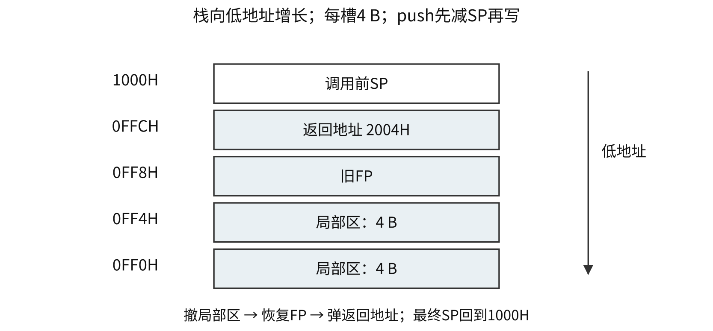
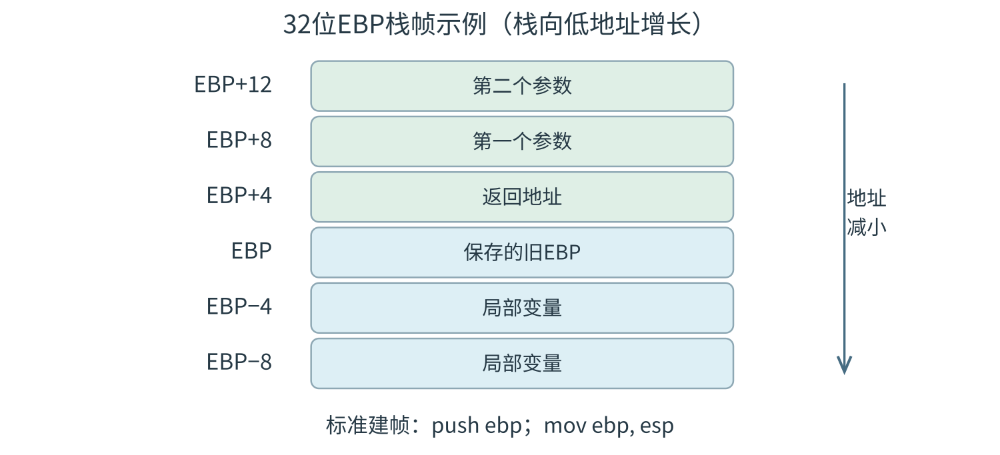

<a id="CO04"></a>
# 指令系统与 C 程序的机器级表示
<a id="CO04-format"></a>
## 指令格式、地址字段与操作码扩展
指令由操作码、操作数/地址及寻址方式等字段组成。指令字长为编码位数，机器字长为整数处理的基本位宽，存储字长为一个存储单元的位数；三者分别确定。一个地址字段可表示寄存器编号、立即数、形式地址或位移。

| 格式 | 典型运算语义 | 隐含位置 |
|---|---|---|
| 三地址 | $M[A_3]\leftarrow M[A_1]+M[A_2]$ | 由指令定义 |
| 二地址 | $M[A_1]\leftarrow M[A_1]+M[A_2]$ | 一个源兼目的 |
| 一地址 | $\mathrm{ACC}\leftarrow\mathrm{ACC}+M[A]$ | 累加器 |
| 零地址 | 弹出栈顶两项运算，再压入结果 | 栈顶、SP |

地址字段数只计显式编码；实际操作数还包括隐含操作数。三地址运算若取指一次、源与目的均在主存，需取指1次、读源2次、写结果1次，共4次访存。多字指令、寄存器源、间接寻址分别改变对应次数。

固定操作码 $k$ 位至多编码 $2^k$ 种操作。扩展操作码逐层保留前缀：本层剩余 $r$ 个前缀，下一段扩展 $a$ 位，得到 $r2^a$ 个可分配编码；扣除已用编码后继续扩展。短操作码与更长操作码的前缀必须互斥。

16位指令、地址字段4位：分配15条三地址后剩1个4位前缀；扩为16个8位码，分配12条二地址后剩4个；扩为64个12位码，分配62条一地址后剩2个；最终可分配32条零地址。指令总长始终16位。

<a id="CO04-E01"></a>
### [例 4-1](../../solutions/notes.md#a-CO04-E01)
设计某指令系统时，假设采用16位定长指令字格式，操作码使用扩展编码方式，地址码为6位，包含零地址、一地址和二地址3种格式的指令。若二地址指令有12条，一地址指令有254条，则零地址指令的条数最多为（　）。

A. 0　 B. 2　 C. 64　 D. 128

<a id="CO04-address"></a>
## 数据寻址、相对地址与访存次数
记形式地址 $A$、寄存器内容 $(R)$、存储单元内容 $M[x]$。表中读主存次数仅统计取得一个源操作数，取指与写回另计。

| 寻址方式 | 操作数或有效地址 EA | 读主存次数 |
|---|---|---|
| 立即 | 操作数为指令内的立即数字段 | 0 |
| 直接 | $\mathrm{EA}=A$，操作数 $M[A]$ | 1 |
| 一次主存间接 | $\mathrm{EA}=M[A]$，操作数 $M[\mathrm{EA}]$ | 2 |
| 寄存器 | 操作数 $(R)$ | 0 |
| 寄存器间接 | $\mathrm{EA}=(R)$ | 1 |
| 基址 | $\mathrm{EA}=(\mathrm{BR})+\text{位移}$ | 主存源1次 |
| 变址 | $\mathrm{EA}=A+(\mathrm{IX})$ | 主存源1次 |
| 相对 | $\text{目标}=\mathrm{PC}_{base}+\operatorname{sext}(\text{位移})\times\text{缩放因子}$ | 按指令语义确定 |

间接寻址可利用比指令地址字段更宽的中间地址扩大寻址范围。基址寄存器通常存程序/数据段起点，支持重定位；变址寄存器通常存变化偏移，支持数组访问。位移的符号扩展和缩放按 ISA 规定。

按字节编址、int占4 B时，$\operatorname{addr}(a[i])=\mathrm{base}+4i$。有比例变址可直接形成偏移；其他机器需先计算 $4i$。相对转移常取后继指令地址为基准，具体以题设PC更新时机为准。

<a id="CO04-E02"></a>
### [例 4-2](../../solutions/notes.md#a-CO04-E02)
某机器字长为16位，主存按字节编址，转移指令采用相对寻址，由两个字节组成，第一个字节为操作码字段，第二个字节为相对位移量字段。假定取指令时，每取一个字节 PC 自动加1。若某转移指令所在主存地址为2000H，相对位移量字段的内容为06H，则该转移指令成功转移后的目标地址是（　）。

A. 2006H　 B. 2007H　 C. 2008H　 D. 2009H

无Cache、无预取、指令与操作数各占一个存储字时，读取一个直接寻址源、一次主存间接源、寄存器间接源分别至少访存2、3、2次，均已计一次取指。32位指令在16位存储字中跨两个字，取指所需访问次数按存储组织确定。

堆栈寻址隐含使用SP。向低地址增长、SP指向栈顶、每槽4 B的模型：push为先SP减4再写，pop为先读再SP加4。初值1000H，两次push、一次pop后SP=0FFCH。硬堆栈使用寄存器组，软堆栈使用主存，访存开销分别计算。

<a id="CO04-isa"></a>
## RISC、CISC 与指令副作用
| 维度 | RISC典型设计 | CISC典型设计 |
|---|---|---|
| 功能 | 常用简单操作，复杂操作由指令组合 | 丰富指令，可表达较复杂操作 |
| 编码与寻址 | 格式规整，常用定长，寻址方式较少 | 格式及寻址较多，常见变长 |
| 数据访存 | Load/Store访问数据，ALU主要操作寄存器 | 多类指令可带主存操作数 |
| 寄存器与传参 | 通用寄存器较多，常用寄存器传参 | 传统设计寄存器较少，操作数来源丰富 |
| 控制与流水 | 常用硬布线，便于流水 | 复杂指令常用微程序，也可流水 |
| 编译 | 重视选指令、分配寄存器和调度 | 同样需要编译优化 |

表中为常见倾向。指令长度、寄存器数、控制器实现和调用约定须以具体ISA、微架构和ABI为准；执行时间按指令数、CPI及周期共同计算。

数据传送复制值；算术逻辑、移位指令产生新值并可能改标志；控制转移改变PC；I/O及系统控制可能涉及权限。每条指令的访存、改标志、特权等副作用依给定语义判断。

<a id="CO04-E03"></a>
### [例 4-3](../../solutions/notes.md#a-CO04-E03)
下列关于 RISC 的叙述中，错误的是（　）。

A. 多采用硬连线方式实现控制器  
B. 通常采用 Load/Store 型指令设计风格  
C. 难以采用流水线数据通路实现微架构  
D. 多采用寄存器传递过程调用时的参数

<a id="CO04-toolchain"></a>
## 编译工具链与重定位
| 阶段 | 输入与主要结果 |
|---|---|
| 预处理 | 源文件→展开宏、包含文件等后的源程序 |
| 编译 | 高级语言→汇编表示 |
| 汇编 | 汇编表示→机器码目标文件，保留符号与重定位信息 |
| 链接 | 合并节、解析跨模块符号、修改地址引用→可执行文件 |

动态链接可将部分链接工作推迟至装入或运行时。目标/可执行文件可含符号表、调试、重定位和装入组织信息。优化后的变量可在寄存器中、成为常量或被消除。

<a id="CO04-E04"></a>
### [例 4-4](../../solutions/notes.md#a-CO04-E04)
将高级语言源程序转换为可执行目标文件的主要过程是（　）。

A. 预处理→编译→汇编→链接  
B. 预处理→汇编→编译→链接  
C. 预处理→编译→链接→汇编  
D. 预处理→汇编→链接→编译

<a id="CO04-x86"></a>
## x86 操作数、有效地址与条件转移
32位示例中EAX、EBX、ECX、EDX为通用寄存器，ESP为栈顶、EBP常作帧基址。AX为EAX低16位，AL与AH为最低、次低8位。

| 含义 | Intel格式：目的在前 | AT&T格式：源在前 |
|---|---|---|
| 立即数5→EAX | `mov eax, 5` | `movl $5, %eax` |
| EBX→EAX | `mov eax, ebx` | `movl %ebx, %eax` |
| 读取32位主存数 | `mov eax, dword ptr [ebx+ecx*4+8]` | `movl 8(%ebx,%ecx,4), %eax` |

AT&T的b、w、l常表示8、16、32位。x86比例因子可取1、2、4、8。`lea`仅计算有效地址表达式；`mov`传数据；`cmp`形成减法标志；`test`形成按位与标志；后两者均不保存运算结果。`shl/sal`左移，`shr`逻辑右移，`sar`符号扩展右移。

以Intel的`cmp eax, ebx`为例，标志来自EAX−EBX：

| 关系 | 有符号条件 | 无符号条件 |
|---|---|---|
| 等于 | ZF=1 | ZF=1 |
| 小于 | $\mathrm{SF}\ne\mathrm{OF}$ | CF=1 |
| 小于等于 | $\mathrm{ZF}=1\lor\mathrm{SF}\ne\mathrm{OF}$ | CF=1或ZF=1 |
| 大于 | $\mathrm{ZF}=0\land\mathrm{SF}=\mathrm{OF}$ | CF=0且ZF=0 |
| 大于等于 | SF=OF | CF=0 |

`loop`在32位计数约定下先ECX减1，再按ECX是否非零决定转移；其标志副作用须依指令定义。

<a id="CO04-flow"></a>
## 分支、循环与动态执行次数
还原控制流时标出初始化、条件、循环体、更新和回边。入口测试型n次循环通常测试n+1次；后测循环从循环体起步时通常至少执行一次。signed与unsigned选择不同分支条件。

```text
// R0=数组基址，R3=元素个数，元素4 B
R1 <- 0; R2 <- 0
TEST:
    if R1 >= R3 jump EXIT
    R4 <- R1 << 2
    R5 <- M[R0 + R4]
    R2 <- R2 + R5
    R1 <- R1 + 1
    jump TEST
EXIT:
```

R3=0时不访问数组；R3=3时访问偏移0、4、8。指针遍历每次加4，终止指针为base+4R3。动态指令数、取指次数与数据访问次数按实际路径累计。

<a id="CO04-call"></a>
## 调用约定、栈帧和递归状态
调用需传参、保存返回位置、安排局部区、传回返回值。ISA提供call/ret或链接寄存器等机制，ABI规定参数位置、栈对齐、返回值及寄存器保存责任。

| 控制方式 | 后继地址 | 额外状态 |
|---|---|---|
| 顺序 | 当前地址+指令长度 | 按指令副作用更新 |
| 条件分支 | 条件成立取目标，否则取顺序后继 | 条件及目标 |
| 调用 | 被调入口 | 保存调用后的后继地址 |
| 返回 | 已保存的返回地址 | 恢复约定现场与栈 |

链接寄存器保存返回地址时，叶子函数可无需写主存；嵌套调用/递归在再次覆盖它前保存旧返回地址。调用者保存寄存器由调用者在调用前保存仍需使用的值；被调用者保存寄存器由被调过程修改前保存、返回前恢复。

向低地址增长、SP指栈顶、槽4 B、call压入返回地址的模型：SP=1000H，返回地址2004H；call后SP=0FFCH，M[0FFCH]=2004H；保存旧FP后SP=0FF8H；分配8 B局部区后SP=0FF0H；按逆序撤销后SP恢复1000H。



32位x86标准建帧示例：`push ebp; mov ebp, esp`，再减ESP分配局部区；返回前`mov esp, ebp; pop ebp; ret`。整数返回值常在EAX。

| 地址 | 标准建帧后的内容 |
|---|---|
| `[ebp]` | 旧EBP |
| `[ebp+4]` | 返回地址 |
| `[ebp+8]`、`[ebp+12]` | 前两个栈参数 |
| `[ebp-4]`等 | 局部变量 |



具体布局以调用约定为准。递归每层保存独立参数、返回位置和局部状态；全局变量共享。递归空间按最大同时存活层数计算。

<a id="CO04-E05"></a>
### [例 4-5](../../solutions/notes.md#a-CO04-E05)
已知 $f(n)=n!=n\times(n-1)\times(n-2)\times\cdots\times2\times1$，计算 $f(n)$ 的C语言函数f1的源程序及其在32位计算机M上的部分机器级代码如下。

```c
int f1(int n) {
    if (n > 1)
        return n * f1(n - 1);
    else
        return 1;
}
```

以下按“行号／虚拟地址／机器指令（字节按地址递增排列）／汇编指令”四列给出，每行是一条代码记录；省略行仍保留四列。

```text
 1  00401000  55              push ebp
 …  …         …               …
11  00401018  83 7D 08 01     cmp dword ptr [ebp+8], 1
12  0040101C  7E 17           jle f1+35h (00401035)
13  0040101E  8B 45 08        mov eax, dword ptr [ebp+8]
14  00401021  83 E8 01        sub eax, 1
15  00401024  50              push eax
16  00401025  E8 D6 FF FF FF  call f1 (00401000)
 …  …         …               …
19  00401030  0F AF C1        imul eax, ecx
20  00401033  EB 05           jmp f1+3Ah (0040103A)
21  00401035  B8 01 00 00 00  mov eax, 1
 …  …         …               …
26  00401040  3B EC           cmp ebp, esp
 …  …         …               …
30  0040104A  C3              ret
```

其中，机器级代码行包括行号、虚拟地址、机器指令和汇编指令，计算机M按字节编址，int型数据占32位。请回答下列问题。

（1）计算f(10)需要调用函数f1多少次？执行哪条指令会递归调用f1？

（2）上述代码中，哪条指令是条件转移指令？哪几条指令一定会使程序跳转执行？

（3）根据第16行的call指令，第17行指令的虚拟地址应是多少？已知第16行的call指令采用相对寻址方式，该指令中的偏移量应是多少（给出计算过程）？已知第16行的call指令的后4字节为偏移量，M采用大端方式还是小端方式？

（4）$f(13)=6\,227\,020\,800$，但f1(13)的返回值为1 932 053 504，为什么两者不相等？要使f1(13)能返回正确的结果，应如何修改f1的源程序？

（5）第19行的imul指令（带符号整数乘）的功能是 $\mathrm R[\mathrm{eax}]\leftarrow\mathrm R[\mathrm{eax}]\times\mathrm R[\mathrm{ecx}]$，当乘法器输出的高、低32位乘积之间满足什么条件时，溢出标志OF=1？要使CPU在发生溢出时转异常处理，编译器应在imul指令后加一条什么指令？
