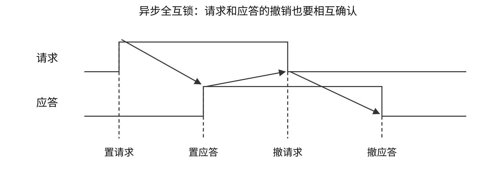

# 总线

## 总线组成、特性与连接结构
总线是多个部件分时共享的信息传输线路及配套协议。每次事务由主设备发起，从设备按地址响应；CPU、取得使用权的DMA控制器均可作主设备。读事务的数据由从设备给出，写事务的数据由主设备给出。

| 信息组 | 作用与传送内容 |
|---|---|
| 地址总线 | 指定存储单元或I/O端口，宽度影响地址组合数 |
| 数据总线 | 传指令、操作数、状态字、命令字、中断类型号等编码值 |
| 控制总线 | 规定读写、有效时刻、请求、应答及状态 |

写控制端口时，命令字可经数据线传输，控制线说明读写性质。地址的驱动者由当前主设备决定。可寻址容量还需结合编址单位计算；数据线数决定一次并行数据量。

| 总线特性 | 规范内容 |
|---|---|
| 机械 | 连接器、尺寸、形状、引脚布局 |
| 电气 | 电平、电压、负载等 |
| 功能 | 每根信号线的意义 |
| 时间 | 建立、采样、保持与撤销关系 |

| 分类维度 | 类别及特点 |
|---|---|
| 位置/用途 | 片内总线；连接CPU、主存、I/O接口的系统总线；系统/设备间通信总线 |
| 数据传送 | 串行逐位发送；并行多线同拍传多位 |
| 连接结构 | 单总线共享，结构简单、争用集中；双/三/多总线分离主存及I/O等流量 |
| 桥接 | 缓冲数据、转换协议、协调控制与速率 |

多总线可减少争用，并增加连接与控制成本；跨桥及主存带宽仍可成为瓶颈。并行的线间偏斜、串扰及接插件复杂度限制频率和距离；高速串行可用多条lane并行传包。具体总线时钟及速度分别确定。

## 位宽、传送率、峰值与有效带宽
设每次有效数据$W$位，每秒$R$次传送，时钟频率$f$、每周期传$a$次：

\[
B_{\mathrm{peak}}=R\frac W8=af\frac W8\quad(\mathrm{B/s}).
\]

MHz为每秒时钟次数，MT/s为每秒数据传送次数；已给MT/s时直接作$R$。总线周期为一次规定操作的时间，可能占多拍。若每事务有效载荷$Q$ B、实际耗时$T$，则$B_{\mathrm{eff}}=Q/T$，分母应含相应地址、等待、仲裁等开销。

| 计算对象 | 分子/分母 |
|---|---|
| 峰值带宽 | 数据节拍的有效载荷/数据节拍时间 |
| 事务有效带宽 | 一次事务有效载荷/事务总历时 |
| 设备速率 | 设备产生或消耗的数据/时间 |
| CPU占用 | CPU执行查询、服务、设置收尾的时间/总时间 |

校验位、包头等按题设从载荷中扣除；多通道仅在可并行且负载允许时相加；全双工分别计算单方向与双向合计。端到端持续吞吐受最慢环节限制。

### [例 6-1](../../solutions/notes.md#a-CO06-E01)
假设某系统总线在一个总线周期中并行传输4 B信息，一个总线周期占用2个时钟周期，总线时钟频率为10 MHz，则总线带宽是（　）。

A. 10 MB/s　 B. 20 MB/s　 C. 40 MB/s　 D. 80 MB/s

### [例 6-2](../../solutions/notes.md#a-CO06-E02)
某64位并行总线每时钟周期传4次数据，实际数据传送率已明确给为1333 MT/s，求单方向理想峰值带宽。若改给的是333.25 MHz时钟频率，结果是否相同？

32位、100 MHz、每拍两次时，峰值$4\times2\times100\times10^6=800$ MB/s。32位、每秒$33\times10^6$次有效传送时为132 MB/s。

## 总线事务与突发传送时间
一次事务通常经过申请/分配、寻址、传输、结束。读操作：主设备发地址和读命令→从设备译码与准备→从设备给出有效数据→主设备采样→结束。写操作由主设备提供写数据。

地址/数据复用线路须分时使用；独立地址、数据线允许的重叠依协议确定。突发传送给一个首地址后连续传多个相邻数据，摊薄地址与启动开销；非突发按每个数据分别计地址、准备及传送。

| 模型 | $n$个数据的总时间（无额外重叠） |
|---|---|
| 非突发，每数据均付启动 | $n(t_a+t_p+t_d)$ |
| 突发，只付一次启动 | $t_a+t_p+nt_d$ |

主存准备是否每字重复、是否可流水/重叠须按题设确认。

### [例 6-3](../../solutions/notes.md#a-CO06-E03)
某存储器总线宽度为64位，总线时钟频率为1 GHz，在总线上传输一个数据或地址需要一个时钟周期，不支持突发传送方式。若通过该总线连接CPU和主存，主存每次准备一个64位数据需要6 ns，主存块大小为32 B，则读取一个主存块所需的时间是（　）。

A. 8 ns　 B. 11 ns　 C. 26 ns　 D. 32 ns

### [例 6-4](../../solutions/notes.md#a-CO06-E04)
某存储器总线的时钟频率为420 MHz，总线宽度为64位，每个时钟周期传送2次数据；其总线事务支持突发传送方式，最多传送8次数据，第1个时钟周期传送地址和读/写命令，从第4个至第7个时钟周期连续传送8次数据。该总线的总线带宽（最大数据传输率）为（　）。

A. 3.84 GB/s　 B. 6.72 GB/s　 C. 30.72 GB/s　 D. 53.76 GB/s

50 MHz同步总线：传8个4 B字，1拍地址+3拍等待+8拍数据，共12拍=240 ns，有效速率约133.3 MB/s。每个字独立占1+3+1拍时，共40拍=800 ns，有效速率40 MB/s。

等待期间若保持总线占有权，等待计入总线资源占用；若释放总线，总历时与占用时间分别累计。DMA的总线占用与CPU开销分别计算。

## 同步、异步与半同步定时
| 定时 | 推进依据 | 时序条件 |
|---|---|---|
| 同步 | 共同的时钟边沿 | 周期容纳传播、译码、准备及建立时间；慢设备可插等待 |
| 异步 | 请求/应答等握手 | 各步按规定建立和撤销信号，适应速度差异 |
| 半同步 | 时钟加等待/应答 | 按规定边沿采样，慢设备请求延长准备阶段 |

异步握手按撤销信号是否等待对方确认分类：

| 类型 | 主设备撤请求 | 从设备撤应答 |
|---|---|---|
| 不互锁 | 发送后按预定时间撤销 | 按预定时间撤销 |
| 半互锁 | 等应答出现后撤销 | 按预定时间撤销 |
| 全互锁 | 等应答出现后撤销 | 等请求撤销后撤销 |

全互锁四阶段：请求置位→应答置位→请求撤销→应答撤销。建立和释放均相互确认，增加相应握手等待。

读时序图须标明：有效电平、地址稳定、读写命令有效、数据有效、采样点及事务起止。低有效信号以低电平为有效，重叠动作按协议判断。

串行异步字符帧需计起始、数据、校验、停止位。例如7数据+1校验+1起始+1停止=10位/字符；480字符/s对应线路4800 bit/s、有效数据3360 bit/s。

## 仲裁优先级与分离事务
仲裁决定多个主设备中谁获使用权；定时决定信号何时有效和事务何时推进。优先级给出先后关系，公平性衡量低优先级请求能否长期得到服务。

| 集中式仲裁 | 选择机制 | 特点 |
|---|---|---|
| 链式查询 | 允许信号沿链传播 | 控制线少；靠近仲裁器者通常优先，链路故障敏感，低位可能长期等待 |
| 计数器定时查询 | 输出设备编号，请求者比较匹配 | 起始编号、循环规则可改变优先级与公平性 |
| 独立请求 | 各设备独立请求/允许 | 响应快、优先级灵活；线路和逻辑开销较大 |

按公共请求、忙、允许的教材计线口径：$n$设备链式3条；计数器式$\lceil\log_2n\rceil+2$条；独立请求式每设备请求/允许加公共忙，$2n+1$条。8设备独立请求为17条。计算先确认公共信号是否计入。

分布式仲裁由各参与者按共同规则竞争或判定使用权。分离事务将请求和响应分两次占用总线：发请求后释放，准备好再申请返回结果；需用标识与排队机制匹配请求/响应。它可与同步/异步定时组合，总历时可大于总线实际占用时长。

## 常见总线和接口标准
| 标准 | 组织与主要对象 |
|---|---|
| ISA/EISA | 早期PC并行扩展总线 |
| VESA局部总线 | 早期显示等高速局部外设 |
| PCI | 共享并行局部总线，支持总线主控、突发和配置 |
| AGP | 历史图形加速接口 |
| PCI Express | 点到点串行、多lane、全双工 |
| USB | 主机与外设串行连接，支持集线器、即插即用、热插拔 |
| SATA | 串行存储接口 |
| SCSI | 设备寻址、命令与控制的接口体系 |
| RS-232 | 串行通信连接、电平与信号规范 |
| PCMCIA/CardBus | 历史便携设备卡式扩展 |

代际、lane数、编码效率、包头与方向共同决定载荷带宽；具体版本标称值须按题给条件使用。DDR每周期在两个边沿传数据，已给传送率时直接按该传送率计算。
