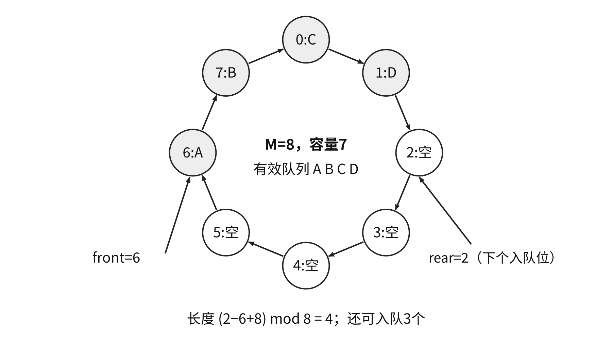
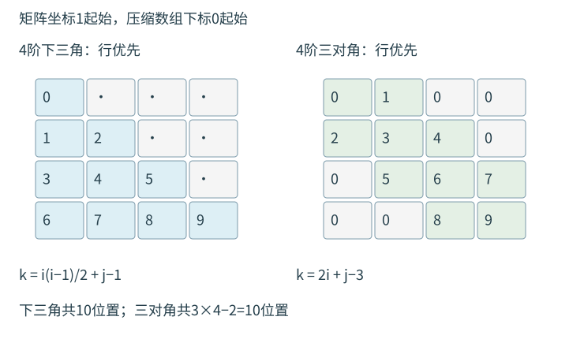

<a id="DS03"></a>
# 栈、队列和数组
<a id="DS03-stack"></a>
## 栈与合法出栈序列
栈只允许在栈顶插入、删除，遵循后进先出。空栈不能出栈，固定容量满栈不能入栈。

检验输出序列：按目标输出依次处理；当前栈顶不符时继续按输入次序入栈，到目标位于栈顶时弹出。输入耗尽且栈顶仍不符即失败。模拟期间最大栈深为实现该输出所需的最小容量。

从空栈出发并回到空栈的合法入出操作序列满足：入栈与出栈总数相同，每个前缀中出栈数不超过入栈数。$n$个不同元素的合法出栈序列数为

$$C_n=\frac1{n+1}\binom{2n}{n}.$$

<a id="DS03-E01"></a>
### [例 3-1](../../solutions/notes.md#a-DS03-E01)
栈 $S$ 和队列 $Q$ 初始均为空，元素 `a,b,c,d,e,f,g` 依次入栈 $S$。每个元素出栈后立即进入队列 $Q$，7个元素出队顺序为 `b,d,c,f,e,a,g`，则栈容量至少是（　）。

A. 1　B. 2　C. 3　D. 4

<a id="DS03-stack-code"></a>
### 顺序栈与共享栈
顺序栈下标从0开始，`top`指当前栈顶，空时为−1。

```cpp
#define MaxSize 100
typedef int ElemType;
typedef struct {
    ElemType data[MaxSize];
    int top;
} SqStack;
void InitStack(SqStack &S) { S.top = -1; }
bool StackEmpty(SqStack S) { return S.top == -1; }
bool Push(SqStack &S, ElemType x) {
    if (S.top == MaxSize - 1) return false;
    S.data[++S.top] = x;
    return true;
}
bool Pop(SqStack &S, ElemType &x) {
    if (S.top == -1) return false;
    x = S.data[S.top--];
    return true;
}
bool GetTop(SqStack S, ElemType &x) {
    if (S.top == -1) return false;
    x = S.data[S.top];
    return true;
}
```

若`top`改指下一空位，须同时改为空时0、入栈`data[top++]=x`、出栈`x=data[--top]`。

共享栈从同一数组两端向中间增长。教材`ShStack`采用如下初值：

```cpp
typedef struct {
    ElemType data[MaxSize];
    int top0, top1;
} ShStack;
void InitStack(ShStack &S) {
    S.top0 = -1;
    S.top1 = MaxSize;
}
```

| 操作 | 0号栈 | 1号栈 |
| --- | --- | --- |
| 判空 | `top0==-1` | `top1==MaxSize` |
| 入栈 | `data[++top0]=x` | `data[--top1]=x` |
| 出栈 | `x=data[top0--]` | `x=data[top1++]` |

两栈共用的满条件为`top1-top0==1`。入栈先判满，出栈先判各自是否为空。

<a id="DS03-linked-stack"></a>
### 链栈
链栈通常无头结点，以链头为栈顶，初始化`S=NULL`。头插、头删均为$O(1)$；入栈可能因申请失败而失败。

```cpp
typedef struct Linknode {
    ElemType data;
    struct Linknode *next;
} *LiStack;
bool Push(LiStack &S, ElemType x) {
    LiStack p = (LiStack)malloc(sizeof(struct Linknode));
    if (p == NULL) return false;
    p->data = x;
    p->next = S;
    S = p;
    return true;
}
bool Pop(LiStack &S, ElemType &x) {
    if (S == NULL) return false;
    LiStack p = S;
    x = p->data;
    S = p->next;
    free(p);
    return true;
}
```

<a id="DS03-queue"></a>
## 队列、双端队列与循环表示
队列在队尾插入、队头删除，先进先出。双端队列允许两端插入和删除；输入受限版本只允许一端输入，输出受限版本只允许一端输出。两种受限模型须分别模拟。

按1、2、3、4顺序输入，输入受限双端队列有22种输出，不能得到`4,2,1,3`及`4,2,3,1`；输出受限双端队列有22种输出，不能得到`4,1,3,2`及`4,2,3,1`。普通栈有14种输出。

循环队列采用长度$M$的数组，`front`指队头，`rear`指下一入队位置。入队后推进`rear`，出队后推进`front`，均对$M$取模。

| 区分空满的方法 | 空 | 满 | 最大元素数 |
| --- | --- | --- | --- |
| 牺牲一单元 | `front==rear` | `(rear+1)%M==front` | $M-1$ |
| 增加`size` | `size==0` | `size==M` | $M$ |
| 最近操作`tag` | 指针相同且tag为出队 | 指针相同且tag为入队 | $M$ |

`tag`初始为出队态，成功操作后才更新。牺牲单元方案长度为

$$len=(rear-front+M)\bmod M.$$

```cpp
typedef struct {
    ElemType data[MaxSize];
    int front, rear;
} SqQueue;
void InitQueue(SqQueue &Q) { Q.front = Q.rear = 0; }
bool QueueEmpty(SqQueue Q) { return Q.front == Q.rear; }
bool EnQueue(SqQueue &Q, ElemType x) {
    if ((Q.rear + 1) % MaxSize == Q.front) return false;
    Q.data[Q.rear] = x;
    Q.rear = (Q.rear + 1) % MaxSize;
    return true;
}
bool DeQueue(SqQueue &Q, ElemType &x) {
    if (Q.front == Q.rear) return false;
    x = Q.data[Q.front];
    Q.front = (Q.front + 1) % MaxSize;
    return true;
}
bool GetHead(SqQueue Q, ElemType &x) {
    if (Q.front == Q.rear) return false;
    x = Q.data[Q.front];
    return true;
}
```



<a id="DS03-E02"></a>
### [例 3-2](../../solutions/notes.md#a-DS03-E02)
循环队列存于数组 `A[21]`，`front` 指向队首元素的前一个位置，`rear` 指向队尾元素。当前 `front=8, rear=3`，队列长度为（　）。

A. 5　B. 6　C. 16　D. 17

若`front`指队头、`rear`指当前队尾，可令空状态`front=0,rear=M-1`；入队先推进`rear`再写，出队先取后推进`front`。牺牲一单元时空条件`(rear+1)%M==front`、满条件`(rear+2)%M==front`，长度`(rear-front+1+M)%M`。数组`A[0..n]`共有$n+1$单元，模数须取$n+1$。

<a id="DS03-linked-queue"></a>
### 链队列
单链队列以链头为队头、链尾为队尾，保存`front、rear`。带头结点时`front`始终指向头结点；初始化和入队的`void`接口以下均假设申请成功。

```cpp
typedef struct LinkNode {
    ElemType data;
    struct LinkNode *next;
} LinkNode;
typedef struct {
    LinkNode *front, *rear;
} LinkQueue;
void InitQueue(LinkQueue &Q) {
    Q.front = Q.rear = (LinkNode *)malloc(sizeof(LinkNode));
    Q.front->next = NULL;
}
bool IsEmpty(LinkQueue Q) { return Q.front == Q.rear; }
void EnQueue(LinkQueue &Q, ElemType x) {
    LinkNode *s = (LinkNode *)malloc(sizeof(LinkNode));
    s->data = x;
    s->next = NULL;
    Q.rear->next = s;
    Q.rear = s;
}
bool DeQueue(LinkQueue &Q, ElemType &x) {
    if (Q.front == Q.rear) return false;
    LinkNode *p = Q.front->next;
    x = p->data;
    Q.front->next = p->next;
    if (Q.rear == p) Q.rear = Q.front;
    free(p);
    return true;
}
```

删除最后一个数据结点后必须令`rear=front`。不带头结点时空状态为两个指针均为空；第一次入队同时设置二者，最后一次出队同时置空。普通单链表尾删需寻找前驱，时间$O(n)$；循环双链表可通过队头的`prior`访问尾部。

<a id="DS03-applications"></a>
## 括号、表达式与递归
括号匹配：左括号入栈；右括号必须与栈顶同型并弹出；扫描结束栈必须为空。以下代码复用顺序栈，`ElemType`改为`char`或能保存字符编码的类型。

```cpp
bool bracketCheck(char str[], int length) {
    SqStack S;
    InitStack(S);
    for (int i = 0; i < length; ++i) {
        char c = str[i];
        if (c == '(' || c == '[' || c == '{') {
            if (!Push(S, c)) return false;
        } else if (c == ')' || c == ']' || c == '}') {
            ElemType x;
            if (!Pop(S, x)) return false;
            if ((c == ')' && x != '(') ||
                (c == ']' && x != '[') ||
                (c == '}' && x != '{')) return false;
        }
    }
    return StackEmpty(S);
}
```

时间$O(n)$，最坏辅助空间$O(n)$；固定栈容量应不小于所需最大深度。`([)]`在第三个字符首次失败。

| 表达式形式 | 扫描方向 | 遇二元运算符的弹出顺序 |
| --- | --- | --- |
| 后缀 | 左至右 | 先右操作数，再左操作数 |
| 前缀 | 右至左 | 先左操作数，再右操作数 |

后缀求值中，操作数入栈；运算符弹出两个值，按左右角色计算后压回。须检查操作数不足、除零与末尾恰留一个值。

<a id="DS03-E05"></a>
### [例 3-5](../../solutions/notes.md#a-DS03-E05)
栈 $S_1$ 保存整数，$S_2$ 保存运算符。函数 F() 依次：（1）从 $S_1$ 弹出操作数 a、b；（2）从 $S_2$ 弹出运算符 op；（3）执行 b op a；（4）把结果压入 $S_1$。初始 $S_1$ 自底向顶为5、8、3、2，$S_2$ 自底向顶为 `*`、`−`、`+`。调用3次 F() 后，$S_1$ 栈顶值是（　）。

A. −15　B. 15　C. −20　D. 20

**中缀转后缀**：操作数直接输出；左括号入栈；右括号触发弹出直到匹配左括号；遇运算符先输出优先级更高的栈顶运算符。左结合运算符同级也弹出，右结合运算符另按结合规则处理；最后清空运算符栈。多位数、一元符号须先识别为词法单元。

例如`A+B-C*D/E+F`转换为`A B + C D * E / - F +`。`x+y*(z-u)/v`的前缀为`+ x / * y - z u v`，后缀为`x y z u - * v / +`。

**双栈直接求中缀值**：操作数立即压入值栈；运算符栈按上述转换规则管理。每逢应输出运算符时，改为弹出左右值、计算并压回。左括号只作边界。

数值式$((15/(7-(1+1)))\times3)-(2+(1+1))$的后缀为`15 7 1 1 + - / 3 * 2 1 1 + + -`，结果为5，操作数栈峰值为4。

<a id="DS03-recursion"></a>
### 调用次数与调用栈
递归栈保存尚未返回的参数、局部变量及返回位置。调用总数与最长活跃调用链分别控制时间、栈空间。

```c
int factorial(int n) {
    if (n == 0 || n == 1) return 1;
    else return n * factorial(n - 1);
}
int Fib(int n) {
    if (n == 0) return 0;
    else if (n == 1) return 1;
    else return Fib(n - 1) + Fib(n - 2);
}
```

输入为非负整数，结果须能由`int`表示。阶乘时间$O(n)$、栈空间$O(n)$。朴素Fibonacci满足$T(n)=T(n-1)+T(n-2)+O(1)$，时间呈指数增长，栈空间$O(n)$。`Fib(4)`返回3，共9次调用，最长活跃链4层。

若`F(n)`在$n\le3$时返回1，否则返回`F(n-2)+F(n-4)+1`，调用次数满足$C(n)=1+C(n-2)+C(n-4)$、基例$C(n)=1$；因此$C(4)=3,C(6)=5,C(8)=9$。递推中的1统计当前调用。C/C++加号两侧调用的先后不保证固定；求“第几次调用”时须检查是否依赖该顺序。嵌套调用须先求实参：基例返回2、递归返回`func(x-2)+func(x-4)`时，`func(func(5))`先由3次调用求出内层结果4，第4次才调用外层`func(4)`。

按层处理用队列；树层序遍历和图BFS均遵循先发现先扩展，图还需防止重复入队。

<a id="DS03-array"></a>
## 多维数组寻址
二维数组行范围$l_1..u_1$、列范围$l_2..u_2$，行数$r=u_1-l_1+1$、列数$c=u_2-l_2+1$；首元素地址$b$，元素宽度$w$个地址单位：

$$\begin{aligned}
\text{行优先：}\quad Addr(A[i,j])&=b+[(i-l_1)c+(j-l_2)]w,\\
\text{列优先：}\quad Addr(A[i,j])&=b+[(j-l_2)r+(i-l_1)]w.
\end{aligned}$$

三维行优先的相对元素位置为$((i-l_1)n_2+(j-l_2))n_3+(k-l_3)$。先算元素偏移，再乘元素宽度；按字编址与按字节编址需统一单位。

<a id="DS03-matrix"></a>
## 特殊矩阵的压缩存储
对称矩阵满足$a_{ij}=a_{ji}$，先将目标换到保存半边。三角矩阵另一半是同一公共常量，常量可非零。三对角矩阵仅$|i-j|\le1$的位置可能非零。

下表矩阵坐标从1开始，压缩数组下标$k$从0开始，$n$为阶数：

| 保存方式 | 有效区域 | 下标$k$ |
| --- | --- | --- |
| 下三角行优先 | $i\ge j$ | $i(i-1)/2+j-1$ |
| 上三角列优先 | $i\le j$ | $j(j-1)/2+i-1$ |
| 上三角行优先 | $i\le j$ | $(i-1)(2n-i+2)/2+j-i$ |
| 下三角列优先 | $i\ge j$ | $(j-1)(2n-j+2)/2+i-j$ |
| 三对角行优先 | $|i-j|\le1$ | $2i+j-3$ |

对称矩阵保存$n(n+1)/2$个值；三角矩阵再加1个公共常量单元；三对角矩阵$n\ge2$时共$3n-2$个值，$n=1$时直接保存一个值。



<a id="DS03-E03"></a>
### [例 3-3](../../solutions/notes.md#a-DS03-E03)
100阶三对角矩阵 $M$ 的元素 $m_{i,j}\ (1\le i,j\le100)$ 按行优先依次压缩存入下标从0开始的一维数组 $N$。$m_{30,30}$ 在 $N$ 中的下标为（　）。

A. 86　B. 87　C. 88　D. 89

<a id="DS03-E04"></a>
### [例 3-4](../../solutions/notes.md#a-DS03-E04)
10×10对称矩阵 $M$ 的上三角元素 $m_{i,j}\ (1\le i\le j\le10)$ 按列优先存入 C 语言一维数组 $N$。$m_{7,2}$ 在 $N$ 中的下标为（　）。

A. 15　B. 16　C. 22　D. 23

反向定位：若矩阵、数组均0起始且下三角行优先，令$T_i=i(i+1)/2$，找$T_i\le k<T_{i+1}$，再取$j=k-T_i$；等价地

$$i=\left\lfloor\frac{\sqrt{8k+1}-1}{2}\right\rfloor,\qquad j=k-i(i+1)/2.$$

浮点实现需用整数边界复核。三对角坐标1起始、数组0起始且$0\le k<3n-2,n\ge2$时：

$$i=\left\lceil\frac{k+2}{3}\right\rceil,\qquad j=k-2i+3.$$

**稀疏矩阵**非零位置无固定规律，三元组保存`(行,列,值)`并另记总行数、总列数、非零元数；全零行也计入行数。十字链表让每个非零结点同时进入行链、列链，修改须维护两组链接。坐标到压缩记录的定位依赖表示，不能直接套普通二维数组公式。
