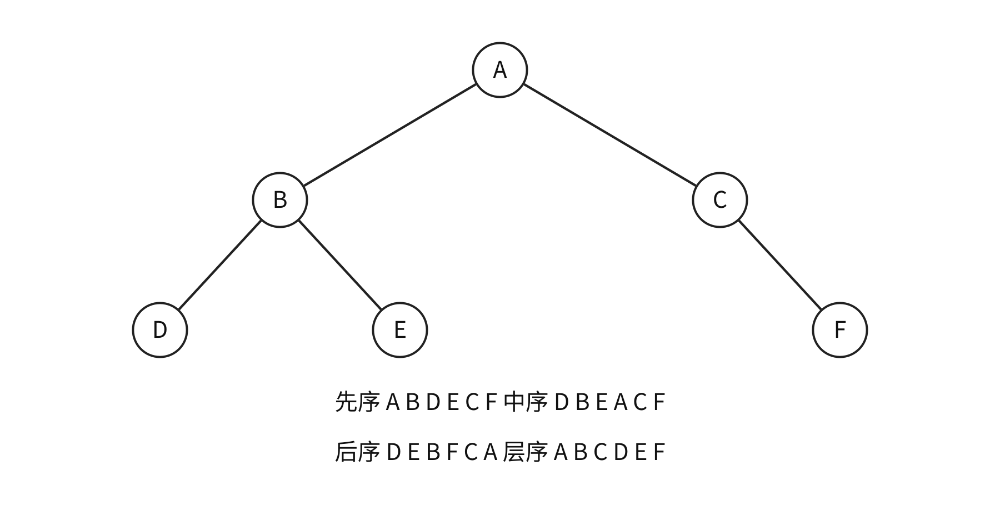
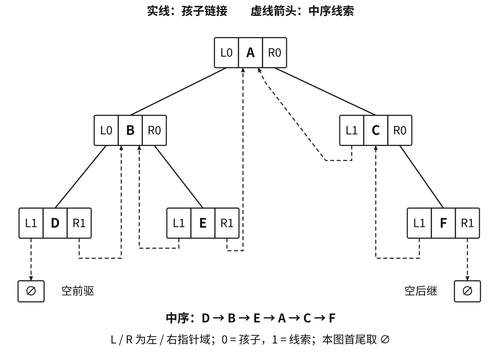
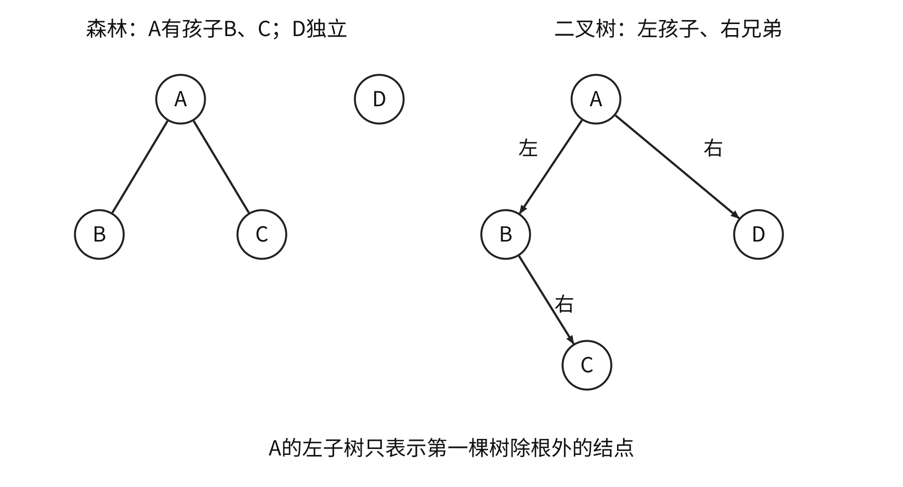

<a id="DS05"></a>
# 树与二叉树
<a id="DS05-tree"></a>
## 树的定义、度与计数
非空树有唯一根，除根外每结点恰有一个双亲，各子树互不相交，根到任意结点有唯一路径。结点的度为孩子数，树的度为结点度最大值，度0为叶。兄弟具有同一双亲；有序树区分各子树先后，无序树无此要求。

森林为零棵或多棵不相交的树；删去非空树根得到子树森林，给森林加统一根得到一棵树。

本章**根为第1层，叶高度1，空树高度0**；路径长按边数计，根到第$i$层的路径长为$i-1$。树高取最大层号，树的路径长度取根到所有结点路径长之和。

设$n_i$为度$i$结点数，$n$为总结点数：

$$n=\sum_i n_i,\qquad n-1=\sum_i i n_i,\qquad n_0=1+\sum_{i\ge2}(i-1)n_i.$$

度1结点可增加树高而不改变叶数，叶数与各高阶度数未必确定总结点数。

<a id="DS05-E01"></a>
### [例 5-1](../../solutions/notes.md#a-DS05-E01)
一棵度为4的树，含20个度为4的结点、10个度为3的结点、1个度为2的结点、10个度为1的结点。叶结点数为（　）。

A. 41　B. 82　C. 113　D. 122

| $m>1$时的条件 | 结论 |
| --- | --- |
| $m$叉树，第$i$层 | 至多$m^{i-1}$个结点 |
| 高$h$的$m$叉树 | $h\le n\le(m^h-1)/(m-1)$ |
| 高$h$、树的度恰为$m$ | 最少$h+m-1$个结点，须$h\ge2$ |
| $n$结点$m$叉树 | 最小高度$\lceil\log_m(n(m-1)+1)\rceil$，最大$n$ |

$m$叉树允许每结点少于$m$个孩子；度恰为$m$要求至少一结点有$m$个孩子。$m=1$时为链，$n=h$；单结点树的度为0。

<a id="DS05-binary"></a>
## 二叉树、完全性与存储
二叉树每结点至多两个孩子，左右位置有别。非空二叉树满足

$$n_0=n_2+1,\qquad h\le n\le2^h-1,\qquad h_{\min}=\lceil\log_2(n+1)\rceil.$$

满二叉树高$h$时每层均满，共$2^h-1$个结点；完全二叉树的已有结点恰占满二叉树从上至下、从左至右编号的前$n$个位置。完全二叉树高$\lfloor\log_2n\rfloor+1$，非叶$\lfloor n/2\rfloor$个、叶$\lceil n/2\rceil$个，度1结点至多一个且只能有左孩子。

| 编号起点 | 双亲 | 左孩子 | 右孩子 |
| --- | --- | --- | --- |
| 1 | $\lfloor i/2\rfloor$，$i>1$ | $2i$ | $2i+1$ |
| 0 | $\lfloor(i-1)/2\rfloor$，$i>0$ | $2i+1$ | $2i+2$ |

完全树的孩子编号不超过末编号才存在；普通树顺序存储还须检查该位置是否为空。高$h$的全右链末编号为$2^h-1$，顺序存储可能浪费大量空位。

<a id="DS05-E02"></a>
### [例 5-2](../../solutions/notes.md#a-DS05-E02)
对于任意一棵高度为5、有10个结点的二叉树，采用顺序存储结构保存，每个结点占1个存储单元，只存放结点数据信息。存放该二叉树需要的存储单元数量至少为（　）。

A. 31　B. 16　C. 15　D. 10

```cpp
typedef struct BiTNode {
    ElemType data;
    struct BiTNode *lchild, *rchild;
} BiTNode, *BiTree;
```

`BiTree`为根指针，空树`T==NULL`。$n$个结点的二叉链表有$2n$个孩子域、$n-1$个非空域、$n+1$个空域；再加双亲域时，共有$n+2$个空域。

<a id="DS05-traversal"></a>
## 遍历、非递归状态与还原
先序为根—左—右，中序为左—根—右，后序为左—右—根；层序以队列按层从左到右处理。

```cpp
void PreOrder(BiTree T) {
    if (T!=NULL) {
        visit(T);
        PreOrder(T->lchild);
        PreOrder(T->rchild);
    }
}
void InOrder(BiTree T) {
    if (T!=NULL) {
        InOrder(T->lchild);
        visit(T);
        InOrder(T->rchild);
    }
}
void PostOrder(BiTree T) {
    if (T!=NULL) {
        PostOrder(T->lchild);
        PostOrder(T->rchild);
        visit(T);
    }
}
```

递归遍历时间$\Theta(n)$、栈空间$O(h)$。表达式树先序、后序分别给出前缀、后缀形式；中序输出须按结构添加必要括号。后序适合在孩子结果齐备后计算高度、结点数或释放结点。

```c
int TreeDepth(BiTree T) {
    if (T==NULL) return 0;
    int hl=TreeDepth(T->lchild), hr=TreeDepth(T->rchild);
    return 1+(hl>hr ? hl : hr);
}
```

高度代码按空树0、叶1返回；时间$O(n)$、栈空间$O(h)$。交换每个结点的左右孩子会反向原中序次序，保留结点身份、叶数和树高。



非递归中序沿左链压栈，遇空弹栈访问并进入右子树；后序须保存最近访问结点`last`判断右子树是否已完成：

```text
inorder(root):
    p=root; 建空栈 S
    while p 非空 or S 非空:
        while p 非空:
            push(S,p); p=p->lchild
        p=pop(S); visit(p)
        p=p->rchild
```

```text
postorder(root):
    p=root; last=NULL; 建空栈 S
    while p 非空 or S 非空:
        if p 非空:
            push(S,p); p=p->lchild
        else:
            q=top(S)
            if q->rchild 非空 and last!=q->rchild:
                p=q->rchild
            else:
                visit(q); last=pop(S)
```

每结点入栈、出栈各一次，时间$O(n)$、栈空间$O(h)$。层序根先入队，出队访问后依次加入非空左右孩子，时间$O(n)$、队列最坏$O(n)$。判完全二叉树可按层检查孩子位置：遇首个空位置后，所有后续位置均须为空。

<a id="DS05-reconstruction"></a>
### 由遍历序列还原
结点标识互异时：

| 给定序列 | 唯一性与步骤 |
| --- | --- |
| 先序＋中序 | 先序首项定根，中序分左右；按子树长度切先序 |
| 后序＋中序 | 后序末项定根，中序分左右；按长度切后序 |
| 层序＋中序 | 层序首项定根，中序分左右；稳定筛分余下层序 |
| 先序＋后序 | 一般不唯一，单孩子左右无法区分 |
| 先序＋层序、后序＋层序 | 一般不唯一，两结点单左与单右树即可说明 |

只给$n$个互异标识的先序序列，二叉树形态数为卡特兰数$C_n$。重复值、显式空标记或规定满树等条件需另行分析。

例如层序`A B C D E`、中序`A C B E D`还原为`A(空,B(C,D(E,空)))`，后序为`C E D B A`。

<a id="DS05-E03"></a>
### [例 5-3](../../solutions/notes.md#a-DS05-E03)
p、q、v 都是二叉树 T 中的结点，v 有两个孩子，T 的中序遍历序列形如 `…,p,v,q,…`。正确的是（　）。

A. p没有右孩子，q没有左孩子　B. p没有右孩子，q有左孩子

C. p有右孩子，q没有左孩子　D. p有右孩子，q有左孩子

<a id="DS05-thread"></a>
## 线索二叉树
原空左域保存指定遍历的前驱，原空右域保存后继；`ltag、rtag`以0表示孩子、1表示线索。$n+1$个原空孩子域包括首前驱、末后继边界；若只统计指向普通结点的线索，边界另算。

中序线索化用`pre`保存刚访问结点；原链表标志须全部为0，以下采用无头结点、首尾线索指空的表示。

```cpp
typedef struct ThreadNode {
    ElemType data;
    struct ThreadNode *lchild, *rchild;
    int ltag, rtag;  // 0：孩子；1：线索
} ThreadNode, *ThreadTree;

void InThread(ThreadTree p, ThreadTree &pre) {
    if (p!=NULL) {
        InThread(p->lchild, pre);
        if (p->lchild==NULL) {
            p->lchild=pre;
            p->ltag=1;
        }
        if (pre!=NULL && pre->rchild==NULL) {
            pre->rchild=p;
            pre->rtag=1;
        }
        pre=p;
        InThread(p->rchild, pre);
    }
}
void CreateInThread(ThreadTree T) {
    ThreadTree pre=NULL;
    if (T!=NULL) {
        InThread(T, pre);
        pre->rchild=NULL;
        pre->rtag=1;
    }
}
```

```cpp
ThreadNode *Firstnode(ThreadNode *p) {
    while (p->ltag==0) p=p->lchild;
    return p;
}
ThreadNode *Nextnode(ThreadNode *p) {
    if (p->rtag==0) return Firstnode(p->rchild);
    return p->rchild;
}
void InOrderThread(ThreadNode *T) {
    if (T==NULL) return;
    for (ThreadNode *p=Firstnode(T); p!=NULL; p=Nextnode(p))
        visit(p);
}
```

`Firstnode`要求非空参数且线索标志完整；整趟中序访问时间$O(n)$、工作空间$O(1)$。已线索化的树递归时须按标志只走真实孩子，避免沿线索返回祖先。



| 线索次序 | 前驱 | 后继 |
| --- | --- | --- |
| 中序 | 左线索直接取；否则左子树最右结点 | 右线索直接取；否则右子树最左结点 |
| 先序 | 左线索直接取；有左孩子时通常需双亲信息 | 有左孩子取左孩子，否则取右域 |
| 后序 | 有右孩子取右孩子，否则取左域 | 右线索直接取；有右孩子时通常需双亲信息 |

有双亲域时：先序左孩子的前驱为双亲；右孩子有左兄弟时为左兄弟子树最后一个先序结点，否则为双亲。后序右孩子的后继为双亲；左孩子有右兄弟时为右兄弟子树第一个后序结点，否则为双亲。

先序线索化访问根后新增的左线索可能回指祖先，递归左侧须查`ltag`。后序末结点为根，根可能有右孩子，收尾只处理原空右域。

<a id="DS05-forest"></a>
## 普通树、森林的存储与转换
| 表示 | 保存内容 | 直接支持的方向 |
| --- | --- | --- |
| 双亲表示 | 每结点保存双亲下标，根为−1 | 查双亲$O(1)$，找全部孩子常需全扫描 |
| 孩子表示 | 顶点表保存各自孩子链 | 枚举孩子，反查双亲需搜索或附加域 |
| 孩子兄弟表示 | `firstchild、nextsibling` | 首孩子与下一个兄弟 |

```cpp
#define MAX_TREE_SIZE 100
typedef struct {
    ElemType data;
    int parent;
} PTNode;
typedef struct {
    PTNode nodes[MAX_TREE_SIZE];
    int n;
} PTree;

typedef struct CSNode {
    ElemType data;
    struct CSNode *firstchild, *nextsibling;
} CSNode, *CSTree;
```

森林双亲数组可有多个根标志，孩子兄弟表示把各根沿兄弟链接相连。转换规则为**左孩子、右兄弟**：普通树首孩子成为左孩子，后续兄弟沿右链；单棵树根无右孩子，森林根沿右链。



逆转换时，某结点的左孩子及其连续右链是原树全部孩子。二叉树根的左子树只含森林第一棵树除根外的结点，其余树在根的右子树中。

<a id="DS05-E04"></a>
### [例 5-4](../../solutions/notes.md#a-DS05-E04)
将森林转换成对应二叉树。若二叉树中 u 是 v 的父结点的父结点，则原森林中 u 与 v 可能的关系是（　）。

Ⅰ. 父子关系　Ⅱ. 兄弟关系　Ⅲ. u 的父结点与 v 的父结点是兄弟关系

A. 只有Ⅱ　B. Ⅰ和Ⅱ　C. Ⅰ和Ⅲ　D. Ⅰ、Ⅱ和Ⅲ

| 原结构遍历 | 对应二叉树遍历 |
| --- | --- |
| 树先根、森林先序 | 先序 |
| 树后根、森林中序 | 中序 |

普通树层序遍历用兄弟链枚举出队结点的全部孩子并入队。

<a id="DS05-huffman"></a>
## 哈夫曼树与前缀编码
给定叶权$w_i$、根到叶的边数$d_i$：

$$WPL=\sum_iw_id_i=\text{所有合并生成的新权值之和},\qquad \bar L=\frac{WPL}{\sum_iw_i}.$$

每轮合并当前最小的两个权根，生成权值为和的新根并放回候选，直到一棵树。$n$个叶需$n-1$轮，有$n-1$个内部结点、$2n-1$个总结点，无度1结点；高最多$n$。优先队列实现时间$O(n\log n)$、空间$O(n)$。

```text
Q=全部带权叶构成的小根优先队列
while size(Q)>1:
    a=extractMin(Q); b=extractMin(Q)
    insert(Q, new Node(a.weight+b.weight, a, b))
返回唯一根；空输入返回空
```

最优性依据：最优树中可令两个最小权占最深兄弟叶而不增大WPL，收缩后仍为同类最优子问题。字符置于叶，根到叶的0、1路径给出前缀编码；相同权选取及左右分支互换可使形态、码字不唯一，最优WPL相同。单符号码长另作约定。

<a id="DS05-E05"></a>
### [例 5-5](../../solutions/notes.md#a-DS05-E05)
6个字符出现频次分别为3、4、5、6、8、10，为它们构造哈夫曼编码，加权平均长度为（　）。

A. 2.4　B. 2.5　C. 2.67　D. 2.75

频次C、A、B、D为80、10、8、2时，合并权为10、20、100，WPL=130 bit，平均1.3 bit/字符。相比固定2位的200 bit节省35%，暂未计码表传递开销。可取C=0、A=10、D=110、B=111。

<a id="DS05-E06"></a>
### [例 5-6](../../solutions/notes.md#a-DS05-E06)
哈夫曼编码长度不超过4，已有两个字符编码为1和01，还最多能对几个字符编码？

A. 2　B. 3　C. 4　D. 5

$m$叉最优合并每轮取最小$m$个权；需使$(n'-1)\bmod(m-1)=0$，缺位补最少零权虚叶，内部结点为$(n'-1)/(m-1)=\lceil(n-1)/(m-1)\rceil$。

<a id="DS05-union-find"></a>
## 并查集
双亲数组表示集合森林。根存负的集合规模，非根存双亲下标；`Find`返回根代表，合并参数应先求根。按规模将小树接到大树；路径压缩把查找路径直接接根，不改变集合划分。

```cpp
void Initial(int S[], int n) {
    for (int i=0; i<n; ++i) S[i]=-1;
}
```

```cpp
void UnionBySize(int S[], int Root1, int Root2) {
    if (Root1==Root2) return;
    if (S[Root2]>S[Root1]) {
        S[Root1]+=S[Root2];
        S[Root2]=Root1;
    } else {
        S[Root2]+=S[Root1];
        S[Root1]=Root2;
    }
}
int FindCompress(int S[], int x) {
    int root=x;
    while (S[root]>=0) root=S[root];
    while (x!=root) {
        int t=S[x];
        S[x]=root;
        x=t;
    }
    return root;
}
```

该优化组始终维护负规模；基础`Union`只写根标志的版本不能交叉调用。单独按规模合并时高不超过$\lfloor\log_2n\rfloor+1$；同时路径压缩时$m$次操作的总开销为$O(m\alpha(n))$，为摊还界。

Kruskal中两个端点代表相同表示已选边中连通，加边会成环；代表不同才选边并合并。

<a id="DS05-heap"></a>
## 堆与优先队列
二叉堆同时满足完全形状与堆序：大根堆双亲不小于孩子，小根堆双亲不大于孩子。根为全局最值，兄弟间无序。

1起始数组中叶下标$\lfloor n/2\rfloor+1..n$。小根堆最大值可在叶中取得；互异关键字大根堆的第二大值位于根的孩子中。

插入先放数组末尾再上滤；删根先以末元素填根、缩小范围，再与较优孩子比较下滤。两者最坏$O(\log n)$。下滤要求左右子树已成堆：

```cpp
void HeadAdjust(int A[], int k, int len) {
    A[0]=A[k];
    for (int i=2*k; i<=len; i*=2) {
        if (i<len && A[i]<A[i+1]) ++i;
        if (A[0]>=A[i]) break;
        A[k]=A[i]; k=i;
    }
    A[k]=A[0];
}
```

从$\lfloor n/2\rfloor$向前逐个下滤建堆，按各高度工作量求和为$O(n)$。逐个插入建堆的最坏上界为$O(n\log n)$。堆只约束祖先后代间的局部序，BST另按左右子树关键字区间有序。
