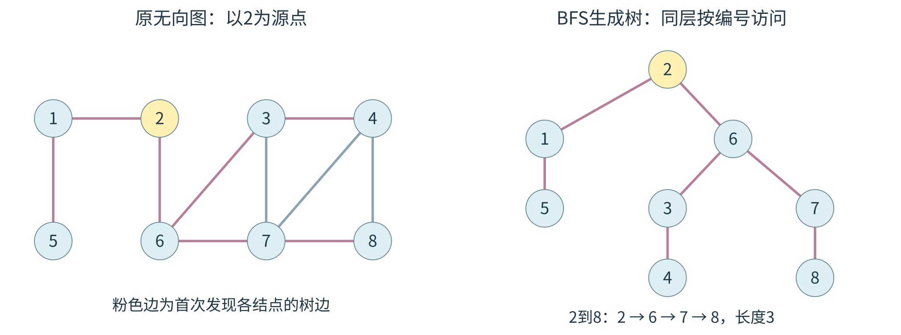
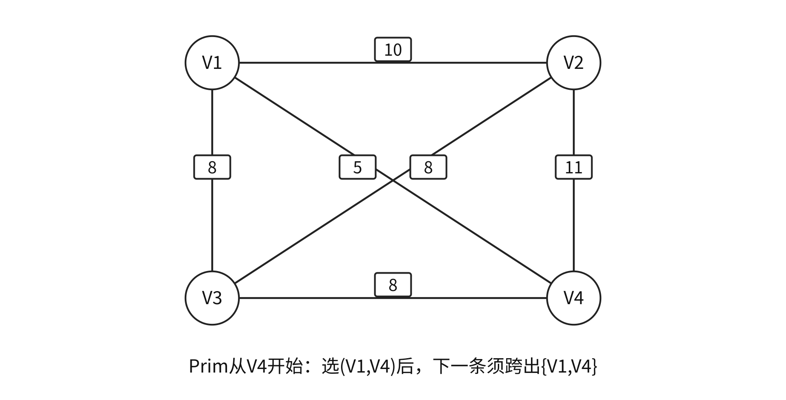
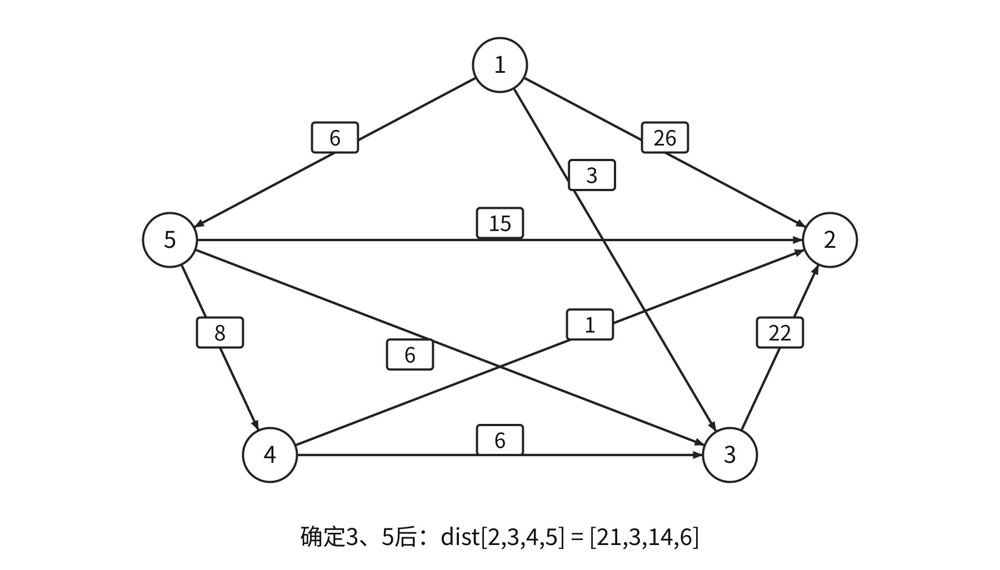
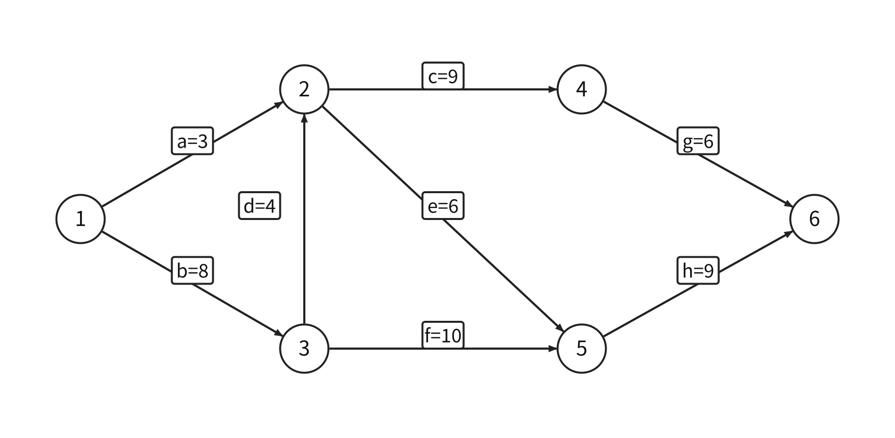

<a id="DS06"></a>
# 图
<a id="DS06-definition"></a>
## 图、度、路径与连通性
图$G=(V,E)$由顶点集和边集组成。本章默认无自环、无平行边的简单图，$n=|V|>0$。无向边为无序对，有向弧为有序对；带权长度为沿途权值和，无权长度为边数。简单路径无重复顶点，简单回路仅首尾相同。

| 结论 | 条件 |
| --- | --- |
| 最大边数$n(n-1)/2$ | 无向简单图 |
| 最大弧数$n(n-1)$ | 有向简单图 |
| $\sum_v TD(v)=2|E|$，奇度顶点数为偶数 | 无向图 |
| $\sum_v ID(v)=\sum_v OD(v)=|E|$ | 有向图 |
| 生成树有$n-1$条边 | 无向连通且无环，覆盖全部顶点 |
| 生成森林有$n-c$条树边 | 无向图有$c$个连通分量 |

无向连通要求任意两顶点存在路径；强连通要求有向图任意两顶点相互可达。连通/强连通分量均为相应性质的极大子图。生成树为极小连通子图，分量保留该块原有全部边。

无向图若$|E|<n-1$必不连通；$|E|=n-1$还需连通或无环条件才能判为树；$|E|\ge n$必有环。保证连通需$|E|>(n-1)(n-2)/2$。有$c$个分量时$|E|\ge n-c$。

<a id="DS06-E01"></a>
### [例 6-1](../../solutions/notes.md#a-DS06-E01)
无向图有7个顶点，要保证图在任何情况下都连通，需要的边数最少是（　）。

A. 6　B. 15　C. 16　D. 21

$n>1$的强连通有向图至少$n$条弧，有向环达到下界；单顶点零弧图按零长度路径也可强连通。有向树须唯一入度0的根、其余点入度1，根可达所有顶点且无环。距离指最短路径长，不可达记$\infty$。

<a id="DS06-storage"></a>
## 存储结构与基本操作
| 表示 | 空间 | 判断给定边 | 枚举出邻点 |
| --- | --- | --- | --- |
| 邻接矩阵 | $\Theta(n^2)$ | $O(1)$ | $O(n)$ |
| 邻接表 | $\Theta(n+|E|)$ | 扫该顶点边链 | $O(OD(v))$ |

无向矩阵对称；有向矩阵按行计出度、按列计入度。无向邻接表每边有两个表结点，有向出边表每弧一个，`arcnum`始终记实际边/弧数。带权无边用$\infty$，零权边与无边分开；最短路初始化对角线为0。

```cpp
#define MaxVertexNum 100
typedef struct {
    VertexType Vex[MaxVertexNum];
    EdgeType Edge[MaxVertexNum][MaxVertexNum];
    int vexnum, arcnum;
} MGraph;

typedef struct ArcNode {
    int adjvex;
    struct ArcNode *next;
    // 带权图在此补充权值域
} ArcNode;
typedef struct VNode {
    VertexType data;
    ArcNode *first;
} VNode, AdjList[MaxVertexNum];
typedef struct {
    AdjList vertices;
    int vexnum, arcnum;
} ALGraph;
```

顶点编号为`0..vexnum-1`；`VertexType、EdgeType`按应用定义。图遍历以下使用`Graph`抽象类型，已实现`FirstNeighbor、NextNeighbor`，无邻点返回−1；有向邻点按出弧方向。其他基本操作包括判边、枚举邻边、增删顶点/边、读写边权。

出边邻接表求全部入度可扫描所有边，时间$O(n+|E|)$；求某点入度通常同样需扫描全表。删除顶点须删除全部入边和出边。无向矩阵可保存一侧三角，连对角线需$n(n+1)/2$单元，省去已知零对角线需$n(n-1)/2$单元，空间阶仍为$O(n^2)$。

**十字链表**：每条有向弧一个结点，保存弧头、弧尾、同头链接、同尾链接；每顶点有入弧、出弧两个链头。**邻接多重表**：每条无向边一个结点，保存两端点及对应两条边链接；沿某顶点枚举须判断它位于哪一端。

0/1邻接矩阵按普通算术相乘时，$(A^k)_{ij}$为$i$到$j$恰走$k$条边的游走数，允许重复顶点和边；布尔乘法只表示存在性。

<a id="DS06-traversal"></a>
## DFS、BFS与搜索森林
DFS在当前顶点无未访问邻点时回退；每次进入新顶点即标记，外层遍历全部未访问顶点。

```cpp
bool visited[MaxVertexNum];
void DFS(Graph G, int v) {
    visit(v);
    visited[v]=true;
    for (int w=FirstNeighbor(G,v); w>=0;
         w=NextNeighbor(G,v,w))
        if (!visited[w]) DFS(G,w);
}
void DFSTraverse(Graph G) {
    for (int v=0; v<G.vexnum; ++v) visited[v]=false;
    for (int v=0; v<G.vexnum; ++v)
        if (!visited[v]) DFS(G,v);
}
```

<a id="DS06-E02"></a>
### [例 6-2](../../solutions/notes.md#a-DS06-E02)
无向图顶点为 `{a,b,c,d,e,f}`，边为 `{ab,ae,ac,be,cf,fd,ed}`。进行深度优先遍历，不能得到的序列为（　）。

A. acfdeb　B. aebdfc　C. aedfcb　D. abecdf

BFS入队时标记，以防多个前驱重复入队。队列保存已发现但未扩展顶点。

```cpp
void BFS(Graph G, int v) {
    SqQueue Q;
    InitQueue(Q);
    visit(v);
    visited[v]=true;
    EnQueue(Q,v);
    while (!QueueEmpty(Q)) {
        DeQueue(Q,v);
        for (int w=FirstNeighbor(G,v); w>=0;
             w=NextNeighbor(G,v,w)) {
            if (!visited[w]) {
                visit(w);
                visited[w]=true;
                EnQueue(Q,w);
            }
        }
    }
}
void BFSTraverse(Graph G) {
    for (int v=0; v<G.vexnum; ++v) visited[v]=false;
    for (int v=0; v<G.vexnum; ++v)
        if (!visited[v]) BFS(G,v);
}
```

队列应能容纳全部可能同时等待的顶点，牺牲单元的循环队列须额外一个物理单元。完整遍历时间：邻接表$O(n+|E|)$，矩阵$O(n^2)$；访问标志、DFS栈或BFS队列最坏均$O(n)$。

遍历序列由起点、外层扫描次序、邻点枚举次序共同决定。首次发现边组成生成森林；无向图树数等于连通分量数，有向图启动次数受扫描顺序影响，不能直接据此计强连通分量。

<a id="DS06-bfs-shortest"></a>
### BFS求同权最短路
初始化`d[*]=INF,path[*]=-1`、`d[s]=0`，发现未访问邻点$w$时令`d[w]=d[v]+1; path[w]=v`。队列按距离分层扩展，首次发现即取得最少边数；适用于有向或无向同权边图。



图中顶点1至8的距离依次为`1,0,2,3,2,1,2,3`，前驱为`2,-1,6,3,1,2,6,7`。目标8反向追踪得到$8\leftarrow7\leftarrow6\leftarrow2$，反转为最短路$2\to6\to7\to8$。

<a id="DS06-mst"></a>
## 最小生成树
MST在带权无向连通图中，最小化生成树的总边权；不连通时求最小生成森林。路径到某源点的距离不属于该目标。

```text
Prim(s):
    U={s}; lowCost[v]=w(s,v)，无边记无穷
    重复直到选入全部顶点:
        u=U外lowCost最小者
        若lowCost[u]=无穷: 原图不连通，停止
        选入parent[u]到u的边；U加入u
        对每个U外邻点v:
            若w(u,v)<lowCost[v]: 更新lowCost[v]及parent[v]
```

```text
Kruskal(G):
    将边按权非降排序；每个顶点初始化为单独集合
    对每条边(u,v,w):
        若find(u)!=find(v):
            选入此边；unite(u,v)
    若选入边数<n-1: 得到最小生成森林而非生成树
```

Prim的`lowCost[v]`保存当前集合到$v$的最轻跨割边；Kruskal按非降权处理边，端点属于不同当前分量时选边并合并。割的轻边可用交换论证安全加入：加入形成环后删去不更轻的跨割边，连通与最优性保持。

<a id="DS06-E03"></a>
### [例 6-3](../../solutions/notes.md#a-DS06-E03)
求下图最小生成树，可能为 Kruskal 第2次选中、但不可能为从 $V_4$ 开始的 Prim 第2次选中的边是（　）。

{#ds-fig-mst width=78%}

A. $(V_1,V_3)$　B. $(V_1,V_4)$　C. $(V_2,V_3)$　D. $(V_3,V_4)$

矩阵朴素Prim时间$O(n^2)$；Kruskal主要为排序$O(|E|\log|E|)$，分量用并查集。边权互异足以保证MST唯一；有同权边时仍可能唯一。

<a id="DS06-shortest"></a>
## Dijkstra与Floyd
Dijkstra求非负权单源最短路。`dist`为已知路径上界，每轮永久确定集合外`dist`最小顶点，再按`dist[u]+w(u,v)`松弛。出现负边时标准算法失去通用保证；所有剩余距离为无穷时停止。

```text
Dijkstra(s):
    dist[s]=0；其余为无穷；S为空
    重复选择S外dist最小的u:
        若dist[u]=无穷: 停止
        S加入u
        对每条u到v，若v未确定且dist[u]+w(u,v)<dist[v]:
            更新dist[v]；parent[v]=u
```

<a id="DS06-E04"></a>
### [例 6-4](../../solutions/notes.md#a-DS06-E04)
使用 Dijkstra 求下图从顶点1到其余顶点的最短路径，`dist` 依次保存到2、3、4、5的距离。求出第二条最短路径后，`dist` 内容为（　）。

{#ds-fig-dijkstra width=88%}

A. 26、3、14、6　B. 25、3、14、6　C. 21、3、14、6　D. 15、3、14、6

Floyd求任意点对最短路，允许负边，要求相关路径无负环。允许前$k$个中转点的阶段递推为

$$D^{(k)}[i,j]=\min\{D^{(k-1)}[i,j],D^{(k-1)}[i,k]+D^{(k-1)}[k,j]\}.$$

```text
Floyd(D):
    D[i][i]=0；其他位置按直接边初始化
    for k=0..n-1:
        for i=0..n-1:
            for j=0..n-1:
                若D[i][k]与D[k][j]均有限:
                    D[i][j]=min(D[i][j],D[i][k]+D[k][j])
```

中转点$k$必须在最外层；加法前检查两段距离有限。最终$D[v][v]<0$表明负环，受其影响的点对无有限最短值。无向负边可往返形成负权闭合游走。

矩阵Dijkstra单源$O(n^2)$，全源重跑$O(n^3)$；Floyd时间$O(n^3)$、距离矩阵$O(n^2)$。BFS只最小化同权边数。

例如直接矩阵

$$D=\begin{pmatrix}0&6&13\\10&0&4\\5&\infty&0\end{pmatrix}$$

依次允许0、1、2中转，分别更新$D[2,1]=11$、$D[0,2]=10$、$D[1,0]=9$。Floyd路径矩阵记录更新所用中转点，递归拆分两段；Dijkstra/BFS的`path[v]`记录直接前驱，两者解释不同。

<a id="DS06-topological"></a>
## DAG、拓扑排序与有向环
AOV网以顶点为活动、弧为先后依赖。拓扑序须使每条$u\to v$的$u$在$v$前；存在拓扑序当且仅当图为DAG。

```text
topological(G):
    统计所有顶点的入度；把入度0者入队Q
    count=0
    while Q非空:
        u=出队；输出u；count++
        对每条u到v: indeg[v]--
            若indeg[v]==0: v入队
    返回count==n
```

邻接表时间$O(n+|E|)$，矩阵$O(n^2)$。每轮零入度候选恰有一个且处理完全部顶点，拓扑序唯一。顶点按拓扑顺序编号时，邻接矩阵呈严格上三角；任意编号的DAG未必如此。

<a id="DS06-E05"></a>
### [例 6-5](../../solutions/notes.md#a-DS06-E05)
载人航天工程包含众多子工程，为保证有序开展，需要明确前导子工程。这可抽象为有向图的拓扑序列问题。已知图G采用邻接矩阵存储：

```c
typedef struct {
    int numVertices,numEdges;
    char VerticesList[MAXV];
    int Edge[MAXV][MAXV];
} MGraph;
```

设计 `int uniquely(MGraph G)` 判定G是否存在唯一拓扑序列，是则返回1，否则返回0。给出设计思想及带关键注释的C或C++实现。

逆拓扑可从出度0开始删顶点及入弧，借助逆邻接表。DAG的DFS完成顺序为逆拓扑，反转即拓扑。DFS判有向环用三态：未访问、栈中、已完成；指向栈中顶点的边表明有环，指向已完成顶点无此保证。无向图检查回边须排除通往双亲的树边。

DAG可共享相同子表达式：操作符和有序输入均相同才合并。例$(a*b)*(a*b)*(a*b)*c$可共享一次$a*b$；多个输入位置可指同一结点。含副作用表达式须遵守原求值语义。

<a id="DS06-critical"></a>
## AOE网与关键路径
AOE网以顶点为事件、边为活动、非负权为持续时间，须无环。多源、多汇可用零时长虚边统一。事件等全部入活动完成才能发生。

$$\begin{aligned}
ve[v]&=\max_{u\to v}\{ve[u]+w(u,v)\},\\
vl[u]&=\min_{u\to v}\{vl[v]-w(u,v)\},\\
e(u,v)&=ve[u],\quad l(u,v)=vl[v]-w(u,v).
\end{aligned}$$

`ve`按拓扑序取最大，`vl`从汇点工期按逆拓扑取最小。活动余量$l-e$为0时为关键活动；源至汇最长带权路径为关键路径，其长度为最短总工期。

```text
criticalPath(G):
    取得拓扑序T；若不存在则模型非法
    ve[*]=0
    按T正序，对每条u到v: ve[v]=max(ve[v],ve[u]+w(u,v))
    D=ve[统一汇点]；vl[*]=D
    按T逆序，对每条u到v: vl[u]=min(vl[u],vl[v]-w(u,v))
    对每条活动u到v:
        e=ve[u]；l=vl[v]-w(u,v)
        若e==l: 该边为关键活动
```

<a id="DS06-E06"></a>
### [例 6-6](../../solutions/notes.md#a-DS06-E06)
下图AOE网包含8个活动。通过同时加快若干活动，可缩短整个工程工期。下列选项中，加快所列活动进度就可缩短工期的是（　）。

{#ds-fig-aoe width=92%}

A. c和e　B. d和c　C. f和d　D. f和h

增加关键活动时长会延长工期；缩短工期须使所有当前关键路径均缩短，持续压缩还可能产生新关键路径。
