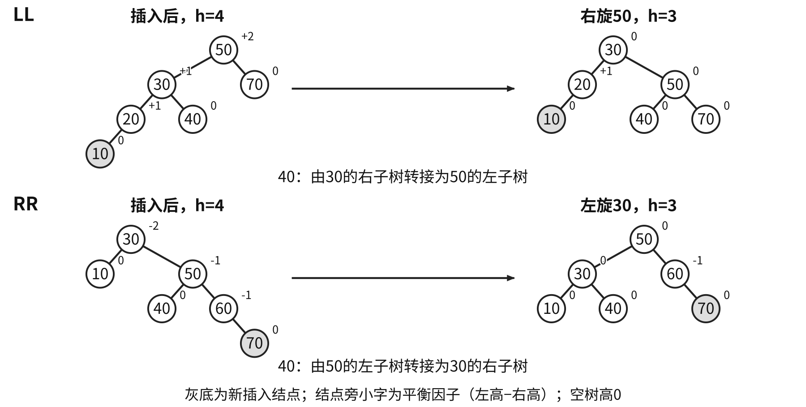
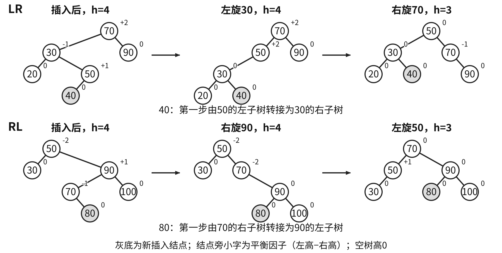
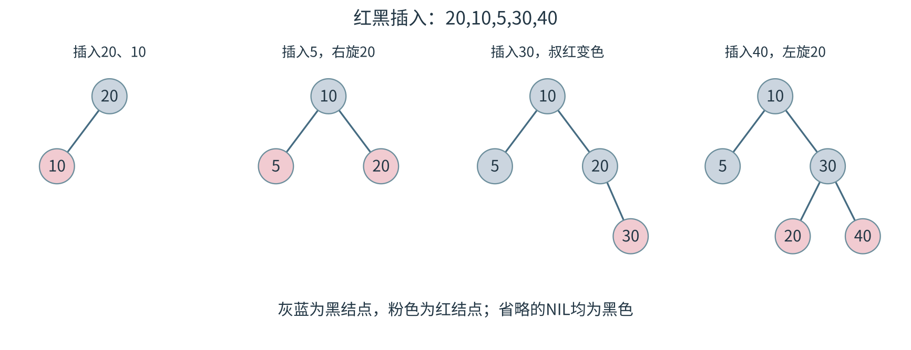
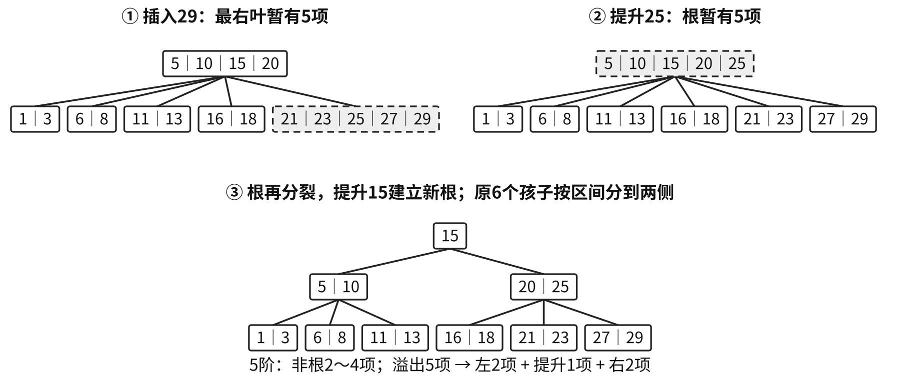
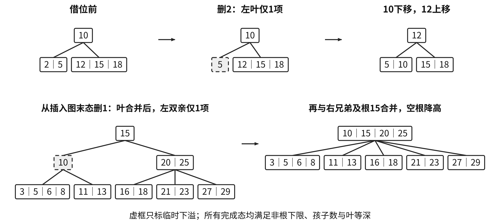
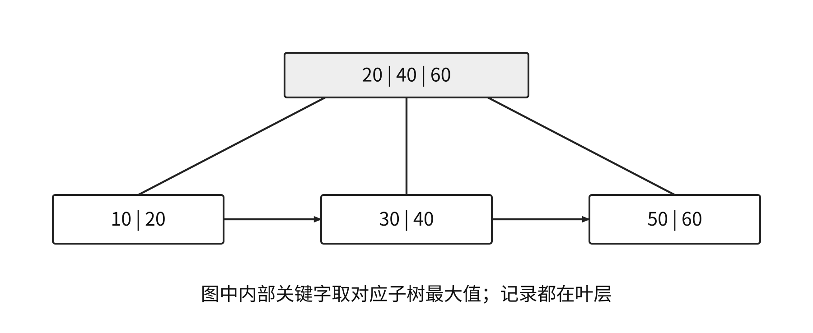

<a id="DS07"></a>
# 查找
<a id="DS07-definition"></a>
## 关键字与平均查找长度
查找表为同类型记录的集合。主关键字唯一标识记录，次关键字可对应多条记录；静态表仅查找，动态表还支持插入、删除。存储为数组或链表不能单独决定静态、动态属性。

$$ASL=\sum_i p_iC_i.$$

先确定事件集合、概率$p_i$与代价$C_i$。成功事件为已有记录，失败事件可按关键字区间或初始散列地址分布；失败ASL分母未必等于表长或记录数。树结点访问次数、关键字比较次数、外存读盘次数分别统计。

<a id="DS07-sequential"></a>
## 顺序查找与分块查找
无序表逐项比较，等概率成功平均$(n+1)/2$次，失败比较$n$个实际记录。有序递增表从头查找时，当前值等于目标即成功，大于目标才可提前失败。

```cpp
typedef struct {
    ElemType *elem;
    int TableLen;
} SSTable;
int Search_Seq(SSTable ST, ElemType key) {
    ST.elem[0]=key;
    int i;
    for (i=ST.TableLen; ST.elem[i]!=key; --i) ;
    return i;
}
```

有效记录为`elem[1..TableLen]`，0号为可写哨兵，空表也需此位置。失败包括哨兵比较时为$n+1$次；返回0表示失败。结构体按值传入仍共享指针所指数组，写哨兵会改变原数组0号单元。

静态顺序查找按访问概率非增序排列可减小成功ASL。底稿六记录概率`0.15,0.05,0.10,0.40,0.28,0.02`原序ASL为3.67，按概率排序后为2.18。

**分块查找**要求块间有序、块内可无序，索引记录每块最大关键字及块起始位置。定位第一个最大关键字不小于目标的块，再块内顺序查找。索引折半未遇相等值时，结束的`low`可指目标块，超过末索引才直接失败。动态更新须维护块范围和索引最大值。

<a id="DS07-E01"></a>
### [例 7-1](../../solutions/notes.md#a-DS07-E01)
查找表有400个元素，查找每个元素的概率相同，采用均匀分块。先顺序查找确定所在块，块内也顺序查找。为使查找效率最高，每块包含元素个数应为（　）。

A. 8　B. 10　C. 20　D. 25

<a id="DS07-binary"></a>
## 折半查找与判定树
折半查找要求**关键字有序且能随机定位中点**。以下有效范围为`elem[0..TableLen-1]`，采用闭区间及向下取整中点：

```cpp
int Binary_Search(SSTable L, ElemType key) {
    int low=0, high=L.TableLen-1, mid;
    while (low<=high) {
        mid=(low+high)/2;
        if (L.elem[mid]==key) return mid;
        else if (L.elem[mid]>key) high=mid-1;
        else low=mid+1;
    }
    return -1;
}
```

循环开始时若目标存在，必在`[low,high]`；排除相等后用`mid±1`去掉已比较项，`low>high`表示失败。大下标可用`low+(high-low)/2`防止求和溢出。

判定树成功次数等于内部结点层次，失败次数等于沿途内部结点数。$n\ge1$时最大比较次数为$\lfloor\log_2n\rfloor+1$。偶数区间取下中点时右子树多一项，树高平衡但未必完全；改取上中点会改变路径。

<a id="DS07-E02"></a>
### [例 7-2](../../solutions/notes.md#a-DS07-E02)
长度为16的顺序表L按关键字有序，采用折半查找，查找一个不存在的元素，关键字比较次数最多为（　）。

A. 4　B. 5　C. 6　D. 7

长度11的表`7,10,13,16,19,29,32,33,37,41,43`中，查33比较`29,37,32,33`；查12比较`29,13,7,10`后失败。成功层次分布1、2、4、4个，等概率成功ASL为3；12个失败区间中4个需3次、8个需4次，失败ASL为$11/3$。

有序链表缺少常数时间中点访问，折半式比较的对数比较次数无法直接保证对数总访问时间。

<a id="DS07-bst"></a>
## 二叉搜索树
互异关键字BST的左子树全部值小于根、右子树全部值大于根，各子树递归满足。等价判据为中序严格递增。验证可传递全局允许区间；合法值包含整数极值时，用显式边界标志或更宽类型。

```cpp
typedef struct BSTNode {
    int key;
    struct BSTNode *lchild, *rchild;
} BSTNode, *BSTree;
BSTNode *BST_Search(BSTree T, int key) {
    while (T!=NULL && key!=T->key) {
        if (key<T->key) T=T->lchild;
        else T=T->rchild;
    }
    return T;
}
int BST_Insert(BSTree &T, int k) {
    if (T==NULL) {
        T=(BSTree)malloc(sizeof(BSTNode));
        T->key=k;
        T->lchild=T->rchild=NULL;
        return 1;
    } else if (k==T->key) return 0;
    else if (k<T->key) return BST_Insert(T->lchild,k);
    else return BST_Insert(T->rchild,k);
}
void Create_BST(BSTree &T, int str[], int n) {
    T=NULL;
    for (int i=0; i<n; ++i) BST_Insert(T,str[i]);
}
```

插入默认申请成功，重复关键字返回0；先搜索到空子树才建叶。操作为$O(h)$，普通BST最坏可退化到$O(n)$；迭代查找工作空间$O(1)$。

删除分三类：叶直接断开；单孩子由孩子接替；双孩子用中序前驱或后继替换，再删除原前驱/后继。前驱无右孩子、后继无左孩子，因此归结到前两类。

```text
erase(t,key):
    if t为空: return 空
    if key<t.key: t.lchild=erase(t.lchild,key)
    else if key>t.key: t.rchild=erase(t.rchild,key)
    else:
        if t.lchild为空: 保存t.rchild，释放t，返回保存值
        if t.rchild为空: 保存t.lchild，释放t，返回保存值
        q=t.rchild；沿q.lchild找到右子树最小结点
        t.key=q.key（记录有附加字段时一并复制）
        t.rchild=erase(t.rchild,q.key)
    return t
```

递归返回删除后的子树根，栈空间$O(h)$。复制须带整条记录；要求保留结点身份时采用移接。

<a id="DS07-avl"></a>
## AVL插入与删除
AVL为任意结点左右高差至多1的BST，平衡因子$BF=h_L-h_R$。插入后从新叶向上，找最近失衡祖先$A$：

| 失衡路径 | 调整 |
| --- | --- |
| LL | 对A右旋 |
| RR | 对A左旋 |
| LR | 左旋A的左孩子，再右旋A |
| RL | 右旋A的右孩子，再左旋A |

```cpp
void R_Rotate(BSTree &p) {
    BSTNode *lc=p->lchild;
    p->lchild=lc->rchild;
    lc->rchild=p;
    p=lc;
}
void L_Rotate(BSTree &p) {
    BSTNode *rc=p->rchild;
    p->rchild=rc->lchild;
    rc->lchild=p;
    p=rc;
}
```

引用参数接回新局部根。中间子树按关键字区间转接；若保存高度，先更新下降结点，再更新提升结点。只交换两个根值无法代替链接旋转。





<a id="DS07-E03"></a>
### [例 7-3](../../solutions/notes.md#a-DS07-E03)
把34、23、15、98、115、28、107依次插入初始为空的平衡二叉搜索树，要求每次插入后保持AVL性质，给出每步结果。

插入修复最小失衡子树后恢复原高度，可停止向上传播。最少结点数满足$N(0)=0,N(1)=1$、$N(h)=1+N(h-1)+N(h-2)$，故高$O(\log n)$。

**删除**先按BST删除，再沿实际被移除结点的祖先向上检查；修复后高度仍可能减1，需继续传播。

| A的BF | 较高孩子的BF | 调整 |
| --- | --- | --- |
| $+2$ | $+1$或0 | 右单旋A |
| $+2$ | $-1$ | 先左旋孩子，再右旋A |
| $-2$ | $-1$或0 | 左单旋A |
| $-2$ | $+1$ | 先右旋孩子，再左旋A |

孩子BF为0时，单旋后高度可保持删除前高度，上层停止受影响。例如`4(2(1,3),5)`删5后右旋为`2(1,4(3,空))`，高仍为3。查找、插删最坏均$O(\log n)$。

固定高度形态数满足$C(0)=C(1)=1$、$C(h)=C(h-1)^2+2C(h-1)C(h-2)$，故$C(2)=3,C(3)=15$；该量与固定结点数的卡特兰计数不同。

<a id="DS07-E04"></a>
### [例 7-4](../../solutions/notes.md#a-DS07-E04)
一棵无重复关键字的AVL树，中序遍历得到降序序列。正确叙述是（　）。

A. 根的度一定为2　B. 最小元素一定是叶结点

C. 最后插入元素一定是叶结点　D. 最大元素一定没有左子树

<a id="DS07-redblack"></a>
## 红黑树
红黑树为BST并满足：每结点红或黑；根黑；空孩子为黑NIL；红结点的孩子黑；任一结点至后代NIL的路径黑结点数相同。

黑高$b$不计当前结点、计终点NIL，NIL自身黑高0。根黑的非空树内部结点数满足

$$2^b-1\le n\le2^{2b}-1.$$

相邻红结点受限，最长路径至多约为最短路径两倍，高度$O(\log n)$。

**插入**先按BST插入红叶：父黑直接结束；父红时看叔。红叔则父叔黑、祖父红并上移；黑叔含NIL，内侧折线先旋父转外侧，再旋祖父并交换提升结点与祖父颜色。最后根黑。旋转次数为常数，变色可能传播到根，完整插入仍$O(\log n)$。

**删除**先化为至多一非空孩子：删红无黑高损失；删黑有红孩子接替时染黑；黑/NIL接替造成缺黑。下表缺黑位置$x$为父$p$左孩子，兄弟$w$在右，近侧为$w$左孩子、远侧为$w$右孩子：

| 条件 | 修复 |
| --- | --- |
| w红 | w黑、p红，左旋p，重新取兄弟 |
| w黑、双孩子黑 | w红；p红则改黑结束，否则缺黑上移到p |
| w黑、远黑近红 | 近侧黑、w红，右旋w，转为下一行 |
| w黑、远红 | w取p原色、p与远侧黑，左旋p，结束 |

缺黑在右时左右对换；缺黑到根可结束。性质检查同时核对BST、中序、根/NIL、红红相邻及各路径黑高。



<a id="DS07-btree"></a>
## B树的容量、插入与删除
$m$阶B树每数据结点至多$m-1$键、$m$孩子；除根外至少$t-1$键，$t=\lceil m/2\rceil$。非底层数据结点$k$键对应$k+1$个孩子区间，非叶根至少1键、2孩子；底层数据结点等深。以下$m\ge3$，高度$h$只计数据层，排除失败空叶。

$$2t^{h-1}-1\le n\le m^h-1.$$

求最大高用最少容量，求最小高用最大容量。外存一结点一页时，查找最多读$h$个索引页，结点内部还需关键字比较。

**插入**沿路径到最底层数据结点插入，溢出则提升中间键、左右分裂，父溢出继续向上。内部分裂同步分配孩子，只有根分裂使高度增加。

**删除**内部键先以前驱或后继替换，再到底层删除。下溢时优先向有富余的相邻兄弟借：父分隔键下移、兄弟近侧键上移，必要时转接孩子。兄弟无富余则将下溢结点、父分隔键和兄弟合并，父可能继续下溢。空根仅剩一孩子时降层。





5阶每非根2至4键：两个合法2键兄弟加父键共5键，超过上限；应在删除造成一侧1键后按$1+1+2=4$合并。不能直接照搬其他阶数的提前合并规则。完成态须满足键有序、子树区间、容量、孩子数及底层等深。

<a id="DS07-E05"></a>
### [例 7-5](../../solutions/notes.md#a-DS07-E05)
一棵3阶B树共有2047个关键字，最大高度为（　），最小高度为（　）。

A. 11　B. 10　C. 8　D. 7

<a id="DS07-E06"></a>
### [例 7-6](../../solutions/notes.md#a-DS07-E06)
给定7个不同关键字，能构造的不同4阶B树的个数最多为（　）。

A. 7　B. 8　C. 9　D. 10

<a id="DS07-bplus"></a>
## B+树
记录或记录指针集中于叶层，内部层只存索引；叶含全体关键字并按序链接。点查沿根到叶，范围查先定位起点叶，再沿叶链扫描。

本章采用王道“每个内部索引键为一棵子树最大键”约定，内部键数等于孩子数：最多$m$，非根分支至少$\lceil m/2\rceil$，非叶根至少2。B树内部命中可结束，B+树记录查询仍降至叶。



每页不携整条记录通常可提高内部扇出，减少外存层数；若叶仅存记录指针，读取叶外记录的I/O另计。

<a id="DS07-hash"></a>
## 散列函数与冲突处理
同一散列函数值的不同关键字为同义词。函数须确定、尽量均匀；装填因子$\alpha=n/m$，其中$m$为表长。

| 构造方法 | 条件与参数 |
| --- | --- |
| 直接定址$akey+b$ | 连续且范围可控的关键字 |
| 除留余数$key\bmod p$ | $p$通常取不大于表长的适当素数 |
| 数字分析 | 按已知分布选择均匀数位 |
| 平方取中 | 让多个数位共同影响结果 |

开放定址统一按$H_i=(H(key)+d_i)\bmod m$计算，每次增量加在初始地址上；初始散列模数$p$与探测模数$m$可不同。

| 探测方法 | 增量 | 覆盖条件 |
| --- | --- | --- |
| 线性 | $d_i=i$ | 连续$m$次遍历全表 |
| 正平方 | $d_i=i^2$ | 未必覆盖全表 |
| 正负平方 | $0,1,-1,4,-4,\ldots$ | $m=4j+3$为素数且增量充分时可覆盖 |
| 双散列 | $i\,hash_2(key)$ | 步长与$m$互质 |
| 伪随机 | 可复现的给定增量 | 检查模$m$的剩余类覆盖 |

双散列步长必须模$m$非零；素数表长可用`1+(key%(m-1))`生成合法步长，负数取模另约定。线性探测易聚集；平方探测即使表未满也可能到不了空位。

<a id="DS07-hash-state"></a>
### 槽状态与删除
```text
hashFind(key):
    按约定的探查序列访问地址
    若槽为有效且关键字相同: 成功
    若槽从未使用: 失败
    若槽已删除或关键字不同: 继续探查
    若可探查位置已耗尽: 失败
```

插入可记住首个删除槽；若禁止重复，仍须沿后续路径排除已存在同键。表满或可达探测位置耗尽时结束，防止无限循环。链地址法真实断链删除，无需墓碑。

<a id="DS07-E07"></a>
### [例 7-7](../../solutions/notes.md#a-DS07-E07)
长度为5、初始为空的散列表HT，$H(k)=(k+4)\bmod5$，线性探查处理冲突。依次插入2022、12、25，再删除25，查找失败的平均查找长度为（　）。

A. 1　B. 1.6　C. 1.8　D. 2.2

<a id="DS07-E08"></a>
### [例 7-8](../../solutions/notes.md#a-DS07-E08)
将20、3、11、18、9、14、7依次插入初始为空、长度11的HT。$H(key)=(key\times3)\bmod11$，初始地址为 $H_0$，冲突时 $H_k=(H_0+k^2)\bmod11\ (k=1,2,\ldots)$。

（1）画出HT并计算装填因子。（2）给出查找14时的关键字比较序列。（3）查找8，确认失败时的散列地址是多少？

<a id="DS07-hash-asl"></a>
### 散列ASL的事件与分母
链地址成功代价为桶内比较位置，失败代价为桶长；空桶失败的关键字比较为0，空指针判断另计。若$m$个桶等概率失败，ASL为$n/m$；桶内有序链可提前失败，须重算概率与路径。

底稿序列`19,14,23,1,68,20,84,27,55,11,10,79`以$key\bmod13$头插入桶，非空链为`1:79→27→1→14`、`3:55→68`、`6:84→19`、`7:20`、`10:10→23`、`11:11`。成功ASL为$21/12$，13桶等概率失败ASL为$12/13$。

同序列放表长16、初始$key\bmod13$、线性探测模16：0为空，1至12依次为`14,1,68,27,55,19,20,84,79,23,11,10`，13至15为空。成功ASL为$30/12=2.5$。失败初始地址只有0至12，探测长度`1,13,12,11,10,9,8,7,6,5,4,3,2`，故失败ASL为$91/13=7$。删除20留标记后，成功ASL为$29/11$，失败ASL仍为7。

<a id="DS07-comparison"></a>
## 按操作约束选择查找结构
| 结构 | 查找代价 | 适用条件与维护 |
| --- | --- | --- |
| 顺序查找 | 最坏$O(n)$ | 可无序，无有序维护 |
| 折半 | $O(\log n)$ | 有序顺序表，插删移动最坏$O(n)$ |
| 普通BST | $O(h)$，最坏$O(n)$ | 动态、有序，可能退化 |
| AVL、红黑树 | 最坏$O(\log n)$ | 动态更新并维护平衡性质 |
| B、B+树 | 至多$h$次索引页读取 | 多路外存索引；B+适合叶链范围访问 |
| 散列 | 合适函数与负载下平均$O(1)$ | 等值检索；链法最坏$O(n)$，开放定址最坏$O(m)$ |

有序范围检索需要关键字次序；散列扩容、树旋转、索引更新均属于维护代价。
