# 408强化例题解析

## 答案速查

| 科目 | 题号 | 答案 | 正文页 |
| --- | --- | --- | --- |
| 数据结构 | [1-1](#a-DS01-E01) | C | 1 |
| 数据结构 | [1-2](#a-DS01-E02) | B | 3 |
| 数据结构 | [1-3](#a-DS01-E03) | B | 3 |
| 数据结构 | [1-4](#a-DS01-E04) | B | 3 |
| 数据结构 | [2-1](#a-DS02-E01) | D | 5 |
| 数据结构 | [2-2](#a-DS02-E02) | 双指针，时间$O(n)$，空间$O(1)$ | 8 |
| 数据结构 | [2-3](#a-DS02-E03) | D | 9 |
| 数据结构 | [2-4](#a-DS02-E04) | 三次逆置，时间$O(n)$，空间$O(1)$ | 10 |
| 数据结构 | [2-5](#a-DS02-E05) | 对齐表尾后同步比较地址，时间$O(m+n)$ | 10 |
| 数据结构 | [2-6](#a-DS02-E06) | 抵消候选后再次计数，时间$O(n)$，空间$O(1)$ | 11 |
| 数据结构 | [3-1](#a-DS03-E01) | C | 12 |
| 数据结构 | [3-2](#a-DS03-E02) | C | 15 |
| 数据结构 | [3-3](#a-DS03-E05) | B | 16 |
| 数据结构 | [3-4](#a-DS03-E03) | B | 18 |
| 数据结构 | [3-5](#a-DS03-E04) | C | 18 |
| 数据结构 | [4-1](#a-DS04-E01) | 位置均为4；朴素15次，普通KMP10次 | 22 |
| 数据结构 | [4-2](#a-DS04-E02) | 位置5；普通next比较12次，nextval比较9次 | 23 |
| 数据结构 | [5-1](#a-DS05-E01) | B | 24 |
| 数据结构 | [5-2](#a-DS05-E02) | A | 25 |
| 数据结构 | [5-3](#a-DS05-E03) | A | 27 |
| 数据结构 | [5-4](#a-DS05-E04) | B | 30 |
| 数据结构 | [5-5](#a-DS05-E05) | B | 30 |
| 数据结构 | [5-6](#a-DS05-E06) | C | 30 |
| 数据结构 | [6-1](#a-DS06-E01) | C | 33 |
| 数据结构 | [6-2](#a-DS06-E02) | D | 35 |
| 数据结构 | [6-3](#a-DS06-E03) | C | 36 |
| 数据结构 | [6-4](#a-DS06-E04) | C | 37 |
| 数据结构 | [6-5](#a-DS06-E05) | 每轮零入度候选恰有一个，且处理完全体顶点 | 38 |
| 数据结构 | [6-6](#a-DS06-E06) | C | 39 |
| 数据结构 | [7-1](#a-DS07-E01) | C | 40 |
| 数据结构 | [7-2](#a-DS07-E02) | B | 41 |
| 数据结构 | [7-3](#a-DS07-E03) | 最终为34(23(15,28),107(98,115)) | 44 |
| 数据结构 | [7-4](#a-DS07-E04) | D | 44 |
| 数据结构 | [7-5](#a-DS07-E05) | A、D | 46 |
| 数据结构 | [7-6](#a-DS07-E06) | C | 46 |
| 数据结构 | [7-7](#a-DS07-E07) | C | 47 |
| 数据结构 | [7-8](#a-DS07-E08) | HT=[11,空,14,7,空,20,9,空,空,3,18]；7/11；3、18、14；地址7 | 47 |
| 数据结构 | [8-1](#a-DS08-E01) | B | 51 |
| 数据结构 | [8-2](#a-DS08-E02) | D | 52 |
| 数据结构 | [8-3](#a-DS08-E09) | 随机划分选择第10小，平均时间$O(n)$、迭代辅助空间$O(1)$ | 52 |
| 数据结构 | [8-4](#a-DS08-E03) | C | 53 |
| 数据结构 | [8-5](#a-DS08-E04) | C | 53 |
| 数据结构 | [8-6](#a-DS08-E05) | C | 54 |
| 数据结构 | [8-7](#a-DS08-E06) | 3段；最大n，最小m | 55 |
| 数据结构 | [8-8](#a-DS08-E07) | 825次；反复合并当前两个最短表 | 56 |
| 数据结构 | [8-9](#a-DS08-E08) | WPL=690 | 56 |
| 计算机组成原理 | [1-1](#a-CO01-E01) | A | 60 |
| 计算机组成原理 | [1-2](#a-CO01-E02) | A | 61 |
| 计算机组成原理 | [1-3](#a-CO01-E03) | D | 61 |
| 计算机组成原理 | [2-1](#a-CO02-E01) | B | 63 |
| 计算机组成原理 | [2-2](#a-CO02-E02) | B | 64 |
| 计算机组成原理 | [2-3](#a-CO02-E03) | D | 64 |
| 计算机组成原理 | [2-4](#a-CO02-E04) | B | 66 |
| 计算机组成原理 | [2-5](#a-CO02-E05) | C | 66 |
| 计算机组成原理 | [2-6](#a-CO02-E06) | B | 67 |
| 计算机组成原理 | [2-7](#a-CO02-E07) | A | 70 |
| 计算机组成原理 | [2-8](#a-CO02-E08) | A | 70 |
| 计算机组成原理 | [2-9](#a-CO02-E09) | D | 70 |
| 计算机组成原理 | [2-10](#a-CO02-E10) | （1）机器模型下循环条件恒真；改int后不进入循环。（2）相等；00FF FFFFH、4B7F FFFFH。（3）浮点舍入为2^25。（4）低32位全1；最大n=30。（5）正无穷；不溢出最大n=126，精确最大n=23。 | 71 |
| 计算机组成原理 | [2-11](#a-CO02-E11) | D | 72 |
| 计算机组成原理 | [3-1](#a-CO03-E01) | A | 75 |
| 计算机组成原理 | [3-2](#a-CO03-E02) | D | 75 |
| 计算机组成原理 | [3-3](#a-CO03-E03) | D | 76 |
| 计算机组成原理 | [3-4](#a-CO03-E04) | D | 76 |
| 计算机组成原理 | [3-5](#a-CO03-E05) | B | 78 |
| 计算机组成原理 | [3-6](#a-CO03-E06) | C | 79 |
| 计算机组成原理 | [3-7](#a-CO03-E07) | A | 80 |
| 计算机组成原理 | [3-8](#a-CO03-E08) | C | 80 |
| 计算机组成原理 | [3-9](#a-CO03-E09) | C | 82 |
| 计算机组成原理 | [3-10](#a-CO03-E10) | C | 82 |
| 计算机组成原理 | [3-11](#a-CO03-E11) | （1）2页、2次缺页，0042 2000H与0042 3000H。（2）以数组元素计，无时间局部性，有空间局部性。（3）块内A4～A0，组号A10～A5；a[1][0]=0042 2100H，组号8。（4）192块；写分配下两种循环均87.5%。 | 83 |
| 计算机组成原理 | [3-12](#a-CO03-E12) | （1）VPN=A29～A12，偏移=A11～A0。（2）标记=A29～A15，组号=A14～A12。（3）淘汰VPN=4。（4）每表项增加2位。 | 84 |
| 计算机组成原理 | [3-13](#a-CO03-E13) | （1）虚址6/2/6位，物理址6/4/2位。（2）03D4H读得36H；00F1H从主存取数，字节值未知；0229H缺页。 | 84 |
| 计算机组成原理 | [4-1](#a-CO04-E01) | D | 86 |
| 计算机组成原理 | [4-2](#a-CO04-E02) | C | 87 |
| 计算机组成原理 | [4-3](#a-CO04-E03) | C | 87 |
| 计算机组成原理 | [4-4](#a-CO04-E04) | A | 88 |
| 计算机组成原理 | [4-5](#a-CO04-E05) | （1）10次，第16行；（2）第12行条件转移，第16、20、30行无条件改变后继；（3）0040102AH，位移−42，小端；（4）32位溢出，改用long long；（5）高32位不等于低32位的符号扩展时OF=1，增加溢出自陷指令。 | 90 |
| 计算机组成原理 | [5-1](#a-CO05-E01) | B | 92 |
| 计算机组成原理 | [5-2](#a-CO05-E02) | （1）SF=F15，OF见解析；（2）Y保存首操作数，Z暂存结果；（3）16个，来自IR，rd接写地址译码器；（4）PCout/MARin→Read→MDRout/IRin，至少7拍；（5）CU产生，IR和FR提供输入。 | 93 |
| 计算机组成原理 | [5-3](#a-CO05-E03) | B | 94 |
| 计算机组成原理 | [5-4](#a-CO05-E04) | C | 95 |
| 计算机组成原理 | [5-5](#a-CO05-E05) | C | 95 |
| 计算机组成原理 | [5-6](#a-CO05-E06) | B | 96 |
| 计算机组成原理 | [5-7](#a-CO05-E07) | A | 97 |
| 计算机组成原理 | [5-8](#a-CO05-E08) | D | 97 |
| 计算机组成原理 | [5-9](#a-CO05-E09) | C | 98 |
| 计算机组成原理 | [5-10](#a-CO05-E10) | C | 99 |
| 计算机组成原理 | [5-11](#a-CO05-E11) | （1）FEFFH；（2）8拍；（3）I3等待RAW写回，I4受前级冻结阻塞；（4）至少17拍。 | 99 |
| 计算机组成原理 | [6-1](#a-CO06-E01) | B | 102 |
| 计算机组成原理 | [6-2](#a-CO06-E02) | 10.664 GB/s；改给333.25 MHz且每拍4次时相同。 | 102 |
| 计算机组成原理 | [6-3](#a-CO06-E03) | D | 102 |
| 计算机组成原理 | [6-4](#a-CO06-E04) | B | 102 |
| 计算机组成原理 | [7-1](#a-CO07-E01) | D | 105 |
| 计算机组成原理 | [7-2](#a-CO07-E02) | C | 106 |
| 计算机组成原理 | [7-3](#a-CO07-E03) | A、B、C屏蔽字依次100、110、111；开始A→B→C，完成C→B→A。 | 107 |
| 计算机组成原理 | [7-4](#a-CO07-E04) | B | 107 |
| 计算机组成原理 | [7-5](#a-CO07-E05) | C | 108 |
| 计算机组成原理 | [7-6](#a-CO07-E06) | D | 108 |
| 计算机组成原理 | [7-7](#a-CO07-E07) | （1）最多2 μs查询一次，至少4%；（2）不能，需800%的CPU预算；（3）最多4%。 | 109 |
| 操作系统 | [1-1](#a-OS01-E01) | D | 110 |
| 操作系统 | [1-2](#a-OS01-E02) | B | 112 |
| 操作系统 | [1-3](#a-OS01-E03) | D | 113 |
| 操作系统 | [1-4](#a-OS01-E04) | A | 113 |
| 操作系统 | [2-1](#a-OS02-E01) | C | 116 |
| 操作系统 | [2-2](#a-OS02-E02) | D | 118 |
| 操作系统 | [2-3](#a-OS02-E03) | B | 118 |
| 操作系统 | [2-4](#a-OS02-E04) | C | 118 |
| 操作系统 | [2-5](#a-OS02-E05) | C | 119 |
| 操作系统 | [2-6](#a-OS02-E06) | SRTF：13；RR：19.25 | 119 |
| 操作系统 | [2-7](#a-OS02-E07) | $priority=nice+k_1cpuTime-k_2waitTime$，$k_1,k_2>0$ | 119 |
| 操作系统 | [2-8](#a-OS02-E08) | C | 120 |
| 操作系统 | [2-9](#a-OS02-E09) | D | 121 |
| 操作系统 | [2-10](#a-OS02-E10) | 两个信号量，初值均0 | 121 |
| 操作系统 | [2-11](#a-OS02-E11) | （1）是；（2）done=0；（3）mutex=1 | 122 |
| 操作系统 | [2-12](#a-OS02-E12) | empty=N，odd=even=0，mutex=1；按类别发布 | 123 |
| 操作系统 | [2-13](#a-OS02-E13) | empty=1000，full=0，mutex=batch=1 | 123 |
| 操作系统 | [2-14](#a-OS02-E14) | D | 125 |
| 操作系统 | [2-15](#a-OS02-E15) | B | 126 |
| 操作系统 | [2-16](#a-OS02-E16) | D | 126 |
| 操作系统 | [2-17](#a-OS02-E17) | C；仅Ⅰ | 127 |
| 操作系统 | [3-1](#a-OS03-E01) | C | 128 |
| 操作系统 | [3-2](#a-OS03-E02) | B | 129 |
| 操作系统 | [3-3](#a-OS03-E03) | B | 130 |
| 操作系统 | [3-4](#a-OS03-E04) | A | 131 |
| 操作系统 | [3-5](#a-OS03-E05) | C | 133 |
| 操作系统 | [3-6](#a-OS03-E06) | C；60A01H | 133 |
| 操作系统 | [3-7](#a-OS03-E07) | A | 133 |
| 操作系统 | [3-8](#a-OS03-E08) | 210 ns；100000220 ns；110 ns；101565H | 134 |
| 操作系统 | [3-9](#a-OS03-E09) | 10801008H；042H、001H；00201108H；00301004H | 134 |
| 操作系统 | [4-1](#a-OS04-E01) | B | 136 |
| 操作系统 | [4-2](#a-OS04-E02) | D | 137 |
| 操作系统 | [4-3](#a-OS04-E03) | B | 138 |
| 操作系统 | [4-4](#a-OS04-E04) | D | 138 |
| 操作系统 | [4-5](#a-OS04-E05) | B | 139 |
| 操作系统 | [4-6](#a-OS04-E06) | C | 140 |
| 操作系统 | [4-7](#a-OS04-E07) | （course,2）、（doc,10）；30；2块；一级和二级 | 141 |
| 操作系统 | [4-8](#a-OS04-E08) | $(8+1024+1024^2+1024^3)4096$ B；$2^{26}$ 个；时间不同 | 142 |
| 操作系统 | [5-1](#a-OS05-E01) | C | 144 |
| 操作系统 | [5-2](#a-OS05-E02) | B | 145 |
| 操作系统 | [5-3](#a-OS05-E03) | B | 146 |
| 操作系统 | [5-4](#a-OS05-E04) | B | 147 |
| 操作系统 | [5-5](#a-OS05-E05) | C | 147 |
| 操作系统 | [5-6](#a-OS05-E06) | ②→⑥→④→③→①→⑤；③为驱动；处理入口时P阻塞、CPU内核态 | 148 |
| 操作系统 | [5-7](#a-OS05-E07) | 307200000 B；100260→101660→110560→60005；（100,5,60）；驱动 | 148 |
| 计算机网络 | [1-1](#a-CN01-E01) | B | 151 |
| 计算机网络 | [1-2](#a-CN01-E02) | B | 151 |
| 计算机网络 | [1-3](#a-CN01-E03) | D | 152 |
| 计算机网络 | [1-4](#a-CN01-E04) | B | 152 |
| 计算机网络 | [2-1](#a-CN02-E01) | C | 153 |
| 计算机网络 | [2-2](#a-CN02-E02) | A | 153 |
| 计算机网络 | [2-3](#a-CN02-E03) | C | 155 |
| 计算机网络 | [3-1](#a-CN03-E01) | A | 156 |
| 计算机网络 | [3-2](#a-CN03-E02) | D | 157 |
| 计算机网络 | [3-3](#a-CN03-E03) | C | 157 |
| 计算机网络 | [3-4](#a-CN03-E04) | D | 158 |
| 计算机网络 | [3-5](#a-CN03-E05) | C | 158 |
| 计算机网络 | [3-6](#a-CN03-E06) | C | 158 |
| 计算机网络 | [3-7](#a-CN03-E12) | （1）3帧；（2）5帧，首$S_{5,2}$、末$S_{1,2}$；（3）3帧，首$S_{2,3}$；（4）50%。 | 159 |
| 计算机网络 | [3-8](#a-CN03-E07) | B | 160 |
| 计算机网络 | [3-9](#a-CN03-E08) | D | 161 |
| 计算机网络 | [3-10](#a-CN03-E09) | B | 161 |
| 计算机网络 | [3-11](#a-CN03-E10) | A | 162 |
| 计算机网络 | [3-12](#a-CN03-E11) | B | 163 |
| 计算机网络 | [4-1](#a-CN04-E01) | D | 164 |
| 计算机网络 | [4-2](#a-CN04-E02) | B | 166 |
| 计算机网络 | [4-3](#a-CN04-E03) | B | 166 |
| 计算机网络 | [4-4](#a-CN04-E04) | B | 167 |
| 计算机网络 | [4-5](#a-CN04-E05) | C | 167 |
| 计算机网络 | [4-6](#a-CN04-E11) | 3条路由；目的194.17.20.200走E0；域间BGP，由TCP承载。 | 167 |
| 计算机网络 | [4-7](#a-CN04-E06) | B | 168 |
| 计算机网络 | [4-8](#a-CN04-E07) | C | 169 |
| 计算机网络 | [4-9](#a-CN04-E08) | C | 169 |
| 计算机网络 | [4-10](#a-CN04-E09) | D | 170 |
| 计算机网络 | [4-11](#a-CN04-E12) | （1）OSPF；（2）16；（3）30 s、60 s；（4）eBGP/UPDATE、iBGP；（5）R14选R11，R15选R13。 | 171 |
| 计算机网络 | [4-12](#a-CN04-E10) | （1）192.168.1.127，192.168.1.128/25，45台；（2）2片，796 B与724 B。 | 172 |
| 计算机网络 | [4-13](#a-CN04-E13) | （1）0.24 s、200 kb/s、理想下界0.40 s；（2）8帧、4 bit；（3）作业区10.10.10.64/26，管理区10.10.10.0/26，生活区10.10.10.128/25。 | 173 |
| 计算机网络 | [5-1](#a-CN05-E01) | B | 174 |
| 计算机网络 | [5-2](#a-CN05-E02) | C | 175 |
| 计算机网络 | [5-3](#a-CN05-E03) | D | 176 |
| 计算机网络 | [5-4](#a-CN05-E04) | D | 177 |
| 计算机网络 | [5-5](#a-CN05-E06) | A | 178 |
| 计算机网络 | [5-6](#a-CN05-E05) | D | 179 |
| 计算机网络 | [5-7](#a-CN05-E07) | A | 179 |
| 计算机网络 | [5-8](#a-CN05-E08) | （1）H发送1、3、4；握手1、2、3；填充3、5；（2）16 B；（3）15个路由器。 | 180 |
| 计算机网络 | [5-9](#a-CN05-E09) | （1）SYN=ACK=1，ack=101；（2）rwnd=12 KB，cwnd=9 KB，发送窗口9 KB；（3）20581，163.84 kb/s；（4）300 ms。 | 180 |
| 计算机网络 | [6-1](#a-CN06-E01) | C | 183 |
| 计算机网络 | [6-2](#a-CN06-E02) | A | 183 |
| 计算机网络 | [6-3](#a-CN06-E03) | A | 184 |
| 计算机网络 | [6-4](#a-CN06-E04) | D | 185 |
| 计算机网络 | [6-5](#a-CN06-E05) | A | 185 |
| 计算机网络 | [6-6](#a-CN06-E06) | D | 186 |
| 计算机网络 | [6-7](#a-CN06-E07) | B | 186 |
| 计算机网络 | [6-8](#a-CN06-E08) | （1）控制持久、数据非持久，先建控制；（2）101、18102；（3）3 MSS、5 MSS；（4）60 ms、2.4 Mb/s。 | 186 |
| 计算机网络 | [6-9](#a-CN06-E09) | （1）DNS，UDP/IP/以太网封装；（2）H1→4、DNS→1、R→2；（3）2帧，目的全FF（需新DNS查询）。 | 187 |


# 数据结构

## 绪论

<a id="a-DS01-E01"></a>
### [例 1-1](../books/数据结构_强化笔记.md#DS01-E01)

C


<a id="a-DS01-E02"></a>
### [例 1-2](../books/数据结构_强化笔记.md#DS01-E02)

B

执行$k$轮后，$sum=k(k+1)/2$。终止轮数为满足$k(k+1)/2\ge n$的最小整数，故$k=\Theta(\sqrt n)$；每轮常数时间，选B。

<a id="a-DS01-E03"></a>
### [例 1-3](../books/数据结构_强化笔记.md#DS01-E03)

B

各轮内循环次数为$1,2,4,\ldots,2^k$，其中$2^k<n\le2^{k+1}$。总次数$2^{k+1}-1=\Theta(n)$，选B。

<a id="a-DS01-E04"></a>
### [例 1-4](../books/数据结构_强化笔记.md#DS01-E04)

B

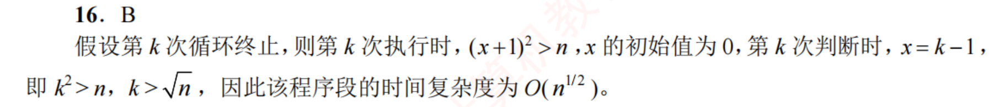

## 线性表

<a id="a-DS02-E01"></a>
### [例 2-1](../books/数据结构_强化笔记.md#DS02-E01)

D

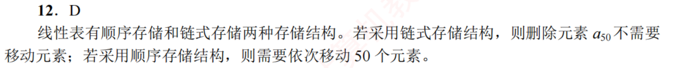

<a id="a-DS02-E02"></a>
### [例 2-2](../books/数据结构_强化笔记.md#DS02-E02)

双指针，时间$O(n)$，空间$O(1)$

倒数位置由尾部决定，但链表不能直接向前访问。让两个指针保持固定间隔：`fast` 先从首元结点前进 $k$ 步，再让 `fast` 与 `slow` 同步前进。若表长为 $n$，`fast` 到达空位置时共走了 $n$ 步，`slow` 只走了 $n-k$ 步，正好指向第 $n-k+1$ 个结点。

```c
int searchK(LNode *list, int k) {
    if (k<=0) return 0;
    LNode *fast=list->next, *slow=list->next;
    for (int j=0; j<k; ++j) {
        if (fast==NULL) return 0;   // 表长不足 k
        fast=fast->next;
    }
    while (fast!=NULL) {
        fast=fast->next;
        slow=slow->next;
    }
    printf("%d", slow->data);
    return 1;
}
```

以长度 5、$k=2$ 为例，先让 `fast` 指向第3个结点，`slow` 留在第1个；同步经过“4与2—5与3—空与4”，第4个即倒数第2个。$k=n$ 时第一阶段恰好走到空位置，第二阶段不执行，返回首元结点；$k>n$ 时在第一阶段报失败。两个指针合计走 $O(n)$ 步，辅助空间 $O(1)$，没有修改任何链接。

<a id="a-DS02-E03"></a>
### [例 2-3](../books/数据结构_强化笔记.md#DS02-E03)

D

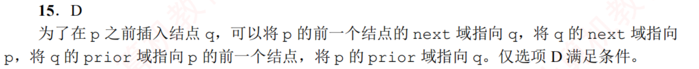

<a id="a-DS02-E04"></a>
### [例 2-4](../books/数据结构_强化笔记.md#DS02-E04)

三次逆置，时间$O(n)$，空间$O(1)$

题目要求两个连续区段交换位置，同时保持各段内部次序。设前 $p$ 个元素为 $A$，其余为 $B$。分别逆置得 $A^RB^R$，再整体逆置，即得 $BA$。两个区段各被逆置两次，内部方向恢复，而相对位置交换。

```c
void reverse(int R[], int l, int r) {
    while (l<r) {
        int t=R[l]; R[l]=R[r]; R[r]=t;
        ++l; --r;
    }
}
void rotateLeft(int R[], int n, int p) {
    reverse(R,0,p-1);
    reverse(R,p,n-1);
    reverse(R,0,n-1);
}
```

例如 `abcdefgh` 左移3位，依次得到 `cbadefgh`、`cbahgfed`、`defghabc`。总交换次数不超过 $n$，时间 $O(n)$；只用常数临时变量，空间 $O(1)$。若将首元素移到末尾重复 $p$ 次，时间为 $O(np)$，当 $p$ 与 $n$ 同阶时会退化。三次逆置可处理 $p=1$ 和 $p=n-1$，无需另写搬移循环。

<a id="a-DS02-E05"></a>
### [例 2-5](../books/数据结构_强化笔记.md#DS02-E05)

对齐表尾后同步比较地址，时间$O(m+n)$

共享指的是地址相同，不能以 `p->data==q->data` 判断。单链表一旦在某结点汇合，其后继也相同，所以两表从公共起点到末尾的长度相等。先各扫描一次求长 $m,n$，让较长表先走 $|m-n|$ 步，两指针便处于距表尾相同的位置；此后同步前进，第一次地址相等的位置就是答案。

```c
LNode *commonSuffix(LNode *str1, LNode *str2) {
    int m=0,n=0;
    for (LNode *p=str1->next; p; p=p->next) ++m;
    for (LNode *q=str2->next; q; q=q->next) ++n;
    LNode *p=str1->next, *q=str2->next;
    while (m>n) { p=p->next; --m; }
    while (n>m) { q=q->next; --n; }
    while (p!=q) { p=p->next; q=q->next; }
    return p;                   // 无公共结点时二者同时为 NULL
}
```

图中两表长度分别为7和5，先让长表跨过 `l,o`，再比较 `a` 与 `b`、`d` 与 `e`，最后到达同一个 `i`。若两表内容相同却各自分配结点，则直到空位置才相等，返回空。总时间 $O(m+n)$，辅助空间 $O(1)$，适用于有限、无环单链表。

<a id="a-DS02-E06"></a>
### [例 2-6](../books/数据结构_强化笔记.md#DS02-E06)

抵消候选后再次计数，时间$O(n)$，空间$O(1)$

每次删除两个值不同的元素，不会消灭一个原本占严格多数的值：若删去一个多数元素和一个其他元素，多数仍超过剩余的一半；若删去两个其他元素，多数优势更大。用一个候选值和计数模拟这种抵消。计数为0时选新候选；相同则加1，不同则减1。

```c
int majority(int A[], int n) {
    int candidate=0, count=0;
    for (int i=0; i<n; ++i) {
        if (count==0) { candidate=A[i]; count=1; }
        else if (A[i]==candidate) ++count;
        else --count;
    }
    int actual=0;
    for (int i=0; i<n; ++i)
        if (A[i]==candidate) ++actual;
    return actual>n/2 ? candidate : -1;
}
```

抵消只保证“若有主元素，最后候选一定是它”，没有保证主元素存在。例如 `1,2,3` 最后仍可能留下候选3，它只出现一次，所以必须第二次扫描核实。两个线性扫描合计 $O(n)$ 时间，额外空间 $O(1)$。题目给出的值域也允许用计数数组，但需 $O(n)$ 辅助空间；此处没有必要为省下一次扫描而付出这部分空间。

## 栈、队列和数组

<a id="a-DS03-E01"></a>
### [例 3-1](../books/数据结构_强化笔记.md#DS03-E01)

C

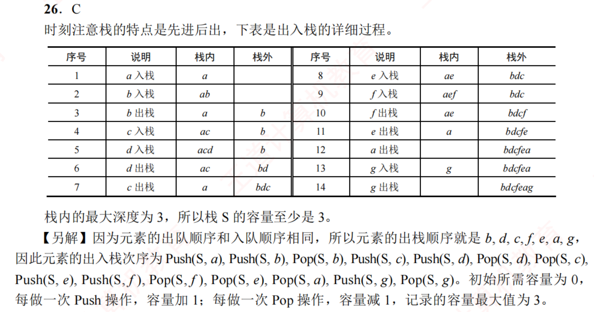

<a id="a-DS03-E02"></a>
### [例 3-2](../books/数据结构_强化笔记.md#DS03-E02)

C

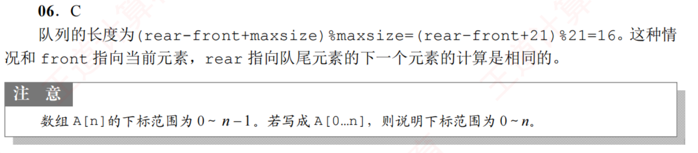

<a id="a-DS03-E05"></a>
### [例 3-3](../books/数据结构_强化笔记.md#DS03-E05)

B

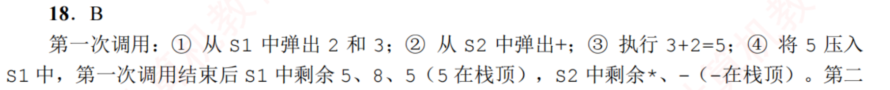

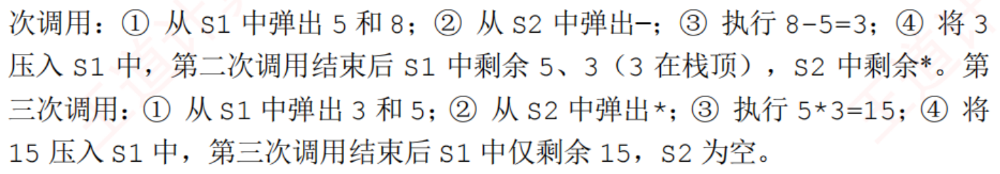

<a id="a-DS03-E03"></a>
### [例 3-4](../books/数据结构_强化笔记.md#DS03-E03)

B

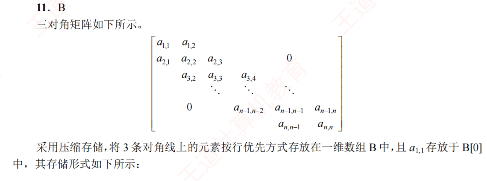

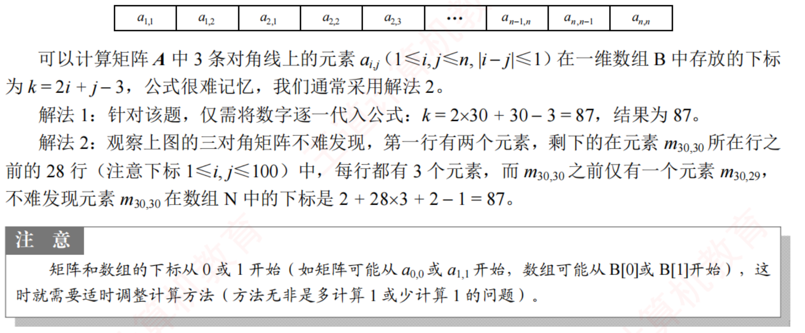

<a id="a-DS03-E04"></a>
### [例 3-5](../books/数据结构_强化笔记.md#DS03-E04)

C

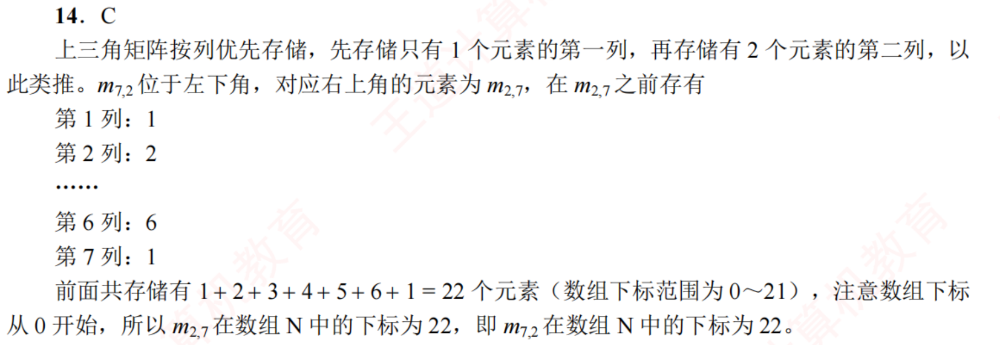

## 串

<a id="a-DS04-E01"></a>
### [例 4-1](../books/数据结构_强化笔记.md#DS04-E01)

位置均为4；朴素15次，普通KMP10次

朴素匹配从起点1、2、3、4依次比较6、1、2、6次，共15次。普通next为`0,1,1,2,2,3`；KMP前5对相等，第6对在`(i,j)=(6,6)`失配，令`j=3`、`i`保持6；随后`(6,3)、(7,4)、(8,5)、(9,6)`均相等，共10次字符比较，返回`10-6=4`。

<a id="a-DS04-E02"></a>
### [例 4-2](../books/数据结构_强化笔记.md#DS04-E02)

位置5；普通next比较12次，nextval比较9次

普通next为`0,1,2,3,4`，nextval为`0,0,0,0,4`。前3对`a`相等；主串第4位`c`在普通表下依次与模式第4、3、2、1位失配，优化表在第一次失配后直接退到0。推进到主串第5位后，连续匹配`aaaab`。普通表比较`3+4+5=12`次，优化表比较`3+1+5=9`次，均返回5。

## 树与二叉树

<a id="a-DS05-E01"></a>
### [例 5-1](../books/数据结构_强化笔记.md#DS05-E01)

B

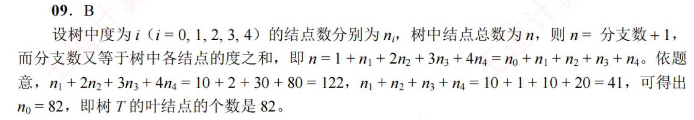

<a id="a-DS05-E02"></a>
### [例 5-2](../books/数据结构_强化笔记.md#DS05-E02)

A

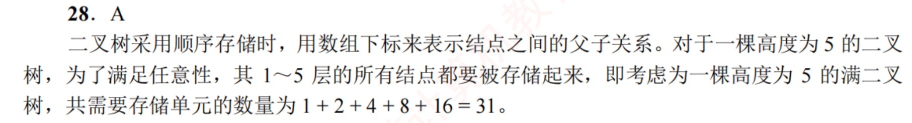

<a id="a-DS05-E03"></a>
### [例 5-3](../books/数据结构_强化笔记.md#DS05-E03)

A

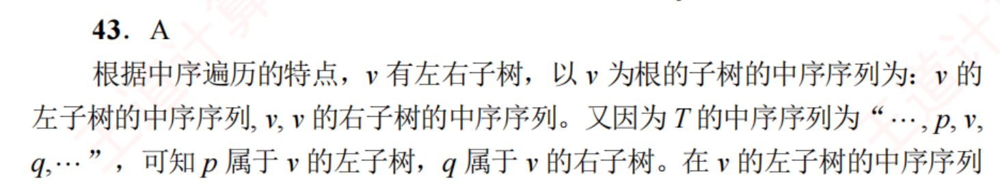

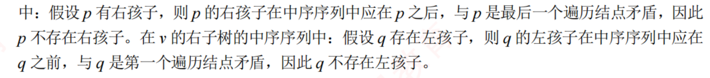

<a id="a-DS05-E04"></a>
### [例 5-4](../books/数据结构_强化笔记.md#DS05-E04)

B

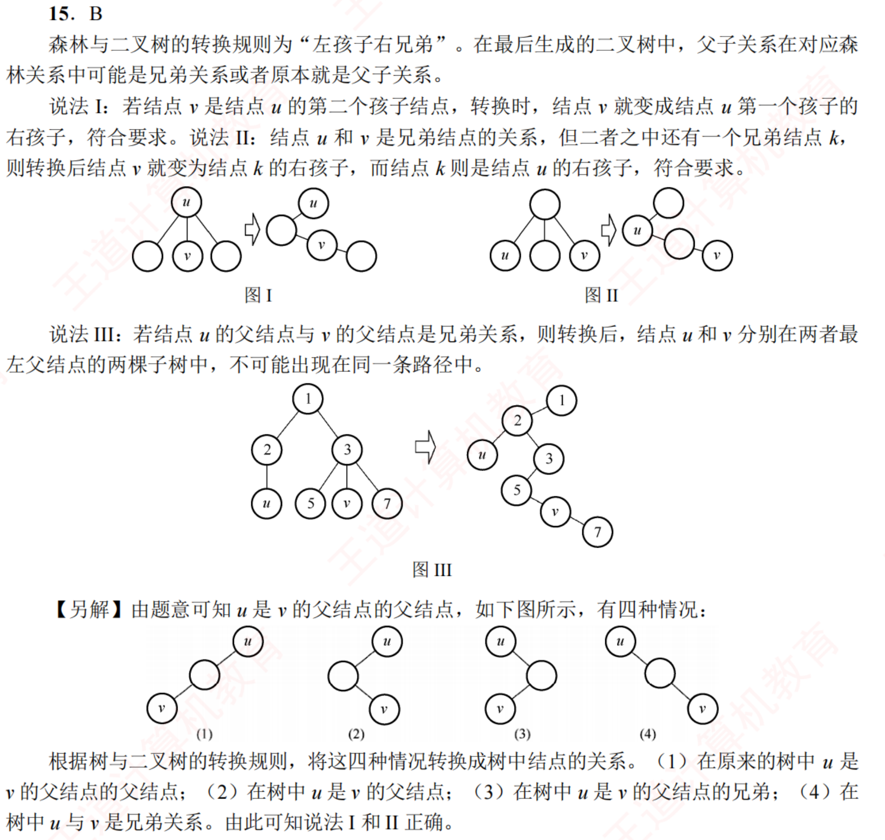

<a id="a-DS05-E05"></a>
### [例 5-5](../books/数据结构_强化笔记.md#DS05-E05)

B

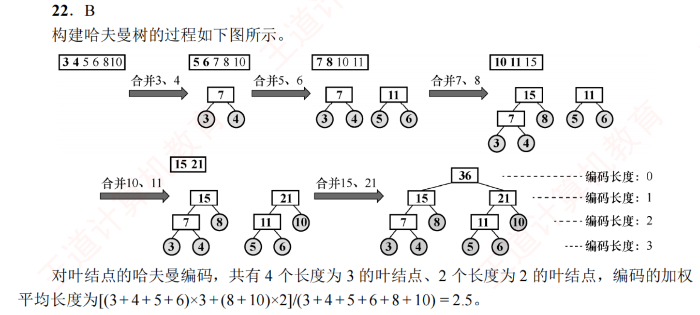

<a id="a-DS05-E06"></a>
### [例 5-6](../books/数据结构_强化笔记.md#DS05-E06)

C

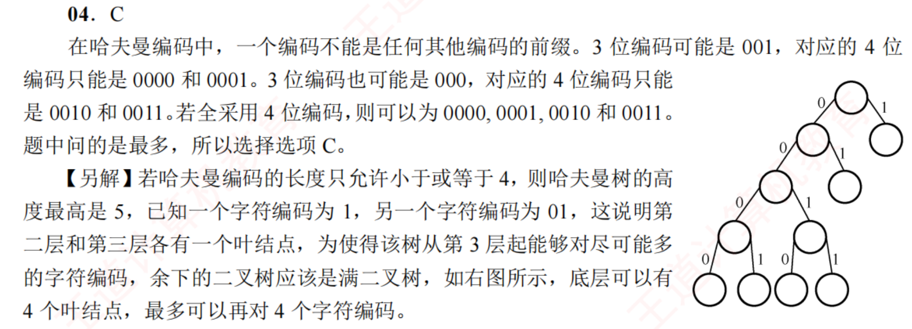

## 图

<a id="a-DS06-E01"></a>
### [例 6-1](../books/数据结构_强化笔记.md#DS06-E01)

C


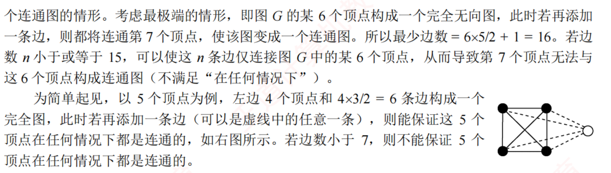

<a id="a-DS06-E02"></a>
### [例 6-2](../books/数据结构_强化笔记.md#DS06-E02)

D

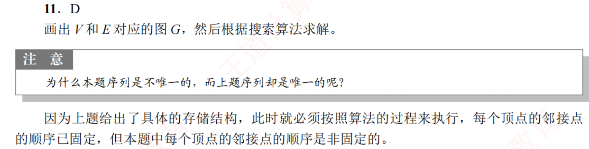

<a id="a-DS06-E03"></a>
### [例 6-3](../books/数据结构_强化笔记.md#DS06-E03)

C

两者首先选权5的$(V_1,V_4)$。Kruskal第2条可取不成环的任一权8边，包括$(V_2,V_3)$。Prim此时集合为$\{V_1,V_4\}$，只能选跨割边$(V_1,V_3)$或$(V_4,V_3)$，选C。

<a id="a-DS06-E04"></a>
### [例 6-4](../books/数据结构_强化笔记.md#DS06-E04)

C

起点确定后初始向量为$(26,3,\infty,6)$。先确定3，经3到2得到$3+22=25$；再确定5，经5到2得到$6+15=21$，经5到4得到$6+8=14$，故为$(21,3,14,6)$，选C。经4把到2改成15属于下一轮。

<a id="a-DS06-E05"></a>
### [例 6-5](../books/数据结构_强化笔记.md#DS06-E05)

每轮零入度候选恰有一个，且处理完全体顶点

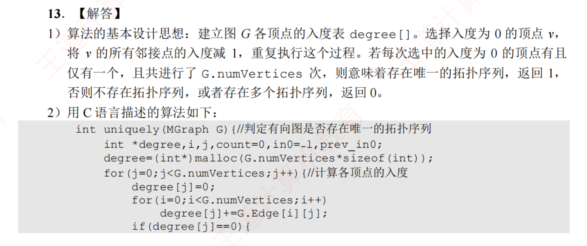

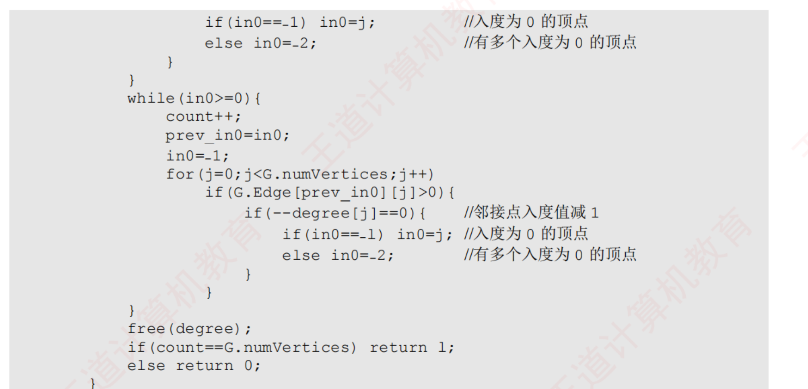

<a id="a-DS06-E06"></a>
### [例 6-6](../books/数据结构_强化笔记.md#DS06-E06)

C

按拓扑序1、3、2、4、5、6求得事件最早、最迟时间均依次为0、8、12、21、18、27。工期27，关键路径为`b-d-c-g`、`b-d-e-h`、`b-f-h`。同时缩短d、f可覆盖三条关键路径；A、B遗漏`b-f-h`，D遗漏`b-d-c-g`，选C。持续缩短后应重算新关键路径。

## 查找

<a id="a-DS07-E01"></a>
### [例 7-1](../books/数据结构_强化笔记.md#DS07-E01)

C

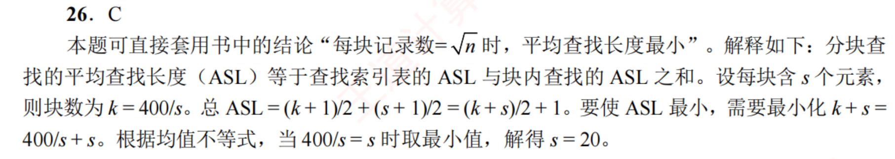

<a id="a-DS07-E02"></a>
### [例 7-2](../books/数据结构_强化笔记.md#DS07-E02)

B

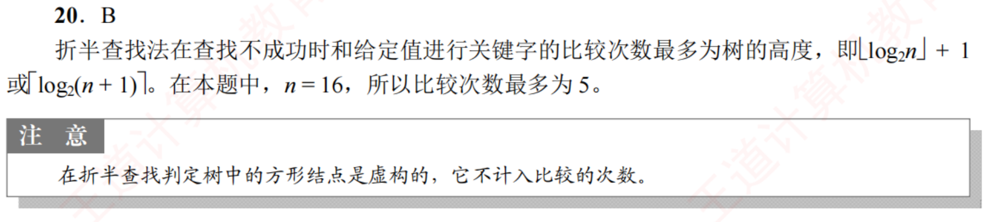

<a id="a-DS07-E03"></a>
### [例 7-3](../books/数据结构_强化笔记.md#DS07-E03)

最终为34(23(15,28),107(98,115))

以下用 `根(左子树,右子树)` 表示局部结构，`∅` 表示空。


| 插入 | 失衡处与调整 | 调整后整树 |
| --- | --- | --- |
| 34 | 无 | 34 |
| 23 | 无 | 34(23,∅) |
| 15 | 34处LL，右旋 | 23(15,34) |
| 98 | 无 | 23(15,34(∅,98)) |
| 115 | 34处RR，左旋 | 23(15,98(34,115)) |
| 28 | 23处RL，先右旋98，再左旋23 | 34(23(15,28),98(∅,115)) |
| 107 | 98处RL，先右旋115，再左旋98 | 34(23(15,28),107(98,115)) |


插入28时，34仍平衡，最小失衡祖先为23；新增路径为“23的右—98的左”，采用RL。各步中序均为已插入关键字的升序。

<a id="a-DS07-E04"></a>
### [例 7-4](../books/数据结构_强化笔记.md#DS07-E04)

D

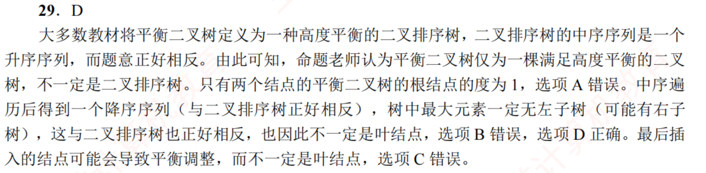

<a id="a-DS07-E05"></a>
### [例 7-5](../books/数据结构_强化笔记.md#DS07-E05)

A、D

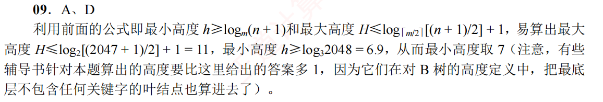

<a id="a-DS07-E06"></a>
### [例 7-6](../books/数据结构_强化笔记.md#DS07-E06)

C

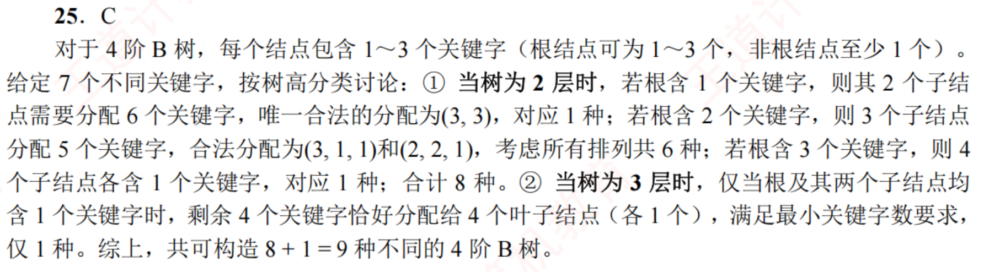

<a id="a-DS07-E07"></a>
### [例 7-7](../books/数据结构_强化笔记.md#DS07-E07)

C

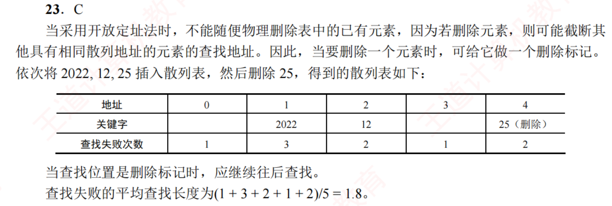

<a id="a-DS07-E08"></a>
### [例 7-8](../books/数据结构_强化笔记.md#DS07-E08)

HT=[11,空,14,7,空,20,9,空,空,3,18]；7/11；3、18、14；地址7

20、3、11、18直接落5、9、0、10；9从5到6；14从9依次探测10、2；7从10依次探测0、3。最终0至10为`11,空,14,7,空,20,9,空,空,3,18`，装填因子$7/11$。查14访问9、10、2，比较3、18、14。查8初始地址2，按$H_0+k^2$探测2、3、6、0、7，在空地址7失败。

## 排序

<a id="a-DS08-E01"></a>
### [例 8-1](../books/数据结构_强化笔记.md#DS08-E01)

B

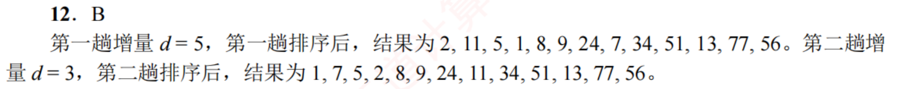

<a id="a-DS08-E02"></a>
### [例 8-2](../books/数据结构_强化笔记.md#DS08-E02)

D

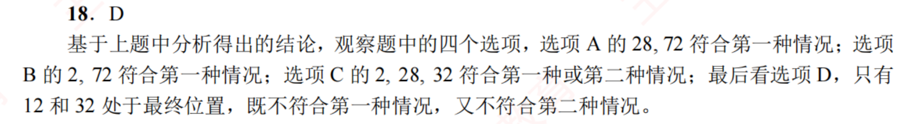

<a id="a-DS08-E09"></a>
### [例 8-3](../books/数据结构_强化笔记.md#DS08-E09)

随机划分选择第10小，平均时间$O(n)$、迭代辅助空间$O(1)$

用随机枢轴划分，只继续处理包含第10小这一秩的子区间，丢弃无需继续划分的一侧。确定分界后保留10个最小数，无须内部有序；相等值跨边界时按尚需个数取足。随机选择的期望工作量为$O(n)$，在原数组迭代执行辅助空间$O(1)$。也可用大小10的大根堆扫描，只有新值小于堆顶才替换、下滤，时间$O(n\log10)$、辅助空间$O(10)$，适合流式输入。

<a id="a-DS08-E03"></a>
### [例 8-4](../books/数据结构_强化笔记.md#DS08-E03)

C

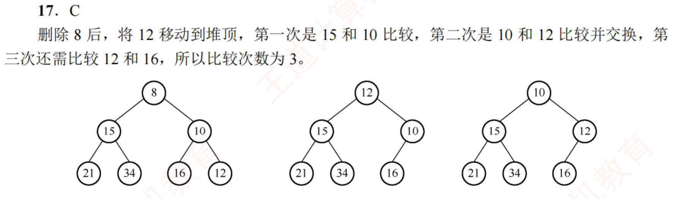

<a id="a-DS08-E04"></a>
### [例 8-5](../books/数据结构_强化笔记.md#DS08-E04)

C

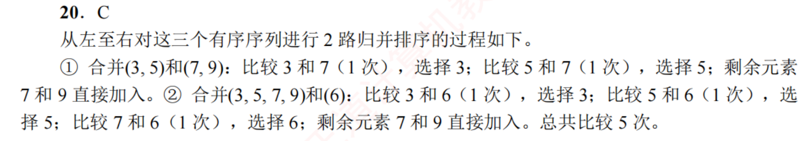

<a id="a-DS08-E05"></a>
### [例 8-6](../books/数据结构_强化笔记.md#DS08-E05)

C

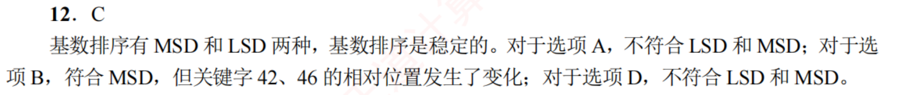

<a id="a-DS08-E06"></a>
### [例 8-7](../books/数据结构_强化笔记.md#DS08-E06)

3段；最大n，最小m

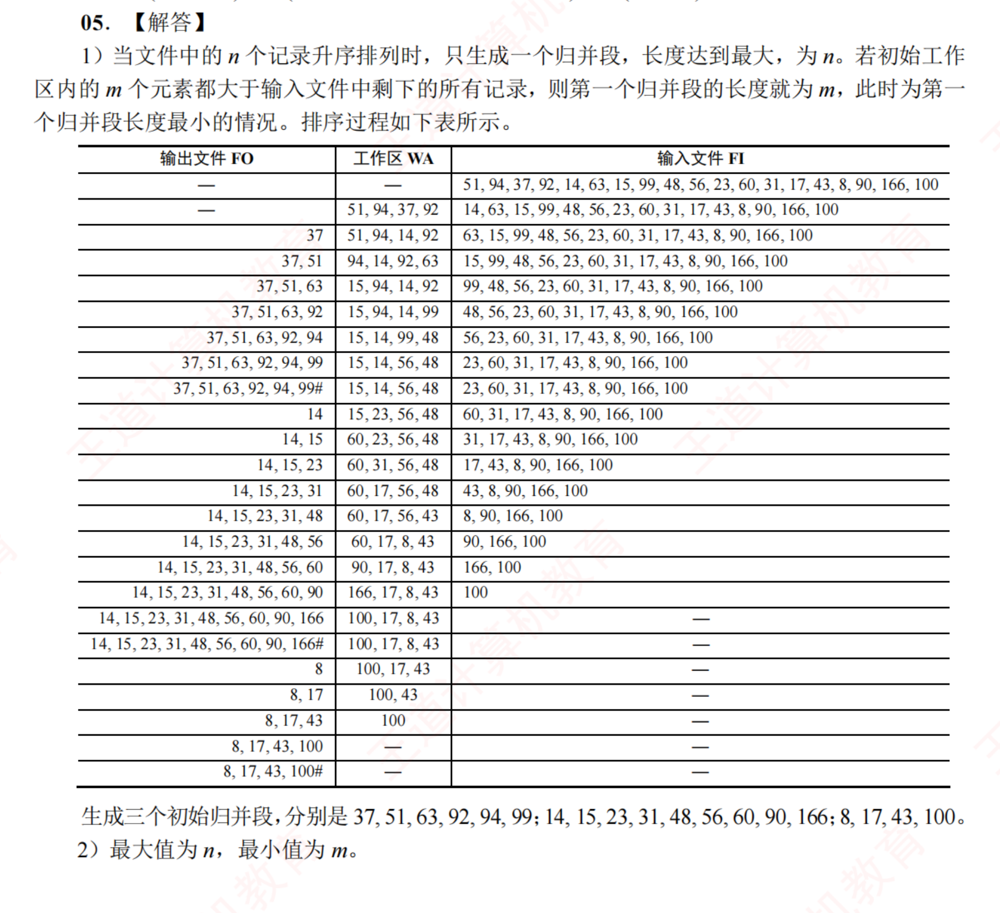

<a id="a-DS08-E07"></a>
### [例 8-8](../books/数据结构_强化笔记.md#DS08-E07)

825次；反复合并当前两个最短表

依次合并`10+35=45`、`40+45=85`、`50+60=110`、`85+110=195`、`195+200=395`。每次最坏比较数为新段长减1，合计$44+84+109+194+394=825$。合并长度和为WPL=830，减5次合并亦得825。对N表反复取最短两表，等价于以表长为叶权构造哈夫曼树，使重复参与层数的加权和最小。

<a id="a-DS08-E08"></a>
### [例 8-9](../books/数据结构_强化笔记.md#DS08-E08)

WPL=690

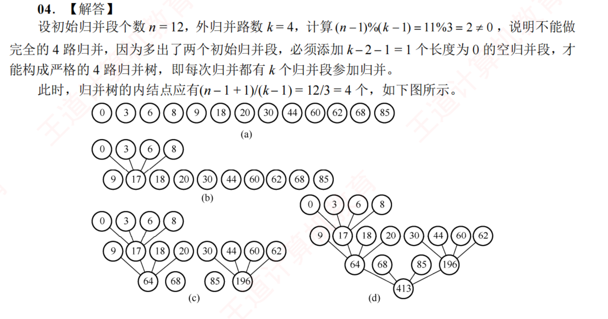


# 计算机组成原理

## 计算机系统与程序执行的层次

<a id="a-CO01-E01"></a>
### [例 1-1](../books/计算机组成原理_强化笔记.md#CO01-E01)

A

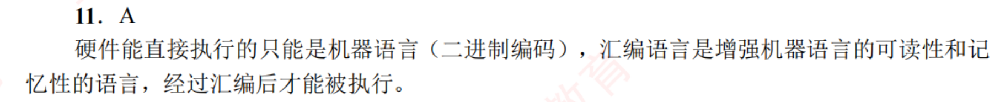

<a id="a-CO01-E02"></a>
### [例 1-2](../books/计算机组成原理_强化笔记.md#CO01-E02)

A，平均 CPI=2.8，CPU 时间28 μs。

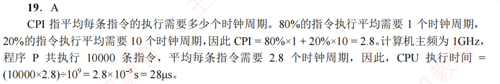

<a id="a-CO01-E03"></a>
### [例 1-3](../books/计算机组成原理_强化笔记.md#CO01-E03)

D，70 s。

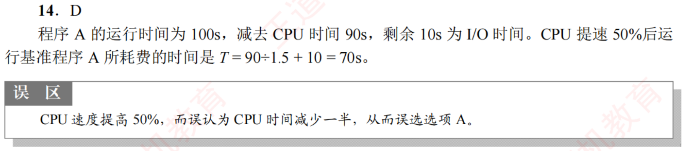

## 数据表示、位级运算与浮点数

<a id="a-CO02-E01"></a>
### [例 2-1](../books/计算机组成原理_强化笔记.md#CO02-E01)

B，211.4。

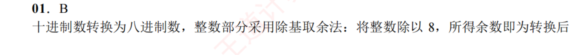

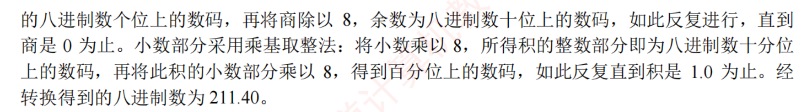

<a id="a-CO02-E02"></a>
### [例 2-2](../books/计算机组成原理_强化笔记.md#CO02-E02)

B，0000 FFFAH。

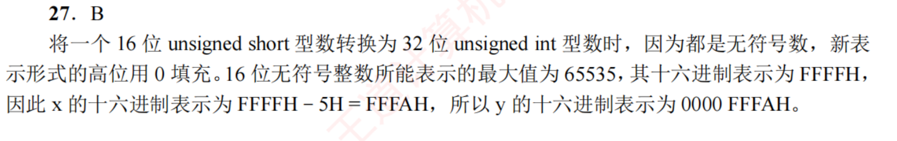

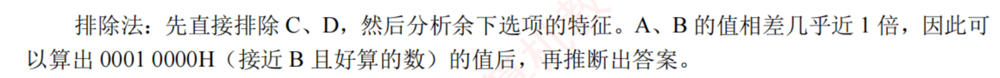

<a id="a-CO02-E03"></a>
### [例 2-3](../books/计算机组成原理_强化笔记.md#CO02-E03)

D。

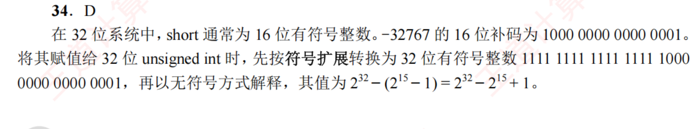

<a id="a-CO02-E04"></a>
### [例 2-4](../books/计算机组成原理_强化笔记.md#CO02-E04)

B。

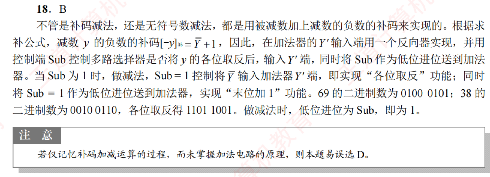

<a id="a-CO02-E05"></a>
### [例 2-5](../books/计算机组成原理_强化笔记.md#CO02-E05)

C。

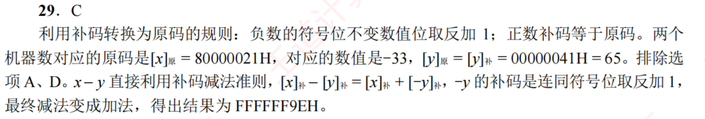

<a id="a-CO02-E06"></a>
### [例 2-6](../books/计算机组成原理_强化笔记.md#CO02-E06)

B，OF=0、CF=1。

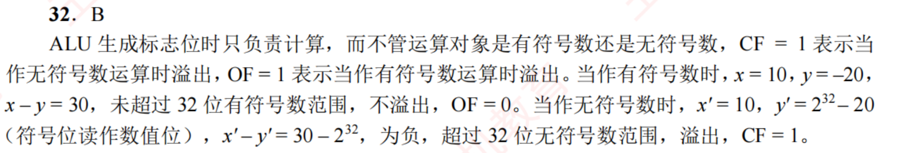

<a id="a-CO02-E07"></a>
### [例 2-7](../books/计算机组成原理_强化笔记.md#CO02-E07)

A，BEE0 0000H。

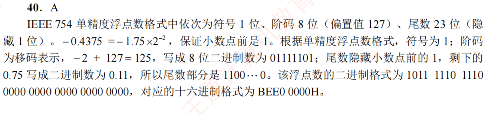


<a id="a-CO02-E08"></a>
### [例 2-8](../books/计算机组成原理_强化笔记.md#CO02-E08)

A，x<y且符号相同。

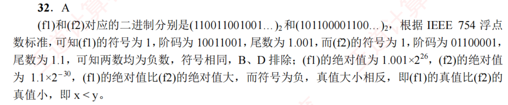

<a id="a-CO02-E09"></a>
### [例 2-9](../books/计算机组成原理_强化笔记.md#CO02-E09)

D，I、II、III、IV。

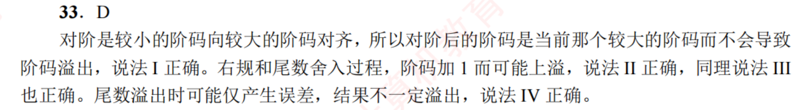

<a id="a-CO02-E10"></a>
### [例 2-10](../books/计算机组成原理_强化笔记.md#CO02-E10)

（1）机器模型下循环条件恒真；改int后不进入循环。（2）相等；00FF FFFFH、4B7F FFFFH。（3）浮点舍入为2^25。（4）低32位全1；最大n=30。（5）正无穷；不溢出最大n=126，精确最大n=23。

本题关于f1溢出后的返回值、n=0的持续循环按题设32位补码机器模型推演；C有符号溢出属未定义行为。

（1）unsigned的 `n-1` 在n=0时为 $2^{32}-1$，任意unsigned i均满足条件，i递增可绕回0。若i、n改int，首次条件为 $0\le-1$，循环不执行。

（2）$f(23)=2^{24}-1=16777215$，int和24位精度binary32均精确。int机器数00FF FFFFH；浮点 $1.\underbrace{11\cdots1}_{23\text{位}}\times2^{23}$，阶码150，机器数4B7F FFFFH。

（3）$f(24)=2^{25}-1=33554431$ 需25位精度；binary32相邻候选为33554430、33554432，精确和居中，最近偶数取33554432，即4C00 0000H。

（4）$2^{32}-1$ 超过int上界，机器模型保留低32位全1，补码为−1。精确须 $2^{n+1}-1\le2^{31}-1$，故n≤30。

（5）7F80 0000H表示正无穷。n=126的结果舍入为有限 $2^{127}$；n=127越过有限上界并舍入为无穷。不溢出上界126；完全精确需n+1个连续1全部容纳在24位中，上界23。

<a id="a-CO02-E11"></a>
### [例 2-11](../books/计算机组成原理_强化笔记.md#CO02-E11)

D，0x11、0xC00E。

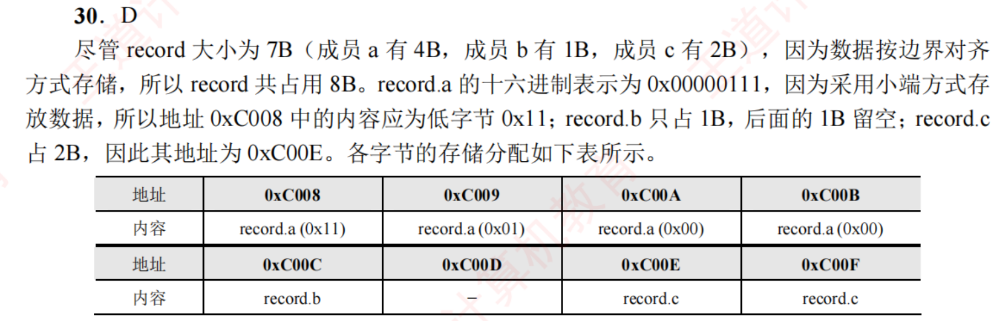

## 存储层次、地址与 Cache

<a id="a-CO03-E01"></a>
### [例 3-1](../books/计算机组成原理_强化笔记.md#CO03-E01)

A，19根。

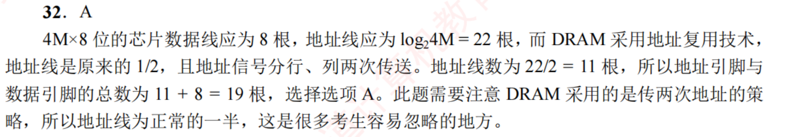

<a id="a-CO03-E02"></a>
### [例 3-2](../books/计算机组成原理_强化笔记.md#CO03-E02)

D，26位。


<a id="a-CO03-E03"></a>
### [例 3-3](../books/计算机组成原理_强化笔记.md#CO03-E03)

D，8000和8004。


<a id="a-CO03-E04"></a>
### [例 3-4](../books/计算机组成原理_强化笔记.md#CO03-E04)

D，ROM 2片、RAM 30片。


<a id="a-CO03-E05"></a>
### [例 3-5](../books/计算机组成原理_强化笔记.md#CO03-E05)

B，约12.2 ms。


<a id="a-CO03-E06"></a>
### [例 3-6](../books/计算机组成原理_强化笔记.md#CO03-E06)

C，约12.5%。


<a id="a-CO03-E07"></a>
### [例 3-7](../books/计算机组成原理_强化笔记.md#CO03-E07)

A，8个20位比较器。


<a id="a-CO03-E08"></a>
### [例 3-8](../books/计算机组成原理_强化笔记.md#CO03-E08)

C，148 K位。


<a id="a-CO03-E09"></a>
### [例 3-9](../books/计算机组成原理_强化笔记.md#CO03-E09)

C，01 8840H。


<a id="a-CO03-E10"></a>
### [例 3-10](../books/计算机组成原理_强化笔记.md#CO03-E10)

C，19位。


<a id="a-CO03-E11"></a>
### [例 3-11](../books/计算机组成原理_强化笔记.md#CO03-E11)

（1）2页、2次缺页，0042 2000H与0042 3000H。（2）以数组元素计，无时间局部性，有空间局部性。（3）块内A4～A0，组号A10～A5；a[1][0]=0042 2100H，组号8。（4）192块；写分配下两种循环均87.5%。

命中率按写分配、无其他数据冲突的模型计算。原题未显式给出写分配，采用非写分配时须重算。

（1）数组 $24\times64\times4=6144$ B，起址页对齐，覆盖2页。原循环第一次访问第一页a[0][0]、第二页a[16][0]时分别缺页，故障地址为0042 2000H、0042 3000H；页面不置换，共2次。

（2）每元素只写一次，以元素为对象无时间局部性；按行顺序访问相邻元素具有空间局部性。块内复用体现空间局部性。

（3）块长32 B，偏移5位；$8192/(32\times4)=64$ 组，组号6位，即A10～A5。这些位均在12位页内偏移内，虚实转换保持不变。每行256 B，a[1][0]为0042 2100H，组号 $(\mathtt{2100H}\gg5)\bmod64=8$。

（4）块数6144/32=192，元素1536。按行每块首次写缺失，随后7次命中，命中率 $1-192/1536=87.5\%$。按列时，同一列相邻元素跨8块，24行只映射8组，每组3块，可驻留于4路；后续同块各列继续命中。不同8列批次使用不同组，仍仅192次首次缺失，命中率87.5%。

<a id="a-CO03-E12"></a>
### [例 3-12](../books/计算机组成原理_强化笔记.md#CO03-E12)

（1）VPN=A29～A12，偏移=A11～A0。（2）标记=A29～A15，组号=A14～A12。（3）淘汰VPN=4。（4）每表项增加2位。


<a id="a-CO03-E13"></a>
### [例 3-13](../books/计算机组成原理_强化笔记.md#CO03-E13)

（1）虚址6/2/6位，物理址6/4/2位。（2）03D4H读得36H；00F1H从主存取数，字节值未知；0229H缺页。

（1）64 B页占6位偏移，VPN为8位；TLB16项、4路共4组，组号2位、标记6位。Cache块4 B占2位偏移，16行占4位行号，物理址剩6位标记。

（2）每次均从题给初态开始，查表项时同时检查有效位和标记。

| 虚拟地址 | VPN／偏移 | TLB组／标记 | 转换与数据路径 |
|---|---|---|---|
| 03D4H | 0FH／14H | 3／03H | 组3路2命中，页框0DH；物理地址354H；Cache标记0DH、行5H、偏移0，命中读36H |
| 00F1H | 03H／31H | 3／00H | TLB缺失，页表P=1、页框02H；物理地址0B1H；Cache标记02H、行CH、偏移1，有效位0，从主存0B0H～0B3H调块后取偏移1，字节值未给出 |
| 0229H | 08H／29H | 0／02H | TLB缺失，页表P=0，缺页；待处理并重试后继续 |

第一地址计算为 $\mathtt{0DH}\times\mathtt{40H}+\mathtt{14H}=\mathtt{354H}$；第二为 $\mathtt{02H}\times\mathtt{40H}+\mathtt{31H}=\mathtt{0B1H}$。第三次在取得驻留页框前进入缺页处理，不继续当前普通数据Cache查找。

## 指令系统与 C 程序的机器级表示

<a id="a-CO04-E01"></a>
### [例 4-1](../books/计算机组成原理_强化笔记.md#CO04-E01)

D，128条。


<a id="a-CO04-E02"></a>
### [例 4-2](../books/计算机组成原理_强化笔记.md#CO04-E02)

C，2008H。


<a id="a-CO04-E03"></a>
### [例 4-3](../books/计算机组成原理_强化笔记.md#CO04-E03)

C。


<a id="a-CO04-E04"></a>
### [例 4-4](../books/计算机组成原理_强化笔记.md#CO04-E04)

A。


<a id="a-CO04-E05"></a>
### [例 4-5](../books/计算机组成原理_强化笔记.md#CO04-E05)

（1）10次，第16行；（2）第12行条件转移，第16、20、30行无条件改变后继；（3）0040102AH，位移−42，小端；（4）32位溢出，改用long long；（5）高32位不等于低32位的符号扩展时OF=1，增加溢出自陷指令。

（1）调用参数依次10、9、…、1，共10次（含最外层）。第16行call递归调用，执行9次。

（2）第12行jle为条件转移；第16行call、第20行jmp、第30行ret执行时均改变顺序后继地址。

（3）call占5 B，后继地址为$00401025\mathrm H+5=0040102A\mathrm H$。相对位移$00401000\mathrm H-0040102A\mathrm H=-2A\mathrm H=-42$，32位补码为FFFF FFD6H。内存低地址先存D6，故为小端。

（4）$13!>2^{31}-1$，超出32位int范围。题给机器结果为截低32位：$6227020800-2^{32}=1932053504$。标准C有符号溢出规则不保证这种回绕。将返回类型改为至少64位的long long，使递归返回值与乘法均按宽类型计算：

```c
long long f1(int n) {
    if (n > 1) return n * f1(n - 1);
    return 1LL;
}
```

（5）令精确64位积的高、低32位分别为H、L。当H等于L符号位的32位扩展（L非负则H全0，L负则H全1），OF=0；其他情况OF=1。编译器可在imul后加入检查OF的溢出自陷指令（32位x86为`into`），OF=1时进入异常处理。

## 中央处理器

<a id="a-CO05-E01"></a>
### [例 5-1](../books/计算机组成原理_强化笔记.md#CO05-E01)

B。


<a id="a-CO05-E02"></a>
### [例 5-2](../books/计算机组成原理_强化笔记.md#CO05-E02)

（1）SF=F15，OF见解析；（2）Y保存首操作数，Z暂存结果；（3）16个，来自IR，rd接写地址译码器；（4）PCout/MARin→Read→MDRout/IRin，至少7拍；（5）CU产生，IR和FR提供输入。

（1）令$a=A_{15},b=B_{15},f=F_{15}$，乘为逻辑与、加为逻辑或：
\[
\mathrm{SF}=f,\quad
\mathrm{OF}_{add}=ab\overline f+\overline a\,\overline b f,\quad
\mathrm{OF}_{sub}=a\overline b\,\overline f+\overline a b f.
\]
加法同号输入异号结果时溢出；减法异号输入、结果符号异于A时溢出。

（2）总线同拍仅提供一个值，Y暂存首操作数，随后总线提供第二个。结果先存Z，避免结果与第二输入同时驱动总线，再由Z输出。

（3）rs、rd为4位，可选$2^4=16$个寄存器，来自IR字段。rd接写地址译码器，rs控制读多路选择器。

（4）PCout、MARin（1拍）→Read，主存读并送MDR（5拍）→MDRout、IRin（1拍），至少7拍。主存读入MDR已计在5拍内；MDRin为内部总线写MDR，本次主存路径无需该信号。

（5）信号由CU产生，IR的指令信息和FR的状态标志输出连到CU输入。

<a id="a-CO05-E03"></a>
### [例 5-3](../books/计算机组成原理_强化笔记.md#CO05-E03)

B。


<a id="a-CO05-E04"></a>
### [例 5-4](../books/计算机组成原理_强化笔记.md#CO05-E04)

C，15位。


<a id="a-CO05-E05"></a>
### [例 5-5](../books/计算机组成原理_强化笔记.md#CO05-E05)

C，8位。


<a id="a-CO05-E06"></a>
### [例 5-6](../books/计算机组成原理_强化笔记.md#CO05-E06)

B。


<a id="a-CO05-E07"></a>
### [例 5-7](../books/计算机组成原理_强化笔记.md#CO05-E07)

A，90 ns。

共同节拍至少覆盖最慢功能段，$\tau\ge\max(90,80,70,60)=90$ ns，选A；题目已忽略段寄存器开销。

<a id="a-CO05-E08"></a>
### [例 5-8](../books/计算机组成原理_强化笔记.md#CO05-E08)

D，1条。

无停顿时I2在第5拍MEM末才有r3，I3原本第5拍EX就需使用，需把I3的EX推迟到第6拍。I1的r1已有可用结果，转发可满足。因此插1条NOP，选D。

<a id="a-CO05-E09"></a>
### [例 5-9](../books/计算机组成原理_强化笔记.md#CO05-E09)

C，I3、I4。


<a id="a-CO05-E10"></a>
### [例 5-10](../books/计算机组成原理_强化笔记.md#CO05-E10)

C。


<a id="a-CO05-E11"></a>
### [例 5-11](../books/计算机组成原理_强化笔记.md#CO05-E11)

（1）FEFFH；（2）8拍；（3）I3等待RAW写回，I4受前级冻结阻塞；（4）至少17拍。

统一约束：无转发，同寄存器不能同拍读写，消费者ID最早为生产者WB的下一拍；按题设计所有指令流出五段。

（1）−513的16位补码FDFFH，算术右移复制符号位，得到FEFFH（−257）。负奇数算术右移按位结果对应向负无穷取整。

（2）$5+4-1=8$拍。

（3）I3读R1、R2，分别依赖I1的WB5、I2的WB6，故ID须到第7拍，第4～6拍等待。IF/ID保持使I4也不能取指。I3的WB10后I4最早ID11，因此流出为第14拍。I4的IF阻塞由前级冻结传播产生。

（4）先装x以提前关键链：

```text
I1 LOAD  R1, [x]
I2 LOAD  R2, [a]
I3 SHL   R1
I4 ADD   R1, R2
I5 STORE R2, [x]
```

| 指令 | IF | ID成功 | EX | M | WB/流出 |
|---|---|---|---|---|---|
| I1 | 1 | 2 | 3 | 4 | 5 |
| I2 | 2 | 3 | 4 | 5 | 6 |
| I3 | 3 | 6 | 7 | 8 | 9 |
| I4 | 6 | 10 | 11 | 12 | 13 |
| I5 | 10 | 14 | 15 | 16 | 17 |

I3在ID端等第4～5拍，I4等第7～9拍，I5等第11～13拍，相应后继取指冻结。x的LOAD→翻倍→相加→STORE链使这三次消费者ID分别至少第6、10、14拍，所列调度达到下界，共17拍。STORE在M16已写主存，按五段流出计为17拍。

## 总线

<a id="a-CO06-E01"></a>
### [例 6-1](../books/计算机组成原理_强化笔记.md#CO06-E01)

B，20 MB/s。


<a id="a-CO06-E02"></a>
### [例 6-2](../books/计算机组成原理_强化笔记.md#CO06-E02)

10.664 GB/s；改给333.25 MHz且每拍4次时相同。

64位为8 B，$1333$ MT/s已是每秒传送次数，$B=1333\times10^6\times8=10.664$ GB/s。若给333.25 MHz，则$R=4\times333.25=1333$ MT/s，结果相同。

<a id="a-CO06-E03"></a>
### [例 6-3](../books/计算机组成原理_强化笔记.md#CO06-E03)

D，32 ns。


<a id="a-CO06-E04"></a>
### [例 6-4](../books/计算机组成原理_强化笔记.md#CO06-E04)

B，6.72 GB/s。


## 输入/输出系统

<a id="a-CO07-E01"></a>
### [例 7-1](../books/计算机组成原理_强化笔记.md#CO07-E01)

D。


<a id="a-CO07-E02"></a>
### [例 7-2](../books/计算机组成原理_强化笔记.md#CO07-E02)

C，0.20%。


<a id="a-CO07-E03"></a>
### [例 7-3](../books/计算机组成原理_强化笔记.md#CO07-E03)

A、B、C屏蔽字依次100、110、111；开始A→B→C，完成C→B→A。

位序A、B、C，1为屏蔽。A允许B、C打断，屏蔽字100；B只允许C，110；C全屏蔽，111。初始均开放，硬件先选A；A开中断后在B、C中先选B，B开中断后进入C。C完成恢复B，B完成恢复A；各层恢复自己的旧屏蔽字，最终按C、B、A完成。

<a id="a-CO07-E04"></a>
### [例 7-4](../books/计算机组成原理_强化笔记.md#CO07-E04)

B，25%。


<a id="a-CO07-E05"></a>
### [例 7-5](../books/计算机组成原理_强化笔记.md#CO07-E05)

C。


<a id="a-CO07-E06"></a>
### [例 7-6](../books/计算机组成原理_强化笔记.md#CO07-E06)

D。


<a id="a-CO07-E07"></a>
### [例 7-7](../books/计算机组成原理_强化笔记.md#CO07-E07)

（1）最多2 μs查询一次，至少4%；（2）不能，需800%的CPU预算；（3）最多4%。


# 操作系统

## 计算机系统概述

<a id="a-OS01-E01"></a>
### [例 1-1](../books/操作系统_强化笔记.md#OS01-E01)

D


<a id="a-OS01-E02"></a>
### [例 1-2](../books/操作系统_强化笔记.md#OS01-E02)

B


<a id="a-OS01-E03"></a>
### [例 1-3](../books/操作系统_强化笔记.md#OS01-E03)

D


<a id="a-OS01-E04"></a>
### [例 1-4](../books/操作系统_强化笔记.md#OS01-E04)

A


## 进程与线程

<a id="a-OS02-E01"></a>
### [例 2-1](../books/操作系统_强化笔记.md#OS02-E01)

C


<a id="a-OS02-E02"></a>
### [例 2-2](../books/操作系统_强化笔记.md#OS02-E02)

D


<a id="a-OS02-E03"></a>
### [例 2-3](../books/操作系统_强化笔记.md#OS02-E03)

B；61 ms


<a id="a-OS02-E04"></a>
### [例 2-4](../books/操作系统_强化笔记.md#OS02-E04)

C；6次


<a id="a-OS02-E05"></a>
### [例 2-5](../books/操作系统_强化笔记.md#OS02-E05)

C；15 ms


<a id="a-OS02-E06"></a>
### [例 2-6](../books/操作系统_强化笔记.md#OS02-E06)

SRTF：13；RR：19.25


<a id="a-OS02-E07"></a>
### [例 2-7](../books/操作系统_强化笔记.md#OS02-E07)

$priority=nice+k_1cpuTime-k_2waitTime$，$k_1,k_2>0$

（1）只比较 nice 时，较小 nice 的进程持续就绪可使较大 nice 的进程长期落选。

（2）取 $priority=nice+k_1cpuTime-k_2waitTime$，$k_1,k_2>0$。运行使优先数增大，等待使优先数减小；waitTime 实现老化。按题设在运行时清 waitTime、就绪时清 cpuTime。无饥饿保证还需有限进程或有界 nice、持续重算、适当抢占或有限运行段及公平同级处理等前提。

<a id="a-OS02-E08"></a>
### [例 2-8](../books/操作系统_强化笔记.md#OS02-E08)

C


<a id="a-OS02-E09"></a>
### [例 2-9](../books/操作系统_强化笔记.md#OS02-E09)

D


<a id="a-OS02-E10"></a>
### [例 2-10](../books/操作系统_强化笔记.md#OS02-E10)

两个信号量，初值均0

T1 按 A、E、F 执行，T2 按 B、C、D 执行；本线程顺序已保证 B→C、C→D、E→F。跨线程只需 A→C 和 C→E。

```text
semaphore ac=0, ce=0;
T1: A; V(ac); P(ce); E; F;
T2: B; P(ac); C; V(ce); D;
```

C 前已完成本线程的 B 并收到 A 通知；E 前收到 C 通知。V(ce) 放在 C 后、D 前，保留 D 与 E/F 的并发。

<a id="a-OS02-E11"></a>
### [例 2-11](../books/操作系统_强化笔记.md#OS02-E11)

（1）是；（2）done=0；（3）mutex=1

（1）两个 C1 可同时发现空缓冲并互相覆盖，检查和写入须作为临界区保护。

（2）初始空且各执行一次，只需写完通知：

```text
semaphore done=0;
P1: C1; V(done);
P2: P(done); C2;
```

该先后关系已排除两次操作重叠。

（3）初始非空且两次修改均不清空，使用互斥量：

```text
semaphore mutex=1;
P1: P(mutex); C3; V(mutex);
P2: P(mutex); C3; V(mutex);
```

每问按各自初态和活动范围独立分析。

<a id="a-OS02-E12"></a>
### [例 2-12](../books/操作系统_强化笔记.md#OS02-E12)

empty=N，odd=even=0，mutex=1；按类别发布

原题未明确初态，沿参考解取初始为空；有初存 a 个奇数、b 个偶数时改为 empty=N-a-b、odd=a、even=b。所有缓冲放取共用 mutex；奇偶分别计产品许可。

```text
semaphore empty=N, odd=0, even=0, mutex=1;
P1: while (true) {
    x=produce();
    P(empty); P(mutex); put(); V(mutex);
    if (x%2) V(odd); else V(even);
}
P2: while (true) {
    P(odd); P(mutex); getodd(); V(mutex);
    V(empty); countodd();
}
P3: while (true) {
    P(even); P(mutex); geteven(); V(mutex);
    V(empty); counteven();
}
```

put() 放入 P1 当前的本地整数 x。实际取出后立即归还空位，私有统计留在锁外；某类长期不产生时，该消费者可一直等，其他进程仍可推进。

<a id="a-OS02-E13"></a>
### [例 2-13](../books/操作系统_强化笔记.md#OS02-E13)

empty=1000，full=0，mutex=batch=1

mutex 保护单次缓冲操作及指针，batch 保证一个消费者连续取10件；生产者不申请 batch。

```text
semaphore empty=1000, full=0, mutex=1, batch=1;
item buf[1000]; int in=0, out=0;
producer: while (true) {
    x=produce(); P(empty); P(mutex);
    buf[in]=x; in=(in+1)%1000;
    V(mutex); V(full);
}
consumer: while (true) {
    P(batch);
    for (int k=0; k<10; k++) {
        P(full); P(mutex);
        local[k]=buf[out]; out=(out+1)%1000;
        V(mutex); V(empty);
    }
    V(batch); consume(local);
}
```

消费者缺货时只持 batch、等待 full，生产者仍可取得 mutex 补货；其他消费者无法插入。每取一件即归还空位，整批无须在开始时凑齐。

<a id="a-OS02-E14"></a>
### [例 2-14](../books/操作系统_强化笔记.md#OS02-E14)

D


<a id="a-OS02-E15"></a>
### [例 2-15](../books/操作系统_强化笔记.md#OS02-E15)

B


<a id="a-OS02-E16"></a>
### [例 2-16](../books/操作系统_强化笔记.md#OS02-E16)

D；不存在安全序列

Work 初为 $(0,2,1)$，仅 P1 可完成，回收后为 $(2,2,1)$；再选 P4 后为 $(2,2,2)$。P2、P3 均仍需3个 R2，仅2个可用，无法继续。完成前两人无法证明整个系统安全；实际当前请求未给出，不能据此确定已死锁。

<a id="a-OS02-E17"></a>
### [例 2-17](../books/操作系统_强化笔记.md#OS02-E17)

C；仅Ⅰ


## 内存管理

<a id="a-OS03-E01"></a>
### [例 3-1](../books/操作系统_强化笔记.md#OS03-E01)

C


<a id="a-OS03-E02"></a>
### [例 3-2](../books/操作系统_强化笔记.md#OS03-E02)

B；9 MB


<a id="a-OS03-E03"></a>
### [例 3-3](../books/操作系统_强化笔记.md#OS03-E03)

B；128

按原解每张下级页表占一页，可放 $2^{10}/2=2^9$ 项；覆盖 $2^{16}$ 页需 $2^{16}/2^9=2^7=128$ 个目录项。字段为7位目录、9位页号、10位偏移。该页表按页存放是原解采用的布局条件。

<a id="a-OS03-E04"></a>
### [例 3-4](../books/操作系统_强化笔记.md#OS03-E04)

A；081H、101H

偏移为低12位225H；目录号 $VA\gg22=081_H$；下级页号 $(VA\gg12)\mathbin{\&}3FF_H=101_H$。10位字段须按二进制位宽提取。

<a id="a-OS03-E05"></a>
### [例 3-5](../books/操作系统_强化笔记.md#OS03-E05)

C；5次

按原解页框初始空，LRU 从最久到最近记录：

| 引用 | 更新后次序 | 结果 |
| --- | --- | --- |
| 0、1、2、7 | 0、1、2、7 | 4次初装 |
| 0 | 1、2、7、0 | 命中 |
| 5 | 2、7、0、5 | 淘汰1 |
| 3 | 7、0、5、3 | 淘汰2 |
| 5 | 7、0、3、5 | 命中 |
| 0 | 7、3、5、0 | 命中 |
| 2 | 3、5、0、2 | 淘汰7 |
| 7 | 5、0、2、7 | 淘汰3 |
| 6 | 0、2、7、6 | 淘汰5 |

9次缺页减4次空框装入，共5次置换。

<a id="a-OS03-E06"></a>
### [例 3-6](../books/操作系统_强化笔记.md#OS03-E06)

C；60A01H

页号2、偏移A01H，存在位0，须调页。固定两框已满，页3、4的状态为 $(1,0)$、$(1,1)$，改进 Clock 清访问位后先选干净的页3。页2装入框60H，$PA=60_H\times1000_H+A01_H=60A01_H$；旧页框字段20H在存在位0时无效。

<a id="a-OS03-E07"></a>
### [例 3-7](../books/操作系统_强化笔记.md#OS03-E07)

A；{6,0,3,2}

t 前最近六次引用为6、0、3、2、3、2，去重得到{6,0,3,2}。竖线右侧的0尚未访问。

<a id="a-OS03-E08"></a>
### [例 3-8](../books/操作系统_强化笔记.md#OS03-E08)

210 ns；100000220 ns；110 ns；101565H


<a id="a-OS03-E09"></a>
### [例 3-9](../books/操作系统_强化笔记.md#OS03-E09)

10801008H；042H、001H；00201108H；00301004H


## 文件管理

<a id="a-OS04-E01"></a>
### [例 4-1](../books/操作系统_强化笔记.md#OS04-E01)

B


<a id="a-OS04-E02"></a>
### [例 4-2](../books/操作系统_强化笔记.md#OS04-E02)

D；20位


<a id="a-OS04-E03"></a>
### [例 4-3](../books/操作系统_强化笔记.md#OS04-E03)

B；1、3


<a id="a-OS04-E04"></a>
### [例 4-4](../books/操作系统_强化笔记.md#OS04-E04)

D；6次


<a id="a-OS04-E05"></a>
### [例 4-5](../books/操作系统_强化笔记.md#OS04-E05)

B


<a id="a-OS04-E06"></a>
### [例 4-6](../books/操作系统_强化笔记.md#OS04-E06)

C；82、1


<a id="a-OS04-E07"></a>
### [例 4-7](../books/操作系统_强化笔记.md#OS04-E07)

（course,2）、（doc,10）；30；2块；一级和二级

（1）stu 的两目录项为 `(course,2)`、`(doc,10)`，按图给定子项作答。

（2）doc 与 course1 同属该文件系统的 inode10，数据块号相同，x=30。

（3）course 目录内容已缓存，取得 inode号后还须读 inode 所在块、数据块30，共2块；题设未给这两者缓存。

（4）6 MiB 需1536个4 KiB数据块；每索引块1024项，直接及一级共1034块，还差502块，须用一级及二级间接，无需三级。一级区用1个索引块；二级区用1个上层及1个下层索引块，索引开销另计。

<a id="a-OS04-E08"></a>
### [例 4-8](../books/操作系统_强化笔记.md#OS04-E08)

$(8+1024+1024^2+1024^3)4096$ B；$2^{26}$ 个；时间不同

（1）每索引簇容纳1024个簇号，用户长度上限为 $(8+1024+1024^2+1024^3)\times4096$ B，不含索引簇。

（2）每 inode簇放64个 inode，inode 区共 $2^{20}\times64=2^{26}$ 个。5600 B 图像各占2数据簇，数据区可放256M个，均在直接区无需间接簇；取较小值64M=$67\,108\,864$个，按题给可用区不另假设目录占用。

（3）F1末簇是逻辑簇1，在直接区；F2末簇是逻辑簇9，需一级间接。inode同已缓存、间接索引未缓存时，取簇号后者多读一次索引簇；若还读目标数据则分别1、2次读盘。

## 输入输出管理

<a id="a-OS05-E01"></a>
### [例 5-1](../books/操作系统_强化笔记.md#OS05-E01)

C


<a id="a-OS05-E02"></a>
### [例 5-2](../books/操作系统_强化笔记.md#OS05-E02)

B；1550 μs、1100 μs


<a id="a-OS05-E03"></a>
### [例 5-3](../books/操作系统_强化笔记.md#OS05-E03)

B；5046


<a id="a-OS05-E04"></a>
### [例 5-4](../books/操作系统_强化笔记.md#OS05-E04)

B


<a id="a-OS05-E05"></a>
### [例 5-5](../books/操作系统_强化笔记.md#OS05-E05)

C；325


<a id="a-OS05-E06"></a>
### [例 5-6](../books/操作系统_强化笔记.md#OS05-E06)

②→⑥→④→③→①→⑤；③为驱动；处理入口时P阻塞、CPU内核态

六项次序为②→⑥→④→③→①→⑤：P 无字符可读先阻塞，键入后中断入口启动，驱动读字符至系统缓冲，唤醒 P，P 被调度后返回系统调用。

（1）①前③、后⑤，⑥后④，仅比较题列操作。（2）②后当前 P 必须让出 CPU，无其他就绪者时进 idle；①后 P 恢复可调度资格。（3）③执行具体控制器读入，属于驱动。（4）入口及读字符阶段 P 仍阻塞，执行①才就绪；CPU 执行中断处理在内核态，被中断者可能为另一进程。

<a id="a-OS05-E07"></a>
### [例 5-7](../books/操作系统_强化笔记.md#OS05-E07)

307200000 B；100260→101660→110560→60005；（100,5,60）；驱动

（1）容量 $300\times10\times200\times512=307200000$ B，即300000 KiB。每簇1024 B，每柱面1000簇。

（2）请求柱面依次为100、60、101、110。SSTF 从85先到100，再到101、110、60，对应簇100260、101660、110560、60005；距离分别15、1、9、50，共75柱面。每步按新磁头位置重算。

（3）$100530=100\times1000+530$，$530=5\times100+30$，故柱面100、磁头5，磁道内第30簇从扇区60开始并含61。起始 CHS 为（100,5,60），各字段0基。按本题传统几何模型由磁盘驱动转换。

# 计算机网络

## 计算机网络体系结构

<a id="a-CN01-E01"></a>
### [例 1-1](../books/计算机网络_强化笔记.md#CN01-E01)

B


<a id="a-CN01-E02"></a>
### [例 1-2](../books/计算机网络_强化笔记.md#CN01-E02)

B


<a id="a-CN01-E03"></a>
### [例 1-3](../books/计算机网络_强化笔记.md#CN01-E03)

D（80.10 ms）

按题设分组长度直接切分文件，分组数为 $10^6/1000=1000$，每组发送时间为 $8000/10^8=80\ \mu s$。每段传播时间由时延带宽积求得 $1000/10^8=10\ \mu s$。

两段链路上第一组用 $2\times80+2\times10=180\ \mu s$ 到齐；后续999组每隔80 μs到齐。总计

$$180+999\times80=80100\ \mu s=80.10\text{ ms},$$

故选 **D**。本题按给定1000 B分组切分，不另添加未给定首部。

<a id="a-CN01-E04"></a>
### [例 1-4](../books/计算机网络_强化笔记.md#CN01-E04)

B


## 物理层

<a id="a-CN02-E01"></a>
### [例 2-1](../books/计算机网络_强化笔记.md#CN02-E01)

C


<a id="a-CN02-E02"></a>
### [例 2-2](../books/计算机网络_强化笔记.md#CN02-E02)

A（约2倍）


<a id="a-CN02-E03"></a>
### [例 2-3](../books/计算机网络_强化笔记.md#CN02-E03)

C


## 数据链路层

<a id="a-CN03-E01"></a>
### [例 3-1](../books/计算机网络_强化笔记.md#CN03-E01)

A


<a id="a-CN03-E02"></a>
### [例 3-2](../books/计算机网络_强化笔记.md#CN03-E02)

D


<a id="a-CN03-E03"></a>
### [例 3-3](../books/计算机网络_强化笔记.md#CN03-E03)

C


<a id="a-CN03-E04"></a>
### [例 3-4](../books/计算机网络_强化笔记.md#CN03-E04)

D


<a id="a-CN03-E05"></a>
### [例 3-5](../books/计算机网络_强化笔记.md#CN03-E05)

C


<a id="a-CN03-E06"></a>
### [例 3-6](../books/计算机网络_强化笔记.md#CN03-E06)

C


<a id="a-CN03-E12"></a>
### [例 3-7](../books/计算机网络_强化笔记.md#CN03-E12)

（1）3帧；（2）5帧，首$S_{5,2}$、末$S_{1,2}$；（3）3帧，首$S_{2,3}$；（4）50%。

读题时先分清两条状态线：收到帧的确认序号决定“我发出的哪些帧已被确认”；收到帧的发送序号决定“我下次应捎带哪个确认号”。GBN的接收窗口为1，收到失序帧不能跳过缺口向前确认。序号空间为$2^3=8$，发送窗口最多为7，所有序号按模8回绕。

图(a)最后收到$R_{3,3}$。其确认号3累计确认甲方序号0、1、2已正确到达，因此第（1）问为3帧：$S_{0,0}$、$S_{1,0}$、$S_{2,0}$。不能因它的发送序号为3，便推断甲方也收齐了乙方0～3号帧：甲方依次正确收到$R_{0,1}$、$R_{1,3}$，随后缺少乙方2号帧，$R_{3,3}$作为失序帧被丢弃，所以甲方仍希望收到乙方2号帧。

此时甲方已发送到$S_{4,1}$，未确认的是发送序号3、4两帧。7个窗口位置中还剩$7-2=5$个；下一发送序号从5开始，捎带确认号始终为2，故第（2）问可发送$S_{5,2}$、$S_{6,2}$、$S_{7,2}$、$S_{0,2}$、$S_{1,2}$，首帧为$S_{5,2}$，末帧为$S_{1,2}$。回绕后的0、1是新一轮数据，不能与已经确认的旧0、1混为一谈。

图(b)乙方最后通告确认号2，意味着甲方0、1号已确认，2、3、4号仍未确认。$S_{2,0}$超时触发从最早未确认帧开始的后退重传，因此第（3）问重发3帧。甲方此时已按序收到乙方$R_{2,2}$，期待乙方下一帧为3，故重传首帧应更新捎带确认号，写成$S_{2,3}$；随后为$S_{3,3}$、$S_{4,3}$，不能照抄旧帧的确认号0。

第（4）问须保留捎带确认帧的发送时间。发送一个数据帧需$T_d=1000\times8/(100\times10^6)=0.08$ ms；确认也装在1000 B的数据帧中，$T_a=0.08$ ms。沿用教材模型：题目中的RTT表示往返传播时延；从发送首帧到完整收到其确认，周期为$T_d+\mathrm{RTT}+T_a=1.12$ ms。最多连续发7帧，故$U_{\max}=7\times0.08/1.12=50\%$。全双工允许两个方向同时工作，但本题求甲方单方向利用率；也不能把长捎带确认当成长度可忽略的纯ACK。

<a id="a-CN03-E07"></a>
### [例 3-8](../books/计算机网络_强化笔记.md#CN03-E07)

B


<a id="a-CN03-E08"></a>
### [例 3-9](../books/计算机网络_强化笔记.md#CN03-E08)

D


<a id="a-CN03-E09"></a>
### [例 3-10](../books/计算机网络_强化笔记.md#CN03-E09)

B


<a id="a-CN03-E10"></a>
### [例 3-11](../books/计算机网络_强化笔记.md#CN03-E10)

A


<a id="a-CN03-E11"></a>
### [例 3-12](../books/计算机网络_强化笔记.md#CN03-E11)

B


## 网络层

<a id="a-CN04-E01"></a>
### [例 4-1](../books/计算机网络_强化笔记.md#CN04-E01)

D

对Net1，经A、B、C、D的总距离为9、33、32、28，取9；Net2为20、45、42、34，取20；Net3为32、28、28、42，取28；Net4为44、40、20、30，取20。因此选 **D**。Net3经B、C并列最优，不影响距离答案；若另问下一跳，就须保留并列或按指定规则选择。

<a id="a-CN04-E02"></a>
### [例 4-2](../books/计算机网络_强化笔记.md#CN04-E02)

B


<a id="a-CN04-E03"></a>
### [例 4-3](../books/计算机网络_强化笔记.md#CN04-E03)

B


<a id="a-CN04-E04"></a>
### [例 4-4](../books/计算机网络_强化笔记.md#CN04-E04)

B


<a id="a-CN04-E05"></a>
### [例 4-5](../books/计算机网络_强化笔记.md#CN04-E05)

C


<a id="a-CN04-E11"></a>
### [例 4-6](../books/计算机网络_强化笔记.md#CN04-E11)

3条路由；目的194.17.20.200走E0；域间BGP，由TCP承载。

先按出口分组，再分别求可用汇总前缀。经S0到达的153.14.5.0/25、153.14.5.128/25恰好拼成153.14.5.0/24，下一跳为R1的153.14.3.2。经S1到达的194.17.20.0/25与194.17.21.0/24可用194.17.20.0/23覆盖，但这个`/23`也包含E0直连的194.17.20.128/25，必须保留该更具体条目，让最长前缀匹配处理例外。


| 目的网络 | 下一跳 | 接口 |
|---|---|---|
| 153.14.5.0/24 | 153.14.3.2 | S0 |
| 194.17.20.0/23 | 194.17.24.2 | S1 |
| 194.17.20.128/25 | —（直连） | E0 |

这3条分别承担三个不同出口，已不能在保持全部转发结果的前提下继续合并。第二条覆盖较宽范围，E0的更具体项处理直连例外。若删除E0例外，原本应直达的分组就会误发给R3。

194.17.20.200同时匹配`194.17.20.0/23`和`194.17.20.128/25`；比较前缀长度25与23，选择**E0**，不依赖表项书写顺序。R1与R2属于不同自治系统，因此交换域间路由使用**BGP（BGP-4）**，BGP报文由**TCP**承载。自治系统内部使用何种IGP，不改变这条跨AS邻接的协议选择。

<a id="a-CN04-E06"></a>
### [例 4-7](../books/计算机网络_强化笔记.md#CN04-E06)

B


<a id="a-CN04-E07"></a>
### [例 4-8](../books/计算机网络_强化笔记.md#CN04-E07)

C

H仅收到地址提议，尚未获得192.168.5.9的使用确认。初始选择阶段Request使用源0.0.0.0、目的255.255.255.255，按“目的、源”的设问顺序选 **C**。服务器的单播地址不是这一步的目的IP地址。

图中Request框沿用原题的 `yiaddr` 标注。按DHCP规范，客户端此阶段申请的地址实际由Requested IP Address选项携带，客户端发出的 `yiaddr` 为0。图中的192.168.5.9应理解为待申请地址信息，不能据这个标注推出H已经能用它作IP源地址。Offer中的 `yiaddr` 才是服务器提出的地址。

<a id="a-CN04-E08"></a>
### [例 4-9](../books/计算机网络_强化笔记.md#CN04-E08)

C


<a id="a-CN04-E09"></a>
### [例 4-10](../books/计算机网络_强化笔记.md#CN04-E09)

D


<a id="a-CN04-E12"></a>
### [例 4-11](../books/计算机网络_强化笔记.md#CN04-E12)

（1）OSPF；（2）16；（3）30 s、60 s；（4）eBGP/UPDATE、iBGP；（5）R14选R11，R15选R13。

第（1）问先检查协议的适用上限。RIP最大有效跳数为15，16即不可达，AS4的规模可能超出这一限制，应选**OSPF**。第（2）问问的是IP的TTL而非RIP度量：每经过一个路由器TTL减1，减至0便被丢弃。最多经过15个路由器后仍须至少剩1，故初始TTL至少为**16**。

第（3）问把每次交换视作一轮：本轮只能把交换前已知的路由传给相邻路由器，不能让新收到的信息在同一轮连续穿越全网。又因为首次交换定义为$t=0$，直连路由在此刻已经传给一跳邻居，不能额外再计一个30 s。


| 距首次交换的时间 | 已正确获知210.2.3.0/24的路由器 | 已正确获知210.2.4.0/24的路由器 |
|---|---|---|
| 0 s | R14、R11、R15 | R16、R15 |
| 30 s | R11～R16全部 | R16、R15、R14、R13 |
| 60 s | R11～R16全部 | R11～R16全部 |

210.2.3.0/24直连R14，首次传给R11、R15，下一轮由它们传给R12、R13、R16，所以需**30 s**。210.2.4.0/24直连R16，首次仅传给R15，30 s时到R14、R13，60 s时才到R11、R12，所以需**60 s**。逐轮集合依赖题图中实际存在的边，不能擅自补上R13—R16。

第（4）问按会话两端是否同属一个AS区分：R44与R13分属AS4、AS1，用**eBGP**会话，通过**UPDATE**报文通告；R13向同属AS1的R14、R15传播可达性信息，用**iBGP**会话。BGP会话不要求所有对端在物理上直接相连。

第（5）问按本题无策略约束的教材选路模型，先比较AS_PATH：经R11、R13的路径各含3个AS，经R12含4个，先排除R12。在其余属性相同的候选中，再比较AS内到出口的距离。R14到R11为1跳，到R13需经R15为2跳，选**R11**；R15到R13为1跳，到R11为2跳，选**R13**。真实BGP还受本地优先级等属性影响，本题给定条件并不支持把“AS数少、出口近”当成无条件覆盖所有策略的规则。

<a id="a-CN04-E10"></a>
### [例 4-12](../books/计算机网络_强化笔记.md#CN04-E10)

（1）192.168.1.127，192.168.1.128/25，45台；（2）2片，796 B与724 B。

“均分一个`/24`”先确定两个`/25`，每个块有128个地址，再利用已经分配的地址识别哪一块属于哪个部门。销售部`.1～.20`在192.168.1.0/25内，广播地址为**192.168.1.127**；技术部`.129～.208`在**192.168.1.128/25**内。技术部可用地址有$128-2=126$个，已分配主机数为$208-129+1=80$，F1的`.254`还占1个，因此还可连接$126-80-1=\mathbf{45}$台主机。路由器接口不是额外的一台用户主机，但会占用同一子网的可用地址。

分片计算从原IP数据部分开始：$1500-20=1480$ B。F1所在链路每片总长不能超过800 B，扣首部后最多780 B；非末片数据长度又必须是8 B的整数倍，故最大数据量为$\lfloor780/8\rfloor\times8=\mathbf{776}$ B。余下$1480-776=704$ B，一片即可容纳，所以最少2片。


| 分片 | 数据长度/B | IP总长度/B | 片偏移（8 B单位）与MF |
|---|---:|---:|---|
| 第一片 | 776 | 796 | 偏移0，MF=1 |
| 第二片 | 704 | 724 | 偏移97，MF=0 |

第二片偏移是$776/8=97$，它累计的是原数据的位置，不加第一片首部。末片不要求数据长度继续凑满776 B，所有片的数据长度相加仍为1480 B。

<a id="a-CN04-E13"></a>
### [例 4-13](../books/计算机网络_强化笔记.md#CN04-E13)

（1）0.24 s、200 kb/s、理想下界0.40 s；（2）8帧、4 bit；（3）作业区10.10.10.64/26，管理区10.10.10.0/26，生活区10.10.10.128/25。

单向路径要经过“地面→卫星→地面”两段。按本题采用的几何模型，每段链路的长度取卫星高度，单向传播时延$T_p=2\times36000/300000=\mathbf{0.24\ s}$。路径吞吐量受最慢链路限制，千兆以太网不能抬高200 kb/s的卫星瓶颈，因此H单方向最大吞吐量为**200 kb/s**；全双工表示反方向另有同样容量，不能在一次上传中相加成400 kb/s。

4000 B经卫星链路发送需$4000\times8/200000=0.16$ s。首部忽略时，最后一比特从卫星链路发送端到接收端还要传播0.24 s，故教材模型给出的最短上传时间为$0.16+0.24=\mathbf{0.40\ s}$。这个400 ms还额外忽略了局域网的发送开销；题干给出的忽略项并不包含千兆链路上的发送与分帧，若要严格计入每段链路上的发送、分帧及存储转发，还需题目进一步指定相应条件。例如4000 B在一条1 Gb/s链路上仅串行发送也需32 μs。因此400 ms适合作为本题理想下界，不能视为所有实际以太网转发方式下的精确完成时间。

SLP每帧发送时延$T_d=1500\times8/200000=60$ ms；ACK长度忽略，从开始发送首帧到收到其确认需$60+2\times240=540$ ms。设窗口为$W$，利用率$U=\min(1,60W/540)$；要求$U\ge0.8$，得到$W\ge7.2$，向上取整为**8帧**。GBN接收窗口为1，需$2^k\ge W+1=9$，所以序号字段最少**4 bit**。3 bit虽然有8个序号，却只能支持最大7帧的GBN发送窗口；其利用率$7/9\approx77.78\%$，达不到要求。

最后按可用主机数决定块大小。生活区需$2^7-2=126$个可用地址，至少占`/25`；另两区各需$2^6-2=62$个，至少占`/26`。三块恰好用完$128+64+64=256$个地址。H的10.10.10.33/26锁定管理区为10.10.10.0/26；生活区的`/25`必须按128地址边界对齐，且不能与管理区重叠，只能取10.10.10.128/25，留下10.10.10.64/26给作业区。


| 子网 | CIDR地址 | 可用地址范围 | 可用数量 |
|---|---|---|---:|
| 作业区 | **10.10.10.64/26** | 10.10.10.65～10.10.10.126 | 62 |
| 管理区 | **10.10.10.0/26** | 10.10.10.1～10.10.10.62 | 62 |
| 生活区 | **10.10.10.128/25** | 10.10.10.129～10.10.10.254 | 126 |

## 传输层

<a id="a-CN05-E01"></a>
### [例 5-1](../books/计算机网络_强化笔记.md#CN05-E01)

B


<a id="a-CN05-E02"></a>
### [例 5-2](../books/计算机网络_强化笔记.md#CN05-E02)

C


<a id="a-CN05-E03"></a>
### [例 5-3](../books/计算机网络_强化笔记.md#CN05-E03)

D


<a id="a-CN05-E04"></a>
### [例 5-4](../books/计算机网络_强化笔记.md#CN05-E04)

D


<a id="a-CN05-E06"></a>
### [例 5-5](../books/计算机网络_强化笔记.md#CN05-E06)

A

第一段seq=2001覆盖2001～3000，第二段seq=3001覆盖3001～4000。返回ack_seq=3001只累计确认第一段，第二段的1000 B仍在途。乙段的seq=4001属于乙→甲方向，不能拿它确认甲发出的字节。

甲原cwnd为2000 B，小于门限8000 B，收到一份对新数据的确认后，按题设慢开始增加1 MSS，cwnd变为3000 B；rwnd通告为4000 B，总发送额度取3000 B。减去在途1000 B，尚可新发2000 B，即2段，选 **A**。对应允许的甲方发送范围从3001起共3000 B，其中3001～4000已经发出，4001～6000还可新发。

<a id="a-CN05-E05"></a>
### [例 5-6](../books/计算机网络_强化笔记.md#CN05-E05)

D


<a id="a-CN05-E07"></a>
### [例 5-7](../books/计算机网络_强化笔记.md#CN05-E07)

A


<a id="a-CN05-E08"></a>
### [例 5-8](../books/计算机网络_强化笔记.md#CN05-E08)

（1）H发送1、3、4；握手1、2、3；填充3、5；（2）16 B；（3）15个路由器。

按“IP长度→TCP起点→控制位→序号确认号”顺序解码。所有分组首字节45表示IPv4、IHL=5，即20 B IP首部，TCP从第21字节开始。1、3、4号的源地址`c0 a8 00 08`为192.168.0.8，因此**H发送的是1、3、4号**；2、5号的源地址为S。


| 编号 | IP总长/B | TCP首长/B | TCP标志 |
| --- | ---: | ---: | --- |
| 1 | 48 | 28 | SYN |
| 2 | 48 | 28 | SYN、ACK |
| 3 | 40 | 20 | ACK |
| 4 | 56 | 20 | PSH、ACK |
| 5 | 40 | 20 | ACK |


| 编号 | seq（十六进制） | ack（十六进制） | 应用数据/B |
| --- | --- | --- | ---: |
| 1 | 846b41c5 | 00000000（ACK=0） | 0 |
| 2 | e0599fef | 846b41c6 | 0 |
| 3 | 846b41c6 | e0599ff0 | 0 |
| 4 | 846b41c6 | e0599ff0 | 16 |
| 5 | e0599ff0 | 846b41d6 | 0 |

1号的TCP数据偏移高半字节为7，首部长$7\times4=28$ B；控制字节02置SYN。2号的控制字节12同时置了SYN与ACK，确认H的初始序号加1；3号的控制字节10只置ACK，确认S的初始序号加1。因此**1、2、3号完成三次握手**，SYN分别消耗一个序号，第三次纯ACK不额外消耗序号。捕获表只给前40 B，1、2号的8 B TCP选项没有完整列出，但长度字段足以判定它们没有应用数据。

快速以太网沿用无标签以太网数据字段至少46 B的限制，判断填充应比较**整个IP分组**与46 B，不能只比较TCP数据。3、5号IP总长`0028`为40 B，均需补$46-40=6$ B；1、2号为48 B、4号为56 B，均不需补。因此填充的是**3、5号**，每个形成$14+40+6+4=64$ B的最短MAC帧。填充不计入IP总长度，更不占TCP字节序号。

第（2）问利用累计确认而不是把40字节截取范围当作完整数据。H首个应用字节的序号为SYN序号加1，即`846b41c6`；5号通告下一个期望序号`846b41d6`，所以S已按序收到$\mathtt{846b41d6}-\mathtt{846b41c6}=\mathtt{10}=\mathbf{16}$ B应用数据。这也与4号的$56-20-20=16$ B相符。

第（3）问先匹配报文身份。S行IP标识为`6811`，TCP序号、确认号与5号一致，对应H处的5号；途中的NAT可能改变目的地址与端口，不能因此误认为是另一个报文。S发出时TTL为`40`即64，H处为`31`即49，每经过一个路由器减1，故经过$64-49=\mathbf{15}$个路由器。交换机不减TTL。图中的其余校验和字节按来源保留；题目只截取了部分字节，选项与有效载荷并未给全，不能据此声称已经验证所有报文的完整校验和。

<a id="a-CN05-E09"></a>
### [例 5-9](../books/计算机网络_强化笔记.md#CN05-E09)

（1）SYN=ACK=1，ack=101；（2）rwnd=12 KB，cwnd=9 KB，发送窗口9 KB；（3）20581，163.84 kb/s；（4）300 ms。

第（1）问的第二次握手要同时表达“接受对方SYN”和“发出本方SYN”，所以**SYN=1、ACK=1、确认号=101**。初始序号100被SYN占用，首个数据字节从101开始。

第（2）问必须分别更新两种窗口。沿用教材模型：初始拥塞窗口为1 MSS，每个新数据段的ACK使慢开始窗口增加1 MSS。第8个数据确认到达后，$cwnd=(1+8)\times1=\mathbf{9\ KB}$，仍小于32 KB阈值；S已经缓存8 KB且未取出，通告$rwnd=20-8=\mathbf{12\ KB}$。发送窗口总额度为$\min(cwnd,rwnd)=\mathbf{9\ KB}$。如果题目问此时能再发送多少，还须扣除已经发出但未确认的数据，不能把9 KB直接当成新增发送量。

第（3）问要计到零窗口通告回到H3的时刻。每轮受拥塞窗口与剩余接收缓存共同限制，不能把慢开始序列无限写成1、2、4、8、16。


| 轮次 | 发送前cwnd/MSS | 尚余接收缓存/KB | 本轮发送/KB |
| --- | ---: | ---: | ---: |
| 1 | 1 | 20 | 1 |
| 2 | 2 | 19 | 2 |
| 3 | 4 | 17 | 4 |
| 4 | 8 | 13 | 8 |
| 5 | 16 | 5 | 5 |


| 轮次 | 累计已接收/KB | 本轮确认到达时刻 |
| --- | ---: | --- |
| 1 | 1 | 1 RTT |
| 2 | 3 | 2 RTT |
| 3 | 7 | 3 RTT |
| 4 | 15 | 4 RTT |
| 5 | 20 | 5 RTT |

第5轮只能再放入5 KB，S随后通告零窗口。下一个待发送字节的序号为$101+20\times1024=\mathbf{20581}$，这个值不因窗口暂时关闭而重置。计时为$5\times200\mathrm{\ ms}=1$ s，平均速率为$20\times1024\times8/1=\mathbf{163840\ bit/s}=\mathbf{163.84\ kb/s}$。这里KB用1024、kb/s用1000；计时起点不包括握手，但终点包括最后一轮确认回传。

零窗口是接收方流量控制的结果，并不说明此前有数据丢失，也不要求按超时规则把cwnd重置为1。发送方可用持续计时器触发零窗口探测，以免窗口更新丢失后永久等待；探测本身不会使接收缓存腾空。在本题“始终不取数据”的条件下，不能假设经过一个RTT窗口便自动恢复。

第（4）问求S的释放时间。为取最短值，S收到H3的FIN后立即合并发出ACK和自己的FIN：H3的FIN到S用0.5 RTT，S的FIN到H3再用0.5 RTT，H3的最后ACK返回S再用0.5 RTT。S收到此ACK后进入CLOSED，故最短为$1.5\mathrm{RTT}=\mathbf{300\ ms}$。H3作为主动关闭方的TIME-WAIT等待属于另一端的计时，不能再加到S的300 ms上。

## 应用层

<a id="a-CN06-E01"></a>
### [例 6-1](../books/计算机网络_强化笔记.md#CN06-E01)

C

计数主体是201.1.1.1，不是H4。最终地址在有效缓存中时，本地服务器不需向外查询，最少0次；完全无可用缓存，且相应各级分别委派时，可依次询问根、com、xyz.com、abc.xyz.com，共4次，选 **C**。H4向201.1.1.1的最初请求不是这台服务器“发出”的请求，不能加入。

“最多4次”采用原题的规范域名及逐级委派模型，不计别名链、失败重试或负载均衡额外查询。若改问主机发出几条请求，或所有层级均以递归方式向下转交，通信主体与计数就要重新列出，而不是照抄0、4。

<a id="a-CN06-E02"></a>
### [例 6-2](../books/计算机网络_强化笔记.md#CN06-E02)

A


<a id="a-CN06-E03"></a>
### [例 6-3](../books/计算机网络_强化笔记.md#CN06-E03)

A


<a id="a-CN06-E04"></a>
### [例 6-4](../books/计算机网络_强化笔记.md#CN06-E04)

D


<a id="a-CN06-E05"></a>
### [例 6-5](../books/计算机网络_强化笔记.md#CN06-E05)

A


<a id="a-CN06-E06"></a>
### [例 6-6](../books/计算机网络_强化笔记.md#CN06-E06)

D

采用题目首次取页面、尚未建立目标TCP连接的模型。有效DNS缓存命中时，不需要远程DNS往返，但TCP建立与HTTP请求响应各1RTT，最短20 ms。完全无所需缓存时，本地解析器依次询问根、com、abc.com权威服务器，增加3RTT；再取Web共5RTT=50 ms，选 **D**。主机与本地DNS之间的局域网时延已忽略，不能额外加一次10 ms。

如果题目再允许浏览器已缓存新鲜的HTML副本，可能无须访问服务器；若TCP已经建立，也会少一个握手往返。这些是改变原题模型的附加条件，不能在原题中任意引入后声称存在另一个更短答案。

<a id="a-CN06-E07"></a>
### [例 6-7](../books/计算机网络_强化笔记.md#CN06-E07)

B


<a id="a-CN06-E08"></a>
### [例 6-8](../books/计算机网络_强化笔记.md#CN06-E08)

（1）控制持久、数据非持久，先建控制；（2）101、18102；（3）3 MSS、5 MSS；（4）60 ms、2.4 Mb/s。

先把FTP会话与一次文件传输分开。控制连接在整个FTP会话期间保持，承载登录、命令与控制信息，因此是**持久连接**；本题的数据连接服务于本次文件传输，传完后关闭，是**非持久连接**。登录时先建立的是**控制连接**，已经完成的登录过程不再计入第（4）问的数据连接计时。

数据连接的SYN占序号100，F首字节从**101**开始。18000 B文件占序号101～18100，发送完后H的FIN占18101，服务器第二次挥手的ACK应确认下一个期望序号，故为**18102**。这里确认的是文件数据再加FIN，不能把登录控制连接的序号混进来。

拥塞控制沿用教材的轮次模型：初始$cwnd=1$ MSS，达到4 MSS门限后按每RTT增加1 MSS。先看ACK落在哪个时刻：确认号2101累计确认$2101-101=2000$ B，即前2个段。第1个ACK使cwnd从1增为2 MSS；第2个ACK是第二轮中较早的那个，此时仍在慢开始，cwnd从2增为**3 MSS**。不能把“第二轮结束时4 MSS”提前用于这个ACK。

确认号7101累计确认$7101-101=7000$ B，即$1+2+4=7$个段，恰好完成第3轮。此轮开始时已到4 MSS门限，采用拥塞避免，第3轮结束后窗口为**5 MSS**。下表同时列出数据发送、确认时刻与累计量，时间均从数据连接SYN发出算起。


| 阶段 | 开始时刻/ms | 本轮cwnd/MSS | 本轮发送段数 |
| --- | ---: | ---: | ---: |
| 数据连接握手 | 0 | — | — |
| 数据第1轮 | 10 | 1 | 1 |
| 数据第2轮 | 20 | 2 | 2 |
| 数据第3轮 | 30 | 4 | 4 |
| 数据第4轮 | 40 | 5 | 5 |
| 数据第5轮 | 50 | 6 | 6 |


| 阶段 | 累计发送段数 | 本轮全部确认到达/ms |
| --- | ---: | ---: |
| 数据连接握手 | 0 | 10 |
| 数据第1轮 | 1 | 20 |
| 数据第2轮 | 3 | 30 |
| 数据第3轮 | 7 | 40 |
| 数据第4轮 | 12 | 50 |
| 数据第5轮 | 18 | 60 |

建立数据连接用1 RTT，18个段按1、2、4、5、6分5轮发完，并在最后一轮结束时得到全文件确认，所以总计$6\mathrm{RTT}=\mathbf{60\ ms}$。期间应用层平均速率为$18000\times8/0.060=\mathbf{2.4\ Mb/s}$，也就是300000 B/s=0.3 MB/s。分母按题目包含握手、不包含连接释放；不能只用50 ms的数据传输阶段，也不能因服务器较早收到最后一比特就省去最后确认的回程。

这里的按轮增长是题目采用的教材近似，阈值前逐ACK检查仍有意义；拥塞避免阶段不宜把轮次表误解成每个ACK都使cwnd增加整整1 MSS。若要描述某个操作系统的精确逐ACK轨迹，还需其拥塞算法和ACK策略。

<a id="a-CN06-E09"></a>
### [例 6-9](../books/计算机网络_强化笔记.md#CN06-E09)

（1）DNS，UDP/IP/以太网封装；（2）H1→4、DNS→1、R→2；（3）2帧，目的全FF（需新DNS查询）。

解题入口是按依赖关系列出“先知道谁的地址，才能发下一帧”。按本题及教材需要新做域名解析的流程，H1先运行**DNS**，把域名换成Web服务器IP；常规查询的封装为**DNS报文→UDP数据报→IPv4分组→Ethernet II帧**。ARP用于在本地链路上解析MAC，不是DNS外面的一层，也不是另一个应用层协议；CSMA/CD是介质访问算法，不是帧格式，在全双工交换链路中通常不运行。

H1先根据`/25`判断本地DNS的192.168.1.126与自己同属192.168.1.0/25，先用ARP解析本地DNS的MAC地址，不先问网关。解析出Web服务器位于外网后，才ARP查询网关R的192.168.1.1。后续IP分组的最终目的仍是Web服务器，当前以太网帧的目的MAC却是R的MAC。


| 顺序 | S收到的帧 | 入端口 | S的处理与新增学习 |
|---|---|---:|---|
| 1 | H1广播ARP，询问本地DNS的MAC | 4 | 学习H1的cc→4；向1、2、3口泛洪 |
| 2 | DNS单播ARP应答给H1 | 1 | 学习DNS的bb→1；已知cc，只转4口 |
| 3 | H1单播DNS查询给DNS | 4 | 已知bb，只转1口 |
| 4 | DNS单播查询应答给H1 | 1 | 已知cc，只转4口 |
| 5 | H1广播ARP，询问网关R的MAC | 4 | 向1、2、3口泛洪 |
| 6 | R单播ARP应答给H1 | 2 | 学习R的aa→2；只转4口 |
| 7 | H1向外网服务器发送TCP SYN，帧发给R | 4 | 已知aa，只转2口 |
| 8 | R转发服务器的SYN+ACK，帧发给H1 | 2 | 已知cc，只转4口 |
| 9 | H1发送TCP确认及首个HTTP请求 | 4 | 帧均发给R，只转2口；到达题设$t_1$ |

表中cc、bb、aa分别是下表完整MAC地址的末字节缩写。第三次握手ACK是否与首个HTTP请求合并，不改变学习或H2收到的帧数。交换机按**帧的源MAC与入端口**学习，不会从广播帧的目的地址、ARP询问目标、IP目的地址或题图上“知道有H2”便自行添加表项。因此$t_1$时为：


| MAC地址 | 端口 |
|---|---:|
| 00-11-22-33-44-cc（H1） | 4 |
| 00-11-22-33-44-bb（本地DNS） | 1 |
| 00-11-22-33-44-aa（R） | 2 |

H2只被动收到两次广播ARP请求，没有发出自己的帧，故没有dd→3条目。两次单播应答到来时，交换机早已从相应请求学到H1的位置，不会因初始表为空便把所有单播一直泛洪。第（3）问按上述解析流程，H2至少收到**2个ARP请求帧**，分别查询本地DNS和网关，目的MAC均为**FF-FF-FF-FF-FF-FF**。

这个2帧结论以本题意图中的新DNS查询为前提。原题明确为空的是ARP表和交换表，并未额外声明DNS缓存为空；若允许命中已有DNS缓存，就不必先访问本地DNS，相应学习表与最小广播数都会改变。应保留这一条件边界，不能把“通过域名访问”推广成任何情况下都必然重新发送DNS查询。
