# 数据结构、算法与复杂度 {#ds-ch1}

本书用 $n$ 表示输入规模。数组默认从 0 开始编号，线性表的“第 $i$ 个元素”默认采用从 1 开始的位序；二者同时出现时写明对应关系。算法中的指针保存结点地址，`p->next` 是由 `p` 所指结点的后继指针域；`p=NULL` 表示它目前不指向有效结点。伪代码中的赋值不是数学等式，循环边界和执行顺序也是算法的一部分。

## 逻辑关系怎样落实到存储 {#ds-01-01}

**数据元素**是数据的基本单位，一个元素可由若干数据项组成。例如一条学生记录是一个元素，学号和姓名是它的数据项。**数据对象**是性质相同的数据元素的集合。讨论数据结构时，还必须说明元素之间的关系：排成先后序列、形成父子层次，还是由任意边相连。

**逻辑结构**描述元素之间的逻辑关系，不涉及具体地址。集合结构没有规定元素间的先后关系；线性结构中，除首尾外每个元素各有一个直接前驱和直接后继；树形结构表达层次；图结构表达更一般的关联。栈和队列都以线性关系为基础，但允许的操作位置不同，因而不是同一种抽象数据类型。

**存储结构**是逻辑结构在计算机中的表示。顺序存储用相邻位置体现关系，链式存储用指针联系结点，索引存储另建索引以定位元素，散列存储由关键字计算位置。这些是表示方法，不能把“线性结构”直接等同于“连续地址”。线性表既能顺序存储，也能链式存储。

### 例 1-1　值以外还要存什么 {#ds-ex1-1}

〖1.1-005〗 在存储数据时，通常不仅要存储各数据元素的值，还要存储（　）。

A. 数据的操作方法　B. 数据元素的类型　C. 数据元素之间的关系　D. 数据的存取方法

**解析。** 若只保存若干值，就无法区分这些值原来构成了一个序列、两棵树还是一张图。存储结构必须表达元素间的关系，答案为 **C**。关系未必另占一个专门字段：数组中相邻位置已隐含先后，链表则用指针显式记录后继。

运算的定义与运算的实现也要分开。线性表的“按位序取值”是一种抽象运算；在数组上用下标访问，在链表上顺着指针寻找，是两种实现。选择存储结构，要同时看需要保存的关系和需要执行的运算，不能只看对象有多少个元素。

**抽象数据类型（ADT）**把数据对象、关系和允许的操作合在一起描述，而不限定一种机器实现。例如栈规定 `push`、`pop` 及后进先出语义；顺序栈和链栈都可以实现这个约定。

## 算法怎样保证结束并得到正确结果 {#ds-01-02}

算法是求解一类问题的有限操作序列。通常要求有穷性、确定性、可行性、输入和输出：对合法输入，执行有限步后结束；每一步含义明确，并能在有限时间内完成；可以有零个或多个输入，至少有一个输出。这里的输出可以是返回值，也可以是修改后的数据状态，不能只把屏幕打印当作输出。

算法的有穷性针对**每一次合法输入**。运行很久仍可能有穷；没有终止条件的服务程序可以是有用的程序，却不属于这里所说的有限求解算法。可行性要求操作能够执行，不是要求它在现实规模下足够快。正确、可读、健壮以及时空效率是进一步评价设计的维度；“必须具备的特性”与“希望达到的设计质量”不是同一层问题。

证明循环正确性，可以找一个每轮前后都保持的关系，称为**循环不变式**。例如依次扫描数组求最大值：处理前 $i$ 个元素后，`max` 等于这 $i$ 个元素的最大值。初始化说明这个关系怎样成立；每轮用下一元素更新后说明它仍成立；终止时 $i=n$，于是结果覆盖全体元素。还要说明循环变量不断接近边界，排除虽然关系成立却永不终止的程序。

空表、单元素、重复元素和查找失败不是额外装饰。若初始化写成 `max=A[0]`，输入规模就必须满足 $n\ge1$；若允许空数组，应另行约定失败返回值，不能继续访问 `A[0]`。

## 怎样由执行次数得到时间复杂度 {#ds-01-03}

实际运行时间受机器、编译器和输入分布影响。比较算法的增长规律时，先选择一种基本操作，统计它的执行次数 $T(n)$，再研究 $n$ 增大时的数量级。本书使用单位成本模型：定长整数的比较、赋值及一次数组访问视为常数时间。若整数位数随输入增长，或者访问外存，这个假设需要重新检查。

$T(n)=O(f(n))$ 给出渐近上界；$T(n)=\Omega(f(n))$ 给出渐近下界；上下界同阶时记为 $\Theta(f(n))$。选择题通常用 $O$ 表示要求的紧数量级。$3n^2+7n+9=\Theta(n^2)$，因为足够大时，低次项和常数因子不会改变增长阶。把 $O(n)$ 写成 $O(2n)$ 并没有更精确地给出渐近阶。

### 先找循环变量怎样变化 {#ds-c01-h41}

`i++` 经过 $n$ 次增长到 $n$；`i*=2` 经过约 $\log_2n$ 次。嵌套循环不能只数层数。内层的范围若依赖外层变量，应先写出每轮次数再求和。例如：

```text
for i = 1 to n:
    for j = 1 to i:
        执行一次基本操作
```

总次数为 $1+2+\cdots+n=n(n+1)/2$，所以为 $\Theta(n^2)$。外层和内层各有一个变量，并不意味着次数总是 $n\times n$，只是本例最终恰好同阶。

### 例 1-2　循环由累计和决定何时停止 {#ds-ex1-2}

【2017】 下列函数的时间复杂度是（　）。

```c
int func(int n) {
    int i=0, sum=0;
    while (sum<n) sum += ++i;
    return i;
}
```

A. $O(\log n)$　B. $O(n^{1/2})$　C. $O(n)$　D. $O(n\log n)$

**解析。** 条件检查的是 `sum`，应先把它写成循环次数的函数。执行 $k$ 轮后，`i=k`，$\mathrm{sum}=1+2+\cdots+k=k(k+1)/2$。终止时 $k$ 是满足 $k(k+1)/2\ge n$ 的最小非负整数，即

$$k=\left\lceil\frac{\sqrt{1+8n}-1}{2}\right\rceil.$$

每轮只做常数次操作，$k=\Theta(\sqrt n)$，答案为 **B**。`sum` 最终约为 $n$，不能推出执行了 $n$ 轮；每轮增加量也在增长。分析按题目给定的整数模型进行，实际实现还应防止固定字长溢出。

### 例 1-3　两层循环为什么仍是线性时间 {#ds-ex1-3}

【2022】 下列程序段的时间复杂度是（　）。

```c
int sum=0;
for (int i=1; i<n; i*=2)
    for (int j=0; j<i; j++)
        sum++;
```

A. $O(\log n)$　B. $O(n)$　C. $O(n\log n)$　D. $O(n^2)$

**解析。** 外层的取值为 $1,2,4,\ldots,2^k$，其中 $2^k<n\le2^{k+1}$。各轮内层次数正好为这些值，总计

$$1+2+4+\cdots+2^k=2^{k+1}-1.$$

该和小于 $2n$，且当 $n>1$ 时大于或等于约 $n$ 的一个常数倍，故为 $\Theta(n)$，答案为 **B**。若把每一轮都估成最后一轮的 $O(n)$，再乘外层轮数，只得到了不紧的 $O(n\log n)$ 上界，丢掉了前几轮很短的信息。

### 最好、最坏与平均情况在比较什么 {#ds-c01-h92}

线性查找长度为 $n$ 的表，目标在首位时比较 1 次；在末位或不存在时，通常比较 $n$ 次。这是相同规模下不同输入造成的差异。**最坏时间**取规模为 $n$ 的合法输入中的最大执行次数；**最好时间**取最小；**平均时间**还须说明输入的概率分布。不能把“平均”直接理解为最好与最坏的算术平均。

若 $n$ 个元素均可能被查找且等概率，并且保证查找成功，顺序查找平均比较次数为 $(n+1)/2$。若还可能失败，就要把失败概率及其代价计入；第7章将按查找模型分别计算。

递归算法先写递推关系。例如每次只递归求解规模 $n-1$ 的一个子问题，并做常数工作，$T(n)=T(n-1)+\Theta(1)=\Theta(n)$。若产生两个规模 $n/2$ 的子问题并在本层做线性合并，$T(n)=2T(n/2)+\Theta(n)$：每层总工作为 $\Theta(n)$，约有 $\log_2n$ 层，总时间为 $\Theta(n\log n)$。不能只看到规模减半就写对数时间；每层有多少个子问题同样决定总量。

## 辅助空间怎样包含递归栈 {#ds-01-04}

**辅助空间复杂度**统计算法运行所需的额外空间随输入规模的增长，一般不计输入本身占用的空间；题目对输出区是否计入另有约定时按题意处理。本书比较排序时把归并辅助数组计入额外空间，不重复计原数组。

几个循环变量占 $\Theta(1)$ 空间，执行一万次循环也不需要同时保存一万个变量。相反，递归调用尚未返回时，调用记录要同时保留参数、返回位置和局部状态。递归求和每层只用常数空间，但最大同时存在 $n$ 层调用，因此辅助空间为 $\Theta(n)$；它的时间与空间恰好同阶，并不是所有递归都如此。

若一次调用先处理左半、返回后再处理右半，左右递归栈不会全程同时存在。二叉树遍历的调用总数为 $\Theta(n)$，最大栈深为树高 $h$，故递归辅助空间是 $O(h)$。完全二叉树中 $h=\Theta(\log n)$；单支链中 $h=\Theta(n)$。这里不能用“访问了 $n$ 个结点”代替“同时保留多少层状态”。

**原地算法**通常允许常数个辅助单元。把递归代码中的显式变量数成几个、忽略调用栈，可能错误地认定原地。快速排序即使在原数组上划分，递归栈仍要计入：普通实现平均 $O(\log n)$，最坏 $O(n)$；第8章会解释两者分别对应怎样的划分。

## 自测与答案 {#ds-ch1-check}

第1题为真题，第2、3题为原创补充，用于检查停止条件、同时占用空间与表示关系。

1. 【2019】设n是描述问题规模的非负整数，程序段 `x=0; while(n>=(x+1)*(x+1)) x=x+1;` 的时间复杂度是（　）。A. $O(\log n)$　B. $O(n^{1/2})$　C. $O(n)$　D. $O(n^2)$
2. 一段算法循环调用一个无递归函数 $n$ 次，每次函数使用 10 个整数局部变量。仅考虑这些局部变量，辅助空间是 $O(n)$ 还是 $O(1)$？
3. 一个对象采用链式存储，能否据此断定它的逻辑结构是一棵树？

**答案。** 1. **B**。次数恰为 $\lfloor\sqrt n\rfloor$，因为终止时 $x^2\le n<(x+1)^2$；仍为平方根数量级，但停止方程与例1-2的累计和不同。2. $O(1)$，前一次调用返回后局部空间可以复用。3. 不能；链式存储是表示方法，线性表、树和图都可采用。


# 线性表：下标、结点与指针变化 {#ds-ch2}

同一个线性表可以放在连续数组中，也可以由分散的结点连接起来。前者把定位成本放在数组下标上，插入和删除常要搬移元素；后者把先后关系放在链接中，定位常要逐结点进行。分析操作复杂度时，必须把“找到位置”和“修改结构”分别计算。

## 位序、下标和基本操作 {#ds-02-01}

线性表是具有相同数据类型的 $n$ 个元素的有限序列。$n=0$ 时为空表。非空表的第一个元素没有直接前驱，最后一个没有直接后继，其余元素各有一个直接前驱和一个直接后继。这里的“相同类型”不要求元素的值互不相同。

长度为 $n$ 的表，已有元素的位序是 $1\sim n$；在第 $i$ 个位置插入新元素，合法范围是 $1\le i\le n+1$。最后一个位置表示追加。若用 `A[0..n-1]` 保存，位序 $i$ 对应下标 $i-1$。查找失败与下标 0 必须用不同方式表示，例如按位序返回 0 表示失败，或按下标返回 −1 表示失败。

本章约定单链表有头结点 `L`，首元结点为 `L->next`。头结点用于统一首位插删，不保存有效表元素；**头指针**是指向它的指针变量，二者不是同一对象。无头结点的版本也可以实现相同运算，但修改第一个结点时必须能够修改头指针。

## 顺序表的寻址、插入和删除 {#ds-02-02}

若每个元素占 $w$ 个地址单位，首元素地址为 $b$，则第 $i$ 个元素地址为 $b+(i-1)w$。计算地址只需常数次算术运算，故可随机存取。“随机”指任意位置可以直接定位，与随机数无关。按值查找仍要比较元素，未排序时通常需要 $O(n)$ 时间。

在下标 $k$ 处插入，要把 `A[k..n-1]` 各后移一位；必须**从后向前**移动，否则后一个元素可能已被前一个覆盖。删除下标 $k$ 的元素，则把 `A[k+1..n-1]` 各前移一位，按从前向后的顺序执行。

```text
insert(A, n, capacity, k, x):
    if k<0 or k>n or n==capacity: return false
    for j=n down to k+1: A[j]=A[j-1]
    A[k]=x
    n=n+1
    return true
```

插入移动 $n-k$ 个元素，追加时为 0；删除移动 $n-k-1$ 个元素，删除末元素时为 0。等概率在 $n+1$ 个插入位置选择时，平均移动 $n/2$ 个；等概率删除 $n$ 个已有元素时，平均移动 $(n-1)/2$ 个。平均数的分母不同，来自合法位置数不同。

### 例 2-1　没有给存储方式时能否确定移动数 {#ds-ex2-1}

〖2.3-012〗 在线性表 $a_0,a_1,\ldots,a_{100}$ 中，删除元素 $a_{50}$ 需要移动（　）个元素。

A. 0　B. 50　C. 51　D. 0 或 50

**解析。** 题目没有限定存储方式。顺序表中，后面的 $a_{51}\sim a_{100}$ 共 50 个元素前移；链表中改变链接即可，无需搬移其他结点的数据，故答案为 **D**。删除前若还要从头寻找该结点，链表访问时间仍可能是 $O(n)$；“不移动数据”不等于“全过程常数时间”。

静态数组的容量固定，不意味着表长固定。动态数组可以在空间不足时申请更大的连续区并搬移旧元素，但单次扩容可能需要 $O(n)$ 时间；分析某一次插入时不能忽略这次复制。

## 单链表：先保留哪条链接 {#ds-02-03}

结点由数据域与后继指针域构成。不同结点不要求物理相邻；同一个结构体结点所含的各域作为一个整体分配，不能把“结点之间地址分散”误说成“一个结点内部各域随意分散”。为了读取第 $i$ 个元素，须从链头沿 `next` 走 $i-1$ 步，所以链表不支持按位序的常数时间随机访问。

已知有效结点 `p`，在其后插入新结点 `s`：先令 `s->next=p->next` 保存旧后继，再令 `p->next=s`。若先把 `p->next` 改成 `s`，随后从 `p->next` 取得的已不是旧后继，可能产生自环并丢失后半链。

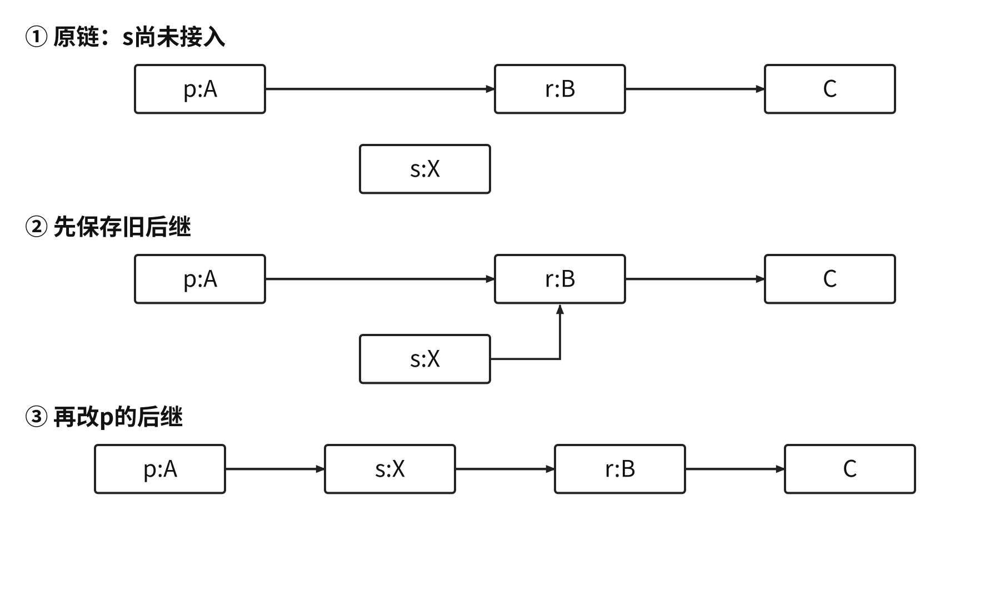{#ds-fig-list-insert width=94%}

删除 `p` 的后继时，先检查 `p->next!=NULL`，再用 `q=p->next` 暂存待删结点，执行 `p->next=q->next`，最后释放 `q`。释放后不能继续读取 `q->next`。若只给待删结点的指针而不给其前驱，通常还要从头寻找前驱；用“复制后继数据再删后继”的办法不适用于尾结点，还可能改变题目要求保留的结点身份。

头插法不断把新结点接到头结点之后，输入次序会逆转；尾插法保存尾指针，每次接到尾部，能保留输入次序。两者若都维护所需指针，建立 $n$ 个结点的链表均为 $O(n)$；若每插入一个元素都重新从头找尾部，才会累积到 $O(n^2)$。

### 原地逆置：未处理部分不能丢 {#ds-c02-h52}

维护 `prev` 为已逆置部分的新首结点，`cur` 为未处理部分的首结点。每次先暂存 `nxt=cur->next`，再把 `cur->next` 指向 `prev`，随后推进两个工作指针。

```c
void reverseList(Node *L) {       // 带头结点
    Node *prev=NULL, *cur=L->next;
    while (cur!=NULL) {
        Node *nxt=cur->next;
        cur->next=prev;
        prev=cur;
        cur=nxt;
    }
    L->next=prev;
}
```

每轮只移动一个结点到逆置区。空表时循环不执行，头结点仍指向空；单结点时其 `next` 仍为空。时间 $\Theta(n)$，辅助空间 $\Theta(1)$。递归逆置虽然也能线性运行，却要保留递归栈，不能与此实现混算空间。

### 例 2-2　如何一次扫描找到倒数第 $k$ 个结点 {#ds-ex2-2}

【2009】 已知一个带有表头结点的单链表，结点结构为 `data | link`，只给出了头指针 `list`。在不改变链表的前提下，设计尽可能高效的算法，查找倒数第 $k$ 个位置上的结点（$k$ 为正整数）。若成功，输出该结点的 `data` 值并返回 1；否则只返回 0。要求说明设计思想、实现步骤，并用 C、C++ 或 Java 描述算法，在关键处加注释。

**解析。** 倒数位置由尾部决定，但链表不能直接向前访问。让两个指针保持固定间隔：`fast` 先从首元结点前进 $k$ 步，再让 `fast` 与 `slow` 同步前进。若表长为 $n$，`fast` 到达空位置时共走了 $n$ 步，`slow` 只走了 $n-k$ 步，正好指向第 $n-k+1$ 个结点。

```c
int searchK(Node *list, int k) {
    if (k<=0) return 0;
    Node *fast=list->link, *slow=list->link;
    for (int j=0; j<k; ++j) {
        if (fast==NULL) return 0;   // 表长不足 k
        fast=fast->link;
    }
    while (fast!=NULL) {
        fast=fast->link;
        slow=slow->link;
    }
    printf("%d", slow->data);
    return 1;
}
```

以长度 5、$k=2$ 为例，先让 `fast` 指向第3个结点，`slow` 留在第1个；同步经过“4与2—5与3—空与4”，第4个即倒数第2个。$k=n$ 时第一阶段恰到空位置，第二阶段不执行，返回首元结点；$k>n$ 时在第一阶段报失败。两个指针合计走 $O(n)$ 步，辅助空间 $O(1)$，没有修改任何链接。

## 双链表、循环链表与静态链表 {#ds-02-04}

双链表为每个结点增加 `prior`，以便从当前结点访问直接前驱。已知 `p` 后，删除 `p` 可在 $O(1)$ 时间内同时接好两侧；它没有消除按位序寻找 `p` 的成本。

### 例 2-3　把结点插到双链表结点之前 {#ds-ex2-3}

〖2.3-015〗 在双链表中向 `p` 所指的结点之前插入结点 `q`，正确操作是（　）。

```text
A. p->prior=q; q->next=p;
   p->prior->next=q; q->prior=p->prior;
B. q->prior=p->prior; p->prior->next=q;
   q->next=p; p->prior=q->next;
C. q->next=p; p->next=q;
   q->prior->next=q; q->next=p;
D. p->prior->next=q; q->next=p;
   q->prior=p->prior; p->prior=q;
```

**解析。** 假设 `p` 有有效前驱（可以是头结点）。记旧前驱为 `r`，结果必须同时满足 `r->next=q`、`q->prior=r`、`q->next=p`、`p->prior=q`。D 在最后才修改 `p->prior`，因此前三句还可以取得旧前驱，答案为 **D**。A 的第一句过早覆盖旧前驱；B 最后把 `p->prior` 设成了 `p` 自身；C 既改错方向，又使用尚未设置的 `q->prior`。

写程序时也可先 `q->prior=p->prior; q->next=p;`，再改两侧结点的链接。若 `p` 是不带头结点链表的首元结点，前驱为空，须单独更新头指针，不能直接解引用它。

**循环单链表**把尾结点的 `next` 指回链头。带头结点时，空表满足 `L->next==L`；`L==NULL` 只是没有有效头结点，不能作为这个模型的空表条件。遍历应在重新遇到头结点时结束，不能等待 `NULL`。

只给尾指针 `rear` 的无头循环单链表，可以用 `rear->next` 取得首元结点；两个非空循环单链表头尾相接时，交换各尾部的后继链接即可完成 $O(1)$ 拼接。若只给头指针且没有尾链接，要先找到尾部，通常需要线性时间。若存在头结点，拼接时须处理多余头结点，不能把它当作数据留在两表之间。

循环双链表的头结点同时连接首尾，空表时 `next` 与 `prior` 都指回自己。**静态链表**用数组保存结点，用整数下标代替机器指针；逻辑后继由游标决定，不要求结点下标相邻。还须维护空闲结点链或其他可用位置管理结构，数组开得大不等于每个位置都是有效数据。

## 双指针、归并与原地处理 {#ds-02-05}

这些方法把题目的约束变成指针之间的不变关系。使用前先确认能否修改原数据、是否有序、是否共享结点，以及是否需要保留重复元素。

### 例 2-4　数组循环左移怎样避免反复搬移 {#ds-ex2-4}

【2010】 将 $n\ (n>1)$ 个整数存放在一维数组 $R$ 中。设计一个时间、空间都尽可能高效的算法，将序列循环左移 $p\ (0<p<n)$ 个位置，即把 $(X_0,\ldots,X_{n-1})$ 变为 $(X_p,\ldots,X_{n-1},X_0,\ldots,X_{p-1})$。给出思想、C/C++ 或 Java 实现，并说明时间与空间复杂度。

**解析。** 题目要求两个连续区段交换位置，同时保持各段内部次序。设前 $p$ 个元素为 $A$，其余为 $B$。分别逆置得 $A^RB^R$，再整体逆置，即得 $BA$。两个区段各被逆置两次，内部方向恢复，而相对位置交换。

```c
void reverse(int R[], int l, int r) {
    while (l<r) {
        int t=R[l]; R[l]=R[r]; R[r]=t;
        ++l; --r;
    }
}
void rotateLeft(int R[], int n, int p) {
    reverse(R,0,p-1);
    reverse(R,p,n-1);
    reverse(R,0,n-1);
}
```

例如 `abcdefgh` 左移3位，依次得到 `cbadefgh`、`cbahgfed`、`defghabc`。总交换次数不超过 $n$，时间 $O(n)$；只用常数临时变量，空间 $O(1)$。若将首元素移到末尾重复 $p$ 次，时间为 $O(np)$，当 $p$ 与 $n$ 同阶时会退化。三次逆置可处理 $p=1$ 和 $p=n-1$，无需另写搬移循环。

### 有序归并为什么可以一次扫描 {#ds-c02-h151}

两个递增表的当前首元素中，较小者一定是剩余全部元素中最小的。输出它并推进对应指针，重复直到某表为空，再接上另一个表的剩余部分。合并长度为 $m,n$ 的两个表需要 $O(m+n)$ 时间；数组版本通常另开输出区，链表版本在允许破坏原表时可直接重接结点。

比较相等元素时，若希望保持原相对次序，先取左表元素。若题目要求集合并集而不是多重集合合并，则相等时只输出一次并推进两个指针；这项条件会改变算法，不能只改题目的答案。

### 例 2-5　相同后缀是相同字符还是相同结点 {#ds-ex2-5}

【2012】 采用带头结点的单链表保存单词，两个单词可共享相同后缀的存储空间。例如 `loading` 与 `being` 共享从字符 `i` 开始的结点。`str1`、`str2` 指向两个头结点，结点为 `data | next`。设计时间上尽可能高效的算法，找到共同后缀的起始结点，给出思想、程序及时间复杂度。

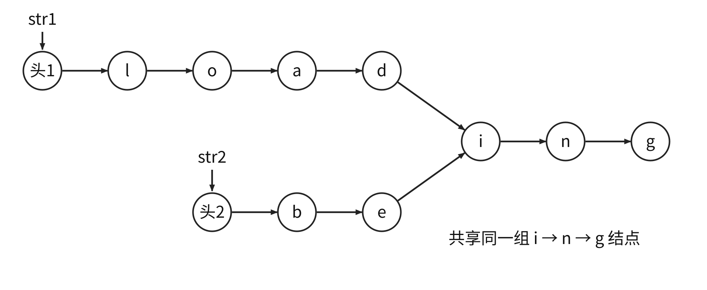{#ds-fig-shared-suffix width=94%}

**解析。** 共享指的是地址相同，不能以 `p->data==q->data` 判断。单链表一旦在某结点汇合，其后继也相同，所以两表从公共起点到末尾的长度相等。先各扫描一次求长 $m,n$，让较长表先走 $|m-n|$ 步，两指针便处于距表尾相同的位置；此后同步前进，第一次地址相等的位置就是答案。

```c
Node *commonSuffix(Node *str1, Node *str2) {
    int m=0,n=0;
    for (Node *p=str1->next; p; p=p->next) ++m;
    for (Node *q=str2->next; q; q=q->next) ++n;
    Node *p=str1->next, *q=str2->next;
    while (m>n) { p=p->next; --m; }
    while (n>m) { q=q->next; --n; }
    while (p!=q) { p=p->next; q=q->next; }
    return p;                   // 无公共结点时二者同时为 NULL
}
```

图中长度为7和5，先让长表跨过 `l,o`，再比较 `a` 与 `b`、`d` 与 `e`、最后到达同一个 `i`。若两表内容相同却各自分配结点，则直到空位置才相等，返回空。总时间 $O(m+n)$，辅助空间 $O(1)$，适用于有限、无环单链表。

### 例 2-6　主元素为什么还要再计数 {#ds-ex2-6}

【2013】 整数序列 $A=(a_0,\ldots,a_{n-1})$ 满足 $0\le a_i<n$。某值出现次数超过 $n/2$ 时，称它为主元素。例如 $(0,5,5,3,5,7,5,5)$ 的主元素为5，而 $(0,5,5,3,5,1,5,7)$ 没有主元素。设计尽可能高效的算法，存在主元素时输出该值，否则输出 −1；给出思想、程序及时间、空间复杂度。

**解析。** 每次删除两个值不同的元素，不会消灭一个原本占严格多数的值：若删去一多数元素和一其他元素，多数仍超过剩余的一半；若删去两个其他元素，多数优势更大。用一个候选值和计数模拟这种抵消。计数为0时选新候选；相同则加1，不同则减1。

```c
int majority(int A[], int n) {
    int candidate=0, count=0;
    for (int i=0; i<n; ++i) {
        if (count==0) { candidate=A[i]; count=1; }
        else if (A[i]==candidate) ++count;
        else --count;
    }
    int actual=0;
    for (int i=0; i<n; ++i)
        if (A[i]==candidate) ++actual;
    return actual>n/2 ? candidate : -1;
}
```

抵消只保证“若有主元素，最后候选一定是它”，没有保证主元素存在。例如 `1,2,3` 最后仍可能留下候选3，它只出现一次，所以必须第二次扫描核实。两个线性扫描合计 $O(n)$ 时间，额外空间 $O(1)$。题目给出的值域也允许用计数数组，但需 $O(n)$ 辅助空间；此处没有必要为省一次扫描付出这部分空间。

## 自测与答案 {#ds-ch2-check}

以下为原创补充，检查边界和不变式。

1. 允许修改单链表，要求删除所有值为 $x$ 的结点。删除一个结点后，指向前驱的指针是否应立即后移？
2. 两个无环单链表长度相同，尾结点地址相同，能否断定它们一定有公共后缀？
3. 顺序表去除相邻重复元素时，为什么可用“已保留长度”作为写指针，而不必每删一个元素都搬移后半表？

**答案。** 1. 不应立即后移；新的后继还可能等于 $x$，应继续检查当前前驱的后继。只有保留一个结点时前驱才推进。2. 能；至少尾结点本身就是公共后缀，公共起点还可能更早。3. 扫描指针只读未处理区，写指针只向前形成已保留区；每个元素最多被检查和写入常数次，总时间 $O(n)$。若原表无序，这只能消除相邻重复，不能保证全表唯一。


# 栈、队列与数组：操作约束与状态 {#ds-ch3}

栈与队列都保存线性序列，差别在允许从哪里加入和取出。判断一个操作序列是否合法，必须保留操作过程中的状态；只检查输入、输出是否含有相同元素，不能排除违反栈顶或队头约束的情况。

## 栈的后进先出与合法序列 {#ds-03-01}

**栈**只允许在同一端插入和删除，这一端称为栈顶，另一端称为栈底。入栈称 `push`，出栈称 `pop`。栈为空时不能出栈；固定容量栈满时不能继续入栈。若不允许中途出栈，一批元素的出栈次序是入栈次序的逆序；若允许交替入栈和出栈，输出就可能有多种。

检验给定输出的方法是按目标逐个模拟：若当前栈顶不是所需元素，继续把尚未入栈的元素依次压入；一旦所需元素到顶，就弹出。若输入已用尽而栈顶仍不符，输出不合法。这个过程也给出实现该输出所需的最小容量：模拟中出现的最大栈深。

### 例 3-1　队列不会改变栈的输出次序 {#ds-ex3-1}

【2009】 栈 $S$ 和队列 $Q$ 初始均为空，元素 `a,b,c,d,e,f,g` 依次入栈 $S$。每个元素出栈后立即进入队列 $Q$，7个元素出队顺序为 `b,d,c,f,e,a,g`，则栈容量至少是（　）。

A. 1　B. 2　C. 3　D. 4

**解析。** 队列保持进入它的先后次序，因此它的输出就是栈的输出。按目标模拟，栈内状态按栈底到栈顶写：

| 需要输出 | 必须先执行的入栈 | 弹出后栈内剩余 |
| --- | --- | --- |
| b | a、b | a |
| d | c、d | a、c |
| c | 无 | a |
| f | e、f | a、e |
| e | 无 | a |
| a | 无 | 空 |
| g | g | 空 |

压入 d 或 f 后，栈深达到3；表中过程也说明3个单元足够，答案为 **C**。不能把队列当作另一处可以随意调整次序的缓冲区。

若只用入栈 `I`、出栈 `O` 表示操作，一段从空栈出发并回到空栈的合法序列须满足：总数相等，且每个前缀中 `O` 的个数不超过 `I`。对 $n$ 个不同元素，合法出栈序列数为卡特兰数 $C_n=\frac1{n+1}\binom{2n}{n}$；这一公式用于计数，不代替具体容量与给定序列的模拟。

输入为 `a,b,c,d` 时，若输出以 `c,d` 开头，弹出 c 后栈中为 a、b，随后必须压入并弹出 d，剩余只能 b、a，因此仅有 `c,d,b,a` 一种。若题目指定的是栈的输出而让输入未知，也要反推中间栈顶。例如第3个输入是1、输出从1递增，1弹出时第2个输入压在第1个输入上方；若第1个是2，就要先弹出上面的另一个值才能到2，与“接下来输出2”矛盾，所以第1个不可能是2。

## 队列与双端队列 {#ds-03-02}

**队列**只在队尾加入、在队头删除，遵循先进先出。它适合保存等待依次处理的对象，如按发现顺序等待扩展的图顶点。队头与队尾是逻辑角色，不能从数组下标大小判断：循环队列绕回后，队尾下标可以小于队头下标。

**双端队列**允许在两端插入和删除。输入受限双端队列只允许一端输入，两端均可输出；输出受限双端队列允许两端输入，只允许一端输出。判断输出时应明确属于哪一种，不能直接套普通队列或普通栈的限制。双端队列能够模拟栈与队列，但这不表示它能按任意次序输出一组顺序输入的元素。

## 顺序栈、共享栈与循环队列 {#ds-03-03}

顺序栈存于 `A[0..M-1]`。本书令 `top` 指向当前栈顶，初值 −1：空条件 `top==-1`，满条件 `top==M-1`；入栈为 `A[++top]=x`，出栈为 `x=A[top--]`。若题目改用“`top` 指向下一个空位”，空条件就为0，入栈与出栈的增减位置也随之改变。先画一个元素的状态，再写公式，通常比背四个表达式可靠。

两个栈共享一个数组时，可让一端从左向右长、另一端从右向左长。初值 `top1=-1, top2=M`，栈满当且仅当 `top2-top1==1`。未用空间是两栈顶之间的单元，某个栈已用多少不单独决定全局栈满。入栈前必须检查相邻条件，不能等两个栈顶已经重合才报告满。

### 循环队列先立约定再计算 {#ds-c03-h47}

采用长度为 $M$ 的数组，令 `front` 指向队头元素，`rear` 指向下一次入队位置。出队后 `front=(front+1)%M`，入队后 `rear=(rear+1)%M`。若只有这两个下标，空与完全占满都会出现 `front==rear`，无法区分。

**牺牲一个单元**时，约定空条件为 `front==rear`，满条件为 `(rear+1)%M==front`，可保存的最大元素数是 $M-1$。当前长度为

$$\mathrm{len}=(rear-front+M)\bmod M.$$

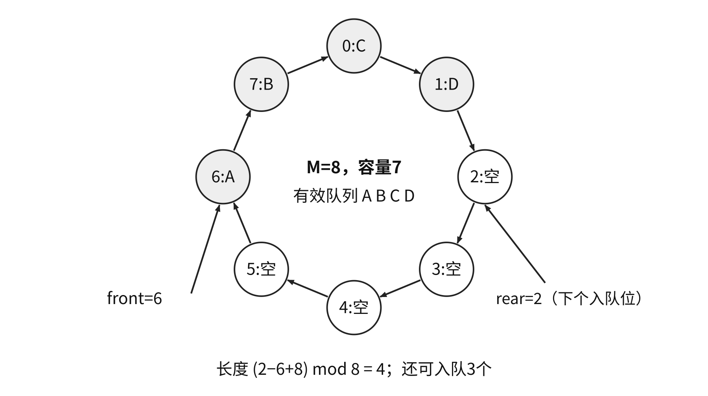{#ds-fig-circular width=80%}

若要求 $M$ 个单元全部可用，可以增加 `size` 计数，或增加标志区分最近一次改变相等状态的是入队还是出队。此时“空”和“满”的判断依赖新增成员，不能仍照搬牺牲单元的满条件。

### 例 3-2　换了 front 含义，长度公式是否改变 {#ds-ex3-2}

〖3.2-006〗 循环队列存于数组 `A[21]`，`front` 指向队首元素的前一个位置，`rear` 指向队尾元素。当前 `front=8, rear=3`，队列长度为（　）。

A. 5　B. 6　C. 16　D. 17

**解析。** 有效元素从下标9开始，经过9至20，再经过0至3，共 $12+4=16$ 个，答案为 **C**。公式仍可写成 $(3-8+21)\bmod21=16$，是因为这里前后两个指针相对前一约定同时偏移了一个位置。若只改变一个指针的含义，公式就未必不变。数组是 `A[0..n]` 时实际有 $n+1$ 个单元，取模也必须使用 $n+1$。

## 链栈与链队列 {#ds-03-04}

链栈通常把链头作为栈顶，头插与头删都是 $O(1)$。动态分配可随数据量申请结点，因而通常不受一个预先给定的小数组容量限制；它仍可能因可用内存不足而入栈失败，栈空也照样可能发生。

单链队列把链头作为队头，链尾作为队尾，并保存两个指针。若反过来从单链表尾部删除，必须找到尾结点的前驱，出队会变为 $O(n)$。带头结点的链队列空时 `front==rear`，二者都指向头结点。入队时接到 `rear->next` 并更新 `rear`；出队时删除 `front->next`。

```text
dequeue(Q):
    if Q.front==Q.rear: return 失败
    p=Q.front->next
    x=p->data
    Q.front->next=p->next
    if Q.rear==p: Q.rear=Q.front
    释放 p
    return x
```

最后一个数据结点出队时，必须让尾指针退回头结点；否则它指向已释放的空间。非空且不止一个元素时，无需改变尾指针，所以题目问“删除是否修改头尾指针”，正确判断取决于是否删除了最后一个元素。

只带队首指针的非循环双链表，要在另一端入队仍需找尾部；循环双链表则可通过 `front->prior` 直接取得尾部。比较结构时，应检查有没有可到达另一端的短链接，而不是看到“双链”就认定所有操作都为常数时间。

## 多维数组的地址怎样计算 {#ds-03-05}

数组同一维度的下标取值范围固定，每个元素大小相同。设二维数组的行下标为 $l_1\sim u_1$，列下标为 $l_2\sim u_2$，列数 $c=u_2-l_2+1$，行数 $r=u_1-l_1+1$，每元素占 $w$ 字节，首元素地址为 $b$。

按行优先时，在 $(i,j)$ 前有 $i-l_1$ 个完整行及本行的 $j-l_2$ 个元素，故

$$\operatorname{Addr}(A[i,j])=b+[(i-l_1)c+(j-l_2)]w.$$

按列优先时，先数完整列：

$$\operatorname{Addr}(A[i,j])=b+[(j-l_2)r+(i-l_1)]w.$$

例如 `A[2..4][−1..2]` 行优先，每元素4字节，`A[2][−1]` 地址1000。`A[4][1]` 前有 $2\times4+2=10$ 个元素，地址为1040字节。下标差先得到“元素数”，最后乘元素宽度才得到字节偏移；按字编址的题则要统一成字地址再计算。

三维数组按行优先时，最右下标变化最快：`A[i][j][k]` 的相对元素位置为 $((i-l_1)n_2+(j-l_2))n_3+(k-l_3)$。可以逐维理解，不必另背一个没有下标原点的公式。

## 对称、三角、三对角与稀疏矩阵 {#ds-03-06}

压缩存储利用元素间的确定关系，避免重复保存。**对称矩阵**满足 $a_{ij}=a_{ji}$，保存一侧三角即可；访问另一侧时交换 $i,j$。**三角矩阵**一侧三角外的元素都相同，通常还要额外保存这个公共常量，它未必为0。**三对角矩阵**只在主对角线及相邻两条对角线上可能非零，共有 $3n-2$ 个需要保存的位置。

下三角按行保存、原矩阵与数组下标均从0开始时，位置 $(i,j)$（$i\ge j$）之前有 $1+2+\cdots+i=i(i+1)/2$ 个元素，故数组下标为 $i(i+1)/2+j$。若原矩阵从1开始而数组从0开始，公式相应变成 $i(i-1)/2+j-1$。推导的顺序始终是“前面完整行或列数＋本行或列内偏移”。

### 例 3-3　三对角矩阵的起止行不能一律算3个 {#ds-ex3-3}

【2016】 100阶三对角矩阵 $M$ 的元素 $m_{i,j}\ (1\le i,j\le100)$ 按行优先依次压缩存入下标从0开始的一维数组 $N$。$m_{30,30}$ 在 $N$ 中的下标为（　）。

A. 86　B. 87　C. 88　D. 89

**解析。** 第一行有2个元素，第2至29行各有3个，共 $2+28\times3=86$ 个在第30行之前。第30行依次保存 $m_{30,29},m_{30,30},m_{30,31}$，目标是本行第2个，因此下标为 $86+1=87$，答案为 **B**。这里87是从0开始的下标，目标是第88个被保存的元素。

### 例 3-4　先用对称性换到实际保存的半边 {#ds-ex3-4}

【2020】 10×10对称矩阵 $M$ 的上三角元素 $m_{i,j}\ (1\le i\le j\le10)$ 按列优先存入 C 语言一维数组 $N$。$m_{7,2}$ 在 $N$ 中的下标为（　）。

A. 15　B. 16　C. 22　D. 23

**解析。** $m_{7,2}=m_{2,7}$，实际寻找第7列第2行。前6列各存 $1,2,\ldots,6$ 个，共21个；本列目标前还有第1行1个元素，所以从0开始的下标为 $21+1=22$，答案为 **C**。不能先把下三角坐标直接代入上三角公式，再试图以加减1修正。

上三角若改为按行优先，各行长度为 $n,n-1,\ldots,1$；第 $i$ 行之前有 $(i-1)(2n-i+2)/2$ 个保存位置。下三角若按列优先，各列长度同样递减，但列内偏移为 $i-j$。公式外形相近，决定它的是保存方向与下标原点。

**稀疏矩阵**的非零位置没有固定三角规律，需要连同位置一起保存。三元组顺序表记录 `(行,列,值)`，还须保存矩阵行列数与非零元数；十字链表为同一个非零元同时设置行链接和列链接。压缩后不能再按普通二维数组地址公式随机访问任意元素，查找与修改成本随表示方法而变。

## 表达式、递归与层次处理 {#ds-03-07}

### 括号与表达式中的“最近一个尚未完成对象” {#ds-c03-h132}

左括号入栈；遇右括号时，栈顶必须是对应种类的左括号，匹配后弹出；扫描完后栈必须为空。`([)]` 中括号数量相等，但遇到第一个右圆括号时栈顶为左方括号，已经失败。这个过程正好需要最后遇到且尚未配对的对象，所以选择栈。

后缀表达式中，操作数先入栈，遇二元运算符时先弹出的数是**右操作数**，后弹出的是左操作数，计算后将结果入栈。减法、除法不能颠倒。合法二元后缀表达式每遇运算符前至少有两个可用值，最终恰好留下一个结果。

### 例 3-5　弹出次序怎样影响减法 {#ds-ex3-5}

【2018】 栈 $S_1$ 保存整数，$S_2$ 保存运算符。函数 F() 依次：（1）从 $S_1$ 弹出操作数 a、b；（2）从 $S_2$ 弹出运算符 op；（3）执行 b op a；（4）把结果压入 $S_1$。初始 $S_1$ 自底向顶为5、8、3、2，$S_2$ 自底向顶为 `*`、`−`、`+`。调用3次 F() 后，$S_1$ 栈顶值是（　）。

A. −15　B. 15　C. −20　D. 20

**解析。** 第一次弹出2、3，用加法得到 $3+2=5$，整数栈变为5、8、5。第二次弹出5、8，用减法得到 $8-5=3$，栈变为5、3。第三次得到 $5\times3=15$，答案为 **B**。若第二次按弹出先后计算 $5-8$，就会得到错误的负数。

中缀转后缀可用运算符栈：操作数直接输出；左括号入栈；右括号触发输出直到匹配左括号；遇运算符时，先输出栈顶中优先级更高的运算符。对通常左结合的 `+、−、*、/`，同级也先弹出；若加入右结合运算符，等优先级规则需要调整。

例如 $x+y(z-u)/v$（其中相邻表示乘法）先把括号内写成 `zu−`，乘除按左结合形成 `yzu−*v/`，最后与 x 相加，得 `xyzu−*v/+`。这里的输出顺序表达运算依赖，而不是把原式的符号按种类重新排列。

### 递归返回前保存了什么 {#ds-c03-h150}

递归调用栈保存尚未完成的调用。调用树的一个结点表示一次调用，不能把函数返回值当作调用次数。对于

```c
int F(int n) {
    if (n<=3) return 1;
    return F(n-2)+F(n-4)+1;
}
```

令 $C(n)$ 表示含当前调用在内的调用次数，则 $n\le3$ 时 $C(n)=1$，否则 $C(n)=1+C(n-2)+C(n-4)$。因此 $C(4)=C(2)+C(0)+1=3$，$C(6)=1+3+1=5$，$C(8)=1+5+3=9$。式中返回值的“＋1”不是另一次函数调用；次数递推中的“＋1”是当前调用本身。此过程对应〖3.3-006〗的递归调用模型。

C/C++ 对加号两侧函数调用的求值先后并不一概保证从左到右。若题目问“第几个被调用”，应检查答案是否依赖这个先后，不能把一种习惯顺序当作语言保证。调用总数与最终结果在本例不受这个先后影响。另如〖3.3-007〗把递归式改为 `func(x-2)+func(x-4)`、基例返回2，并计算 `func(func(5))`：必须先完成内层func(5)，它和func(3)、func(1)共3次调用，结果为4，所以第4次是外层func(4)；内层两个基例谁先执行不影响这个结论。

层次处理需要先进先出的队列：先发现的一层结点必须先扩展，后发现的下一层排在后面。第5章层序遍历与第6章 BFS 都用这条约束，但图还需 `visited` 防止同一顶点反复入队。

## 自测与答案 {#ds-ch3-check}

第2题引自王道书，其余为原创补充，检查表示约定。

1. 数组有8个单元、牺牲一个单元的循环队列，`front=6,rear=2`，长度是多少？还能再入队几个元素？
2. 〖3.1-025〗顺序共享栈 `Share[0..n−1]`，第一个栈顶top1初值−1，第二个栈顶top2初值n，栈满条件是（　）。A. `top2−top1==1`　B. `top1−top2==1`　C. `top1==top2`　D. 都不对
3. 下标从1开始的三对角矩阵，若压缩数组也从1开始，非边界行元素 $a_{i,j}$ 的位置如何计算？

**答案。** 1. 长度 $(2-6+8)\bmod8=4$，最大容量7，还能入队3个。2. **A**，两栈顶相邻时已无可用单元，不能等栈顶重合才判满。3. 前面有 $2+3(i-2)=3i-4$ 个元素，本行从 $j=i-1$ 开始，故从1开始的位置为 $3i-4+[j-(i-1)]+1=2i+j-2$；前提为 $2\le i\le n-1$ 且 $|i-j|\le1$，首尾行须按实际保存位置解释。


# 串的模式匹配：失配后怎样移动 {#ds-ch4}

模式匹配要在主串中寻找一段连续字符，使它与模式串逐字符相同。朴素方法失败后重试下一个起点；KMP 利用已经相等的部分决定怎样移动模式串。二者处理的是同一个匹配问题，差别在于是否重复比较已经知道的信息。

## 串、子串与下标 {#ds-04-01}

**串**是由零个或多个字符组成的有限序列，串长为字符个数。长度为0的是空串；只含空格的串仍含字符，不是空串。**子串**必须由原串中连续的一段字符构成，允许不连续选取字符得到的是子序列。两个串相等，须长度相等且每个对应字符相等。

本章令主串为 $T[0..n-1]$，模式串为 $P[0..m-1]$，匹配位置返回从0开始的下标。题目若使用从1开始的位序，最终位置加1，但中间 `next` 数组还涉及失败哨兵的约定，不能只把某一列机械加1。空模式是否匹配应由接口约定；以下算法把空模式匹配位置约定为0，主要讲解 $m>0$ 的情形。

串可用定长数组、动态分配连续区或块链存储。C 的以 `\0` 结束的字符串是一种具体表示；结束符本身不计入通常的串长。使用显式长度的串也可以包含值为0的字符。求子串、连接、替换与模式匹配是不同运算，不能把“找到一段相同字符”称为串连接。

## 朴素匹配怎样回退 {#ds-04-02}

先把模式首字符与主串起点 $s=0$ 对齐，从头逐一比较。若某处不同，则把起点改为 $s+1$，重新从模式首字符比较。若模式全部相等，返回 $s$；若所有 $s\le n-m$ 的起点均失败，则不存在匹配。

```text
naive(T, n, P, m):
    for s=0 to n-m:
        j=0
        while j<m and T[s+j]==P[j]: j=j+1
        if j==m: return s
    return -1
```

当 $m>n$ 时，没有候选起点，直接失败。一次尝试最多比较 $m$ 次，总共最多 $n-m+1$ 个起点，所以最坏时间为 $O((n-m+1)m)$，常简记为 $O(nm)$；辅助空间为 $O(1)$。

最坏情况来自“前面大段都相同，到末尾才失败”。例如主串连续很多个 a，模式为 `aaaab`。每次对齐都重比一段 a，且这些比较没有帮助排除紧接着的下一个起点。若每次第一个字符就失配，比较次数则近似候选起点数。不能把最坏上界当成每次实际执行次数。

## KMP 的 next 为什么只依赖模式串 {#ds-04-03}

设当前已经匹配 $j$ 个字符，即 $T[i-j..i-1]=P[0..j-1]$，现在 $T[i]\ne P[j]$。主串这段已知内容就是模式的前 $j$ 个字符。要让模式右移后仍保留尽可能多的已匹配字符，新的模式前缀必须等于旧匹配段的后缀。

因此，在 $P[0..j-1]$ 中寻找“相等的最长真前缀与真后缀”，设长度为 $k$。真前缀和真后缀都不允许取整个串。右移后，旧段最后 $k$ 个字符与新模式前 $k$ 个字符已经相等，下一步只需比较 $T[i]$ 与 $P[k]$。主串指针 $i$ 保持不变，模式指针从 $j$ 退到 $k$，模式整体右移了 $j-k$ 位。

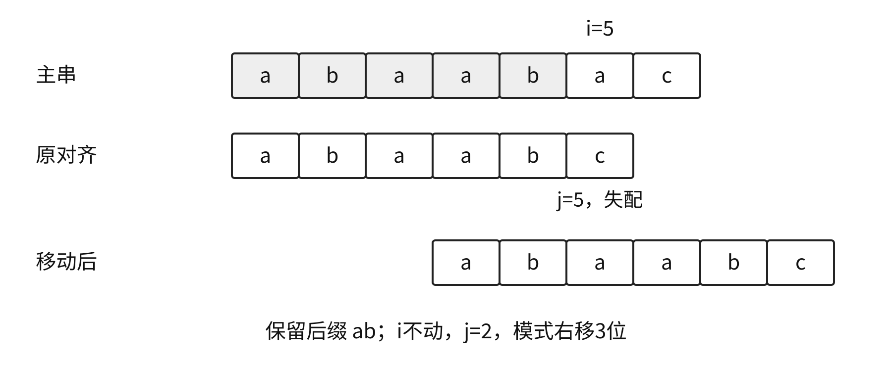{#ds-fig-kmp width=96%}

### 本书的 next 定义 {#ds-c04-h38}

对 $j\ge1$，`next[j]` 等于 $P[0..j-1]$ 的最长相等真前后缀长度；令 `next[0]=-1` 作哨兵。`j=0` 已失配时，模式没有可保留的前缀，应把主串推进一位再从模式首字符开始；代码借 `j=-1` 统一完成这个动作。

以 `P=abaabc` 为例：

| 下标 j | 0 | 1 | 2 | 3 | 4 | 5 |
| --- | --- | --- | --- | --- | --- | --- |
| P[j] | a | b | a | a | b | c |
| next[j] | −1 | 0 | 0 | 1 | 1 | 2 |

求 `next[5]` 看的是它前面的 `abaab`，而不是把 `P[5]=c` 也包括进去。`abaab` 的最长相等真前后缀是 `ab`，长度2，所以失败后去 `P[2]` 继续比较。若把 `next` 误算成“包含当前位置的前后缀长度”，就会把表错开一格。

```text
buildNext(P, m):
    next[0]=-1
    i=0; k=-1
    while i<m-1:
        if k==-1 or P[i]==P[k]:
            i=i+1; k=k+1
            next[i]=k
        else:
            k=next[k]
```

建表函数的前提是 $m>0$；空模式直接返回匹配位置0，不调用建表。求表时同样是在模式内部做匹配：已知长为 $k$ 的相等前后缀，若下一字符也相等，就扩展一位；不等时，退到这段前缀自己的更短边界继续尝试。不能每次失配都直接把 $k$ 清零，否则会丢掉仍可复用的边界。

```text
kmp(T, n, P, m, next):
    if m==0: return 0
    i=0; j=0
    while i<n and j<m:
        if j==-1 or T[i]==P[j]:
            i=i+1; j=j+1
        else:
            j=next[j]
    if j==m: return i-m
    return -1
```

主串指针只前进，不回退；模式指针可回退。每次字符相等时二者同时增加，失败时只有 $j$ 减少；$j$ 总减少量受此前总增加量约束。因此匹配扫描为 $O(n)$，求表为 $O(m)$，总时间 $O(n+m)$，辅助数组占 $O(m)$。这里没有说“每个主串字符只能比较一次”：同一个主串字符可能与模式的多个位置比较，只是总比较量仍为线性。

### 例 4-1　第一次失配后哪个指针改变 {#ds-ex4-1}

【2015】 字符串 s 为 `abaabaabacacaabaabcc`，模式串 t 为 `abaabc`。采用 KMP 匹配，第一次出现失配 `s[i]≠t[j]` 时，`i=j=5`，下次开始匹配时，i 和 j 分别是（　）。

A. i=1，j=0　B. i=5，j=0　C. i=5，j=2　D. i=6，j=2

**解析。** 由“i=j=5 时第一次失配”可知本题使用从0开始的下标：前面已匹配 `abaab`，当前主串字符 a 与模式字符 c 不同。已匹配段的后缀 `ab` 可与模式前缀 `ab` 重合，因此 `j=next[5]=2`，i 仍为5，答案为 **C**。此后比较的是同一个主串 a 与模式第3个字符 a；这一步若相等，才把 i、j 同时加1。

若使用从1开始的 `next[1]=0` 约定，相同位置对应的指针是 `i=j=6`，失败后 `j=3`。它与从0开始的“5退到2”表达同一次对齐，不能把表的哨兵0和字符下标0混作一件事。

### nextval 省掉哪些一定失败的比较 {#ds-c04-h90}

若当前 `P[j]` 已与主串字符失配，而 `P[next[j]]==P[j]`，退过去再比较仍必失败。可以继续沿失败链接退到不同字符，或直接退到哨兵。把这种合并后的失败位置存入 `nextval`。

在本章0起始约定下，先求普通 `next`，再从小到大求：

```text
nextval[0]=-1
for j=1 to m-1:
    k=next[j]
    if k>=0 and P[j]==P[k]: nextval[j]=nextval[k]
    else: nextval[j]=k
```

这项优化只跳过“当前已知失配字符相同”的无效比较，不能任意选择更大的右移距离；过度右移会漏掉合法匹配。某些实现把前缀函数记为 `pi` 或 `lps`，其第 j 项包含当前字符。读题时先确认定义，再换算表，不能仅凭数组名断定语义。

### 例 4-2　修正后最长能移动几位 {#ds-ex4-2}

【2024】 KMP 使用修正后的 next 数组进行模式匹配，模式串 S=`aabaab`。当主串中某字符与 S 中某字符失配时，S 向右滑动的最长距离是（　）。

A. 5　B. 4　C. 3　D. 2

**解析。** 按本章定义，逐位置求表并计算 `j-nextval[j]`：

| j | 0 | 1 | 2 | 3 | 4 | 5 |
| --- | --- | --- | --- | --- | --- | --- |
| S[j] | a | a | b | a | a | b |
| next[j] | −1 | 0 | 1 | 0 | 1 | 2 |
| nextval[j] | −1 | −1 | 1 | −1 | −1 | 1 |
| 右移距离 | 1 | 2 | 1 | 4 | 5 | 4 |

最长距离为5，答案为 **A**。例如在 j=4 的 a 处失配，普通失败链接退到 j=1 的 a，再到 j=0 的 a，都会与当前主串字符重复失配；修正表直接到 −1。下一轮主串也前进一位，于是新对齐起点相对旧起点实际前进5位。

### 比较次数要与实际实现对应 {#ds-c04-h123}

普通 next 与 nextval 的字符比较次数可能不同；程序里对 `j==-1` 的判断不是一次字符比较。若题目要求“单个字符之间的比较次数”，只记录真正执行 `T[i]==P[j]` 的次数。一次匹配成功后是否继续查重叠出现，也取决于任务：只找首次出现可立即返回；要找全部出现，须保留末尾可重用边界，不能一律把模式指针清零并跳过已读位置。

## 自测与答案 {#ds-ch4-check}

以下为原创补充，用于检查失败表定义及边界。

1. 对模式 `aaaa`，按本章约定写普通 next 与 nextval。
2. 某主串字符与模式 `abab` 的最后一个 b 失配，普通 next 应退到哪里？主串指针是否前进？
3. 主串长 $n$、模式长 $m$，只执行一次 KMP 匹配但预先已有可用 next 表，扫描部分复杂度是多少？

**答案。** 1. next 为 `−1,0,1,2`，nextval 为 `−1,−1,−1,−1`。2. `next[3]=1`，先退到模式下标1，主串指针不动；若使用 nextval，因两个位置都是 b，可直接退到0继续。3. $O(n)$；总算法连同求表才记为 $O(n+m)$，表的存储仍存在。


# 树与二叉树：结构、遍历及应用 {#ds-ch5}

树用父子关系组织层次。二叉树在此基础上区分左、右位置，遍历把结构转成一个处理次序；哈夫曼树、并查集和堆则各自增加约束，分别处理编码、集合合并和最值访问。它们共享树的表示工具，但不能互相替代性质。

## 树的结点、度、层次与路径 {#ds-05-01}

非空树有且仅有一个根。除根外每个结点恰有一个双亲，根到任意结点只有一条简单路径；树的各子树互不相交。一个结点的孩子数称为结点的**度**，树的度是所有结点度的最大值。度为0的结点称为叶结点。树中“度”通常指数孩子的个数，与无向图把关联边条数称为度的约定不同。

本书把根记为第1层，树高为最大层号，空树高度为0。结点的深度按根起的边数计，因此根深度为0，某结点层号等于深度加1；结点高度从该结点到最深后代的结点层数计。题目改为“根高度0”时，要整体换算，不能只改公式的一端。

路径长度以边数计，不以沿途结点数计。树的路径长度是根到各结点路径长度的总和；树高由最长的一条路径决定，二者不同。孩子、子孙、兄弟也要区分：兄弟共有一个双亲，堂兄弟不是同一个概念。

### 例 5-1　怎样从非叶结点数求叶结点数 {#ds-ex5-1}

【2010】 一棵度为4的树，含20个度为4的结点、10个度为3的结点、1个度为2的结点、10个度为1的结点。叶结点数为（　）。

A. 41　B. 82　C. 113　D. 122

**解析。** 设叶数为 $n_0$。一方面总节点数为 $n=n_0+20+10+1+10=n_0+41$；另一方面每条边从一个双亲指向一个孩子，边数是度数总和 $4\times20+3\times10+2+10=122$。树有 $n-1$ 条边，所以 $n_0+40=122$，得 $n_0=82$，答案为 **B**。

一般地，令 $n_i$ 为度为 $i$ 的结点数，由 $\sum_i n_i-1=\sum_i i n_i$ 得

$$n_0=1+\sum_{i\ge2}(i-1)n_i.$$

度为1的结点不出现在右端，是因为在一条边上再串入一个单孩子结点，结点数、边数各增加1，叶数不变。因此只给定 $n_2,n_3$ 和叶数，未必能确定全树结点总数；还可能插入任意多个度为1的结点。

每结点至多有 $m$ 个孩子的树，第 $i$ 层至多有 $m^{i-1}$ 个结点，高度 $h$ 至多容纳 $(m^h-1)/(m-1)$ 个结点（$m>1$）。求最小高度时，找使容量至少达到 $n$ 的最小整数 $h$。例如至多3叉、50个结点，高4时最多40个，高5时最多121个，所以最小高度5。这里必须把“度为3”理解为全树最大孩子数3，不能要求每个非叶结点都恰有3个孩子。

## 二叉树、满二叉树与完全二叉树 {#ds-05-02}

二叉树的每个结点至多有两个孩子，而且左右有别。只有一个孩子时，左孩子与右孩子形成不同结构；二叉树也不是简单地把“度不超过2的普通树”换个名字。普通树的单孩子若不规定位置，不区分这两种形态。

高度为 $h$、每一层都达到最大结点数的二叉树称为**满二叉树**，共有 $2^h-1$ 个结点。**完全二叉树**按满二叉树从上到下、从左到右编号，已有结点恰占前 $n$ 个编号。最后一层可以不满，但只能缺右侧连续的一段；上一层不能留下空缺后又出现更深结点。

“每个非叶结点恰有两个孩子”只说明不存在度为1的结点，未必是这里定义的满二叉树。叶结点可能分布在不同层。使用外文资料中的 full、perfect 等名称时，也要先看定义。

二叉树第 $i$ 层至多 $2^{i-1}$ 个结点。非空二叉树有 $n_0=n_2+1$，由上一节公式直接得到。高度 $h$ 时，结点数满足 $h\le n\le2^h-1$；给定 $n$，最小高度为 $\lceil\log_2(n+1)\rceil$，最大为 $n$。例如50个结点，最小高度6。

完全二叉树有 $\lfloor n/2\rfloor$ 个非叶结点、$\lceil n/2\rceil$ 个叶结点，最多只有一个度为1的结点，且它只能有左孩子。普通二叉树不能沿用这些完全性结论。

## 顺序编号与链式表示 {#ds-05-03}

完全二叉树按1起始编号，结点 $i$ 的双亲为 $\lfloor i/2\rfloor$，左、右孩子为 $2i,2i+1$，但只有编号不超过 $n$ 的位置才存在。若下标从0开始，孩子公式改为 $2i+1,2i+2$，非根双亲为 $\lfloor(i-1)/2\rfloor$。

任意二叉树也可以按满二叉树位置编号，但缺失的位置必须留空。因此实际结点少，不一定顺序空间也少。高度 $h$ 的一条全右链，用1起始位置时最后编号为 $2^h-1$，只存 $h$ 个结点却可能需要指数级下标范围。

### 例 5-2　任意形态的顺序存储需要预留多少 {#ds-ex5-2}

【2020】 对于任意一棵高度为5、有10个结点的二叉树，采用顺序存储结构保存，每个结点占1个存储单元，只存放结点数据信息。存放该二叉树需要的存储单元数量至少为（　）。

A. 31　B. 16　C. 15　D. 10

**解析。** 本题要求容量能够保存这种约束下的任意形态。高度5的满二叉树位置编号到31；合法的10结点形态完全可能包含第31号位置（保留通往该位置的祖先，再安排其余结点）。因此为保证任意形态可保存，至少预留31个位置，答案为 **A**。并非每一棵给定的10结点树都实际用到下标31；不能把“保证任意形态”读成“在所有形态中挑一个最省空间的”。

二叉链表为每个结点保存左、右孩子指针。$n$ 个非空结点共有 $2n$ 个孩子指针域，真正指向孩子的有 $n-1$ 个，所以空域为 $n+1$ 个。若再增加双亲指针，根的双亲域为空，其他 $n-1$ 个双亲域非空；总空域为 $3n-2(n-1)=n+2$。某个结点被多少指针指向，不只由它自己有几个孩子决定：孩子的双亲域也会指回它。

## 遍历、还原与树形递归 {#ds-05-04}

先序、中序、后序分别把“访问根”的位置放在左、右子树递归的前、中、后；三个次序都先处理左子树再处理右子树。对下图：

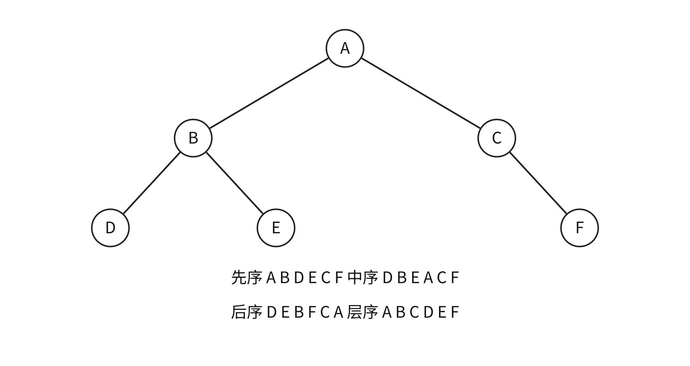{#ds-fig-traversal width=90%}

先序为 `A B D E C F`；中序为 `D B E A C F`；后序为 `D E B F C A`；层序为 `A B C D E F`。先序在深入之前处理结点，适合复制或输出结构；后序在左右结果齐备后处理根，适合求子树大小、高度、释放结点。访问位置应服从依赖，不能仅靠“某种遍历最常见”选择。

```c
int height(Node *t) {
    if (t==NULL) return 0;
    int hl=height(t->left), hr=height(t->right);
    return 1+(hl>hr ? hl : hr);
}
```

这段代码每个结点只处理一次，时间 $O(n)$；调用栈深为 $O(h)$。求高度时，叶结点返回1，与本章高度约定一致。交换所有左右子树可以递归地先交换两个子树内部，再交换两个孩子指针，从而把中序序列整体反向；交换不改变根的身份，也不改变哪些结点是叶结点。

### 先序加中序为什么能还原 {#ds-c05-h75}

假设结点标识互不相同。先序第一个元素为根，在中序中找到根后，左侧全属于左子树，右侧全属于右子树；由左子树的长度，能把先序余段分成左右两段，再递归。上图根为 A，中序左段 `D B E` 长3，故先序左段是 `B D E`，根B又把它分成D和E。

中序加后序也能唯一还原，根取后序最后一个；先序加后序一般不能区分一个单孩子在左还是在右。只给含 $n$ 个不同标识的先序序列，形态数仍为卡特兰数 $C_n$，例如4个元素为14种。结点值重复时，“在中序中找到根的位置”可能不唯一，前述唯一性需要额外身份信息。

非递归中序遍历用显式栈保存未完成的祖先：沿左链入栈，到空位置时弹栈访问，再转到其右子树。上图先依次压入 A、B、D，弹出 D 后没有右孩子，接着弹出 B 并转到 E；E 处理完才回到仍在栈中的 A。

```text
inorder(root):
    p=root; 建空栈 S
    while p 非空 or S 非空:
        while p 非空:
            push(S,p); p=p->left
        p=pop(S); visit(p)
        p=p->right
```

非递归后序还需分辨右子树是否已经处理，可保存最近访问结点 `last`。从左边返回时先看栈顶；它有尚未处理的右子树，就进入右子树，不能立即弹根。

```text
postorder(root):
    p=root; last=NULL; 建空栈 S
    while p 非空 or S 非空:
        if p 非空:
            push(S,p); p=p->left
        else:
            q=top(S)
            if q->right 非空 and last!=q->right:
                p=q->right
            else:
                visit(q); last=pop(S)
```

`last` 只在一次完整子树处理后更新，因此它等于 `q->right`，表示右子树根已经最后访问过。每个结点各入栈、出栈一次，时间仍为 $O(n)$，栈最多同时保存一条祖先路径，空间为 $O(h)$。

层序遍历把根入队，反复出队访问并依次入队左右孩子。判定完全二叉树可在层序中设置“已经遇到空孩子”标志：一旦出现空位置，此后的孩子位置不得再出现非空结点。只排除“有右孩子而无左孩子”还不够，还要排除遇到首个空孩子位置后又出现非空孩子的情况；一个结点只有左孩子，本身未必违反完全性。

### 例 5-3　中序前驱和后继在哪一侧 {#ds-ex5-3}

【2024】 p、q、v 都是二叉树 T 中的结点，v 有两个孩子，T 的中序遍历序列形如 `…,p,v,q,…`。正确的是（　）。

A. p没有右孩子，q没有左孩子　B. p没有右孩子，q有左孩子

C. p有右孩子，q没有左孩子　D. p有右孩子，q有左孩子

**解析。** v 有左子树，紧邻它之前的 p 必在左子树的最右端；若 p 还有右孩子，应先访问那棵右子树，p 就不可能紧邻 v。对称地，q 是右子树的最左端，不可能有左孩子。答案为 **A**。这里的“最右端”是沿右孩子一直走到不能再走，不能按图上结点画得最靠右判断。

## 线索二叉树：区分孩子链接与遍历线索 {#ds-05-05}

二叉链表有许多空孩子指针。把空左域改记某遍历次序下的前驱，把空右域改记后继，便得到相应的**线索二叉树**。新增 `ltag`、`rtag` 区分该域是孩子还是线索；本书约定0表示孩子，1表示线索。寻找子树时必须先看标志，不能沿一条线索继续递归，否则可能回到祖先形成循环。

中序线索树中，若结点右域为线索，可直接到中序后继；若右域为孩子，后继是右子树中沿真实左孩子链到达的第一个结点。前驱同理：左域为线索则直接取，否则到左子树最右端。图中每个结点的 L、R 分别表示左、右指针域，其后数字为对应的 `ltag`、`rtag`。E 的 R1 指向 A，C 的 L1 也指向 A；两条线索各有独立起点、箭头落点。D 的 L1 和 F 的 R1 则分别接空前驱、空后继端点，本图采用无头结点、首尾取空的约定。

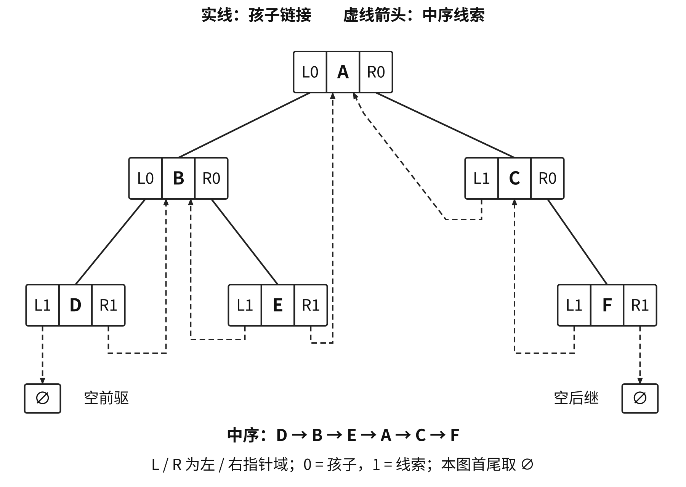{#ds-fig-threads width=94%}

$n+1$ 个原空孩子域均可改为线索域，其中首结点的前驱和末结点的后继需约定为空或指向专设头结点。题目说“线索数为 $n+1$”时通常统计这些线索域，包含首尾边界；若只统计实际指向普通结点的线索，则边界两项另算。加头结点后，其额外指针也不应混入原树的 $2n$ 域计数。

构造中序线索时，用 `pre` 保存刚访问过的结点，初值为空。处理当前结点p时，若其左域为空，填入pre并设置左线索标志；若pre的右域为空，填入p并设置右线索标志，随后令pre=p。递归只沿真实孩子执行，避免把刚填的线索又当作子树。

```text
thread(p):
    if p==NULL: return
    if p->ltag==0: thread(p->left)
    if p->left==NULL:
        p->left=pre; p->ltag=1
    if pre!=NULL and pre->right==NULL:
        pre->right=p; pre->rtag=1
    pre=p
    if p->rtag==0: thread(p->right)
```

调用前所有原孩子标志为0。图中先访问D，其空左域指向空前驱；随后访问B，D的空右域才补为指向B的线索。访问E时填左线索指向B，访问A时再把E的空右域补为A。遍历结束后，pre为最后结点F，将其空右域标为后继线索，目标按约定为空或头结点。若使用头结点，首结点空前驱也应统一改指头结点。

先序、后序线索的前驱后继依照各自次序，不可沿用中序规则。后序中，若叶结点 X 存在左兄弟 Y，则 X 是双亲的右孩子；左子树、右子树处理后访问双亲，因此 X 的后序后继是双亲，而不是左兄弟。一般后序线索树若无双亲信息，不一定能像中序那样方便地只凭孩子和线索完成全部后继访问。

## 普通树的三种存储 {#ds-05-06}

**双亲表示法**为每个结点保存双亲的下标，根用 −1 等特殊值标识。找双亲 $O(1)$，找全部孩子通常需扫描整个数组。它适合从结点反复向根追踪，但不天然适合列举孩子。

**孩子表示法**为每个结点保存孩子链表，便于依次访问所有孩子；反查双亲时若没有另外保存双亲信息，仍需搜索。**孩子兄弟表示法**只保存两个链接：`firstChild` 指向第一个孩子，`nextSibling` 指向下一个兄弟。它能用两个指针表示孩子数不定的树，却不能把 `nextSibling` 理解成普通树的孩子。

选择表示时，应先看主要方向：查双亲、枚举孩子或遍历同层兄弟，分别依赖不同的链接。多保存一个双亲域会增加空间，但也会改变上溯操作成本。

## 树、森林怎样转换为二叉树 {#ds-05-07}

采用“左孩子、右兄弟”约定：普通树第一个孩子成为二叉树左孩子，后续兄弟依次以右孩子相连。原树的根没有兄弟，故其对应二叉树根没有右孩子。森林的各棵树根互为兄弟，再沿右链连接，第一棵树的根成为二叉树的根。

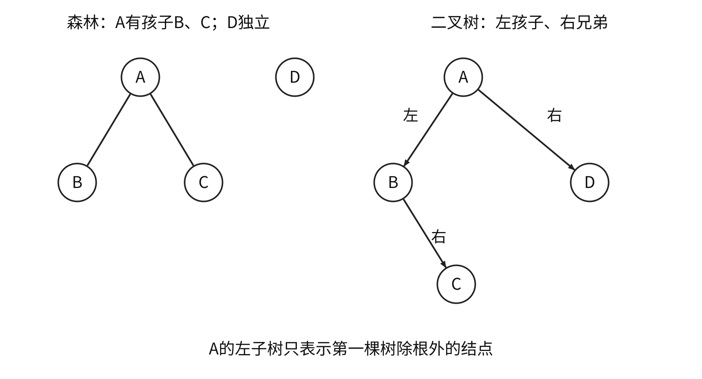{#ds-fig-forest width=96%}

逆转换时，沿某结点左孩子开始的右链，得到它的全部孩子；根及其右链上的各结点分别作为森林各棵树的根。转换改变了“左右链接的解释”，没有增加或删除数据结点。森林有4棵树、第一棵含 $a$ 个结点时，二叉树根的左子树只含第一棵树除根外的 $a-1$ 个结点，其他树由根的右子树表示。

### 例 5-4　二叉树隔两条链接，在森林中是什么关系 {#ds-ex5-4}

【2009】 将森林转换成对应二叉树。若二叉树中 u 是 v 的父结点的父结点，则原森林中 u 与 v 可能的关系是（　）。

Ⅰ. 父子关系　Ⅱ. 兄弟关系　Ⅲ. u 的父结点与 v 的父结点是兄弟关系

A. 只有Ⅱ　B. Ⅰ和Ⅱ　C. Ⅰ和Ⅲ　D. Ⅰ、Ⅱ和Ⅲ

**解析。** 从 u 到 v 恰经过两条二叉树链接。左—右表示“先到 u 的第一个孩子，再到其下一个兄弟”，v 仍是 u 的孩子，Ⅰ可能；右—右表示连续两个兄弟链接，u、v 互为兄弟，Ⅱ可能。左—左表示祖孙，右—左表示 u 的兄弟的孩子，它们都不能产生Ⅲ要求的两对父结点关系。因此答案为 **B**。应按每条链接的语义推回森林，不能把二叉树的双亲直接当作原树的双亲。

## 树与森林的遍历怎样对应 {#ds-05-08}

普通树的先根遍历先访问根，再依次先根遍历各子树；后根遍历先按顺序遍历各子树，再访问根。采用孩子兄弟转换后，树的先根次序对应二叉树先序，树的后根次序对应二叉树中序。原因是二叉树左链接深入第一个孩子，而右链接串联后续兄弟。

森林先序依次先根遍历各棵树，对应二叉树先序；森林中序先按中序处理第一棵树的子树森林，再访问该树根，最后处理其余树，对应二叉树中序。森林不是只在整片森林最开始访问一次根，应按定义递归到各棵树。

层次遍历普通树时，出队一个结点后，按孩子链的次序把它的所有孩子入队；兄弟链接用于枚举孩子，不能把整条兄弟链当作下一层逐层右移。

## 哈夫曼树、WPL 与前缀编码 {#ds-05-09}

给每个叶结点一个权值 $w_i$，其深度为 $d_i$，**带权路径长度**为 $\mathrm{WPL}=\sum_iw_id_i$。权值通常为频数或概率，内部结点不直接加入这项“叶权乘深度”的求和。求给定叶权下最小 WPL 的二叉树，可每次选当前两个最小权值合并为新结点，再把权值和放回候选集合，直到仅剩根。

为什么合并两最小值：在一棵最优树中，可以让最深的一对兄弟叶承载两个最小权值而不增大 WPL；把它们收缩成一个权值为和的叶后，剩余结构仍应最优，否则可以替换得到更小的原树。每次合并使这两个子树的全部叶深度增加1，因此合并权值之和也等于最终 WPL。

### 例 5-5　加权平均码长怎样从合并过程得到 {#ds-ex5-5}

【2023】 6个字符出现频次分别为3、4、5、6、8、10，为它们构造哈夫曼编码，加权平均长度为（　）。

A. 2.4　B. 2.5　C. 2.67　D. 2.75

**解析。** 每轮重新从当前候选中取最小两个，不能把原始序列分成相邻对后一次配完。

| 本轮合并 | 新权值 | 合并后候选权值 |
| --- | --- | --- |
| 3与4 | 7 | 5、6、7、8、10 |
| 5与6 | 11 | 7、8、10、11 |
| 7与8 | 15 | 10、11、15 |
| 10与11 | 21 | 15、21 |
| 15与21 | 36 | 36 |

WPL 为 $7+11+15+21+36=90$，频次总和36，所以平均码长为 $90/36=2.5$ 位/字符，答案为 **B**。不能把总码长除以6，因为各字符出现频次不同。

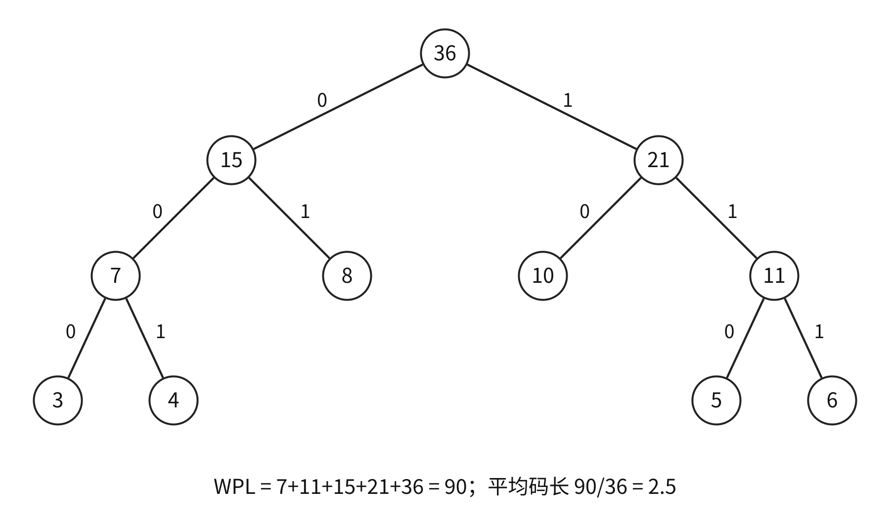{#ds-fig-huffman width=94%}

沿根到叶的0、1路径形成码字。字符只放在叶上，所以任何字符码都不是另一个字符码的前缀，这称为**前缀编码**。编码可因相等权值的选取、左右分支交换而不唯一，WPL 仍可相同。哈夫曼树没有度为1的内部结点，若有 $n$ 个叶，内部结点 $n-1$、总节点 $2n-1$；它未必完全、未必平衡，$n$ 个叶的最大高度可达 $n$。

### 例 5-6　已占用的码字怎样限制剩余容量 {#ds-ex5-6}

〖5.5-004〗 哈夫曼编码长度不超过4，已有两个字符编码为1和01，还最多能对几个字符编码？

A. 2　B. 3　C. 4　D. 5

**解析。** 以1开头的整棵子树已被码字1占用，以01开头的子树也被占用。剩余码字只能位于00开头的子树。长度至多4，00之后最多还放2位，最多形成 `0000、0001、0010、0011` 四个叶，答案为 **C**。使用较短的剩余码会占用其后代位置，不会增加字符总数。

推广到 $m$ 叉最优归并/编码时，每次合并 $m$ 个最小权值。若叶数不满足满 $m$ 叉树的条件 $(n-1)\bmod(m-1)=0$，可补最少的零权虚叶。补齐后的叶数记 $n'$，内部结点数为 $(n'-1)/(m-1)=\lceil(n-1)/(m-1)\rceil$；不能直接把二叉的“内部结点 $n-1$”照搬。这里内部结点都按m叉合并计算，零权虚叶不代表额外字符。第8章最佳归并树会再次使用这项结构关系。

## 并查集：用根结点代表一个集合 {#ds-05-10}

并查集维护若干互不相交的集合，主要支持 `find(x)` 查 x 所在集合的代表元、`union(x,y)` 合并两集合。它不要求维护集合内部元素的顺序。用数组 `parent` 表示一片双亲森林，根存负数表示集合规模，非根存双亲下标。

例如初始6个单元素集合：`parent=[−1,−1,−1,−1,−1,−1]`。合并0与1后可记 `parent[0]=−2,parent[1]=0`；再合并2与3得 `parent[2]=−2,parent[3]=2`；把这两集合合并时，把根2接到根0，根0规模记−4。查找3时沿3→2→0，不能把直接双亲2误当作最终代表。

**按规模合并**让较小树根接到较大树根，避免不断形成长链；**路径压缩**在查找后把沿途结点直接连到根。路径压缩不改变集合划分，只改变表示。两项同时使用时，连续操作的摊还复杂度极低，可用反阿克曼函数表示；单次查找仍须按当时实际路径执行，不能声称每次严格只访问一个单元。

```text
find(x):
    if parent[x]<0: return x
    parent[x]=find(parent[x])
    return parent[x]

unite(x,y):
    rx=find(x); ry=find(y)
    if rx==ry: return
    若 parent[rx]>parent[ry] 则交换 rx、ry
    parent[rx]=parent[rx]+parent[ry]
    parent[ry]=rx
```

Kruskal 选边时，若两个端点代表元相同，加边会在现有森林中形成环；代表元不同才合并。这里代表的是当前已选边连成的分量，不是原图预先固定的一个编号。

## 堆的结构、调整与优先队列 {#ds-05-11}

**二叉堆**同时满足完全二叉树的形状和堆序。大根堆中每个双亲关键字不小于孩子，小根堆中不大于孩子。于是根保存全局最大值或最小值；兄弟间没有规定，整个数组也不必有序。堆中沿根到叶的关键字单调，二叉搜索树则按左右子树区间有序，二者不是同一个约束。

本书堆用下标从1开始的数组。小根堆的最大值一定可以在叶中找到，叶下标为 $\lfloor n/2\rfloor+1\sim n$；不能确定是哪一个叶。非根若比所有后代都小，仍不保证它比别的子树元素小。

插入时先放到数组末尾，保证完全性，再与双亲比较并向上调整。删除根时，用末元素填根、缩小堆范围，再从根向下调整：选择较优孩子，与候选值比较，必要时交换并继续。每次最多跨越树高，时间 $O(\log n)$。原有左右子树必须已是堆，下滤才只需沿一条路径。

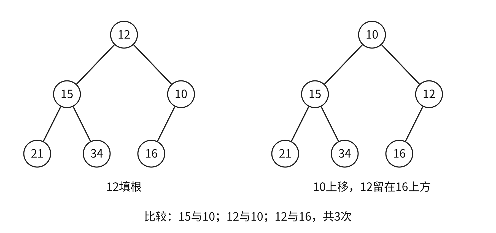{#ds-fig-heap width=96%}

建堆从最后一个非叶结点 $\lfloor n/2\rfloor$ 开始逆序下滤。叶子本身已是堆，靠下的内部结点移动距离短；按各高度结点数求和，建堆总时间为 $O(n)$，不是把每个结点都按最坏树高估成 $O(n\log n)$。逐个插入也能建堆，但对应另一种过程和复杂度上界。第8章将用同一调整规则执行完整堆排序。

## 自测与答案 {#ds-ch5-check}

以下为原创补充，针对表示与前置条件。

1. 一棵二叉树有8个度为2的结点、3个度为1的结点，共多少结点？它是否一定为完全二叉树？
2. 一棵二叉树的先序和中序完全相同，结点值互异，所有非叶结点的孩子位置有什么限制？
3. 并查集中 `parent[4]=2,parent[2]=0,parent[0]=−5`，执行带路径压缩的 `find(4)` 后，哪些关系改变？
4. 关键字互不相同的大根堆中，第二大元素一定在哪些可能位置？

**答案。** 1. 叶数9，总数 $8+3+9=20$；不一定完全，且完全二叉树至多一个度为1结点，本例已排除完全性。2. 只能有右孩子；若存在左子树，中序会先于根访问它，与先序矛盾。3. 返回0，`parent[4]` 改为0，2仍指向0，根规模不变。4. 根的孩子中；若某更深结点是第二大，其双亲严格大于它，除根外还会出现一个更大的结点，产生矛盾。存在相同值时，须先明确第二大是否按不同值计数，不能原样沿用结论。


# 图：从存储、遍历到路径与活动网络 {#ds-ch6}

图的题目先辨认边的含义：一条边可以表示可通行的道路、需要铺设的线路，也可以表示任务之间的先后约束。最短路径、最小生成树、拓扑排序和关键路径分别优化或检查不同对象；选择算法前先把题目要求写成图上的条件。

## 顶点、边、连通性与路径 {#ds-06-01}

图记为 $G=(V,E)$，$V$ 为顶点集合，$E$ 为边集合。无向边用无序顶点对表示，有向边（弧）用有序对表示。除另行说明，本章讨论无自环、无平行边的简单图，顶点数 $n=|V|>0$。无向简单图最多有 $n(n-1)/2$ 条边；有向简单图最多有 $n(n-1)$ 条弧。带权图的边还关联权值，权可以表示距离、费用或时间。

无向图顶点的度为关联边数，所有顶点度数和为 $2|E|$；有向图分别计入度、出度，各自总和都为 $|E|$。无向图度数为奇数的顶点个数必为偶数。路径长度若未加权，通常计边条数；带权长度计沿途权值和。简单路径不重复顶点，简单回路除首尾相同外不重复其他顶点。

无向图任意两顶点都有路径时称为连通图，其极大连通子图为连通分量；有向图中每对顶点相互可达时为强连通，极大强连通子图为强连通分量。单向可达不等于强连通。“极大”指不能再加入原图其他顶点而保持相应性质，不是要求分量含全图最多的顶点。

连通无向图的**生成树**含全部顶点，连通且无环，因此有 $n-1$ 条边。它是极小连通子图：再删一边即不连通。生成树一般不是原图的连通分量，因为分量须保留属于该连通块的原图边，不能任意删到一棵树。非连通图的每个分量各取一棵生成树，得到生成森林。

### 例 6-1　“有可能连通”与“保证连通”不同 {#ds-ex6-1}

【2010】 无向图有7个顶点，要保证图在任何情况下都连通，需要的边数最少是（　）。

A. 6　B. 15　C. 16　D. 21

**解析。** 6条边可以组成一棵生成树，但也可以都集中在部分顶点上，不能保证连通。若图不连通，边数最多的分法是6个顶点组成完全图，剩1个孤立顶点，共 $\binom62=15$ 条边。超过15条就不可能仍不连通，故最少16条，答案为 **C**。

一般的 $n$ 顶点简单无向图，边数大于 $(n-1)(n-2)/2$ 可保证连通；边数至少 $n-1$ 只是连通的必要条件。图有 $c$ 个连通分量时，每个分量至少需要“顶点数减1”条边，所以 $|E|\ge n-c$。若 $|E|<n-1$，必不连通；若 $|E|=n-1$，还需检查是否无环或连通，才能认定为树。

一张 $n$ 顶点、$n$ 条边的无向图必有环，因为无环森林最多有 $n-1$ 条边。这不保证图连通，也不保证恰有一个环。求给定边数下最多分量，则希望把边尽量集中：例如51个顶点、21条边，可在7个顶点上组成完全图，其余44个孤立，共45个分量；少于7个顶点最多15条边，无法容纳21条。

## 邻接矩阵、邻接表与基本操作 {#ds-06-02}

邻接矩阵 `A[u][v]` 表示是否存在 $u\to v$；带权时可用权值表示存在，用 $+\infty$ 表示不存在，不能把0同时用作无边与零权边。无向图矩阵对称，有向图不必。矩阵占 $\Theta(n^2)$ 空间，检查一条给定边为 $O(1)$，枚举某顶点邻边通常要扫整行 $O(n)$。

邻接表为每个顶点保存其邻接点链。无向图每条边通常出现两个表结点，有向图每条弧在出边表出现一次，空间均为 $\Theta(n+|E|)$。枚举邻边只访问实际表项，判断一条边是否存在则可能扫描相应链。逆邻接表以终点组织入边，方向与普通出边表相反。

下图贯通表示与遍历。无向边为 `ab、ac、ae、be、cf、df、de`，各邻接表按字母升序排列。

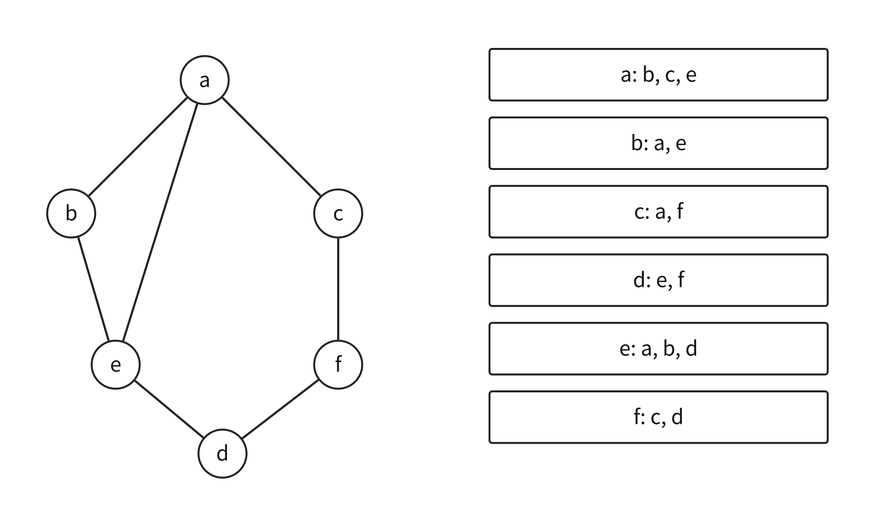{#ds-fig-graph width=96%}

对该图，a 行有b、c、e三个非零项，b 行有a、e两个。无向图度等于相应行非零项个数；有向图行对应出度、列对应入度。求有向图所有入度时，矩阵要扫描 $n^2$ 个位置，邻接表要扫描所有表项，成本不同。

删除顶点会同时删除其所有关联边。无向邻接表不能只删除该顶点自己的链，还要清除其他顶点中指向它的表项；有向图则须同时考虑入边和出边。题目给“只按出度计删除成本”的实现，应检查是否另有入边索引。

## 十字链表与邻接多重表 {#ds-06-03}

**十字链表**面向有向图，每条弧只建立一个弧结点，记录弧尾、弧头以及两个链接：一个沿相同弧尾串联出弧，一个沿相同弧头串联入弧。每个顶点分别保存第一条出弧、第一条入弧。这样同一条弧可从源顶点出边链或终点入边链到达，无需存两份弧数据。

**邻接多重表**面向无向图，每条边只建一个边结点，记录两个端点 `ivex,jvex`，并有 `ilink,jlink`，分别串入两个端点的关联边链。沿顶点 u 的链前进时，须先判断 u 是这条边的哪个端点，再选择对应链接；不能始终只走 `ilink`。这种表示便于给一条边设置统一访问标记、执行删除等边操作。

普通邻接表中，无向边的两个表项是两个结点；邻接多重表中的一条边结点同时挂在两条链上。数边时直接数两种结构的链表项，会得到不同倍数。稀疏矩阵的十字链表也使用“两种方向共享一个数据结点”的思想，但它的两维是行与列，不是有向图的弧尾与弧头。

## 深度优先搜索与搜索森林 {#ds-06-04}

DFS 从一个顶点开始，标记并访问，再递归访问尚未访问的邻接点；当前顶点已没有未访问邻点时才回退。标记用于防止沿环重复访问。遍历整张图时，还须依次检查所有顶点，对仍未访问的顶点重新启动搜索；一趟 DFS 未必到达全图。

```text
DFS(u):
    visited[u]=true
    visit(u)
    for v in u 的邻接点:
        if not visited[v]: DFS(v)

traverse(G):
    全部 visited 初始化为 false
    for u in 全体顶点:
        if not visited[u]: DFS(u)
```

上图按字母顺序枚举邻点，从 a 开始，得到 `a,b,e,d,f,c`。首次到达新顶点的边形成 DFS 生成树；无向图的搜索树棵数等于连通分量数，有向图不能用树棵数直接认定强连通分量数。

### 例 6-2　什么时候允许回退去另一个分支 {#ds-ex6-2}

〖6.3-011〗 无向图顶点为 `{a,b,c,d,e,f}`，边为 `{ab,ae,ac,be,cf,fd,ed}`。进行深度优先遍历，不能得到的序列为（　）。

A. acfdeb　B. aebdfc　C. aedfcb　D. abecdf

**解析。** D 访问到 `a,b,e` 时，e 的邻点d尚未访问，必须深入d，不能先回退到a转去c，因此 D 不可能。A可沿a→c→f→d→e→b；B可先走a→e→b，b无未访问邻点后回到e，再走d→f→c；C可先走a→e→d→f→c，回退后再处理b。答案为 **D**。相邻输出顶点不一定直接相连，因为中间可能发生回退；需要检查的是回退时当前顶点是否还留有未探索邻点。

采用邻接表时，每个顶点和表项只处理常数次，时间 $O(n+|E|)$；矩阵要对每个访问顶点扫一整行，时间 $O(n^2)$。递归栈最坏 $O(n)$，另有访问标志数组 $O(n)$。如果在退出递归前才输出顶点，得到的是完成次序；对 DAG，该次序的逆序是拓扑序列，第8节会说明原因。

## BFS 为什么得到无权最短路 {#ds-06-05}

BFS 用队列保存已发现、尚未扩展的顶点。起点先标记并入队；每次取出队头，将其尚未发现的邻点标记、记录距离并入队。标记应在**入队时**设置，若等到出队才标记，同一顶点可能被不同前驱重复入队。

```text
BFS(s):
    dist[s]=0; visited[s]=true; enqueue(s)
    while 队列非空:
        u=dequeue()
        for v in u 的邻接点:
            if not visited[v]:
                visited[v]=true
                dist[v]=dist[u]+1; parent[v]=u
                enqueue(v)
```

队列保证距离0层先于距离1层，距离1层先于距离2层。首次发现 v 时，如果还存在更短路径，其前一个顶点应在更早的一层，并早已扩展，v 就应更早被发现，产生矛盾。因此 `dist` 是最少边数。

上图从a出发、邻点按字母枚举，出队访问序列为 `a,b,c,e,f,d`；b、c、e距离1，f、d距离2。它与DFS顺序不同，但也不唯一：同层邻接次序可改变，最少边数不变。带权不等长边时，少经过一条边未必总权更小，不能把这条证明直接推广为带权最短路。

邻接表与矩阵的时间同DFS，队列和标记等辅助空间为 $O(n)$。有向图中，BFS只沿允许方向扩展；“无权最短路”不要求图无向，却要求每条经过的边都按同等代价计数。

## Prim 与 Kruskal 在挑什么边 {#ds-06-06}

最小生成树（MST）要求连通全部顶点、无环，并使所选 $n-1$ 条边权和最小。它不要求从某个起点到每个顶点的路径最短。若图不连通，只能得到每个分量的最小生成森林。

Prim 维护一个已连接顶点集合 U，每次从“一端在U、一端在外”的边中选最小边，加入新顶点。Kruskal 则把全部边按权非降序考虑，端点在不同当前分量时选入并合并，同一分量则跳过以避免成环。二者都利用割上的轻边性质，但状态不同：Prim始终扩展一棵树，Kruskal可能同时有多棵。

### 例 6-3　同权边怎样影响第二次选边 {#ds-ex6-3}

【2015】 求下图最小生成树，可能为 Kruskal 第2次选中、但不可能为从 $V_4$ 开始的 Prim 第2次选中的边是（　）。

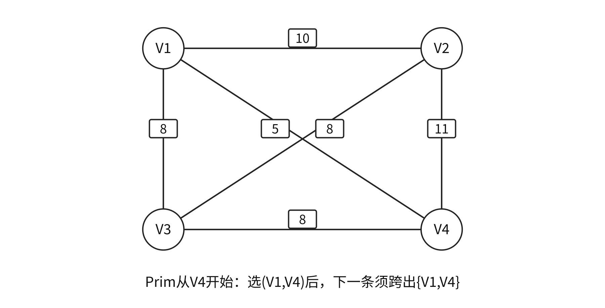{#ds-fig-mst width=78%}

A. $(V_1,V_3)$　B. $(V_1,V_4)$　C. $(V_2,V_3)$　D. $(V_3,V_4)$

**解析。** 两算法首先都选权5的 $(V_1,V_4)$。Kruskal 此后可选任意一条不成环的权8边，包括 $(V_2,V_3)$。Prim 此时 U 为 $\{V_1,V_4\}$，第2条必须跨越这个集合边界，只能在 $(V_1,V_3)$ 与 $(V_4,V_3)$ 中选权8的边；$(V_2,V_3)$ 两端都在集合外，不能选。答案为 **C**。

继续执行时，Kruskal若选 $(V_2,V_3)$，最后还要用一条权8边把两个分量连接，总权21；Prim选入V3后，再用 $(V_3,V_2)$ 权8连V2，也是21。同权边可导致不同MST；全部边权互异足以保证唯一，但存在同权边不必然不唯一。

朴素Prim配矩阵为 $O(n^2)$；邻接表配优先队列可减少稀疏图中选最小代价的成本。Kruskal主要花在边排序，常写 $O(|E|\log|E|)$，加并查集维护分量。不能只比较算法名字而忽略表示与具体选边实现。

## Dijkstra 与 Floyd 的条件和中间状态 {#ds-06-07}

Dijkstra 求单源最短路径。维护已确定集合 S 与暂定距离 `dist[v]`；每次选择 S 外距离最小的顶点 u，确定它的最短距离，再用 `dist[u]+w(u,v)` 松弛其邻点。尚未确定的 `dist` 是已知可达路径的最好上界，不一定已是真正最短距离。

通用正确性要求边权非负：若还可能先走到一个当前距离更远的顶点，再经负边返回u，u就可能被过早确定。出现负边不表示每个实例都必然算错，但标准算法不能保证正确。不可达顶点的距离保持无穷，所有剩余距离都为无穷时可停止，不能再把无穷当作普通数参与加法。

### 例 6-4　求出第二条最短路径后哪些值还可变 {#ds-ex6-4}

【2021】 使用 Dijkstra 求下图从顶点1到其余顶点的最短路径，`dist` 依次保存到2、3、4、5的距离。求出第二条最短路径后，`dist` 内容为（　）。

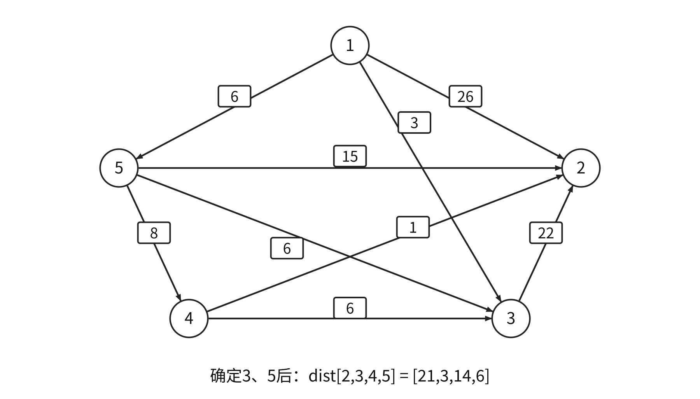{#ds-fig-dijkstra width=88%}

A. 26、3、14、6　B. 25、3、14、6　C. 21、3、14、6　D. 15、3、14、6

**解析。** 先把起点1确定，初始 `dist=(26,3,∞,6)`。第1条到其他顶点的确定路径是1→3，长3；用3→2的22更新到2距离为25。随后选顶点5，距离6，第2条路径确定；由5→2的15把到2更新为21，由5→4的8把到4更新为14，得到 **(21,3,14,6)，答案 C**。

| 已确定的新顶点 | dist[2] | dist[3] | dist[4] | dist[5] |
| --- | --- | --- | --- | --- |
| 1（初始化） | 26 | 3 | ∞ | 6 |
| 3 | 25 | 3 | ∞ | 6 |
| 5 | 21 | 3 | 14 | 6 |
| 4 | 15 | 3 | 14 | 6 |
| 2 | 15 | 3 | 14 | 6 |

答案要求的是第2条路径确定后，不是算法最终结果。顶点4随后才用其到2的权1把21改为15，不能把这个将来更新提前放进答案。

Floyd 求任意顶点对之间的最短路。令 $D^{(k)}[i,j]$ 表示只允许编号不超过k的顶点作为内部中转时的最短距离，则

$$D^{(k)}[i,j]=\min\{D^{(k-1)}[i,j],D^{(k-1)}[i,k]+D^{(k-1)}[k,j]\}.$$

两种候选分别是不经过k，或在k处分成两段。实现时中转顶点k必须放在最外层循环，才能对应这个阶段含义。时间 $O(n^3)$，距离矩阵 $O(n^2)$；允许负边，但要求不存在影响所求路径的负权回路，否则不存在有限最短值。无向图一条负权边即可来回构成负权闭合游走，不能直接当作通常的有限最短路模型。

矩阵版 Dijkstra 单源时间 $O(n^2)$；对每个源点重跑得到全源需 $O(n^3)$，不能仍写成 $O(n^2)$。BFS解决同权边的最少边数；MST最小化整棵树的边权总和；Floyd/Dijkstra最小化指定端点的路径权和，三个目标要分别辨认。

## 拓扑排序：由入度判断哪些任务可以先做 {#ds-06-08}

有向无环图（DAG）可以用顶点表示活动、弧表示先后约束，称为 AOV 网。拓扑序列要求每条弧 $u\to v$ 中，u都排在v之前。算法先把所有入度为0的顶点作为候选，每次删除一个候选及其出弧，更新后继入度；处理顶点数不足n时存在有向环。

有多个候选时可选择不同顺序，因此一般不唯一。DAG中用DFS退出时输出，某条弧的终点必先完成，得到逆拓扑序列；将该完成序列反向才是拓扑序列。若有向环存在，单纯取得一个DFS完成次序不能证明拓扑合法。

### 例 6-5　怎样判定唯一拓扑序列 {#ds-ex6-5}

【2024】 载人航天工程包含众多子工程，为保证有序开展，需要明确前导子工程。这可抽象为有向图的拓扑序列问题。已知图G采用邻接矩阵存储：

```c
typedef struct {
    int numVertices,numEdges;
    char VerticesList[MAXV];
    int Edge[MAXV][MAXV];
} MGraph;
```

设计 `int uniquely(MGraph G)` 判定G是否存在唯一拓扑序列，是则返回1，否则返回0。给出设计思想及带关键注释的C或C++实现。

**解析。** 每一轮的候选零入度顶点必须恰有一个。若图无环且某轮至少有两个，二者都可作为下一项，交换其先后可产生至少两个拓扑序列；若余图有环，则根本不能完成拓扑序列。这两种情况都不满足唯一，均可返回0。若没有候选且尚未处理完，也是有环。只有始终唯一且处理全体顶点，才能返回1。

```c
int uniquely(MGraph G) {
    int n=G.numVertices, indeg[MAXV]={0};
    bool used[MAXV]={false};
    for (int u=0; u<n; ++u)
        for (int v=0; v<n; ++v)
            if (G.Edge[u][v]) ++indeg[v];
    for (int step=0; step<n; ++step) {
        int pick=-1;
        for (int v=0; v<n; ++v)
            if (!used[v] && indeg[v]==0) {
                if (pick!=-1) return 0; // 至少两个候选
                pick=v;
            }
        if (pick==-1) return 0;         // 剩余部分有环
        used[pick]=true;
        for (int v=0; v<n; ++v)
            if (G.Edge[pick][v]) --indeg[v];
    }
    return 1;
}
```

这里AOV邻接矩阵按0/1表示无边/有弧，不能直接把带权矩阵的“无边为无穷”搬进这个判断。总时间 $O(n^2)$，工作数组额外占 $O(n)$；题给的按值传参若实际复制整个矩阵，形参副本还占 $O(n^2)$，可按接口许可改为只读引用以避免复制。若使用邻接表并维护零入度候选数，处理时间可为 $O(n+|E|)$。顶点已经按某个拓扑次序编号时，所有弧才保证由小编号指向大编号，邻接矩阵才呈严格上三角；任意编号的DAG不必原样为三角矩阵。

DAG还可表达共享子表达式：相同子式只存一份，不同上层结点可指向同一子式。它表达计算依赖而非普通树的唯一双亲关系；不能再套用“除根外每结点恰有一个双亲”。

## 关键路径：事件与活动的时间不同 {#ds-06-09}

AOE 网用顶点表示事件、带权有向边表示活动，边权为持续时间。某事件要等全部进入活动完成才能发生；它的出边活动才能开始。以下假设网无环，持续时间非负，有统一源点和汇点；若有多个源汇，可添加零时长虚边统一。

事件最早发生时间 `ve[v]` 按拓扑序计算：从所有前驱中取 `ve[u]+w(u,v)` 的**最大值**，因为全部前导活动都得完成。令汇点最迟发生时间等于总工期，事件最迟发生时间 `vl[u]` 逆拓扑计算，取所有后继的 `vl[v]-w(u,v)` 的**最小值**，以保证每条后续活动仍赶得上。

活动 $u\to v$ 的最早开始时间为 $e=ve[u]$，最迟开始时间为 $l=vl[v]-w(u,v)$。$l-e$ 是该活动的时间余量；余量0的活动为关键活动。关键路径是源到汇的一条最长带权路径，决定最短可完成工期；它不是边最多的路径。

### 例 6-6　多条关键路径时怎样缩短工期 {#ds-ex6-6}

【2013】 下图AOE网包含8个活动。通过同时加快若干活动，可缩短整个工程工期。下列选项中，加快所列活动进度就可缩短工期的是（　）。

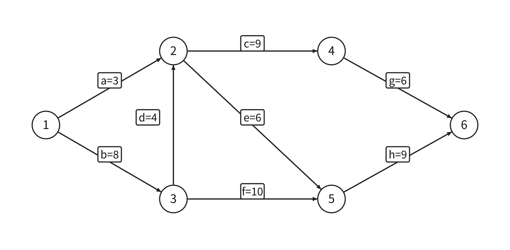{#ds-fig-aoe width=92%}

A. c和e　B. d和c　C. f和d　D. f和h

**解析。** 先按拓扑次序1、3、2、4、5、6算事件时间。

| 事件 | ve | vl |
| --- | --- | --- |
| 1 | 0 | 0 |
| 2 | 12 | 12 |
| 3 | 8 | 8 |
| 4 | 21 | 21 |
| 5 | 18 | 18 |
| 6 | 27 | 27 |

例如 `ve[2]=max(0+3,8+4)=12`，不能仅沿1→2算成3；`ve[5]=max(12+6,8+10)=18`。从汇点反推，`vl[2]=min(21−9,18−6)=12`，同时约束它通往4和5的两条后续活动。

活动a余量为9，其余b、c、d、e、f、g、h均为关键活动。关键路径有三条：`b-d-c-g`、`b-d-e-h`、`b-f-h`，长度均27。只缩短其中一条上的活动，其他路径仍可能保持27。f与d合起来覆盖三条关键路径：d影响前两条，f影响第三条；两者同时适当缩短，所有原关键路径都会变短。答案为 **C**。A、B遗漏路径b-f-h，D遗漏路径b-d-c-g。

增加关键活动时长会使包含它的路径变长，进而延长工期；缩短某一关键活动却未必缩短工期，因为还可能有不包含它的其他关键路径。持续缩短还可能使原非关键路径成为新的关键路径，必须重新计算，不能无限按原余量推断。

## 自测与答案 {#ds-ch6-check}

以下为原创补充，检查算法选择的边界。

1. 图有8个顶点、7条边，能否直接认定为树？若再给“连通”呢？
2. 有向图A→B、A→C、B→D、C→D有几个拓扑序列？若添加B→C，怎样变化？
3. 一条边权变大，MST总权与某一对顶点最短距离是否一定同时改变？
4. 一条关键活动缩短1，工期是否必缩短1？

**答案。** 1. 不能；若无向且连通，7条边恰够生成树，不可能再有环，故为树。2. 原有A-B-C-D与A-C-B-D两个；添加后仅A-B-C-D。3. 不一定；该边可能不在任何当前采用的最优解中，两种优化目标也不同。4. 不一定；有另一条不含该活动的同长关键路径时工期不变。


# 查找：由数据约束选择索引结构 {#ds-ch7}

查找结构要回答两个问题：怎样缩小候选范围，插入或删除后怎样保持这种缩小范围的能力。顺序查找只依赖逐项比较；折半查找依赖顺序存储且有序；搜索树把有序关系放进分支；散列表则用关键字计算位置。外存索引还要考虑一次读入能取得多少个关键字。

## 关键字、成功失败与平均查找长度 {#ds-07-01}

查找表是同一类型记录的集合，**关键字**是用于识别记录的数据项。主关键字唯一标识记录，次关键字可能对应多条记录。只进行查找、不改变记录集合的表称为静态查找表；还需插入、删除记录时为动态查找表，不能仅凭“采用数组”判断静态或动态。

**查找长度**通常指一次查找中关键字的比较次数，平均查找长度为 $\mathrm{ASL}=\sum_i p_iC_i$，其中 $p_i$ 为某一查找事件的概率、$C_i$ 为该事件的比较次数。成功ASL按表内记录分配概率；失败ASL按不存在的关键字可能进入的失败区间或初始散列地址分配概率，分母未必是表长。

树形查找中，访问一个含多关键字的B树结点可能只触发一次外存读，却在内存中比较多个关键字。因此“读盘次数”“访问结点数”“关键字比较次数”不是同一个量，题目要求哪个就统计哪个。

## 顺序查找、分块查找与提前结束 {#ds-07-02}

无序表从一端逐项比较，成功时停止，扫描完仍未找到则失败。等概率成功时，平均比较 $(n+1)/2$ 次；失败通常比较n次。哨兵可以统一循环终止条件、减少边界判断，但不会把数量级变成常数。若计入哨兵自身的关键字比较，次数还须按代码约定加上相应一项。

递增有序表从头查找时，当前值等于目标应报告成功，当前值**大于**目标才可提前失败；把“不小于”一概判为失败会把相等的目标漏掉。若仍逐个向后比较，等概率成功ASL与无序表相同，只是失败可能提前结束；有序并不自动意味着每种查找都使用折半。

分块查找把表分成若干块，块内可无序，块间有序：前一块的最大关键字小于后一块所有关键字。索引保存每块最大关键字和块起始位置，先定位块，再在块内顺序找。若索引用顺序查找与折半查找，得到的效率不同。

### 例 7-1　两级顺序查找怎样选择块长 {#ds-ex7-1}

【2025】 查找表有400个元素，查找每个元素的概率相同，采用均匀分块。先顺序查找确定所在块，块内也顺序查找。为使查找效率最高，每块包含元素个数应为（　）。

A. 8　B. 10　C. 20　D. 25

**解析。** 设每块s个，共 $b=400/s$ 块。查成功时，索引平均比较 $(b+1)/2$ 次，块内平均比较 $(s+1)/2$ 次，总计

$$\mathrm{ASL}=\frac{400/s+s}{2}+1.$$

两项乘积固定，$400/s+s$ 在 $s=\sqrt{400}=20$ 时最小，答案为 **C**。四个选项均能整除400，无需处理尾块。若索引改为折半，这个“平方根块长”的推导不再对应实际代价。

## 折半查找与判定树 {#ds-07-03}

折半查找要求按关键字有序且能快速定位中点。本书在闭区间 `[low,high]` 中查找，取 `mid=low+(high-low)/2`，向下取整。目标较小时令 `high=mid-1`，较大时令 `low=mid+1`；目标已与中点比较过，更新后不能把它又留在候选区间。

```c
int binarySearch(int A[], int n, int key) {
    int low=0, high=n-1;
    while (low<=high) {
        int mid=low+(high-low)/2;
        if (A[mid]==key) return mid;
        if (A[mid]<key) low=mid+1;
        else high=mid-1;
    }
    return -1;
}
```

比较次数对应判定树上的内部结点深度加1。失败发生在候选区间为空时，空位置本身通常不做关键字比较，因此沿途比较次数等于经过的内部结点数。取上中点或下中点会改变具体路径，数量级仍是 $O(\log n)$。

### 例 7-2　失败查找的最大比较次数 {#ds-ex7-2}

【2010】 长度为16的顺序表L按关键字有序，采用折半查找，查找一个不存在的元素，关键字比较次数最多为（　）。

A. 4　B. 5　C. 6　D. 7

**解析。** 用从1开始的位序、向下取中点，查找一个大于全部元素的值：区间依次为 `[1,16]→[9,16]→[13,16]→[15,16]→[16,16]→空`，比较位置为8、12、14、15、16，共5次，答案为 **B**。$\log_216=4$ 不是这里的最大比较次数；还需要最后一次区分第16个元素与它右侧的失败区间。

同样的约定下，长度11时查第11个元素，比较位序为6、9、10、11；长度10、关键字依次 `b,c,d,e,f,g,q,r,s,t` 时查b，比较f、c、b。不能在不同题中忽然改用向上取中点。

有序链表即使能逐步寻找中点，也没有数组的常数时间随机定位能力；普通折半查找的对数比较次数并不自动带来对数总访问时间。无序数组不满足排除半区的依据，静态链表用数组存结点也不保证逻辑顺序按下标连续。

## 二叉搜索树的区间不变式 {#ds-07-04}

本书二叉搜索树（BST）默认关键字互异，左子树所有值小于根，右子树所有值大于根，左右子树分别满足同样性质。只检查根与两个直接孩子还不够；一个较深后代也可能越过祖先设定的区间。中序遍历严格递增是等价的整体判断。

查找从根出发，每次比较后进入相应子树；插入沿相同路径，到空位置新建叶结点。比较次数最多为树高，树可能退化成链，因此普通BST最坏为 $O(n)$，不能无条件写 $O(\log n)$。

删除叶结点直接断开双亲链接；只有一个孩子时让孩子接替位置；有两个孩子时，可把中序前驱（左子树最大值）或后继（右子树最小值）移到当前位置，再删除那个原结点。被选的前驱不会有右孩子，后继不会有左孩子，最后归结到前两种情况。若题目要求保留结点地址而非只保留关键字，复制数据与整体移接是不同实现，应据此处理引用。

验证BST可以中序扫描并比较相邻值，也可以给每个结点传递允许区间 `(lower,upper)`。左递归把上界收紧到当前值，右递归把下界提高到当前值；这样不会漏掉“孩子合格但孙子越过祖先”的错误。边界值可能等于整数类型极值时，用更宽类型或显式“有无边界”标记，不要随意把一个合法值当作无穷。

## AVL：先定位最小失衡子树 {#ds-07-05}

AVL是每个结点左右子树高度差绝对值不超过1的BST。令平衡因子为“左高减右高”，合法值为−1、0、1。插入后沿查找路径向上更新高度，找到离插入位置最近的失衡祖先A，再根据新结点相对A及其较高孩子的位置分类。

LL（左孩子的左侧增高）对A右旋；RR对A左旋；LR先对A的左孩子左旋，再对A右旋；RL先对A的右孩子右旋，再对A左旋。名称描述失衡路径，不能把“LL”误当作“向左旋”。旋转必须保持中序次序：右旋时原左孩子B升为局部根，B原来的右子树移成A的左子树，因为它的值介于B与A之间。

以下数值树用于观察旋转机制。插入前各树高度均为3；灰底新结点插入后，最小失衡子树高度升为4。单旋图同时保留需要转接的中间子树：LL中40由30的右子树改接为50的左子树，RR中40的转接方向对称。

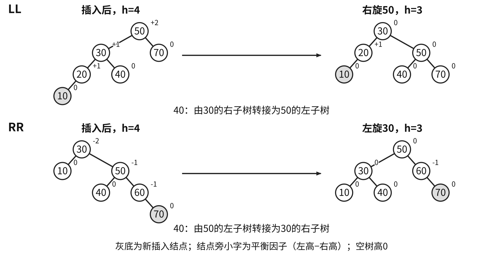{#ds-fig-avl width=96%}

LR图在70的左孩子30的右侧插入40，先左旋30，再右旋70；第一步把40转接为30的右孩子。RL图在50的右孩子90的左侧插入80，先右旋90，再左旋50；第一步把80转接为90的左孩子。**第一步后的树仍可能失衡**，双旋应检查完整两步，不能在中间态停下。四例都保持同一组关键字的升序中序，最终高度恢复为3，所有平衡因子回到−1、0、1。

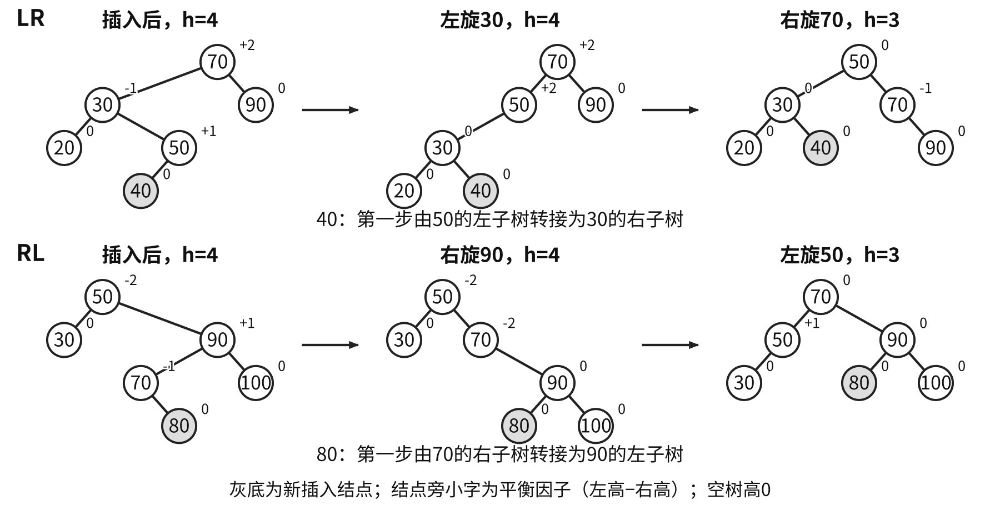{#ds-fig-avl-double width=96%}

### 例 7-3　连续插入时在哪里旋转 {#ds-ex7-3}

〖7.3-003〗 把34、23、15、98、115、28、107依次插入初始为空的平衡二叉搜索树，要求每次插入后保持AVL性质，给出每步结果。

**解析。** 以下用 `根(左子树,右子树)` 表示局部结构，`∅` 表示空。

| 插入 | 失衡处与调整 | 调整后整树 |
| --- | --- | --- |
| 34 | 无 | 34 |
| 23 | 无 | 34(23,∅) |
| 15 | 34处LL，右旋 | 23(15,34) |
| 98 | 无 | 23(15,34(∅,98)) |
| 115 | 34处RR，左旋 | 23(15,98(34,115)) |
| 28 | 23处RL，先右旋98，再左旋23 | 34(23(15,28),98(∅,115)) |
| 107 | 98处RL，先右旋115，再左旋98 | 34(23(15,28),107(98,115)) |

插入28时，不能只旋转它的双亲34：34仍平衡，最先失衡的是23，新增路径是“23的右—98的左”，故为RL。每次调整后复查中序始终为已插入关键字的升序，避免只把树形画平衡而破坏搜索关系。

插入后的最小失衡子树调整好，通常恢复到插入前高度，更高祖先不再因这次插入失衡。删除则可能使子树高度继续缩短，需要一路向上检查，不能把插入时“一处修复即可”的结论直接用于删除。AVL最小结点数满足 $N(h)=1+N(h-1)+N(h-2)$，由此树高是 $O(\log n)$，查找与更新路径才有对数保证。

固定高度求形态数，统计的是另一件事。按本书空树高0、单根高1，令 $C(h)$ 为恰高h的AVL形态数，$C(0)=C(1)=1$；恰高2的左右高度只能是 `(1,1)、(1,0)、(0,1)`，所以 $C(2)=3$。恰高3时，左右高度为 `(2,2)、(2,1)、(1,2)`，故 $C(3)=3^2+2\times3\times1=15$，对应〖7.3-013〗。这不等于固定结点数的卡特兰计数，也不等于最小结点数递推。

### 例 7-4　中序为降序时搜索方向怎样变 {#ds-ex7-4}

【2015】 一棵无重复关键字的AVL树，中序遍历得到降序序列。正确叙述是（　）。

A. 根的度一定为2　B. 最小元素一定是叶结点

C. 最后插入元素一定是叶结点　D. 最大元素一定没有左子树

**解析。** 本题的搜索方向与通常递增BST相反：左子树全大于根，右子树全小于根。最大值位于持续向左找到的最左结点，它没有左子树，答案为 **D**。AVL约束不保证根一定有两个孩子；最小值结点可以有左孩子；新结点虽然最初作为叶插入，旋转后可能成为内部结点。不要把平衡性代替关键字方向条件。

## 红黑树：颜色约束怎样限制高度 {#ds-07-06}

红黑树仍是BST，另为结点标红或黑，采用以下约定：根为黑；所有空孩子视为黑色NIL叶；红结点的孩子均为黑；从任一结点到其所有后代NIL叶的路径，黑结点数相同。NIL不是普通数据结点，画图时可以省略，但计算黑高时不能忽略其一致作用。

相邻红结点不允许，所以一条路径中红结点数不会超过相应黑结点数。本书黑高b定义为：从当前结点向下到任一NIL的路径，不计当前结点、计终点NIL，所含黑结点数；NIL自身黑高记0。黑高为b的子树至少含 $2^b-1$ 个内部结点。于是最长路径不会超过最短路径长度约两倍，整体高度为 $O(\log n)$。它不要求每个结点左右高度差至多1，比AVL的局部高度约束宽。

插入先按BST加入，通常把新结点染红，以免立即改变各路径黑结点数。双亲黑则完成；双亲红时，看祖父另一侧的叔结点：

- 叔为红：双亲与叔变黑、祖父变红，把问题上移到祖父，最后保证根黑。
- 叔为黑（含NIL）：若形成内侧折线，先在双亲处旋转为外侧；再在祖父处反向旋转，并交换提升结点与原祖父的颜色，消除红红相邻。

例如黑根10、红左孩子5，插入红1，叔为空黑，形成LL：右旋10后5成为黑根，1与10为红，黑路径数保持一致。若原来还存在红右孩子15，则插入1先使5、15变黑，祖父10暂红，最后根10恢复黑；这个情境应变色，不应直接套前一个旋转。

删除时先按BST把待删位置化到至多一个非空孩子的情形。删红不减少路径黑高；删黑后，若有红孩子接替，可把接替孩子染黑。若替代位置是黑或NIL，则沿该分支缺少一个黑结点，需要根据兄弟与其孩子颜色修复。

设缺黑位置x是双亲p的左孩子，兄弟w为p的右孩子。w的左孩子为近侧、右孩子为远侧，均相对x而言；NIL按黑处理。按下表逐步转换，不能把“红兄弟”直接当作最终修复。

| 当前条件 | 操作与后续 |
| --- | --- |
| w红 | w染黑、p染红，对p左旋；重新取x的兄弟，再处理下列黑兄弟情况 |
| w黑、两个孩子都黑 | w染红；若p红则p染黑并结束，否则将缺黑位置上移到p继续，移到根即可结束 |
| w黑、远侧黑、近侧红 | 近侧染黑、w染红，对w右旋；重新取兄弟，转成下一行 |
| w黑、远侧红 | w继承p原颜色，p与远侧染黑，对p左旋，结束缺黑修复 |

缺黑在右侧时，左右及旋转方向对称互换。最后一行的最小例子可写成 `10黑(缺黑NIL,20黑(NIL,30红))`：左旋10并换色，得到 `20黑(10黑,30黑)`，两侧向下的黑结点数相同。旋转前后中序仍为10、20、30；修复既要补黑高，也要保持搜索次序。

这里颜色不表示访问频率，也不影响BST比较方向。做性质判断时，先检查中序有序，再检查根与NIL、红红相邻、各分支黑高；仅数红黑结点总数不能判定一棵红黑树是否合法。

## B树：一个结点保存多个分隔关键字 {#ds-07-07}

本书m阶B树规定每结点最多m个孩子、最多m−1个关键字。除根外，每个数据结点至少t−1个关键字，其中 $t=\lceil m/2\rceil$；有非空孩子的非底层数据结点至少t个孩子，非叶根至少2个孩子、1个关键字。最底层数据结点没有非空孩子，并且全部在同一层。若另外画查找失败的空外部叶，它们在下一层且不存关键字；以下高度不计这层空叶。

一个结点有k个升序关键字，就有k+1个孩子区间。先在结点内找到目标或确定区间，再读相应孩子。多路分支降低外存层数；结点内可以顺序或折半比较，读盘次数不直接等于关键字比较次数。

### 插入从叶开始，分裂向上传播 {#ds-c07-h154}

以下是**5阶B树的教学机制例**，用紧凑关键字显示分裂与合并，不对应后面原题的阶数。5阶结点最多4项，非根至少2项；非底层非根因此有3至5个孩子，非叶根仍可只有2个孩子。

初态根为 `[5,10,15,20]`，从左到右的5个叶分别为 `[1,3]`、`[6,8]`、`[11,13]`、`[16,18]`、`[21,23,25,27]`，共16个关键字。沿搜索路径插入29后，最右叶临时有5项。提升第3项25，叶分成 `[21,23]` 与 `[27,29]`，提升项从叶中移走。根因而临时成为 `[5,10,15,20,25]`，也有5项，不能到此结束。

再将根的第3项15提升为新根，左右内部结点分别为 `[5,10]`、`[20,25]`。原来的6个孩子按区间各接3个：左侧接 `[1,3]`、`[6,8]`、`[11,13]`，右侧接 `[16,18]`、`[21,23]`、`[27,29]`。两次分裂均为“5项→左2项、提升1项、右2项”，内部结点分裂时还须同步分配孩子。根分裂使数据层数由2增至3；局部叶分裂本身不增加全树高度。

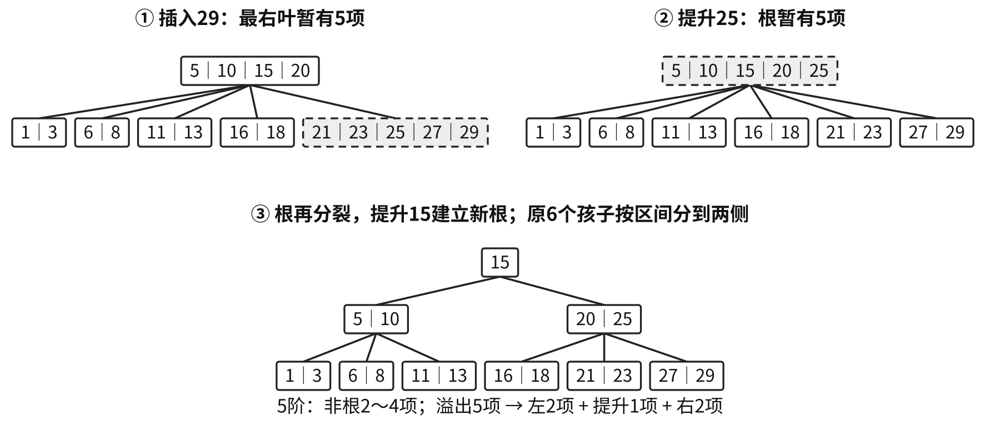{#ds-fig-btree width=96%}

### 删除后的借位、合并与向上传播 {#ds-c07-h164}

删除内部关键字时，先用相邻前驱或后继关键字替换，再到最底层删除对应项。删除后若少于最小关键字数，先看相邻兄弟能否借：父分隔关键字下移，兄弟靠近的一项上移到父；若在内部层借位，右兄弟的最左孩子或左兄弟的最右孩子也要转接，保持孩子数等于关键字数加1。兄弟也只有最小数时，合并当前结点、父分隔关键字与相邻兄弟，父可能继续下溢；空根仅剩一个孩子时，由孩子接替，高度减1。

先看5阶借位小例：根 `[10]`，两个叶 `[2,5]` 与 `[12,15,18]`。删除2后左叶只剩 `[5]`，低于2项下限；右兄弟有3项，能够出借。将父10下移到左叶、右兄弟最小项12上移到父，得到根 `[12]`、叶 `[5,10]` 与 `[15,18]`。不能把12直接塞给左叶而让父仍为10，否则分隔关系就被破坏。

再从插入图的最终树删除1：左叶剩 `[3]`，相邻叶 `[6,8]` 已只有2项，不能借；合并它们与父分隔项5，成为 `[3,5,6,8]`。其双亲原为 `[5,10]`，此时只剩 `[10]` 和2个孩子，也低于非根下限。右内部兄弟 `[20,25]` 同样不能借，故将左侧 `[10]`、根15、右侧 `[20,25]` 合为 `[10,15,20,25]`，按顺序接5个原孩子。旧根为空，删除旧根后数据层数从3降为2。

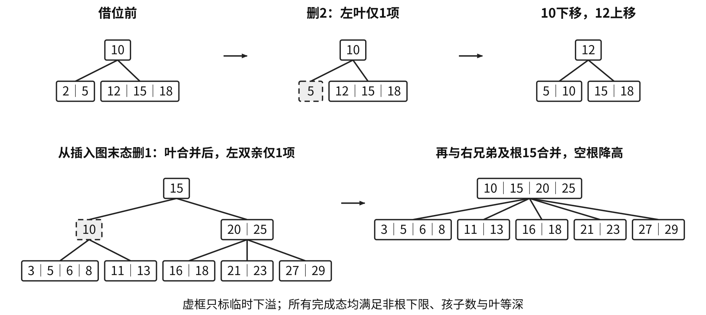{#ds-fig-btree-delete width=96%}

5阶的合并须特别检查发生时机：**两个各有2项的合法兄弟加父分隔项会有5项，超过上限**；本例是在删除造成一侧仅1项后，按 $1+1+2=4$ 项合并。不能把其他阶数或最小度参数下的提前合并规则直接套来。每个完成态都要复查结点内有序、孩子区间、关键字上下限、孩子数和叶等深；虚框中的临时下溢或溢出不算一个已完成的合法B树状态。

若高度h按数据结点层数计，非空m阶B树关键字总数满足 $2t^{h-1}-1\le n\le m^h-1$，其中 $t=\lceil m/2\rceil$。左端让根取1项、其余结点取最少分支，右端让各结点取满；求最大高度用左端，求最小高度用右端。

### 例 7-5　关键字总数怎样限制高度 {#ds-ex7-5}

〖7.4-009〗 一棵3阶B树共有2047个关键字，最大高度为（　），最小高度为（　）。

A. 11　B. 10　C. 8　D. 7

**解析。** 高度按数据结点层数计。要使树尽量高，各层尽量稀疏：根1项、2个孩子；其他结点至少1项、至少2个孩子。高度h时最少关键字 $1+2+\cdots+2^{h-1}=2^h-1$。因此 $2^h-1\le2047=2^{11}-1$，最大11，第一空 **A**。

要使树尽量矮，各结点取满，每层关键字数分别2、6、18……，高度h时最多 $3^h-1$。$3^6-1=728<2047\le3^7-1=2186$，所以最小7，第二空 **D**。这两端分别使用“最少容量”和“最大容量”，不能将不等式方向颠倒。

### 例 7-6　小规模B树的形态怎样完整计数 {#ds-ex7-6}

【2025】 给定7个不同关键字，能构造的不同4阶B树的个数最多为（　）。

A. 7　B. 8　C. 9　D. 10

**解析。** 每结点最多3项，非根至少1项；关键字的升序分配由形态与各结点项数确定，不再任意排列。

高度1最多3项，不够。高度2时，设根有r项，则有r+1个叶，叶项数和为7−r，各叶1至3项：r=1时只有 `(3,3)`，1种；r=2时是正整数三元组和5，各项至多3，包括 `(3,1,1)` 的3个排列与 `(2,2,1)` 的3个排列，共6种；r=3时只有 `(1,1,1,1)`，1种。因此高度2共8种。

高度3时，最少项数为 $1+2+4=7$，只能每结点1项且每个内部结点2个孩子，1种。高度4最少15项，已不可能。合计 $8+1=9$，答案为 **C**。只考虑根的取值而不枚举叶的分配，会漏掉不同的结点分组。

## B+树：索引层与叶层分工 {#ds-07-08}

B+树把记录或记录指针集中在叶结点，内部结点保存索引关键字及孩子指针；叶结点按关键字有序，并用链接便于连续访问。一次点查找沿索引降到叶；范围查找先定位起点叶，再沿叶链扫描，避免对每个值重新从根下降。

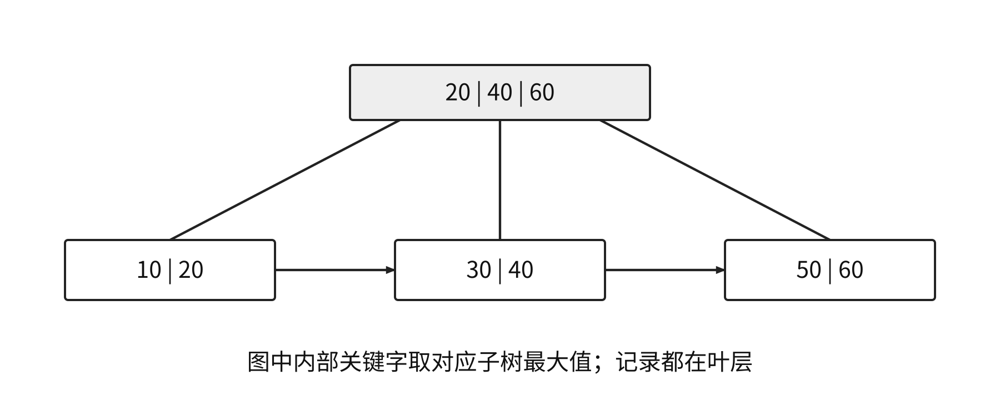{#ds-fig-bplus width=94%}

不同教材对内部关键字保存子树最大值还是区间分隔值、m阶结点的键数与指针数对应关系，存在具体约定差异。王道书常用“内部结点关键字对应子树最大关键字”的表示；本图按该约定，索引 `[20|40|60]` 指向最大值分别为20、40、60的三片子树。做题应先按给定图或定义确定，不把B树的“k键必有k+1孩子”无条件套给B+树。

B树的关键字可在内部结点命中后结束；B+树记录查询通常仍需到叶。叶链让B+适合区间访问，并不意味着每次点查都顺着整条叶链查找。内部不携带整条记录，通常能提高同样页大小下的分支数，减少外存层数；优势来自页组织与访问方式，不能据此声称任何规模都一定比内存BST更快。

## 散列表：冲突、删除与ASL {#ds-07-09}

散列函数 $H(key)$ 把关键字映射到表地址；不同关键字有相同函数值称为同义词，发生地址冲突。函数应对同一关键字给出确定地址，并尽量均匀分散。随机改变同一关键字的地址会使后续查找无法复现位置，不能直接作为稳定散列函数。

**开放定址**在表内继续探查空位置。线性探查地址为 $(H_0+k)\bmod m$；二次探查可能规定为 $(H_0+k^2)\bmod m$，也可能按正负平方交替，须按题目公式执行。探查取模用表长m；散列函数内部的除数p可能小于m，不能混用。线性探查能够在一整轮内访问全表，二次探查不一定遍历所有位置，即使表未满也可能找不到可达空位。

**链地址法**把同义词放在一个桶的链表中，成功时沿链比较，失败时到链尾即可。开放定址的聚集不仅来自同义词，也可能由不同初始地址的探查链交错引起。装填因子 $\alpha=n/m$ 越大，一般可用位置越少；散列并不保证任何输入下都严格常数时间。

### 例 7-7　删除标记为什么继续计入失败路径 {#ds-ex7-7}

【2023】 长度为5、初始为空的散列表HT，$H(k)=(k+4)\bmod5$，线性探查处理冲突。依次插入2022、12、25，再删除25，查找失败的平均查找长度为（　）。

A. 1　B. 1.6　C. 1.8　D. 2.2

**解析。** 2022与12初始地址都为1，分别存1与2；25存4。删除4处关键字后应留“已删除”标记，而不是把它当作从未使用的空位置。得到：

| 地址 | 0 | 1 | 2 | 3 | 4 |
| --- | --- | --- | --- | --- | --- |
| 状态 | 从未用空 | 2022 | 12 | 从未用空 | 已删除 |
| 从该地址开始的失败探查次数 | 1 | 3 | 2 | 1 | 2 |

失败查找遇到从未使用的空位才结束；越过删除标记还要继续。按5个初始地址等概率，ASL为 $(1+3+2+1+2)/5=1.8$，答案为 **C**。探查到空单元也计一次表访问，这是本题失败ASL的计数口径；删除标记处没有有效关键字可比，却不能在这里终止。

若直接清空一个探查链中间位置，后面的元素可能仍存在，但查找会提前失败。插入时删除位置可以复用；若不允许重复关键字，要继续查到能排除已有同关键字的位置，再决定使用哪个已删除槽。

### 例 7-8　二次探查必须回到原始地址计算 {#ds-ex7-8}

【2024】 将20、3、11、18、9、14、7依次插入初始为空、长度11的HT。$H(key)=(key\times3)\bmod11$，初始地址为 $H_0$，冲突时 $H_k=(H_0+k^2)\bmod11\ (k=1,2,\ldots)$。

（1）画出HT并计算装填因子。（2）给出查找14时的关键字比较序列。（3）查找8，确认失败时的散列地址是多少？

**解析。** 20、3、11、18直接存于5、9、0、10。9从5冲突后到6；14从9依次探查10、2，存2；7从10依次探查0、3，存3。

| 地址 | 0 | 1 | 2 | 3 | 4 | 5 | 6 | 7 | 8 | 9 | 10 |
| --- | --- | --- | --- | --- | --- | --- | --- | --- | --- | --- | --- |
| 关键字 | 11 | 空 | 14 | 7 | 空 | 20 | 9 | 空 | 空 | 3 | 18 |

装填因子为 $7/11$。查14的探查地址为9、10、2，比较关键字为3、18、14。查8时，$H_0=24\bmod11=2$，探查地址依次为2、3、6、0、7，第7号为空，所以在**地址7**确认失败。每个新地址从同一个 $H_0$ 加平方增量计算，不能在上一次地址上再加 $k^2$。

## 怎样按操作约束选择方法 {#ds-07-10}

下表把主要成立条件与查找代价分开。记录数为n，散列表长为m，树高记为h；B/B+树的h按数据层数计，假定每个结点占一个外存页，表中的读盘上界指索引结点路径上的页访问，还未扣除已缓存页；若叶中只存记录指针，随后取叶外记录的I/O另计。

| 方法或结构 | 成立条件 | 查找代价 | 更新、范围或外存特点 |
| --- | --- | --- | --- |
| 顺序查找 | 可无序；数组或链表 | 最坏 $O(n)$ | 不需维护有序；范围筛选仍须扫描 |
| 折半查找 | 有序且能随机定位的顺序表 | 最坏 $O(\log n)$ | 数组插删最坏移动 $O(n)$；可定位区间端点 |
| 普通BST | 满足全部子树的区间关系 | $O(h)$，最坏 $O(n)$ | 支持前驱后继；无平衡维护时可退化成链 |
| AVL | BST且任一结点两侧高差至多1 | 最坏 $O(\log n)$ | 动态插删需维护高度与旋转 |
| 红黑树 | BST及红黑性质均成立 | 最坏 $O(\log n)$ | 动态插删维护颜色、黑高与旋转 |
| B树 | 多关键字有序、容量约束、叶等深 | 至多h次结点读盘 | 内部命中可停；读入结点后的键比较另计 |
| B+树 | 按给定索引约定，叶层存全体关键字及记录或记录指针 | 点查沿根到叶，至多h次索引页读盘 | 定位起点后沿叶链作范围访问 |
| 散列表 | 散列函数、装填因子和冲突策略匹配 | 合适散列与受控负载下平均 $O(1)$；最坏链扫描 $O(n)$，开放定址探查 $O(m)$ | 扩容有维护成本；原生不保序，不直接支持有序范围定位 |

一个表可能有多种索引。不能为了只优化一次查找，就忽略频繁更新的维护成本；也不能用散列的平均等值查找优势替代区间检索所需的有序性。题目给“有序、随机访问、频繁插删、外存、范围”时，分别把它们转成结构成立条件与访问成本，再作选择。

## 自测与答案 {#ds-ch7-check}

以下为原创补充，检查维护过程与失败口径。

1. BST中每个结点都满足“左孩子小于自身、右孩子大于自身”，是否足够？给反例。
2. 4阶B树一个非根结点最多、最少有多少关键字？根为空时能否直接认定整树空？
3. 一条散列探查路径经过“有效关键字—删除标记—有效关键字—从未用空位”，目标均不等，失败探查几次？
4. 红黑树根10黑、孩子5红和15红，插入1后，首先应旋转还是变色？

**答案。** 1. 不够；根10，左孩子5，5的右孩子12，所有直接比较都满足，但12在10左子树却大于10。2. 最多3项、最少1项；根空但还有唯一孩子时应降层，由孩子接替，树不空。3. 4次，删除标记不能截断路径。4. 先变色，叔15红，把5、15变黑、10暂红，最后根恢复黑，无需该处旋转。


# 排序：过程、不变量与外部归并 {#ds-ch8}

排序把记录按关键字排列，同时可能影响相等关键字记录的原相对次序。做过程题，先确定这一趟处理的是一个元素、一个增量分组，还是所有当前子区间；做选法题，再比较规模、初始状态、稳定性、空间和外存访问。算法名字相同，划分约定不同，也可能产生不同中间序列。

## 稳定性、内外排序与比较口径 {#ds-08-01}

若两条记录关键字相等，排序后它们的相对次序与原来一致，称该排序算法**稳定**。给记录加身份下标，如 $2_a,2_b$，就能检验相等值是否被交换；只看两个相同数字无法观察稳定性。稳定性是算法对所有合法输入的保证，某个不稳定算法在一份特定数据上也可能恰好没有打乱相等记录。

内部排序指排序时待处理记录能全部放入内存；外部排序需要在内外存间分批交换。区别在于处理期间是否需要外存参与，不能只用一个固定的数据量阈值判断。外部排序通常优先减少块I/O，内部排序则常比较关键字比较次数、移动次数和辅助空间。

每一种“趟”须按算法说明。直接插入一趟放好一个新记录；归并一趟合并所有相邻段；本章快速排序过程题把同一深度尚未确定最终位置的所有子区间各划分一次算一趟。若程序逐子区间调用一次划分就计一趟，应按那份程序重新解释。

## 直接插入与折半插入 {#ds-08-02}

直接插入维护左侧已排好序的前缀。取下一个记录x，从前缀末尾向左比较，把大于x的记录右移，直到找到插入位置。每次循环结束，前缀扩大1且仍有序。

```c
void insertionSort(int A[], int n) {
    for (int i=1; i<n; ++i) {
        int x=A[i], j=i-1;
        while (j>=0 && A[j]>x) {
            A[j+1]=A[j]; --j;
        }
        A[j+1]=x;
    }
}
```

相等时不再左移，把新记录放在已有相等记录后面，因此稳定。若条件改为 `A[j]>=x`，会把新记录放到旧相等记录之前，稳定性随之改变。初始有序时每趟很快停止，时间 $\Theta(n)$；逆序时要移动 $1+2+\cdots+(n-1)$ 个记录，最坏 $\Theta(n^2)$；仅用一个暂存记录和几个下标，空间 $O(1)$。

折半插入在有序前缀中用折半查找决定插入点，减少关键字比较；但数组中腾出位置仍要移动元素，平均和最坏移动量仍为 $\Theta(n^2)$，所以平均和最坏总时间仍为 $\Theta(n^2)$。要保持稳定，应寻找“第一个大于x”的位置，把x插到所有旧相等项之后。

本章比较表采用**每趟都完整执行折半定位**的实现，不先用前缀末项判断是否已经就位。因此即使初始有序，比较总量仍为 $\Theta(\sum_{i=1}^{n-1}\log(i+1))=\Theta(n\log n)$，最好总时间也是 $\Theta(n\log n)$；最好时少移动，不能据此把比较代价也省掉。若另加“已不小于前缀末项则直接跳过折半”的判断，有序输入可变成线性时间，那是增加了提前判断的实现。

## 起泡：一次相邻交换消除一个逆序 {#ds-08-03}

从左向右比较相邻元素，前者大于后者就交换，一趟后最大记录到达最右端；下趟只处理未确定的左侧范围。若某一趟没有发生交换，整段已无相邻逆序，可提前结束。没有这项标志的实现即使输入有序，也仍会执行全部固定比较。

例如 `4,2,3,1` 第一趟依次变为 `2,4,3,1→2,3,4,1→2,3,1,4`，只保证末尾4就位，不保证其余已序。每次交换仅在严格大于时进行，不会跨过相等记录，故稳定。带提前终止时最好 $\Theta(n)$，平均、最坏 $\Theta(n^2)$，空间 $O(1)$。

## 简单选择：比较与移动的代价不同 {#ds-08-04}

简单选择每趟从未排序区找到最小记录，与该区首记录交换，使前部有序区扩大。无论初始是否有序，找最小值都要扫描当前未排序区，关键字比较总数固定为 $(n-1)+(n-2)+\cdots+1=n(n-1)/2$。至多进行n−1次交换，但比较始终为 $\Theta(n^2)$。

它通常不稳定。例如 $2_a,2_b,1$，第一趟把1与 $2_a$ 交换，得到 $1,2_b,2_a$，相等关键字次序逆转。这不是比较时相等就交换造成的，而是与远处最小记录交换时跨越了 $2_b$；仅把找最小值的条件改成严格小于，不能保证稳定。

## 希尔：一趟只保证各增量子序列有序 {#ds-08-05}

希尔排序选择递减增量d，对下标同余的记录分别作直接插入排序，称为d间隔有序。较大增量使远处记录较快移动，最后必须有d=1这一趟，才能保证整体有序。某个d间隔有序，不代表相邻记录有序，也不代表换任意更小增量后无需再排。

### 例 8-1　两趟希尔排序怎样按下标分组 {#ds-ex8-1}

〖8.2-012〗 输入序列为 `13,24,7,1,8,9,11,56,34,51,2,77,5`，增量依次为5、3、1。两趟排序后为（　）。

A. 1,7,8,9,13,24,11,34,51,2,5,56,77

B. 1,7,5,2,8,9,24,11,34,51,13,77,56

C. 2,11,5,1,8,9,24,7,34,51,13,77,56

D. 2,5,11,1,8,9,7,24,34,13,51,77,56

**解析。** d=5按下标余数分组，例如下标0、5、10的 `13,9,2` 排为 `2,9,13`；下标2、7、12的 `7,56,5` 排为 `5,7,56`。第一趟整体为

`2,11,5,1,8,9,24,7,34,51,13,77,56`。

d=3重新分组：下标0、3、6、9、12的 `2,1,24,51,56` 排为 `1,2,24,51,56`；下标1、4、7、10的 `11,8,7,13` 排为 `7,8,11,13`；下标2、5、8、11的 `5,9,34,77` 已有序。填回原下标得

`1,7,5,2,8,9,24,11,34,51,13,77,56`，答案为 **B**。

“一趟”包含全部余数分组，不是只排第一组。最后d=1才将全序列插入排序。希尔排序不稳定，复杂度与增量序列有关，不能不附增量条件就给一个通用的精确平均阶；空间通常为 $O(1)$。

## 快速排序：先划分，再递归 {#ds-08-06}

一趟划分选择枢轴，使左区记录不大于枢轴、右区记录不小于枢轴，并确定一个枢轴的最终位置；两侧内部仍可能无序。以下采用首记录作枢轴、双向扫描的“挖坑”方式，便于明确指针停留与填回位置。

```c
int partition(int A[], int low, int high) {
    int pivot=A[low];
    while (low<high) {
        while (low<high && A[high]>=pivot) --high;
        A[low]=A[high];
        while (low<high && A[low]<=pivot) ++low;
        A[high]=A[low];
    }
    A[low]=pivot;
    return low;
}
```

```text
quickSort(A,l,r):
    if l>=r: return
    p=partition(A,l,r)
    quickSort(A,l,p-1)
    quickSort(A,p+1,r)
```

每次划分扫过当前区间，代价与区间长度同阶。两侧规模较均衡时，每层合计 $O(n)$、约 $\log n$ 层，时间 $O(n\log n)$；若首枢轴总是最小或最大，规模为n−1与0，累积为 $\Theta(n^2)$。原序列已经有序时，这个首枢轴实现反而是坏情况，不能把插入排序的“有序输入最快”迁移过来。

递归栈平均 $O(\log n)$、最坏 $O(n)$；数组内划分的常数临时变量不能抵消调用栈。远距离移动会改变相等记录顺序，通常不稳定。等值很多时，具体左右扫描规则会影响划分平衡；三路划分是另一种处理方式，不能把它的状态与上述程序混写。

### 例 8-2　第二趟结束后应有几个枢轴就位 {#ds-ex8-2}

【2019】 对尚未确定最终位置的所有元素进行一遍处理称为一趟。下列序列中，不可能是快速排序第二趟结果的是（　）。

A. 5,2,16,12,28,60,32,72

B. 2,16,5,28,12,60,32,72

C. 2,12,16,5,28,32,72,60

D. 5,2,12,28,16,32,72,60

**解析。** 先确定完全有序结果为 `2,5,12,16,28,32,60,72`。一个就位枢轴还必须满足左边全不大于它、右边全不小于它。若第一枢轴在端点，第二趟只划分一个非空子区间，可能只有两个枢轴就位；若第一枢轴不在端点，两侧均非空，第二趟后至少有三个就位位置（单元素区间自身已就位）。

D只有12与32这两个满足分隔关系的位置，而且两者都不是端点。无论谁作为第一枢轴，第二趟都应在它左右再各形成一个就位位置，与仅有两个矛盾，所以答案为 **D**。

A可先把最大值72定在末尾，再在左区把28就位；B可先把最小值2定在首位，再把72就位；C可先把28就位，再让左区2、右区32就位。不是只要求“看起来有几个数字已按升序排好”，而是检查枢轴的全区间分隔作用。

## 堆排序：堆范围与有序区分开 {#ds-08-07}

升序堆排序先建大根堆，根是未排序区最大值；与当前末元素交换后，把这个最大值留在末尾，堆范围减1，再对新根下滤。重复直到堆范围只剩一个元素。数组尾部有序，前部是堆，不是已经整体递增。

建堆 $O(n)$，每次删除最大值并调整至多 $O(\log n)$，完整排序有 $O(n\log n)$ 时间上界；常规迭代下滤空间 $O(1)$。教材常用不同关键字的模型将各情况列为对数线性阶，但不能据此断言任意重复输入都要做同样多比较：若全相等且下滤在相等时立即停止，具体实现可只做线性数量的工作。末尾与根的远距离交换使堆排序通常不稳定。小根堆反复交换到末尾则得到降序数组，不能只看“每次取最小”就认定数组最后为升序。

### 例 8-3　删除堆顶时怎样数关键字比较 {#ds-ex8-3}

【2015】 小根堆为 `8,15,10,21,34,16,12`，删除关键字8之后重建堆，此过程中关键字之间的比较次数是（　）。

A. 1　B. 2　C. 3　D. 4

**解析。** 用最后的12填根，堆范围由7缩为6。先比较两个孩子15与10，选10（第1次）；再比较候选12与10（第2次），10上移、12下到原10位置。该位置只有一个孩子16，比较12与16（第3次）后停止。结果为 `10,15,12,21,34,16`，答案为 **C**，过程见[删堆顶图](#ds-fig-heap)。

无需再把16与不存在的右孩子比较，循环边界检查也不是关键字比较。若题目给了另一个下滤程序，例如始终下沉至叶再回升，应按那个程序计数，不能把本过程的3次当作所有实现的共同常数。

## 二路归并：有序子段怎样变成长有序段 {#ds-08-08}

归并两个有序段时，只需比较当前未输出首记录，较小者先输出；一段耗尽后，另一段直接复制。相等时先取左段能保持稳定。归并长度分别为a、b的段，最坏关键字比较a+b−1次；最后一个记录所在段确定后，剩余复制不再做跨段关键字比较。

自底向上先把每个记录视为长度1的段，一趟两两合并成最长2，再到4、8……；自顶向下先递归处理两半，再归并。每层总处理 $O(n)$ 个记录，层数 $O(\log n)$，故普通二路归并时间为 $O(n\log n)$，不因原序列已序就自动跳过整套过程。数组实现的归并辅助区通常为 $O(n)$，递归栈的 $O(\log n)$ 不改变总空间阶。

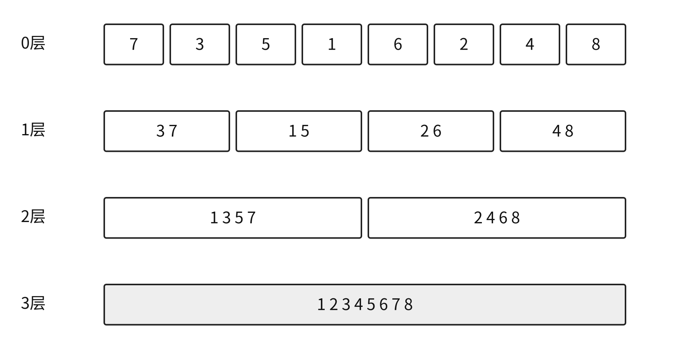{#ds-fig-merge width=96%}

### 例 8-4　比较次数不等于移动次数 {#ds-ex8-4}

【2024】 三个有序序列 `(3,5)`、`(7,9)`、`(6)`，按从左到右次序选择序列进行二路归并，关键字总比较次数为（　）。

A. 3　B. 4　C. 5　D. 6

**解析。** 先归并前两段，比较3与7、5与7，两次后左段耗尽，直接接7、9，得到 `3,5,7,9`。再与单元素6归并，比较3与6、5与6、7与6，共3次，之后接7、9。总数 $2+3=5$，答案为 **C**。最坏上界a+b−1只有在具体过程能一直交错到仅剩一个元素时才取到，本题第一次只比较2次，不能机械按4−1计3次。

## 基数排序：低位排好后怎样保留次序 {#ds-08-09}

基数排序按关键字的组成部分分配、收集。LSD从最低有效位开始，逐位稳定排序；每轮收集必须保持同一桶内原顺序，才能保留先前已经排好的低位关系。处理更高位后，低位只在高位相同时决定顺序，正是从低到高稳定处理的依据。

### 例 8-5　第一趟后为什么尚未整体递增 {#ds-ex8-5}

〖8.5-012〗 对 `05,46,13,55,94,17,42` 进行基数排序，一趟后的结果为（　）。

A. 05,46,13,55,94,17,42

B. 05,13,17,42,46,55,94

C. 42,13,94,05,55,46,17

D. 05,13,46,55,17,42,94

**解析。** 本题采用通常的十进制LSD，第一趟按个位分配：桶2放42，桶3放13，桶4放94，桶5依次放05、55，桶6放46，桶7放17。按桶号收集得 `42,13,94,05,55,46,17`，答案为 **C**。桶5不能把55放到05之前。第二趟按十位稳定处理，才得到 `05,13,17,42,46,55,94`。

若共d位、基数r，每轮分配n项并收集r个桶，时间为 $O(d(n+r))$。空间要按实现：已有链式记录、链接域计入原记录时，额外桶头尾为 $O(r)$；数组分桶另开输出数组时为 $O(n+r)$。固定十进制位数与r时可近似线性，但不能把位数随规模增长的情形也无条件写为 $O(n)$。

MSD从最高位开始，把记录分成桶后递归处理各桶；它的任务分解与LSD不同。负整数、可变长字符串、空缺位的次序都需要事先定义，不能把非负定长十进制示例原样用于所有关键字。

### 按取值计数：空间与稳定实现的条件 {#ds-c08-h175}

计数排序用关键字值映射计数数组。若整数取值从min到max，令 $k=\mathrm{max}-\mathrm{min}+1$，以 `key-min` 为下标：先统计频次，再求前缀和，得到每个值应占据的输出位置范围。例序列 $2_a,4,3_a,0,2_b,3_b$ 的频次数组为 `[1,0,2,2,1]`，前缀和为 `[1,1,3,5,6]`。从后向前扫描原序列，每次把记录放到该值当前最后一个输出位置，再将位置减1，得到 $0,2_a,2_b,3_a,3_b,4$，相等记录仍保序。

按这一稳定实现，时间为 $\Theta(n+k)$，输出数组与计数数组合计辅助空间 $\Theta(n+k)$。它适合整数取值范围较小的情形；k很大时，清零和累计计数本身就可能不合算。若只按次数把数值重新覆写回数组，没有保存相等记录的身份及附加数据，不能据此宣称对记录作了稳定排序。计数、基数利用关键字结构，不属于仅靠关键字两两比较来确定次序的模型，因而不直接受比较排序的 $\Omega(n\log n)$ 最坏下界约束。

## 外部排序：归并段、缓冲与I/O {#ds-08-10}

外部归并先把可装入内存的一批记录排成有序初始归并段，再多路归并。内存可同时放B个块、每路至少1个输入缓冲块且留1个输出缓冲块时，最多支持B−1路简单归并；双缓冲或额外选择结构还可能占更多空间。提高路数减少趟数，但不能忽略缓冲的实际容量。

若有r个初始段，固定k路平衡归并需要 $\lceil\log_k r\rceil$ 趟，最后一组可不足k路。每一趟把全部N个数据块读入并写出，通常为2N次块传输；生成初始段也读写全文件，若计入该阶段，总量为 $2N[1+\lceil\log_k r\rceil]$，这里不计寻道、缓存命中或最后输出直送等特殊节省。

例如4500条记录，每块75条，内存能容450条，则文件60块、内存6块。直接分批内排序可得到10个初始段，每段450条、6块；若用5路归并，10→2→1，需要2趟归并。计初始段生成，总块传输 $2\times60\times3=360$ 次。记录数、块数、段数各起不同作用，不能把4500直接当作I/O次数。

### 置换—选择为什么能产生长于内存的段 {#ds-c08-h189}

工作区保存当前仍可进入本段的记录。每次输出其中最小值x，再读一个新记录y：若 $y\ge x$，仍可参加当前段；若 $y<x$，把它冻结，留给下一段。可用记录耗尽时结束本段，把全部冻结记录解冻，重新开始。这里工作区只保持m条候选，输出段却可以随着不断换入而增长。

### 例 8-6　冻结记录在什么时候重新参加 {#ds-ex8-6}

【2023】 对含 $n>0$ 个记录的文件外部排序，以置换—选择生成初始归并段，工作区能保存m个记录。

（1）文件19个关键字依次为 `51,94,37,92,14,63,15,99,48,56,23,60,31,17,43,8,90,166,100`，m=4时生成几个初始段？各是什么？

（2）对任意m（$n\gg m>0$），第一个初始段长度最大、最小值分别是多少？

**解析。** 先装入51、94、37、92，输出37后读入14，因为14<37而冻结；输出51后读入63，63仍可参加本段。前6次输出和换入如下：

| 输出 | 新读入 | 新记录归属 |
| --- | --- | --- |
| 37 | 14 | 冻结 |
| 51 | 63 | 当前段 |
| 63 | 15 | 冻结 |
| 92 | 99 | 当前段 |
| 94 | 48 | 冻结 |
| 99 | 56 | 冻结 |

此时工作区14、15、48、56全被冻结，第一段结束。解冻后继续，同样逐次选最小；读入17、43、8和100时，它们分别小于当时最后输出的31、48、56和166，留给下一段。最终得到3段：

1. `37,51,63,92,94,99`；
2. `14,15,23,31,48,56,60,90,166`；
3. `8,17,43,100`。

每个原记录恰好输出一次，三段长度 $6+9+4=19$，段内均递增。第一个段最大可含全部n项，例如输入已经非降；最小为m项，例如严格递减输入，每个新读入都冻结，但最初m个仍要全部输出才能结束。答案是**最大n、最小m**，不是每段都恰好m或2m。

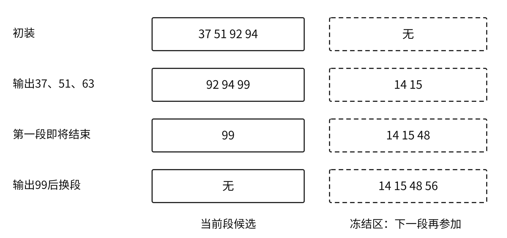{#ds-fig-replacement width=96%}

### 败者树怎样减少每次输出后的比较 {#ds-c08-h222}

k路归并每次都要找各段当前首记录中的最小者。败者树把各路作为叶，内部结点记录一次比赛的败者，并额外保存总冠军的路号。冠军输出后，仅该路换入新首记录，它沿原比赛路径与保存的败者重新比较；每层只需一次关键字比较，更新约 $O(\log k)$。

例如4路首记录为A:3、B:5、C:2、D:7，冠军是C的2，内部保存5、7及最终败者3。C换入6后，先与7比较，再与3比较，冠军变为A的3。它不需要重新比较未变化的3与5。堆的下滤一般先比较两个孩子再与候选比较，败者树每层沿既定对手路径比较，过程不同；堆可以在中途已满足堆序时停止，败者树更新冠军路径则要传到总冠军位置。

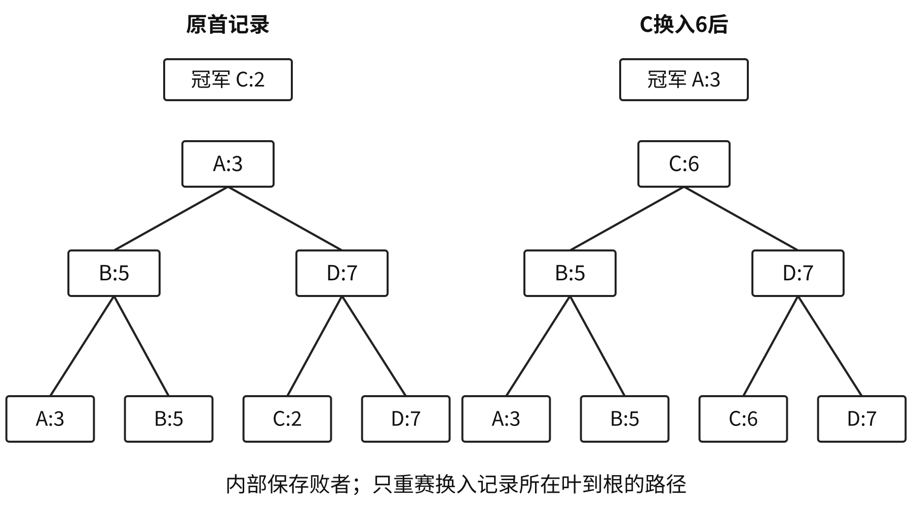{#ds-fig-loser width=96%}

### 例 8-7　不等长有序表怎样安排合并 {#ds-ex8-7}

【2012】 6个升序表A、B、C、D、E、F，分别含10、35、40、50、60、200个元素。通过5次两两合并成为一个升序表，要求最坏情况下比较总次数最小。

（1）给出完整合并过程及最坏比较总次数。（2）描述N个不等长升序表的合并策略并说明理由。

**解析。** 一张表每参加一次合并，它的全部元素就再次参与一层归并工作。让长表尽量晚参加、短表较早参加，等价于最小化以表长为叶权的二叉归并树WPL，使用哈夫曼合并策略：

| 合并段长 | 新段长 | 本次最坏比较 |
| --- | --- | --- |
| 10与35 | 45 | 44 |
| 40与45 | 85 | 84 |
| 50与60 | 110 | 109 |
| 85与110 | 195 | 194 |
| 195与200 | 395 | 394 |

最坏比较总数 $44+84+109+194+394=825$。合并长度之和即WPL，为830；每次归并比较至多“合并长度−1”，共有5次，所以也可得830−5=825。推广到N段，就是反复选当前两个最短段合并后放回候选集合，直到只剩一段，理由与哈夫曼最优树相同。

### 例 8-8　四路最佳归并为什么补零权段 {#ds-ex8-8}

〖8.7-004〗 12个初始段长分别为30、44、8、6、3、20、60、18、9、62、68、85。进行4路外部归并，画出最佳归并树并计算WPL。

**解析。** 满4叉归并树的叶数应满足 $(r-1)\bmod3=0$。12不满足，补1个零权虚段得到13个叶。每次取4个最小权值：

`0+3+6+8=17`，`9+17+18+20=64`，`30+44+60+62=196`，最后 `64+68+85+196=413`。

所以WPL为 $17+64+196+413=690$。虚段不含真实记录，补它是为安排允许不足4个真实输入的第一次归并，不会平白增加文件数据量。若每次合并段都完整读写，且段长按块计，归并阶段总块I/O为 $2\times690=1380$；这是按该模型计数，不包含此前生成初始段的读写。

## 怎样比较和选择排序算法 {#ds-08-11}

下表比较的是**完整排序的总时间**，同时计入比较、移动和循环工作，不把一次划分、一次下滤或只建堆当作完整排序。辅助空间不计输入记录本身，但计入递归栈和另开输出数组；$\Theta$ 表示同阶，$O$ 只给上界。$r$ 为基数，d为固定执行的位数，k为计数排序的取值范围大小。比较排序的平均列按互异关键字的等概率随机排列分析；随机枢轴快排也可对其随机选择取期望，这些都不等于每份输入的保证。

| 算法 | 最好时间 | 平均时间 | 最坏时间 | 辅助空间 | 稳定性 | 重要实现条件 |
| --- | --- | --- | --- | --- | --- | --- |
| 直接插入 | $\Theta(n)$ | $\Theta(n^2)$ | $\Theta(n^2)$ | $O(1)$ | 稳定 | 只移动严格大于新项的记录 |
| 折半插入 | $\Theta(n\log n)$ | $\Theta(n^2)$ | $\Theta(n^2)$ | $O(1)$ | 稳定 | 每趟都折半定位；插在旧相等项之后 |
| 起泡 | $\Theta(n)$ | $\Theta(n^2)$ | $\Theta(n^2)$ | $O(1)$ | 稳定 | 有无交换标志可提前停；仅逆序相邻项交换 |
| 简单选择 | $\Theta(n^2)$ | $\Theta(n^2)$ | $\Theta(n^2)$ | $O(1)$ | 不稳定 | 每趟选最小后与首位交换；比较固定 |
| 希尔 | 依增量序列 | 依增量序列 | 依增量序列 | $O(1)$ | 不稳定 | 逐组插入，末增量为1；未给增量不填统一时间阶 |
| 快速 | $\Theta(n\log n)$ | $\Theta(n\log n)$ | $\Theta(n^2)$ | 栈平均 $O(\log n)$，最坏 $O(n)$ | 不稳定 | 本章单枢轴划分与双支递归；平均需随机模型 |
| 堆 | $O(n\log n)$，见下文 | $\Theta(n\log n)$ | $\Theta(n\log n)$ | $O(1)$ | 不稳定 | 自底向上建堆、迭代下滤；最好紧界有条件 |
| 二路归并 | $\Theta(n\log n)$ | $\Theta(n\log n)$ | $\Theta(n\log n)$ | $\Theta(n)$ | 稳定 | 数组常规归并，不跳过已有序段；相等先取左段 |
| LSD基数 | $\Theta(d(n+r))$ | $\Theta(d(n+r))$ | $\Theta(d(n+r))$ | 链式额外 $O(r)$；数组 $O(n+r)$ | 稳定 | 固定执行d轮；同桶保序；链式原记录已有链接域 |
| 计数 | $\Theta(n+k)$ | $\Theta(n+k)$ | $\Theta(n+k)$ | $\Theta(n+k)$ | 稳定 | 计数、前缀和、逆向放入输出数组的记录实现 |

堆排序的教材汇总在关键字互异的常规模型下把最好、平均、最坏都列为对数线性阶；本表最好格保留总时间上界，并提醒具体停机条件：若允许所有关键字相等，下滤比较相等即停止，建堆和全部输出可只做 $\Theta(n)$ 工作。不能把教材汇总的最好紧界无条件套到这份重复输入，也不能因这一特例删去堆排序的 $\Theta(n\log n)$ 最坏时间。起泡若无提前停止标志，则有序输入仍执行固定二次比较；归并若另加跳过有序段的优化，最好情况也应随实现重算。

规模小、接近有序时，直接插入移动少、控制简单；需要可靠的最坏对数线性时间且额外空间有限，可考虑堆；要求稳定而可用线性辅助区，可用归并；关键字可分成少量固定位或整数取值范围较小时，可分别比较基数、计数的代价；外存排序优先设计初始段和多路归并，不能只把内部快排换到磁盘上逐元素访问。

移动、比较和趟数不能互换。简单选择比较量不受初始次序影响，交换是否真的执行却可依代码省略；折半插入比较量变化小，移动量仍依赖初始排列；LSD按固定d位执行时分配收集轮数固定；快速排序划分深度依赖结果。并行能力也依实现：快排两子区间可独立，归并同层不同段可独立；LSD的下一位依赖本位稳定结果，但每一位内部仍可设计并行分配。不能把某个串行教材步骤的依赖，扩大成算法在任何实现下“绝不可能并行”。

## 自测与答案 {#ds-ch8-check}

第2题为真题，其余为原创补充，检查模型变化。

1. 直接插入把大于条件改为大于等于，时间阶没变，哪项性质可能改变？
2. 【2022】n（n>100000）个数保存在一维数组M中，需要查找最小的10个数。（1）设计算法，要求平均情况下比较次数尽可能少，简述思想，不需要程序实现。（2）说明平均时间复杂度和空间复杂度。
3. 100个初始段，最多4路归并，需要几趟？若每趟完整读写500块，归并阶段多少块传输？
4. 一个不稳定排序在没有相等关键字的输入上，能否观察到稳定性差异？

**答案。** 1. 可能破坏稳定性，新相等记录移到旧记录前。2. 用随机枢轴划分，把第10小作为选择目标，只继续处理包含这一秩的子区间；其余一侧无需继续排序。确定分界后，左侧保留10个最小数，边界有相等值时按还需个数选取。平均时间 $O(n)$，在原数组上迭代选择可用 $O(1)$ 辅助空间；题目不要求这10个数内部有序。也可维护大小10的大根堆：只用小于堆顶的数替换并下滤，适合流式读入，代价为 $O(n\log10)$、辅助 $O(10)$，不能把它误写成必须完整排序。3. $\lceil\log_4100\rceil=4$ 趟，传输 $4\times2\times500=4000$ 块；若包含初始段生成，再加1000块。4. 不能，相等记录不存在，但算法的稳定性定义仍按所有合法输入判断。
