# 计算机系统与程序执行的层次 {#co-ch1}

## 从程序看计算机的功能部件 {#co-01-01}

计算机系统由硬件和软件共同构成。硬件提供保存信息、执行运算、控制步骤和输入输出的物理装置，软件用程序和数据规定装置怎样完成任务。仅凭处理器芯片无法判断一个应用能否运行；还要看指令集、操作系统、库及文件格式等条件。

计算机的五个基本功能部件是运算器、控制器、存储器、输入设备和输出设备。这个分类按**功能**划分，不是按芯片这一物理实体划分。CPU 通常包含运算器、控制器和寄存器，还可能集成若干级 Cache；一个存储控制器也可能集成在处理器芯片内。

| 部件 | 在执行 `c=a+b` 时做什么 |
|---|---|
| 运算器 | 对取来的两个数进行加法，形成结果及有关标志 |
| 控制器 | 解释指令，在合适时刻发出选择、读写和运算等控制信号 |
| 存储器 | 保存指令、a、b、c 及执行所需的其他信息 |
| 输入、输出设备 | 将系统外部的信息送入系统，或把系统内的结果送出 |

中央处理器 CPU 的数据通路包括寄存器、运算部件及其连接，控制器决定数据在通路上何时、向哪里流动。第5章将把一次加法展开为寄存器传送；这里先把“处理数据”和“控制步骤”分清。

主存储器能由 CPU 直接按地址访问，程序执行时所需的指令和数据通常要进入主存。磁盘、SSD 等外存提供较大且非易失的存储空间；文件保存在磁盘，并不意味着 CPU 每执行一条指令都直接向磁盘取一次。

### ISA 规定什么，微体系结构决定什么 {#co-c01-h20}

指令集体系结构 ISA 是软件可见的机器接口，规定机器指令的功能和编码、软件可见的寄存器、数据类型、寻址方式以及相关的存储访问规则。微体系结构则指在该接口约束下怎样组织与实现机器，例如采用几级流水线、怎样转发数据、Cache 怎样实现、加法器采用何种进位结构。

同一个整数加法的机器指令，可以由不同硬件通路实现。只要软件可见的效果符合 ISA，程序不必知道内部用了串行进位还是先行进位。不过，机器码能否执行还取决于运行环境；“同一 ISA”不自动保证不同操作系统的可执行文件可直接互用。硬件与软件能实现相同逻辑功能，也不表示两者的时间、成本和可修改性相同。

## 存储程序怎样变成一次次指令执行 {#co-01-02}

存储程序的基本思想是：执行前把程序指令和数据存入存储器，运行时自动取出指令、解释并执行。指令和数据都可以用二进制编码，机器根据当前操作和访问位置解释其含义。同一串位的“指令身份”或“数据身份”都离不开上下文。

冯·诺依曼型计算机按指令控制执行过程，常称控制流驱动。遇到转移、调用或异常中断时，下一步不再简单地取顺序地址上的指令，但仍由确定的控制机制改变执行位置。“存储程序”并不要求程序所在的存储内容在指令执行期间保持不变。

程序计数器 PC 保存指令执行所需的地址信息。最小的顺序执行过程可以写成：

1. 根据 PC 访问指令所在存储单元，取得指令。
2. 解释操作码和有关字段，取得操作数。
3. 执行运算、访存或控制转移，保存结果。
4. 按顺序地址或转移目标更新执行位置，继续取指。

这里的顺序地址增量取决于指令长度和地址单位。按字节编址、指令长4 B时，顺序地址通常增加4；不能把所有机器的 PC 更新都写成“加1”。流水线中取指、译码、执行还可能重叠，程序员看到的指令语义与内部时序应分开。

### 从 C 源文件到 CPU 能执行的内容 {#co-c01-h41}

在常见的静态编译流程中，预处理展开头文件和宏等指令；编译把高级语言转换为汇编形式；汇编把汇编指令编码成可重定位目标文件；链接合并目标文件与所需库，处理符号引用和重定位，形成可执行文件。装入程序再按可执行文件的组织方式建立进程的地址空间，准备执行入口。

汇编语句 `add` 是便于人阅读的符号，CPU 取到的是其机器编码。宏、伪指令还可能展开为零条、一条或多条机器指令。一条 C 语句也可能展开为多条指令；反过来，编译优化可能把多条 C 语句合并或删除。

### 例 1-1　硬件直接执行哪一种程序 {#co-ex1-1}

【2015】 计算机硬件能够直接执行的是（　）。

I. 机器语言程序　II. 汇编语言程序　III. 硬件描述语言程序

A. 仅 I　 B. 仅 I、II　 C. 仅 I、III　 D. I、II、III

**解析。** 执行普通指令的硬件按 ISA 识别机器编码，因此 I 成立。汇编语言必须经过汇编，硬件描述语言用于描述和设计硬件，不能作为普通机器指令直接送入 CPU 执行。答案为 **A**。题目问的是执行接口，而不是哪种语言更接近硬件。

解释执行是另一种程序执行方式：解释器读取源程序或中间表示，并在运行时完成相应操作。实际解释器本身仍由机器指令运行。现代语言实现也可能结合解释、预编译和即时编译，不能用“高级语言都逐行解释”概括。

## 性能计算：先确定谁的时间在改变 {#co-01-03}

响应时间是从提出任务到得到结果经历的时间；吞吐量是单位时间内完成的任务量。增加处理器可以让多个独立任务同时进行，因而可能提高系统吞吐量；一个不能并行的单线程任务却不因此自动缩短执行时间。

程序的总运行时间还可能包含 I/O 等待、系统调度等。CPU 时间是 CPU 为该程序工作所花的时间。本节的基本性能式只计算指定口径的 CPU 时间：

\[
T_{\mathrm{CPU}}=\frac{N\times\overline{\mathrm{CPI}}}{f}
=N\times\overline{\mathrm{CPI}}\times T_{\mathrm{clk}}.
\]

$N$ 是实际执行的指令条数，不能用程序文件中的静态指令条数代替；$f$ 是主频，单位 Hz；$T_{\mathrm{clk}}=1/f$ 是时钟周期；平均 CPI 是每条指令平均占用的时钟周期数。若第 $i$ 类指令执行 $n_i$ 条、平均 CPI 为 $c_i$，则

\[
\overline{\mathrm{CPI}}=\frac{\sum_i n_i c_i}{\sum_i n_i}.
\]

不同类指令的 CPI 必须按条数加权平均。CPI 还受 Cache 缺失、流水线停顿等影响，并非仅由指令操作码决定。流水线稳态下 CPI 可以接近1；多发射处理器的平均 CPI 也可以小于1，这并不表示一条指令的全部处理延迟小于一个时钟周期。

### 例 1-2　主频相同，怎样由指令组成求时间 {#co-ex1-2}

【2022】 某计算机主频为1 GHz，程序 P 运行过程中共执行10000条指令，其中80%的指令执行平均需1个时钟周期，20%的指令执行平均需10个时钟周期。程序 P 的平均 CPI 和 CPU 执行时间分别是（　）。

A. 2.8，28 μs　 B. 28，28 μs　 C. 2.8，28 ms　 D. 28，28 ms

**解析。** 条件给的是动态指令比例，先求加权平均：$0.8\times1+0.2\times10=2.8$。总周期数为 $10000\times2.8=28000$；1 GHz 对应每周期1 ns，因此 CPU 时间为28000 ns，即28 μs。答案为 **A**。百分比必须乘各类周期数，GHz 与 μs 的换算不能略去。

### 例 1-3　CPU 加快后，I/O 时间怎样处理 {#co-ex1-3}

【2012】 假定基准程序 A 在某计算机上的运行时间为100 s，其中90 s为 CPU 时间，其余为 I/O 时间。若 CPU 速度提高50%，I/O 速度不变，则运行基准程序 A 所耗费的时间是（　）。

A. 55 s　 B. 60 s　 C. 65 s　 D. 70 s

**解析。** “速度提高50%”是原速度的1.5倍，因此原来的90 s变为 $90/1.5=60$ s，而不是减为45 s。I/O 仍占10 s，总时间为70 s，选 **D**。

一般地，原运行时间中比例 $p$ 的部分加快为原速度的 $s$ 倍，其余不变，且两部分时间可以这样相加时，加速比为

\[
S=\frac{1}{(1-p)+p/s}.
\]

该式的上限是 $1/(1-p)$，但前提是加速部分划分和时间模型成立。若 I/O 与计算本来重叠，或并行化新增了通信与同步开销，应先画出实际时间关系，不能直接把各部分都相加。

### 比较性能时，为什么不能只看主频或 MIPS {#co-c01-h102}

两台机器的时间之比同时取决于指令条数、平均 CPI 和主频。相同源程序在不同 ISA、不同编译器下可能有不同的动态指令条数。即使平均 CPI 相等，也不能仅凭主频断言谁完成同一任务更快。

性能变化也应放在同一任务与同一统计口径下比较：编译优化可能同时减少动态指令条数、改变指令组成；改善 Cache 通常减少访存停顿，从而改变平均 CPI；提高主频改变每周期时间，但若伴随更多流水级或等待，CPI 也可能变化；增加核心则先要问任务能并行到什么程度。只有题干明确其他量不变时，才把时间比约成某一个因子的比例。

这些变化还对应不同系统层次。ISA 规定一条指令对软件可见的效果，编译器决定怎样用指令表达任务，微体系结构决定这些指令怎样在资源和时序上实现，操作系统决定进程可使用的运行环境与资源。问机器码能否执行，要查 ISA 和运行环境；问同一机器码为何快慢不同，要沿动态指令数、CPI、主频和等待时间寻找变化。用同一个“机器更先进”概括，无法支持具体推算。

MIPS 表示每秒执行多少百万条指令，$\mathrm{MIPS}=f/(\overline{\mathrm{CPI}}\times10^6)$；IPC 是每周期平均完成的指令数，在统计区间一致时与平均 CPI 互为倒数。MFLOPS 等指标统计浮点运算次数，与机器指令条数不是同一量。跨机器比较应优先比较同一任务的实际时间，再看指标如何解释差异。

机器字长主要反映 CPU 一次处理整数数据的基本位宽。它关系到整数表示范围和相关运算能力，但不能单独推出主存容量、总线宽度或某程序的速度。“64位机器”也不表示所有数据类型都占64位。

### 自测 {#co-self1}

1. 【2014】程序 P 在机器 M 上的执行时间是20 s。编译优化后，P 执行的指令数减少到原来的70%，而 CPI 增加到原来的1.2倍，则 P 在 M 上的执行时间是（　）。A. 8.4 s　B. 11.7 s　C. 14 s　D. 16.8 s。
2. 原创补充：两个任务都由同一单核 CPU 各执行2 s。换成两核后，每个任务仍占用一个核执行2 s，且可同时开始。两个任务的总完成时间和单个任务的响应时间分别怎样变化？

**答案。** 1. D。主频不变，时间变为 $20\times0.7\times1.2=16.8$ s。2. 两个任务全部完成的时间从4 s降为2 s；无排队时单个任务本身的执行时间仍为2 s。该小例用于区分吞吐量改善与单任务加速。


# 数据表示、位级运算与浮点数 {#co-ch2}

## 位串与数值之间还差一个解释规则 {#co-02-01}

位是取0或1的二进制位，字节 B 在本讲义中为8位，bit 写作 b。同一位串可以解释成无符号整数、补码整数、浮点数或字符编码。计算前必须同时确定**位宽、编码和小数点位置**，不能看见最高位为1就断言“这个数是负数”。

$r$ 进制采用位置权，$(a_k\cdots a_0.a_{-1}\cdots)_r$ 的值是 $\sum_i a_i r^i$，其中 $0\le a_i<r$。二进制与八进制、十六进制转换时，从小数点向两侧分组：每3位一组对应一位八进制，每4位一组对应一位十六进制；整数端左侧补0，小数端右侧补0。

### 例 2-1　整数与小数分别换基数 {#co-ex2-1}

〖2.1-001〗 若十进制数为137.5，则其八进制数为（　）。

A. 89.8　 B. 211.4　 C. 211.5　 D. 1011111.101

**解析。** $137=2\times8^2+1\times8+1$，小数部分 $0.5\times8=4$，因此为 $(211.4)_8$，选 **B**。八进制数字只能是0至7，A 本身就不是合法八进制数。分组也可验证：$137.5=(10001001.1)_2=(010\ 001\ 001.100)_2$。

十进制整数转二进制可反复除2取余、倒序排列；小数则反复乘2取整数、顺序排列。有限十进制小数未必能写成有限二进制小数，例如0.1的二进制表示无限循环。保存有限位时会发生近似，这正是后面浮点舍入出现的原因之一。

## 定点编码：范围先于运算规则 {#co-02-02}

真值是按通常数学符号写出的数值；机器数是采用约定编码保存的位串。定点表示约定小数点位置固定，并不表示存储器真的另存了一个小数点。

对 $n$ 位整数，常用编码如下。

| 编码 | 最高位和数值含义 | 表示范围 |
|---|---|---|
| 无符号 | 所有位均有正权 | $0$ 至 $2^n-1$ |
| 原码 | 最高位为符号，其余为绝对值 | $-(2^{n-1}-1)$ 至 $2^{n-1}-1$，两个零 |
| 反码 | 正数同原码，负数的数值位取反 | 与原码相同，两个零 |
| 补码 | 最高位权为 $-2^{n-1}$，其余为正权 | $-2^{n-1}$ 至 $2^{n-1}-1$，一个零 |

8位补码 `1111 1101` 的值为 $-128+64+32+16+8+4+1=-3$。也可先把它作为无符号数253，再因最高位为1减去256，得到−3。后一方法适合十六进制机器数：对 $n$ 位补码，若无符号解释为 $u$，则最高位为 0 时取 $u$，为 1 时取 $u-2^n$。

求一个负整数的补码时，可在给定位宽下把它的绝对值逐位取反再加1；位宽不能省。8位中 $-128$ 编码为 `1000 0000`，它的数学相反数128不能用8位补码表示。“取反加1”得到的仍是同一位串，这说明运算按模256进行，并不表示已经得到可表示的正128。

原码中的 `1000 0000` 表示−0，补码中则表示−128。反码的−0是 `1111 1111`。对于常见的偏置 $2^{n-1}$ 的整数移码，有 $E=x+2^{n-1}$，与对应补码相比只需翻转最高位；IEEE 754 阶码的偏置通常为 $2^{k-1}-1$，不可套用“翻转最高位”这一特殊关系。

若采用一位符号、$n-1$ 位小数的补码定点小数，最高位权为−1，其余权从 $2^{-1}$ 至 $2^{-(n-1)}$，范围为 $[-1,1-2^{-(n-1)}]$。同样的位串改变小数点位置，真值就按2的幂缩放。

## 截断、扩展与 C 类型转换 {#co-02-03}

位宽变小时，硬件截取低位；能否保留原数值，要检查被丢掉的位。位宽增大时，无符号数在高位补0，有符号补码数复制符号位。原码、反码各有自己的扩展规则，补码规则并不适用于所有编码。

8位补码−3扩为16位是 `1111 1111 1111 1101`，无符号253扩为16位则是 `0000 0000 1111 1101`。扩展后低8位相同，真值不同。**扩展方式首先取决于源数怎样解释，而不是目标类型名字中有没有 unsigned。**

### 例 2-2　无符号短整数扩展 {#co-ex2-2}

【2012】 假定编译器规定 int 型和 short 型长度分别为32位和16位，执行下列 C 语言语句：

```c
unsigned short x = 65530;
unsigned int y = x;
```

得到 y 的机器数为（　）。

A. 0000 7FFAH　 B. 0000 FFFAH　 C. FFFF 7FFAH　 D. FFFF FFFAH

**解析。** $65530=65536-6=\mathtt{FFFAH}$，源类型是无符号16位数，扩展补0，得到 `0000 FFFAH`，选 **B**。最高位为1在这里是普通数值位，不是负号。

### 例 2-3　负的 short 转成 unsigned int {#co-ex2-3}

【2025】 在32位计算机上执行下列 C 语言代码段后，ui 的值是（　）。

```c
short si = -32767;
unsigned int ui = si;
```

A. $2^{15}-1$　 B. $2^{15}+1$　 C. $2^{32}-2^{15}-1$　 D. $2^{32}-2^{15}+1$

**解析。** 按题目的16位 short、32位 unsigned int 模型，−32767的16位补码为 `8001H`。数值转换为32位无符号整数后，得到与−32767模 $2^{32}$ 同余的数，即 $2^{32}-32767=2^{32}-2^{15}+1$，机器数为 `FFFF 8001H`，选 **D**。把 `8001H` 直接补0会把负的源值误当成无符号32769。

C 中的 usual arithmetic conversions 也会改变比较方式。若32位 `int i=-1` 与32位 `unsigned u=1` 比较，常见模型下 i 转为无符号 $2^{32}-1$，所以 `i<u` 为假。需要先完成整数提升和通常算术转换，再决定按哪种值比较。

本讲义中“截断取低位”的位级推演按题设机器模型进行。C 语言本身不保证有符号溢出按补码绕回：有符号加法溢出属于未定义行为；按本讲义采用的 C11/C17 口径，超范围转换到有符号类型还涉及实现规定。考题若明确给机器位宽和截断模型，可据模型计算；编写可移植 C 程序时不能把这些题设当成语言的普遍保证。

### 移位先问逻辑还是算术 {#co-c02-h78}

逻辑右移高位补0，算术右移复制符号位；左移均在低位补0，但如何解释结果及是否溢出仍取决于编码。8位补码−3算术右移1位得到−2，相当于向负无穷方向取整；整数除法−3/2通常向零截断得到−1，两者不能无条件互换。左移时被丢弃的高位无法恢复，“低位补0”也不保证数值恰好乘2。

## 加法器怎样同时支持加与减 {#co-02-04}

一位全加器接收 $A_i,B_i,C_i$，产生和位 $S_i$ 与向高位的进位 $C_{i+1}$：

\[
S_i=A_i\oplus B_i\oplus C_i,
\qquad C_{i+1}=A_iB_i+(A_i\oplus B_i)C_i.
\]

定义进位生成 $G_i=A_iB_i$、进位传递 $P_i=A_i\oplus B_i$，即可逐层展开进位表达式。串行进位需等低位进位逐级传播；先行进位用更复杂的组合逻辑并行形成若干进位，缩短关键路径。更快的进位结构没有改变加法的数值规则。

加减运算器用控制位 Sub 将第二输入按位与 Sub 异或，同时令最低进位 $C_0=\mathrm{Sub}$。Sub=0时执行 $A+B$；Sub=1时执行 $A+\overline B+1$，即模 $2^n$ 的减法。算术逻辑部件 ALU 还通过选择控制实现与、或、异或等逻辑操作；移位器是否算在 ALU 内部，要看具体的数据通路图。

### 例 2-4　减法器的两路输入不直接送负数符号 {#co-ex2-4}

〖2.2-018〗 某计算机字长为8位，CPU 中有一个8位加法器。已知无符号数 $x=69,y=38$，若在该加法器中计算 $x-y$，则加法器的两个输入端信息和输入的低位进位信息分别为（　）。

A. 0100 0101、0010 0110、0  
B. 0100 0101、1101 1001、1  
C. 0100 0101、1101 1010、0  
D. 0100 0101、1101 1010、1

**解析。** $69=0100\ 0101$，$38=0010\ 0110$。第二路取反为 `1101 1001`，另由最低进位补上1，所以选 **B**。若第二路已取反加1又令最低进位为1，就重复加了1。运算实际为 $69+217+1=287$，低8位31、最高进位1，符合 $69-38=31$。

## CF 与 OF 分别判断什么 {#co-02-05}

同一次加法器运算可以同时按有符号和无符号两种规则解释，因此产生不同用途的标志。ZF 表示结果低 $n$ 位是否全0，SF 等于结果最高位；SF=1并不自动表示数学真值为负，还要确认按有符号解释且未发生有符号溢出。

对于加法，CF 反映最高位向外进位；对于本讲义采用的“CF=1表示借位”约定，减法的 CF 为最高进位的反值。可统一写为 $\mathrm{CF}=C_n\oplus\mathrm{Sub}$。某些 ISA 用“无借位”作为减法进位标志，遇到这类题设时，必须按该 ISA 的约定判断。

OF 判断有符号结果是否越出补码范围：加法时同号相加而结果异号会溢出；减法时两操作数异号且结果符号与被减数不同会溢出。也可用符号位的进位输入与进位输出异或：$\mathrm{OF}=C_{n-1}\oplus C_n$。它不要求把符号位当成独立的符号去做原码运算。

### 同一个结果，按哪一种数判断 {#co-c02-h114}

位串运算、数值解释和条件判断应分三步。先按位宽完成加减，保留低 $n$ 位；再按无符号或补码规则解读；最后选择与这种解释对应的标志。不能为了得到希望的正负号，改写已经产生的机器结果。

| 8位运算 | 保留结果 | 按无符号解释 | 按补码解释 | CF、OF |
|---|---|---|---|---|
| `7FH+01H` | `80H` | $127+1=128$，可表示 | $127+1$ 超过127 | 0、1 |
| `FFH+01H` | `00H` | $255+1$ 超过255 | $-1+1=0$，可表示 | 1、0 |
| `80H-01H` | `7FH` | $128-1=127$，无借位 | $-128-1$ 小于−128 | 0、1 |
| `00H-01H` | `FFH` | $0-1$ 需借位 | $0-1=-1$，可表示 | 1、0 |

ZF和SF只看保留下来的结果：上表第二行ZF=1，第一行与第四行SF=1。若要由减法结果判断补码数的有符号小于或大于关系，应结合OF修正结果符号；例如第三行SF=0，却不能据此说原来的−128大于1。是否相等只需看ZF，不必额外使用OF。编码范围决定“能否表示”，运算电路决定“产生哪些位”，转移条件决定“怎样使用标志”，三者要连起来判断。

### 例 2-5　十六进制补码相减 {#co-ex2-5}

【2018】 假定有符号整数采用补码表示，若 int 型变量 x 和 y 的机器数分别是 FFFF FFDFH 和0000 0041H，则 x、y 的值及 x−y 的机器数分别是（　）。

A. x=−65，y=41，x−y 的机器数溢出  
B. x=−33，y=65，x−y 的机器数为 FFFF FF9DH  
C. x=−33，y=65，x−y 的机器数为 FFFF FF9EH  
D. x=−65，y=41，x−y 的机器数为 FFFF FF96H

**解析。** `FFFFFFDFH` 距 $2^{32}$ 差33，故 x=−33；`41H` 是十进制65。数学结果为−98，在32位补码范围内，机器数为 $2^{32}-98=\mathtt{FFFFFF9EH}$，选 **C**。十六进制的41不能按十进制41读。

### 例 2-6　有符号减法为何仍会产生借位 {#co-ex2-6}

【2023】 已知 x、y 为 int 类型，当 x=100、y=200时，执行“x减y”指令得到的溢出标志 OF 和借位标志 CF 分别为0、1。那么当 x=10、y=−20时，执行该指令得到的 OF 和 CF 分别是（　）。

A. OF=0，CF=0　 B. OF=0，CF=1　 C. OF=1，CF=0　 D. OF=1，CF=1

**解析。** 有符号真值为 $10-(-20)=30$，可表示，OF=0。若按无符号解释输入位串，−20对应 $2^{32}-20$，10小于它，减法需要借位，CF=1，选 **B**。题目已经用100−200说明了借位标志约定，不能把两个标志都按有符号真值判断。

条件转移利用这些标志完成比较。先计算 $a-b$：无符号 $a<b$ 对应 CF=1，无符号 $a>b$ 对应 CF=0且ZF=0；带符号 $a<b$ 对应 $\mathrm{SF}\ne\mathrm{OF}$，带符号 $a>b$ 对应ZF=0且SF=OF。用 SF 单独判断带符号大小，会在溢出时失败。

## 乘除运算必须保留的中间量 {#co-02-06}

### 无符号乘法：为什么需要部分积和双倍位宽 {#co-c02-h150}

两个 $n$ 位无符号数的精确乘积最多需要 $2n$ 位。以王道书§2.2中的13乘11为例：$13=1101_2$，$11=1011_2$。乘数从低位到高位为1、1、0、1，部分积依次是13、26、0、104，总和143，即 `1000 1111`。

顺序乘法器可以每轮检查乘数最低位，决定是否把被乘数加到部分积高半部，再将“进位—部分积—乘数”组合右移。部分积开始为0，循环 $n$ 次后得到 $2n$ 位积。相应的等价算法也可让被乘数左移、乘数右移，把选中的部分积加到双倍宽累加器；两种寄存器布局的逐轮数值不同，不应把一种布局的移位规则套用到另一种。

对13×11，用双倍宽累加器的轨迹如下：

| 本轮乘数低位 | 本轮被乘数 | 累加器更新后 | 乘数右移后 |
|---|---:|---:|---:|
| 1 | 13 | 13 | 5 |
| 1 | 26 | 39 | 2 |
| 0 | 52 | 39 | 1 |
| 1 | 104 | 143 | 0 |

带符号乘法不能把负数的补码直接当成同宽无符号数求完整积。Booth 法在乘数末端附一位0，考察相邻两位 $q_iq_{i-1}$：01时加被乘数，10时减被乘数，00或11不加减，再对组合寄存器算术右移。这里的前提是符号扩展到位、中间寄存器足够宽；对最小负数取负时，尤其需要保护位。

以4位补码的−3×5说明Booth法（原创机制示例）。乘数寄存器Q为4位，附加位$q_{-1}$为1位，A采用5位补码以保留保护位，被乘数M=−3也扩成5位。初态A=`00000`、Q=`0101`、$q_{-1}=0$。每轮先看$Q_0q_{-1}$，对A加减M，再把A、Q、$q_{-1}$连接成10位整体算术右移；A的最低位移入Q最高位，Q最低位移入$q_{-1}$。

| 轮次 | 判断位 | 移位前操作及A真值 | 移位后的A | 移位后的Q | $q_{-1}$ |
|---:|---|---|---|---|---:|
| 1 | 10 | A−M=3 | 00001 | 1010 | 1 |
| 2 | 01 | A+M=−2 | 11111 | 0101 | 0 |
| 3 | 10 | A−M=2 | 00001 | 0010 | 1 |
| 4 | 01 | A+M=−2 | 11111 | 0001 | 0 |

四轮后AQ为9位`11111 0001`，去掉冗余符号保护位即8位`1111 0001`，真值为−15。移位时必须复制A的符号位，并在寄存器边界传位；把A、Q分别右移会丢掉跨界位，得到错误乘积。

阵列乘法器用组合电路完成部分积生成与压缩求和，可能在一个足够长的时钟周期内完成；顺序乘法器复用 ALU 和移位器，通常跨多个周期。“一个周期”不能脱离所用电路和时钟周期长度讨论。常数乘法可以在保持规定语义的前提下化为移位与加减，例如 $13x=(x\ll3)+(x\ll2)+x$。

### 除法：商来自每一步余数比较 {#co-c02-h180}

以无符号7÷3为例，按被除数的有效位 `111` 从高到低处理，初始余数 R=0。每读入一位，先令 $R\leftarrow2R+b$，若 R≥3则减3并在商中记1，否则记0。

| 读入位 | 比较前余数 | 本位商 | 本步余数 |
|---|---:|---:|---:|
| 1 | 1 | 0 | 1 |
| 1 | 3 | 1 | 0 |
| 1 | 1 | 0 | 1 |

商为 `010` 即2，余数1，满足 $7=2\times3+1$ 且 $0\le R<3$。硬件通常固定处理整个位宽，在前面补零位，不会因此改变结果。恢复余数法先试减，结果为负时再加回除数；不恢复余数法根据余数符号决定下一轮加还是减，用不同轨迹完成同一任务。

不恢复余数法也可用同一7÷3观察。令余数R为4位有符号寄存器、Q为3位，除数D=3，初态R=0、Q=`111`。每轮先把R、Q连接左移一位，Q最高位移入R最低位；若上一轮R非负，本轮减D，若上一轮R为负则加D；运算后R非负就在Q最低位置1，否则置0。

| 轮次 | 左移后R真值 | 加减操作 | 操作后R | 记商后的Q |
|---:|---:|---|---:|---|
| 1 | 1 | R−D | −2 | 110 |
| 2 | −3 | R+D | 0 | 101 |
| 3 | 1 | R−D | −2 | 010 |

最后R仍负，补做R←R+D，得到余数1，Q=`010`为商2。第二轮没有先把−2恢复成1再试减，而把恢复效果合并进下一轮加法，这正是不恢复余数法的含义；最终余数校正不能漏掉。硬件布局或商编码约定不同会改变表中轨迹，做题时应遵循同一套规则。

有符号除法还要确定商、余数符号和舍入方向。按 C 向零截断模型，−7÷3的商为−2、余数为−1，仍满足被除数=商×除数+余数。除数为0时需要异常处理；$-2^{n-1}/(-1)$ 的商超出 $n$ 位补码范围。某种除法器可能检测到被除数绝对值小于除数，就提前输出商0；另一种固定轮数除法器仍运行完整迭代。只有题干电路给出提前退出逻辑时，才能比较哪组数据用时最短。

## IEEE 754：字段既规定精度，也规定特殊情况 {#co-02-07}

IEEE 754 binary32 即通常的单精度格式，由1位符号 s、8位阶码 E、23位尾数字段 F 构成；binary64分别为1、11、52位。这里 F 的整数值要除以 $2^{23}$ 或 $2^{52}$ 才是小数尾数部分。

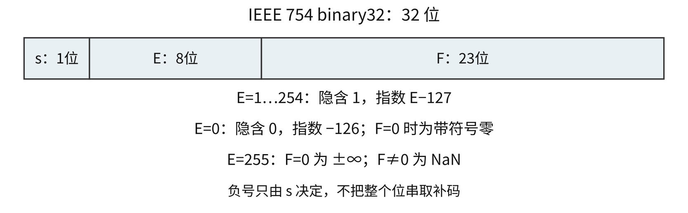{#co-fig-ieee width=96%}

对于 binary32：

\[
x=\begin{cases}
(-1)^s(1+F/2^{23})2^{E-127},&1\le E\le254;\\
(-1)^s(F/2^{23})2^{-126},&E=0;\\
(-1)^s\infty,&E=255,F=0;\\
\mathrm{NaN},&E=255,F\ne0.
\end{cases}
\]

规格化数有隐含的前导1，有效精度24位。非规格化数前导为0，最小指数同样取−126，数值逐渐接近0；当 F=0时是带符号零。非规格化数不能再用指数 E−127配隐含1计算。

最小正规格化数为 $2^{-126}$，最小正非规格化数为 $2^{-149}$，最大有限正数为 $(2-2^{-23})2^{127}$。这些是数值范围；“能连续精确表示的整数”是另一问题。binary32能精确表示 $[-2^{24},2^{24}]$ 内所有整数，更大的某些整数仍能精确表示，但相邻可表示数的间隔可能大于1。

### 例 2-7　负小数怎样组成单精度机器数 {#co-ex2-7}

【2022】 −0.4375的 IEEE 754 单精度浮点数表示为（　）。

A. BEE0 0000H　 B. BF60 0000H　 C. BF70 0000H　 D. C0E0 0000H

**解析。** $0.4375=0.0111_2=1.11_2\times2^{-2}$。s=1，E=−2+127=125=`01111101`，F为 `110` 后补20个0。连接为 `1|01111101|11000000000000000000000`，十六进制为 `BEE00000H`，选 **A**。负数只改变符号位，不对浮点数全部位取补码。

### 例 2-8　同为负浮点数时怎样比较 {#co-ex2-8}

【2014】 float 型数据常用 IEEE 754 单精度浮点格式表示。假设两个 float 型变量 x 和 y 分别存放在32位寄存器 f1 和 f2 中，若 `(f1)=CC90 0000H`、`(f2)=B0C0 0000H`，则 x 和 y 之间的关系为（　）。

A. x<y且符号相同　 B. x<y且符号不同　 C. x>y且符号相同　 D. x>y且符号不同

**解析。** 两个最高位都为1，均为负。x的阶码为153，实际指数26；y的阶码为97，实际指数−30。两者均为有限规格化数，x的绝对值远大于y，因此 x<y，选 **A**。此处不必把尾数展开为完整十进制数。对负数，绝对值更大的反而更小。

int 转 float 可能丢低位，32位 int 转 binary64 则可精确表示，因为 binary64 有53位有效精度。float 转 double 在通常 IEEE 格式下能精确保留原来的有限数值，但不能恢复 float 形成时已经丢掉的信息。浮点转整数按语言规则截断，且须检查范围；NaN 与任何数（包括自身）的相等比较都为假，不能把 `x/x==1` 用在 x=0或无穷等情形。

## 浮点加减：对阶丢位以后还要判断舍入 {#co-02-08}

两个浮点数只有指数相同，才能直接把有效数相加。通常先把较小指数的有效数右移，使指数与较大者一致；这叫对阶。大阶向小阶对齐会要求更多高位和更大的寄存器，不符合固定精度运算的通常实现。

对阶之后进行尾数运算，再规格化和舍入。加法可能得到 $10.xxx_2$，须右移1位、阶码加1；异号相加发生抵消，可能得到 $0.00\cdots1xxx_2$，须左移、阶码减少。舍入使尾数加1时还可能再次进位，必须再检查规格化和阶码范围。若得到精确的0，也不能继续无止境地左移寻找前导1。

用一个仅保留4位有效数的教学格式说明舍入。$x=1.000_2\times2^0$，$y=1.000_2\times2^{-4}$，精确和为 $1.0001_2$，恰好位于保留为 `1.000` 和 `1.001` 的中点。采用“舍入到最近，正中取偶数”，保留最低位为0的 `1.000`。若 x 改为 `1.001`，精确和为 `1.0011`，则正中取偶数进为 `1.010`。偶数指保留有效数的最低位为0，不是判断整个真值是奇整数还是偶整数。

实际实现常保留保护位、舍入位和粘滞位。粘滞位记录更低位中是否出现过1，因此 `1000…` 与 `1000…1` 的舍入结论可能不同，不能只保留移出的第一位。

### 例 2-9　哪些步骤可能造成指数越界 {#co-ex2-9}

【2015】 下列有关浮点数加减运算的叙述中，正确的是（　）。

I. 对阶操作不会引起阶码上溢或下溢  
II. 右规和尾数舍入都可能引起阶码上溢  
III. 左规时可能引起阶码下溢  
IV. 尾数溢出时，结果不一定溢出

A. 仅 II、III　 B. 仅 I、II、IV　 C. 仅 I、III、IV　 D. I、II、III、IV

**解析。** 对阶把较小阶提高到较大阶，最终阶码仍是原有合法阶码之一；右移尾数可能损失精度，但不使该阶码越界，I正确。右规和舍入后的再右规会使指数加1，可能越过上界，II正确。抵消后的左规要减小指数，可能进入非规格化区或触及题设的下溢界，III正确。尾数暂时形成 `10.xxx` 还可以右规，只要指数容纳得下，结果仍可表示，IV正确。选 **D**。尾数的暂时进位与最终浮点范围溢出是不同层次。

采用 IEEE 754 的渐进下溢时，指数过小并不立即把所有结果变成0，还可能形成非规格化数。题目若采用“阶码、尾数均为补码”的教学格式，就应按其位宽、小数点位置、双符号位和舍入方法计算，不能把该格式的尾数补码接到 IEEE 字段中。

浮点加法不满足数学实数的结合律。例如在 binary32 中，$a=2^{25},b=-2^{25},c=1$：$(a+b)+c=1$，而 $a+(b+c)$ 中 b+c 可能先舍入回 b，结果为0。发生差异的原因是中间舍入，不是加法指令随意改变数学规则。

### 定点整数与浮点数的范围、精度怎样比较 {#co-c02-h270}

32位补码整数把31位用于正数的数值范围，范围内整数连续、没有空缺；binary32把位分给符号、指数和有效数，扩大数值范围，同时只保留24位有效二进制数字。浮点数在某个数量级的间隔随指数增大，因而“32位”相同不表示能精确保存同一批整数。

例如 $2^{24}$ 可被binary32精确表示，但 $2^{24}+1$ 正好落在相邻两个可表示数之间；按最近偶数舍入回 $2^{24}$。而 $2^{25}$ 仍可精确表示。问“所有不超过某界的整数都精确”与问“某个大整数是否精确”，必须分别作答。整数溢出检查编码范围；浮点溢出检查舍入、规格化后的指数；尚未溢出的浮点结果也可能已经不精确。

### 例 2-10　同一求和程序中的循环边界、整数范围与浮点精度 {#co-ex2-10}

【2017】 已知 $f(n)=\sum_{i=0}^{n}2^i=2^{n+1}-1=\underbrace{11\cdots1}_{n+1\text{位}}{}_2$，计算 $f(n)$ 的C语言函数f1如下。

```c
int f1(unsigned n) {
    int sum = 1, power = 1;
    for (unsigned i = 0; i <= n - 1; i++) {
        power *= 2;
        sum += power;
    }
    return sum;
}
```

将f1中的int都改为float，可得到计算 $f(n)$ 的另一个函数f2。假设unsigned和int型数据都占32位，float采用IEEE 754单精度标准。请回答下列问题。

（1）当n=0时，f1会出现死循环，为什么？若将f1中的变量i和n都定义为int型，则f1是否还会出现死循环？为什么？

（2）f1(23)和f2(23)的返回值是否相等？机器数各是什么（用十六进制表示）？

（3）f1(24)和f2(24)的返回值分别为33 554 431和33 554 432.0，为什么不相等？

（4）$f(31)=2^{32}-1$，而f1(31)的返回值却为−1，为什么？若使f1(n)的返回值与f(n)相等，则最大的n是多少？

（5）f2(127)的机器数为7F80 0000H，对应的值是什么？若使f2(n)的结果不溢出，则最大的n是多少？若使f2(n)的结果精确（无舍入），则最大的n是多少？

**解析。** 本题把同一数列放进不同表示中：先查循环是否结束，再查运算范围，最后查浮点有效位。以下对f1(31)的既定结果和n=0时持续循环的轨迹，都按32位补码机器执行模型解释；标准C中有符号溢出属于未定义行为，n=0时循环体也可能先发生这种溢出，不能把本题机器推演当成可移植C保证。

（1）i和n均为unsigned，n=0时，`n-1`按模 $2^{32}$ 运算成为 $2^{32}-1$。任何32位无符号i都满足 `i<=n-1`，i达到最大值后再加1又回到0，因此循环条件一直为真。若两者都改为int，n−1为−1，第一次测试 $0\le-1$ 就为假，循环一次也不执行，不会因这个边界形成死循环。

（2）$f(23)=2^{24}-1=16\,777\,215$，是24个连续的二进制1。它在32位int范围内，且binary32恰有24位有效精度，故两者数值相等。f1(23)的补码机器数为 `00FF FFFFH`。浮点形式为 $1.\underbrace{11\cdots1}_{23\text{位}}\times2^{23}$，s=0、E=23+127=150、F全1，故f2(23)的机器数为 `4B7F FFFFH`。相同数值不要求机器编码相同。

（3）$f(24)=2^{25}-1$ 需要25位有效数字，int仍能精确保存，binary32却只能保留24位。最后一次加法的精确结果为33 554 431，处于33 554 430与33 554 432之间的正中；最近偶数舍入选后者，得到 $2^{25}$，机器数 `4C00 0000H`。这里尚未浮点溢出，只丢失了低位精度。

（4）$2^{32}-1$ 超过32位补码int最大值 $2^{31}-1$。按题设保留的低32位全为1，解释为补码−1。要求所有返回值与数学数列一致，须 $2^{n+1}-1\le2^{31}-1$，所以最大n=30；不能因为无符号32位能表示 $2^{32}-1$，便认为int也能表示。

（5）`7F80 0000H` 的阶码全1、尾数全0、符号0，表示正无穷。n=126时，精确数 $2^{127}-1$ 被舍入为 $2^{127}$，仍是有限数；n=127时，结果越过最大有限数并舍入为正无穷。因此不溢出的最大n=126。要完全精确，数列中n+1个连续1必须全部容纳在24位有效数中，最大n=23。两个上界分别来自指数范围与有效精度，不能互换。

### 自测 {#co-self2}

1. 原创补充：8位机器计算 `7FH+01H`，按本章标志约定求低8位结果、CF、OF、SF、ZF。
2. 原创补充：binary32位串 `0000 0001H` 与 `0080 0000H` 各表示什么正数？两者是否都具有隐含前导1？
3. 〖2.3-024〗 已知32位 int 变量 i=12345，float 变量 $f=1.2345\times2^3$。下列结果为假的是：A. `i==(int)(double)i`；B. `f==(float)(double)f`；C. `i==(int)(float)i`；D. `f==(float)(int)f`。

**答案。** 1. 结果 `80H`，CF=0、OF=1、SF=1、ZF=0；127+1越出补码范围，但未越出8位无符号范围。2. 分别为 $2^{-149}$ 与 $2^{-126}$，前者非规格化、隐含0，后者规格化、隐含1。3. D。12345能被 binary32精确表示；float到double再回来也保留原float值，但 f 截断为整数会丢小数部分。


# 存储层次、地址与 Cache {#co-ch3}

## 为什么一个程序同时使用几层存储器 {#co-03-01}

寄存器、Cache、主存和外存的速度、容量及单位成本不同。寄存器紧贴运算部件、容量小；Cache 保存近期可能使用的主存块；主存容纳正在运行的程序和数据；外存提供较大且通常非易失的空间。层次化存储利用程序访问的局部性，使大量访问落在较快的层中，同时保留较大容量。

随机存取指访问时间基本不随单元位置改变，不等于“随机挑一个位置”。顺序存取要按顺序经过前面的内容；直接存取先定位一个区域，再在区域内访问，例如磁盘。相联存储器按内容匹配，TLB 的相联查找就是常见用途。

存取时间是完成一次读或写所需的时间；存取周期是连续两次访问之间允许的最短间隔。DRAM 读后需要恢复等操作，存取周期可能大于单纯读出延迟。计算连续访问的总时间时，不能只拿一次存取时间乘访问次数。

容量要写成“单元数×每单元位数”，再结合编址单位换算。$2^{20}$ 个8位单元为1 MiB；本讲义在芯片容量、地址空间、Cache中使用二进制单位，主频和传输率中的 M、G 按十进制。题源沿用 KB、MB 时，根据地址幂次说明实际口径。

## SRAM、DRAM 与 Flash 保存信息的方式 {#co-03-02}

SRAM 用稳定电路状态保存位，只要供电就不需周期刷新，通常速度快、集成密度相对低，适合 Cache。DRAM 用电容电荷表示位，电荷会泄漏，需要刷新；读出还伴随感知、放大和恢复。它的高密度使其适合主存。

“动态”说的是保存机制，不是程序是否经常改写数据；“随机”说的是访问方式，不是是否需要刷新。SRAM、DRAM 都是易失性存储器，掉电后不能保持原信息。

Flash 是非易失性半导体存储器。读、编程和擦除的粒度与代价不同，通常不能像 SRAM 那样直接覆盖写入任意旧位；例如 NAND Flash 常按页读写、按块擦除。SSD 控制器借助映射、垃圾回收和磨损均衡，把复杂的物理操作组织成主机看到的逻辑块访问。掉电保持不等于写入次数无限，也不等于写延迟与读延迟相同。

比较存储器时，要固定同一维度。SRAM与DRAM在“能否随机访问”上相同，在“怎样保持一位、是否刷新、速度与密度”上不同；DRAM与Flash在“是否掉电保持”上不同；Cache与主存则首先是系统中的层次角色，常分别由SRAM和DRAM实现，而角色的划分与器件技术的划分不是一回事。芯片题再把器件组织写成单元数×位宽：一片 $4\mathrm M\times8$ 的容量是4 MiB，不能因它用于主存，就把“地址线、数据线、存储单元数”当成同一个数。

## 地址引脚不总等于地址位数 {#co-03-03}

SRAM 的 $2^k\times w$ 表示有 $2^k$ 个可选单元，每次选中输出 w 位，通常需 k 根地址线和 w 根数据线，另有片选和读写等控制线。DRAM 常将行地址、列地址分时送入同一组地址引脚，由行、列选通信号分别锁存，因此逻辑地址位数不能直接作为地址引脚数。

### 例 3-1　DRAM 的复用地址怎样计数 {#co-ex3-1}

【2014】 某容量为256 MB的存储器由若干 $4\mathrm M\times8$ 位的 DRAM 芯片构成，该 DRAM 芯片的地址引脚和数据引脚总数是（　）。

A. 19　 B. 22　 C. 30　 D. 36

**解析。** $4\mathrm M=2^{22}$，芯片内部需要22位单元地址。按题目采用的行列各11位、地址复用模型，需11根地址引脚；数据宽8位，需要8根数据引脚，共19根，选 **A**。题目给出的整机256 MB并不改变单片引脚数。若问组成整机需要多少片，则另算 $256/4=64$ 片。

实际 DRAM 还可能含多个 Bank，地址、命令及引脚结构要按题目给出的组织判断。刷新按行进行，不是每保存一个位就分别发一次刷新。集中刷新把若干刷新操作连在一起，期间可能有一段较长的时间不能正常访问；分散刷新把一次正常存取和一次刷新组合到扩大的存取周期内，不形成集中刷新的长间隙，但会降低正常访存速率。异步刷新在保持时间内把各行刷新均匀分散，定期插入短的刷新周期，其间仍可进行正常访问。若有 R 行、保持时间为 $T_r$，把每行各刷新一次并均匀分布，平均间隔为 $T_r/R$；还须检查每次刷新占用多久。

### MAR 的位数由地址空间决定 {#co-c03-h37}

MAR 需容纳可由该机器给出的主存地址。它与 MDR 的位数没有“必须相等”的关系。MDR 反映某次数据传送的位宽，MAR 反映地址编码位宽。

### 例 3-2　已安装容量不是全部可编址空间 {#co-ex3-2}

【2011】 某计算机存储器按字节编址，主存地址空间大小为64 MB，现用 $4\mathrm M\times8$ 位的 RAM 芯片组成32 MB的主存储器，则存储器地址寄存器 MAR 的位数至少是（　）。

A. 22位　 B. 23位　 C. 25位　 D. 26位

**解析。** 题目问覆盖64 MB地址空间需要多少位，而不是按已安装的32 MB去算。$64\mathrm{MB}=2^{26}\mathrm B$，每个字节一个地址，所以 MAR 至少26位，选 **D**。芯片地址位数22、已安装容量地址位数25都不能回答这一问题。

## 单体多字和多体交叉怎样提高带宽 {#co-03-04}

单体多字存储器扩宽一次读写的数据量，一个存储单元包含多个机器字。顺序使用相邻字时，一次访问可以提供多个字；若频繁跳转，取来的其他字未必有用。它主要改善带宽，不能仅凭“一次取多个字”就当成解决地址空间不足的方案。

多体存储器则包含能相对独立工作的存储模块。高位交叉（顺序编址）用地址高位选模块，各模块保存连续的一段地址；低位交叉用低位选模块，连续字地址轮流落到不同模块。对 m 个模块且按字编址的常规模型：

\[
\text{模块号}=\text{字地址}\bmod m,\qquad
\text{模块内地址}=\left\lfloor\frac{\text{字地址}}m\right\rfloor.
\]

若给的是字节地址，每字 w B，且各模块每次存取一字，通常应先由 $\lfloor A/w\rfloor$ 求出字地址，再据此分模块；最低的字节偏移不参与模块编号。多体交叉与单体多字可以结合，但两者不是同一种机制。

设单模块存取周期为 T，连续启动相邻模块的间隔为 r，模块数 m。连续顺序访问不冲突的条件是 $mr\ge T$。若第一字在 T 后到达，后续每隔 r 得到一个字，读 n 个字的时间为 $T+(n-1)r$。第一字延迟仍为 T，提高的是连续吞吐率。

### 例 3-3　同一模块不等于立即发生冲突 {#co-ex3-3}

【2015】 某计算机使用4体交叉编址存储器，假定在存储器总线上出现的主存地址（十进制）序列为8005、8006、8007、8008、8001、8002、8003、8004、8000，则可能发生访存冲突的地址对是（　）。

A. 8004和8008　 B. 8002和8007　 C. 8001和8008　 D. 8000和8004

**解析。** 先求地址模4：1、2、3、0、1、2、3、0、0。最后两次8004、8000连续访问模块0，模块可能尚未结束前次存取，所以选 **D**。8008与8004也在模块0，却隔了四个访问位置，不能只凭同体就忽略时间间隔。这里沿题目的低位交叉约定解释“可能冲突”，具体是否冲突仍由模块周期与请求间隔决定。

## 主存芯片怎样连到 CPU {#co-03-05}

位扩展把若干芯片并联在同一地址上，各提供数据的一部分；字扩展让若干组芯片承担不同地址范围，用片选区分。组成 $M\times W$ 的存储器，单片容量 $m\times w$，且两个方向都能整除时，位方向需要 $W/w$ 片，字方向需要 $M/m$ 组，总片数为两者乘积。

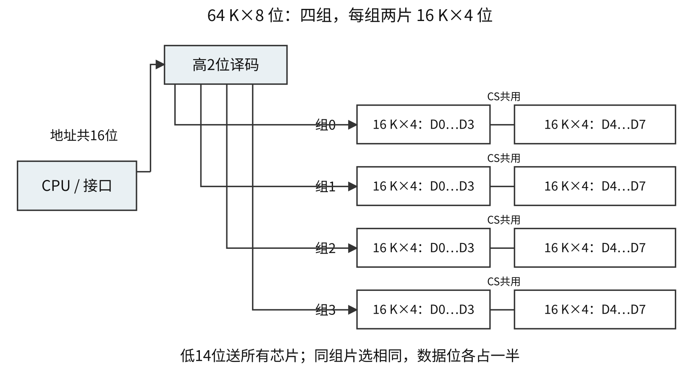{#co-fig-expand width=96%}

图中每片 $16\mathrm K\times4$ 位，同行两片并成 $16\mathrm K\times8$ 位，四组组成 $64\mathrm K\times8$ 位。低14位送给所有芯片选择片内单元，高2位经2–4译码器选一组。位扩展增加数据宽度，字扩展增加可选单元数，两者所用连线不同。

### 例 3-4　ROM 与 RAM 分区要分别计算 {#co-ex3-4}

【2009】 某计算机主存容量为64 KB，其中 ROM 区为4 KB，其余为 RAM 区，按字节编址。现要用 $2\mathrm K\times8$ 位的 ROM 芯片和 $4\mathrm K\times4$ 位的 RAM 芯片来设计该存储器，则需要上述规格的 ROM 芯片数和 RAM 芯片数分别是（　）。

A. 1、15　 B. 2、15　 C. 1、30　 D. 2、30

**解析。** ROM单片2 KB且已有8位宽，需 $4/2=2$ 片。RAM总量60 KB；单片虽有4 K单元，每单元只有4位，要两片并成 $4\mathrm K\times8$ 位的一组，再用 $60/4=15$ 组，共30片，选 **D**。只算60/4会漏掉位扩展。

确定地址范围时，先确定编址单位，再拼接片选地址和片内地址。首地址由片选编码后接全 0 构成，末地址由片选编码后接全 1 构成。例如按字编址，32 K×16位芯片的片内字地址为15位；若高3位片选为111，则字地址范围为 `38000H` 至 `3FFFFH`。若改按字节编址，每个字占2 B，片内字节范围需16位，范围随之改变，不能沿用同一答案。

地址线的编号方式同样要从题干读。通常本书令 A0为最低位；有的题明确写 A0为最高位，此时4 K片内地址使用最后12根低位地址线，片选应取其上方的线。下标数字不是判断高低位的可靠依据。

## 磁盘与 SSD 的一次访问花在哪些时间上 {#co-03-06}

磁盘由盘面、磁道和扇区组织信息。同一半径处各盘面的磁道组成柱面；选择盘面由磁头完成，寻道把磁头移动到相应磁道。旋转等待使目标扇区转到磁头下方，随后才传输数据。磁盘地址的典型几何字段是柱面号、磁头号、扇区号；磁头号已经指定盘面，不必再把“盘面号”另算一个定位维度。

\[
T_{\mathrm{access}}=T_{\mathrm{seek}}+T_{\mathrm{rotation}}+T_{\mathrm{transfer}}.
\]

只有题设要求时再计控制器或排队开销。转速为 r 转/分时，一圈为60/r秒；随机到达且目标角位置均匀时，平均旋转等待为半圈。传输一个扇区的时间只占一圈的相应部分，不能把等待的半圈再算进传输时间。

### 例 3-5　7200转每分不是7200转每秒 {#co-ex3-5}

【2015】 若磁盘转速为7200转/分，平均寻道时间为8 ms，每个磁道包含1000个扇区，则访问一个扇区的平均存取时间大约是（　）。

A. 8.1 ms　 B. 12.2 ms　 C. 16.3 ms　 D. 20.5 ms

**解析。** 一圈 $60/7200$ s≈8.333 ms，平均旋转等待约4.167 ms；一扇区传输约 $8.333/1000=0.008333$ ms。总时间约12.175 ms，选 **B**。把一整圈当成平均等待，会得到另一数量级的选项。

SSD 没有机械寻道和旋转等待，但仍有接口传输、闪存访问、控制器与写放大等开销。因此不能照搬磁盘的平均旋转等待公式。RAID把多个盘组织起来：条带化提升并行访问能力，镜像提供冗余，奇偶校验可支持某些盘故障后的恢复。RAID0没有数据冗余；即便采用冗余，也不等于可以代替备份：误删的内容仍可能被同步写到冗余盘。

## Cache 命中率怎样变成时间 {#co-03-07}

时间局部性指近期访问过的信息可能很快再访问，例如循环累加器；空间局部性指相邻位置可能很快被访问，例如顺序扫描数组。Cache按块调入，因此顺序数组中一次缺失可能为随后几个元素准备数据。

命中率 $h=N_{\mathrm{hit}}/(N_{\mathrm{hit}}+N_{\mathrm{miss}})$。平均访问时间必须先明确“未命中”指的是哪一段时间。若先查 Cache 花 $t_c$，未命中后再用 $t_m$ 完成取块，则

\[
\mathrm{AMAT}=t_c+(1-h)t_m.
\]

若题目给出的“未命中访问时间”已经包含查 Cache 的时间，记为 $t_{\mathrm{miss}}$，则写为 $ht_c+(1-h)t_{\mathrm{miss}}$。两式只是对同一事件的不同分解，第二式中不能再额外加一次 $t_c$。多级 Cache 则应区别局部缺失率与相对 CPU 总访问的全局缺失率。

### 例 3-6　读后写的数组访问怎样计缺失率 {#co-ex3-6}

【2016】 有如下 C 语言程序段：

```c
for (k = 0; k < 1000; k++)
    a[k] = a[k] + 32;
```

若数组 a 和变量 k 均为 int 型，int 型数据占4 B，数据 Cache 采用直接映射方式，数据区大小为1 KB、块大小为16 B，该程序段执行前 Cache 为空，则该程序段执行过程中访问数组 a 的 Cache 缺失率约为（　）。

A. 1.25%　 B. 2.5%　 C. 12.5%　 D. 25%

**解析。** 每块容纳4个 int。按顺序扫描，每块第一次读缺失，其余3次读命中；第一次读已把块取入，随后对应的写也命中。每4个元素共8次数组访问、1次缺失，因此约为12.5%，选 **C**。若数组首地址未按块对齐，块数可能多1，不影响本题“约为”的结论。不能把循环1000轮误当作只访问数组1000次。

### 一次缺失损失要不要反复付启动代价 {#co-c03-h139}

若每次取8 B需发送地址1周期、准备8周期、传输1周期，64 B块包含8次独立访问，总计 $8(1+8+1)=80$ 周期。若支持突发，只发一次首地址，等待首数据8周期后连续传8次，则共 $1+8+8=17$ 周期。是否支持突发会改变这里的计算结果，详见第7章；不能只看总线同为64位就给出同一个时间。

## 地址拆分决定块能放在哪里 {#co-03-08}

先由数据容量 C 和块大小 B 求行数 $L=C/B$。若每组 r 行，则组数 $G=L/r$。按字节编址且 B、G为2的幂时，块内偏移为 $b=\log_2B$ 位，组号为 $g=\log_2G$ 位，剩下高位为标记。若Cache总容量已经包含标记等附加位，这个总量就不能再当作 C。

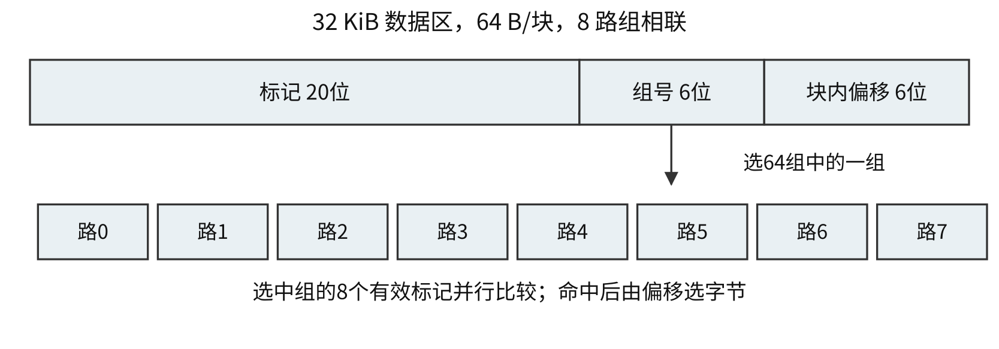{#co-fig-cache width=96%}

常规低位选组的规则为：主存块号 $q=\lfloor A/B\rfloor$，组号 $q\bmod G$，标记 $\lfloor q/G\rfloor$。直接映射是 r=1，全相联是 G=1；r 路组相联中的“路数”是每组行数，不是组数。

在地址位数、数据容量C和块大小B都相同的条件下，三种映射可放在同一框架比较。表中C为数据区容量，与B采用相同单位；块大小和组数按2的幂组织，字段位数才可直接写成以2为底的对数。

| 映射 | 每块可放的位置 | 地址中的组选字段 | 一次查找的比较范围 | 满时怎样选牺牲行 |
|---|---|---|---|---|
| 直接映射 | 唯一一行 | $\log_2(C/B)$ 位 | 选中行的一个标记 | 无行间选择 |
| r路组相联 | 唯一一组内的r行 | $\log_2(C/(Br))$ 位 | 该组r个有效标记 | 仅在该组内替换 |
| 全相联 | 全Cache任一行 | 0位 | 全部行的有效标记 | 在全Cache内替换 |

提高相联度时，块内偏移不变，组选字段变短，标记相应变长；比较器和替换状态的成本也可能增加。这样做能减少某些冲突缺失，却不消除首次访问的强制缺失，也不能让有限容量容纳任意大的工作集。映射决定候选位置，替换决定满组时选谁，写策略决定何时更新下一层，应分别求解。

访问时用组号选一组，并行比较该组各行的有效标记。组号已经用于选组，不需要再保存到每行标记中；块内偏移只负责从已找到的块中选字节。

### 例 3-7　8路组相联需要几个比较器 {#co-ex3-7}

【2022】 若计算机主存地址为32位，按字节编址，某 Cache 的数据区容量为32 KB，主存块大小为64 B，采用8路组相联映射方式，该 Cache 中比较器的个数和位数分别为（　）。

A. 8，20　 B. 8，23　 C. 64，20　 D. 64，23

**解析。** 行数 $2^{15}/2^6=2^9$，组数 $2^9/8=2^6$。偏移6位、组号6位，标记 $32-6-6=20$ 位。一次只在选中的一组内比较8个标记，因此8个20位比较器，选 **A**。组数为64，并不表示同一次访问就要比较64个组。

## LRU 更新的是访问次序，不只是装入次序 {#co-03-09}

当目标组有空行时先用空行；满了才按替换算法决定牺牲哪一行。直接映射每个块只有一个位置，不需要在多行间选择。FIFO记录装入次序，命中一般不改变队列；LRU记录最近访问次序，命中也要更新；随机替换不跟踪精确最近次序。

下面以两路的一个组解释 LRU 状态，顺序从最近使用到最久未使用。开始为空，访问 A后为[A]，访问 B后为[B,A]，再次访问 A后为[A,B]。此时访问 C，应淘汰 B，变为[C,A]。若按 FIFO，则第三次访问 A不改变装入队列，访问 C会淘汰 A。这组状态足以说明两算法的分歧。

执行替换题的表格应至少记录本次地址、块号、组号、命中与否，以及该组更新后的状态。替换仅发生在对应组内，不能从其他组挑一个“全 Cache 最久未用”的块。若题干改用高位或特殊函数选组，先按题干给出的映射分组；LRU本身不负责决定组号。

## 写命中与写缺失是两个独立问题 {#co-03-10}

写命中时，直写同时更新 Cache 和下一层；回写只改 Cache 并置修改位，替换脏块时才写回。直写常配写缓冲，以减少等待，但缓冲满时仍可能阻塞。回写时主存内容暂时旧于 Cache，这是允许的受控状态，不能凭“二者立即不同”就断定设计有错。

写缺失时，写分配先调入块再更新 Cache，非写分配直接写下一层而不把该块装入 Cache。回写常配写分配、直写常配非写分配，这是常用组合，不是逻辑上仅有的两种组合。

### 例 3-8　Cache 总容量还包括哪些位 {#co-ex3-8}

【2015】 假定主存地址为32位，按字节编址，主存和 Cache 之间采用直接映射方式，主存块大小为4个字，每字32位，采用回写方式，则能存放4 K字数据的 Cache 的总容量的位数至少是（　）。

A. 146 K　 B. 147 K　 C. 148 K　 D. 158 K

**解析。** 一块 $4\times4=16$ B，块内偏移4位。4 K字数据共16 KB，Cache有 $4096/4=1024=2^{10}$ 行，行号10位，标记18位。每行数据128位，还需有效位1和修改位1，共 $128+18+1+1=148$ 位；总计 $1024\times148=148$ K位，选 **C**。直接映射无需 LRU 替换位。本题“至少”按这些必要字段计算，不额外猜测 ECC 等未给出的实现。

多个 CPU 各有 Cache 时，一个核的写入还涉及其他副本怎样失效或更新；DMA 与 Cache 也可能有一致性处理。单核回写正确不等于多核副本会自动一致。协议细节超出本章基本模型，此处保留“需要一致性机制”的边界，不把全写法当作解决任意多副本问题的证明。

## 虚拟存储器怎样让程序看到地址空间 {#co-03-11}

虚拟存储器把进程使用的虚拟地址映射到物理地址，允许部分内容暂存外存，也支持隔离与保护。它不是“用硬盘代替所有内存”：CPU最终仍需要可访问的物理存储，缺页时还要调入并等待。

操作系统建立、维护页表等映射信息，决定分配、换入换出及保护；运行时 MMU 根据这些信息实施地址转换并检查权限。把“映射由 OS 管理”与“每次访存都调用 OS 软件转换”混为一谈，会误判硬件路径。正常的 TLB 命中不需要逐次陷入内核。

## 页表与 TLB：地址偏移为何原样保留 {#co-03-12}

页式系统把虚拟地址分为虚页号 VPN 和页内偏移 d；页表查得物理页框号 PPN 后，物理地址为 $\mathrm{PPN}\times P+d$，P是页大小。因为页和页框大小相同，页内位置不变。虚拟地址位数和物理地址位数可以不同，改变的是页号部分。

TLB 是页表项的高速缓存。TLB未命中表示缓存里没有本次所需的映射，不表示页面一定不在主存；随后可以查页表并填入TLB。对于地址合法且映射已建立的页面，存在位为0表示尚未驻留，按题设触发缺页异常。非法地址、无效映射或权限不足的情况须另行检查，不能一律按可调页修复处理；保护异常也可能发生在页面已经在主存时。

### TLB、页表与Cache各自缺少什么 {#co-c03-h207}

| 结构 | 查找所依据的信息 | 保存的主要对象 | 未命中或无效后继续做什么 |
|---|---|---|---|
| TLB | 虚页号；组相联时再拆组号和标记 | 虚页到物理页框的映射及权限等 | 查页表；此时还不能断定缺页 |
| 页表 | 虚页号，可能经过多级索引 | 页框号、存在位、权限及管理状态等 | 地址合法且未驻留时按题设缺页；非法映射与保护失败另行处理 |
| 物理地址访问的Cache | 物理块号；再拆组号和标记 | 主存数据块或指令块的副本 | 访问下一存储层，按写策略调块或写出 |

因此，TLB命中仍可能Cache缺失；TLB未命中也可能页面已在主存。不能把三个结构的“有效”都当成“原数据已经在Cache”。TLB表项存的是地址映射，不是一页完整数据；Cache行的标记也不等同于物理页框号。

按“先转换、后查物理Cache”的串行教学模型，一次普通数据读可这样展开：先由虚拟地址分出VPN与页内偏移；用VPN查TLB，未命中则走题设页表层数；取得有效页框号后拼出物理地址；再由物理地址分Cache标记、组号、块内偏移，决定从Cache还是下一层取得数据。若中间缺页，先处理并重试指令，不把尚未形成的物理地址继续送去查数据Cache。计算次数或时间时，就沿这条路径逐项累计；页表访问是否又经过Cache、TLB与Cache能否重叠，均须服从题设。

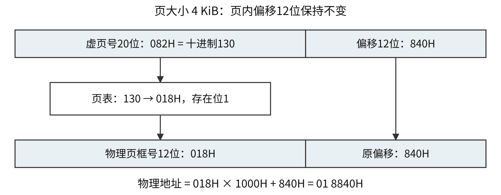{#co-fig-vm width=96%}

### 例 3-9　页号的十六进制不能直接当表中十进制 {#co-ex3-9}

【2022】 某计算机主存地址为24位，采用分页虚拟存储管理方式，虚拟地址空间大小为4 GB，页大小为4 KB，按字节编址。某进程的页表部分内容如下。

| 虚页号 | 实页号（页框号） | 存在位 |
|---:|---:|---:|
| 82 | 024H | 0 |
| … | … | … |
| 129 | 180H | 1 |
| 130 | 018H | 1 |

当 CPU 访问虚拟地址0008 2840H时，虚—实地址转换的结果是（　）。

A. 得到主存地址02 4840H　 B. 得到主存地址18 0840H  
C. 得到主存地址01 8840H　 D. 检测到缺页异常

**解析。** 页大小 $2^{12}$ B，低12位是偏移 `840H`，虚页号 `82H` 等于十进制130，并非表中第一行的十进制82。查到页框 `018H` 且存在位1，物理地址为 `018H×1000H+840H=018840H`，选 **C**。计算前逐列辨明进制，可避免把本题误判为缺页。

### 例 3-10　TLB 标记不包含页内偏移 {#co-ex3-10}

【2024】 某计算机按字节编址，采用页式虚拟存储管理方式，虚拟地址为32位，主存地址为30位，页大小为1 KB。若 TLB 共有32个表项，采用4路组相联映射方式，则 TLB 表项中标记字段的位数至少是（　）。

A. 17　 B. 18　 C. 19　 D. 20

**解析。** 偏移10位，VPN为22位。TLB共有8组，选组用VPN的3位，标记为 $22-3=19$ 位，选 **C**。物理地址30位决定页框号位数，不决定用来匹配虚页的标记位数；也不能把Cache块偏移的位数套用到TLB标记上。

计算含 TLB 的平均时间时，应画出题设路径。例如，设访问串行进行，TLB命中率为 h，TLB耗时 $t_T$，单级页表和主存访问各耗时 $t_M$，则不计缺页时的平均时间为 $h(t_T+t_M)+(1-h)(t_T+2t_M)$。多级页表、页表项缓存、TLB与Cache并行查找都会改变路径。缺页还包括外存和操作系统处理，通常远大于一次普通主存访问。

## 段式与段页式地址为什么需要界限检查 {#co-03-13}

段式系统按代码、数据等逻辑单位划分不等长段。逻辑地址含段号和段内偏移，段表记录段基址、段长及权限。若段长表示可用字节数 L，必须先验证 $0\le d<L$，再计算物理地址 $\mathrm{base}+d$；当 d=L时已经越界，不能把末地址写成base+L。

段页式先按段号找到该段页表，再用段内页号查页框，最后拼接页内偏移。段表基址、页表基址和最终数据地址不是同一个量。若段本身有界限，页号合法仍不保证最后一页的所有偏移均合法。

例如某段基址10000 B、段长3000 B，偏移2999合法、物理地址12999 B；偏移3000非法。若段页式采用1 KB页，该段的逻辑长度仍为3000 B，最后一个页号2中的偏移952对应段内3000，应被界限检查拒绝，不能因页框还有空间就允许访问。

## 综合访存：数组次序、TLB替换与Cache查找 {#co-memory-synthesis}

### 例 3-11　交换内外层循环，命中率一定降低吗 {#co-ex3-11}

【2023】改编（两个赋值式统一为常量10） 已知计算机M字长为32位，按字节编址，采用请求调页策略的虚拟存储管理方式，虚拟地址32位，页面大小为4 KB；数据Cache采用4路组相联映射方式，数据区大小为8 KB，主存块大小为32 B。现有C语言程序段如下：

```c
int a[24][64];
/* ... */
for (i = 0; i < 24; i++)
    for (j = 0; j < 64; j++) a[i][j] = 10;
```

已知二维数组a按行优先存放，在虚拟地址空间中分配的起始地址为0042 2000H，`sizeof(int)=4`。假定在M上执行上述程序段之前数组a不在主存，且在该程序执行过程中不会发生页面置换。请回答下列问题。

（1）数组分布在几个页面中？对于数组a的访问，会发生几次缺页异常？页故障地址各是什么？

（2）不考虑变量i和j，该程序段的数据访问是否具有时间局部性？为什么？

（3）计算机M的虚拟地址（A31～A0）中哪几位用作块内地址？哪几位用作Cache组号？a[1][0]的虚拟地址是多少？其所在主存块对应的Cache组号是多少？

（4）数组a占用多少主存块？假设上述程序段执行过程中数组a的访问不会和其他数据发生Cache访问冲突，则数组a的Cache命中率是多少？若将循环中i和j的次序按如下方式调换，则数组a的Cache命中率又是多少？

```c
for (j = 0; j < 64; j++)
    for (i = 0; i < 24; i++) a[i][j] = 10;
```

**解析。** 先把数组元素下标化为字节地址，再分别按页和Cache块划分。按行优先，每行64个int，共256 B，因此

\[
\operatorname{addr}(a[i][j])=\mathtt{00422000H}+(64i+j)\times4.
\]

本题参考解按写分配模型处理首次写缺失：写一个尚不在Cache中的块时先调入该块。后续命中率均采用这一约定；若明确改为非写分配，结论须重算。数组初始不在主存，因此不能把数组块预先算作有效命中。

（1）数组大小为 $24\times64\times4=6144$ B，即6 KiB。起始地址低12位为0，恰在4 KiB页边界；前16行占第一页4096 B，后8行占第二页2048 B，所以共2页。

第一次执行a[0][0]时缺页，故障地址为0042 2000H；第一次执行a[16][0]时进入下一页，故障地址为0042 3000H。无页面置换，每页首次调入后保留，共2次缺页。6 KiB除以4 KiB后向上取整在这里成立，是因为首地址页对齐；若数组从页中部开始，必须把首地址页内偏移也计入。

（2）以数组元素为数据对象，各元素只被写一次，没有重复访问同一元素，因此没有时间局部性。按行连续访问相邻元素，具有空间局部性。同一Cache块中相邻元素的后续访问能够命中，正是按块调入利用空间局部性的结果；不应据此认为同一元素“又访问了一次”。

（3）块为 $2^5$ B，块内地址为A4～A0。Cache行数 $8192/32=256$，4路共有64组，组号6位，对应A10～A5。虽然映射最终作用于物理块，但这些位都在低12位页内偏移内，地址转换不改变它们，因此可以直接从虚拟地址取出本题组号。

a[1][0]在起点之后256 B，即0042 2100H。低11位中的组号为 `(2100H>>5) mod 64=8`，二进制001000。不要把“第1行”当成只跨过一个int。

（4）每块32 B可容纳8个int，起点块对齐，总块数 $6144/32=192$。按行访问时，每块第一次写缺失，随后7次写命中，共1536次写、192次缺失，命中率为

\[
\frac{1536-192}{1536}=\frac78=87.5\%.
\]

交换循环后，每个j先跨24行访问，同一列相邻两次地址相差256 B，即相差8个块，组号也按模64增加8。固定j时，24个块轮流落在8个组中，每组恰好3块，**4路容得下这3块**。因此不能仅凭“按列走”就断言块被赶走。

例如j=0时，行号0、8、16的块都映射到组0，分别占据该组3路；第4路仍空。j=1至7仍访问这24个已装入块，均命中。j=8首次使用下一批24块，其组号在原来基础上加1，与前批分属不同组；以后同理。全数组192块按映射可以同时驻留，仍只有192次首次缺失，命中率仍为87.5%。

这个结论同时依赖数组大小、起始对齐、组数、路数和无其他数据冲突这些条件。不能只凭“数组6 KiB小于Cache8 KiB”就下结论，因为总容量装得下，仍可能在少数组内发生冲突。

**关键变式（原创）。** 若仅把Cache改成4 KiB、2路，保留64组和32 B块，则每个相关组仍轮流访问3块，却只有2路。按列遍历、LRU替换时，三块循环会互相淘汰，下一列也难以复用，数组写访问全部缺失；按行遍历仍能在同块的8次访问中命中7次。决定解法的条件是每组能容纳的块数，而不是“换循环必然降低命中率”这类笼统说法。

### 例 3-12　TLB的组选、标记与连续替换 {#co-ex3-12}

【2021】 假设计算机M的主存地址为24位，按字节编址；采用分页存储管理方式，虚拟地址为30位，页大小为4 KB；TLB采用2路组相联方式和LRU替换策略，共8组。请回答下列问题。

（1）虚拟地址中哪几位表示虚页号？哪几位表示页内地址？

（2）已知访问TLB时虚页号高位部分用作TLB标记，低位部分用作TLB组号，M的虚拟地址中哪几位是TLB标记？哪几位是TLB组号？

（3）假设TLB初始时为空，访问的虚页号依次为10、12、16、7、26、4、12和20，在此过程中，哪一个虚页号对应的TLB表项被替换？说明理由。

（4）若将M中的虚拟地址位数增加到32位，则TLB表项的位数增加几位？

**解析。** 这里替换的是地址映射表项，先按VPN选TLB组，再在所选组内更新LRU；不依据物理页框号选组，也不对全部16项作一次全局LRU。

（1）4 KB=$2^{12}$ B，故虚拟地址A11～A0为页内偏移，A29～A12共18位为VPN。物理地址24位只决定页框号为12位，不能据此把虚页号也截成12位。

（2）8组需3位组号，取VPN最低3位，即虚拟地址A14～A12；余下A29～A15共15位为TLB标记。把字段写成位数核对：$15+3+12=30$。

（3）题中虚页号均为十进制。组号为VPN mod 8，标记为 $\lfloor\mathrm{VPN}/8\rfloor$。下表的状态从最久未使用到最近使用，只列本次选中的组。

| 次序 | VPN | 组号 | 标记 | 命中与否 | 本次访问后该组的VPN次序 |
|---:|---:|---:|---:|---|---|
| 1 | 10 | 2 | 1 | 未命中，空行装入 | [10] |
| 2 | 12 | 4 | 1 | 未命中，空行装入 | [12] |
| 3 | 16 | 0 | 2 | 未命中，空行装入 | [16] |
| 4 | 7 | 7 | 0 | 未命中，空行装入 | [7] |
| 5 | 26 | 2 | 3 | 未命中，第二路装入 | [10,26] |
| 6 | 4 | 4 | 0 | 未命中，第二路装入 | [12,4] |
| 7 | 12 | 4 | 1 | 命中，更新最近次序 | [4,12] |
| 8 | 20 | 4 | 2 | 未命中，淘汰4 | [12,20] |

只有组4遇到第三个不同虚页。第7次命中12后，最久未用的是4，所以访问20时替换VPN=4的表项。若只按装入次序排队，会错误淘汰12；若只看全部16项里已用了几项，还会误以为未满就无需替换。

（4）页大小、组数和主存地址位数都不变。新增的2位虚拟地址属于VPN高位，全部进入TLB标记；页框号仍12位，故每个TLB表项增加2位。增加虚址位宽扩大了可区分的虚页范围，不会自动增加实际主存容量或TLB项数。

### 例 3-13　TLB 未命中后，还要经过哪些判断 {#co-ex3-13}

典型示例（据王道《操作系统》§3.2.9 摘编、重排）。某系统按字节编址，虚拟地址为14位，物理地址为12位，页大小为64 B。TLB 共16项，采用4路组相联；数据 Cache 使用物理地址，采用直接映射，共16行，每行4 B。

按“先完成地址转换，再查数据 Cache”的串行模型分析。所有待访问的虚拟地址均合法，且允许读；页表存在位 $P=1$ 表示页面已在主存，$P=0$ 表示合法但尚未驻留，需要处理缺页。读 Cache 未命中时，从主存调入对应的4 B数据块。

以下给出本题所需的初始状态。表中页号、页框号、标记、Cache 行号和字节数据均用十六进制，后缀 H 表示十六进制；$V$ 为有效位，“—”表示没有可用信息。TLB 的组号和路号均在0至3之间。

**表 A　TLB 初始状态：每行对应一个表项**

| 组号 | 路号 | 标记 | 有效位 $V$ | 页框号 |
| ---: | ---: | ---: | ---: | ---: |
| 0 | 0 | 03H | 0 | — |
| 0 | 1 | 00H | 0 | — |
| 0 | 2 | 09H | 1 | 0DH |
| 0 | 3 | 07H | 1 | 02H |
| 3 | 0 | 07H | 0 | — |
| 3 | 1 | 0AH | 1 | 34H |
| 3 | 2 | 03H | 1 | 0DH |
| 3 | 3 | 02H | 0 | — |

**表 B　页表中与本题有关的表项**

| 虚页号 | 存在位 $P$ | 页框号 |
| ---: | ---: | ---: |
| 03H | 1 | 02H |
| 08H | 0 | — |

**表 C　Cache 初始状态：数据列按块内字节偏移排列**

| 行号 | 标记 | $V$ | 偏移0 | 偏移1 | 偏移2 | 偏移3 |
| ---: | ---: | ---: | ---: | ---: | ---: | ---: |
| 5H | 0DH | 1 | 36H | 72H | F0H | 1DH |
| CH | 02H | 0 | — | — | — | — |

（1）写出查 TLB 时虚拟地址的字段划分，以及查 Cache 时物理地址的字段划分，并求各字段位数。

（2）分别读取虚拟地址03D4H、00F1H、0229H处的一个字节，依次说明 TLB 查找、必要的页表检查和 Cache 查找，指出最终从哪里取数，或在哪一步转入异常处理。能确定字节值时给出结果。

**三次访问相互独立，均从上述初始状态开始。** 某次访问引起的回填不影响另两次；不推演缺页后的页框分配与替换，也不计算访问时间。

**解析。** 先分别拆分虚拟地址和物理地址，再沿实际访问路径检查各表项。

**（1）两种地址的字段划分。** 页大小为 $64=2^6$ B，页内偏移占6位，虚页号 VPN 占 $14-6=8$ 位。TLB 有 $16/4=4$ 组，用 VPN 的低2位选组，其余6位作为标记。因此，从高位到低位，虚拟地址分为 **TLB 标记6位、组号2位、页内偏移6位**。

Cache 每行4 B，块内偏移占2位；共16行，行号占4位，其余 $12-4-2=6$ 位作为标记。因此，物理地址分为 **Cache 标记6位、行号4位、块内偏移2位**。页内偏移和 Cache 块内偏移的长度不同，不能混用。

**（2）三次独立的读访问。** 判断顺序如下。

- **查 TLB：** 在选中组内，只有 $V=1$ 且标记相同的表项才算命中。命中可取得页框号；未命中则查页表，此时还不能断定缺页。
- **必要时查页表：** 本题已保证地址合法且有读权限。若 $P=1$，取得页框号，并可回填 TLB；若 $P=0$，转入缺页处理，当前查找停止。
- **形成物理地址后查 Cache：** 用物理地址选行，再同时检查有效位和标记。$V=1$ 且标记相同才命中；否则从主存调块，按块内偏移取出目标字节。

**读取03D4H：TLB 命中，Cache 也命中。** 虚页号为0FH，页内偏移为14H。VPN 的低2位给出 TLB 组号3，其余位给出标记03H。表 A 的组3、路2有效且标记为03H，取得页框号0DH，无需再查页表。物理地址为

\[
\mathrm{0DH}\times\mathrm{40H}+\mathrm{14H}=\mathrm{354H}.
\]

拆分354H，得到 Cache 标记0DH、行号5H、块内偏移0。表 C 中第5H行的 $V=1$，标记也是0DH，因此从该行偏移0的位置读得 **36H**。

**读取00F1H：TLB 未命中，页面已驻留，Cache 未命中。** 虚页号为03H，页内偏移为31H；TLB 组号为3、标记为00H。组3没有有效的匹配项，因此查表 B。虚页03H的 $P=1$、页框号为02H，说明页面已在主存，**不发生缺页**。物理地址为

\[
\mathrm{02H}\times\mathrm{40H}+\mathrm{31H}=\mathrm{0B1H}.
\]

拆分0B1H，得到 Cache 标记02H、行号CH、块内偏移1。第CH行虽保留着相同标记，但 $V=0$，所以仍未命中。须从主存调入地址0B0H至0B3H所在的4 B块，再取偏移1的字节。题中没有给出该主存字节的内容，**只能确定取数路径，不能确定字节值**。

**读取0229H：TLB 未命中，随后发生缺页。** 虚页号为08H，页内偏移为29H；TLB 组号为0、标记为02H。组0没有有效的匹配项，转查页表。表 B 中虚页08H的 $P=0$，因此触发缺页异常。此时尚无可用页框号，**不形成物理地址，也不继续查数据 Cache**。由操作系统完成缺页处理、更新映射并重新执行该访问后，才继续取数。

三次访问分别在 TLB、页表和 Cache 处作出不同判断。TLB 缓存的是映射，页表存在位说明页面是否驻留，Cache 保存的是数据块：**TLB 未命中不等于缺页，页面已驻留不等于 Cache 命中，标记相同也不能代替有效位检查。** 真实系统还须区分非法地址和访问越权；本题通过“地址合法、允许读”的条件将这两类异常排除。

### 自测 {#co-self3}

1. 原创补充：32位字节地址、Cache数据区4 KB、块16 B、2路组相联，求偏移、组号、标记位数。假定另需有效位和修改位，先不计替换位，每行多少位？
2. 原创补充：两路某组按LRU访问A、B、A、C、B，初始空，列每次命中情况与最近到最久次序。
3. 【2024】下列事件中，不是在 MMU 地址转换过程中检测的是（　）。A. 访问越权　B. Cache缺失　C. 页面缺失　D. TLB缺失。

**答案。** 1. 4、7、21位；每行 $128+21+1+1=151$ 位。2. 缺失[A]、缺失[B,A]、命中[A,B]、缺失[C,A]、缺失[B,C]。3. B。MMU负责地址转换和相关保护；Cache缺失属于Cache查找结果，不能与TLB缺失等同。


# 指令系统与 C 程序的机器级表示 {#co-ch4}

## 指令字段怎样决定可表示的操作和地址 {#co-04-01}

一条机器指令包含操作码以及完成该操作所需的其他字段。操作码规定做什么，地址字段可能给出立即数、寄存器编号、形式地址、位移或寻址方式，并非所有字段都是主存绝对地址。指令字长是指令编码的位数，机器字长是整数运算的基本位宽，两者不必相等。

按显式操作数地址字段数，可以有零地址、一地址、二地址、三地址指令。零地址指令也可以操作数据：栈式机器的加法隐含从栈顶取两个数；一地址指令可隐含使用累加器；二地址形式常让一个地址同时承担源和目的，但具体语义仍要由题目给出。“两个字段”并不对应固定的访存次数：字段还可能指定寄存器或立即数。

数据传送指令移动或复制值；算术逻辑指令形成新值和可能的标志；转移指令改变后继执行地址；调用在转移前保留返回位置，返回根据保存的位置继续；输入输出及系统控制指令还可能有权限限制。通常的赋值和算术指令不会把源操作数“取走后清空”。

固定长度操作码用 k 位可区分至多 $2^k$ 种编码。扩展操作码把部分短编码保留为扩展前缀，用更长的操作码表示操作数较少的指令。已作为短指令使用的编码不能同时作长指令前缀，否则译码有歧义。

### 例 4-1　扩展操作码应逐层扣除哪些前缀 {#co-ex4-1}

【2022】 设计某指令系统时，假设采用16位定长指令字格式，操作码使用扩展编码方式，地址码为6位，包含零地址、一地址和二地址3种格式的指令。若二地址指令有12条，一地址指令有254条，则零地址指令的条数最多为（　）。

A. 0　 B. 2　 C. 64　 D. 128

**解析。** 二地址格式需要12位地址，短操作码为4位，共16种前缀，用掉12种，剩4种可扩展。每个前缀再接6位，共提供 $4\times64=256$ 种一地址操作码；用掉254种，剩2种再各扩展6位，得到 $2\times64=128$ 条零地址指令，选 **D**。

不能从 $2^{16}$ 中直接减去“12+254”，因为每条二地址指令还对应 $2^{12}$ 种操作数字段组合，每条一地址指令对应 $2^6$ 种组合。逐层保留前缀的算法直接反映译码过程，也方便处理其他字段长度。

## 从形式地址到有效地址 {#co-04-02}

以下记指令地址字段为 A，寄存器 R 的内容为 (R)，主存地址 x 的内容为 M[x]；有效地址 EA 指最终操作数所在的主存地址。立即数不需要另求操作数的主存地址；寄存器寻址的操作数也在寄存器中，不必为凑访存次数而虚构一次主存访问。

| 寻址方式 | 操作数或有效地址 | 核对条件 |
|---|---|---|
| 立即 | 操作数在指令中 | 字段的符号扩展规则 |
| 直接 | EA=A，操作数=M[A] | A的编码范围 |
| 一次间接 | EA=M[A] | 先取地址，再取操作数 |
| 寄存器直接 | 操作数=(R) | 字段是寄存器编号 |
| 寄存器间接 | EA=(R) | 寄存器保存的是地址 |
| 基址 | EA=(BR)+位移 | 位移位宽及符号 |
| 变址 | EA=A+(IX) | 元素下标是否已乘元素宽度 |
| 相对 | 目标=PC基准+位移 | PC指当前还是后继地址 |

间接寻址得到的中间地址位宽可能大于指令地址字段，从而扩大可寻址范围，代价是多一次取地址的访存。基址可用于程序重定位，变址适合数组遍历；二者都可写成寄存器加位移的形式，但寄存器的用途不同，具体机器也可能用同一种编码机制实现。

### 例 4-2　相对转移用哪个 PC {#co-ex4-2}

【2009】 某机器字长为16位，主存按字节编址，转移指令采用相对寻址，由两个字节组成，第一个字节为操作码字段，第二个字节为相对位移量字段。假定取指令时，每取一个字节 PC 自动加1。若某转移指令所在主存地址为2000H，相对位移量字段的内容为06H，则该转移指令成功转移后的目标地址是（　）。

A. 2006H　 B. 2007H　 C. 2008H　 D. 2009H

**解析。** 指令从2000H开始，占2 B，取完后 PC=2002H。相对位移为+6，目标为2008H，选 **C**。若位移字段改为 FAH且按8位补码解释，则位移为−6，目标为1FFCH；不能把 FAH当作正250。PC基准必须以本题规定的更新时机为准。

数组寻址还需区分元素下标和字节偏移。按字节编址、int为4 B时，`a[i]` 地址为base+4i。某 ISA 若有“比例变址”，可由硬件把索引乘4；若没有，则由移位或其他指令形成4i。这不意味着数组元素之间多留了3个空洞，四个字节共同存放一个元素。

### 访存次数要按执行路径来数 {#co-c04-h50}

若指令为一个字、无Cache、无预取，直接寻址的读操作数指令通常至少取指一次、取操作数一次；一次主存间接寻址再多读一次地址。若还写回主存，需另计一次写。若指令跨两个存储字、发生缺页或含两个主存操作数，次数会改变。“寄存器间接”中的“间接”不会额外读一次主存地址，因为地址已经在寄存器中。

## 大端、小端和对齐解决不同问题 {#co-04-03}

多字节数据的大端方式把最高有效字节放在最低地址，小端方式把最低有效字节放在最低地址。字节序只改变一个多字节对象内部的字节排列，不反转每个字节内的位，也不改变数组元素的顺序。

32位值 `12345678H` 从低地址到高地址，大端为12、34、56、78，小端为78、56、34、12。讨论“高位字节”时指数字意义上的高位，讨论“高地址”时指存储位置，两个维度应分开。

对齐指对象的起始地址满足规定的倍数要求。常用的自然对齐模型中，2 B对象的起始地址是2的倍数，4 B对象是4的倍数。编译器还可能为结构体在成员之间和末尾加入填充，使各成员地址和相邻数组元素都满足对齐规则。具体要求属于 ABI/编译器约定；题目给出“按边界对齐”时，才按给定类型大小计算。

### 例 4-3　先确定结构布局，再看低字节 {#co-ex4-3}

【2012】 某计算机存储器按字节编址，采用小端方式存放数据。假定编译器规定 int 型和 short 型长度分别为32位和16位，并且数据按边界对齐存储。某 C 语言程序段如下：

```c
struct {
    int a;
    char b;
    short c;
} record;
record.a = 273;
```

若 record 变量的首地址为0xC008，则地址0xC008中的内容及 record.c 的地址分别为（　）。

A. 0x00，0xC00D　 B. 0x00，0xC00E  
C. 0x11，0xC00D　 D. 0x11，0xC00E

**解析。** a占偏移0至3，b占偏移4。下一地址偏移5不是2的倍数，须填充1 B，c占偏移6、7，故c地址为C00EH。$273=\mathtt{00000111H}$，小端最低地址保存低字节11H，选 **D**。填充来自对齐，低字节11来自字节序，两步不能互相代替。

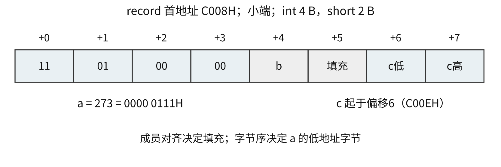{#co-fig-struct width=95%}

二维数组按行优先存放时，`a[i][j]` 的元素偏移为 $i\times\text{列数}+j$，字节偏移还要乘元素字节数。对于取负值的 short，先写出完整的16位补码，再按字节序拆开。例如−6为 `FFFAH`，小端低地址是FA、下一字节是FF，不是把真值“−6”拆成十进制字符。

## RISC 与 CISC：设计倾向不代替具体实现 {#co-04-04}

RISC通常采用较规整的指令格式、较少的寻址方式和Load/Store风格：算术逻辑操作主要在寄存器间进行，访存由装入和存储指令承担。这有利于规整译码和流水处理。CISC往往支持更丰富的指令形式与寻址方式，单条指令可以表达较复杂操作。

下表按共同维度比较教材中的典型设计。表中的“较多”“较少”只是同一历史设计背景下的倾向，并不按指令条数、某条指令或单项性能为所有处理器划定边界。

| 比较维度 | RISC的典型设计 | CISC的典型设计 | 做题时的适用边界 |
|---|---|---|---|
| 指令功能与使用 | 选用常见的简单操作，复杂功能由指令组合实现 | 指令功能较丰富，一条指令可表达较复杂操作 | 不用“小于100条／大于200条”等历史概数代替具体ISA定义 |
| 编码与寻址 | 格式较规整，常用定长编码，寻址方式较少 | 格式和寻址方式较多，常见变长编码 | 定长、变长须按题给编码确认；不能只凭RISC名称确定每条指令字节数 |
| 数据操作数访存 | 典型Load/Store模型中，装入和存储访问数据存储器，算术逻辑在寄存器间进行 | 多类指令可含主存操作数 | 这里说的是数据访问，取指也要读存储器；具体指令能否访存仍查其语义 |
| 寄存器与调用 | 通用寄存器较多，多用寄存器传参，减少数据访存 | 传统设计的通用寄存器相对较少，操作数来源较丰富 | 寄存器数由ISA给定；传参位置还受ABI约束，不由RISC/CISC名称单独决定 |
| 执行时间与CPI | 简单操作便于规整流水；教材常用多数简单指令单周期的理想模型 | 不同指令的执行时间差异往往较大 | 单条指令延迟、流水吞吐和平均CPI分别计算；访存等待、乘除及发射宽度都会改变结果 |
| 控制方式 | 多采用硬布线控制 | 复杂指令常借助微程序控制 | 两者是控制器实现方式，可结合使用，不能断言某类ISA只能选一种 |
| 流水线 | 规整编码和操作有利于流水处理 | 也可通过译码、分解内部操作等方式实现流水 | 采用流水线不是RISC独占的能力；阶段数、旁路和阻塞规则均由具体微架构决定 |
| 编译优化 | 复杂功能较多依靠编译器选指令、分配寄存器和调度 | 丰富指令给出更多选择，选指令与优化可能更复杂 | 两类都需要编译优化；目标代码条数较少不直接等于执行时间较短 |

做题时要按题目中“多采用”“通常”等措辞判断典型特征；删去这些限定，就会把设计倾向误读成必然条件。

### 例 4-4　RISC 设计能否支持流水线 {#co-ex4-4}

【2025】 下列关于 RISC 的叙述中，错误的是（　）。

A. 多采用硬连线方式实现控制器  
B. 通常采用 Load/Store 型指令设计风格  
C. 难以采用流水线数据通路实现微架构  
D. 多采用寄存器传递过程调用时的参数

**解析。** 格式规整、操作较简单，通常有利于流水线实现，所以 C 错。A、B、D描述的是常见设计倾向，不应把“多采用”读成“只能采用”。答案为 **C**。

## 编译、汇编、链接怎样确定程序中的地址 {#co-04-05}

第1章已给出工具链顺序，这里进一步说明为什么目标文件未必能直接运行。编译和汇编时，一个模块可能引用另一个模块的函数或全局变量，汇编器尚不知道它的最终地址，只能留下符号与重定位信息。链接器合并相应节，解析符号，再按选定地址修改相关引用。

可执行文件包含机器代码，也包含装入所需的组织信息；CPU 并不把文件的每一个字节都当作指令。目标文件还可能含符号表、调试信息和重定位记录。高级语言的变量名在运行时未必仍对应一个固定的主存地址；优化后变量本身可能在寄存器中、被折叠成常量，或已经消失。

### 例 4-5　工具链顺序 {#co-ex4-5}

【2022】 将高级语言源程序转换为可执行目标文件的主要过程是（　）。

A. 预处理→编译→汇编→链接  
B. 预处理→汇编→编译→链接  
C. 预处理→编译→链接→汇编  
D. 预处理→汇编→链接→编译

**解析。** 先处理源文件中的预处理指令，再将高级语言翻译成汇编表示，继而编码为目标文件，最后解析跨模块引用，选 **A**。这是题目采用的典型静态编译流程；动态链接把部分工作留到装入或运行时，但汇编编码仍必须在程序开始执行前完成。

## 分支和循环怎样改变 PC {#co-04-06}

机器执行选择结构时，先形成条件，再决定是否改变后继地址。条件可由比较指令设置标志，也可由分支指令直接比较寄存器。翻译 C 条件时必须保留 signed/unsigned 的区别：两者都用减法硬件，但转移条件并不相同。

下列教学指令约定整数均为32位，R1存放x，R2存放y，`bge` 按有符号数比较，标签代表指令地址；并假定本例的差值可用32位有符号数表示：

```text
    bge R1, R2, ELSE     // x>=y 时跳过 then
    sub R3, R2, R1      // then: z=y-x
    jump END
ELSE:
    sub R3, R1, R2      // else: z=x-y
END:
```

这里要实现 `if(x<y) z=y-x; else z=x-y;`，分支条件取原条件的否定，于是满足原条件时顺序落入 then。转移目标是代码位置，不是把标签的字符存进 PC。

分析循环时，先确定入口测试、循环体、更新和回边。对以下机器级教学轨迹，R0为数组基址，R1为元素下标，R2为和，R3为元素个数，int占4 B：

```text
    R1 <- 0; R2 <- 0
TEST:
    if R1 >= R3 jump EXIT
    R4 <- R1 << 2
    R5 <- M[R0 + R4]
    R2 <- R2 + R5
    R1 <- R1 + 1
    jump TEST
EXIT:
```

R3=0时直接退出，不读 `a[0]`；R3=3时读取偏移0、4、8而非0、1、2。这两个边界足以检查循环上下界和地址单位。若变换为指针遍历，每轮指针加4，终止地址为base+4R3；终止地址并不是最后一个有效元素的地址。

逆向读代码时，先标出各寄存器的初值和更新式，再识别分支条件。循环回边指令的执行次数与循环体次数可能不同：入口先测的 n 次循环，测试通常执行 n+1次。算动态指令数和 Cache 访问次数时，这个差别必须计入。

## 过程调用为什么要保存返回位置 {#co-04-07}

调用至少要解决四件事：把参数交给被调过程，记录返回位置，给局部变量和临时值安排空间，将返回值交回调用者。ISA提供调用、返回或寄存器转移等基础机制，ABI进一步规定参数寄存器、返回值位置、栈对齐，以及哪些寄存器由哪一方保存。

返回地址可以放到栈，也可以先放到链接寄存器。若采用链接寄存器，叶子函数可能不访存保存返回地址；会再次调用其他函数的过程，通常要在覆盖链接寄存器之前保存其中的返回地址。“返回地址一定写主存”并不是所有指令系统的共同特征。

以下采用一个明确的栈模型说明调用：栈向低地址增长，每槽4 B，SP指向当前栈顶；push先SP减4再写，pop先读再SP加4；调用压入后继指令地址，返回弹出该地址送PC。调用前SP=1000H，返回地址为2004H，则调用后SP=0FFCH、M[0FFCH]=2004H。

若被调过程又保存旧帧指针 FP、再分配8 B局部区，SP依次变为0FF8H和0FF0H。此时局部变量不能覆盖0FFCH的返回地址。退出时先撤销局部区，恢复旧FP，再取返回地址；SP最终回到1000H。图中的地址单位为字节。

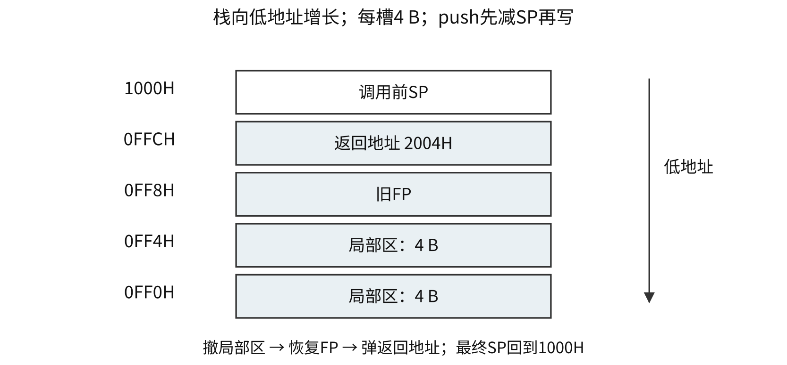{#co-fig-stack width=96%}

嵌套调用靠每次独立保存的返回位置区分“回到哪里”；递归的各层也各有参数、局部变量和返回地址。局部变量同名不表示它们共用同一槽。调用者保存寄存器需在调用前保留自己还要使用的值；被调用者保存寄存器则在被调过程修改前保存、返回前恢复。

题目给出具体调用约定时，要按该约定追踪，不能凭熟悉的 x86、MIPS 或 RISC-V 经验补条件。特别要检查栈生长方向、SP指向、入栈前后调整顺序和返回地址基准。这些细节都会影响地址计算与最终返回位置。

### 顺序、分支、调用和返回分别改变什么 {#co-c04-h184}

| 执行方式 | 后继地址怎样得到 | 额外需要保留的信息 | 读代码时先核对什么 |
|---|---|---|---|
| 顺序执行 | 当前地址加指令字节数 | 不因普通顺序执行单独保存返回地址 | 变长指令必须实际数编码字节 |
| 条件分支 | 条件成立取目标，否则取顺序后继 | 通常无需调用返回地址 | signed/unsigned条件、位移符号、基准与缩放 |
| 调用 | 无条件转到被调入口 | 调用后的后继地址 | 返回位置存栈还是链接寄存器 |
| 返回 | 取先前保存的返回位置 | 还须按约定恢复栈和现场 | 返回地址来自哪层调用，不能重算成函数入口 |

相对寻址只规定“基准地址加位移”，并不规定所有指令的位移都以字节为单位。例如下面x86的call用后继指令地址加有符号字节位移；某些定长RISC分支会把编码位移先左移两位。读机器码时应分别求出当前地址、指令长度、基准地址、扩展后的位移及缩放比例，最后核对目标。把汇编目标标签直接当成机器码里保存的绝对地址，会漏掉这条计算链。

### 例 4-6　递归调用的返回位置、机器编码与乘法溢出 {#co-ex4-6}

【2019】 已知 $f(n)=n!=n\times(n-1)\times(n-2)\times\cdots\times2\times1$，计算 $f(n)$ 的C语言函数f1的源程序及其在32位计算机M上的部分机器级代码如下。

```c
int f1(int n) {
    if (n > 1)
        return n * f1(n - 1);
    else
        return 1;
}
```

以下按“行号／虚拟地址／机器指令（字节按地址递增排列）／汇编指令”四列给出，每行是一条代码记录；省略行仍保留四列。

```text
 1  00401000  55              push ebp
 …  …         …               …
11  00401018  83 7D 08 01     cmp dword ptr [ebp+8], 1
12  0040101C  7E 17           jle f1+35h (00401035)
13  0040101E  8B 45 08        mov eax, dword ptr [ebp+8]
14  00401021  83 E8 01        sub eax, 1
15  00401024  50              push eax
16  00401025  E8 D6 FF FF FF  call f1 (00401000)
 …  …         …               …
19  00401030  0F AF C1        imul eax, ecx
20  00401033  EB 05           jmp f1+3Ah (0040103A)
21  00401035  B8 01 00 00 00  mov eax, 1
 …  …         …               …
26  00401040  3B EC           cmp ebp, esp
 …  …         …               …
30  0040104A  C3              ret
```

其中，机器级代码行包括行号、虚拟地址、机器指令和汇编指令，计算机M按字节编址，int型数据占32位。请回答下列问题。

（1）计算f(10)需要调用函数f1多少次？执行哪条指令会递归调用f1？

（2）上述代码中，哪条指令是条件转移指令？哪几条指令一定会使程序跳转执行？

（3）根据第16行的call指令，第17行指令的虚拟地址应是多少？已知第16行的call指令采用相对寻址方式，该指令中的偏移量应是多少（给出计算过程）？已知第16行的call指令的后4字节为偏移量，M采用大端方式还是小端方式？

（4）$f(13)=6\,227\,020\,800$，但f1(13)的返回值为1 932 053 504，为什么两者不相等？要使f1(13)能返回正确的结果，应如何修改f1的源程序？

（5）第19行的imul指令（带符号整数乘）的功能是 $\mathrm R[\mathrm{eax}]\leftarrow\mathrm R[\mathrm{eax}]\times\mathrm R[\mathrm{ecx}]$，当乘法器输出的高、低32位乘积之间满足什么条件时，溢出标志OF=1？要使CPU在发生溢出时转异常处理，编译器应在imul指令后加一条什么指令？

**解析。** 先追踪源程序的调用层次，再读指令对PC和数据的作用。表中的省略号表示原题未展示的指令，行号差并不等于字节数。

（1）调用参数依次为10、9、…、1，共10次，包含最外层调用；函数内部第16行call实际递归执行9次。参数为1时，第12行转到返回1的分支，不再递归。各层的返回位置虽都是调用点的后继地址，但栈帧和参数相互独立，返回时逐层乘回2、3、…、10。

（2）第12行jle是条件转移，根据比较结果决定是否转移。第16行call、第20行jmp、第30行ret在执行时都会改变顺序后继：分别是调用、无条件跳转和返回。第15行push保存参数，本身并不转到f1入口。

（3）call从0040 1025H开始，占1字节操作码及4字节位移，共5 B，所以后继地址为

\[
\mathtt{00401025H}+5=\mathtt{0040102AH}.
\]

按后继地址为相对基准，位移为 $\mathtt{00401000H}-\mathtt{0040102AH}=-\mathtt{2AH}=-42$，其32位补码为 `FFFF FFD6H`。表中后4字节按低地址到高地址为D6、FF、FF、FF，低有效字节先存，因此为小端。复核：$\mathtt{0040102AH}+(-42)=\mathtt{00401000H}$。不能用call自身起点减目标，也不能把D6当成正214。

（4）13!超过32位int上界 $2^{31}-1$。题给返回值是保留低32位后的机器结果：$6\,227\,020\,800-2^{32}=1\,932\,053\,504$，它虽为正数，仍是溢出后的错误数学结果。标准C并没有规定有符号溢出必须这样回绕；这里解释的是原题给定的机器执行结果。

一种修改是把函数返回类型改为至少64位的 `long long`，使递归返回值及与n的乘法都按该较宽类型进行：

```c
long long f1(int n) {
    if (n > 1)
        return n * f1(n - 1);
    return 1LL;
}
```

13!可以用该类型精确表示。若只是先在int中乘完，再把溢出结果强制转换为宽类型，已经丢失的高位无法恢复。这里仅保证题目所问的f1(13)，不意味着任意大的阶乘都能用固定64位整数表示。

（5）令精确64位乘积为高32位H与低32位L。若H恰是L最高位的32位符号扩展，即L的符号位为0时H全0、为1时H全1，则截为32位仍保留真值，OF=0；否则OF=1。等价地，乘积从第63位至第31位的高33位必须全0或全1才不溢出。只检查H是否为0并不够：可表示的负积需要H全1。

题目要求的是发生溢出时转异常处理，因此应在imul后安排检查OF的**溢出自陷指令**：OF=1时发出溢出异常并转入处理程序。普通条件转移 `jo` 能根据OF跳往一段代码，但跳转本身并不等于完成了异常入口动作。乘法器设置标志、指令检查标志、异常机制保存返回状态并转入口，是相接的三个步骤。

### 自测 {#co-self4}

1. 【2025】某32位计算机按字节编址，采用小端方式存放数据，编译器按边界对齐方式为下列 C 语言结构型数组 employee 分配空间：`struct record { int id; char name[10]; int salary; } employee[200];`。若 employee 首地址为0000 A0B0H，employee[1].id的机器数为1234 5678H，则其中56H所在单元地址是（　）。A. 0000 A0C3H　B. 0000 A0C4H　C. 0000 A0C5H　D. 0000 A0C6H。
2. 原创补充：沿用本章栈模型，初始SP=1000H，连续push两个4 B值后，再pop一个值，SP是多少？返回地址保存在链接寄存器时，是否每次调用都必然产生一次主存写？

**答案。** 1. C。id占0至3，name占4至13，填充14、15，salary占16至19，结构大小20 B。employee[1].id始于A0C4H，小端的56H在其后1 B，即A0C5H。2. SP=0FFCH。否，是否写主存还取决于调用模型及是否需要溢出保存。


# CPU、数据通路、控制器与异常中断 {#co-ch5}

## 寄存器的名字说明它暂存什么 {#co-05-01}

CPU 的基本任务是取指、解释指令并控制操作执行，同时处理规定的异常和中断。运算部件完成算术逻辑处理，寄存器保存当前操作需要的状态，控制器安排数据通路中的动作。每个部件的作用要放到一次实际传送中理解。

| 寄存器 | 保存内容及用途 |
|---|---|
| PC | 与后继取指位置有关的地址；更新规则由执行时序决定 |
| IR | 当前正在译码或执行的指令编码 |
| MAR | 本次主存访问的地址 |
| MDR | 与主存交换的指令或数据 |
| 通用寄存器组 | 指令能按编号访问的操作数、地址或临时结果 |
| PSW/标志寄存器 | 运算标志及体系结构规定的处理器状态 |

“寄存器在 CPU 内”不等于“它属于通用寄存器组”。PC、IR与通用寄存器的用途不同；MAR、MDR在题目的抽象模型中标明访存接口，但这并不意味着所有现代芯片都用同样的名字设置独立物理寄存器。

MAR 位数由可寻址单元数决定，MDR 位数由该数据通路一次访存交换的位宽决定。若数据总线32位、按字节编址且有26位地址，MDR可以为32位而MAR为26位，两者无须相等。MDR刚完成取指时存指令，刚完成数据读时存操作数，它的内容随本次访存的类型改变。

### 例 5-1　哪些元件负责运算，哪些元件保存状态 {#co-ex5-1}

【2023】 数据通路由组合逻辑元件（操作元件）和时序逻辑元件（状态元件）组成。以下给出的元件中，属于操作元件的是（　）。

I. 算术逻辑部件（ALU）　II. 程序计数器（PC）  
III. 通用寄存器组（GPRs）　IV. 多路选择器（MUX）

A. 仅 I、II　 B. 仅 I、IV　 C. 仅 II、III　 D. 仅 I、II、IV

**解析。** ALU按当前输入产生运算输出，MUX按选择信号把某路输入送往输出，二者是组合逻辑。PC和通用寄存器组保存跨时钟的状态，属于状态元件，选 **B**。寄存器组内部也有组合读出或选择电路，但这不改变它作为状态元件的分类。

## 指令周期、机器周期与时钟周期 {#co-05-02}

时钟周期是同步CPU中状态推进的基本时间单位。指令周期是从一条指令开始执行到完成所需的整个过程。机器周期是某些实现中为取指、访存等基本操作划分的较大时间单位，不同机器的划分不同，不应把它当成跨体系结构固定的常数。

指令周期可能含取指、间址、执行、中断等阶段；不是每条指令都经过所有阶段。寄存器指令无需为操作数访问主存，间接寻址可能增加取有效地址的阶段，外部中断也只有在满足响应条件时才进入响应过程。

单周期CPU把一条指令的全部操作安排在一个时钟周期内，所以时钟必须容纳最慢指令的数据通路；简单指令也使用同样长的周期。多周期CPU把指令拆成若干步，周期由各步关键路径决定，不同指令使用不同步数。流水线让多条指令的不同阶段重叠，减少连续指令的平均完成间隔，但未必缩短一条指令自身的延迟。

| 比较维度 | 单周期 | 多周期 | 简单标量流水线 |
|---|---|---|---|
| 同一时刻处理的指令 | 一条 | 一条的当前步骤 | 多条各在不同阶段 |
| 时钟受什么路径约束 | 最慢完整指令 | 最慢基本步骤 | 最慢流水段及段寄存器开销 |
| 一条指令占几拍 | 1拍，但该拍较长 | 随所需步骤变化 | 通常跨多拍；稳态可每拍完成一条 |
| 同一运算资源能否复用 | 同拍需要的不同用途要避免争用 | 可跨步骤复用 | 重叠阶段同拍所需资源要避免争用 |

例如PC增量和数据加法在同一长周期内都需要求和时，不能仅因“单周期一拍”就假定一个无复用路径的ALU能同时完成两项操作；多周期可以在不同拍复用，流水线则要核查两者是否会同时发生。CPI=1的单周期与稳态CPI约1的流水线可能有完全不同的时钟长度，比较性能仍须回到执行时间。

若题目给“每次访存2周期”，应把它安排到取指和操作数读写等实际位置；不能拿“某类指令固定3个机器周期”代替具体数据通路的资源分析，实际步数仍以资源限制为准。

## 一条指令怎样变为微操作 {#co-05-03}

微操作是数据通路能完成的基本动作，例如PC送MAR、两寄存器值相加、结果写回。控制信号选择输出源和ALU功能，允许某个寄存器写入，或发出存储器读写请求。微操作是动作，微命令是发出该动作的控制命令，两者不是同一个对象。

下例采用单条CPU内部总线。一次总线传送只允许一个驱动源，但同一值可以同时送入多个目的寄存器。ALU的一输入来自暂存器Y，另一输入来自总线，结果先存Z，再由Z上总线写回。这里先按图确认资源，再写时序，不另补未画出的专用路径。

### 例 5-2　从单总线图确定控制信号与取指时序 {#co-ex5-2}

【2022】 某CPU中部分数据通路如下图所示，其中，GPRs为通用寄存器组；FR为标志寄存器，用于存放ALU产生的标志信息；带箭头虚线表示控制信号，如控制信号Read、Write分别表示主存读、主存写，MDRin表示内部总线上数据写入MDR，MDRout表示MDR的内容送内部总线。

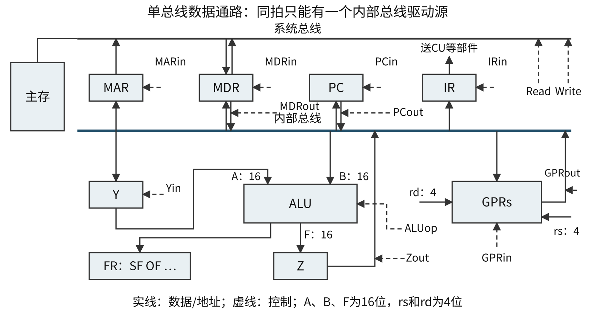{#co-fig-datapath width=98%}

（1）设ALU的输入端A、B及输出端F的最高位分别为A15、B15及F15，FR中的符号标志和溢出标志分别为SF和OF，则SF的逻辑表达式是什么？A加B、A减B时OF的逻辑表达式分别是什么？要求逻辑表达式的输入变量为A15、B15及F15。

（2）为什么要设置暂存器Y和Z？

（3）若GPRs的输入端rs、rd分别为所读、写的通用寄存器的编号，则GPRs中最多有多少个通用寄存器？rs和rd来自图中的哪个寄存器？已知GPRs内部有一个地址译码器和一个多路选择器，rd应连接地址译码器还是多路选择器？

（4）取指令阶段（不考虑PC增量操作）的控制信号序列是什么？若从发出主存读命令到主存读出数据并传送到MDR共需5个时钟周期，则取指令阶段至少需要几个时钟周期？

（5）图中控制信号由什么部件产生？图中哪些寄存器的输出信号会连到该部件的输入端？

**解析。** （1）SF直接记录结果最高位，所以 $\mathrm{SF}=F_{15}$。OF判断有符号运算是否越界。为简写，以下令 $a=A_{15},b=B_{15},f=F_{15}$，乘号表示逻辑与、加号表示逻辑或、上横线表示逻辑非：

\[
\mathrm{OF}_{\mathrm{add}}=ab\overline f+\overline a\,\overline b f,
\qquad
\mathrm{OF}_{\mathrm{sub}}=a\overline b\,\overline f+\overline a b f.
\]

加法只在两输入同号、结果异号时溢出；减法只在两输入异号、结果符号不同于A时溢出。例如16位32767加1得到8000H，a=b=0、f=1，代入加法表达式得OF=1；−32768减1得到7FFFH，a=1、b=0、f=0，代入减法表达式也得1。SF只保存结果的最高位，并不保证有符号运算的结果在数学上正确。

（2）同一时刻内部总线只能提供一个值，而ALU要同时接收两个输入。先把第一个输入存Y，总线随后送第二个输入到B端，Y提供A端。ALU产生结果时总线还在送第二输入，若直接把结果也送回同一总线会争用；先用Z保存，下拍再由Z输出。Y解决两个输入先后取得的问题，Z解决结果输出的时机问题；二者并不是两个名字不同的通用寄存器。

（3）rs和rd均为4位编号，最多 $2^4=16$ 个通用寄存器。它们来自指令寄存器IR中的对应字段。rd决定本拍把结果写入哪一个寄存器，接写地址译码器；rs决定从哪个寄存器读出，控制读出多路选择器。4位编号能选16个寄存器，不表示每个寄存器只有4位。

（4）先用PC提供指令地址，访问主存，最后将读出的指令送IR：

| 控制步骤 | 有效控制信号 | 数据变化与所需时间 |
|---|---|---|
| 地址准备 | PCout、MARin | PC经内部总线写MAR，1周期 |
| 主存读 | Read | 主存按MAR地址读出，送MDR，共5周期 |
| 装入指令 | MDRout、IRin | MDR经内部总线写IR，1周期 |

因此至少 $1+5+1=7$ 个时钟周期。5周期已包含主存读出并送MDR，无须再加一次“写MDR”的额外周期。图中MDRin专指从内部总线写MDR，并不出现在这条外部主存读入路径上。题目明确不考虑PC增量，也不必为更新PC多加一步。

（5）控制信号由控制器中的控制部件CU产生。IR输出指令的操作信息，FR输出SF、OF等状态，二者共同为控制决策提供输入。通用寄存器保存的是程序数据，PC提供执行位置，不能因为它们在CPU内，就把所有寄存器都列为本图CU的判断输入。

### 例 5-3　间接操作数经过哪些部件 {#co-ex5-3}

【2019】 某指令功能为 $\mathrm R[r2]\leftarrow\mathrm R[r1]+\mathrm M[\mathrm R[r0]]$，其两个源操作数分别采用寄存器、寄存器间接寻址方式。对于下列给定部件，该指令在取数及执行过程中需要用到的是（　）。

I. 通用寄存器组（GPRs）　II. 算术逻辑单元（ALU）  
III. 存储器（Memory）　IV. 指令译码器（ID）

A. 仅 I、II　 B. 仅 I、II、III　 C. 仅 II、III、IV　 D. 仅 I、III、IV

**解析。** r1的值和r0中的地址来自寄存器组；按r0值访问存储器得到第二个操作数；ALU做加法并写回r2，所以I、II、III必需，选 **B**。题目已限定“取数及执行”，指令译码是此前确定操作的工作，不能把整个指令周期使用过的所有部件都加进来。

解数据通路题时，先写出指令的寄存器传送语义，再用图上的实际路径连接源和目的，最后安排周期。总线冲突、写入条件和内存延迟通常比“背一张步骤表”更能决定答案。不要为了省周期自行补出未画出的旁路。

## 控制信号由组合逻辑还是微程序产生 {#co-05-04}

硬布线控制器根据操作码、当前节拍和状态条件，经译码与逻辑电路产生控制信号。它不必逐条读取控制存储器中的微指令，常有较短控制延迟；新增复杂指令可能需要修改更多逻辑。

微程序控制器把一条机器指令的控制过程组织为微指令序列，保存在控制存储器中。微指令的控制字段产生本拍的微命令，后继地址及条件字段决定下一条微指令。控制存储器通常是CPU内部的专用存储器，不是用户主存；微程序计数器或微地址寄存器也不是机器程序的PC。

两个控制器实现同一ISA时，对同一机器指令应产生等价的软件可见结果；差别在于控制序列由逻辑电路直接形成，还是从控制存储器取出微指令形成。机器指令的操作码用于选择一种指令功能，微地址用于选择控制序列中的一步，微命令控制具体部件动作。因而“机器指令有32条”“控制存储器有130个位置”“本拍需发5条微命令”数的是三个不同对象，各自的位数不能互相套用。

微指令的直接控制方式为每条控制线分配一位，便于同拍并行，但字宽较大。字段直接编码把互斥微命令分组，每字段经译码选一个命令，需要保留“不发该组命令”的编码。字段间接编码还借助其他字段共同解释。水平型倾向于显式并行多个微命令，垂直型以较短编码表示操作，往往需要更多微指令才能完成同一控制任务；不能笼统地说后者并行性更高。

### 例 5-4　互斥类为什么还要一个空操作编码 {#co-ex5-4}

【2012】 某计算机的控制器采用微程序控制方式，微指令中的操作控制字段采用字段直接编码法，共有33个微命令，构成5个互斥类，分别包含7、3、12、5和6个微命令，则操作控制字段至少有（　）。

A. 5位　 B. 6位　 C. 15位　 D. 33位

**解析。** 每组除了要能发出其中一条命令，还要能一条都不发。各组位数为 $\lceil\log_2(7+1)\rceil=3$、2、4、3、3，总计15位，选 **C**。例如若某组有4条命令，2位只有4种编码，没有“本拍不用该组”的位置，通常要3位。

### 例 5-5　控制存储器地址字段怎样估位宽 {#co-ex5-5}

【2014】 某计算机采用微程序控制器，共有32条指令，公共的取指令微程序包含2条微指令，各指令对应的微程序平均由4条微指令组成，采用断定法（下地址字段法）确定下条微指令地址，则微指令中下地址字段的位数至少是（　）。

A. 5　 B. 6　 C. 8　 D. 9

**解析。** 公共取指微程序只存一份，控制存储器至少需 $32\times4+2=130$ 个微指令位置，地址至少 $\lceil\log_2 130\rceil=8$ 位，选 **C**。32种机器指令只需要5位编码，不表示微指令的存储地址也只需5位；两者编码的对象不同。

取指虽然不靠“上一条指令的操作码”决定读哪条指令，但仍需要控制信号来选择PC、发出存储器读并写入IR。流水线图有时省略这些固定发生的控制动作，但这不代表取指、译码电路不需要任何控制。题目说“数据通路不包含控制部件”时，是按功能划分数据处理通路与信号生成部分；这也不意味着数据通路能脱离控制运行。

## 异常、中断与返回位置 {#co-05-05}

本讲义按408的常用语境区分：异常与当前执行的指令有关，在执行过程中检测，例如缺页、非法指令、算术异常；外部中断来自指令执行之外的事件，例如设备完成、定时器请求，通常在指令边界接受响应。广义的“中断机制”有时统称两者，遇到题目要先辨清其用词范围。

故障 fault 通常可在修复后重新执行，例如缺页后调入页面；陷阱 trap 是有意发出的通知或调试事件，处理完后通常从后继位置继续；终止 abort 表示严重情况，通常不能可靠恢复。不同ISA的异常分类和保存PC的细则不同，此处不把每一种算术异常固定归入同一类别。

响应异常或中断时，硬件需保存足够的返回信息、切换到规定状态并找到处理程序入口。通用寄存器现场往往由入口汇编代码和软件继续保存。中断服务例程是软件；“中断隐指令”则是对硬件自动响应动作的教材称呼，不是程序员在代码中插入的一条普通指令。

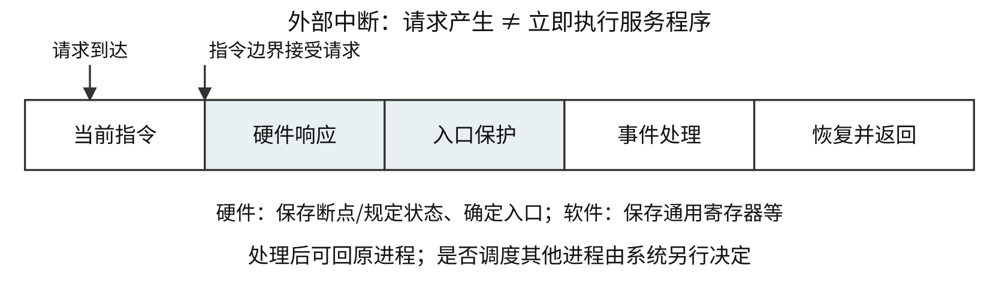{#co-fig-interrupt width=96%}

### 例 5-6　缺页后为什么重试当前指令 {#co-ex5-6}

【2021】 异常事件在当前指令执行过程中进行检测，中断请求则在当前指令执行后进行检测。下列事件中，相应处理程序执行后，必须回到当前指令重新执行的是（　）。

A. 系统调用　 B. 页缺失　 C. DMA传送结束　 D. 打印机缺纸

**解析。** 页缺失意味着当前指令需要访问的页面尚未就绪，指令的原定访问还未完成。处理程序调入页面后，应重新执行这条指令，选 **B**。系统调用已经发出了服务请求，不能不加区分地重做调用指令；DMA完成和打印机事件来自外设，不要求重做某条已完成的普通指令。

外部中断的返回地址通常是下一条尚未执行指令的位置，不能写成“刚执行完的那一条”。发生故障时可能保存当前指令起点，发生陷阱时可能保存后继位置。给出流水线或变长指令的题目，还要看体系结构怎样保证可恢复状态，不能单凭此时取指PC的数值推断精确断点。

处理器进入内核态不必切换到另一个进程。一次设备中断可能处理后返回原进程；调度器也可能决定切换执行主体。模式切换与进程上下文切换相关但不等价。第8章进一步讨论设备请求、屏蔽和中断嵌套。

### 自测 {#co-self5}

1. 【2009】相对于微程序控制器，硬布线控制器的特点是（　）。A. 指令执行速度慢，指令功能的修改和扩展容易；B. 指令执行速度慢，指令功能的修改和扩展难；C. 指令执行速度快，指令功能的修改和扩展容易；D. 指令执行速度快，指令功能的修改和扩展难。
2. 原创补充：沿用本章单总线图，能否在一拍同时执行 `R1→Y`、`R2→MAR`？能否同时执行 `R1→Y`、`R1→MAR`？

**答案。** 1. D，比较的是教材所述常见控制实现的控制开销与修改难度。2. 前者不能，两源争用总线；后者可以，同一来源同时送两个写入端，只要各目的具备独立写使能。


# 流水线与并行处理的基本模型 {#co-ch6}

## 延迟和完成间隔是两个量 {#co-06-01}

把一条指令分为 k 段，每段使用自己的部件或占用自己的时段，让多条指令的不同阶段重叠执行，称为指令流水线。同一条指令内部的先后依赖依然存在：必须先取得地址，才能读取相应数据。它主要提高连续指令的吞吐率。

理想 k 段流水线，每段耗时一个时钟周期 $\tau$，无停顿且每周期启动一条指令，完成 n 条指令需

\[
T_{\mathrm{pipe}}=(k+n-1)\tau.
\]

前 k 个周期使第一条指令通过全线，此后每周期再完成一条。填充时间只在开始付一次，并非每条指令各付一次。吞吐率为 $n/T_{\mathrm{pipe}}$，n 足够大时趋近 $1/\tau$；单条延迟约为 $k\tau$。加入停顿 s 周期后，总时间变为 $(k+n-1+s)\tau$；这里假定每个停顿周期都使最终完成时间推后一个周期。

若非流水方案中每条指令依次完整走完这 k 段、每段也占用同样的 $\tau$，则非流水时间为 $nk\tau$，加速比为 $nk/(k+n-1)$。若原方案时钟不同、各段耗时不等或另有资源复用，基线要重新计算；流水级数本身并不等于加速比。

### 例 6-1　最慢的一段决定时钟下限 {#co-ex6-1}

【2009】 某计算机的指令流水线由四个功能段组成，指令流经各功能段的时间（忽略各功能段之间的缓存时间）分别为90 ns、80 ns、70 ns和60 ns，则该计算机的 CPU 时钟周期至少是（　）。

A. 90 ns　 B. 80 ns　 C. 70 ns　 D. 60 ns

**解析。** 相邻阶段寄存器在同一节拍推进，必须留足最慢段90 ns，选 **A**。若实际阶段寄存器开销为 $t_r$，则时钟周期通常至少为 $\max_i(t_i)+t_r$；题目已说明忽略这项开销。

在本题时间下，理想完成10条指令需 $(4+10-1)\times90=1170$ ns。若非流水方案每条直接耗时 $90+80+70+60=300$ ns，10条为3000 ns，加速比约2.56；若基线规定每段都占90 ns，基线时间又会不同。比较时必须明确分母采用哪种机器。

## 阶段寄存器保存的不只是一份数据 {#co-06-02}

五段教学流水线常写为 IF取指、ID译码/寄存器读、EX执行或地址计算、MEM访存、WB写回。算术指令也可能经过MEM这一拍但不访问数据存储器；存储指令通常不在WB写通用寄存器。阶段名只描述一种通路划分，并不意味着每条指令都在各段做同一件事。

阶段之间的寄存器保存下一段所需的操作数、立即数、目的寄存器编号、指令地址及控制信息。若只传数据不传目的编号，结果就可能写到错误寄存器；若指令已经阻塞，写使能却继续向下游传递，就可能重复写入或错误访存。

时钟负责推进状态，控制信号决定状态能否写入、组合部件执行哪种功能。阶段寄存器常需写使能、保持和清空控制，因此“控制仅作用于组合部件、时钟仅作用于寄存器”的割裂描述不能当作普遍规则。气泡是在某阶段插入一个不改变有效状态的操作，冻结则让原状态保持，两者效果不同。

## 冒险先按冲突对象分类 {#co-06-03}

结构冒险来自同一拍内争用数量不足的硬件资源。例如取指和数据读取同时需要单端口统一存储器；可通过停顿、增加端口或分离指令与数据存储来处理。寄存器组同拍读写是否冲突，取决于端口数及前后半拍的时序约定。

数据冒险来自指令间数据依赖与执行时序的矛盾。写后读 RAW：后指令读前指令产生的新值；读后写 WAR：后指令过早写破坏前指令尚未读取的旧值；写后写 WAW：两次写的完成顺序颠倒，使最终值错误。在固定五段、顺序发射、ID读寄存器且WB顺序写回的简单流水线中，通常需要处理RAW，而既定次序使WAR、WAW不会发生。变为乱序执行或不同延迟写回后，这个结论不再普遍成立。

控制冒险来自后继指令地址未确定，常见于条件分支、跳转、异常和中断处理。无条件转移仍需在某个时刻获得目标地址，因而也可能造成前端控制冒险。“不判断条件”并不等于“不会停顿”。

### 转发能省去等待写回，但不能送来尚未产生的数据 {#co-c06-h43}

转发把已经形成的结果从阶段寄存器等位置直接送到后续指令使用点，不必等写回寄存器组。例如ALU结果在EX结束时产生，后继指令下一拍进入EX，可以从EX/MEM寄存器取得该结果。

load的数据通常到MEM结束才产生。紧随其后的指令若下一拍EX就需要该值，即使有转发也来不及，必须插入一个等待周期。转发路径是否通往存储数据端、分支比较端，还要看具体电路；不能一见“支持转发”就推断所有相关都已解决。

### 同一组 RAW，在不同实现中等到哪一拍 {#co-c06-h49}

| 题设实现 | 消费者取得值的条件 | 排时序时使用的约束 |
|---|---|---|
| 无转发，寄存器同拍不能读写 | 必须等生产者WB结束，再在ID读 | 消费者ID至少比生产者WB晚1拍 |
| 无转发，寄存器同拍先写后读 | 生产者WB前半拍写，消费者ID后半拍读 | 可以让消费者ID与生产者WB同拍 |
| ALU结果向EX转发 | 生产者EX末已有结果，下一拍送消费者EX | 不必为该值等到寄存器WB |
| load结果向EX转发 | 生产者MEM末才有读出数据 | 消费者EX须在该MEM之后，紧邻load仍可能停1拍 |

“相关”由程序中谁产生、谁使用同一个值决定；“冒险是否导致停顿”还由结果产生点、使用点、转发路径和寄存器时序共同决定。因此，无转发题不能套用load-use只停一拍的结论，有转发题也不必机械等到所有源写回。STORE的数据可能在ID读取、在MEM使用，分支可能在ID或EX比较，须先看清具体通路的约定。

### 例 6-2　装入后立即使用需要一个气泡 {#co-ex6-2}

〖5.6-013〗 下列指令序列中，指令I1和I3、I2和I3之间发生数据相关。假定采用“取指、译码/取数、执行、访存、写回”五段流水线方式，那么在采用转发技术时，需要在指令I3之前加入（　）条空操作指令才能使这段程序不发生数据冒险。

```text
I1: add  r1, r0, 1    // R[r1] <- R[r0] + 1
I2: load r3, 12(r2)   // R[r3] <- M[R[r2] + 12]
I3: add  r5, r3, r1   // R[r5] <- R[r3] + R[r1]
```

A. 3　 B. 2　 C. 0　 D. 1

**解析。** I1在第3拍EX末形成r1结果，到I3需要时已经可用；I2到第5拍MEM末才有r3数据，而无停顿的I3本应在第5拍EX使用它，时间相撞。把I3的EX推迟到第6拍即可，因此选 **D**。

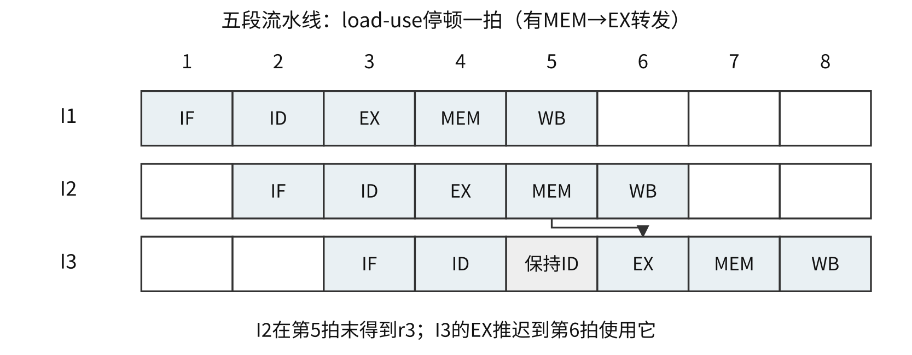{#co-fig-pipeline width=96%}

| 指令 | 1 | 2 | 3 | 4 | 5 | 6 | 7 | 8 |
|---|---|---|---|---|---|---|---|---|
| I1 | IF | ID | EX | MEM | WB |  |  |  |
| I2 |  | IF | ID | EX | MEM | WB |  |  |
| I3 |  |  | IF | ID | 保持ID | EX | MEM | WB |

采用寄存器组同拍先写后读的时序，I1第5拍WB写回的r1可在该拍被保持在ID的I3读到；若实现不同，须另有WB到ID的旁路。第5拍EX放入气泡，I3在ID保持，下一拍取得装入结果。这里按题目所指的常见五段转发模型，把r3的使用点设在EX；若某图要求在ID比较，所需等待和转发路径还可能不同。

### 例 6-3　同一段序列里同时有数据与控制等待 {#co-ex6-3}

【2023】 在采用“取指、译码/取数、执行、访存、写回”5段流水线的 RISC 处理器中，执行如下指令序列，其中s0、s1、s2、s3和t2表示寄存器编号。

```text
I1: add  s2, s1, s0  // R[s2] <- R[s1] + R[s0]
I2: load s3, 0(s2)   // R[s3] <- M[R[s2] + 0]
I3: beq  t2, s3, L1  // if R[t2] = R[s3] jump to L1
I4: addi t2, t2, 20  // R[t2] <- R[t2] + 20
I5: L1: ...
```

若采用转发（旁路）技术处理数据冒险，采用硬件阻塞方式处理控制冒险，则在指令I1～I4的执行过程中，发生流水线阻塞的指令有（　）。

A. 仅 I3　 B. 仅 I2、I4　 C. 仅 I3、I4　 D. I2、I3、I4

**解析。** I1的ALU结果可以及时转发给I2计算地址，所以I2不因这项RAW等待。I2是load，I3马上使用s3，仍有load-use等待。I3的分支结果未确定时，硬件阻塞后继I4，形成控制等待。因此发生阻塞的是I3、I4，选 **C**。分析一条序列不能只找到第一组相关就停下；每个使用值的位置和后继PC都要检查。

### 三种处理办法各改变什么 {#co-c06-h102}

硬件阻塞保持相关指令及其前方的必要状态，在前级暂停、后级放气泡，让生产者先前进。编译调度把不依赖该结果、且移动后不改变程序语义的指令填进等待间隔；无法填满才用NOP。不能把有副作用或可能越界访存的指令随意移过分支。

分支预测先选择一条路径继续取指，正确时减少等待，错误时清除错误路径上尚不能提交的结果并从正确位置重新取指。若每条指令发生预测错误的概率为p、每次平均损失d周期，且其他开销已包含在基本CPI中，可用 $\mathrm{CPI}=\mathrm{CPI}_{0}+pd$；“分支比例”并不等于“所有指令的预测失败比例”。

旁路主要让结果更早可用，不直接决定分支目标地址；某些设计把数据转发给分支比较器，缩短因数据相关而产生的分支等待，但不等于所有控制冒险都由旁路消除。题目需按具体控制路径判断。

## 超标量与动态流水线允许哪些重叠 {#co-06-04}

超标量CPU每周期可发射多条指令，需要相应的译码、调度、执行和写回资源。是否真能每周期发满，取决于数据依赖、分支、功能部件和访存带宽。最大发射宽度w只给出理想吞吐率上限，不能把w直接当作任意程序的加速比。

超流水把阶段划得更细，试图缩短时钟周期。阶段寄存器开销和冒险损失会限制收益。超长指令字 VLIW 把若干可并行的操作交给编译器打包，硬件和指令格式仍需支持相应并行执行，并非“只改编译器，硬件没有要求”。

动态调度可让后面的就绪指令先执行，减少因前面一条长延迟指令而造成的闲置。寄存器重命名为每次逻辑写入分配不同的物理寄存器，可去除WAR、WAW这类假相关，但不能消除真实RAW：消费者必须等对应生产者的值。按序提交使软件看到的状态仍符合程序顺序，并帮助实现精确异常。

例如前指令还要读取旧r1，后指令将写新r1时，为新值分配另一物理寄存器，可避免覆盖旧值；若后指令确实需要前指令算出的r1，改名并不能凭空产生结果。区分“名字相同”和“值确有依赖”比背三组字母更有用。

## 一条指令处理多个数据，还是多个指令流 {#co-06-05}

Flynn分类按指令流和数据流区分：SISD为单指令流单数据流；SIMD为单指令流多数据流；MISD为多指令流单数据流；MIMD为多指令流多数据流。分类描述执行组织，不是按机器装了几个屏幕、几块内存来判断。

向量处理器用一条向量指令对一组数据元素重复执行同类操作，可采用向量流水和多个通道，属于常见SIMD组织。它有启动代价，长向量能更好地摊薄这笔代价；向量长度不等于同时存在同样多套完整处理器。SIMD也不能自然地处理这样的任务：每个元素都要求完全不同的控制流程；分支发散可能降低有效利用率。

MIMD允许不同处理单元执行不同指令流。共享物理地址空间的多处理器属于MIMD的一种，分布式存储系统也可属于MIMD。SMP中的“对称”是各处理器在系统功能等方面地位对等，不表示每个时刻执行同一条指令。

## 硬件线程、多核与共享内存 {#co-06-06}

硬件多线程让一个核保存多套线程体系结构状态，以便在一个线程等待时运行另一线程。细粒度多线程可按周期交替线程；粗粒度多线程常在较长延迟事件时切换；同时多线程 SMT 允许同周期从不同线程发射操作，利用已有执行资源。它们都不要求芯片必须有多个核。

多核是在一个处理器芯片内集成多个执行核心。各核可以独立推进指令流，通常还共享某些Cache、互连或内存控制资源。增加核数并不保证单线程加速，也不意味着功耗必然高于任意单核设计；工艺、频率、负载和资源共享均影响结果。

共享内存多处理器让各处理器使用同一物理地址空间，但各核寄存器、部分Cache仍可私有。共享地址空间只保证各处理器能访问同一对象，不保证多个读改写操作自动具有原子性。并发程序还需要同步，Cache一致性与存储顺序也要分别满足相应规则。操作系统的进程同步讲义会沿用这一边界。

### 例 6-4　硬件多线程不等于多核 {#co-ex6-4}

【2022】 下列关于并行处理技术的叙述中，不正确的是（　）。

A. 多核处理器属于 MIMD 结构  
B. 向量处理器属于 SIMD 结构  
C. 硬件多线程技术只可用于多核处理器  
D. SMP中所有处理器共享单一物理地址空间

**解析。** 单核也能保存多套线程状态并共享执行部件，所以 C 错，选 **C**。A、B是按指令流和数据流分类，D说的是共享物理地址空间；都没有断言所有资源完全相同或所有访问自动同步。

### 例 6-5　无转发流水线的阻塞传播与最短调度 {#co-ex6-5}

【2012】 某16位计算机中，带符号整数用补码表示，数据Cache和指令Cache分离。下面给出了指令系统中部分指令的汇编格式及对应功能，其中Rs和Rd表示寄存器，mem表示存储单元地址，(x)表示寄存器x或存储单元x的内容。

```text
ADD   Rs, Rd
SHL   Rd
SHR   Rd
LOAD  Rd, mem
STORE Rs, mem
```

上面每行给出一种汇编格式；下表逐项给出各助记符对应的名称和功能，不改变源、目的操作数的次序。

| 名称 | 助记符 | 指令功能 |
|---|---|---|
| 加法 | `ADD` | $(\mathrm{Rs})+(\mathrm{Rd})\to\mathrm{Rd}$ |
| 算术/逻辑左移 | `SHL` | $2(\mathrm{Rd})\to\mathrm{Rd}$ |
| 算术右移 | `SHR` | $(\mathrm{Rd})/2\to\mathrm{Rd}$ |
| 取数 | `LOAD` | $(\mathrm{mem})\to\mathrm{Rd}$ |
| 存数 | `STORE` | $(\mathrm{Rs})\to\mathrm{mem}$ |

该计算机采用5段流水方式执行指令，各流水段分别是取指IF、译码/读寄存器ID、执行/计算有效地址EX、访问存储器M和结果写回寄存器WB。流水线采用“按序发射、按序完成”方式，没有采用转发技术处理数据相关，并且同一个寄存器的读和写操作不能在同一个时钟周期内进行。请回答下列问题。

（1）若int型变量x的值为−513，存放在寄存器R1中，则执行指令 `SHR R1` 后，R1的内容是多少（用十六进制表示）？

（2）若某个时间段中有连续4条指令进入流水线，在其执行过程中没有发生任何阻塞，则执行这4条指令需要多少个时钟周期？

（3）若赋值语句为 `x=a+b`，x、a、b均为int型变量，其存储单元地址分别为[x]、[a]、[b]。对应指令序列及流水过程如下，I3的ID段和I4的IF段被阻塞的原因各是什么？

```text
I1  LOAD  R1, [a]
I2  LOAD  R2, [b]
I3  ADD   R1, R2
I4  STORE R2, [x]
```

| 指令 | 1 | 2 | 3 | 4 | 5 | 6 | 7 | 8 | 9 | 10 | 11 | 12 | 13 | 14 |
|---|---|---|---|---|---|---|---|---|---|---|---|---|---|---|
| I1 | IF | ID | EX | M | WB | | | | | | | | | |
| I2 | | IF | ID | EX | M | WB | | | | | | | | |
| I3 | | | IF | | | | ID | EX | M | WB | | | | |
| I4 | | | | | | | IF | | | | ID | EX | M | WB |

上表沿原图画法，只标每段成功推进的拍，空白格并不都表示同一种状态：I3第4～6拍在ID端等待，I4第4～6拍尚未获准取指，第8～10拍又在ID端等待；这些等待格应保留。各行取指前及流出后的其他空格表示该指令尚未进入或已经离开流水线。

（4）若赋值语句为 `x=x*2+a`，x和a均为unsigned int型变量，其存储单元地址分别为[x]、[a]，执行这条语句至少需要多少个时钟周期？要求模仿上图，画出对应指令序列及流水线执行过程示意图。

**解析。** 本题与例 6-2的转发模型不同。全题统一采用如下约束：源寄存器若在第w拍WB写回，则消费者最早第w+1拍在ID完成取数并向后推进；在此之前可以停留于ID端等待，IF/ID寄存器保持，后继取指也被阻塞。按题中过程，所有指令都要走完五段才算完成，即使某一段不产生实际数据读写。

（1）−513的16位补码为 `FDFFH`，即 `1111 1101 1111 1111`。算术右移复制符号位，得到 `1111 1110 1111 1111`，即 `FEFFH`，真值−257。表中“除以2”说明算术右移的数量关系；对负奇数按位右移相当于向负无穷取整，不能套用C整数除法向零截断，答成−256。

（2）无阻塞时，第一条用5拍，后3条每隔1拍完成，共 $5+4-1=8$ 拍。指令Cache与数据Cache分离，题干未给取指与数据访存争用，不应额外添加。

（3）I3要读I1写入的R1和I2写入的R2，存在两条RAW依赖。I1在第5拍、I2在第6拍WB写回，且同一寄存器不许同拍读写，所以I3在第4～6拍于ID端等待，第7拍才可完成取数，而非第6拍。I3占用的IF/ID状态尚未释放时，若I4继续取指，会覆盖这条待推进指令，因此I4的IF也推迟到第7拍。后一处是前方数据等待向取指端传播，不能误说成STORE在IF就要读R2。

等I3在第10拍WB写出和，I4才可在第11拍ID读取R2，随后经过EX、M、WB，在第14拍流出。原图的两段空白应分别追溯到它等待的生产者与受阻的资源，不能把空白一概叫作访存延迟。

（4）用两个寄存器保存x和a，让x先装入，以便尽早开始连续依赖的移位与相加：

```text
I1  LOAD  R1, [x]
I2  LOAD  R2, [a]
I3  SHL   R1          // 也可用 ADD R1, R1
I4  ADD   R1, R2      // R2 <- 2*x + a
I5  STORE R2, [x]
```

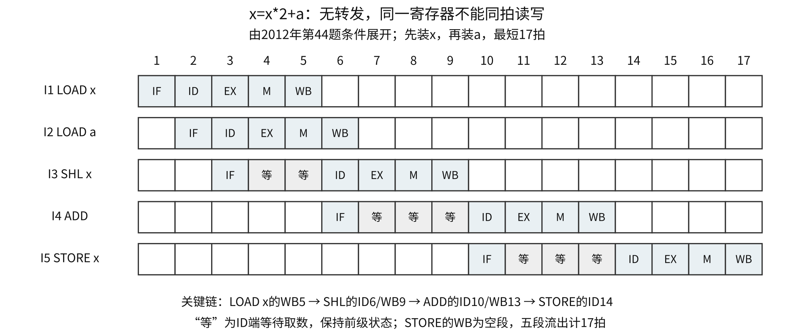{#co-fig-pipeline-schedule width=98%}

I1第5拍WB，故I3最早第6拍ID、第9拍WB。I4依赖I3的R1，最早第10拍ID、第13拍WB；I2已在第6拍写回，不会再额外拖延I4。I5最早第14拍ID，至第17拍流出，故至少17拍。

这个排程还给出了下界证明：本题给定指令中，需要两次LOAD、一次翻倍、一次相加和一次STORE；x的“LOAD→翻倍→相加→STORE”链不能颠倒。即使其余工作都尽早完成，这条链也要求ID分别不早于第6、10、14拍；所列排程恰好达到下界。若先装a再装x，关键链反而晚一拍。STORE在第16拍M已写入存储器，但按原题五段完整流出的统一口径，答案仍为17拍。

### 自测 {#co-self6}

1. 原创补充：理想5段流水线周期2 ns，完成20条指令，中间有3个导致整体延长的停顿周期，求总时间与实际吞吐率。
2. 原创补充：若一条指令的结果要到MEM末才形成，而消费者在下一拍EX开始使用，有MEM→EX转发，是否仍需等到生产者WB结束？若消费者EX与生产者MEM是同一拍呢？

**答案。** 1. $(5+20-1+3)\times2=54$ ns，吞吐率 $20/54\approx0.370$ 条/ns。2. 前者不需要，可在下一拍使用MEM末的结果；后者来不及，需要推迟消费者。关键是结果形成时刻与使用时刻，而不是“二者有相关”这句判断本身。


# 总线：一次事务怎样占用时间 {#co-ch7}

## 位宽、频率、传送率分别给出什么 {#co-07-01}

总线是部件之间传送信息的公共通路。按信息用途可区分地址、数据和控制：地址说明访问哪个单元或端口，数据线承载被交换的值，控制线说明操作类型、有效时刻及应答等。命令字虽然在语义上“控制设备”，CPU写命令字时仍可能在**数据线**上传送；不能只凭名称判断该走哪组线。

数据线上可以传指令、操作数、状态字、命令字和中断类型号。它们如何解释取决于传送双方和操作类型。MAR保存待访问地址，MDR暂存交换的值；主存并不靠“某个数据看起来像地址”来判定这次访问的性质，而是由相应线路与控制时序确定。

总线位宽通常指并行数据线根数。串行传送逐位使用通道，并行传送同一时刻通过多条线传若干位；多个串行通道并用，并不等于一条传统并行总线。系统可用桥接部件连接不同速度和协议的通路，靠近CPU的部件通常要求更高带宽；有多条总线，并不表示它们共用同一时钟。

若有效数据宽度为 W 位，每秒实际发生 R 次数据传送，理想单方向峰值带宽为 $R\times W/8$ B/s。R 与时钟频率不一定相同：每周期一次为R=f，每周期两次为R=2f；若已给MT/s，则已经是每秒传送次数，不能再乘“每周期次数”。

总线周期是一次规定的总线操作所占的时间，可能有多个时钟周期。带宽为每次传送的有效数据量除以这次所用时间；控制、地址、等待、校验与空闲开销会使有效数据率低于只算数据节拍的峰值。

### 例 7-1　一个总线周期占两个时钟周期 {#co-ex7-1}

【2009】 假设某系统总线在一个总线周期中并行传输4 B信息，一个总线周期占用2个时钟周期，总线时钟频率为10 MHz，则总线带宽是（　）。

A. 10 MB/s　 B. 20 MB/s　 C. 40 MB/s　 D. 80 MB/s

**解析。** 时钟周期100 ns，一次总线传送需200 ns，传4 B，因此带宽 $4/(200\times10^{-9})=20\times10^6$ B/s，选 **B**。若直接用4 B×10 MHz，就忽略了每次传送占两拍。

### 例 7-2　已经给出 MT/s 就不再乘4 {#co-ex7-2}

【2025】 某处理器总线采用同步、并行传输方式，每个总线时钟周期传送4次数据（quadpumped技术）。若该总线的工作频率为1333 MHz（实际单位是MT/s，表示每秒传送1333 M次），总线宽度为64位，则总线带宽约为（　）。

A. 10.66 GB/s　 B. 42.66 GB/s　 C. 85.31 GB/s　 D. 341.25 GB/s

**解析。** 括号给出了1333这个数的实际意义：它已经是数据传送率。每次64位=8 B，故 $1333\times10^6\times8\approx10.66$ GB/s，选 **A**。若1333表示的真是时钟频率，才会再乘4。本题必须服从括号的单位限定，不能同时把同一数当两种量。

多通道带宽只有在各通道能够并行传送且工作分配允许时才相加。全双工总线要区分单方向带宽和两个方向合计带宽；校验位若不属于有效载荷，不应计入有效数据量的分子。带宽题第一步宜写出“每次有效几字节、每秒几次”，再统一单位。

## 一次总线事务从地址到应答 {#co-07-02}

总线主设备发起事务，从设备按地址被选中并完成操作。CPU常是主设备，DMA控制器也可在取得使用权后成为主设备。主从关系只就本次事务而言，不等于某个设备永久只能发送或只能接收。

一次读事务可以分为：主设备发地址和读命令；从设备译码并准备数据；从设备在数据线上给出有效数据；主设备采样，双方结束本轮操作。写事务则由主设备给出要写的数据。地址、数据若复用同一组线路，就需不同时间片分别传送，不能把这些线路同时算成两份独立的并行位宽。

### 同步定时：固定采样时刻，必要时插等待 {#co-c07-h39}

同步总线用共同的时钟约定信号的有效和采样时刻。最短周期必须覆盖信号传播、译码、设备准备及建立时间等延迟。若从设备来不及，可按协议插入等待状态；“同步”不等于所有事务长度永远相同，也不表示每个设备可随意提供互不协调的时钟。

突发传送只给出一个首地址，再连续传送多个相邻数据，分摊地址和启动开销。非突发则可能为每个数据重复地址及准备过程。因此“读一块多长时间”应先数数据拍数，再判断地址、等待代价要付几遍。

### 例 7-3　不支持突发，就要反复准备每个数据 {#co-ex7-3}

【2023】 某存储器总线宽度为64位，总线时钟频率为1 GHz，在总线上传输一个数据或地址需要一个时钟周期，不支持突发传送方式。若通过该总线连接CPU和主存，主存每次准备一个64位数据需要6 ns，主存块大小为32 B，则读取一个主存块所需的时间是（　）。

A. 8 ns　 B. 11 ns　 C. 26 ns　 D. 32 ns

**解析。** 一拍1 ns，每个64位数据为8 B，一块需要4个数据。每个数据都单独付地址1 ns、准备6 ns、传送1 ns，共8 ns，总计 $4\times8=32$ ns，选 **D**。11 ns对应只付一次地址和准备、再连传4次，是突发模型，题目已排除。

### 例 7-4　峰值带宽与整次事务的有效速率 {#co-ex7-4}

【2024】 某存储器总线的时钟频率为420 MHz，总线宽度为64位，每个时钟周期传送2次数据；其总线事务支持突发传送方式，最多传送8次数据，第1个时钟周期传送地址和读/写命令，从第4个至第7个时钟周期连续传送8次数据。该总线的总线带宽（最大数据传输率）为（　）。

A. 3.84 GB/s　 B. 6.72 GB/s　 C. 30.72 GB/s　 D. 53.76 GB/s

**解析。** 问的是数据节拍的最大传送率，每周期2次、每次8 B，峰值 $420\times10^6\times2\times8=6.72$ GB/s，选 **B**。

若另问这次8次数据的事务有效速率，才把地址和等待计入分母：数据64 B、事务7周期，$64/(7/(420\times10^6))=3.84$ GB/s。A正是按整次事务口径算出的结果，不能用它回答本题已经说明的峰值带宽。第4至第7拍共4拍，每拍2次，正好8次，不是8拍。

### 峰值、事务速率与CPU占用采用不同分母 {#co-c07-h63}

总线峰值带宽按数据节拍可持续搬多少有效字节来计，事务有效速率还把本次地址、等待等时间算入；设备速率是设备产生或消耗数据的速度；CPU占用率则是CPU执行查询、服务或设置收尾的时间比例。这四个量可能出现在同一道题中，应先分别写成“什么量除以什么时间”。

例如在例 7-4中数据节拍峰值6.72 GB/s、整次事务有效速率3.84 GB/s，都不能直接当成某个设备的实测速率；若设备只提供40 MB/s，系统还受这个供数速度限制。反过来，DMA可让设备数据直接经过总线进入主存，同时CPU仅做少量设置收尾，所以不能把总线使用率等同于CPU使用率。端到端吞吐要核最慢环节，资源占用要核实际争用的时段。

当一次突发在等待期间必须保持总线占有权时，等待也消耗总线资源；若题设明确采用分离事务、允许准备期间让出总线，则总历时与实际占用时间还会不同。画事务时间线时，应同时标出“在等什么”和“谁仍占有总线”，不能仅凭延迟长短直接推断总线忙碌比例。

### 异步定时：用握手确认进度 {#co-c07-h71}

异步总线不用统一周期来强制双方同拍完成，而用请求和应答等信号交换进度。速度较慢的设备晚些应答，主设备相应等待。异步仍受顺序约束，也不能随时改变信号而不通知对方。

全互锁的四阶段握手可以写为：主设备置请求；从设备准备好后置应答；主设备看到应答后撤请求；从设备看到请求撤销后撤应答。各阶段都等待对方作出相应反应，因而不依赖预设的固定延迟来猜测对方已结束。

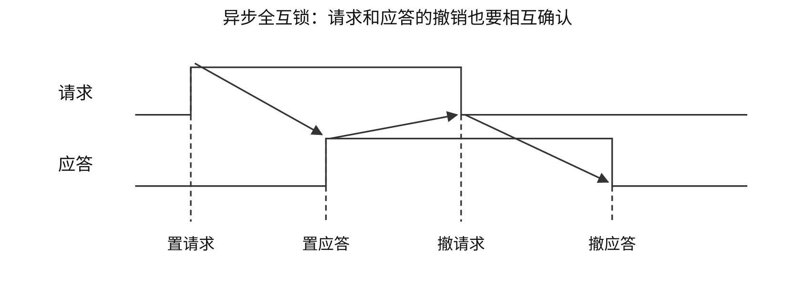{#co-fig-handshake width=96%}

非互锁方式中，主设备发出请求后按预定时间撤回，不等应答；从设备发出应答后也按时撤回，不等请求撤回。半互锁方式中，主设备等待应答出现才撤请求，而从设备仍可按时撤应答。全互锁方式中，从设备还必须等请求撤回才撤应答。给出时序图时，按图中信号的建立、撤销条件来识别，不单凭信号名称猜测。全互锁通常多了等待环节，不能因为最可靠就断定它最快。

半同步通信将时钟节拍与等待/应答结合：正常情况下按时钟节拍推进，慢设备可请求延长，握手状态在规定边沿采样。这里的“半同步”不等于一半数据串行、一半数据并行，两个分类维度不同。

### 如何读总线时序图 {#co-c07-h83}

先标出地址何时稳定、读写命令何时有效、数据何时有效和何时被接收，最后数出从事务开始到完成的时间。若图中低电平有效，应以标出的有效电平判断，不可把所有上升沿都当成开始。不同信号能否同拍出现由协议规定；“地址/数据复用”和“独立地址数据线”会改变哪些操作可以重叠。

串行异步字符传送每帧另加起始位和停止位，校验位可选。若每字符7个数据位、1个校验位、1个起始位和1个停止位，则每字符实际发送10位，480字符/s需要4800 bit/s，而有效字符数据只有3360 bit/s。不要把物理线路传送率与有效数据率混为一谈。

### 自测 {#co-self7}

1. 〖6.2-010〗 某存储器总线采用同步通信，时钟频率50 MHz，突发传8个字，每字4 B。1周期接收地址、3周期等待、8周期传8个字。数据传输速率为（　）。A. 114.3 MB/s　B. 126 MB/s　C. 133.3 MB/s　D. 144.3 MB/s。
2. 〖6.2-010〗变式（改变事务组织）：将第1题改为每个字都独立付1周期地址、3周期等待、1周期数据，读同样8字需要多少时间，有效速率多少？

**答案。** 1. C。共12周期，每周期20 ns，32 B/240 ns≈133.3 MB/s。2. 共40周期=800 ns，32 B/800 ns=40 MB/s。两题块长相同，改变的是启动代价的重复次数。


# I/O接口、程序中断与 DMA {#co-ch8}

## 端口是接口中可访问的位置 {#co-08-01}

CPU通常通过I/O接口访问外部设备。接口把系统总线上的读写操作转换为设备所需的信号，并提供数据缓冲、状态记录、命令控制、地址识别及必要的中断或DMA连接。设备本体和接口并不是一回事：磁盘驱动器是设备，网络控制器、打印机适配器等承担接口功能。

CPU能访问的接口寄存器或相应位置称为I/O端口。数据端口交换数据，状态端口报告就绪、忙或错误，控制端口接收启动、复位等命令。读状态与写控制可能共用同一个端口地址，由读写方向区分；不能因为地址相同就认为两个端口是同一个寄存器。

统一编址（存储器映射I/O）把端口放进主存地址空间，用访存指令访问；独立编址为I/O设单独地址空间，通常使用专门I/O指令。同一个数值地址在独立编址下可分别对应内存位置和端口，在统一编址下则要避免地址译码冲突。端口地址不是设备内部磁盘扇区地址。

### 例 8-1　命令字走哪组线 {#co-ex8-1}

【2012】 下列选项中，在I/O总线的数据线上传输的信息包括（　）。

I. I/O接口中的命令字　II. I/O接口中的状态字　III. 中断类型号

A. 仅 I、II　 B. 仅 I、III　 C. 仅 II、III　 D. I、II、III

**解析。** 三者都是本次总线交换的编码值，可以由数据线承载，选 **D**。读写控制线表达“本轮读或写”等时序和操作性质，并不逐位承载所有名称里带“控制”二字的信号。

接口与设备侧交换数据、控制和设备状态，接口向CPU发送中断请求。打印机一般不会向其接口“接收中断请求信号”来获知下一个字符；这里要辨清信号的发送端与接收端。串并转换、缓冲和速度匹配也在接口或设备控制电路中完成，主机内部总线并行并不要求磁盘写入盘面的位也并行。

## 查询方式：等待和搬运都由 CPU 安排 {#co-08-02}

程序查询方式先启动设备，再读状态端口，未就绪就继续检查；就绪后由CPU执行指令，在数据端口与寄存器或主存之间搬运，并更新地址与计数。数据没准备好时，CPU若一直轮询，等待时间也占用了执行机会。

```text
设置设备命令、目标地址和剩余数量
while 剩余数量 > 0:
    while 状态端口表示未就绪:
        继续检查
    从数据端口读一个单位并存入目标地址
    目标地址 += 单位大小
    剩余数量 -= 1
```

定时查询则在规定时刻检查，其余时间可以执行其他工作。是否会丢数据取决于设备速率、接口缓冲容量和最长查询间隔，不能由忙等程序的表现推出“查询方式下CPU永远不能运行其他程序”。

### 例 8-2　定时查询占多少 CPU 时间 {#co-ex8-2}

【2011】 某计算机处理器主频为50 MHz，采用定时查询方式控制设备A的I/O，查询程序运行一次所用的时钟周期数至少为500。在设备A工作期间，为保证数据不丢失，每秒需对其查询至少200次，则CPU用于设备A的I/O的时间占整个CPU时间的百分比至少是（　）。

A. 0.02%　 B. 0.05%　 C. 0.20%　 D. 0.50%

**解析。** 每秒至少执行 $500\times200=100000$ 个查询周期，CPU每秒有 $50\times10^6$ 个周期，比例为0.002，即0.20%，选 **C**。200次/s只决定查询次数，不是设备每秒搬运200 B；题目也未要求把每次查询的500周期再当作500条指令。

若另给每个数据的搬运周期数，还要判断它已包含在查询程序开销中，还是必须另加。计算CPU占用率时，用CPU实际花掉的时间作分子，设备在外部独自准备数据的时间不直接算作CPU执行时间。

## 中断方式：先请求，再响应，再运行服务程序 {#co-08-03}

中断I/O允许CPU启动设备后继续做其他工作，设备或接口就绪后提出中断请求。CPU在允许响应的边界检查未屏蔽请求，完成硬件响应，再执行中断服务程序，由程序读取或写入数据端口。等待不再要求CPU持续轮询，但每次软件搬运数据仍要CPU执行指令。

请求需要保存在接口或中断控制器的触发器中，因为外设产生事件时CPU未必能立即响应。中断请求的产生、被允许响应、被调度执行以及处理完成是四个不同的时间点。CPU可能正在执行指令，处于关中断状态，或已有更高优先级请求需要先处理。

### 硬件保存断点，与软件保护现场分开 {#co-c08-h55}

典型硬件响应包括暂时禁止相应中断、保存返回位置及规定的状态、确定中断服务入口。中断向量是用于定位处理程序的信息，中断向量地址是保存向量的位置，处理程序入口地址是最终执行代码的位置。三者在某种实现中存在固定联系，但并不总是同一数值。

服务程序进入后保存其将修改且须恢复的通用寄存器，处理事件，再恢复并返回。单重中断处理期间不允许同类可屏蔽中断嵌套；多重中断则在保护必要现场、设置屏蔽后重新允许某些请求打断当前服务程序。入口处的现场保护未完成就开放嵌套，可能覆盖尚未保存的返回信息。

在教材采用的一种单重中断序列中，软件部分是“保护现场→事件处理→恢复现场→开中断→中断返回”，保存断点和初始关中断已经由硬件响应完成。实际ISA可能由中断返回指令原子恢复状态和允许位；不能把教材序列中的“开中断”和返回之间可被中断的窗口当作所有机器的共同实现。

### 屏蔽改变允许谁打断谁 {#co-c08-h63}

中断响应优先级通常由硬件仲裁关系决定，多个未屏蔽请求同时到来时据此选一个。处理优先级描述服务过程中允许哪些请求打断当前服务，可由各服务程序设置的屏蔽字确定。屏蔽会改变参与本次仲裁的集合，不会把仲裁电路本身的固定比较顺序改写。

### 例 8-3　响应顺序与完成顺序为什么可以不同 {#co-ex8-3}

原创补充

有A、B、C三个请求源，硬件响应优先级A>B>C。屏蔽字按A、B、C排列，1表示屏蔽。要求处理优先级C>B>A，服务程序均在保存现场并设置屏蔽字后开中断。给出三者的屏蔽字，并追踪三请求同时待处理时的一次嵌套过程。

**解析。** A处理中应屏蔽A自己，允许B、C，故为100；B处理中屏蔽A、B，允许C，故为110；C处理中三者都屏蔽，故为111。初始三者均允许响应时，硬件先选A，不能因希望C处理优先就把首次响应写成C。

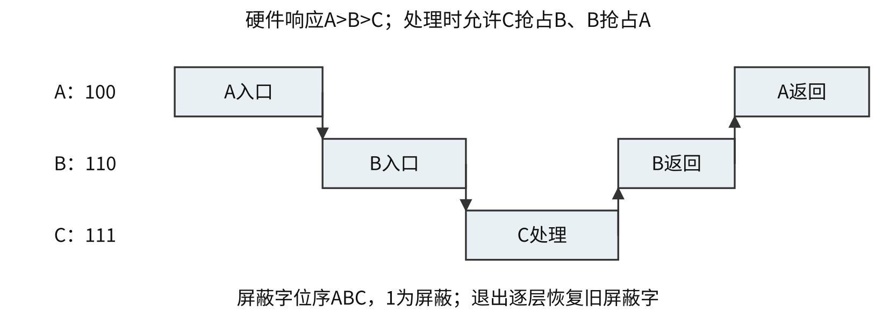{#co-fig-nesting width=96%}

1. A保护现场、设100、开中断，B和C仍待处理，硬件在二者中选B。
2. B保护现场、设110、开中断，C可以响应，转入C。
3. C设111完成处理，恢复B的状态和屏蔽字，返回B。
4. B完成后恢复A，A最后完成。服务开始顺序A、B、C，完成顺序C、B、A。

题目要的是给定规则下的模型。各层必须保存并恢复旧屏蔽字，不能在C退出时直接恢复成最外层的全开放状态。屏蔽字的位序和0/1含义也必须从题干确定。

### 例 8-4　允许延迟不是额外的服务开销 {#co-ex8-4}

【2014】 若某设备中断请求的响应和处理时间为100 ns，每400 ns发出一次中断请求，中断响应所允许的最长延迟时间为50 ns，则在该设备持续工作过程中，CPU用于该设备的I/O时间占整个CPU时间的百分比至少是（　）。

A. 12.5%　 B. 25%　 C. 37.5%　 D. 50%

**解析。** 每个请求实际占CPU100 ns，请求间隔400 ns，长期占用比例为 $100/400=25\%$，选 **B**。最长响应延迟50 ns约束请求产生后必须多快开始响应，不是额外要执行50 ns的服务程序，不能加到100 ns上。

若题给设备数据率R B/s、每次中断交换q B、每次CPU开销t秒，在每次均交换q B且持续工作的模型中，请求率为R/q，CPU比例为 $(R/q)t$。若结果超过100%，说明该模型下CPU无法及时服务；不能把它继续当作可达到的利用率。

## DMA：数据不经过 CPU 寄存器逐次搬运 {#co-08-04}

DMA控制器在设备接口与主存之间组织直接传送。CPU仍需通过驱动程序设置方向、主存起始地址、传送数量和设备等参数，启动设备；传送过程中由控制器形成主存地址、请求总线、搬运数据并更新计数；结束或出错后再通知CPU处理。DMA减少逐个数据的指令开销，不表示CPU从头到尾完全不参与。

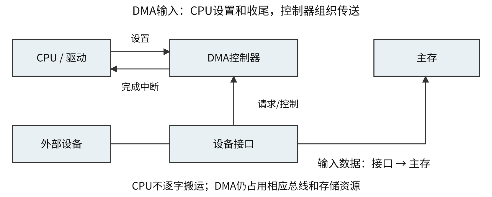{#co-fig-dma width=96%}

暂停CPU方式可在一块数据传送期间集中占用相关总线；周期挪用方式在设备准备好一个传送单位后申请一次或若干次总线使用；交替方式按约定把周期分给CPU和DMA。CPU能否同时访问某个存储体、Cache或另一条总线，要由具体资源结构决定。只要CPU本拍不需要被占用的资源，它仍可能继续内部运算。

周期挪用中，设备准备数据后向DMA控制器请求服务，DMA控制器再向系统申请总线。教材说“DMA请求”时可能指设备侧请求，也可能指总线申请，解题要看请求的发送者和接收者，不能只认四个字母。

### 例 8-5　周期挪用不等于整块期间封住主存 {#co-ex8-5}

【2020】 若设备采用周期挪用DMA方式进行输入和输出，每次DMA传送的数据块大小为512字节，相应的I/O接口中有一个32位数据缓冲寄存器。对于数据输入过程，下列叙述中，错误的是（　）。

A. 每准备好32位数据，DMA控制器就发出一次总线请求  
B. 相对于CPU，DMA控制器的总线使用权的优先级更高  
C. 在整个数据块的传送过程中，CPU不可以访问主存储器  
D. 数据块传送结束时，会产生“DMA传送结束”中断请求

**解析。** 每次缓冲32位即4 B，512 B需要128次传送。周期挪用只在取得总线的时段占用资源，其余时段CPU仍可访问主存，不是整块传完前一直封锁，所以选 **C**。B描述本题中DMA优先取得总线的模型，不表示任何系统的任意外部请求都永久压过CPU。

一次总线占用时间为b、每次搬q B时，DMA数据率R对应的总线占用比例约为 $(R/q)b$，前提是这些占用不重叠且没有额外启动代价。CPU实际损失还取决于它原本是否需要总线，因此不能把“DMA占总线10%”无条件改写成“程序变慢10%”。

### 例 8-6　DMA 的准备与完成仍需要软件 {#co-ex8-6}

【2019】 下列关于DMA方式的叙述中，正确的是（　）。

I. DMA传送前由设备驱动程序设置传送参数  
II. 数据传送前由DMA控制器请求总线使用权  
III. 数据传送由DMA控制器直接控制总线完成  
IV. DMA传送结束后的处理由中断服务程序完成

A. 仅 I、II　 B. 仅 I、III、IV　 C. 仅 II、III、IV　 D. I、II、III、IV

**解析。** I是CPU上的驱动程序做传送前准备，II、III是DMA硬件实际传输，IV是完成通知后的软件收尾，四项均正确，选 **D**。这条链把“CPU不逐字搬运”和“CPU完全不参与”清楚区分开。

| 方式 | CPU何时介入 | 数据搬运主体 | 每次CPU工作的粒度 | 主要约束 |
|---|---|---|---|---|
| 忙等查询 | 持续检查，准备好后搬运 | CPU执行指令 | 状态检查及每个数据单位 | 等待和搬运都占执行机会 |
| 定时查询 | 定期检查，准备好后搬运 | CPU执行指令 | 每次查询及相应搬运 | 查询间隔不超过缓冲填满时间 |
| 中断I/O | 每次请求被允许响应后 | 服务程序中的CPU指令 | 每次中断交换q B | 请求率×每次响应处理时间 |
| DMA | 块传送前设置、结束后收尾 | DMA硬件控制接口与主存 | 每块Q B的设置与收尾 | CPU开销、总线和主存占用分别计算 |

适用性取决于设备速率、传送粒度、缓冲和系统实现。字符型低速设备通常适合查询或中断，网络和块设备的大批量传送常用DMA；中断方式并非适用于所有设备，DMA也没有固定的速度门槛。

比较三种方式时，可先固定同一设备数据率R。若接口一次仅能容纳q B，则数据积满时间为q/R；定时查询的查询间隔要小于这个时间，中断方式每秒约响应R/q次。若DMA每块Q B才让CPU收尾一次，CPU事件率变成R/Q；但控制器可能仍按q B多次请求总线，不能把“每块一次完成中断”误作“整块只有一次总线传送”。CPU事件数、设备准备次数和总线事务数是三个不同计数。

### 例 8-7　同一接口缓冲下比较查询、中断和DMA预算 {#co-ex8-7}

【2018】 假定计算机的主频为500 MHz，CPI为4。现有设备A和B，其数据传输率分别为2 MB/s和40 MB/s，对应I/O接口中各有一个32位数据缓冲寄存器。请回答下列问题，要求给出计算过程。

（1）若设备A采用定时查询I/O方式，每次输入/输出都至少执行10条指令。设备A最多间隔多长时间查询一次才能不丢失数据？CPU用于设备A输入/输出的时间占CPU总时间的百分比至少是多少？

（2）在中断I/O方式下，若每次中断响应和中断处理的总时钟周期数至少为400，则设备B能否采用中断I/O方式？为什么？

（3）若设备B采用DMA方式，每次DMA传送的数据块大小为1000 B，CPU用于DMA预处理和后处理的总时钟周期数为500，则CPU用于设备B输入/输出的时间占CPU总时间的百分比最多是多少？

**解析。** 数据率中的M按 $10^6$ 计，缓冲32位=4 B，CPU每秒有 $500\times10^6$ 个时钟周期。先分别求设备填满缓冲的时间、CPU每次服务时间，再求长期比例，不把设备工作时间直接当作CPU忙碌时间。

（1）A每准备4 B需要

\[
\Delta t_A=\frac4{2\times10^6}=2\ \mu\mathrm s.
\]

因此最多每2 μs就必须完成一次查询与取数；间隔更长，单个缓冲可能被下一组数据覆盖。每秒至少服务 $2\times10^6/4=5\times10^5$ 次；每次至少10×4=40周期，故CPU占用比例至少为

\[
\frac{(5\times10^5)\times40}{500\times10^6}=4\%.
\]

每次这项服务最少耗时80 ns，2 μs是设备产生一缓冲数据的间隔，不是CPU每次都要执行2 μs。

（2）B每4 B只允许 $4/(40\times10^6)=0.1\ \mu\mathrm s$，相当于50个CPU周期；一次中断响应与处理却至少需400周期=0.8 μs。每次服务还未完成，后续数据已连续到来，不能持续及时处理。按请求率核对，所需CPU比例为

\[
\frac{(40\times10^6/4)\times400}{500\times10^6}=8=800\%.
\]

这表示所需服务能力超过CPU预算，不能解释成实际CPU利用率能达到800%。给定单缓冲与逐次中断模型下，设备B不适合这种中断I/O方式。

（3）DMA把CPU事件粒度改成1000 B一块。以设备满速计，每秒最多 $40\times10^6/1000=40000$ 块；每块CPU预处理和后处理500周期，所以CPU开销比例最多为

\[
\frac{40000\times500}{500\times10^6}=4\%.
\]

一块设备传送时间为25 μs，CPU设置收尾共1 μs，二者相除也得4%。这一项没有再乘CPI，因为题干已直接给时钟周期数。第（1）问的4%是由“至少10条指令”得到下界，本问的4%按最大设备速率得到上界；数值相同，含义不同。

DMA的4%统计CPU设置收尾，并未把DMA占用总线的时间当作CPU执行时间。若另问整机吞吐是否可达40 MB/s，还须核对总线与主存带宽；若另问CPU程序因此慢多少，还要看CPU同时是否需要这些资源。第7章的总线预算与本题CPU预算应分别算，再按共享资源关系连接。

### 自测 {#co-self8}

1. 【2024】下列关于中断I/O方式的叙述中，错误的是（　）。A. 中断屏蔽字用于确定中断响应的优先级；B. 保存断点和程序状态字在中断响应阶段完成；C. 保存通用寄存器和设置新中断屏蔽字由软件实现；D. 单重中断方式下中断处理时CPU处于关中断状态。
2. 【2024】DMA控制I/O方式下，设备的输入/输出由DMA控制器控制完成，此时DMA控制器控制的数据传输通路位于（　）。A. CPU和主存之间；B. CPU和DMA控制器之间；C. 设备接口和主存之间；D. 设备接口和DMA控制器之间。
3. 原创补充：设备数据率为1 MB/s，每次中断交换4 B，开销为2 μs，CPU占用多少？若改为每1024 B一块DMA，假设CPU每块仅需20 μs设置及收尾，CPU开销比例是多少？暂不计总线竞争。

**答案。** 1. A。按本章教材口径，屏蔽字规定允许的抢占关系和处理优先级，固定的响应仲裁次序不能由它直接改写。2. C。3. 中断为 $(10^6/4)\times2\times10^{-6}=50\%$；DMA为 $(10^6/1024)\times20\times10^{-6}\approx1.953\%$。后者只是CPU设置收尾开销，尚不包含DMA占用主存总线对程序造成的影响。
